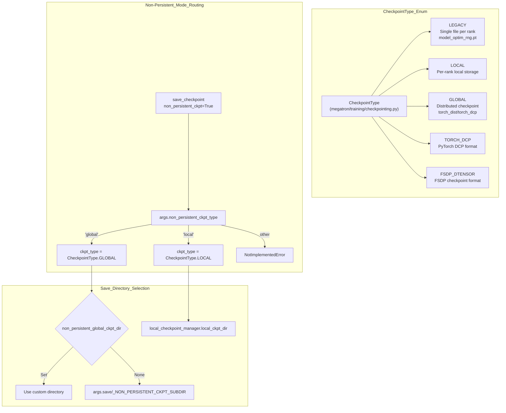
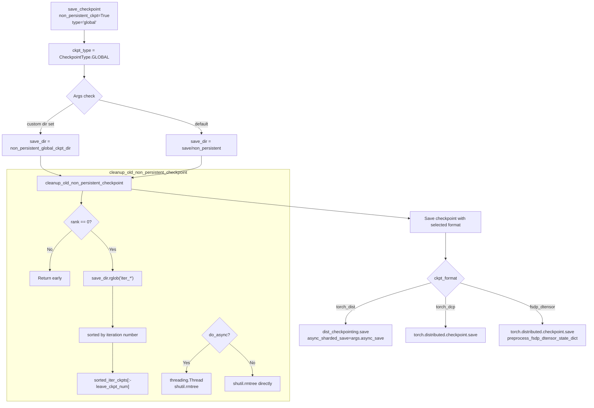
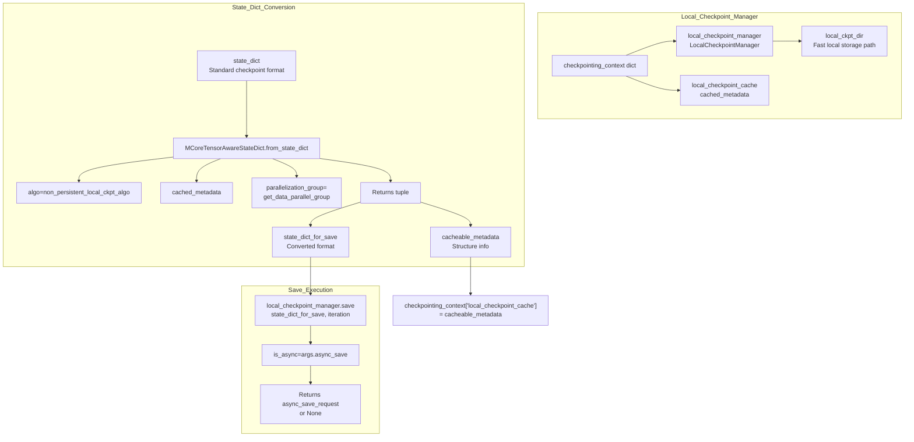
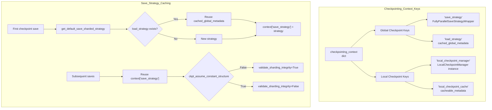
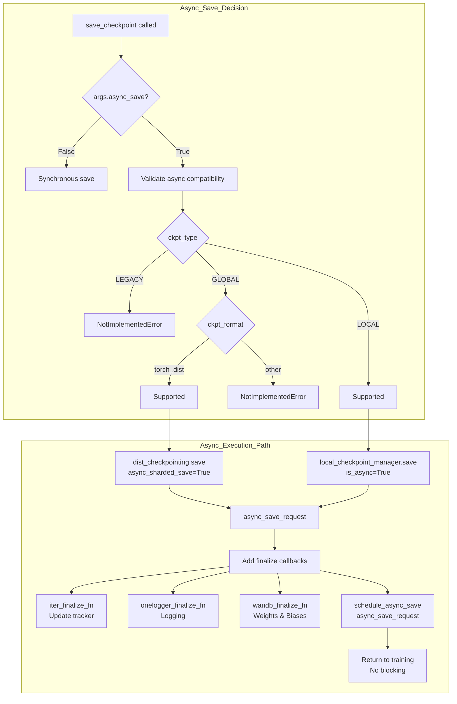

<!-- source: DeepWiki mcp.deepwiki.com · repo NVIDIA/Megatron-LM · page 7.4 Local and Non-Persistent Checkpointing · fetched 2026-10-26 -->

# Local and Non-Persistent Checkpointing

Relevant source files

The following files were used as context for generating this wiki page:

- [megatron/core/datasets/object_storage_utils.py](megatron/core/datasets/object_storage_utils.py)
- [megatron/core/datasets/utils_s3.py](megatron/core/datasets/utils_s3.py)
- [megatron/core/dist_checkpointing/strategies/async_utils.py](megatron/core/dist_checkpointing/strategies/async_utils.py)
- [megatron/core/dist_checkpointing/strategies/cached_metadata_filesystem_reader.py](megatron/core/dist_checkpointing/strategies/cached_metadata_filesystem_reader.py)
- [megatron/core/dist_checkpointing/strategies/filesystem_async.py](megatron/core/dist_checkpointing/strategies/filesystem_async.py)
- [megatron/core/dist_checkpointing/strategies/nvrx.py](megatron/core/dist_checkpointing/strategies/nvrx.py)
- [megatron/core/dist_checkpointing/strategies/state_dict_saver.py](megatron/core/dist_checkpointing/strategies/state_dict_saver.py)
- [megatron/training/async_utils.py](megatron/training/async_utils.py)
- [megatron/training/inprocess_restart.py](megatron/training/inprocess_restart.py)
- [tests/unit_tests/data/test_bin_reader.py](tests/unit_tests/data/test_bin_reader.py)
- [tests/unit_tests/data/test_gpt_dataset.py](tests/unit_tests/data/test_gpt_dataset.py)
- [tests/unit_tests/data/test_preprocess_data.py](tests/unit_tests/data/test_preprocess_data.py)
- [tests/unit_tests/dist_checkpointing/models/test_mamba.py](tests/unit_tests/dist_checkpointing/models/test_mamba.py)
- [tests/unit_tests/dist_checkpointing/test_async_save.py](tests/unit_tests/dist_checkpointing/test_async_save.py)
- [tests/unit_tests/dist_checkpointing/test_fp8.py](tests/unit_tests/dist_checkpointing/test_fp8.py)
- [tests/unit_tests/dist_checkpointing/test_fully_parallel.py](tests/unit_tests/dist_checkpointing/test_fully_parallel.py)
- [tests/unit_tests/dist_checkpointing/test_global_metadata_reuse.py](tests/unit_tests/dist_checkpointing/test_global_metadata_reuse.py)
- [tests/unit_tests/dist_checkpointing/test_local.py](tests/unit_tests/dist_checkpointing/test_local.py)
- [tests/unit_tests/dist_checkpointing/test_nonpersistent.py](tests/unit_tests/dist_checkpointing/test_nonpersistent.py)
- [tests/unit_tests/dist_checkpointing/test_replication.py](tests/unit_tests/dist_checkpointing/test_replication.py)
- [tests/unit_tests/dist_checkpointing/test_torch_dist.py](tests/unit_tests/dist_checkpointing/test_torch_dist.py)
- [tools/preprocess_data.py](tools/preprocess_data.py)
- [tools/preprocess_data_nmt.py](tools/preprocess_data_nmt.py)

## Purpose and Scope

This document describes non-persistent checkpointing mechanisms in Megatron-LM that provide temporary checkpoint storage optimized for fault tolerance and fast recovery. Non-persistent checkpoints are designed to minimize I/O overhead during training by automatically managing checkpoint lifecycle and leveraging fast storage. For information about the main distributed checkpointing system and long-term checkpoint storage, see [7.1. Distributed Checkpointing System](). For optimizer state checkpointing details, see [7.3. Optimizer State Checkpointing]().

## Overview

Non-persistent checkpointing addresses the tension between fault tolerance requirements (frequent saves) and storage constraints (limited disk space). Two modes are provided:

- **Global Non-Persistent**: Saves checkpoints to shared storage with automatic cleanup of older iterations.
- **Local Non-Persistent**: Each rank saves its checkpoint portion to fast local storage (e.g., NVMe SSD, ramdisk).

Both modes support asynchronous saving to overlap checkpoint I/O with training computation.

## Checkpoint Type Architecture

The system uses an internal `CheckpointType` enumeration to route saving and loading logic based on the desired persistence and format.

**Diagram: Checkpoint Type Routing and Directory Selection**

Sources: [megatron/training/checkpointing.py:373-378](), [megatron/training/checkpointing.py:453-471]()

## Global Non-Persistent Checkpointing

### Configuration Arguments

| Argument | Type | Description |
|----------|------|-------------|
| `--non-persistent-ckpt-type global` | str | Enables global non-persistent mode [megatron/training/arguments.py:105]() |
| `--non-persistent-global-ckpt-dir` | str | Custom directory path (optional) |
| `--async-save` | bool | Enable asynchronous checkpoint I/O [megatron/training/checkpointing.py:439]() |
| `--ckpt-format` | str | Checkpoint format (torch_dist/torch_dcp/fsdp_dtensor) [megatron/training/checkpointing.py:488]() |

### Save and Cleanup Process

Global non-persistent checkpoints utilize the standard distributed checkpointing strategies but wrap them with automated directory management.

**Diagram: Global Non-Persistent Save and Cleanup Flow**

Sources: [megatron/training/checkpointing.py:456-471](), [megatron/training/checkpointing.py:740-760]()

### Cleanup Implementation Details

The `cleanup_old_non_persistent_checkpoint` function implements automatic removal:

- **Pattern Matching**: Uses `Path.rglob('iter_*')` to find checkpoint directories [megatron/training/checkpointing.py:747]().
- **Iteration Extraction**: Parses iteration number from directory name using `int(ckpt_name.name[len(iter_prefix):])` [megatron/training/checkpointing.py:750]().
- **Keep Strategy**: Retains `leave_ckpt_num` most recent checkpoints (default: 1) [megatron/training/checkpointing.py:753]().
- **Async Option**: Can spawn removal thread to avoid blocking training [megatron/training/checkpointing.py:757-760]().
- **Rank 0 Only**: Only rank 0 performs cleanup to avoid race conditions [megatron/training/checkpointing.py:742]().

## Local Non-Persistent Checkpointing

Local checkpointing is designed for high-frequency saves to local SSDs or RAM disks. It requires the `nvidia_resiliency_ext` library and uses a specialized `LocalCheckpointManager`.

### Configuration Arguments

| Argument | Type | Description |
|----------|------|-------------|
| `--non-persistent-ckpt-type local` | str | Enables local non-persistent mode [megatron/training/arguments.py:105]() |
| `--non-persistent-local-ckpt-algo` | str | Algorithm for state dict conversion (e.g., 'atomic', 'fully_parallel') |
| `--ckpt-assume-constant-structure` | bool | Cache metadata for faster saves |
| `--async-save` | bool | Enable asynchronous checkpoint I/O [megatron/training/checkpointing.py:439]() |

### Architecture and State Dict Conversion

Local checkpointing transforms the standard `state_dict` into a sharded format optimized for per-rank local I/O.

**Diagram: Local Checkpoint Manager and Conversion Logic**

Sources: [megatron/training/checkpointing.py:603-626](), [tests/unit_tests/dist_checkpointing/test_local.py:108-125]()

### Optimizer Sharding Compatibility

Local checkpoints have restrictions on optimizer configurations. The system validates the sharding type:

- **Supported**: `dp_reshardable` optimizer sharding.
- **Unsupported**: `fully_reshardable`, `dp_zero_gather_scatter`.

Sources: [megatron/training/checkpointing.py:609-614]()

## Checkpointing Context Management

The `checkpointing_context` dictionary maintains state across checkpoint operations to optimize performance, particularly for the `FullyParallelSaveStrategyWrapper`.

**Diagram: Checkpointing Context and Strategy Caching**

Sources: [megatron/training/checkpointing.py:547-569](), [megatron/core/dist_checkpointing/strategies/fully_parallel.py:46-78](), [megatron/training/checkpointing.py:617-626]()

### Save Strategy Optimization

The `FullyParallelSaveStrategyWrapper` optimizes the save process by distributing shards to ranks based on data replication without moving actual tensor data.

- **Initialization**: Takes a base strategy (e.g., `TorchDistSaveShardedStrategy`) and a `parallelization_group` [megatron/core/dist_checkpointing/strategies/fully_parallel.py:71-86]().
- **Caching**: If `do_cache_distribution` is enabled, it avoids re-calculating the shard-to-rank mapping in subsequent calls [megatron/core/dist_checkpointing/strategies/fully_parallel.py:121-124]().
- **Metadata Exchange**: Computes uniform distribution using `determine_main_replica_uniform_distribution` [megatron/core/dist_checkpointing/strategies/fully_parallel.py:126-128]().

## Asynchronous Checkpoint Saving

Megatron-LM supports overlapping checkpoint I/O with training. The `save_checkpoint` function returns an `async_save_request` which is scheduled for background execution via a singleton `AsyncCallsQueue`.

**Diagram: Async Save Execution and Callbacks**

Sources: [megatron/training/checkpointing.py:439-440](), [megatron/training/checkpointing.py:511-515](), [megatron/training/checkpointing.py:698-727](), [megatron/core/dist_checkpointing/strategies/fully_parallel.py:90-98](), [megatron/training/async_utils.py:63-75]()

### Async Save Compatibility Matrix

| Checkpoint Type | Format | Async Support |
|----------------|--------|---------------|
| LEGACY | N/A | ❌ Not supported [megatron/training/checkpointing.py:513]() |
| GLOBAL | torch_dist | ✅ Supported via `FullyParallelSaveStrategyWrapper.async_save` [megatron/core/dist_checkpointing/strategies/fully_parallel.py:90-98]() |
| GLOBAL | torch_dcp | ❌ Not implemented [megatron/training/checkpointing.py:515]() |
| LOCAL | (proprietary) | ✅ Supported via `LocalCheckpointManager.save` [megatron/training/checkpointing.py:625]() |

## Implementation Components

### FullyParallelSaveStrategyWrapper
Wraps arbitrary save strategies to distribute shards uniformly across ranks by exchanging metadata. It uses `determine_main_replica_uniform_distribution` to compute the mapping without data movement [megatron/core/dist_checkpointing/strategies/fully_parallel.py:46-78]().

### FileSystemWriterAsync
An async-enabled implementation of `FileSystemWriter` for PyTorch Distributed format. It prepares data by moving tensors from GPU to CPU (D2H) before starting background writing [megatron/core/dist_checkpointing/strategies/filesystem_async.py:69-133]().

### AsyncCallsQueue and AsyncCaller
The `AsyncCallsQueue` manages the lifecycle of asynchronous save requests [megatron/core/dist_checkpointing/strategies/async_utils.py:189-220](). It can utilize a persistent worker process to offload the I/O, ensuring that checkpointing does not block the main training loop [megatron/training/async_utils.py:63-75]().

### Quality of Service (QoS) for Background Processes
The system provides `_set_process_qos` to deprioritize the checkpoint writer process. This involves setting CPU "nice" values and Linux "ionice" priorities to ensure checkpointing I/O does not cause jitter in training performance [megatron/core/dist_checkpointing/strategies/async_utils.py:29-82]().

Sources: [megatron/core/dist_checkpointing/strategies/fully_parallel.py:46-140](), [megatron/core/dist_checkpointing/strategies/filesystem_async.py:69-189](), [megatron/core/dist_checkpointing/strategies/async_utils.py:29-220](), [megatron/training/async_utils.py:63-170]()

---

