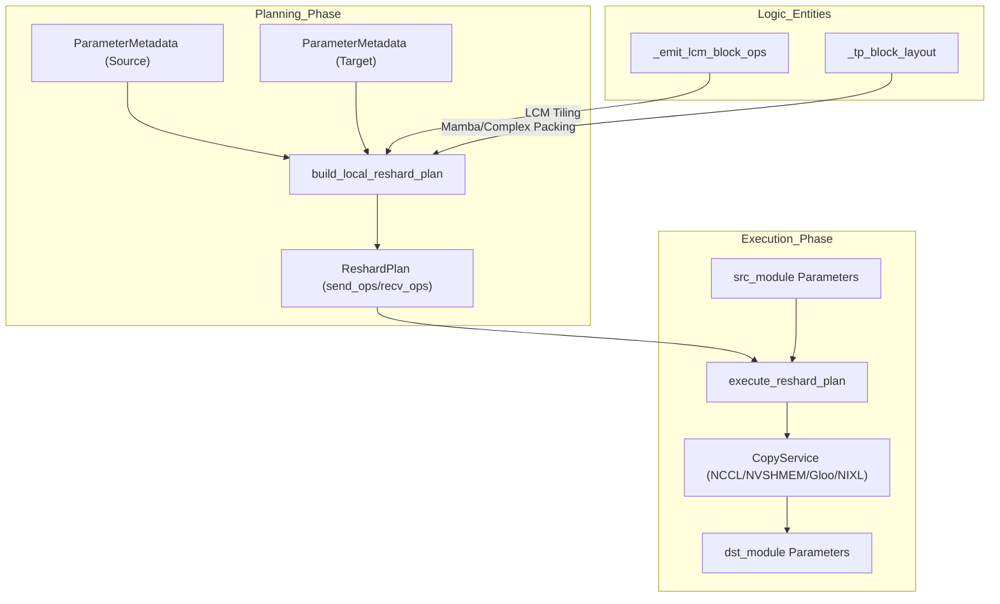
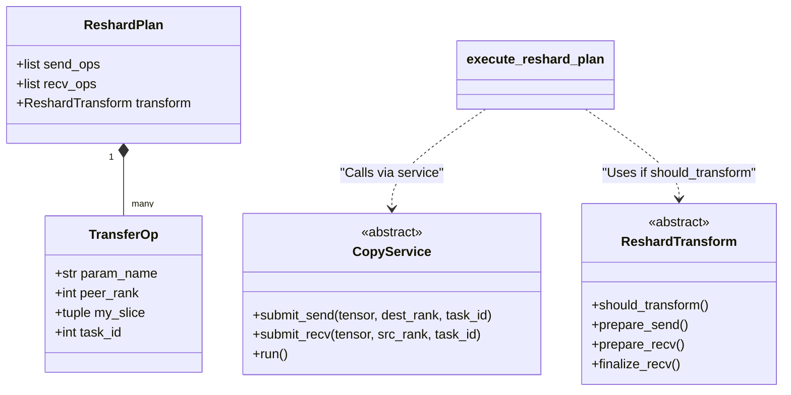
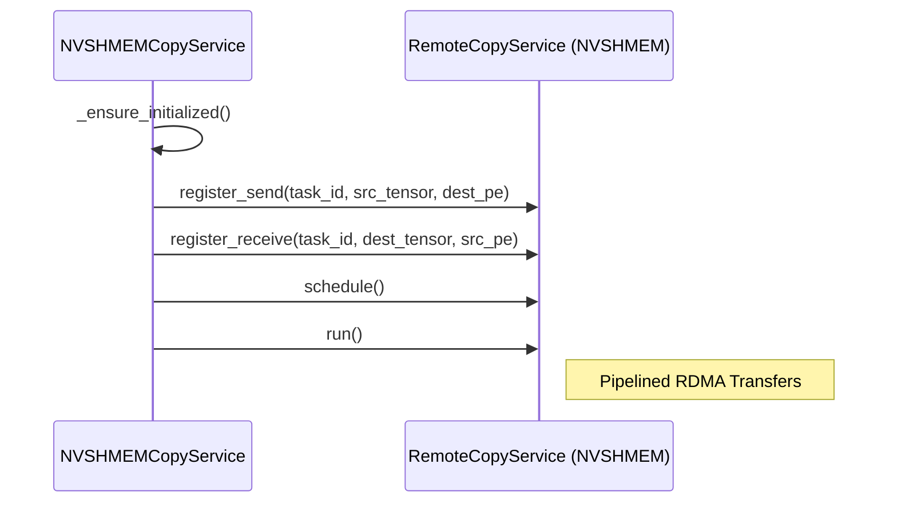

<!-- source: DeepWiki mcp.deepwiki.com · repo NVIDIA/Megatron-LM · page 7.5 Model Resharding and Parallelism Conversion · fetched 2026-10-26 -->

# Model Resharding and Parallelism Conversion

Relevant source files

The following files were used as context for generating this wiki page:

- [megatron/core/inference/moe/activations.py](megatron/core/inference/moe/activations.py)
- [megatron/core/inference/moe/fused_moe.py](megatron/core/inference/moe/fused_moe.py)
- [megatron/core/inference/moe/permute.py](megatron/core/inference/moe/permute.py)
- [megatron/core/inference/quantization/mxfp8_quantize.py](megatron/core/inference/quantization/mxfp8_quantize.py)
- [megatron/core/inference/quantization/mxfp8_tensor.py](megatron/core/inference/quantization/mxfp8_tensor.py)
- [megatron/core/inference/quantization/utils.py](megatron/core/inference/quantization/utils.py)
- [megatron/core/resharding/README.md](megatron/core/resharding/README.md)
- [megatron/core/resharding/__init__.py](megatron/core/resharding/__init__.py)
- [megatron/core/resharding/copy_services/__init__.py](megatron/core/resharding/copy_services/__init__.py)
- [megatron/core/resharding/copy_services/base.py](megatron/core/resharding/copy_services/base.py)
- [megatron/core/resharding/copy_services/gloo_copy_service.py](megatron/core/resharding/copy_services/gloo_copy_service.py)
- [megatron/core/resharding/copy_services/nccl_copy_service.py](megatron/core/resharding/copy_services/nccl_copy_service.py)
- [megatron/core/resharding/copy_services/nixl_copy_service.py](megatron/core/resharding/copy_services/nixl_copy_service.py)
- [megatron/core/resharding/copy_services/nvshmem_copy_service.py](megatron/core/resharding/copy_services/nvshmem_copy_service.py)
- [megatron/core/resharding/execution.py](megatron/core/resharding/execution.py)
- [megatron/core/resharding/planner.py](megatron/core/resharding/planner.py)
- [megatron/core/resharding/refit.py](megatron/core/resharding/refit.py)
- [megatron/core/resharding/transforms.py](megatron/core/resharding/transforms.py)
- [megatron/core/resharding/utils.py](megatron/core/resharding/utils.py)
- [tests/unit_tests/inference/test_mxfp8_utils.py](tests/unit_tests/inference/test_mxfp8_utils.py)
- [tests/unit_tests/resharding/test_copy_services.py](tests/unit_tests/resharding/test_copy_services.py)
- [tests/unit_tests/resharding/test_execution.py](tests/unit_tests/resharding/test_execution.py)
- [tests/unit_tests/resharding/test_model_swap.py](tests/unit_tests/resharding/test_model_swap.py)
- [tests/unit_tests/resharding/test_mxfp8_refit.py](tests/unit_tests/resharding/test_mxfp8_refit.py)
- [tests/unit_tests/resharding/test_planner.py](tests/unit_tests/resharding/test_planner.py)

The Model Resharding system provides a robust framework for converting model checkpoints and live weights between different parallelism configurations. This is critical for scenarios where a model trained with one set of Tensor Parallel (TP), Pipeline Parallel (PP), or Expert Parallel (EP) degrees needs to be loaded into a different configuration for inference or continued training. The system comprises a centralized planner, an execution engine, and various communication backends, including a high-performance NVSHMEM-based copy service.

## System Architecture

The resharding process follows a "Plan then Execute" pattern. The system analyzes the source and destination model structures, determines the necessary data movements (slices and peer ranks), and then dispatches these operations to a specialized transport layer.

### Core Components

| Component | Role | Key Entities |
| :--- | :--- | :--- |
| **Planner** | Determines which rank sends which slice to whom. | `build_local_reshard_plan`, `ShardingDescriptor` |
| **Execution Engine** | Orchestrates the local model parameters and calls the copy service. | `execute_reshard_plan`, `ReshardPlan` |
| **Copy Services** | Abstract the transport layer (NCCL, Gloo, NVSHMEM, or NIXL). | `CopyService`, `NVSHMEMCopyService`, `NCCLCopyService`, `NixlCopyService` |
| **Transforms** | Handles data format conversions (e.g., MXFP8 quantization). | `ReshardTransform`, `MXFP8ReshardTransform` |

### High-Level Data Flow

The following diagram illustrates the flow from model configuration to final weight placement.

**Resharding Pipeline Overview**

Sources: [megatron/core/resharding/refit.py:25-25](), [megatron/core/resharding/planner.py:77-94](), [megatron/core/resharding/execution.py:58-81](), [megatron/core/resharding/utils.py:38-87]()

---

## The Planner

The planner is responsible for generating a `ReshardPlan` [megatron/core/resharding/utils.py:101-111](). It matches parameters between models using a `resolved_name` that accounts for differences in local expert indices (EP) or local layer indices (PP) [megatron/core/resharding/utils.py:68-85]().

### TP Planning Logic
For Tensor Parallelism, the planner uses Least Common Multiple (LCM) tiling to support arbitrary integer strides and contiguous micro-tiles [megatron/core/resharding/planner.py:94-129]().
- **Standard TP**: Handled by analyzing the intersection of source and destination shards based on `ShardingDescriptor` [megatron/core/resharding/planner.py:31-74]().
- **Interleaved Packing**: Handled by `_tp_block_layout` for parameters like Mamba `in_proj` that pack multiple independently-sharded components of different sizes using `partition_sizes` [megatron/core/resharding/planner.py:131-190]().

### Metadata Extraction
The `extract_param_metadata` [megatron/core/resharding/utils.py:18-18]() system captures the sharding state (`is_tp`, `partition_dim`, `partition_stride`) and the process group ranks for every parameter in the model into `ParameterMetadata` objects [megatron/core/resharding/utils.py:38-87]().

Sources: [megatron/core/resharding/planner.py:131-190](), [megatron/core/resharding/utils.py:38-87](), [megatron/core/resharding/utils.py:18-18]()

---

## Execution and Transforms

The `execute_reshard_plan` function [megatron/core/resharding/execution.py:58-81]() iterates through `send_ops` and `recv_ops`. It attempts to minimize memory overhead by receiving directly into destination parameter slices when they are contiguous and not quantized [megatron/core/resharding/execution.py:168-171]().

### Reshard Transforms
Transforms allow for logic beyond simple slicing. The most prominent example is the `MXFP8ReshardTransform` [megatron/core/resharding/transforms.py:118-160]().
- **Quantization Handling**: When resharding into an MXFP8 model, the engine uses `pending_quantized` to accumulate all BF16 slices for a parameter before calling `quantize_()` once [megatron/core/resharding/execution.py:141-143](). This prevents corrupting the MXFP8 per-block scales that would occur with partial-slice updates [megatron/core/resharding/execution.py:40-47]().
- **Address Stability**: The `MXFP8ReshardTransform` writes received weight data directly into persistent `MXFP8Tensor` buffers so that CUDA-graph device-pointer captures remain valid across refits [megatron/core/resharding/transforms.py:118-124]().

**Resharding Logic Mapping**

Sources: [megatron/core/resharding/utils.py:20-35](), [megatron/core/resharding/utils.py:101-111](), [megatron/core/resharding/execution.py:58-81](), [megatron/core/resharding/transforms.py:23-68]()

---

## Copy Services

Megatron-LM provides multiple `CopyService` implementations to handle different transport requirements.

### NCCL and Gloo Backends
- **NCCLCopyService**: A thin wrapper around `torch.distributed.batch_isend_irecv` for GPU-to-GPU transfers [megatron/core/resharding/copy_services/nccl_copy_service.py:17-21]().
- **GlooCopyService**: Routes traffic over a CPU/Gloo process group. It handles GPU-to-CPU staging and CPU-to-GPU writebacks to facilitate transfers where NCCL is unavailable or suboptimal [megatron/core/resharding/copy_services/gloo_copy_service.py:15-21]().

### NVSHMEM and NIXL Backends
For maximum performance during live weight swapping (refit), the `NVSHMEMCopyService` [megatron/core/resharding/copy_services/nvshmem_copy_service.py:17-22]() uses RDMA (Remote Direct Memory Access) to bypass the CPU and NCCL stacks.
- **NixlCopyService**: Provides a backend for NIXL-based transfers [megatron/core/resharding/copy_services/nixl_copy_service.py:15-20]().
- **Local Copy Matching**: All backends use `match_local_ops_by_task_id` to pair same-rank send/recv operations using a globally unique `task_id` [megatron/core/resharding/copy_services/base.py:66-74]().

**NVSHMEM Interaction Diagram**

Sources: [megatron/core/resharding/copy_services/nvshmem_copy_service.py:54-113](), [megatron/core/resharding/copy_services/nvshmem_copy_service.py:159-162](), [megatron/core/resharding/copy_services/base.py:66-74]()

---

## MXFP8 Inference Support

The resharding system integrates with MXFP8 quantization for inference optimization on Blackwell GPUs.

- **MXFP8Tensor**: A wrapper storing quantized `e4m3fn` data and `e8m0` scale bytes [megatron/core/inference/quantization/mxfp8_tensor.py:119-124]().
- **Fused Kernels**: Fused MoE implementations use `mcore_fused_moe` which supports MXFP8 grouped GEMMs via `scaled_grouped_mm` [megatron/core/inference/moe/fused_moe.py:62-73]().
- **Padding-Aware Activations**: Triton kernels like `_squared_relu_kernel` skip alignment-padding rows to avoid wasted computation [megatron/core/inference/moe/activations.py:38-66]().

Sources: [megatron/core/inference/quantization/mxfp8_tensor.py:119-124](), [megatron/core/inference/moe/fused_moe.py:91-133](), [megatron/core/inference/moe/activations.py:38-66]()

---

## Key Functions and Classes

### Refit Orchestration
- `swap_model_weights`: The public API for live resharding. It accepts a backend name ("nccl", "gloo", "nvshmem", or "nixl") and uses `_PlanCacheKey` to avoid repeated planning overhead [megatron/core/resharding/refit.py:38-60]().
- `get_or_create_service`: Manages the lifecycle of communication services, particularly important for `NVSHMEMCopyService` to avoid re-allocating large pinned buffers [megatron/core/resharding/refit.py:118-143]().

### Metadata and Planning Helpers
- `ParameterMetadata`: Data class containing sharding info, owner rank, and process group lists [megatron/core/resharding/utils.py:38-87]().
- `assign_ep_resolved_name_inplace`: Remaps local expert indices to global indices in the `resolved_name` for Expert Parallel models [megatron/core/resharding/utils.py:143-182]().

Sources: [megatron/core/resharding/refit.py:118-143](), [megatron/core/resharding/refit.py:38-60](), [megatron/core/resharding/utils.py:38-87](), [megatron/core/resharding/utils.py:143-182]()

---

