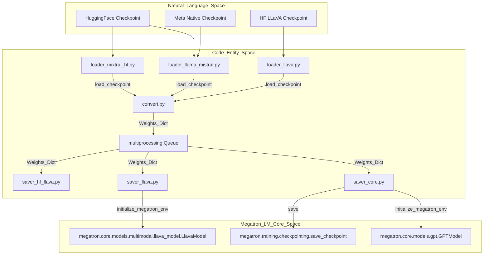
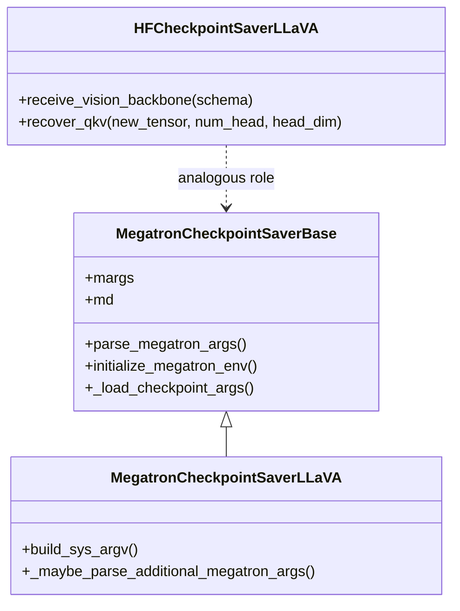

<!-- source: DeepWiki mcp.deepwiki.com · repo NVIDIA/Megatron-LM · page 7.6 Checkpoint Conversion Tools · fetched 2026-10-26 -->

# Checkpoint Conversion Tools

<details>
<summary>Relevant source files</summary>

The following files were used as context for generating this wiki page:

- [.pylintrc](.pylintrc)
- [docs/images/megatron_fsdp/maxpool_allocator.png](docs/images/megatron_fsdp/maxpool_allocator.png)
- [docs/user-guide/features/megatron_fsdp.md](docs/user-guide/features/megatron_fsdp.md)
- [examples/megatron_fsdp/README.md](examples/megatron_fsdp/README.md)
- [examples/megatron_fsdp/sbatch_mfsdp_deepseek_v3.sh](examples/megatron_fsdp/sbatch_mfsdp_deepseek_v3.sh)
- [examples/megatron_fsdp/train_llama3_8b_fsdp_h100_fp8.sh](examples/megatron_fsdp/train_llama3_8b_fsdp_h100_fp8.sh)
- [megatron/core/distributed/fsdp/src/megatron_fsdp/uneven_dtensor.py](megatron/core/distributed/fsdp/src/megatron_fsdp/uneven_dtensor.py)
- [megatron/core/full_cuda_graph.py](megatron/core/full_cuda_graph.py)
- [megatron/core/optimizer/optimizer_cuda_graph.py](megatron/core/optimizer/optimizer_cuda_graph.py)
- [megatron/core/transformer/fsdp_dtensor_checkpoint.py](megatron/core/transformer/fsdp_dtensor_checkpoint.py)
- [megatron/training/yaml_arguments.py](megatron/training/yaml_arguments.py)
- [tests/unit_tests/distributed/mfsdp_v1/test_mfsdp_fused_mla_checkpoint.py](tests/unit_tests/distributed/mfsdp_v1/test_mfsdp_fused_mla_checkpoint.py)
- [tests/unit_tests/transformer/test_fsdp_dtensor_checkpoint.py](tests/unit_tests/transformer/test_fsdp_dtensor_checkpoint.py)
- [tools/autoformat.sh](tools/autoformat.sh)
- [tools/check_copyright.py](tools/check_copyright.py)
- [tools/checkpoint/checkpoint_inspector.py](tools/checkpoint/checkpoint_inspector.py)
- [tools/checkpoint/loader_base.py](tools/checkpoint/loader_base.py)
- [tools/checkpoint/loader_llava.py](tools/checkpoint/loader_llava.py)
- [tools/checkpoint/loader_mixtral_hf.py](tools/checkpoint/loader_mixtral_hf.py)
- [tools/checkpoint/saver_base.py](tools/checkpoint/saver_base.py)
- [tools/checkpoint/saver_hf_llava.py](tools/checkpoint/saver_hf_llava.py)
- [tools/checkpoint/saver_llava.py](tools/checkpoint/saver_llava.py)
- [tools/checkpoint/schema_hf.py](tools/checkpoint/schema_hf.py)
- [tools/copyright.sh](tools/copyright.sh)

</details>


The Megatron-LM checkpoint conversion suite provides a unified framework for migrating model weights between Megatron-LM and external formats, primarily HuggingFace (HF) and Meta's native Llama formats. These tools are essential for utilizing pretrained open-source models within Megatron's highly parallelized training and inference environment.

## Conversion Framework Architecture

The conversion system operates using a producer-consumer model over a multiprocessing queue. This architecture decouples the source format logic (Loader) from the destination format logic (Saver), allowing for $N \times M$ conversion possibilities.

### Implementation Overview
The core orchestration logic resides in `tools/checkpoint/convert.py`. It dynamically loads "plugin" modules based on command-line arguments.

1.  **Loader Process**: Reads the source checkpoint (e.g., HF weights), performs necessary permutations (like RoPE frequency scaling or head reshuffling), and pushes unified weight dictionaries into a `multiprocessing.Queue` [tools/checkpoint/loader_base.py:19-28]().
2.  **Saver Process**: Consumes weights from the queue, initializes a Megatron model with the target parallelism (TP/PP/EP), and saves the weights using Megatron's native checkpointing system [tools/checkpoint/saver_base.py:12-23]().

### Data Flow Diagram

The following diagram illustrates how the conversion scripts bridge the gap between external weight formats and the Megatron-LM internal model state.

**Checkpoint Conversion Data Flow**

**Sources:** [tools/checkpoint/saver_base.py:11-23](), [tools/checkpoint/loader_llava.py:32-40](), [tools/checkpoint/saver_llava.py:44-51](), [tools/checkpoint/saver_hf_llava.py:32-36]()

---

## Supported Loaders and Models

### Llama and Mistral Loader
The `loader_llama_mistral.py` script supports a wide variety of Llama-like architectures. It handles the critical `permute` operation to account for differences in how Megatron and HF/Meta handle rotary positional embeddings (RoPE).

### Mixtral (MoE) Loader
The `loader_mixtral_hf.py` is specialized for Mixture of Experts (MoE) models. It maps the HF `block_sparse_moe` structure to Megatron Core's `local_experts` [tools/checkpoint/loader_mixtral_hf.py:100-116](). It also handles Group Query Attention (GQA) by re-ordering dimensions for Megatron [tools/checkpoint/loader_mixtral_hf.py:85-98]().

### LLaVA (Multimodal) Loader
The `MegatronCheckpointLoaderLLaVA` class in `tools/checkpoint/loader_llava.py` extends the base loader to handle multimodal models. It manages metadata for both the language backbone and the vision tower (ViT), including tile tags, pixel shuffling, and vision projections [tools/checkpoint/loader_llava.py:54-86](). It utilizes `get_language_model_config`, `get_vision_model_config`, and `get_vision_projection_config` to build comprehensive model metadata [tools/checkpoint/loader_llava.py:112-132]().

**Sources:** [tools/checkpoint/loader_mixtral_hf.py:85-116](), [tools/checkpoint/loader_llava.py:32-86](), [tools/checkpoint/loader_base.py:10-28](), [tools/checkpoint/loader_llava.py:112-132]()

---

## Saver Implementations

Savers are responsible for taking the "raw" unified weights from the queue and distributing them according to the target parallelism configuration.

### Base Saver Orchestration
The `MegatronCheckpointSaverBase` class provides the foundation for all savers. It handles:
*   **Argument Overwriting**: `parse_megatron_args()` forcibly overwrites `sys.argv` to initialize a model with the desired TP/PP/EP sizes [tools/checkpoint/saver_base.py:90-134]().
*   **Environment Setup**: `initialize_megatron_env()` sets up `parallel_state` using `_ConverterFakeProcessGroup` since conversion often happens on a single GPU or CPU [tools/checkpoint/saver_base.py:136-163]().
*   **Checkpoint Loading**: `_load_checkpoint_args()` ensures that critical model parameters like `num_layers` and `hidden_size` are preserved from the source checkpoint [tools/checkpoint/saver_base.py:55-88]().

### Multimodal Savers
1.  **MegatronCheckpointSaverLLaVA**: Saves checkpoints into Megatron's native format. It supports specific multimodal configurations like `freeze_ViT`, `freeze_LM`, and `image_tag_type` [tools/checkpoint/saver_llava.py:134-148](). It constructs a specific `sys.argv` to ensure Megatron initializes the multimodal components correctly [tools/checkpoint/saver_llava.py:85-132]().
2.  **HFCheckpointSaverLLaVA**: Converts Megatron LLaVA models back to HuggingFace format. It includes logic to recover QKV projections from fused Megatron tensors [tools/checkpoint/saver_hf_llava.py:16-30]() and handles vision backbones like InternVit, SigLIP, and RADIO using specialized schemas [tools/checkpoint/saver_hf_llava.py:74-91]().

**Saver Class Structure**

**Sources:** [tools/checkpoint/saver_base.py:11-23](), [tools/checkpoint/saver_llava.py:44-51](), [tools/checkpoint/saver_hf_llava.py:32-36](), [tools/checkpoint/saver_hf_llava.py:16-30](), [tools/checkpoint/saver_llava.py:85-148]()

---

## Distributed Checkpoint Inspection and FSDP Conversion

For modern distributed checkpoints (e.g., `torch_dist` or `fsdp_dtensor` formats), Megatron provides an inspector tool in `tools/checkpoint/checkpoint_inspector.py`.

### FSDP and DTensor Handling
The conversion process for FSDP models involves handling `DTensor` objects and uneven sharding. The `megatron/core/transformer/fsdp_dtensor_checkpoint.py` module provides utilities to:
*   **Handle Experts**: `handle_experts_in_state_dict` rewrites expert keys to match the current rank's Expert Parallel (EP) offset [megatron/core/transformer/fsdp_dtensor_checkpoint.py:129-183]().
*   **Expert Index Extraction**: `get_expert_index_from_key` parses various expert key formats (GroupedMLP and SequentialMLP) to extract the index [megatron/core/transformer/fsdp_dtensor_checkpoint.py:105-127]().
*   **Uneven Sharding**: The `gather_and_compute_chunk_metadata` function in `megatron/core/distributed/fsdp/src/megatron_fsdp/uneven_dtensor.py` calculates global offsets and shapes for tensors that do not divide evenly across the device mesh [megatron/core/distributed/fsdp/src/megatron_fsdp/uneven_dtensor.py:29-93]().

### Checkpoint Inspector Tool
The inspector allows users to:
*   **Inspect Metadata**: View `metadata.json` and sharded tensor properties [tools/checkpoint/checkpoint_inspector.py:70-184]().
*   **Format Conversion**: Convert between `torch-dist` and `fsdp-dtensor` formats while performing operations like renaming MTP (Multi-Token Prediction) keys or splitting SWiGLU weights [tools/checkpoint/checkpoint_inspector.py:186-210]().

**Sources:** [megatron/core/transformer/fsdp_dtensor_checkpoint.py:105-183](), [megatron/core/distributed/fsdp/src/megatron_fsdp/uneven_dtensor.py:29-93](), [tools/checkpoint/checkpoint_inspector.py:70-210]()

---

## Usage Examples

### Converting LLaVA to Megatron
To convert a LLaVA model to Megatron format using the M-Core implementation:

```bash
python tools/checkpoint/convert.py \
    --model-type GPT \
    --loader llava \
    --saver llava \
    --megatron-path . \
    --target-tensor-parallel-size 1 \
    --true-vocab-size 151680 \
    --load-dir <load_path> \
    --save-dir <save_path>
```
**Sources:** [tools/checkpoint/saver_llava.py:17-22]()

### Parameter Mapping (Mixtral HF to Megatron)

| HF Parameter Name | Megatron Parameter Name | Logic/Transformation |
| :--- | :--- | :--- |
| `model.embed_tokens` | `embedding.word_embeddings` | Direct copy [tools/checkpoint/loader_mixtral_hf.py:69-70]() |
| `block_sparse_moe.gate` | `mlp.router` | Router weight copy [tools/checkpoint/loader_mixtral_hf.py:103]() |
| `experts[i].w1` + `w3` | `experts[i].linear_fc1` | Concatenate for SwiGLU [tools/checkpoint/loader_mixtral_hf.py:108-113]() |
| `model.norm` | `decoder.final_layernorm` | Final RMSNorm [tools/checkpoint/loader_mixtral_hf.py:74]() |

---

## Validation and Testing
The conversion tools are validated via a functional test suite. Unit tests in `tests/unit_tests/transformer/test_fsdp_dtensor_checkpoint.py` verify the logic for expert index extraction and state dict flattening [tests/unit_tests/transformer/test_fsdp_dtensor_checkpoint.py:54-103](). It also includes shared slice helpers like `_intersect_slice` and `_shift_slice` for handling fused-parameter transformations [tests/unit_tests/transformer/test_fsdp_dtensor_checkpoint.py:71-102]().

**Sources:** [tests/unit_tests/transformer/test_fsdp_dtensor_checkpoint.py:54-103](), [megatron/core/transformer/fsdp_dtensor_checkpoint.py:62-71]()

---

