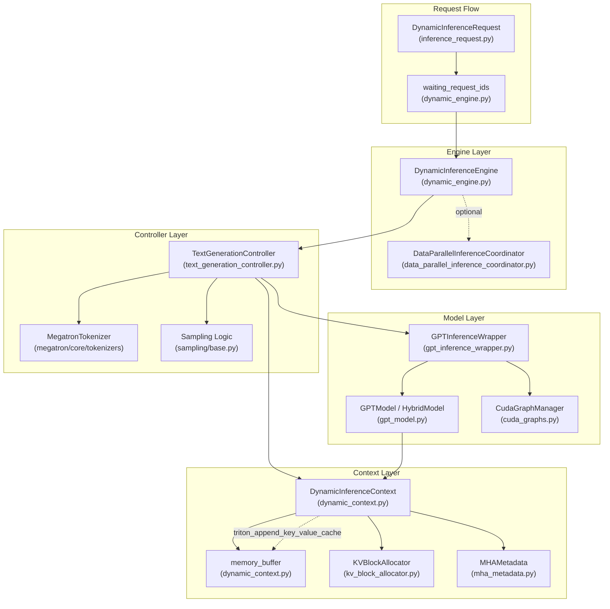
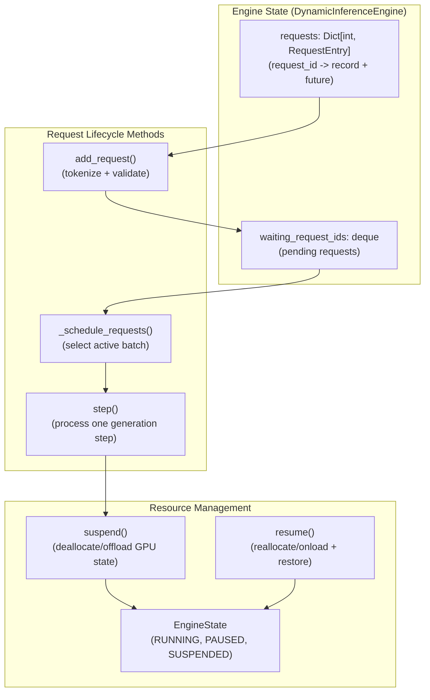

<!-- source: DeepWiki mcp.deepwiki.com · repo NVIDIA/Megatron-LM · page 8 Inference and Text Generation · fetched 2026-10-26 -->

# Inference and Text Generation

Relevant source files

The following files were used as context for generating this wiki page:

- [examples/inference/README.md](examples/inference/README.md)
- [megatron/core/inference/common_inference_params.py](megatron/core/inference/common_inference_params.py)
- [megatron/core/inference/communication_utils.py](megatron/core/inference/communication_utils.py)
- [megatron/core/inference/config.py](megatron/core/inference/config.py)
- [megatron/core/inference/contexts/base_context.py](megatron/core/inference/contexts/base_context.py)
- [megatron/core/inference/contexts/dynamic_context.py](megatron/core/inference/contexts/dynamic_context.py)
- [megatron/core/inference/contexts/static_context.py](megatron/core/inference/contexts/static_context.py)
- [megatron/core/inference/engines/dynamic_engine.py](megatron/core/inference/engines/dynamic_engine.py)
- [megatron/core/inference/engines/mcore_engine.py](megatron/core/inference/engines/mcore_engine.py)
- [megatron/core/inference/inference_request.py](megatron/core/inference/inference_request.py)
- [megatron/core/inference/model_inference_wrappers/abstract_model_inference_wrapper.py](megatron/core/inference/model_inference_wrappers/abstract_model_inference_wrapper.py)
- [megatron/core/inference/model_inference_wrappers/gpt/gpt_inference_wrapper.py](megatron/core/inference/model_inference_wrappers/gpt/gpt_inference_wrapper.py)
- [megatron/core/inference/model_inference_wrappers/multimodal/vlm_inference_wrapper.py](megatron/core/inference/model_inference_wrappers/multimodal/vlm_inference_wrapper.py)
- [megatron/core/inference/model_inference_wrappers/t5/t5_inference_wrapper.py](megatron/core/inference/model_inference_wrappers/t5/t5_inference_wrapper.py)
- [megatron/core/inference/sampling_params.py](megatron/core/inference/sampling_params.py)
- [megatron/core/inference/scheduler.py](megatron/core/inference/scheduler.py)
- [megatron/core/inference/text_generation_controllers/encoder_decoder_text_generation_controller.py](megatron/core/inference/text_generation_controllers/encoder_decoder_text_generation_controller.py)
- [megatron/core/inference/text_generation_controllers/text_generation_controller.py](megatron/core/inference/text_generation_controllers/text_generation_controller.py)
- [megatron/core/inference_params.py](megatron/core/inference_params.py)
- [megatron/inference/utils.py](megatron/inference/utils.py)
- [megatron/training/config/inference_config.py](megatron/training/config/inference_config.py)
- [tests/unit_tests/inference/contexts/test_dynamic_context.py](tests/unit_tests/inference/contexts/test_dynamic_context.py)
- [tests/unit_tests/inference/engines/test_dynamic_engine.py](tests/unit_tests/inference/engines/test_dynamic_engine.py)
- [tests/unit_tests/inference/model_inference_wrappers/gpt/test_gpt_inference_wrapper.py](tests/unit_tests/inference/model_inference_wrappers/gpt/test_gpt_inference_wrapper.py)
- [tests/unit_tests/inference/model_inference_wrappers/t5/test_t5_inference_wrapper.py](tests/unit_tests/inference/model_inference_wrappers/t5/test_t5_inference_wrapper.py)
- [tests/unit_tests/inference/test_inference_config.py](tests/unit_tests/inference/test_inference_config.py)
- [tests/unit_tests/inference/test_mtp_cuda_graph_inference.py](tests/unit_tests/inference/test_mtp_cuda_graph_inference.py)
- [tests/unit_tests/inference/test_scheduler.py](tests/unit_tests/inference/test_scheduler.py)
- [tests/unit_tests/inference/text_generation_controllers/test_encoder_decoder_text_generation_controller.py](tests/unit_tests/inference/text_generation_controllers/test_encoder_decoder_text_generation_controller.py)
- [tests/unit_tests/inference/text_generation_controllers/test_text_generation_controller.py](tests/unit_tests/inference/text_generation_controllers/test_text_generation_controller.py)
- [tests/unit_tests/inference/text_generation_controllers/test_vlm_text_generation_controller.py](tests/unit_tests/inference/text_generation_controllers/test_vlm_text_generation_controller.py)
- [tools/run_inference_performance_test.py](tools/run_inference_performance_test.py)
- [tools/run_text_generation_server.py](tools/run_text_generation_server.py)

This page documents the inference system in Megatron-LM, which enables efficient text generation with dynamic batching, block-level KV cache management, and support for varying sequence lengths. The system is designed for high-throughput serving scenarios where requests arrive asynchronously and have different prompt and generation lengths.

For information about static batching inference, see the legacy `StaticInferenceEngine` [megatron/core/inference/engines/static_engine.py:3-5](). For training-related topics, see [Training System](#5). For model architectures, see [Core Model Architecture](#2).

## System Architecture

The inference system consists of several primary components that work together to process text generation requests:

**Sources**: [megatron/core/inference/engines/dynamic_engine.py:186-202](), [megatron/core/inference/contexts/dynamic_context.py:97-123](), [megatron/core/inference/text_generation_controllers/text_generation_controller.py:99-114](), [megatron/core/inference/inference_request.py:133-158]()

## Inference Engine Architecture

The inference system supports both `StaticInferenceEngine` and `DynamicInferenceEngine`. The `DynamicInferenceEngine` is the modern central orchestrator that manages the request lifecycle, scheduling, and token generation. It maintains a state machine via `EngineState` (e.g., `RUNNING`, `PAUSED`, `SUSPENDED`, `SUSPENDING`) and processes requests in batches with dynamic scheduling [megatron/core/inference/engines/dynamic_engine.py:123-136]().

For details, see [Inference Engine Architecture](#8.1).

### Engine Components

**Core Methods**:
- **`add_request(...)`**: Tokenizes the prompt using the controller, validates constraints (e.g., max sequence length) against the context, and adds the request to the waiting queue [megatron/core/inference/engines/dynamic_engine.py:789-815]().
- **`step()`**: The main generation loop that performs request scheduling, model forward passes, token sampling, and state updates for the active batch [megatron/core/inference/engines/dynamic_engine.py:1191-1250]().
- **`_schedule_requests()`**: Logic to transition requests from the waiting queue to the active pool based on token limits (`max_tokens`), request counts (`max_requests`), and KV cache availability [megatron/core/inference/engines/dynamic_engine.py:1303-1459]().

**Sources**: [megatron/core/inference/engines/dynamic_engine.py:123-136](), [megatron/core/inference/engines/dynamic_engine.py:218-222](), [megatron/core/inference/engines/dynamic_engine.py:1191-1250](), [megatron/core/inference/engines/dynamic_engine.py:789-815]()

## Dynamic Context and KV Cache Management

The `DynamicInferenceContext` manages the KV cache, request metadata, and attention state for dynamic batching. It provides a block-level memory management system using `KVBlockAllocator` (similar to PagedAttention) and supports advanced features like prefix caching and Mamba state management for hybrid models [megatron/core/inference/contexts/dynamic_context.py:49-56]().

For details, see [Dynamic Context and KV Cache Management](#8.2).

### Block Allocation and Memory

The `KVBlockAllocator` manages a pool of memory blocks. Each request requires `ceil(sequence_length / block_size_tokens)` blocks [megatron/core/inference/contexts/dynamic_context.py:54]().

| Feature | Description |
|--------|---------|
| `KVCacheManagementMode` | Defines how large tensors are handled during suspend/resume: `PERSIST`, `OFFLOAD`, or `RECOMPUTE` [megatron/core/inference/config.py:137-148](). |
| `PrefixCachingEvictionPolicy` | Supports `LRU` or `REF_ZERO` eviction for cached prefixes [megatron/core/inference/config.py:111-122](). |
| `Mamba Inference State` | Manages `conv_states` and `ssm_states` for hybrid models via `MambaInferenceStateConfig` [megatron/core/inference/config.py:16-50](). |

**Sources**: [megatron/core/inference/contexts/dynamic_context.py:49-56](), [megatron/core/inference/config.py:137-148](), [megatron/core/inference/inference_request.py:92-130]()

## Text Generation Controller

The `TextGenerationController` handles the logic for tokenization, sampling (greedy, top-k, top-p), and detokenization. It bridges the gap between the high-level engine and the low-level model forward passes [megatron/core/inference/text_generation_controllers/text_generation_controller.py:99-114](). It also handles Multi-Token Prediction (MTP) and speculative decoding logic [megatron/core/inference/text_generation_controllers/text_generation_controller.py:168-181]().

For details, see [Text Generation Controller](#8.3).

**Sampling Implementation**:
The controller utilizes `SamplingParams` which define request-level attributes like `temperature`, `top_k`, and `top_p` [megatron/core/inference/sampling_params.py:14-37](). It supports different sampling backends, including `TorchSampling` and `FlashInferSampling` [megatron/core/inference/text_generation_controllers/text_generation_controller.py:67]().

**Sources**: [megatron/core/inference/text_generation_controllers/text_generation_controller.py:99-114](), [megatron/core/inference/sampling_params.py:14-37](), [megatron/core/inference/text_generation_controllers/text_generation_controller.py:168-181]()

## CUDA Graphs for Inference

CUDA graphs are integrated to reduce kernel launch overhead during the decode phase of text generation. The system supports capturing graphs for specific batch dimensions to optimize repeated forward passes [megatron/core/inference/batch_dimensions_utils.py:148-167]().

For details, see [CUDA Graphs for Inference](#8.4).

The `CUDAGraphBatchDimensionBuilder` generates configurations for capture, including token counts and prefill/decode request counts. At runtime, the `DynamicInferenceEngine` selects and replays the appropriate captured graph using the `CudaGraphManager` [megatron/core/inference/engines/dynamic_engine.py:54]().

**Sources**: [megatron/core/inference/engines/dynamic_engine.py:54](), [megatron/core/inference/batch_dimensions_utils.py:148-167]()

## Distributed Inference and Coordination

For large-scale deployments, Megatron-LM supports distributed inference across multiple ranks. The `DataParallelInferenceCoordinator` facilitates coordination across data-parallel groups, often using ZMQ for asynchronous request handling [megatron/core/inference/engines/dynamic_engine.py:33-35]().

For details, see [Distributed Inference and Coordination](#8.5).

The `AsyncZMQCommunicator` provides the transport layer for sending requests and receiving results between the coordinator and the engine ranks [megatron/core/inference/engines/dynamic_engine.py:72](). It also handles CPU-side synchronization for expert parallelism batch dimension adjustment to avoid GPU stream stalls [megatron/core/inference/batch_dimensions_utils.py:175-180]().

**Sources**: [megatron/core/inference/engines/dynamic_engine.py:33-72](), [megatron/core/inference/batch_dimensions_utils.py:175-180]()

## Text Generation APIs and CLI Tools

Megatron-LM provides several entry points and tools for performing inference, ranging from simple scripts to full API servers.

For details, see [Text Generation APIs and CLI Tools](#8.6).

**Key Entry Points**:
- **`run_text_generation_server.py`**: A script to launch a Flask-based inference server supporting GPT models [tools/run_text_generation_server.py:26-27]().
- **`offline_inference.py`**: Example for batched offline generation using `MegatronLLM` [examples/inference/README.md:21-24]().
- **`inference/utils.py`**: Contains shared helpers for building models for inference and constructing the dynamic engine [megatron/inference/utils.py:79-117]().

**Sources**: [tools/run_text_generation_server.py:26-27](), [examples/inference/README.md:21-24](), [megatron/inference/utils.py:79-117]()

## Disaggregated Inference

Megatron-LM supports a disaggregated architecture where prefill and decode phases are separated across different GPU pools. This improves throughput by allowing independent scaling and optimization of each phase.

For details, see [Disaggregated Inference](#8.7).

The system utilizes `DisaggDynamicInferenceEngine` and various KV transfer backends (e.g., NIXL, NCCL) to hand off inference state between the prefill and decode pools [megatron/core/inference/text_generation_controllers/text_generation_controller.py:178-180]().

**Sources**: [megatron/core/inference/text_generation_controllers/text_generation_controller.py:178-180]()

---

