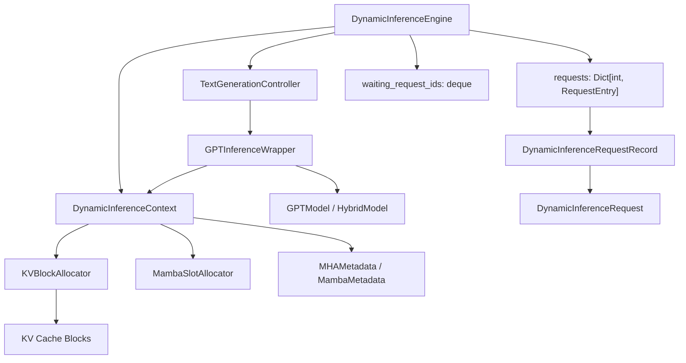
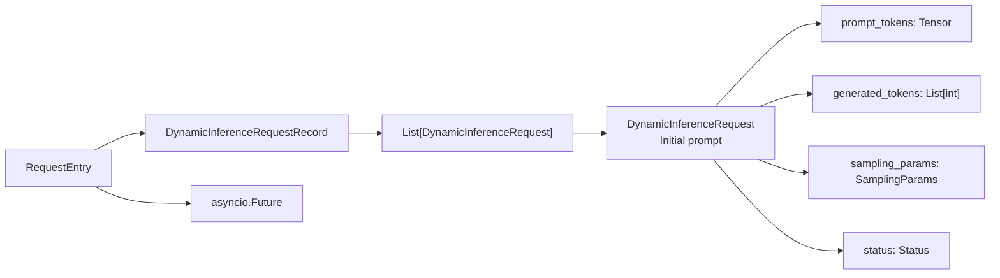
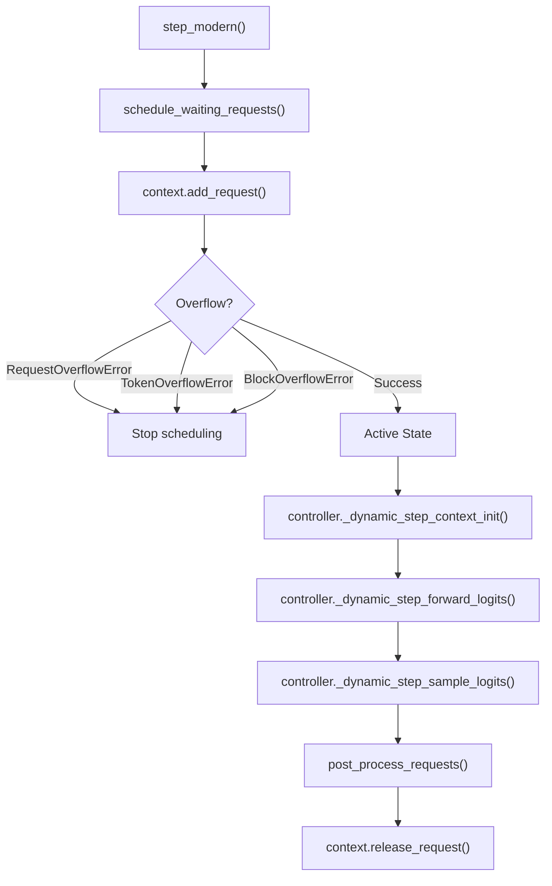

<!-- source: DeepWiki mcp.deepwiki.com · repo NVIDIA/Megatron-LM · page 8.1 Inference Engine Architecture · fetched 2026-10-26 -->

# Inference Engine Architecture

<details>
<summary>Relevant source files</summary>

The following files were used as context for generating this wiki page:

- [examples/inference/README.md](examples/inference/README.md)
- [megatron/core/inference/apis/_llm_base.py](megatron/core/inference/apis/_llm_base.py)
- [megatron/core/inference/apis/async_llm.py](megatron/core/inference/apis/async_llm.py)
- [megatron/core/inference/apis/llm.py](megatron/core/inference/apis/llm.py)
- [megatron/core/inference/apis/serve_config.py](megatron/core/inference/apis/serve_config.py)
- [megatron/core/inference/common_inference_params.py](megatron/core/inference/common_inference_params.py)
- [megatron/core/inference/communication_utils.py](megatron/core/inference/communication_utils.py)
- [megatron/core/inference/config.py](megatron/core/inference/config.py)
- [megatron/core/inference/contexts/base_context.py](megatron/core/inference/contexts/base_context.py)
- [megatron/core/inference/contexts/dynamic_context.py](megatron/core/inference/contexts/dynamic_context.py)
- [megatron/core/inference/contexts/static_context.py](megatron/core/inference/contexts/static_context.py)
- [megatron/core/inference/engines/dynamic_engine.py](megatron/core/inference/engines/dynamic_engine.py)
- [megatron/core/inference/engines/mcore_engine.py](megatron/core/inference/engines/mcore_engine.py)
- [megatron/core/inference/inference_request.py](megatron/core/inference/inference_request.py)
- [megatron/core/inference/model_inference_wrappers/abstract_model_inference_wrapper.py](megatron/core/inference/model_inference_wrappers/abstract_model_inference_wrapper.py)
- [megatron/core/inference/model_inference_wrappers/gpt/gpt_inference_wrapper.py](megatron/core/inference/model_inference_wrappers/gpt/gpt_inference_wrapper.py)
- [megatron/core/inference/model_inference_wrappers/multimodal/vlm_inference_wrapper.py](megatron/core/inference/model_inference_wrappers/multimodal/vlm_inference_wrapper.py)
- [megatron/core/inference/model_inference_wrappers/t5/t5_inference_wrapper.py](megatron/core/inference/model_inference_wrappers/t5/t5_inference_wrapper.py)
- [megatron/core/inference/sampling_params.py](megatron/core/inference/sampling_params.py)
- [megatron/core/inference/scheduler.py](megatron/core/inference/scheduler.py)
- [megatron/core/inference/text_generation_controllers/encoder_decoder_text_generation_controller.py](megatron/core/inference/text_generation_controllers/encoder_decoder_text_generation_controller.py)
- [megatron/core/inference/text_generation_controllers/text_generation_controller.py](megatron/core/inference/text_generation_controllers/text_generation_controller.py)
- [megatron/core/inference_params.py](megatron/core/inference_params.py)
- [megatron/inference/utils.py](megatron/inference/utils.py)
- [megatron/training/config/inference_config.py](megatron/training/config/inference_config.py)
- [tests/unit_tests/inference/contexts/test_dynamic_context.py](tests/unit_tests/inference/contexts/test_dynamic_context.py)
- [tests/unit_tests/inference/engines/test_dynamic_engine.py](tests/unit_tests/inference/engines/test_dynamic_engine.py)
- [tests/unit_tests/inference/high_level_api/test_apis.py](tests/unit_tests/inference/high_level_api/test_apis.py)
- [tests/unit_tests/inference/high_level_api/test_event_loop_manager.py](tests/unit_tests/inference/high_level_api/test_event_loop_manager.py)
- [tests/unit_tests/inference/model_inference_wrappers/gpt/test_gpt_inference_wrapper.py](tests/unit_tests/inference/model_inference_wrappers/gpt/test_gpt_inference_wrapper.py)
- [tests/unit_tests/inference/model_inference_wrappers/t5/test_t5_inference_wrapper.py](tests/unit_tests/inference/model_inference_wrappers/t5/test_t5_inference_wrapper.py)
- [tests/unit_tests/inference/test_inference_config.py](tests/unit_tests/inference/test_inference_config.py)
- [tests/unit_tests/inference/test_mtp_cuda_graph_inference.py](tests/unit_tests/inference/test_mtp_cuda_graph_inference.py)
- [tests/unit_tests/inference/test_scheduler.py](tests/unit_tests/inference/test_scheduler.py)
- [tests/unit_tests/inference/text_generation_controllers/test_encoder_decoder_text_generation_controller.py](tests/unit_tests/inference/text_generation_controllers/test_encoder_decoder_text_generation_controller.py)
- [tests/unit_tests/inference/text_generation_controllers/test_text_generation_controller.py](tests/unit_tests/inference/text_generation_controllers/test_text_generation_controller.py)
- [tests/unit_tests/inference/text_generation_controllers/test_vlm_text_generation_controller.py](tests/unit_tests/inference/text_generation_controllers/test_vlm_text_generation_controller.py)
- [tools/run_inference_performance_test.py](tools/run_inference_performance_test.py)
- [tools/run_text_generation_server.py](tools/run_text_generation_server.py)

</details>


This page documents the inference engine architecture in Megatron-LM, which orchestrates text generation workflows. The primary inference engine is `DynamicInferenceEngine`, which supports variable-length continuous batching. The legacy `StaticInferenceEngine` is deprecated and now wraps `DynamicInferenceEngine` internally. For KV cache management details, see page 8.2.

## Overview

Inference engines in Megatron-LM manage the complete request lifecycle for text generation:

1.  **Request Addition**: Accept prompts and create `DynamicInferenceRequest` objects [megatron/core/inference/engines/dynamic_engine.py:1134-1160]().
2.  **Scheduling**: Move waiting requests to active state when resources (KV cache blocks, token slots) are available [megatron/core/inference/engines/dynamic_engine.py:736-847]().
3.  **Token Generation**: Execute model forward passes and sample tokens via `TextGenerationController` [megatron/core/inference/text_generation_controllers/text_generation_controller.py:72-81]().
4.  **Request Completion**: Detokenize and return generated text through `DynamicInferenceRequestRecord` [megatron/core/inference/inference_request.py:232-287]().

**Engine Types**

| Engine | Status | Use Case | Implementation |
| :--- | :--- | :--- | :--- |
| `DynamicInferenceEngine` | Primary | Variable workloads, continuous batching | Native implementation with `DynamicInferenceContext` [megatron/core/inference/engines/dynamic_engine.py:182-213]() |
| `StaticInferenceEngine` | Deprecated | Legacy fixed-batch processing | Wrapper around `DynamicInferenceEngine` [megatron/core/inference/engines/static_engine.py:34-45]() |

Sources: [megatron/core/inference/engines/dynamic_engine.py:182-213](), [megatron/core/inference/engines/static_engine.py:34-45]()

## DynamicInferenceEngine Architecture

The `DynamicInferenceEngine` is the core inference engine that supports variable-length continuous batching with dynamic KV cache management. It maintains a state machine to handle transitions between running, paused, and suspended states [megatron/core/inference/engines/dynamic_engine.py:123-136]().

**DynamicInferenceEngine Component Structure**



**Key Components**

| Component | Type | Purpose | Location |
| :--- | :--- | :--- | :--- |
| `controller` | `TextGenerationController` | Manages tokenization, sampling, and model forward passes | [megatron/core/inference/engines/dynamic_engine.py:213]() |
| `context` | `DynamicInferenceContext` | Manages KV cache blocks and request state | [megatron/core/inference/engines/dynamic_engine.py:213]() |
| `requests` | `Dict[int, RequestEntry]` | Maps request IDs to request records and futures | [megatron/core/inference/engines/dynamic_engine.py:241]() |
| `waiting_request_ids` | `deque` | Queue of requests waiting to be scheduled | [megatron/core/inference/engines/dynamic_engine.py:242]() |

Sources: [megatron/core/inference/engines/dynamic_engine.py:182-245](), [megatron/core/inference/contexts/dynamic_context.py:192-248]()

## Request Management

**Request Data Structures**



**Request Entry Structure**

The engine maintains a `Dict[int, RequestEntry]` where each entry contains:

| Field | Type | Purpose |
| :--- | :--- | :--- |
| `record` | `DynamicInferenceRequestRecord` | Versioned history of request state across suspend/resume cycles [megatron/core/inference/inference_request.py:232-287]() |
| `future` | `asyncio.Future` | Future that resolves when request completes [megatron/core/inference/engines/dynamic_engine.py:218-223]() |

Sources: [megatron/core/inference/engines/dynamic_engine.py:218-223](), [megatron/core/inference/inference_request.py:232-287]()

**Request States**

The `Status` enum defines the lifecycle of a request within the engine [megatron/core/inference/inference_request.py:77-85]().

| Status | Value | Description |
| :--- | :--- | :--- |
| `WAITING_IN_QUEUE` | 1 | Request is added but not yet active in the context |
| `ACTIVE_AND_GENERATING_TOKENS` | 2 | Request is currently being processed in the forward pass |
| `ACTIVE_BUT_NOT_GENERATING_TOKENS` | 3 | Request is active but temporarily paused (e.g., waiting for resources) |
| `COMPLETED` | 4 | Generation finished successfully |
| `FAILED` | 5 | Generation failed (e.g., context overflow) |

Sources: [megatron/core/inference/inference_request.py:77-85]()

## Scheduling and Request Lifecycle

**Request Scheduling Flow**

The `DynamicInferenceEngine` manages request transitions through a greedy scheduling mechanism. When `step_modern()` is called, the engine attempts to move requests from `waiting_request_ids` to the active context [megatron/core/inference/engines/dynamic_engine.py:927-940]().



**Resource Constraints**

The scheduler respects multiple resource limits enforced by `DynamicInferenceContext` [megatron/core/inference/contexts/dynamic_context.py:113-176]():

| Limit | Error Class | Description |
| :--- | :--- | :--- |
| Maximum Requests | `RequestOverflowError` | Total requests exceeds `max_requests` [megatron/core/inference/contexts/dynamic_context.py:133-136]() |
| Maximum Tokens | `TokenOverflowError` | Total tokens in batch exceeds `max_tokens` [megatron/core/inference/contexts/dynamic_context.py:139-142]() |
| KV Cache Blocks | `BlockOverflowError` | Insufficient blocks in `KVBlockAllocator` [megatron/core/inference/contexts/dynamic_context.py:152-155]() |
| Sequence Length | `MaxSequenceLengthOverflowError` | Request exceeds `max_sequence_length` [megatron/core/inference/contexts/dynamic_context.py:145-150]() |

Sources: [megatron/core/inference/contexts/dynamic_context.py:113-176](), [megatron/core/inference/engines/dynamic_engine.py:736-847]()

## Token Generation Flow

**Execution Sequence**

The core generation loop is managed by `step_modern()`, which orchestrates the interaction between the engine, controller, and context [megatron/core/inference/engines/dynamic_engine.py:927-1088]().

1.  **Context Initialization**: `_dynamic_step_context_init()` prepares the `MHAMetadata` or `MambaMetadata` and retrieves flattened `input_ids` and `position_ids` from the context [megatron/core/inference/text_generation_controllers/text_generation_controller.py:490-530]().
2.  **Forward Pass**: `_dynamic_step_forward_logits()` executes the model forward pass. If pipeline parallelism is used, it handles broadcasting logits from the last stage to all other stages [megatron/core/inference/text_generation_controllers/text_generation_controller.py:532-588]().
3.  **Sampling**: `_dynamic_step_sample_logits()` performs token selection. It bucketizes requests by sampling parameters (temperature, top\_k, top\_p) to optimize throughput [megatron/core/inference/text_generation_controllers/text_generation_controller.py:590-662]().
4.  **Post-Processing**: `post_process_requests()` updates the context with new tokens and checks for termination conditions (e.g., EOD token or max length) [megatron/core/inference/engines/dynamic_engine.py:849-925]().

Sources: [megatron/core/inference/engines/dynamic_engine.py:927-1088](), [megatron/core/inference/text_generation_controllers/text_generation_controller.py:490-662]()

## Sampling and Token Selection

**Sampling Pipeline**

The `TextGenerationController` implements a flexible sampling pipeline. It supports greedy sampling, Top-K, and Top-P (nucleus) sampling [megatron/core/inference/text_generation_controllers/text_generation_controller.py:224-307]().

| Parameter | Type | Default | Description |
| :--- | :--- | :--- | :--- |
| `temperature` | `float` | 1.0 | Scales logits before softmax [megatron/core/inference/sampling_params.py:24]() |
| `top_k` | `int` | 0 | Limits sampling to top K tokens [megatron/core/inference/sampling_params.py:25]() |
| `top_p` | `float` | 0.0 | Limits sampling to cumulative probability P [megatron/core/inference/sampling_params.py:26]() |
| `termination_id` | `int` | None | Token ID that triggers completion [megatron/core/inference/sampling_params.py:28]() |

Sources: [megatron/core/inference/sampling_params.py:21-30](), [megatron/core/inference/text_generation_controllers/text_generation_controller.py:224-307]()

## High-Level APIs

Megatron-LM provides simplified entry points for common inference workflows via `MegatronLLM` (synchronous) and `MegatronAsyncLLM` (asynchronous) [examples/inference/README.md:14-17]().

### MegatronLLM / MegatronAsyncLLM
These APIs abstract away the manual management of engines and controllers.
*   **Offline Inference**: Used for batched generation via `offline_inference.py` [examples/inference/README.md:21-23]().
*   **Inference Server**: Used to launch OpenAI-compatible HTTP servers using `MegatronAsyncLLM.serve()` [examples/inference/README.md:25-27]().

### Stepping the Engine
In a typical inference loop, the engine is stepped until all requests are completed. For manual stepping, users often interact with the engine directly.

```python
# From tools/run_inference_performance_test.py
while inference_engine.has_unfinished_requests():
    result = inference_engine.step()
```

### Asynchronous Execution
`DynamicInferenceEngine` provides an asynchronous interface for integration into server environments [megatron/core/inference/engines/dynamic_engine.py:1162-1247]().

```python
# megatron/core/inference/engines/dynamic_engine.py:1162-1185
async def add_request_async(self, request_id, prompt, sampling_params):
    # Adds request and returns a future
    ...

# megatron/core/inference/engines/dynamic_engine.py:1218-1247
async def run_engine(self):
    # Background loop processing requests
    while self.state != EngineState.STOPPED:
        await self.step_modern_async()
```

## Distributed Inference Architecture

The engine supports distributed inference through a coordinator-worker model, often utilizing ZMQ for communication between data-parallel replicas [megatron/core/inference/engines/dynamic_engine.py:82-93]().

**DataParallelInferenceCoordinator**

The `DataParallelInferenceCoordinator` acts as a central hub, distributing requests across different model replicas (DP groups). Each DP group has a coordinator rank that receives requests via ZMQ and broadcasts them to its local workers [megatron/core/inference/data_parallel_inference_coordinator.py:29-31]().

**ZMQ Communicator**
The `AsyncZMQCommunicator` handles the low-level asynchronous socket management for inter-process communication [megatron/core/inference/engines/async_zmq_communicator.py:23-26]().

Sources: [megatron/core/inference/engines/dynamic_engine.py:339-491](), [megatron/core/inference/data_parallel_inference_coordinator.py:29-31](), [megatron/core/inference/engines/async_zmq_communicator.py:23-26]()

---

