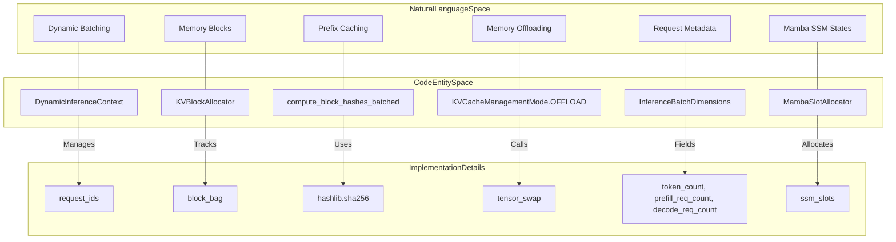
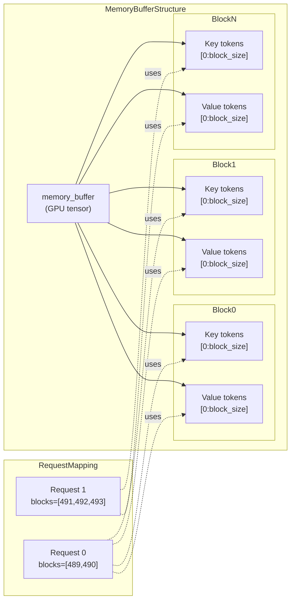
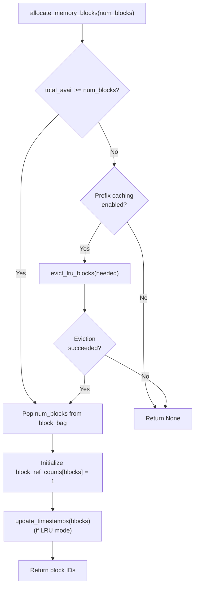
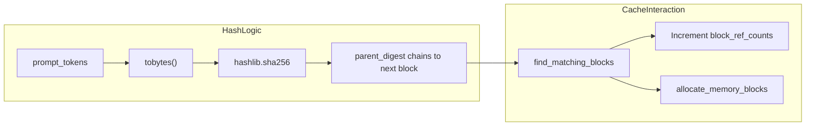

<!-- source: DeepWiki mcp.deepwiki.com · repo NVIDIA/Megatron-LM · page 8.2 Dynamic Context and KV Cache Management · fetched 2026-10-26 -->

# Dynamic Context and KV Cache Management

<details>
<summary>Relevant source files</summary>

The following files were used as context for generating this wiki page:

- [megatron/core/inference/config.py](megatron/core/inference/config.py)
- [megatron/core/inference/contexts/attention_context/mamba_metadata.py](megatron/core/inference/contexts/attention_context/mamba_metadata.py)
- [megatron/core/inference/contexts/dynamic_context.py](megatron/core/inference/contexts/dynamic_context.py)
- [megatron/core/inference/contexts/kv_block_allocator.py](megatron/core/inference/contexts/kv_block_allocator.py)
- [megatron/core/inference/contexts/mamba_slot_allocator.py](megatron/core/inference/contexts/mamba_slot_allocator.py)
- [megatron/core/inference/engines/dynamic_engine.py](megatron/core/inference/engines/dynamic_engine.py)
- [megatron/core/inference/inference_request.py](megatron/core/inference/inference_request.py)
- [megatron/core/inference/sampling_params.py](megatron/core/inference/sampling_params.py)
- [megatron/core/inference/text_generation_controllers/text_generation_controller.py](megatron/core/inference/text_generation_controllers/text_generation_controller.py)
- [megatron/core/inference/unified_memory.py](megatron/core/inference/unified_memory.py)
- [megatron/core/models/mamba/mamba_layer_specs.py](megatron/core/models/mamba/mamba_layer_specs.py)
- [megatron/core/models/mamba/mamba_model.py](megatron/core/models/mamba/mamba_model.py)
- [megatron/core/ssm/mamba_block.py](megatron/core/ssm/mamba_block.py)
- [megatron/core/ssm/mamba_hybrid_layer_allocation.py](megatron/core/ssm/mamba_hybrid_layer_allocation.py)
- [megatron/core/ssm/mamba_layer.py](megatron/core/ssm/mamba_layer.py)
- [megatron/core/ssm/mamba_mixer.py](megatron/core/ssm/mamba_mixer.py)
- [megatron/inference/utils.py](megatron/inference/utils.py)
- [megatron/training/config/inference_config.py](megatron/training/config/inference_config.py)
- [tests/unit_tests/inference/contexts/attention_metadata/test_mamba_metadata.py](tests/unit_tests/inference/contexts/attention_metadata/test_mamba_metadata.py)
- [tests/unit_tests/inference/contexts/test_dynamic_context.py](tests/unit_tests/inference/contexts/test_dynamic_context.py)
- [tests/unit_tests/inference/contexts/test_dynamic_prefix_caching.py](tests/unit_tests/inference/contexts/test_dynamic_prefix_caching.py)
- [tests/unit_tests/inference/contexts/test_kv_block_allocator.py](tests/unit_tests/inference/contexts/test_kv_block_allocator.py)
- [tests/unit_tests/inference/engines/test_dynamic_engine.py](tests/unit_tests/inference/engines/test_dynamic_engine.py)
- [tests/unit_tests/inference/test_inference_config.py](tests/unit_tests/inference/test_inference_config.py)
- [tests/unit_tests/inference/test_mtp_cuda_graph_inference.py](tests/unit_tests/inference/test_mtp_cuda_graph_inference.py)
- [tests/unit_tests/inference/text_generation_controllers/test_text_generation_controller.py](tests/unit_tests/inference/text_generation_controllers/test_text_generation_controller.py)

</details>


## Purpose and Scope

This document describes the **block-level KV cache memory management system** and **dynamic batching context** in Megatron-LM's inference pipeline. The `DynamicInferenceContext` class manages a pre-allocated memory buffer divided into blocks that are dynamically assigned to requests, enabling efficient in-flight batching and memory reuse through prefix caching.

For information about the overall inference engine architecture and request lifecycle, see [Inference Engine Architecture](8.1). For text generation control flow and sampling, see [Text Generation Controller](8.3). This page focuses specifically on memory management, block allocation, and the tensor state that tracks KV cache assignments.

**Sources:** [megatron/core/inference/contexts/dynamic_context.py:1-175](), [megatron/core/inference/engines/dynamic_engine.py:123-214]()

## Architecture Overview

The `DynamicInferenceContext` implements a **block-level KV cache** similar to PagedAttention, where a large pre-allocated memory buffer is divided into fixed-size blocks that are dynamically assigned to inference requests. This design enables:

- **In-flight batching**: Requests of varying lengths can be dynamically added and removed in each inference step. [megatron/core/inference/engines/dynamic_engine.py:123-136]()
- **Memory efficiency**: Blocks are shared via prefix caching and reused when freed. [megatron/core/inference/contexts/kv_block_allocator.py:12-75]()
- **Flexible scheduling**: Requests can be paused (moved to a separate buffer region) and resumed. [megatron/core/inference/contexts/kv_block_allocator.py:27-46]()
- **Hybrid Model Support**: Manages states for both Transformer (KV cache) and Mamba (Conv/SSM states) layers. [megatron/core/inference/contexts/dynamic_context.py:534-577]()

### Natural Language to Code Entity Mapping

The following diagram maps high-level memory management concepts to their specific class and variable implementations in the codebase.



**Sources:** [megatron/core/inference/contexts/dynamic_context.py:216-577](), [megatron/core/inference/contexts/kv_block_allocator.py:12-75](), [megatron/core/inference/inference_request.py:77-85](), [megatron/core/inference/batch_dimensions_utils.py:21-36](), [megatron/core/inference/inference_request.py:92-130](), [megatron/core/inference/contexts/mamba_slot_allocator.py:23-50]()

## Block-Level KV Cache System

### Memory Buffer Layout

The KV cache is stored in a contiguous GPU tensor `memory_buffer`. Its shape is determined by the model type:
- **Standard Attention**: `[2, num_attention_layers, total_blocks, block_size_tokens, num_heads_per_partition, head_dim]` [megatron/core/inference/contexts/dynamic_context.py:588-605]()
- **MLA (Multi-Latent Attention)**: `[num_attention_layers, total_blocks, block_size_tokens, kv_lora_rank + qk_pos_emb_head_dim]` [megatron/core/inference/contexts/dynamic_context.py:607-623]()



**Diagram: KV Cache Block-Level Organization**

The buffer is allocated at initialization with size determined by `buffer_size_gb`. The number of blocks is computed based on the memory required for one block across all layers. [megatron/core/inference/contexts/dynamic_context.py:337-358](), [megatron/core/inference/contexts/dynamic_context.py:588-623]()

## KVBlockAllocator and Memory Management

### Allocation Strategy

The `KVBlockAllocator` manages block IDs using a stack-based allocator (`block_bag`) with optional prefix caching. [megatron/core/inference/contexts/kv_block_allocator.py:152-186]()



**Diagram: Block Allocation Flow**

### Active and Paused Memory Regions

The block allocator distinguishes between **active** and **paused** memory regions to support request suspension without losing KV cache:

- **Active blocks** (`active_count`): Used by requests currently being processed. [megatron/core/inference/contexts/kv_block_allocator.py:34]()
- **Paused blocks** (`paused_count`): Reserved for requests that have been paused but not evicted. [megatron/core/inference/contexts/kv_block_allocator.py:39]()
- **Total blocks** (`total_count`): Sum of active + paused + 1 dummy block. [megatron/core/inference/contexts/kv_block_allocator.py:46]()

**Sources:** [megatron/core/inference/contexts/kv_block_allocator.py:27-46]()

## Request and Token State Management

### Request Metadata Tensors

Each request slot in the context is tracked by parallel tensors. These are crucial for the `TextGenerationController` and the model forward pass.

| Tensor | Shape | Description |
|--------|-------|-------------|
| `request_ids` | `[max_requests]` | Request ID, -1 if slot unused. [megatron/core/inference/contexts/dynamic_context.py:706]() |
| `request_query_lengths` | `[max_requests]` | Number of input tokens in current step. [megatron/core/inference/contexts/dynamic_context.py:710]() |
| `request_kv_length_offsets` | `[max_requests]` | KV cache offset for new tokens. [megatron/core/inference/contexts/dynamic_context.py:717]() |
| `request_to_kv_block_ids` | `[max_requests, max_kv_block_count]` | Block ID mapping. [megatron/core/inference/contexts/dynamic_context.py:726]() |

### Token-to-Block Mapping

During the forward pass, the system maps individual tokens in the batch to specific locations in the `memory_buffer`.

| Tensor | Shape | Description |
|--------|-------|-------------|
| `token_to_block_idx` | `[max_tokens]` | Block index in memory buffer. [megatron/core/inference/contexts/dynamic_context.py:743]() |
| `token_to_local_position_within_kv_block` | `[max_tokens]` | Position within block (0 to block_size-1). [megatron/core/inference/contexts/dynamic_context.py:748]() |

**Sources:** [megatron/core/inference/contexts/dynamic_context.py:737-748]()

## Prefix Caching

Prefix caching allows multiple requests to share the same KV cache blocks if they share a common prompt prefix.

### Hash-Based Block Matching

The system computes SHA-256 based hashes for all complete blocks in a prompt. Each block hash is computed as `SHA-256(parent_digest || block_bytes)`, where the `parent_digest` chains from the previous block. [megatron/core/inference/inference_request.py:92-130]()



**Diagram: Prefix Caching Logic Flow**

**Sources:** [megatron/core/inference/inference_request.py:92-130](), [megatron/core/inference/contexts/kv_block_allocator.py:248-303]()

### Eviction Policies

Supported via `PrefixCachingEvictionPolicy`:
1. **REF_ZERO**: Blocks are immediately freed when `ref_count` reaches 0. [megatron/core/inference/config.py:117]()
2. **LRU (Least Recently Used)**: Blocks with `ref_count == 0` remain cached until evicted by timestamp when memory is needed. [megatron/core/inference/config.py:120]()

**Sources:** [megatron/core/inference/contexts/kv_block_allocator.py:305-347](), [megatron/core/inference/config.py:111-122]()

## KV Cache Management Modes

The `DynamicInferenceContext` supports **suspend/resume** operations, allowing the engine to yield GPU resources. [megatron/core/inference/engines/dynamic_engine.py:130-134]()

| Mode | Behavior on Suspend | Implementation Detail |
|------|---------------------|-----------------------|
| **PERSIST** | Stays in GPU. | No-op in `deallocate_inference_state_buffers`. [megatron/core/inference/contexts/dynamic_context.py:816]() |
| **OFFLOAD** | Copied to CPU. | Uses `tensor_swap` or `torch_memory_saver`. [megatron/core/inference/contexts/dynamic_context.py:821-835]() |
| **RECOMPUTE** | Discarded. | Prefill is re-run on resume. [megatron/core/inference/contexts/dynamic_context.py:845-849]() |

**Sources:** [megatron/core/inference/config.py:137-148](), [megatron/core/inference/contexts/dynamic_context.py:814-853]()

## Mamba State Management

For hybrid models, the context manages Mamba convolution and SSM states using the `MambaSlotAllocator`. Unlike the KV cache, Mamba states are fixed-size per request but must be indexed correctly during batching.

### Mamba Slot Allocation
The `MambaSlotAllocator` provides a pool of indices (slots) for requests. When a request is processed in a Mamba layer, its assigned slot determines where its `conv_state` and `ssm_state` are stored. [megatron/core/inference/contexts/mamba_slot_allocator.py:23-50]()

### Integration in Forward Pass
During `MambaLayer.forward`, the `MambaMetadata` (derived from the context) provides the indices for `causal_conv1d_update` and `selective_state_update`. [megatron/core/ssm/mamba_mixer.py:26-32](), [megatron/core/ssm/mamba_layer.py:118-121]()

**Sources:** [megatron/core/inference/contexts/mamba_slot_allocator.py:23-50](), [megatron/core/inference/contexts/attention_context/mamba_metadata.py:21-45](), [megatron/core/ssm/mamba_mixer.py:643-690]()

## Integration with Inference Engine

### Attention State Initialization

Before each forward pass, `initialize_attention_state` prepares the metadata required by the transformer layers.

```mermaid
graph TD
    START["initialize_attention_state()"] --> SCHED["schedule_waiting_requests()"]
    SCHED --> METADATA["Build MHA/Mamba Metadata"]
    METADATA --> MAP["Map Tokens to Blocks"]
    MAP --> ROUTER["RouterReplay.initialize() (for MoE)"]
    ROUTER --> END["Ready for Forward Pass"]
end
```

**Diagram: Attention State Initialization Flow**

**Sources:** [megatron/core/inference/contexts/dynamic_context.py:1372-1542](), [megatron/core/inference/text_generation_controllers/text_generation_controller.py:146-170]()

### KV Cache Writing

After the forward pass, `append_key_value_cache` writes new KV values to the `memory_buffer`. It prioritizes the `triton_append_key_value_cache` kernel for performance if available. [megatron/core/inference/contexts/dynamic_context.py:1707-1799]()

**Sources:** [megatron/core/inference/contexts/dynamic_context.py:1707-1799]()

---

