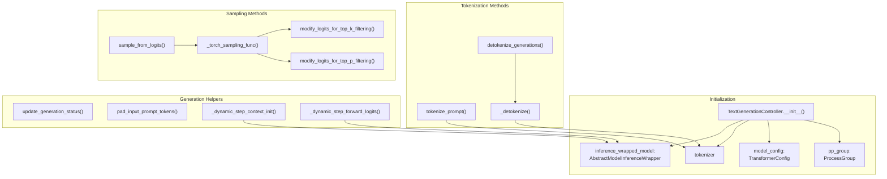
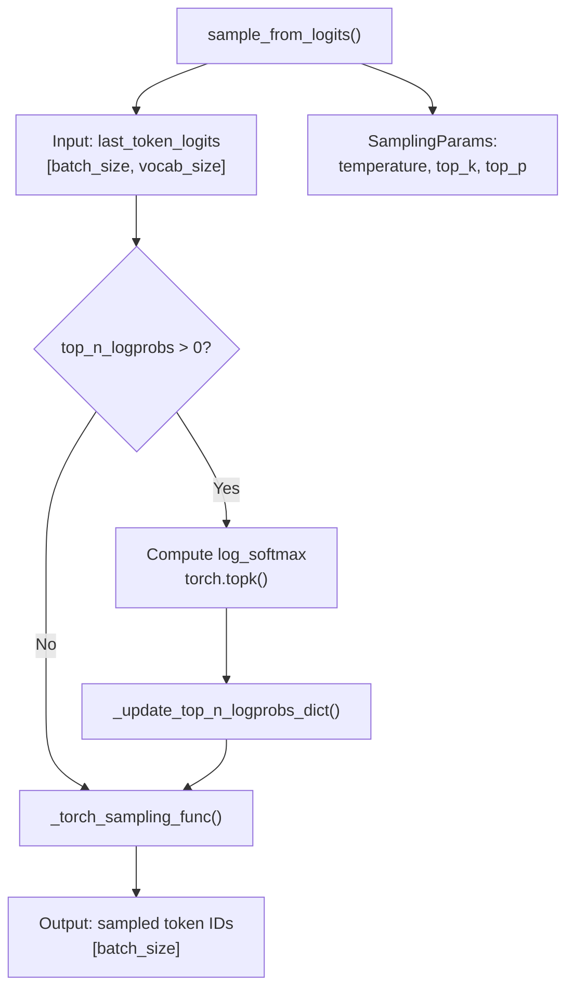

<!-- source: DeepWiki mcp.deepwiki.com · repo NVIDIA/Megatron-LM · page 8.3 Text Generation Controller · fetched 2026-10-26 -->

# Text Generation Controller

<details>
<summary>Relevant source files</summary>

The following files were used as context for generating this wiki page:

- [megatron/core/inference/config.py](megatron/core/inference/config.py)
- [megatron/core/inference/contexts/dynamic_context.py](megatron/core/inference/contexts/dynamic_context.py)
- [megatron/core/inference/engines/dynamic_engine.py](megatron/core/inference/engines/dynamic_engine.py)
- [megatron/core/inference/inference_request.py](megatron/core/inference/inference_request.py)
- [megatron/core/inference/sampling_params.py](megatron/core/inference/sampling_params.py)
- [megatron/core/inference/text_generation_controllers/text_generation_controller.py](megatron/core/inference/text_generation_controllers/text_generation_controller.py)
- [megatron/core/inference/text_generation_server/dynamic_text_gen_server/endpoints/chat_completions.py](megatron/core/inference/text_generation_server/dynamic_text_gen_server/endpoints/chat_completions.py)
- [megatron/core/inference/text_generation_server/dynamic_text_gen_server/endpoints/completions.py](megatron/core/inference/text_generation_server/dynamic_text_gen_server/endpoints/completions.py)
- [megatron/core/inference/text_generation_server/dynamic_text_gen_server/incremental_detokenizer.py](megatron/core/inference/text_generation_server/dynamic_text_gen_server/incremental_detokenizer.py)
- [megatron/core/inference/text_generation_server/dynamic_text_gen_server/openai_streaming.py](megatron/core/inference/text_generation_server/dynamic_text_gen_server/openai_streaming.py)
- [megatron/core/tokenizers/text/parsers/__init__.py](megatron/core/tokenizers/text/parsers/__init__.py)
- [megatron/core/tokenizers/text/parsers/deepseek_r1_reasoning_parser.py](megatron/core/tokenizers/text/parsers/deepseek_r1_reasoning_parser.py)
- [megatron/core/tokenizers/text/parsers/nemotron_v3_reasoning_parser.py](megatron/core/tokenizers/text/parsers/nemotron_v3_reasoning_parser.py)
- [megatron/core/tokenizers/text/parsers/qwen3_coder_tool_parser.py](megatron/core/tokenizers/text/parsers/qwen3_coder_tool_parser.py)
- [megatron/inference/utils.py](megatron/inference/utils.py)
- [megatron/training/config/inference_config.py](megatron/training/config/inference_config.py)
- [tests/unit_tests/inference/contexts/test_dynamic_context.py](tests/unit_tests/inference/contexts/test_dynamic_context.py)
- [tests/unit_tests/inference/engines/test_dynamic_engine.py](tests/unit_tests/inference/engines/test_dynamic_engine.py)
- [tests/unit_tests/inference/test_inference_config.py](tests/unit_tests/inference/test_inference_config.py)
- [tests/unit_tests/inference/test_inference_request.py](tests/unit_tests/inference/test_inference_request.py)
- [tests/unit_tests/inference/test_mtp_cuda_graph_inference.py](tests/unit_tests/inference/test_mtp_cuda_graph_inference.py)
- [tests/unit_tests/inference/test_openai_streaming.py](tests/unit_tests/inference/test_openai_streaming.py)
- [tests/unit_tests/inference/text_generation_controllers/test_text_generation_controller.py](tests/unit_tests/inference/text_generation_controllers/test_text_generation_controller.py)
- [tests/unit_tests/tokenizers/test_text_parsers.py](tests/unit_tests/tokenizers/test_text_parsers.py)

</details>


The `TextGenerationController` class manages the complete token generation pipeline: tokenization of input prompts, sampling from model logits, logits processing (temperature/top-k/top-p), and detokenization of generated tokens. The controller is used by both `StaticInferenceEngine` and `DynamicInferenceEngine` to coordinate text generation.

For information about the inference engines that use this controller, see page 8.1 (Inference Engine Architecture) and page 8.2 (Dynamic Context and KV Cache Management). For sampling parameter configuration, see `SamplingParams` class documentation.

## Controller Architecture

The `TextGenerationController` acts as the orchestration layer between the inference engine and the model, managing all text ↔ token conversions and sampling decisions.

**Diagram: TextGenerationController Component Structure**



**Sources:** [megatron/core/inference/text_generation_controllers/text_generation_controller.py:99-110]()

### Initialization

The controller is initialized with:

| Component | Type | Description |
|-----------|------|-------------|
| `inference_wrapped_model` | `AbstractModelInferenceWrapper` | Wraps model and manages inference context |
| `tokenizer` | Tokenizer | Handles text ↔ token conversion |

The constructor extracts key configuration from the wrapped model:

- `model_config`: Transformer configuration from `inference_wrapped_model.model.config` [megatron/core/inference/text_generation_controllers/text_generation_controller.py:112]().
- `vocab_size`: Padded vocabulary size from the model, handling special cases like `LLaVAModel` [megatron/core/inference/text_generation_controllers/text_generation_controller.py:127-131]().
- `pp_group`: Pipeline parallel process group for cross-stage communication [megatron/core/inference/text_generation_controllers/text_generation_controller.py:117-121]().
- `sampling_rng`: Random number generator seeded with `model_config.inference_sampling_seed` [megatron/core/inference/text_generation_controllers/text_generation_controller.py:133-134]().
- `num_mtp_depths`: Configured if `num_speculative_tokens` > 0 for Multi-Token Prediction [megatron/core/inference/text_generation_controllers/text_generation_controller.py:136-147]().

**Sources:** [megatron/core/inference/text_generation_controllers/text_generation_controller.py:110-160]()

For dynamic batching, the controller also initializes sampling tensors via `_init_dynamic_sampling_tensors()`:

- `_sampled_tokens_cuda`: Tensor for storing sampled token IDs [megatron/core/inference/text_generation_controllers/text_generation_controller.py:187]().
- `_request_metadata`: Dictionary mapping request metadata labels to tensors (e.g., `temperature`, `top_k`, `top_p`) [megatron/core/inference/text_generation_controllers/text_generation_controller.py:197-204]().
- `_torch_sampling_buckets`: Logic to group requests with similar sampling parameters for efficient batching [megatron/core/inference/text_generation_controllers/text_generation_controller.py:208]().

**Sources:** [megatron/core/inference/text_generation_controllers/text_generation_controller.py:173-211]()

## Tokenization and Detokenization

The controller provides methods to convert between text and token representations, handling BOS tokens and special token filtering.

**Diagram: Tokenization and Detokenization Flow**

```mermaid
graph TB
    subgraph "tokenize_prompt()"
        TP_In["Input: prompt string, add_BOS"]
        TP_Tok["tokenizer.tokenize(prompt)"]
        TP_Strip["Remove existing BOS tokens"]
        TP_Add{"add_BOS?"}
        TP_AddBOS["Prepend tokenizer.bos"]
        TP_Out["Output: List[int]"]
    end
    
    subgraph "_detokenize()"
        DT_In["Input: tokens, skip_special_tokens"]
        DT_Check{"_detok_accepts_skip<br/>cached?"}
        DT_Inspect["Inspect tokenizer.detokenize<br/>signature"]
        DT_Cache["Cache result"]
        DT_Call["tokenizer.detokenize()"]
        DT_Out["Output: str"]
    end
    
    subgraph "detokenize_generations()"
        DG_In["Input: tokens_gpu_tensor,<br/>lengths_gpu_tensor,<br/>detokenize_segments"]
        DG_ToList["tokens_gpu_tensor.tolist()"]
        DG_Seg{"detokenize_segments?"}
        DG_Simple["Single _detokenize() call"]
        DG_Loop["Loop over sequences"]
        DG_Offsets["tokenizer.offsets()"]
        DG_Segments["Split into word segments"]
        DG_Out["Output: (text, segments)"]
    end
    
    TP_In --> TP_Tok
    TP_Tok --> TP_Strip
    TP_Strip --> TP_Add
    TP_Add -->|Yes| TP_AddBOS
    TP_Add -->|No| TP_Out
    TP_AddBOS --> TP_Out
    
    DT_In --> DT_Check
    DT_Check -->|No| DT_Inspect
    DT_Check -->|Yes| DT_Call
    DT_Inspect --> DT_Cache
    DT_Cache --> DT_Call
    DT_Call --> DT_Out
    
    DG_In --> DG_ToList
    DG_ToList --> DG_Seg
    DG_Seg -->|No| DG_Simple
    DG_Seg -->|Yes| DG_Loop
    DG_Simple --> DG_Out
    DG_Loop --> DG_Offsets
    DG_Offsets --> DG_Segments
    DG_Segments --> DG_Out
```



**Sources:** [megatron/core/inference/text_generation_controllers/text_generation_controller.py:230-332]()

### tokenize_prompt()

Converts input text to token IDs with BOS token handling:

```python
def tokenize_prompt(self, prompt: str, add_BOS: bool = False) -> List[int]
```

**Process:**
1. Call `tokenizer.tokenize(prompt)` to get token IDs [megatron/core/inference/text_generation_controllers/text_generation_controller.py:244]().
2. Remove any existing BOS tokens from the start to prevent duplication [megatron/core/inference/text_generation_controllers/text_generation_controller.py:246-248]().
3. If `add_BOS=True`, prepend `tokenizer.bos` token [megatron/core/inference/text_generation_controllers/text_generation_controller.py:250-251]().

**Sources:** [megatron/core/inference/text_generation_controllers/text_generation_controller.py:230-251]()

### _detokenize()

Internal method that adapts to different tokenizer APIs by inspecting method signatures:

```python
def _detokenize(self, tokens: List[int], skip_special_tokens: bool = True) -> str
```

**Features:**
- **Signature caching**: On first call, inspects `tokenizer.detokenize` to check if it accepts `skip_special_tokens` parameter [megatron/core/inference/text_generation_controllers/text_generation_controller.py:265-271]().
- **Automatic adaptation**: Uses `skip_special_tokens` if supported, otherwise calls without it [megatron/core/inference/text_generation_controllers/text_generation_controller.py:274-282]().

**Sources:** [megatron/core/inference/text_generation_controllers/text_generation_controller.py:253-282]()

### detokenize_generations()

Converts generated token tensors to text with optional per-token segmentation:

```python
def detokenize_generations(
    self,
    tokens_gpu_tensor: torch.Tensor,
    lengths_gpu_tensor: torch.Tensor,
    detokenize_segments: bool,
    skip_special_tokens: bool = True,
) -> tuple[str, Optional[List[List[str]]]]
```

**Return:** Tuple of `(full_text, segments)` where `segments` is `None` if `detokenize_segments=False`, otherwise a list of per-token strings obtained via `tokenizer.offsets()` [megatron/core/inference/text_generation_controllers/text_generation_controller.py:307-325]().

**Sources:** [megatron/core/inference/text_generation_controllers/text_generation_controller.py:284-332]()

## Logits Processing and Sampling

The controller converts model logits to sampled token IDs using configurable sampling strategies: greedy decoding, top-k sampling, top-p (nucleus) sampling, and temperature scaling.

**Diagram: sample_from_logits() Flow**



**Sources:** [megatron/core/inference/text_generation_controllers/text_generation_controller.py:419-505]()

### sample_from_logits()

Main entry point for sampling from logits:

```python
def sample_from_logits(
    self,
    last_token_logits: torch.Tensor,
    sampling_params: Optional[SamplingParams] = None,
    vocab_size: Optional[int] = None,
    generation_started: Optional[torch.Tensor] = None,
    top_n_logprobs_dict: Dict[int, List[Dict[str, float]]] = None,
    logits: Optional[torch.Tensor] = None,
    **kwargs,
) -> torch.Tensor
```

**Process:**
1. If `top_n_logprobs > 0`, compute and store top-N log probabilities for each token [megatron/core/inference/text_generation_controllers/text_generation_controller.py:454-499]().
2. Delegate to the appropriate sampling backend (`TorchSampling` or `FlashInferSampling`) [megatron/core/inference/text_generation_controllers/text_generation_controller.py:501-503]().

**Sources:** [megatron/core/inference/text_generation_controllers/text_generation_controller.py:419-505]()

### _torch_sampling_func()

Core sampling logic that applies temperature, top-k, and top-p filtering:

**Sampling modes:**

| Mode | Condition | Behavior |
|------|-----------|----------|
| Greedy | `top_k == 1` | Returns `torch.argmax(logits)` [megatron/core/inference/text_generation_controllers/text_generation_controller.py:385](). |
| Top-K | `top_k > 1` | Masks all but top-k logits to -inf, then samples [megatron/core/inference/text_generation_controllers/text_generation_controller.py:398-401](). |
| Top-P | `top_p > 0.0` | Masks logits below cumulative probability threshold [megatron/core/inference/text_generation_controllers/text_generation_controller.py:403-406](). |
| Temperature | `temperature != 1.0` | Scales logits by `1/temperature` [megatron/core/inference/text_generation_controllers/text_generation_controller.py:395-396](). |

**Sources:** [megatron/core/inference/text_generation_controllers/text_generation_controller.py:334-417]()

### Top-K and Top-P Filtering

- **Top-K**: Sets the logits for non top-k values to `-inf` using `torch.topk` [megatron/core/inference/text_generation_controllers/text_generation_controller.py:365-366]().
- **Top-P**: Sets the logits for non top-p values to `-inf` by sorting logits and calculating cumulative softmax probabilities [megatron/core/inference/text_generation_controllers/text_generation_controller.py:368-381]().

**Sources:** [megatron/core/inference/text_generation_controllers/text_generation_controller.py:365-381]()

## Generation Status Tracking

The controller tracks which requests have completed generation via `update_generation_status()`.

### update_generation_status()

Determines which requests have finished generating tokens:

```python
def update_generation_status(
    self,
    updated_prompts_tokens: torch.Tensor,
    generation_started: torch.Tensor,
    current_context_end_position: int,
    is_generation_done_tensor: torch.Tensor,
    generated_sequence_lengths: torch.Tensor,
    termination_id: Optional[int] = None,
) -> Tuple[torch.Tensor, torch.Tensor]
```

**Termination conditions:**
1. **Termination token**: Generated token equals `termination_id` (typically `tokenizer.eod`) [megatron/core/inference/text_generation_controllers/text_generation_controller.py:535-538]().
2. **Stop Word Callback**: If a stop word callback is set via `set_stop_word_finished_ids_callback()`, it is invoked to mark specific request IDs as finished [megatron/core/inference/text_generation_controllers/text_generation_controller.py:544-555]().

**Sources:** [megatron/core/inference/text_generation_controllers/text_generation_controller.py:507-573]()

## Dynamic Batching Helpers

### _dynamic_step_context_init()

Prepares the inference context before a forward pass:

1. **KV Cache Initialization**: Calls `context.initialize_attention_state()` [megatron/core/inference/text_generation_controllers/text_generation_controller.py:627-630]().
2. **MoE Synchronization**: Sets MoE metadata sync flags [megatron/core/inference/text_generation_controllers/text_generation_controller.py:632-634]().
3. **Expert Padding**: Sets decode expert padding if using CUDA graphs with MoE [megatron/core/inference/text_generation_controllers/text_generation_controller.py:636-639]().
4. **Metadata Copy**: Copies sampling metadata (temperature, etc.) to CPU [megatron/core/inference/text_generation_controllers/text_generation_controller.py:641-650]().

**Sources:** [megatron/core/inference/text_generation_controllers/text_generation_controller.py:622-691]()

### _dynamic_step_forward_logits()

Executes the model forward pass:

1. **Forward Pass**: Calls `inference_wrapped_model.run_one_forward_step()` [megatron/core/inference/text_generation_controllers/text_generation_controller.py:703-706]().
2. **Pipeline Parallelism**: If model is pipeline parallel, broadcasts logits from the last stage to all other stages [megatron/core/inference/text_generation_controllers/text_generation_controller.py:708-727]().

**Sources:** [megatron/core/inference/text_generation_controllers/text_generation_controller.py:693-737]()

## Prompt Padding

The controller provides utilities for padding input prompts to uniform length for static batching.

- `pad_input_prompt_tokens()`: Pads a batch of variable-length prompts to fixed dimensions using `tokenizer.eod` [megatron/core/inference/text_generation_controllers/text_generation_controller.py:575-609]().
- `unpad_input_prompt_tokens()`: Truncates the batch dimension back to the original size [megatron/core/inference/text_generation_controllers/text_generation_controller.py:611-620]().

**Sources:** [megatron/core/inference/text_generation_controllers/text_generation_controller.py:575-620]()

---

