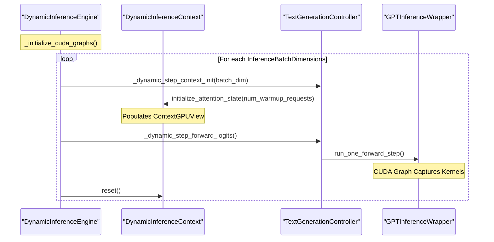
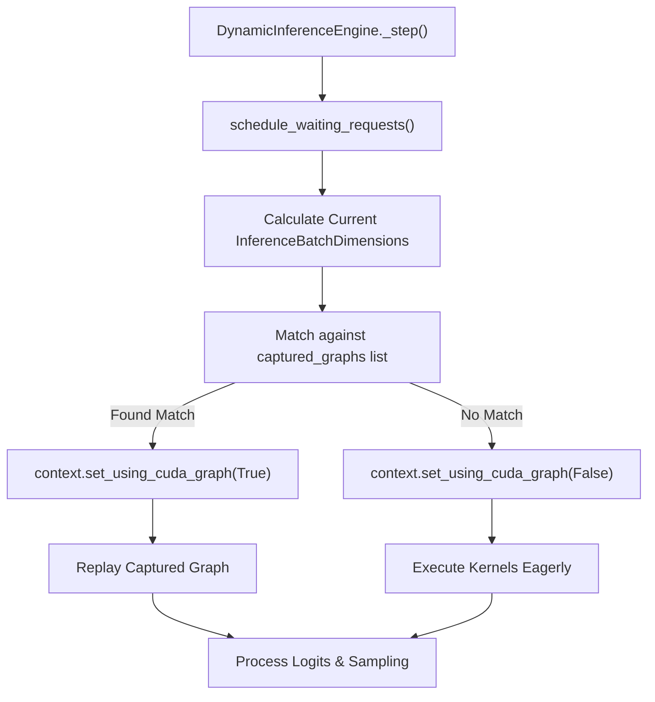

<!-- source: DeepWiki mcp.deepwiki.com · repo NVIDIA/Megatron-LM · page 8.4 CUDA Graphs for Inference · fetched 2026-10-26 -->

# CUDA Graphs for Inference

Relevant source files

The following files were used as context for generating this wiki page:

- [megatron/core/inference/batch_dimensions_utils.py](megatron/core/inference/batch_dimensions_utils.py)
- [megatron/core/inference/config.py](megatron/core/inference/config.py)
- [megatron/core/inference/contexts/attention_context/metadata_base.py](megatron/core/inference/contexts/attention_context/metadata_base.py)
- [megatron/core/inference/contexts/attention_context/mha_metadata.py](megatron/core/inference/contexts/attention_context/mha_metadata.py)
- [megatron/core/inference/contexts/dynamic_context.py](megatron/core/inference/contexts/dynamic_context.py)
- [megatron/core/inference/engines/dynamic_engine.py](megatron/core/inference/engines/dynamic_engine.py)
- [megatron/core/inference/inference_request.py](megatron/core/inference/inference_request.py)
- [megatron/core/inference/sampling_params.py](megatron/core/inference/sampling_params.py)
- [megatron/core/inference/text_generation_controllers/text_generation_controller.py](megatron/core/inference/text_generation_controllers/text_generation_controller.py)
- [megatron/inference/utils.py](megatron/inference/utils.py)
- [megatron/training/config/inference_config.py](megatron/training/config/inference_config.py)
- [tests/unit_tests/inference/contexts/test_dynamic_context.py](tests/unit_tests/inference/contexts/test_dynamic_context.py)
- [tests/unit_tests/inference/engines/test_dynamic_engine.py](tests/unit_tests/inference/engines/test_dynamic_engine.py)
- [tests/unit_tests/inference/test_batch_dimension_utils.py](tests/unit_tests/inference/test_batch_dimension_utils.py)
- [tests/unit_tests/inference/test_inference_config.py](tests/unit_tests/inference/test_inference_config.py)
- [tests/unit_tests/inference/test_mtp_cuda_graph_inference.py](tests/unit_tests/inference/test_mtp_cuda_graph_inference.py)
- [tests/unit_tests/inference/text_generation_controllers/test_text_generation_controller.py](tests/unit_tests/inference/text_generation_controllers/test_text_generation_controller.py)

## Purpose and Scope

This document explains the integration of CUDA graphs within Megatron-LM's inference system. CUDA graphs are utilized to minimize CPU launch overhead by capturing a sequence of GPU kernels and replaying them as a single operation. This optimization is critical for low-latency token generation, particularly during the decode phase of Large Language Models (LLMs).

This page covers the architecture of graph capture and replay, the role of `DynamicInferenceContext` and `ContextGPUView` in managing graphed state, and how batch dimensions are optimized for graph matching. It also details specific integrations for Mixture of Experts (MoE) and Multi-Token Prediction (MTP).

## CUDA Graphs in Inference: Overview

CUDA graphs eliminate the per-kernel launch overhead by recording the execution path. In Megatron-LM inference, they are primarily targeted at the **decode-only** steps where kernel overhead often dominates the total execution time. The engine can also be configured to use graphs for non-decode steps via `use_cuda_graphs_for_non_decode_steps` [megatron/core/inference/contexts/dynamic_context.py:101-101]().

### Key Components

| Component | Role | File Reference |
|-----------|------|----------------|
| `DynamicInferenceEngine` | Orchestrates graph capture during initialization and replay during execution. | [megatron/core/inference/engines/dynamic_engine.py:36-36]() |
| `DynamicInferenceContext` | Manages the memory and metadata required for both graphed and eager execution. | [megatron/core/inference/contexts/dynamic_context.py:113-173]() |
| `ContextGPUView` | Provides a GPU-resident snapshot of bookkeeping data with fixed addresses for graph compatibility. | [megatron/core/inference/contexts/gpu_view.py:6-25]() |
| `CUDAGraphBatchDimensionBuilder` | Generates a discrete set of batch configurations (tokens/requests) for which graphs will be captured. | [megatron/core/inference/batch_dimensions_utils.py:22-25]() |
| `CudaGraphManager` | Low-level utility for managing `torch.cuda.CUDAGraph` objects, handles capture and replay logic. | [megatron/core/transformer/cuda_graphs.py:186-214]() |

**Sources:** [megatron/core/inference/engines/dynamic_engine.py:36-36](), [megatron/core/inference/contexts/dynamic_context.py:113-173](), [megatron/core/inference/contexts/gpu_view.py:6-25](), [megatron/core/inference/batch_dimensions_utils.py:22-25](), [megatron/core/transformer/cuda_graphs.py:186-214]()

## Graph Capture Architecture

### Capture Flow
Graphs are captured during the initialization of the `DynamicInferenceEngine`. The engine iterates through a list of batch dimensions provided by the `CUDAGraphBatchDimensionBuilder` and performs a "warmup" forward pass to record the operations. The number of graphs is controlled by `inference_dynamic_batching_num_cuda_graphs` [megatron/training/config/inference_config.py:109-112]().

**Sources:** [megatron/core/inference/engines/dynamic_engine.py:190-214](), [megatron/core/inference/text_generation_controllers/text_generation_controller.py:76-103](), [megatron/training/config/inference_config.py:109-112]()

### Static Memory Management
For a CUDA graph to be valid across replays, the memory addresses of its inputs and outputs must remain constant. The `DynamicInferenceContext` facilitates this via `ContextGPUView`:
1.  **Contiguous GPU Buffers**: `ContextGPUView` backs all bookkeeping fields (like `token_to_input_ids` or `mha_block_table`) with a single contiguous `uint8` buffer (`self._buf`) [megatron/core/inference/contexts/gpu_view.py:20-25]().
2.  **Fixed Addresses**: Each field is a `view()` onto a slice of this buffer, ensuring the per-step Host-to-Device (H2D) transfer is a single `cudaMemcpyAsync` and addresses remain static for the graph [megatron/core/inference/contexts/gpu_view.py:20-25]().
3.  **Memory Pooling**: Leveraging a global memory pool (`CudaGraphManager.global_mempool`) to share activation memory between different graph instances [megatron/core/transformer/cuda_graphs.py:199-214]().

**Sources:** [megatron/core/inference/contexts/gpu_view.py:6-25](), [megatron/core/transformer/cuda_graphs.py:199-214]()

## Runtime Graph Selection

During each inference step, the engine evaluates the current batch (total tokens, prefill requests, and decode requests) to decide between graph replay or eager execution.

### Matching Logic
The engine uses `InferenceBatchDimensions.is_applicable_for_batch_dim()` to find a captured graph that can "fit" the current workload. A graph is applicable if its captured capacity (tokens and requests) is greater than or equal to the current requirements [megatron/core/inference/batch_dimensions_utils.py:44-74]().

**Sources:** [megatron/core/inference/engines/dynamic_engine.py:123-136](), [megatron/core/inference/batch_dimensions_utils.py:44-74]()

## Advanced Optimization Integrations

### MoE and Expert Parallelism
For Mixture of Experts (MoE) in inference, variable-length activations are managed using specialized dispatchers.
- **Graph Compatibility**: Megatron-LM provides `NCCLAllGatherDispatcher` and `NVLSAllGatherVDispatcher` to handle MoE communication patterns [megatron/core/inference/contexts/dynamic_context.py:41-45]().
- **EP Adjustment**: The `adjust_batch_dims_for_expert_parallelism` method ensures that all ranks in an Expert Parallel (EP) group use the same graph dimensions by taking the `max` of token counts across the group [megatron/core/inference/batch_dimensions_utils.py:143-180]().

### Multi-Token Prediction (MTP)
MTP models predict multiple future tokens simultaneously, which complicates graph shapes.
- **KV Rewind**: MTP requires specialized logic like `rewind_kv_cache` and `prepare_next_forward_pass` which must be compatible with the static memory addresses used in graphs [megatron/core/inference/text_generation_controllers/text_generation_controller.py:68-73]().
- **Speculative Padded Dims**: Batch dimensions for MTP account for speculative tokens via `num_speculative_tokens` in the validity checks [megatron/core/inference/batch_dimensions_utils.py:101-104]().

### RNG State Management
CUDA graph capture requires "graph-safe" random number generation. The `CudaRNGStatesTracker` (referenced in training utilities) ensures that random seeds are correctly handled within captured regions, preventing divergence across graph replays [megatron/core/tensor_parallel/random.py:62-62]().

**Sources:** [megatron/core/inference/contexts/dynamic_context.py:41-45](), [megatron/core/inference/batch_dimensions_utils.py:143-180](), [megatron/core/inference/text_generation_controllers/text_generation_controller.py:68-73](), [megatron/core/inference/batch_dimensions_utils.py:101-104]()

## Configuration Reference

| Parameter | Impact on CUDA Graphs | File Reference |
|-----------|------------------------|----------------|
| `cuda_graph_modules` | Defines which transformer sub-modules (e.g., Block, MLP, Attention) to wrap in CUDA graphs. | [megatron/training/config/inference_config.py:66-68]() |
| `inference_cuda_graph_scope` | Sets the granularity of capture (e.g., entire block vs. individual layers). | [megatron/core/transformer/enums.py:55-55]() |
| `cuda_graph_sizing_distribution` | Determines if graph token counts are spaced exponentially or linearly. | [megatron/core/inference/config.py:150-163]() |
| `cuda_graph_max_tokens` | The maximum token count for which a graph will be captured. | [megatron/core/inference/contexts/dynamic_context.py:104-104]() |

**Sources:** [megatron/training/config/inference_config.py:66-68](), [megatron/core/transformer/enums.py:55-55](), [megatron/core/inference/config.py:150-163](), [megatron/core/inference/contexts/dynamic_context.py:104-104]()

---

