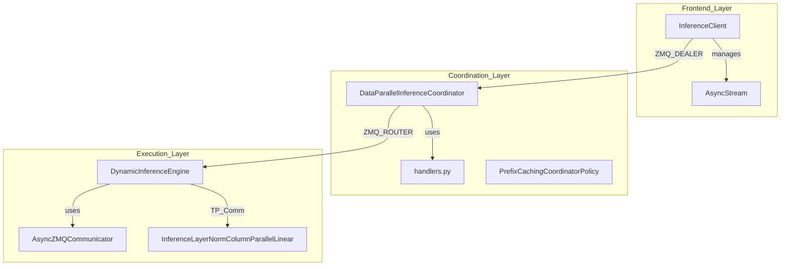
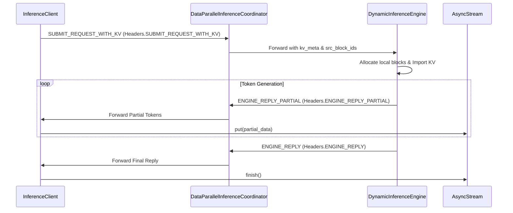

<!-- source: DeepWiki mcp.deepwiki.com · repo NVIDIA/Megatron-LM · page 8.5 Distributed Inference and Coordination · fetched 2026-10-26 -->

# Distributed Inference and Coordination

Relevant source files

The following files were used as context for generating this wiki page:

- [megatron/core/inference/async_stream.py](megatron/core/inference/async_stream.py)
- [megatron/core/inference/communication/torch_symm_triton/collectives.py](megatron/core/inference/communication/torch_symm_triton/collectives.py)
- [megatron/core/inference/data_parallel_inference_coordinator/coordinator.py](megatron/core/inference/data_parallel_inference_coordinator/coordinator.py)
- [megatron/core/inference/data_parallel_inference_coordinator/handlers.py](megatron/core/inference/data_parallel_inference_coordinator/handlers.py)
- [megatron/core/inference/headers.py](megatron/core/inference/headers.py)
- [megatron/core/inference/inference_client.py](megatron/core/inference/inference_client.py)
- [megatron/core/tensor_parallel/inference_layers.py](megatron/core/tensor_parallel/inference_layers.py)
- [tests/functional_tests/test_cases/moe/gpt_dynamic_inference_tp4_pp1_ep4_16B_mtp_sp_block_cudagraphs/golden_values_dev_dgx_gb200.json](tests/functional_tests/test_cases/moe/gpt_dynamic_inference_tp4_pp1_ep4_16B_mtp_sp_block_cudagraphs/golden_values_dev_dgx_gb200.json)
- [tests/functional_tests/test_cases/moe/gpt_dynamic_inference_tp4_pp1_ep4_16B_mtp_sp_block_cudagraphs/golden_values_dev_dgx_h100.json](tests/functional_tests/test_cases/moe/gpt_dynamic_inference_tp4_pp1_ep4_16B_mtp_sp_block_cudagraphs/golden_values_dev_dgx_h100.json)
- [tests/functional_tests/test_cases/moe/gpt_dynamic_inference_tp4_pp1_ep4_16B_mtp_sp_block_cudagraphs/model_config.yaml](tests/functional_tests/test_cases/moe/gpt_dynamic_inference_tp4_pp1_ep4_16B_mtp_sp_block_cudagraphs/model_config.yaml)
- [tests/unit_tests/inference/coordinator_test_utils.py](tests/unit_tests/inference/coordinator_test_utils.py)
- [tests/unit_tests/inference/test_data_parallel_inference_coordinator.py](tests/unit_tests/inference/test_data_parallel_inference_coordinator.py)
- [tests/unit_tests/inference/test_dynamic_prefix_caching_coordinator.py](tests/unit_tests/inference/test_dynamic_prefix_caching_coordinator.py)
- [tests/unit_tests/inference/test_inference_client_streaming.py](tests/unit_tests/inference/test_inference_client_streaming.py)
- [tests/unit_tests/inference/test_moe_dispatching_and_routing.py](tests/unit_tests/inference/test_moe_dispatching_and_routing.py)

## Purpose and Scope

This document describes the distributed inference system in Megatron-LM, specifically focusing on the `DataParallelInferenceCoordinator` and ZMQ-based request orchestration. This system enables horizontal scaling of inference throughput by distributing requests across multiple data-parallel (DP) replicas, each potentially consisting of multiple tensor-parallel (TP) and pipeline-parallel (PP) ranks.

The system is designed for high-concurrency environments, supporting:
- **Centralized Request Management**: A dedicated coordinator process for load balancing and worker registration.
- **Asynchronous Communication**: Non-blocking message passing using ZeroMQ (ZMQ) and MessagePack (msgpack).
- **Streaming Support**: Real-time token delivery via `AsyncStream` and `Headers.ENGINE_REPLY_PARTIAL`.
- **KV Cache Handoff**: Coordination for disaggregated inference, allowing KV state to be transferred between prefill and decode engines.
- **Prefix-Aware Routing**: Optimization for KV cache reuse by routing similar prompts to the same DP rank.

## Architecture Overview

The distributed inference architecture separates request ingestion, coordination, and execution into distinct layers.

### System Components and Code Entities

The following diagram maps high-level system components to their corresponding classes and modules.

**Sources:** [megatron/core/inference/data_parallel_inference_coordinator/coordinator.py:46-82](), [megatron/core/inference/inference_client.py:31-54](), [megatron/core/inference/async_stream.py:17-23](), [megatron/core/tensor_parallel/inference_layers.py:125-147]()

## DataParallelInferenceCoordinator

The `DataParallelInferenceCoordinator` acts as the central hub, managing the lifecycle of requests and the availability of data-parallel workers [megatron/core/inference/data_parallel_inference_coordinator/coordinator.py:46-51]().

### Message Handling and Dispatch
Message handling is decoupled from the main loop via a registry in `handlers.py`. Each handler is decorated with `@message_handler` and keyed by a `Headers` enum value [megatron/core/inference/data_parallel_inference_coordinator/handlers.py:6-14]().

| Handler Function | Header | Description |
| :--- | :--- | :--- |
| `handle_connect` | `CONNECT` | Performs handshake with new clients [megatron/core/inference/data_parallel_inference_coordinator/handlers.py:54-64](). |
| `handle_submit_request` | `SUBMIT_REQUEST` | Routes standard inference tasks to DP ranks [megatron/core/inference/data_parallel_inference_coordinator/handlers.py:67-72](). |
| `handle_submit_request_with_kv` | `SUBMIT_REQUEST_WITH_KV` | Routes requests involving remote KV imports for disaggregated inference [megatron/core/inference/data_parallel_inference_coordinator/handlers.py:138-140](). |
| `handle_engine_reply` | `ENGINE_REPLY` | Forwards completed results back to the initiating client [megatron/core/inference/data_parallel_inference_coordinator/handlers.py:205-209](). |

### Prefix-Aware Routing Logic
When `enable_prefix_caching` is active, the coordinator uses `compute_block_hashes_batched` to calculate hashes for prompt tokens [megatron/core/inference/data_parallel_inference_coordinator/coordinator.py:97-101](). It maintains a shadow `_hash_table` to track which DP ranks have cached specific blocks [tests/unit_tests/inference/test_dynamic_prefix_caching_coordinator.py:57-61](). 

The routing score is calculated as:
`score = alpha * match + (1 - alpha) * normalized_load` [megatron/core/inference/data_parallel_inference_coordinator/coordinator.py:118-119]().

**Sources:** [megatron/core/inference/data_parallel_inference_coordinator/coordinator.py:88-122](), [megatron/core/inference/data_parallel_inference_coordinator/handlers.py:36-51](), [megatron/core/inference/inference_request.py:18-32]()

## Inference Communication Flow

Communication uses ZeroMQ with MessagePack serialization to ensure non-blocking, low-latency coordination.

### Sequence: Streaming Request with KV Handoff
This sequence illustrates a disaggregated inference scenario where a client initiates a streaming request that pulls KV state from a remote prefill engine.

**Sources:** [megatron/core/inference/inference_client.py:163-188](), [megatron/core/inference/data_parallel_inference_coordinator/handlers.py:138-174](), [megatron/core/inference/async_stream.py:41-53](), [megatron/core/inference/headers.py:25-35]()

### Protocol Headers
The `Headers` class provides a unified interface for signaling across the distributed system [megatron/core/inference/headers.py:119-128]().

- **Request Category**: `SUBMIT_REQUEST`, `ENGINE_REPLY`, `ENGINE_REPLY_PARTIAL`, `ABORT_REQUEST`, `SUBMIT_REQUEST_WITH_KV`, `RELEASE_KV` [megatron/core/inference/headers.py:25-35]().
- **Control Category**: `PAUSE`, `UNPAUSE`, `SUSPEND`, `RESUME`, `STOP` [megatron/core/inference/headers.py:37-48]().
- **Transport Category**: `TP_BROADCAST`, `KV_HANDOFF_COMPLETE` [megatron/core/inference/headers.py:57-62]().

## InferenceClient and Streaming

The `InferenceClient` manages the asynchronous interaction between the user application and the coordinator [megatron/core/inference/inference_client.py:31-54]().

### Streaming Mechanism
Streaming is handled via `AsyncStream`, which wraps an `asyncio.Queue` [megatron/core/inference/async_stream.py:32-34]().
1.  **Submission**: `add_request_streaming` sets `sampling_params.streaming = True` and sends the request [megatron/core/inference/inference_client.py:184-200]().
2.  **Partial Replies**: The client's listener task receives `ENGINE_REPLY_PARTIAL` frames and calls `stream.put()` [tests/unit_tests/inference/test_inference_client_streaming.py:77-85]().
3.  **Termination**: An `ENGINE_REPLY` frame triggers `stream.finish()`, ending the async iterator [tests/unit_tests/inference/test_inference_client_streaming.py:86-89]().

### KV Handoff for Disaggregated Inference
The client supports `add_request_with_kv_handoff`, which includes `kv_meta` (identifying remote buffers) and `src_block_ids` (identifying specific KV blocks) [megatron/core/inference/inference_client.py:137-157](). This allows the decode engine to pull KV state directly from a prefill peer before beginning generation.

**Sources:** [megatron/core/inference/inference_client.py:117-188](), [megatron/core/inference/async_stream.py:60-70](), [tests/unit_tests/inference/test_inference_client_streaming.py:29-55]()

## Low-Level Communication Optimizations

Megatron Core provides specialized layers and kernels to minimize inference latency.

### Inference-Optimized Layers
Classes like `InferenceLayerNormColumnParallelLinear` are optimized for inference by skipping training-specific logic and utilizing fused kernels [megatron/core/tensor_parallel/inference_layers.py:125-147]().
- **Triton NVLS Kernels**: Uses `multimem_all_gather` and `multimem_reduce_scatter` for high-speed communication over NVLink [megatron/core/tensor_parallel/inference_layers.py:13-18]().
- **Fused RS-Add-Norm-AG**: Toggles like `skip_norm_and_all_gather` allow fusing the reduce-scatter from one layer with the norm and all-gather of the next [megatron/core/tensor_parallel/inference_layers.py:188-191]().

### Triton Collectives
The `megatron.core.inference.communication.torch_symm_triton` module implements `multimem` instructions for Zero-Copy communication using Symmetric Memory [megatron/core/inference/communication/torch_symm_triton/collectives.py:187-197]().
- **All-Gather Phase**: Loads from local memory and multicast-stores to a symmetric buffer [megatron/core/inference/communication/torch_symm_triton/collectives.py:30-40]().
- **Fused 3-Tensor AG**: Processes three tensors in sequence with a single synchronization point to eliminate kernel launch overhead [megatron/core/inference/communication/torch_symm_triton/collectives.py:111-132]().

**Sources:** [megatron/core/tensor_parallel/inference_layers.py:168-191](), [megatron/core/inference/communication/torch_symm_triton/collectives.py:29-108](), [megatron/core/inference/communication/torch_symm_triton/collectives.py:175-222]()

---

