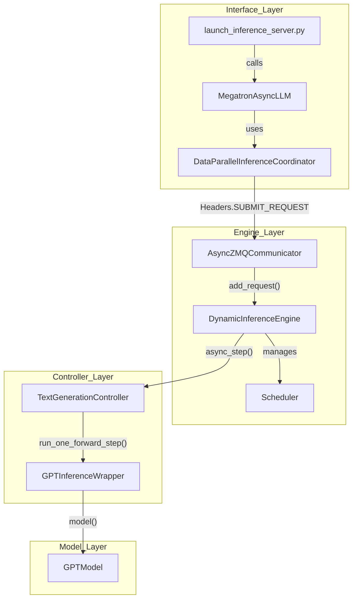
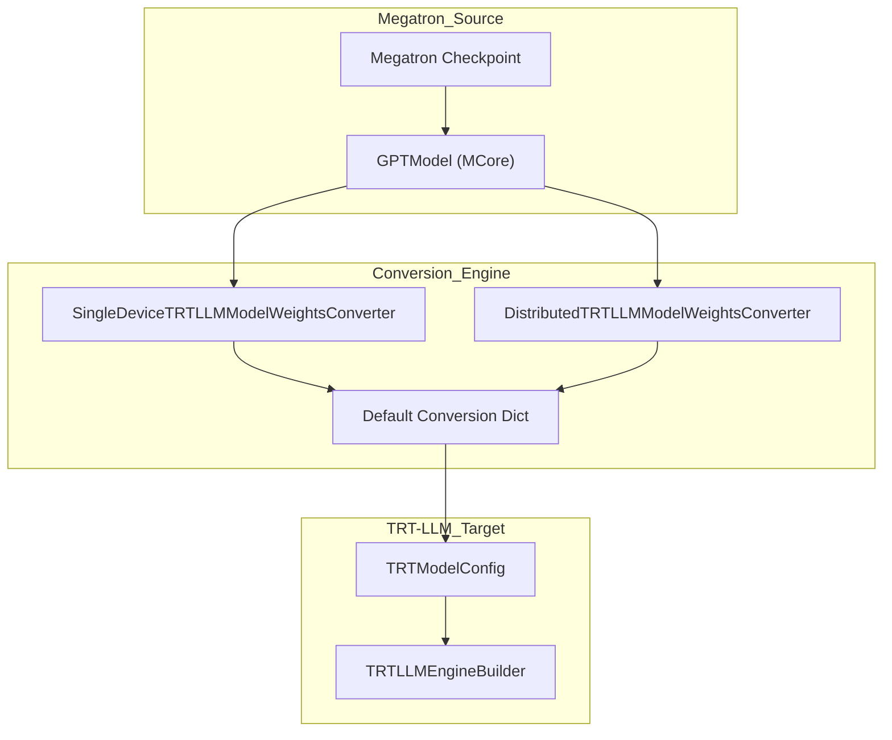

<!-- source: DeepWiki mcp.deepwiki.com · repo NVIDIA/Megatron-LM · page 8.6 Text Generation APIs and CLI Tools · fetched 2026-10-26 -->

# Text Generation APIs and CLI Tools

Relevant source files

The following files were used as context for generating this wiki page:

- [examples/export/trtllm_export/README.md](examples/export/trtllm_export/README.md)
- [examples/inference/README.md](examples/inference/README.md)
- [megatron/core/export/model_type.py](megatron/core/export/model_type.py)
- [megatron/core/export/trtllm/engine_builder/trtllm_engine_builder.py](megatron/core/export/trtllm/engine_builder/trtllm_engine_builder.py)
- [megatron/core/export/trtllm/model_to_trllm_mapping/default_conversion_dict.py](megatron/core/export/trtllm/model_to_trllm_mapping/default_conversion_dict.py)
- [megatron/core/export/trtllm/trt_model_config.py](megatron/core/export/trtllm/trt_model_config.py)
- [megatron/core/export/trtllm/trt_model_type.py](megatron/core/export/trtllm/trt_model_type.py)
- [megatron/core/export/trtllm/trtllm_helper.py](megatron/core/export/trtllm/trtllm_helper.py)
- [megatron/core/export/trtllm/trtllm_layers.py](megatron/core/export/trtllm/trtllm_layers.py)
- [megatron/core/export/trtllm/trtllm_weights_converter/distributed_trtllm_model_weights_converter.py](megatron/core/export/trtllm/trtllm_weights_converter/distributed_trtllm_model_weights_converter.py)
- [megatron/core/export/trtllm/trtllm_weights_converter/single_device_trtllm_model_weights_converter.py](megatron/core/export/trtllm/trtllm_weights_converter/single_device_trtllm_model_weights_converter.py)
- [megatron/core/inference/common_inference_params.py](megatron/core/inference/common_inference_params.py)
- [megatron/core/inference/communication_utils.py](megatron/core/inference/communication_utils.py)
- [megatron/core/inference/contexts/base_context.py](megatron/core/inference/contexts/base_context.py)
- [megatron/core/inference/contexts/static_context.py](megatron/core/inference/contexts/static_context.py)
- [megatron/core/inference/engines/mcore_engine.py](megatron/core/inference/engines/mcore_engine.py)
- [megatron/core/inference/model_inference_wrappers/abstract_model_inference_wrapper.py](megatron/core/inference/model_inference_wrappers/abstract_model_inference_wrapper.py)
- [megatron/core/inference/model_inference_wrappers/gpt/gpt_inference_wrapper.py](megatron/core/inference/model_inference_wrappers/gpt/gpt_inference_wrapper.py)
- [megatron/core/inference/model_inference_wrappers/multimodal/vlm_inference_wrapper.py](megatron/core/inference/model_inference_wrappers/multimodal/vlm_inference_wrapper.py)
- [megatron/core/inference/model_inference_wrappers/t5/t5_inference_wrapper.py](megatron/core/inference/model_inference_wrappers/t5/t5_inference_wrapper.py)
- [megatron/core/inference/scheduler.py](megatron/core/inference/scheduler.py)
- [megatron/core/inference/text_generation_controllers/encoder_decoder_text_generation_controller.py](megatron/core/inference/text_generation_controllers/encoder_decoder_text_generation_controller.py)
- [megatron/core/inference_params.py](megatron/core/inference_params.py)
- [megatron/core/transformer/heterogeneous/heterogeneous_config.py](megatron/core/transformer/heterogeneous/heterogeneous_config.py)
- [tests/unit_tests/export/trtllm/test_distributed_fp8.py](tests/unit_tests/export/trtllm/test_distributed_fp8.py)
- [tests/unit_tests/export/trtllm/test_single_device_fp8.py](tests/unit_tests/export/trtllm/test_single_device_fp8.py)
- [tests/unit_tests/export/trtllm/test_trtllm_distributed_gpu_converter.py](tests/unit_tests/export/trtllm/test_trtllm_distributed_gpu_converter.py)
- [tests/unit_tests/export/trtllm/test_trtllm_helper.py](tests/unit_tests/export/trtllm/test_trtllm_helper.py)
- [tests/unit_tests/export/trtllm/test_trtllm_single_device_converter.py](tests/unit_tests/export/trtllm/test_trtllm_single_device_converter.py)
- [tests/unit_tests/inference/model_inference_wrappers/gpt/test_gpt_inference_wrapper.py](tests/unit_tests/inference/model_inference_wrappers/gpt/test_gpt_inference_wrapper.py)
- [tests/unit_tests/inference/model_inference_wrappers/t5/test_t5_inference_wrapper.py](tests/unit_tests/inference/model_inference_wrappers/t5/test_t5_inference_wrapper.py)
- [tests/unit_tests/inference/test_scheduler.py](tests/unit_tests/inference/test_scheduler.py)
- [tests/unit_tests/inference/text_generation_controllers/test_encoder_decoder_text_generation_controller.py](tests/unit_tests/inference/text_generation_controllers/test_encoder_decoder_text_generation_controller.py)
- [tests/unit_tests/inference/text_generation_controllers/test_vlm_text_generation_controller.py](tests/unit_tests/inference/text_generation_controllers/test_vlm_text_generation_controller.py)
- [tools/run_inference_performance_test.py](tools/run_inference_performance_test.py)
- [tools/run_text_generation_server.py](tools/run_text_generation_server.py)

## Purpose and Scope

This page documents the inference examples, command-line tools, API server implementations, and model export workflows in Megatron-LM. These tools bridge the gap between low-level inference engines and user-facing applications, providing standard interfaces for interacting with large language models (LLMs), hybrid/Mamba models, and Vision-Language Models (VLMs), as well as exporting models to TensorRT-LLM (TRT-LLM).

The system supports multiple modes of operation, including offline batched generation, synchronous API serving, and asynchronous distributed serving with continuous batching.

---

## Inference Execution Flow

The inference system follows a layered architecture where user requests are transformed into model-specific inputs through a series of wrappers and controllers.

### Code Entity Relationship
The following diagram maps the logical flow of a request from the API/CLI level down to the core model execution.

**Sources**: [megatron/core/inference/model_inference_wrappers/abstract_model_inference_wrapper.py:23-68](), [examples/inference/README.md:14-27](), [tools/run_text_generation_server.py:70-78]()

---

## Inference Servers

Megatron-LM provides primary server implementations for different use cases: a legacy static server and a modern asynchronous server for continuous batching.

### OpenAI-Compatible Inference Server
The modern entry point is `examples/inference/launch_inference_server.py`. It utilizes `MegatronAsyncLLM.serve()` to expose a high-performance HTTP frontend [examples/inference/README.md:25-27]().

- **`DataParallelInferenceCoordinator`**: Acts as a central router managing communication between multiple clients and data parallel ranks. It handles worker registration, request forwarding, and response routing.
- **OpenAI Compatible Endpoints**: The server provides standard endpoints such as `/v1/chat/completions` and `/v1/completions` [examples/inference/README.md:70-73]().

### Static Text Generation Server
The `tools/run_text_generation_server.py` script initializes a `MegatronServer` for fixed-batch inference [tools/run_text_generation_server.py:178-179]().
- **`run_mcore_engine`**: Orchestrates the inference loop across ranks [tools/run_text_generation_server.py:27](), [tools/run_text_generation_server.py:186-186]().
- **`get_inference_engine`**: Factory function constructing a `StaticInferenceEngine` which utilizes a `StaticInferenceContext` for KV cache management [tools/run_text_generation_server.py:52-78]().
- **Server Loop**: The main loop broadcasts choices to all ranks to synchronize the start of inference or exit [tools/run_text_generation_server.py:181-190]().

**Sources**: [tools/run_text_generation_server.py:52-78](), [tools/run_text_generation_server.py:178-190](), [examples/inference/README.md:66-73]()

---

## CLI Tools and Examples

### Offline Inference
`examples/inference/offline_inference.py` supports batched offline generation using the `MegatronLLM` (sync) or `MegatronAsyncLLM` (async) APIs [examples/inference/README.md:21-24](). It provides throughput stats and optional JSON dumps for regression testing [examples/inference/README.md:35-38]().

### Benchmarking and Performance
`tools/run_inference_performance_test.py` benchmarks inference performance. It supports both `static` and `dynamic` engine types [tools/run_inference_performance_test.py:59-60]().
- **`get_random_prompt_tokens`**: Generates valid token IDs excluding special tokens like BOS/EOS for stress testing [tools/run_inference_performance_test.py:95-120]().
- **`generate_dynamic`**: Drives the `DynamicInferenceEngine` step-by-step and tracks per-request latency [tools/run_inference_performance_test.py:123-149]().

### Model Inference Wrappers
Wrappers encapsulate model-specific logic for the inference loop, preparing inputs and managing forward passes.

| Wrapper Class | Model Architecture | Key Responsibilities |
|---------------|-------------------|----------------------|
| `GPTInferenceWrapper` | GPT (MCore/Legacy) | Builds causal masks and position IDs; manages standard KV cache [megatron/core/inference/model_inference_wrappers/gpt/gpt_inference_wrapper.py:19-28](). |
| `T5InferenceWrapper` | T5 (Encoder-Decoder) | Handles encoder tokenization with mask/sentinel logic and decoder padding [megatron/core/inference/model_inference_wrappers/t5/t5_inference_wrapper.py:19-38](). |
| `AbstractModelInferenceWrapper` | Base Class | Handles model preparation, eval mode, and pipeline parallel communication (P2P send/recv) [megatron/core/inference/model_inference_wrappers/abstract_model_inference_wrapper.py:23-78](). |

**Sources**: [megatron/core/inference/model_inference_wrappers/abstract_model_inference_wrapper.py:23-158](), [tools/run_inference_performance_test.py:59-149](), [megatron/core/inference/model_inference_wrappers/gpt/gpt_inference_wrapper.py:34-52](), [megatron/core/inference/model_inference_wrappers/t5/t5_inference_wrapper.py:42-91]()

---

## Model Export to TensorRT-LLM

Megatron-LM includes a framework for exporting trained models to NVIDIA TensorRT-LLM for optimized deployment.

### Export Architecture
The export process converts Megatron checkpoints into a format compatible with TRT-LLM's build system, supporting both single-device and distributed configurations.

### Key Export Components
- **`SingleDeviceTRTLLMModelWeightsConverter`**: Handles weight mapping and casting for models on a single GPU. It supports FP8 scaling if scaling factors are provided [megatron/core/export/trtllm/trtllm_weights_converter/single_device_trtllm_model_weights_converter.py:40-72]().
- **`DistributedTRTLLMModelWeightsConverter`**: Manages weight conversion for sharded models. It handles gated activation splitting (e.g., SwiGLU) during export [megatron/core/export/trtllm/trtllm_weights_converter/distributed_trtllm_model_weights_converter.py:31-69]().
- **`TRTLLMEngineBuilder`**: Orchestrates the compilation of the TRT-LLM engine from converted weights.

**Sources**: [megatron/core/export/trtllm/trtllm_weights_converter/single_device_trtllm_model_weights_converter.py:40-72](), [megatron/core/export/trtllm/trtllm_weights_converter/distributed_trtllm_model_weights_converter.py:31-74]()

---

## Configuration and Arguments

- **`Scheduler`**: Manages the lifecycle of inference requests, transitioning them between `active_request_pool`, `waiting_request_pool`, and `completed_request_pool` based on `max_batch_size` [megatron/core/inference/scheduler.py:17-36]().
- **`SamplingParams`**: Encapsulated parameters for token generation, including `temperature`, `top_k`, `top_p`, and `num_tokens_to_generate` [megatron/core/inference/sampling_params.py:22-22]().
- **Server Arguments**: `add_text_generate_args` defines CLI flags for the text generation server such as `--port`, `--prompts`, and sampling controls [tools/run_text_generation_server.py:81-116]().

**Sources**: [megatron/core/inference/scheduler.py:17-152](), [tools/run_text_generation_server.py:81-116](), [tools/run_inference_performance_test.py:179-188]()

---

