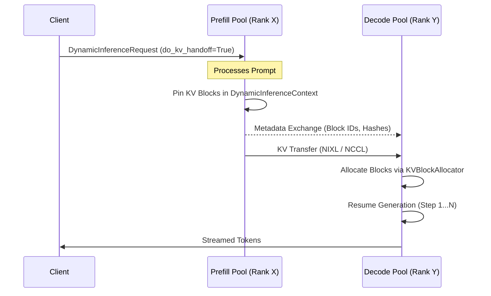

<!-- source: DeepWiki mcp.deepwiki.com · repo NVIDIA/Megatron-LM · page 8.7 Disaggregated Inference · fetched 2026-10-26 -->

# Disaggregated Inference

<details>
<summary>Relevant source files</summary>

The following files were used as context for generating this wiki page:

- [megatron/core/inference/config.py](megatron/core/inference/config.py)
- [megatron/core/inference/contexts/dynamic_context.py](megatron/core/inference/contexts/dynamic_context.py)
- [megatron/core/inference/disaggregation/ssm_reshard.py](megatron/core/inference/disaggregation/ssm_reshard.py)
- [megatron/core/inference/disaggregation/transfer_backends/__init__.py](megatron/core/inference/disaggregation/transfer_backends/__init__.py)
- [megatron/core/inference/disaggregation/transfer_backends/base.py](megatron/core/inference/disaggregation/transfer_backends/base.py)
- [megatron/core/inference/disaggregation/transfer_backends/nccl.py](megatron/core/inference/disaggregation/transfer_backends/nccl.py)
- [megatron/core/inference/disaggregation/transfer_backends/nixl.py](megatron/core/inference/disaggregation/transfer_backends/nixl.py)
- [megatron/core/inference/disaggregation/utils.py](megatron/core/inference/disaggregation/utils.py)
- [megatron/core/inference/engines/dynamic_engine.py](megatron/core/inference/engines/dynamic_engine.py)
- [megatron/core/inference/inference_request.py](megatron/core/inference/inference_request.py)
- [megatron/core/inference/sampling_params.py](megatron/core/inference/sampling_params.py)
- [megatron/core/inference/text_generation_controllers/text_generation_controller.py](megatron/core/inference/text_generation_controllers/text_generation_controller.py)
- [megatron/inference/utils.py](megatron/inference/utils.py)
- [megatron/training/config/inference_config.py](megatron/training/config/inference_config.py)
- [tests/unit_tests/inference/contexts/test_dynamic_context.py](tests/unit_tests/inference/contexts/test_dynamic_context.py)
- [tests/unit_tests/inference/engines/test_dynamic_engine.py](tests/unit_tests/inference/engines/test_dynamic_engine.py)
- [tests/unit_tests/inference/test_inference_config.py](tests/unit_tests/inference/test_inference_config.py)
- [tests/unit_tests/inference/test_kv_transfer_backends.py](tests/unit_tests/inference/test_kv_transfer_backends.py)
- [tests/unit_tests/inference/test_mtp_cuda_graph_inference.py](tests/unit_tests/inference/test_mtp_cuda_graph_inference.py)
- [tests/unit_tests/inference/test_nccl_transfer_backend.py](tests/unit_tests/inference/test_nccl_transfer_backend.py)
- [tests/unit_tests/inference/test_ssm_reshard.py](tests/unit_tests/inference/test_ssm_reshard.py)
- [tests/unit_tests/inference/text_generation_controllers/test_text_generation_controller.py](tests/unit_tests/inference/text_generation_controllers/test_text_generation_controller.py)

</details>


Disaggregated inference refers to the architectural separation of the **Prefill** (context processing) and **Decode** (token generation) phases of Large Language Model (LLM) inference across distinct GPU pools. This separation allows for independent scaling of compute resources to optimize for the differing hardware requirements of each phase: high compute throughput for prefill and high memory bandwidth for decode.

Megatron-LM implements this via the `DisaggDynamicInferenceEngine`, which facilitates the handoff of inference state (KV cache and SSM states) between prefill and decode instances using high-performance communication backends.

## Architecture Overview

The disaggregated inference system consists of two primary components: a **Prefill Pool** and a **Decode Pool**. When a request arrives, the prefill pool processes the initial prompt and then transfers the generated KV cache to the decode pool to continue generation.

### System Components

| Component | Role | Code Entity |
| :--- | :--- | :--- |
| **Engine** | Orchestrates the step-by-step execution and state handoff. | `DisaggDynamicInferenceEngine` |
| **State Handoff** | Mechanism to package and move KV/SSM states between pools. | `do_kv_handoff` flag in `SamplingParams` |
| **Transfer Backend** | Low-level communication layer for moving tensors across the network. | `KVTransferBackend` |
| **Dynamic Context** | Manages block-level KV cache allocation and mapping. | `DynamicInferenceContext` |

### Prefill to Decode Data Flow

The following diagram illustrates the lifecycle of a request in a disaggregated setup:

**Disaggregated Request Lifecycle**

Sources: [megatron/core/inference/sampling_params.py:43-43](), [megatron/core/inference/engines/dynamic_engine.py:168-188]()

## Inference State Handoff

The handoff mechanism relies on the `do_kv_handoff` attribute within `SamplingParams` [megatron/core/inference/sampling_params.py:43-43](). When enabled, the engine performs the following actions:

1.  **Block Pinning**: The `DynamicInferenceContext` ensures that the physical memory blocks associated with the request are not evicted during the transfer [megatron/core/inference/contexts/dynamic_context.py:54-54]().
2.  **Metadata Packaging**: Information including `finished_handoff_block_ids`, `finished_handoff_ssm_slots`, and `finished_handoff_decode_tokens` is gathered by the `TextGenerationController` [megatron/core/inference/text_generation_controllers/text_generation_controller.py:178-180]().
3.  **SSM State Handling**: For hybrid models (e.g., Mamba), the SSM states are reshared and transferred alongside the KV cache [megatron/core/inference/config.py:16-41]().

Sources: [megatron/core/inference/sampling_params.py:43-43](), [megatron/core/inference/text_generation_controllers/text_generation_controller.py:178-180](), [megatron/core/inference/config.py:16-41]()

## KV Transfer Backends

Megatron-LM supports multiple backends for transferring the KV cache between the prefill and decode ranks. These are abstracted under the `KVTransferBackend` base class.

### Supported Backends

*   **NCCL Backend**: Uses standard NCCL process groups for inter-rank communication. This is the default for most multi-node setups.
*   **NIXL Backend**: A specialized backend optimized for high-throughput transfers, often leveraging NVLink or proprietary interconnects.

### Transfer Logic in Code

The association between system components and code entities is detailed below:

**Transfer Backend Class Relationships**
```mermaid
classDiagram
    class "KVTransferBackend" {
        <<Abstract>>
        +send_kv(tensors, destination)
        +receive_kv(source)
    }
    class "NCCLTransferBackend" {
        +comm_group: ProcessGroup
        +send_kv()
    }
    class "NIXLTransferBackend" {
        +shm_manager: SharedMemory
        +send_kv()
    }
    "KVTransferBackend" <|-- "NCCLTransferBackend"
    "KVTransferBackend" <|-- "NIXLTransferBackend"
    
    class "DisaggDynamicInferenceEngine" {
        +transfer_backend: KVTransferBackend
        +context: DynamicInferenceContext
        +step()
    }
    "DisaggDynamicInferenceEngine" --> "KVTransferBackend" : uses
```
Sources: [megatron/core/inference/engines/dynamic_engine.py:27-36](), [megatron/core/inference/contexts/dynamic_context.py:52-54]()

## Dynamic Context Management

The `DynamicInferenceContext` is responsible for managing the memory pool where KV blocks reside. In a disaggregated setting, it must handle the allocation of blocks for incoming transferred states.

### Key Context Operations
*   **Block Allocation**: The `KVBlockAllocator` manages the pool size and availability [megatron/core/inference/contexts/dynamic_context.py:54-54]().
*   **Unified Memory**: Supports `unified_memory_level` to allow the KV cache to spill to CPU memory, which is critical for large-scale disaggregated deployments [megatron/core/inference/config.py:122-124]().
*   **Prefix Caching**: Works in tandem with disaggregation to avoid re-transferring blocks if a common prefix is already present in the decode pool's cache [megatron/core/inference/config.py:111-135]().

### Configuration Parameters

| Parameter | Description | File Reference |
| :--- | :--- | :--- |
| `kv_cache_management_mode` | Determines if tensors are persisted, offloaded, or recomputed during handoff. | [megatron/core/inference/config.py:137-148]() |
| `buffer_size_gb` | Total GPU memory reserved for the KV block pool. | [megatron/core/inference/config.py:84-88]() |
| `max_requests` | Limits the number of concurrent handoffs the engine can process. | [megatron/core/inference/config.py:102-104]() |

Sources: [megatron/core/inference/contexts/dynamic_context.py:54-54](), [megatron/core/inference/config.py:84-148]()

## Implementation Details

The `DisaggDynamicInferenceEngine` extends the standard `DynamicInferenceEngine` to add asynchronous state transfer capabilities.

### Step Execution Loop
During each iteration of the engine's `step()` function:
1.  The `TextGenerationController` determines which requests have finished their prefill phase [megatron/core/inference/text_generation_controllers/text_generation_controller.py:153-164]().
2.  If `do_kv_handoff` is True, the engine invokes the `transfer_backend` to initiate an asynchronous send [megatron/core/inference/sampling_params.py:43-43]().
3.  The engine continues processing other active decode requests while the transfer occurs in the background [megatron/core/inference/engines/dynamic_engine.py:123-136]().

Sources: [megatron/core/inference/engines/dynamic_engine.py:123-136](), [megatron/core/inference/text_generation_controllers/text_generation_controller.py:153-164](), [megatron/core/inference/sampling_params.py:43-43]()

---

