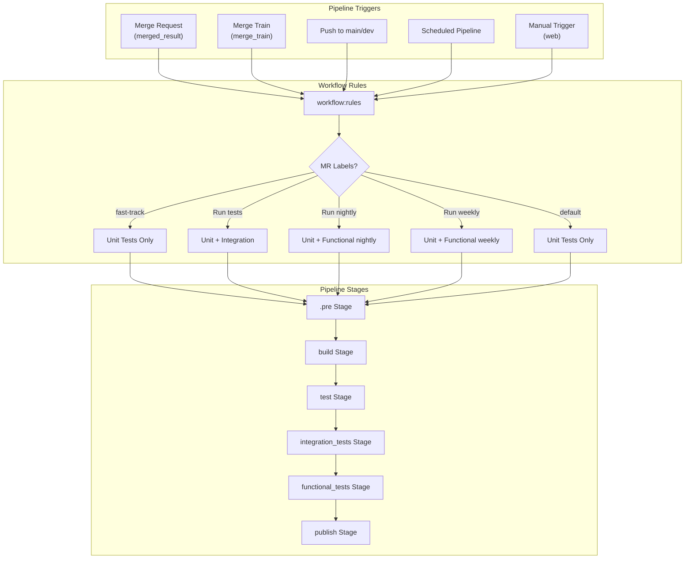
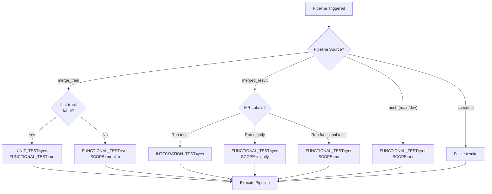
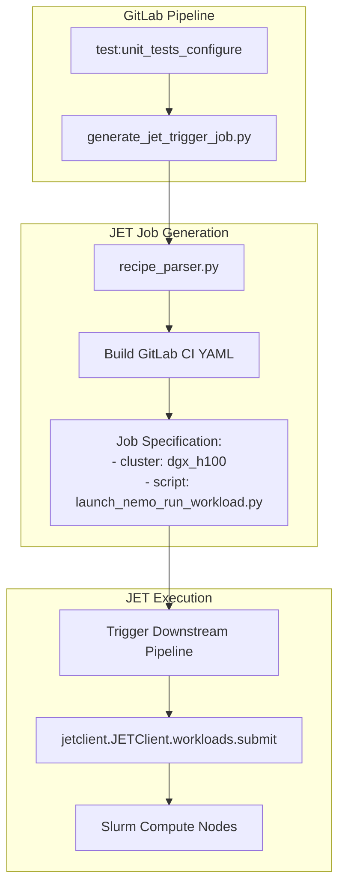

<!-- source: DeepWiki mcp.deepwiki.com · repo NVIDIA/Megatron-LM · page 9 CI/CD and Testing Infrastructure · fetched 2026-10-26 -->

# CI/CD and Testing Infrastructure

Relevant source files

The following files were used as context for generating this wiki page:

- [.github/actions/action.yml](.github/actions/action.yml)
- [.github/scripts/cancel_superseded_merge_group_runs.py](.github/scripts/cancel_superseded_merge_group_runs.py)
- [.github/scripts/test_approve_test_queue.sh](.github/scripts/test_approve_test_queue.sh)
- [.github/scripts/test_cancel_superseded_merge_group_runs.py](.github/scripts/test_cancel_superseded_merge_group_runs.py)
- [.github/workflows/cicd-approve-test-queue.yml](.github/workflows/cicd-approve-test-queue.yml)
- [.github/workflows/cicd-cancel-superseded-merge-groups.yml](.github/workflows/cicd-cancel-superseded-merge-groups.yml)
- [.github/workflows/cicd-main.yml](.github/workflows/cicd-main.yml)
- [.github/workflows/copyright-check.yml](.github/workflows/copyright-check.yml)
- [.github/workflows/install-test.yml](.github/workflows/install-test.yml)
- [.github/workflows/multi-approval-bot.yml](.github/workflows/multi-approval-bot.yml)
- [.github/workflows/release.yaml](.github/workflows/release.yaml)
- [.gitlab-ci.yml](.gitlab-ci.yml)
- [.gitlab/labeler-config.yml](.gitlab/labeler-config.yml)
- [.gitlab/scripts/build.sh](.gitlab/scripts/build.sh)
- [.gitlab/stages/00.pre.yml](.gitlab/stages/00.pre.yml)
- [.gitlab/stages/01.build.yml](.gitlab/stages/01.build.yml)
- [.gitlab/stages/02.test.yml](.gitlab/stages/02.test.yml)
- [.gitlab/stages/03.integration-tests.yml](.gitlab/stages/03.integration-tests.yml)
- [.gitlab/stages/04.functional-tests.yml](.gitlab/stages/04.functional-tests.yml)
- [.gitlab/stages/05.publish.yml](.gitlab/stages/05.publish.yml)
- [tests/test_utils/python_scripts/check_status_of_main.py](tests/test_utils/python_scripts/check_status_of_main.py)
- [tests/test_utils/python_scripts/generate_jet_trigger_job.py](tests/test_utils/python_scripts/generate_jet_trigger_job.py)
- [tests/test_utils/python_scripts/launch_jet_workload.py](tests/test_utils/python_scripts/launch_jet_workload.py)
- [tests/test_utils/python_scripts/launch_nemo_run_workload.py](tests/test_utils/python_scripts/launch_nemo_run_workload.py)
- [tests/test_utils/python_scripts/recipe_parser.py](tests/test_utils/python_scripts/recipe_parser.py)
- [tests/test_utils/python_scripts/wait_for_resources.py](tests/test_utils/python_scripts/wait_for_resources.py)
- [tests/test_utils/recipes/_cleanup.yaml](tests/test_utils/recipes/_cleanup.yaml)
- [tests/test_utils/test_launch_nemo_run_workload.py](tests/test_utils/test_launch_nemo_run_workload.py)

## Purpose and Scope

This document describes the comprehensive Continuous Integration and Continuous Deployment (CI/CD) infrastructure for Megatron-LM. The CI/CD system orchestrates automated testing across multiple hardware configurations, manages Docker image builds, enforces code quality standards, and handles release workflows. The pipeline is primarily implemented using GitLab CI for internal cluster testing and GitHub Actions for public-facing repository management, integrating with the JET (Job Execution Tool) platform for distributed testing on Slurm clusters.

This page focuses on the infrastructure that executes tests. For details on the implementation of the tests themselves, refer to the child pages linked below.

---

## Pipeline Architecture Overview

The CI/CD system consists of several major stages that execute sequentially, with conditional execution based on pipeline triggers and labels. The pipeline supports multiple execution contexts including merge requests, merge trains, scheduled pipelines, and manual triggers.

### High-Level Pipeline Flow

**Sources:** [.gitlab-ci.yml:15-141](), [.gitlab-ci.yml:151-156]()

### Pipeline Variables

Pipeline behavior is controlled through variables defined in `.gitlab-ci.yml` that determine test scopes and hardware targets:

| Variable | Purpose | Options | Default |
|----------|---------|---------|---------|
| `UNIT_TEST` | Enable unit tests | yes/no | yes |
| `INTEGRATION_TEST` | Enable integration tests | yes/no | yes |
| `INTEGRATION_TEST_SCOPE` | Test suite to run | mr/nightly/weekly/pre-release/release | mr |
| `FUNCTIONAL_TEST` | Enable functional tests | yes/no | yes |
| `FUNCTIONAL_TEST_SCOPE` | Test suite level | mr/nightly/weekly/pre-release/release | mr |
| `CLUSTER_A100` | A100 cluster selection | dgxa100_dracooci/dgxa100_dracooci-ord | dgxa100_dracooci |
| `CLUSTER_H100` | H100 cluster selection | dgxh100_coreweave/dgxh100_eos | dgxh100_coreweave |

**Sources:** [.gitlab-ci.yml:164-245]()

---

## Workflow Rules and Triggers

The workflow rules system determines which tests execute based on the pipeline source and merge request labels. This allows for fast-tracked merges while ensuring comprehensive testing when needed. For example, a "fast-track" label skips functional tests to speed up the merge train [.gitlab-ci.yml:58-67]().

### Workflow Decision Logic

**Sources:** [.gitlab-ci.yml:15-141]()

---

## Pipeline Stages

### Pre Stage (.pre)

The pre stage performs setup tasks including automated labeling, cherry-picking, and health checks on the target branch.

**Key Pre-Stage Jobs:**
- **`pre:label_merge_request`**: Automatically applies labels based on changed files, specifically checking for changes in `parallel_state` [.gitlab/stages/00.pre.yml:93-127]().
- **`pre:maybe_cherry_pick_to_main`**: Automatically creates cherry-pick MRs for `dev` to `main` mirrors [.gitlab/stages/00.pre.yml:128-192]().

For details, see [GitLab CI Pipeline Architecture](#9.1).

### Build Stage

The build stage creates foundational Docker images for all subsequent testing. Images are tagged with `CI_PIPELINE_ID` and pushed to the registry.

**Build Configuration:**
- **Matrix Strategy**: Builds `CI_MCORE_LTS_IMAGE`, `CI_MCORE_DEV_IMAGE`, and `UTILITY_IMAGE` for `amd64` and `arm64` [.gitlab/stages/01.build.yml:50-80]().
- **Multi-Arch Support**: Uses `docker manifest` to create unified multi-architecture images [.gitlab/stages/01.build.yml:129-133]().

For details, see [Build and Docker Infrastructure](#9.2).

### Test Stage (Unit Testing)

The test stage executes unit tests and code quality checks.

**Key Test Components:**
- **`wait_for_resources`**: A queueing system that checks concurrent job counts via `wait_for_resources.py` to prevent cluster overload [.gitlab/stages/02.test.yml:13-39]().
- **`test:unit_tests_configure`**: Dynamically generates JET trigger jobs using `generate_jet_trigger_job.py` [.gitlab/stages/02.test.yml:47-113]().

For details, see [Unit Testing System](#9.3).

### Integration and Functional Tests Stages

These stages verify compatibility with external frameworks like NeMo and run full-scale training jobs.

- **`functional:configure`**: Resolves test scopes and generates cluster-specific YAML recipes for A100, H100, and GB200 [.gitlab/stages/04.functional-tests.yml:69-190]().
- **Smoke Tests**: Explicitly triggers L0-smoke tests for H100 and GB200 platforms [.gitlab/stages/04.functional-tests.yml:93-122]().

For details, see [Integration and Functional Tests](#9.4) and [Test Configuration and Recipe System](#9.6).

### Publish Stage

The publish stage handles post-merge activities including documentation updates and statistics collection.

- **`publish:upload_statistics`**: Collects test results via `dashboard.py` [.gitlab/stages/05.publish.yml:45-71]().
- **`publish:approve_merge_gate`**: Manages the GitHub merge queue by checking branch health via `check_status_of_main.py` [.gitlab/stages/05.publish.yml:79-122]().

For details, see [GitHub Actions and Release Management](#9.7).

---

## JET Testing Platform Integration

JET (Job Execution Tool) manages distributed test execution on Slurm clusters. The CI pipeline generates JET-compatible job specifications dynamically.

**Sources:** [.gitlab/stages/02.test.yml:88-113](), [.github/actions/action.yml:136-144](), [tests/test_utils/python_scripts/launch_jet_workload.py:144-162]()

For details, see [JET Testing Platform and Cluster Management](#9.5).

---

## GitHub Actions and Release Management

GitHub Actions handle public-facing CI, including external contributor validation and installation tests.

- **`is-not-external-contributor`**: Verifies NVIDIA SSO membership to determine runner selection (internal vs ephemeral) [.github/workflows/cicd-main.yml:40-131]().
- **`Approve Test Queue`**: Manages concurrency for PR tests, dividing capacity between internal and external contributors using `MAX_CONCURRENCY` variables [.github/workflows/cicd-approve-test-queue.yml:72-95]().
- **`Copyright check`**: Enforces licensing standards using templates from `NVIDIA-NeMo/FW-CI-templates` [.github/workflows/copyright-check.yml:30-37]().

For details, see [GitHub Actions and Release Management](#9.7).

---

## Child Pages

- [GitLab CI Pipeline Architecture](#9.1) — Pipeline stages, triggers, and orchestration logic.
- [Build and Docker Infrastructure](#9.2) — Container images, multi-arch builds, and caching strategies.
- [Unit Testing System](#9.3) — Pytest configuration, discovery, and resource management.
- [Integration and Functional Tests](#9.4) — Model convergence, golden values, and framework integration.
- [JET Testing Platform and Cluster Management](#9.5) — Slurm integration, JET workload generation, and cluster management.
- [Test Configuration and Recipe System](#9.6) — YAML-based test definitions and dynamic job generation.
- [GitHub Actions and Release Management](#9.7) — Release workflows, installation tests, and merge queue management.

---

