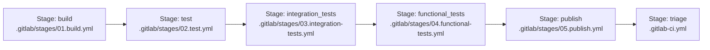
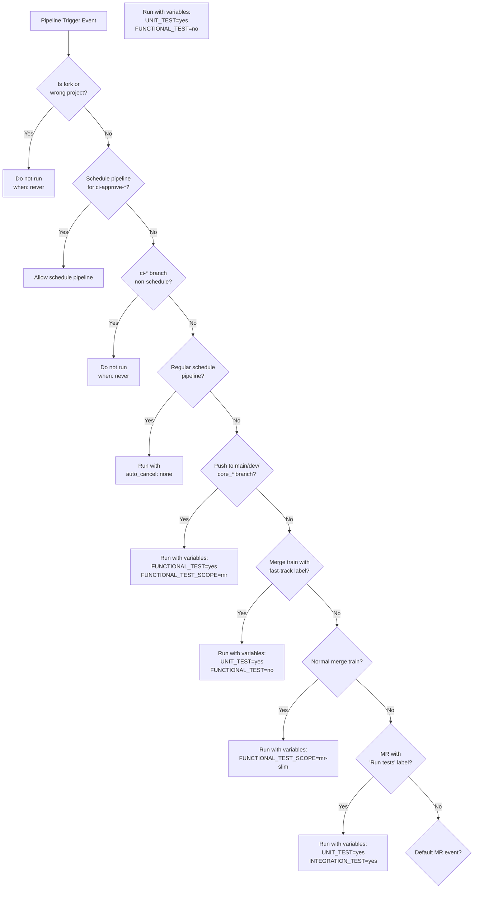
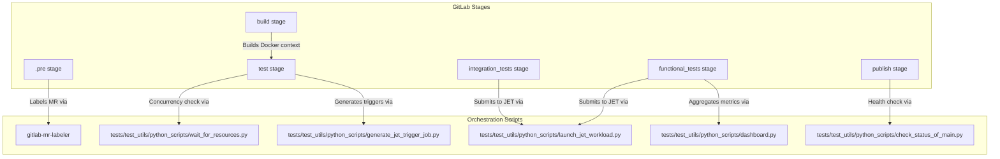

<!-- source: DeepWiki mcp.deepwiki.com · repo NVIDIA/Megatron-LM · page 9.1 GitLab CI Pipeline Architecture · fetched 2026-10-26 -->

# GitLab CI Pipeline Architecture

Relevant source files

The following files were used as context for generating this wiki page:

- [.gitlab-ci.yml](.gitlab-ci.yml)
- [.gitlab/labeler-config.yml](.gitlab/labeler-config.yml)
- [.gitlab/scripts/build.sh](.gitlab/scripts/build.sh)
- [.gitlab/stages/00.pre.yml](.gitlab/stages/00.pre.yml)
- [.gitlab/stages/01.build.yml](.gitlab/stages/01.build.yml)
- [.gitlab/stages/02.test.yml](.gitlab/stages/02.test.yml)
- [.gitlab/stages/03.integration-tests.yml](.gitlab/stages/03.integration-tests.yml)
- [.gitlab/stages/04.functional-tests.yml](.gitlab/stages/04.functional-tests.yml)
- [.gitlab/stages/05.publish.yml](.gitlab/stages/05.publish.yml)
- [tests/test_utils/python_scripts/check_status_of_main.py](tests/test_utils/python_scripts/check_status_of_main.py)
- [tests/test_utils/python_scripts/generate_jet_trigger_job.py](tests/test_utils/python_scripts/generate_jet_trigger_job.py)
- [tests/test_utils/python_scripts/launch_jet_workload.py](tests/test_utils/python_scripts/launch_jet_workload.py)
- [tests/test_utils/python_scripts/recipe_parser.py](tests/test_utils/python_scripts/recipe_parser.py)
- [tests/test_utils/python_scripts/wait_for_resources.py](tests/test_utils/python_scripts/wait_for_resources.py)
- [tests/test_utils/recipes/_cleanup.yaml](tests/test_utils/recipes/_cleanup.yaml)

## Purpose and Scope

This document describes the architecture of the GitLab CI/CD pipeline system used for continuous integration and testing in Megatron-LM. The pipeline is defined in `.gitlab-ci.yml` and orchestrates five sequential stages: **build**, **test**, **integration_tests**, **functional_tests**, and **publish**. This page covers the pipeline structure, workflow rules for pipeline triggering, stage orchestration, configuration variables, and integration with external test execution systems like JET.

For details on specific testing systems, see:
- Docker image building: [9.2 Build and Docker Infrastructure]()
- Unit test execution: [9.3 Unit Testing System]()
- Integration and functional tests: [9.4 Integration and Functional Tests]()
- JET platform for cluster execution: [9.5 JET Testing Platform and Cluster Management]()
- Test configuration: [9.6 Test Configuration and Recipe System]()

## Pipeline Architecture Overview

The GitLab CI pipeline uses a multi-stage sequential architecture where each stage must complete successfully before the next stage begins. The pipeline configuration is modular, with each stage's detailed configuration defined in separate YAML files under `.gitlab/stages/`.

### Stage Pipeline Structure

**Sources:** [.gitlab-ci.yml:151-157](), [.gitlab-ci.yml:165-201]()

### Stage Definitions and Responsibilities

| Stage | Configuration File | Primary Responsibility | Controlled By Variable |
|-------|-------------------|------------------------|------------------------|
| `build` | `.gitlab/stages/01.build.yml` | Build Docker images for LTS (PyTorch 25.09) and DEV (PyTorch 26.06) environments | `BUILD` |
| `test` | `.gitlab/stages/02.test.yml` | Execute unit tests via dynamic downstream triggers and secret detection | `UNIT_TEST` |
| `integration_tests` | `.gitlab/stages/03.integration-tests.yml` | Run multi-GPU integration tests on JET clusters | `INTEGRATION_TEST` |
| `functional_tests` | `.gitlab/stages/04.functional-tests.yml` | Execute end-to-end training/convergence tests on DGX clusters | `FUNCTIONAL_TEST` |
| `publish` | `.gitlab/stages/05.publish.yml` | Upload statistics to dashboard, sync GitHub mirror, and manage merge gates | `PUBLISH` |

**Sources:** [.gitlab-ci.yml:151-157](), [.gitlab-ci.yml:166-234](), [.gitlab/stages/01.build.yml:56-65](), [.gitlab/stages/05.publish.yml:45-132]()

## Workflow Rules and Pipeline Triggering

The GitLab CI pipeline uses a workflow rule system to determine when pipelines are triggered and what tests are executed based on sources, branches, labels, and events.

### Workflow Decision Logic

**Sources:** [.gitlab-ci.yml:15-146]()

### Pipeline Triggering Contexts

The workflow rules define different contexts for pipeline execution:

*   **Fork Protection**: Pipelines are restricted to the `ADLR` namespace to protect credentials [[.gitlab-ci.yml:17-19]]().
*   **CI Branch Restrictions**: Branches prefixed with `ci-` are restricted to scheduled pipelines only [[.gitlab-ci.yml:24-25]]().
*   **Push to Protected Branches**: Pushes to `main`, `dev`, or `core_*` branches trigger functional tests with `mr` scope and 5 repetitions [[.gitlab-ci.yml:41-55]]().
*   **Merge Trains**: Supports `fast-track` (unit tests only) and standard merge trains (unit tests + `mr-slim` functional tests) [[.gitlab-ci.yml:58-71]]().
*   **Targeted MR Testing**: Labels like `Run tests`, `Run nightly`, and `Run functional tests` allow developers to opt-in to expensive suites before merge [[.gitlab-ci.yml:74-123]]().

## Pipeline Configuration Variables

The pipeline exposes a set of variables to control test execution and cluster resource allocation.

### Core Test Control Variables

| Variable | Default | Description |
|----------|---------|-------------|
| `BUILD` | `yes` | Controls Docker image building stages [[.gitlab-ci.yml:166]]() |
| `UNIT_TEST` | `yes` | Controls unit test execution [[.gitlab-ci.yml:168]]() |
| `INTEGRATION_TEST` | `yes` | Controls integration test suite [[.gitlab-ci.yml:180]]() |
| `FUNCTIONAL_TEST` | `yes` | Controls functional test suite [[.gitlab-ci.yml:201]]() |
| `FUNCTIONAL_TEST_SCOPE` | `mr` | Scope of functional tests (mr, nightly, weekly, release) [[.gitlab-ci.yml:207-215]]() |
| `CLUSTER_A100` | `dgxa100_dracooci` | Target cluster for A100 workloads [[.gitlab-ci.yml:234-239]]() |
| `CLUSTER_H100` | `dgxh100_dracooci` | Target cluster for H100 workloads [[.gitlab-ci.yml:241-245]]() |

**Sources:** [.gitlab-ci.yml:165-245]()

## Stage Implementation and Orchestration

### Pre-Stage Hooks (`.pre`)
The `.pre` stage handles administrative and automation tasks:
*   **Branch Management**: `pre:create_ci_branches` refreshes CI-specific branches for scheduled runs [[.gitlab/stages/00.pre.yml:24-62]]().
*   **MR Labeling**: `pre:label_merge_request` uses `gitlab-mr-labeler` and `gojq` to automatically label MRs based on changed files, specifically detecting changes to `parallel_state` [[.gitlab/stages/00.pre.yml:93-126]]().
*   **Cherry-Picking**: `pre:maybe_cherry_pick_to_main` automates mirroring commits from `dev` into `main` for MRs labeled `mirror-to-main` [[.gitlab/stages/00.pre.yml:128-192]]().

### Build Stage (`build`)
The `build` stage constructs Docker images using `docker buildx` for multi-platform support (`amd64`, `arm64`) [[.gitlab/stages/01.build.yml:8-36]]().
*   **Image Variants**: Builds `CI_MCORE_LTS_IMAGE` (PyTorch 25.09), `CI_MCORE_DEV_IMAGE` (PyTorch 26.06), and `UTILITY_IMAGE` [[.gitlab/stages/01.build.yml:50-81]]().
*   **Manifest Creation**: `test:build_image` creates multi-arch manifests and pushes them to the registry [[.gitlab/stages/01.build.yml:92-133]]().
*   **Script Logic**: `build.sh` manages registry caching based on branch names and merge request IIDs [[.gitlab/scripts/build.sh:30-41]]().

### Test Stage (`test`)
This stage executes unit tests using a "Configure and Trigger" pattern:
1.  **wait_for_resources**: Manages concurrency by checking the position in the queue for the target branch via `wait_for_resources.py` [[.gitlab/stages/02.test.yml:13-39]]().
2.  **unit_tests_configure**: Generates GitLab CI trigger YAMLs for different environments (LTS/DEV) using `generate_jet_trigger_job.py` [[.gitlab/stages/02.test.yml:47-114]]().
3.  **unit_tests_run**: Triggers downstream pipelines using the generated YAML artifacts via the `trigger:include` strategy [[.gitlab/stages/02.test.yml:129-173]]().

### Integration and Functional Stages
These stages run multi-node workloads on DGX clusters via the JET platform [[.gitlab/stages/03.integration-tests.yml:20-130]](), [[.gitlab/stages/04.functional-tests.yml:19-198]]().
*   **Downstream Triggers**: Both stages generate dynamic trigger files that include JET workload manifests [[.gitlab/stages/03.integration-tests.yml:63-108]](), [[.gitlab/stages/04.functional-tests.yml:109-176]]().
*   **Convergence Submodule**: `functional:configure` injects the `megatron-lm-convergence-tests` submodule into the job environment [[.gitlab/stages/04.functional-tests.yml:44-47]]().
*   **Jet Workload Management**: `launch_jet_workload.py` handles the actual submission to the JET API and polls for completion with a SIGALRM watchdog to prevent hung connections [[tests/test_utils/python_scripts/launch_jet_workload.py:60-117]]().

### Publish Stage (`publish`)
*   **Statistics**: `publish:upload_statistics` runs `dashboard.py` to aggregate results for internal telemetry [[.gitlab/stages/05.publish.yml:45-71]]().
*   **Merge Gate**: `publish:approve_merge_gate` runs `check_status_of_main.py` to ensure the target branch is healthy before allowing automation to submit or approve PRs [[.gitlab/stages/05.publish.yml:79-122]]().
*   **Branch Sync**: `publish:sync_branches` force-pushes the local state to both GitHub and GitLab mirrors [[.gitlab/stages/05.publish.yml:132-171]]().

## Data Flow and Code Entity Mapping

The following diagram maps the CI workflow to specific code entities and scripts responsible for orchestration.

**Sources:** [.gitlab/stages/02.test.yml:39-89](), [.gitlab/stages/04.functional-tests.yml:109](), [tests/test_utils/python_scripts/launch_jet_workload.py:144-146](), [.gitlab/stages/05.publish.yml:71-105]()

## Auto-Cancellation and Retry Logic

Jobs are configured to be `interruptible: true` by default, allowing GitLab to cancel redundant pipelines if a newer commit is pushed to the same branch [[.gitlab-ci.yml:148-150]]().

**Retry Strategy:**
*   **Max retries**: 2 [[.gitlab-ci.yml:162]]().
*   **Trigger**: `runner_system_failure` (infrastructure issues, not code failures) [[.gitlab-ci.yml:163]]().

**Sources:** [.gitlab-ci.yml:148-163]().

---

