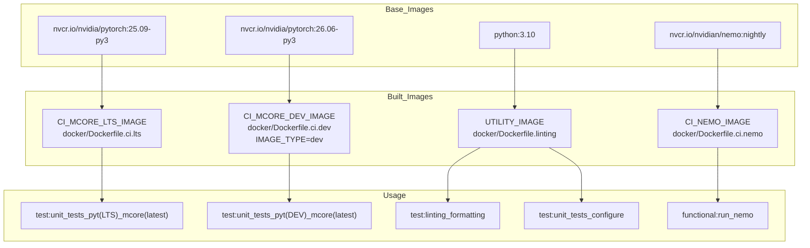
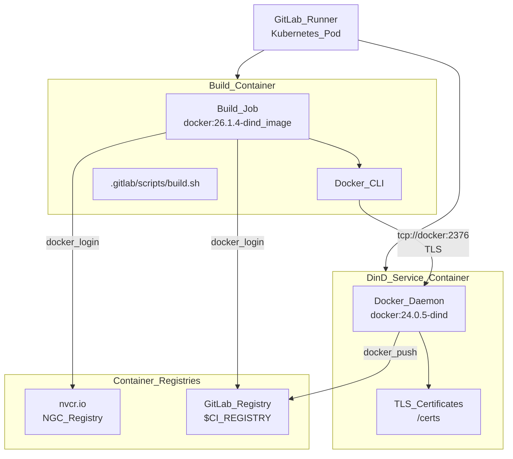
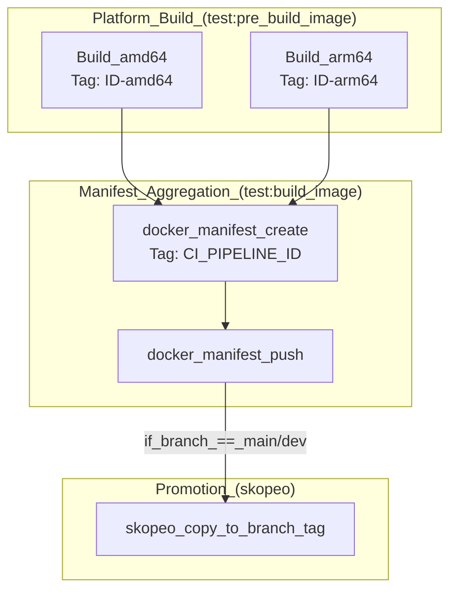

<!-- source: DeepWiki mcp.deepwiki.com · repo NVIDIA/Megatron-LM · page 9.2 Build and Docker Infrastructure · fetched 2026-10-26 -->

# Build and Docker Infrastructure

Relevant source files

The following files were used as context for generating this wiki page:

- [.github/workflows/_build_test_publish_wheel.yml](.github/workflows/_build_test_publish_wheel.yml)
- [.gitlab-ci.yml](.gitlab-ci.yml)
- [.gitlab/labeler-config.yml](.gitlab/labeler-config.yml)
- [.gitlab/scripts/build.sh](.gitlab/scripts/build.sh)
- [.gitlab/stages/00.pre.yml](.gitlab/stages/00.pre.yml)
- [.gitlab/stages/01.build.yml](.gitlab/stages/01.build.yml)
- [.gitlab/stages/02.test.yml](.gitlab/stages/02.test.yml)
- [.gitlab/stages/03.integration-tests.yml](.gitlab/stages/03.integration-tests.yml)
- [.gitlab/stages/04.functional-tests.yml](.gitlab/stages/04.functional-tests.yml)
- [.gitlab/stages/05.publish.yml](.gitlab/stages/05.publish.yml)
- [docker/Dockerfile.ci.dev](docker/Dockerfile.ci.dev)
- [docker/Dockerfile.ci.lts](docker/Dockerfile.ci.lts)
- [docker/common/install.sh](docker/common/install.sh)
- [docker/common/install_source_wheels.sh](docker/common/install_source_wheels.sh)
- [megatron/core/distributed/fsdp/src/megatron_fsdp/__init__.py](megatron/core/distributed/fsdp/src/megatron_fsdp/__init__.py)
- [megatron/core/distributed/fsdp/src/pyproject.toml](megatron/core/distributed/fsdp/src/pyproject.toml)
- [pyproject.toml](pyproject.toml)
- [tests/functional_tests/shell_test_utils/_run_training.sh](tests/functional_tests/shell_test_utils/_run_training.sh)
- [tests/functional_tests/shell_test_utils/run_ci_test.sh](tests/functional_tests/shell_test_utils/run_ci_test.sh)
- [tests/performance_tests/shell_test_utils/determinism/print_nsys_leaderboard.py](tests/performance_tests/shell_test_utils/determinism/print_nsys_leaderboard.py)
- [tests/test_utils/python_scripts/check_status_of_main.py](tests/test_utils/python_scripts/check_status_of_main.py)
- [tests/test_utils/python_scripts/generate_jet_trigger_job.py](tests/test_utils/python_scripts/generate_jet_trigger_job.py)
- [tests/test_utils/python_scripts/launch_jet_workload.py](tests/test_utils/python_scripts/launch_jet_workload.py)
- [tests/test_utils/python_scripts/recipe_parser.py](tests/test_utils/python_scripts/recipe_parser.py)
- [tests/test_utils/python_scripts/wait_for_resources.py](tests/test_utils/python_scripts/wait_for_resources.py)
- [tests/test_utils/recipes/_cleanup.yaml](tests/test_utils/recipes/_cleanup.yaml)
- [tests/test_utils/test_training_script_secret_redaction.py](tests/test_utils/test_training_script_secret_redaction.py)
- [uv.lock](uv.lock)

## Purpose and Scope

This document describes the Docker image building infrastructure used in the Megatron-LM CI/CD pipeline. It covers the types of Docker images built, the base image strategy, the build orchestration process, and how these images are used throughout the testing pipeline.

For information about the overall CI/CD workflow and pipeline stages, see [9.1 GitLab CI Pipeline Architecture](). For details on how these images are consumed in testing, see [9.3 Unit Testing System](), [9.4 Integration and Functional Tests](), and [9.5 JET Testing Platform and Cluster Management]().

---

## Overview of Docker Infrastructure

The Megatron-LM project builds several distinct Docker images during the `build` stage of the CI/CD pipeline. These images provide isolated, reproducible environments for different testing purposes and ensure consistency across development (DEV) and long-term support (LTS) PyTorch versions.

The Docker infrastructure uses a **Docker-in-Docker (DinD)** architecture where the GitLab CI runner spawns a Docker daemon as a service, allowing the build jobs to execute Docker commands. All images are tagged with the `CI_PIPELINE_ID` to ensure unique identification and are pushed to the GitLab container registry.

**Sources**: [.gitlab/stages/01.build.yml:1-146](), [.gitlab/stages/00.pre.yml:15-23]()

---

## Image Types and Base Images

### Image Matrix

The build system creates several image types in parallel, each serving a specific purpose:

| Image Variable | Dockerfile | Base Image | Purpose |
|---------------|------------|------------|---------|
| `CI_MCORE_LTS_IMAGE` | `Dockerfile.ci.lts` | `nvcr.io/nvidia/pytorch:25.09-py3` | LTS PyTorch version testing [[.gitlab/stages/01.build.yml:54-61]()] |
| `CI_MCORE_DEV_IMAGE` | `Dockerfile.ci.dev` | `nvcr.io/nvidia/pytorch:26.06-py3` | DEV PyTorch version testing [[.gitlab/stages/01.build.yml:62-71]()] |
| `UTILITY_IMAGE` | `Dockerfile.linting` | `python:3.10` | Code quality and utility tasks [[.gitlab/stages/01.build.yml:72-79]()] |
| `CI_NEMO_IMAGE` | `Dockerfile.ci.nemo` | `nvcr.io/nvidian/nemo:nightly` | NeMo integration testing [[.gitlab/stages/01.build.yml:81-87]()] |

### Natural Language to Code Entity Space: Image Mapping

The following diagram maps high-level image requirements to the specific Dockerfiles and build arguments used in the codebase.

**Diagram: Docker Image Build and Usage Flow**
**Sources**: [.gitlab/stages/01.build.yml:50-87](), [.gitlab/stages/02.test.yml:163-174](), [.gitlab/stages/04.functional-tests.yml:19-106]()

### Image Purposes

- **CI_MCORE_LTS_IMAGE / CI_MCORE_DEV_IMAGE**: These images contain Megatron-LM with all dependencies managed by `uv`. The LTS variant uses the stable PyTorch Long-Term Support version, while DEV uses the latest development PyTorch container. Both images are used for unit tests, functional tests, and integration tests. `Dockerfile.ci.dev` supports an `IMAGE_TYPE` build argument to specialize the build (e.g., for DeepEP installation) [[docker/Dockerfile.ci.dev:55-56]()].
- **UTILITY_IMAGE**: A lightweight image based on Python 3.10 containing code quality tools (ruff, black, isort, flake8, pylint), GitLab API clients, and utilities for job configuration generation. Used for linting, test configuration, and CI orchestration tasks [[.gitlab/stages/02.test.yml:53-60]()].
- **CI_NEMO_IMAGE**: Built only when integration or functional tests are required, this image integrates Megatron-LM with NeMo for cross-framework testing [[.gitlab/stages/01.build.yml:81-91]()].

**Sources**: [.gitlab/stages/01.build.yml:50-91](), [docker/Dockerfile.ci.dev:4-71]()

---

## Build Process

### Docker-in-Docker Architecture

The build infrastructure uses Docker-in-Docker to isolate the build environment from the GitLab runner host. This architecture consists of:

**Diagram: Docker-in-Docker Build Architecture**

The build container communicates with the Docker daemon over TCP with TLS encryption at `tcp://docker:2376`. TLS certificates are shared through a volume mounted at `/certs`.

**Key Configuration Variables**:
- `DOCKER_HOST`: `tcp://docker:2376` [[.gitlab/stages/01.build.yml:22]()]
- `DOCKER_TLS_CERTDIR`: `/certs` [[.gitlab/stages/01.build.yml:23]()]
- `DOCKER_TLS_VERIFY`: `1` [[.gitlab/stages/01.build.yml:24]()]
- `DOCKER_CERT_PATH`: `$DOCKER_TLS_CERTDIR/client` [[.gitlab/stages/01.build.yml:25]()]

**Sources**: [.gitlab/stages/01.build.yml:15-25](), [.gitlab/stages/00.pre.yml:15-22]()

### Dependency Management with UV

The Docker infrastructure uses `uv` for fast dependency management. The `Dockerfile.ci.dev` uses `uv sync` to install dependencies into a virtual environment located at `/opt/venv` [[docker/Dockerfile.ci.dev:14-17]()].

Key `uv` features used in the build:
- **Caching**: UV caches are mounted during build to speed up subsequent runs [[docker/Dockerfile.ci.dev:58]()].
- **System Site Packages**: The virtual environment is created with `--system-site-packages` to leverage pre-installed CUDA/PyTorch libraries in the base NGC image [[docker/Dockerfile.ci.dev:70]()].
- **Package Filtering**: UV handles complex dependencies while excluding standard packages like `torch` and `triton` that are provided by the base image [[docker/Dockerfile.ci.dev:79-81]()].
- **Specialized Library Installation**: The build process manually installs specialized libraries like `DeepEP` (with custom patches) and `nvidia-nvshmem-cu13` to ensure specific versioning [[docker/Dockerfile.ci.dev:98-137]()].

**Sources**: [docker/Dockerfile.ci.dev:8-137](), [pyproject.toml:185-207]()

### Build Script Orchestration

The actual build process is delegated to the `.gitlab/scripts/build.sh` script. The build job prepares the environment by exporting necessary tokens and references before executing the script [[.gitlab/stages/01.build.yml:31-36]()].

The build script manages the Docker Buildx configuration, multi-platform builds, and registry-based caching strategies (`--cache-to`, `--cache-from`) to optimize build times.

**Sources**: [.gitlab/stages/01.build.yml:31-48](), [.gitlab/scripts/build.sh:1-68]()

---

## Container Registry Management

### Image Tagging and Manifests

Megatron-LM uses a multi-architecture tagging strategy. Images are first built for specific platforms (`amd64` and `arm64`) and then combined into a single manifest [[.gitlab/stages/01.build.yml:129-133]()].

**Diagram: Multi-arch Manifest Creation**

If the build occurs on a protected branch (`main` or `dev`) or during a specific rebuild trigger, `skopeo` is used to copy the image to a branch-specific tag (e.g., `CI_MCORE_DEV_IMAGE:main`) [[.gitlab/stages/01.build.yml:135-137]()].

**Sources**: [.gitlab/stages/01.build.yml:92-146]()

---

## Build Configuration and Variables

### Resource Allocation

Build jobs use specific Kubernetes pod tags to ensure they run on appropriate infrastructure. Resource limits are explicitly set to handle heavy compilation tasks:
- `KUBERNETES_SERVICE_MEMORY_REQUEST`: 90Gi [[.gitlab/stages/01.build.yml:118]()]
- `KUBERNETES_SERVICE_MEMORY_LIMIT`: 90Gi [[.gitlab/stages/01.build.yml:119]()]
- `timeout`: 180m [[.gitlab/stages/01.build.yml:110]()]

### Build Rules

The `.build_rules` mixin defines when builds execute. This ensures builds always run unless explicitly disabled by the `$BUILD` variable, even if earlier stages fail [[.gitlab/stages/01.build.yml:1-6]()].

**Sources**: [.gitlab/stages/01.build.yml:1-30]()

---

## Code Entity Reference

### Key Files

| File | Purpose |
|------|---------|
| [.gitlab/stages/01.build.yml]() | Build stage job definitions and multi-arch manifest logic |
| [docker/Dockerfile.ci.dev]() | Main Dockerfile for training/test environments using `uv` |
| [pyproject.toml]() | Dependency definitions and `uv` tool configuration |
| [uv.lock]() | Locked dependency tree for reproducible builds |
| [.gitlab/stages/00.pre.yml]() | DinD service and registry authentication logic |
| [.gitlab/scripts/build.sh]() | Core shell script orchestrating the `docker build` command |

### Key Job Names

- `test:pre_build_image`: Parallel matrix for building individual architecture images [[.gitlab/stages/01.build.yml:50-80]()].
- `test:build_image`: Aggregates platform-specific images into a manifest [[.gitlab/stages/01.build.yml:92-146]()].
- `test:build_nemo_image`: Conditional build for NeMo integration testing [[.gitlab/stages/01.build.yml:81-91]()].

### Key Variables

- `CI_MCORE_LTS_IMAGE`: LTS PyTorch environment image name [[.gitlab/stages/01.build.yml:54]()].
- `CI_MCORE_DEV_IMAGE`: Latest PyTorch environment image name [[.gitlab/stages/01.build.yml:62]()].
- `UTILITY_IMAGE`: Image for linting and CI scripts [[.gitlab/stages/01.build.yml:72]()].
- `UV_PROJECT_ENVIRONMENT`: Path to the python virtual environment (`/opt/venv`) [[docker/Dockerfile.ci.dev:14]()].

**Sources**: [.gitlab/stages/01.build.yml:1-146](), [docker/Dockerfile.ci.dev:1-140](), [pyproject.toml:1-225](), [.gitlab/scripts/build.sh:1-68]()

---

