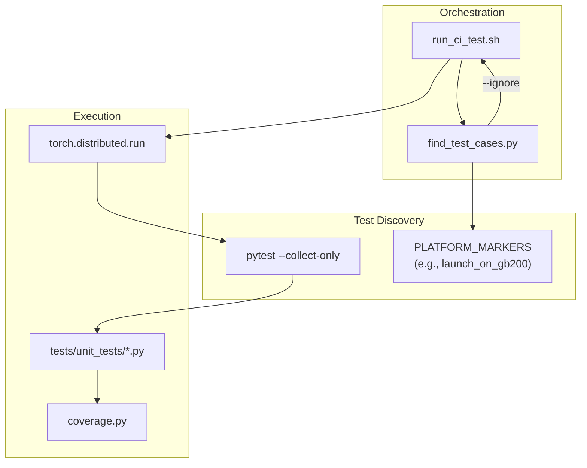
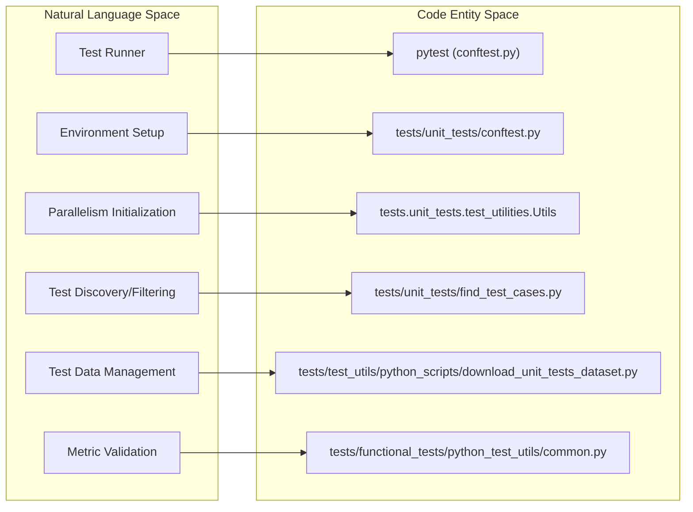
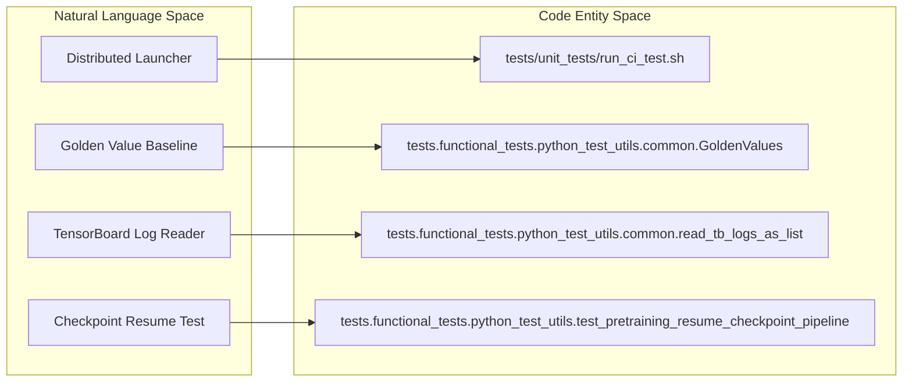

<!-- source: DeepWiki mcp.deepwiki.com · repo NVIDIA/Megatron-LM · page 9.3 Unit Testing System · fetched 2026-10-26 -->

# Unit Testing System

Relevant source files

The following files were used as context for generating this wiki page:

- [.gitlab/scripts/fetch-legacy-suite.sh](.gitlab/scripts/fetch-legacy-suite.sh)
- [tests/functional_tests/python_test_utils/common.py](tests/functional_tests/python_test_utils/common.py)
- [tests/functional_tests/python_test_utils/conftest.py](tests/functional_tests/python_test_utils/conftest.py)
- [tests/functional_tests/python_test_utils/get_test_results_from_tensorboard_logs.py](tests/functional_tests/python_test_utils/get_test_results_from_tensorboard_logs.py)
- [tests/functional_tests/python_test_utils/test_pretraining_regular_pipeline.py](tests/functional_tests/python_test_utils/test_pretraining_regular_pipeline.py)
- [tests/functional_tests/python_test_utils/test_pretraining_resume_checkpoint_pipeline.py](tests/functional_tests/python_test_utils/test_pretraining_resume_checkpoint_pipeline.py)
- [tests/test_utils/python_scripts/download_unit_tests_dataset.py](tests/test_utils/python_scripts/download_unit_tests_dataset.py)
- [tests/test_utils/python_scripts/test_download_unit_tests_dataset.py](tests/test_utils/python_scripts/test_download_unit_tests_dataset.py)
- [tests/unit_tests/conftest.py](tests/unit_tests/conftest.py)
- [tests/unit_tests/find_test_cases.py](tests/unit_tests/find_test_cases.py)
- [tests/unit_tests/run_ci_test.sh](tests/unit_tests/run_ci_test.sh)
- [tests/unit_tests/test_model_configs.py](tests/unit_tests/test_model_configs.py)
- [tests/unit_tests/test_utilities.py](tests/unit_tests/test_utilities.py)

## Purpose and Scope

The Unit Testing System provides automated testing infrastructure for validating Megatron Core functionality. It encompasses test configuration, execution, and coverage reporting. The system runs `pytest`-based unit tests on multiple PyTorch environments (LTS and DEV) across distributed GPU clusters using the JET testing platform.

This document covers unit test orchestration, pytest execution, and distributed test utilities. For integration and functional tests that run full training workloads, see [9.4 Integration and Functional Tests](). For JET platform details and cluster management, see [9.5 JET Testing Platform and Cluster Management](). For test recipe configuration formats, see [9.6 Test Configuration and Recipe System]().

---

## System Architecture Overview

The unit testing system follows a pipeline architecture where tests are discovered, filtered based on hardware/platform markers, and executed in distributed environments.

### Unit Test Execution Flow

"Unit Test Execution Flow"

**Sources**: `tests/unit_tests/run_ci_test.sh` [170-192](), `tests/unit_tests/find_test_cases.py` [8-26]()

---

## Pytest Configuration and Discovery

The testing system relies on `pytest` as the primary runner, with specialized configuration in `conftest.py`.

### Global Fixtures and Hooks
The `tests/unit_tests/conftest.py` file manages the test lifecycle:
*   **NCCL Defaults**: `pytest_configure` sets `NCCL_MAX_NCHANNELS=1` and `NCCL_NVLS_ENABLE=0` to reduce memory usage and SM contention, preventing hangs in distributed algorithms like FSDP [tests/unit_tests/conftest.py:17-31]().
*   **Experimental Flag**: Adds a `--experimental` command-line argument to enable `megatron.core.config.ENABLE_EXPERIMENTAL` during testing [tests/unit_tests/conftest.py:33-50]().
*   **Distributed Cleanup**: The `cleanup` fixture automatically destroys the process group after the session finishes if `torch.distributed` was initialized [tests/unit_tests/conftest.py:57-69]().
*   **Environment Reset**: The `reset_env_vars` fixture captures `os.environ` before a test and restores it afterward to prevent cross-test interference [tests/unit_tests/conftest.py:121-132]().
*   **Data Assurance**: The `ensure_test_data` fixture checks for assets in `/opt/data` and triggers `download_and_extract_asset` if missing [tests/unit_tests/conftest.py:96-119]().
*   **Distributed Checkpointing**: Provides `tmp_path_dist_ckpt` for shared directory access across processes during checkpointing tests, using a `TempNamedDir` to synchronize [tests/unit_tests/conftest.py:78-94]().

### Distributed Test Utilities
The `Utils` class in `tests/unit_tests/test_utilities.py` provides standardized methods for initializing model parallelism in a test context:
*   `initialize_distributed()`: Sets up the NCCL backend, process groups, and `PrefixStore` to avoid key collisions [tests/unit_tests/test_utilities.py:50-83]().
*   `initialize_model_parallel()`: Orchestrates the destruction of existing parallel states and re-initialization of Tensor and Pipeline parallelism [tests/unit_tests/test_utilities.py:121-143]().
*   `fake_initialize_model_parallel()`: Used for layer-wise unit tests as a proxy for NeMo-style initialization, setting world sizes and ranks without full process group initialization [tests/unit_tests/test_utilities.py:158-174]().
*   `destroy_model_parallel()`: Synchronizes CUDA, destroys model parallel groups, and clears GPU cache [tests/unit_tests/test_utilities.py:102-120]().

**Sources**: `tests/unit_tests/conftest.py` [1-133](), `tests/unit_tests/test_utilities.py` [43-175]()

---

## Test Execution and Platform Selection

### Marker-Driven Platform Selection
For specific hardware platforms like GB200, the system uses markers to select tests. The `find_test_cases.py` script identifies tests carrying specific markers (e.g., `launch_on_gb200`) and generates `--ignore` arguments for all other tests in a bucket [tests/unit_tests/run_ci_test.sh:126-129]().

### CI Execution Script
The `tests/unit_tests/run_ci_test.sh` script is the entry point for running unit tests in CI. It performs the following:
*   **Argument Parsing**: Validates environment (LTS/DEV), tag (latest/legacy), and platform (H100/GB200) [tests/unit_tests/run_ci_test.sh:20-85]().
*   **Marker Logic**: Constructs `pytest` marker arguments based on the environment, excluding "flaky" tests in LTS or "flaky_in_dev" in DEV [tests/unit_tests/run_ci_test.sh:103-124]().
*   **Distributed Execution**: Launches tests via `torch.distributed.run` with a configurable number of GPUs (default 8) [tests/unit_tests/run_ci_test.sh:137-146]().
*   **Experimental Mode**: If the `latest` tag is used, it also runs tests with the `--experimental` flag [tests/unit_tests/run_ci_test.sh:179-187]().
*   **Coverage**: Runs tests under `coverage run` to generate coverage reports for `megatron/core` [tests/unit_tests/run_ci_test.sh:170-176]().

**Sources**: `tests/unit_tests/run_ci_test.sh` [1-191](), `tests/unit_tests/find_test_cases.py` [8-26]()

---

## Functional Test Integration

The system also supports functional testing via golden value comparison.

### Golden Value Validation
The functional test suite uses `GoldenValueMetric` to compare training results against baseline values stored in JSON [tests/functional_tests/python_test_utils/common.py:69-80]().
*   **Comparison Types**: Supports `ApproximateTest` (using `atol` and `rtol`) and `DeterministicTest` (exact match) [tests/functional_tests/python_test_utils/common.py:40-67]().
*   **Metric Collection**: `collect_train_test_metrics` extracts metrics like `lm loss`, `iteration-time`, and `mem-allocated-bytes` from TensorBoard logs to generate new golden values [tests/functional_tests/python_test_utils/get_test_results_from_tensorboard_logs.py:27-56]().
*   **Resume Checkpoint Pipeline**: Specifically validates that resuming from a checkpoint produces consistent metrics compared to a continuous run [tests/functional_tests/python_test_utils/test_pretraining_resume_checkpoint_pipeline.py:14-86]().

**Sources**: `tests/functional_tests/python_test_utils/common.py` [23-80](), `tests/functional_tests/python_test_utils/get_test_results_from_tensorboard_logs.py` [27-56](), `tests/functional_tests/python_test_utils/test_pretraining_resume_checkpoint_pipeline.py` [14-87]()

---

## Test Infrastructure Mapping

The following diagrams map the natural language concepts of the testing system to the specific code entities that implement them.

"Testing System Entity Mapping"

"Global State and Metric Mapping"

**Sources**: `tests/unit_tests/conftest.py` [17-133](), `tests/unit_tests/test_utilities.py` [43-175](), `tests/unit_tests/find_test_cases.py` [8-26](), `tests/unit_tests/run_ci_test.sh` [137-191](), `tests/functional_tests/python_test_utils/common.py` [79-80, 145-212](), `tests/functional_tests/python_test_utils/test_pretraining_resume_checkpoint_pipeline.py` [14-87]()

---

