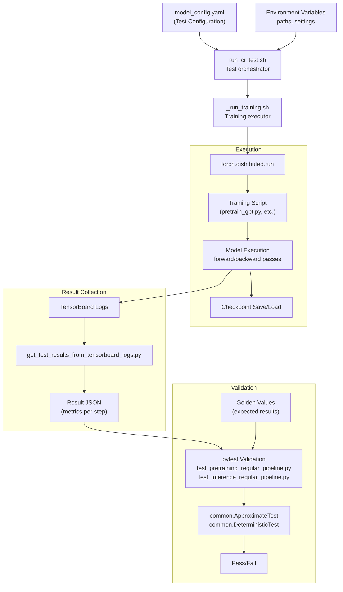
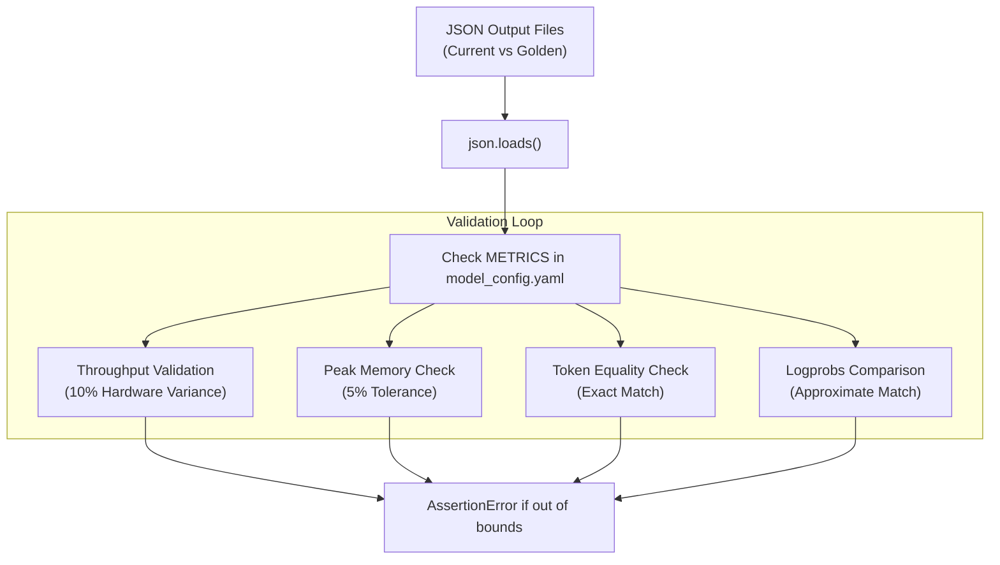

<!-- source: DeepWiki mcp.deepwiki.com · repo NVIDIA/Megatron-LM · page 9.4 Integration and Functional Tests · fetched 2026-10-26 -->

# Integration and Functional Tests

<details>
<summary>Relevant source files</summary>

The following files were used as context for generating this wiki page:

- [tests/functional_tests/python_test_utils/common.py](tests/functional_tests/python_test_utils/common.py)
- [tests/functional_tests/python_test_utils/conftest.py](tests/functional_tests/python_test_utils/conftest.py)
- [tests/functional_tests/python_test_utils/get_test_results_from_tensorboard_logs.py](tests/functional_tests/python_test_utils/get_test_results_from_tensorboard_logs.py)
- [tests/functional_tests/python_test_utils/test_inference_regular_pipeline.py](tests/functional_tests/python_test_utils/test_inference_regular_pipeline.py)
- [tests/functional_tests/python_test_utils/test_pretraining_regular_pipeline.py](tests/functional_tests/python_test_utils/test_pretraining_regular_pipeline.py)
- [tests/functional_tests/python_test_utils/test_pretraining_resume_checkpoint_pipeline.py](tests/functional_tests/python_test_utils/test_pretraining_resume_checkpoint_pipeline.py)
- [tests/functional_tests/test_cases/gpt/gpt_dynamic_inference_tp1_pp1_583m_cuda_graphs_fp8_logitsmatch/golden_values_dev_dgx_h100.json](tests/functional_tests/test_cases/gpt/gpt_dynamic_inference_tp1_pp1_583m_cuda_graphs_fp8_logitsmatch/golden_values_dev_dgx_h100.json)
- [tests/functional_tests/test_cases/gpt/gpt_dynamic_inference_tp1_pp1_583m_cuda_graphs_fp8_logitsmatch/model_config.yaml](tests/functional_tests/test_cases/gpt/gpt_dynamic_inference_tp1_pp1_583m_cuda_graphs_fp8_logitsmatch/model_config.yaml)
- [tests/functional_tests/test_cases/gpt/gpt_dynamic_inference_tp1_pp1_583m_cuda_graphs_logitsmatch_decode_graphs_only/golden_values_dev_dgx_h100.json](tests/functional_tests/test_cases/gpt/gpt_dynamic_inference_tp1_pp1_583m_cuda_graphs_logitsmatch_decode_graphs_only/golden_values_dev_dgx_h100.json)
- [tests/functional_tests/test_cases/gpt/gpt_dynamic_inference_tp1_pp1_583m_cuda_graphs_logitsmatch_decode_graphs_only/model_config.yaml](tests/functional_tests/test_cases/gpt/gpt_dynamic_inference_tp1_pp1_583m_cuda_graphs_logitsmatch_decode_graphs_only/model_config.yaml)
- [tests/functional_tests/test_cases/gpt/gpt_dynamic_inference_tp1_pp1_583m_logitsmatch/golden_values_dev_dgx_h100.json](tests/functional_tests/test_cases/gpt/gpt_dynamic_inference_tp1_pp1_583m_logitsmatch/golden_values_dev_dgx_h100.json)
- [tests/functional_tests/test_cases/gpt/gpt_dynamic_inference_tp8_pp1_583m_logitsmatch/golden_values_dev_dgx_h100.json](tests/functional_tests/test_cases/gpt/gpt_dynamic_inference_tp8_pp1_583m_logitsmatch/golden_values_dev_dgx_h100.json)
- [tests/functional_tests/test_cases/moe/gpt_dynamic_inference_tp4_pp1_ep4_16B_logitsmatch/golden_values_dev_dgx_h100.json](tests/functional_tests/test_cases/moe/gpt_dynamic_inference_tp4_pp1_ep4_16B_logitsmatch/golden_values_dev_dgx_h100.json)
- [tests/unit_tests/test_model_configs.py](tests/unit_tests/test_model_configs.py)

</details>


## Purpose and Scope

This document describes the integration and functional test infrastructure that validates end-to-end training, inference, and RL workflows in Megatron-LM. These tests execute complete model training or inference runs and verify correctness by comparing outputs against golden values with statistical tolerance checks.

**Scope:**
- Integration tests that run full training/inference pipelines.
- Functional tests for checkpoint save/load, resumption, and consistency.
- Golden value validation with hardware-aware tolerances using `pytest`.
- Multi-run statistical analysis for variance characterization and tolerance tuning.

**Related pages:**
- For unit tests and pytest infrastructure, see [Unit Testing System](9.3).
- For JET-based cluster execution, see [JET Testing Platform and Cluster Management](9.5).
- For YAML test configuration, see [Test Configuration and Recipe System](9.6).
- For GitLab/GitHub CI orchestration, see [GitLab CI Pipeline Architecture](9.1) and [GitHub Actions and Release Management](9.7).

---

## Test Architecture Overview

The functional test system executes complete model runs on GPU clusters and validates results against expected values. It supports multiple test types (regular, checkpoint resumption, consistency checks) and multiple modes (pretraining, inference).

### High-Level Test Flow



**Sources:** [tests/functional_tests/python_test_utils/common.py:23-66](), [tests/functional_tests/python_test_utils/test_inference_regular_pipeline.py:46-165]()

---

## Test Types and Modes

The system supports distinct test types and execution modes, configured via YAML files.

### Test Types

| Test Type | Purpose | Behavior |
|-----------|---------|----------|
| `regular` | Basic correctness validation | Single run, compare against golden values. |
| `ckpt-resume` | Checkpoint resumption | Run 1 (save) → Run 2 (resume from checkpoint). |
| `frozen-resume` | Resume from pre-existing checkpoint | Load from `CHECKPOINT_LOAD_PATH` → continue training. |
| `frozen-start` | Start from frozen checkpoint | Load checkpoint → run (standard for inference tests). |
| `checkpoint-consistency` | Multi-config consistency | Run multiple configurations → compare states. |
| `release` | Production validation | Full convergence test with strict thresholds. |

### Execution Modes

| Mode | Purpose | Output Format |
|------|---------|---------------|
| `pretraining` | GPT/BERT/T5 training | TensorBoard metrics (loss, timing, memory). |
| `inference` | Text generation | JSON outputs (latency, tokens, logprobs). |

**Sources:** [tests/functional_tests/test_cases/gpt/gpt_dynamic_inference_tp1_pp1_583m_cuda_graphs_fp8_logitsmatch/model_config.yaml:6-7](), [tests/functional_tests/test_cases/gpt/gpt_dynamic_inference_tp1_pp1_583m_cuda_graphs_logitsmatch_decode_graphs_only/model_config.yaml:6-7]()

---

## Inference Functional Tests

Inference tests validate model generation quality, performance, and memory usage. These tests compare current execution metrics against static JSON "golden" files.

### Inference Validation Logic
The `test_inference_pipeline` function in `test_inference_regular_pipeline.py` handles the comparison logic for inference runs.



**Key Validation Functions:**
- `_median_as_float`: Converts metric lists to a single float, treating the first element as warmup if length > 1 [tests/functional_tests/python_test_utils/test_inference_regular_pipeline.py:27-39]().
- `test_inference_pipeline`: Main entry point for comparing current inference results against ground truth [tests/functional_tests/python_test_utils/test_inference_regular_pipeline.py:46-165]().

**Sources:** [tests/functional_tests/python_test_utils/test_inference_regular_pipeline.py:16-107](), [tests/functional_tests/python_test_utils/test_inference_regular_pipeline.py:110-165]()

---

## Golden Value Validation

Test results are compared against golden values using the `common.pipeline` function, which supports both deterministic and approximate checks.

### Tolerance Configuration

Tolerances are defined via Pydantic models in `common.py`.

| Class | Type | `rtol` | `atol` | Purpose |
|-------|------|--------|--------|---------|
| `DeterministicTest` | `DETERMINISTIC` | 0.0 | 0 | Exact matches (e.g., tokens) [tests/functional_tests/python_test_utils/common.py:52-67](). |
| `ApproximateTest` | `APPROXIMATE` | 1e-5 | 0 | Floating point comparisons (e.g., loss) [tests/functional_tests/python_test_utils/common.py:40-51](). |

**Sources:** [tests/functional_tests/python_test_utils/common.py:40-67]()

### Validation Logic

The `common.pipeline` function iterates through checks and compares `actual_values` against `golden_values`.

- **Iteration Time:** Uses the median of values to avoid noise from outliers [tests/functional_tests/python_test_utils/test_inference_regular_pipeline.py:27-39]().
- **Throughput:** Inference throughput is expected to be within 10% of the golden value [tests/functional_tests/python_test_utils/test_inference_regular_pipeline.py:99-101]().
- **Memory:** `mem-max-allocated-bytes` is checked within a ±5% window [tests/functional_tests/python_test_utils/test_inference_regular_pipeline.py:121-137]().

**Sources:** [tests/functional_tests/python_test_utils/test_inference_regular_pipeline.py:91-138]()

---

## Result Extraction

Metrics are extracted from TensorBoard event files or JSON outputs.

### Training Metric Extraction
The `collect_train_test_metrics` command in `get_test_results_from_tensorboard_logs.py` filters for specific keys:
- `iteration-time`
- `mem-allocated-bytes`
- `mem-max-allocated-bytes`
- `lm loss`
- `num-zeros`
- `mtp_1 loss`
- `mtp_2 loss`
- `total loss`

**Sources:** [tests/functional_tests/python_test_utils/get_test_results_from_tensorboard_logs.py:42-56]()

### Inference Metric Extraction
Inference tests extract metrics like `generated_tokens`, `logprobs`, and `throughput` from JSON output structures [tests/functional_tests/python_test_utils/test_inference_regular_pipeline.py:151-165](). Golden files contain the ground truth for these metrics, including `latency`, `ttft`, and `cuda_graph_request_count_map` [tests/functional_tests/test_cases/gpt/gpt_dynamic_inference_tp1_pp1_583m_cuda_graphs_fp8_logitsmatch/golden_values_dev_dgx_h100.json:37-43]().

---

## Configuration System

Functional tests rely on `model_config.yaml` to define environment variables, model arguments, and the metrics to be validated.

### Sample Configuration (GPT Dynamic Inference)
```yaml
ENV_VARS:
  CUDA_DEVICE_MAX_CONNECTIONS: 1
TEST_TYPE: frozen-start
MODE: inference
MODEL_ARGS:
  --use-mcore-models: true
  --tensor-model-parallel-size: 1
  --pipeline-model-parallel-size: 1
  --log-memory-to-tensorboard: true
METRICS:
  - "generated_tokens"
  - "logprobs"
```

**Sources:** [tests/functional_tests/test_cases/gpt/gpt_dynamic_inference_tp1_pp1_583m_cuda_graphs_fp8_logitsmatch/model_config.yaml:1-60]()

### Checkpoint Resumption Validation
The `test_resume_checkpoint_pipeline` script ensures that training resumes correctly by comparing the metrics of a resumed run against the latter half of a continuous run. It specifically replaces the initial steps of the second run with data from the first run to verify seamless transition [tests/functional_tests/python_test_utils/test_pretraining_resume_checkpoint_pipeline.py:14-86]().

---

## Summary of Key Code Entities

| Entity | File Path | Role |
|--------|-----------|------|
| `GoldenValueMetric` | `tests/functional_tests/python_test_utils/common.py` | Pydantic model for storing step-based metric values [tests/functional_tests/python_test_utils/common.py:69-77](). |
| `read_tb_logs_as_list` | `tests/functional_tests/python_test_utils/common.py` | Reads TensorBoard events and formats them for comparison [tests/functional_tests/python_test_utils/common.py:145-188](). |
| `test_inference_pipeline` | `tests/functional_tests/python_test_utils/test_inference_regular_pipeline.py` | Validates inference outputs including tokens and logprobs [tests/functional_tests/python_test_utils/test_inference_regular_pipeline.py:46-165](). |
| `collect_train_test_metrics` | `tests/functional_tests/python_test_utils/get_test_results_from_tensorboard_logs.py` | CLI tool to generate golden value JSONs from TB logs [tests/functional_tests/python_test_utils/get_test_results_from_tensorboard_logs.py:27-66](). |
| `test_resume_checkpoint_pipeline` | `tests/functional_tests/python_test_utils/test_pretraining_resume_checkpoint_pipeline.py` | Validates that model state is correctly preserved across checkpoints [tests/functional_tests/python_test_utils/test_pretraining_resume_checkpoint_pipeline.py:14-86](). |
| `test_model_config_tracks_memory` | `tests/unit_tests/test_model_configs.py` | Unit test ensuring functional test configs enable necessary telemetry [tests/unit_tests/test_model_configs.py:25-37](). |

**Sources:** [tests/functional_tests/python_test_utils/common.py:1-188](), [tests/functional_tests/python_test_utils/test_inference_regular_pipeline.py:1-165](), [tests/functional_tests/python_test_utils/get_test_results_from_tensorboard_logs.py:1-69](), [tests/functional_tests/python_test_utils/test_pretraining_resume_checkpoint_pipeline.py:1-86](), [tests/unit_tests/test_model_configs.py:25-37]()

---

