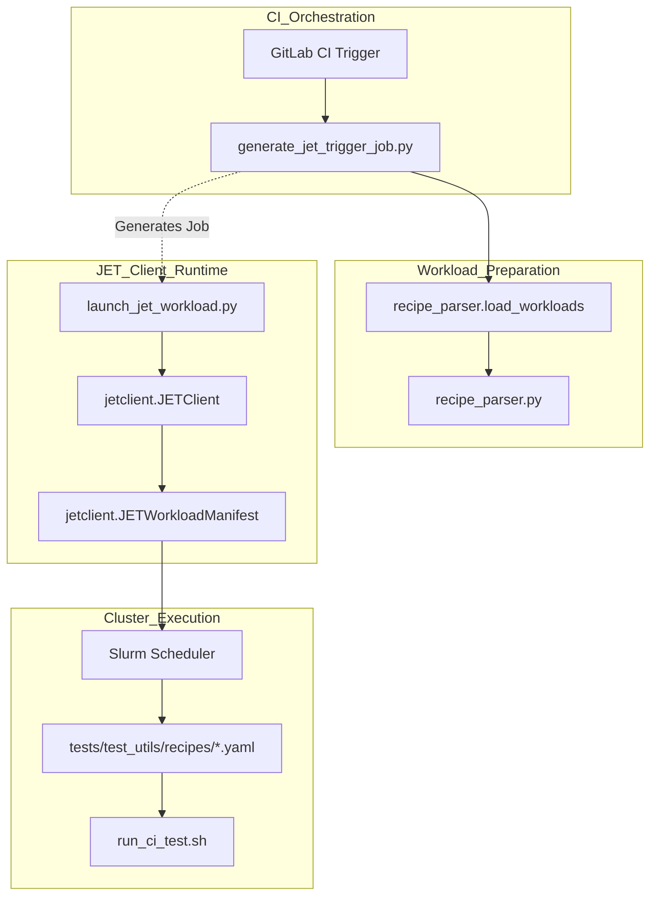
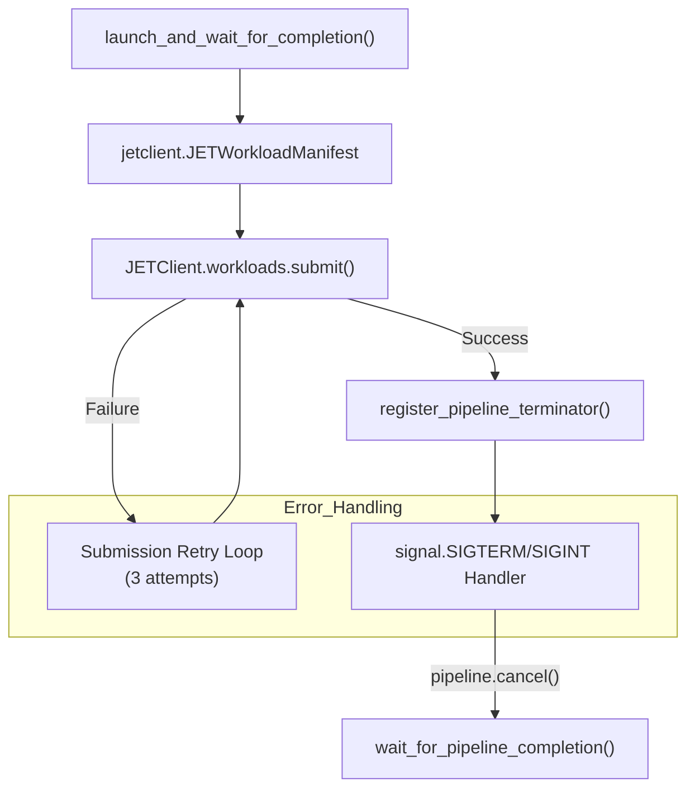

<!-- source: DeepWiki mcp.deepwiki.com · repo NVIDIA/Megatron-LM · page 9.5 JET Testing Platform and Cluster Management · fetched 2026-10-26 -->

# JET Testing Platform and Cluster Management

Relevant source files

The following files were used as context for generating this wiki page:

- [.gitlab-ci.yml](.gitlab-ci.yml)
- [.gitlab/labeler-config.yml](.gitlab/labeler-config.yml)
- [.gitlab/scripts/build.sh](.gitlab/scripts/build.sh)
- [.gitlab/stages/00.pre.yml](.gitlab/stages/00.pre.yml)
- [.gitlab/stages/01.build.yml](.gitlab/stages/01.build.yml)
- [.gitlab/stages/02.test.yml](.gitlab/stages/02.test.yml)
- [.gitlab/stages/03.integration-tests.yml](.gitlab/stages/03.integration-tests.yml)
- [.gitlab/stages/04.functional-tests.yml](.gitlab/stages/04.functional-tests.yml)
- [.gitlab/stages/05.publish.yml](.gitlab/stages/05.publish.yml)
- [tests/test_utils/python_scripts/check_status_of_main.py](tests/test_utils/python_scripts/check_status_of_main.py)
- [tests/test_utils/python_scripts/generate_jet_trigger_job.py](tests/test_utils/python_scripts/generate_jet_trigger_job.py)
- [tests/test_utils/python_scripts/launch_jet_workload.py](tests/test_utils/python_scripts/launch_jet_workload.py)
- [tests/test_utils/python_scripts/recipe_parser.py](tests/test_utils/python_scripts/recipe_parser.py)
- [tests/test_utils/python_scripts/wait_for_resources.py](tests/test_utils/python_scripts/wait_for_resources.py)
- [tests/test_utils/recipes/_cleanup.yaml](tests/test_utils/recipes/_cleanup.yaml)
- [tests/test_utils/recipes/gb200/gpt-1node.yaml](tests/test_utils/recipes/gb200/gpt-1node.yaml)
- [tests/test_utils/recipes/gb200/gpt.yaml](tests/test_utils/recipes/gb200/gpt.yaml)
- [tests/test_utils/recipes/gb200/moe-1node.yaml](tests/test_utils/recipes/gb200/moe-1node.yaml)
- [tests/test_utils/recipes/gb200/moe.yaml](tests/test_utils/recipes/gb200/moe.yaml)
- [tests/test_utils/recipes/h100/bert.yaml](tests/test_utils/recipes/h100/bert.yaml)
- [tests/test_utils/recipes/h100/flextron.yaml](tests/test_utils/recipes/h100/flextron.yaml)
- [tests/test_utils/recipes/h100/gpt-grads.yaml](tests/test_utils/recipes/h100/gpt-grads.yaml)
- [tests/test_utils/recipes/h100/gpt-grpo.yaml](tests/test_utils/recipes/h100/gpt-grpo.yaml)
- [tests/test_utils/recipes/h100/gpt-perf.yaml](tests/test_utils/recipes/h100/gpt-perf.yaml)
- [tests/test_utils/recipes/h100/gpt.yaml](tests/test_utils/recipes/h100/gpt.yaml)
- [tests/test_utils/recipes/h100/hybrid-perf.yaml](tests/test_utils/recipes/h100/hybrid-perf.yaml)
- [tests/test_utils/recipes/h100/mamba.yaml](tests/test_utils/recipes/h100/mamba.yaml)
- [tests/test_utils/recipes/h100/moe.yaml](tests/test_utils/recipes/h100/moe.yaml)
- [tests/test_utils/recipes/h100/t5.yaml](tests/test_utils/recipes/h100/t5.yaml)

## Purpose and Scope

The JET (Job Execution Tool) testing platform is the backbone for large-scale distributed validation in Megatron-LM. It enables the execution of training and inference workloads on Slurm-managed GPU clusters (A100, H100, GB200) directly from CI/CD pipelines. This system manages the lifecycle of distributed jobs, handles cluster-specific configurations, and provides mechanisms to distinguish between software regressions and infrastructure-level flakiness.

## JET Platform Architecture

JET acts as a middle layer between GitLab CI orchestration and physical compute clusters. The integration is primarily implemented through Python-based submission scripts and shell wrappers that prepare the cluster environment.

### System Interaction Diagram

The following diagram maps high-level CI stages to the specific code entities that interface with the JET platform.

**JET Platform Integration Architecture**

Sources: [tests/test_utils/python_scripts/launch_jet_workload.py:144-162](), [tests/test_utils/python_scripts/generate_jet_trigger_job.py:127-135](), [tests/test_utils/recipes/h100/gpt-grpo.yaml:13-62](), [.gitlab/stages/02.test.yml:89-114](), [.gitlab/stages/04.functional-tests.yml:109-176]()

## Workload Submission Flow

Workload submission is managed by `launch_jet_workload.py`, which uses the `jetclient` SDK to interact with the JET API.

### Submission and Lifecycle Logic

The submission process includes a retry loop for robustness against API timeouts and a signal handler to prevent orphaned jobs on the cluster.

**Workload Submission and Lifecycle Management**

Sources: [tests/test_utils/python_scripts/launch_jet_workload.py:35-44](), [tests/test_utils/python_scripts/launch_jet_workload.py:60-117](), [tests/test_utils/python_scripts/launch_jet_workload.py:119-146]()

### Implementation Details

*   **Workload Generation**: The system uses `recipe_parser.load_workloads` to transform YAML recipes into a list of workload specifications during the trigger generation phase [tests/test_utils/python_scripts/launch_jet_workload.py:149-160]().
*   **Environment Injection**: JET passes critical metadata to Slurm nodes via `custom_config`. This includes `MCORE_MR_COMMIT` for code versioning, `DASHBOARD_ENDPOINT` for tracking, and `RECORD_CHECKPOINTS` for golden value generation [tests/test_utils/python_scripts/launch_jet_workload.py:163-195]().
*   **Signal Termination**: To prevent resource leakage, `register_pipeline_terminator` captures `SIGINT` and `SIGTERM` signals to explicitly cancel the JET pipeline [tests/test_utils/python_scripts/launch_jet_workload.py:35-44]().
*   **Watchdog Mechanism**: `wait_for_pipeline_completion` implements a custom watchdog using `signal.alarm` and `SIGALRM` to prevent the CI job from hanging indefinitely on dropped TCP connections during status polling [tests/test_utils/python_scripts/launch_jet_workload.py:60-117]().

## Cluster Management and Configuration

Megatron-LM supports multiple cluster types, identified by their hardware type (A100, H100, GB200) and specific environment (LTS or Dev).

| Cluster Variable | Default Options | Usage Context |
| :--- | :--- | :--- |
| `CLUSTER_A100` | `dgxa100_dracooci`, `dgxa100_dracooci-ord` | A100 Functional/Integration Testing [.gitlab-ci.yml:234-239]() |
| `CLUSTER_H100` | `dgxh100_eos`, `dgxh100_dracooci` | H100 Scale/Performance Testing [.gitlab-ci.yml:240-245]() |
| `CLUSTER_GB200` | `dgxgb200_oci-hsg` | GB200 Next-Gen Validation [.gitlab-ci.yml:247-252]() |

The `functional:configure` and `integration:configure` stages map these clusters to specific Slurm partitions and accounts using generated YAML trigger jobs [.gitlab/stages/04.functional-tests.yml:51-176]().

Sources: [.gitlab-ci.yml:234-252](), [.gitlab/stages/04.functional-tests.yml:51-176](), [.gitlab/stages/03.integration-tests.yml:43-108]()

## Cluster Execution Environment

When a job starts on a Slurm node, the `script_setup` and `script` blocks defined in recipes (e.g., `gpt-grpo.yaml`) configure the environment.

### Node Preparation and Version Control
1.  **Authentication**: Jobs often inject credentials into `.netrc` to allow git operations on internal repositories [tests/test_utils/recipes/h100/gpt-grpo.yaml:17-18]().
2.  **Code Synchronization**: The setup block performs a clean git initialization and fetches specific commits defined by `MCORE_MR_COMMIT` and `MCORE_BACKWARDS_COMMIT` to ensure the exact code under test is executed [tests/test_utils/recipes/h100/gpt-grpo.yaml:20-39]().
3.  **Lightweight Mode**: Triggered by the `--enable-lightweight-mode` flag in `generate_jet_trigger_job.py`, workloads can be restricted to short "smoke" tests [tests/test_utils/python_scripts/generate_jet_trigger_job.py:67-74]().

### Workload Execution and Triage
The `generate_jet_trigger_job.py` script wraps the execution command with error extraction logic:
*   **Error Extraction**: If enabled via `--enable-error-extraction`, the script `extract-errors` is called on the log file to generate a structured `error_report.json` [tests/test_utils/python_scripts/generate_jet_trigger_job.py:16-31]().
*   **Pipeline Strategy**: The generated GitLab CI jobs use `strategy: depend` to ensure the parent pipeline status reflects the outcome of the downstream JET workloads [.gitlab/stages/02.test.yml:140-144]().

Sources: [tests/test_utils/recipes/h100/gpt-grpo.yaml:13-62](), [tests/test_utils/python_scripts/generate_jet_trigger_job.py:16-31](), [.gitlab/stages/02.test.yml:140-144]()

## Monitoring and Resource Management

*   **Main Branch Health**: The `check_status_of_main.py` script polls the GitLab API to ensure the target branch is green before allowing merges, preventing the "broken main" scenario [tests/test_utils/python_scripts/check_status_of_main.py:46-92]().
*   **Resource Throttling**: `wait_for_resources.py` implements a queuing mechanism that checks the number of concurrent jobs in the GitLab project to avoid overwhelming cluster capacity [.gitlab/stages/02.test.yml:13-39]().
*   **Pipeline Triage**: `dashboard.py` is used in the `publish:upload_statistics` stage to aggregate test results and upload them to a central dashboard for long-term performance tracking [.gitlab/stages/05.publish.yml:45-71]().
*   **Retry Policy**: CI pipelines are configured to retry jobs up to 2 times specifically when encountering `runner_system_failure` [.gitlab-ci.yml:160-163]().

Sources: [tests/test_utils/python_scripts/check_status_of_main.py:46-92](), [.gitlab/stages/02.test.yml:13-39](), [.gitlab/stages/05.publish.yml:45-71](), [.gitlab-ci.yml:160-163]()

---

