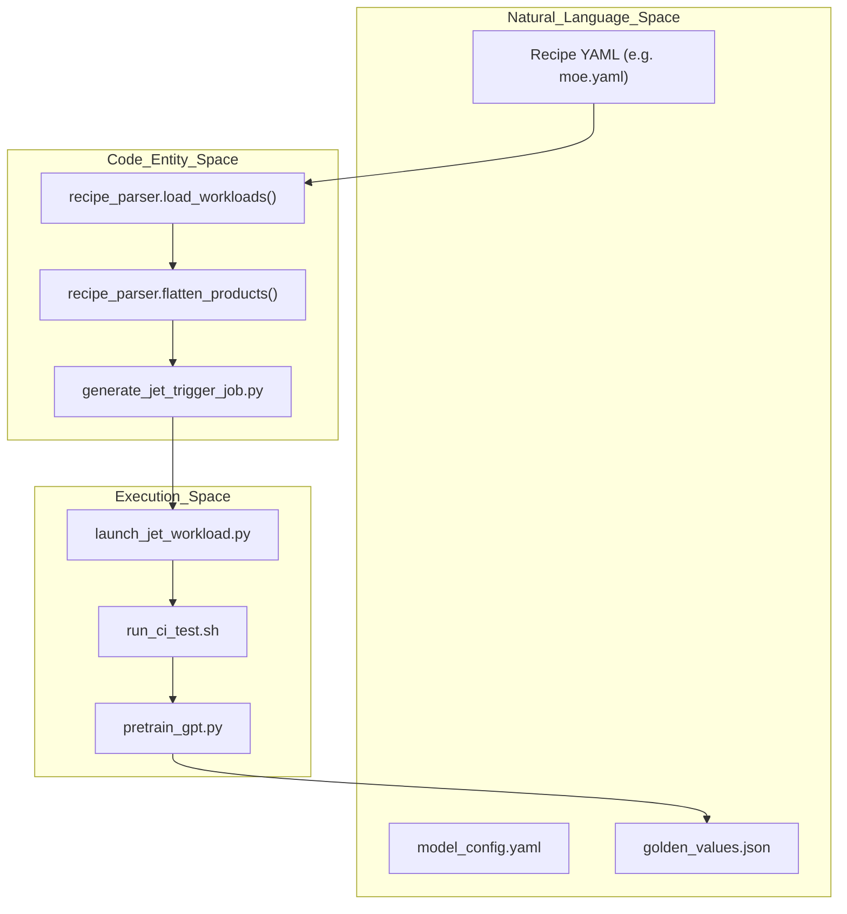
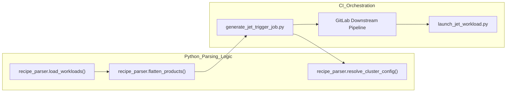

<!-- source: DeepWiki mcp.deepwiki.com · repo NVIDIA/Megatron-LM · page 9.6 Test Configuration and Recipe System · fetched 2026-10-26 -->

# Test Configuration and Recipe System

Relevant source files

The following files were used as context for generating this wiki page:

- [.gitlab-ci.yml](.gitlab-ci.yml)
- [.gitlab/cerno.yml](.gitlab/cerno.yml)
- [.gitlab/labeler-config.yml](.gitlab/labeler-config.yml)
- [.gitlab/scripts/build.sh](.gitlab/scripts/build.sh)
- [.gitlab/stages/00.pre.yml](.gitlab/stages/00.pre.yml)
- [.gitlab/stages/01.build.yml](.gitlab/stages/01.build.yml)
- [.gitlab/stages/02.test.yml](.gitlab/stages/02.test.yml)
- [.gitlab/stages/03.integration-tests.yml](.gitlab/stages/03.integration-tests.yml)
- [.gitlab/stages/04.functional-tests.yml](.gitlab/stages/04.functional-tests.yml)
- [.gitlab/stages/05.publish.yml](.gitlab/stages/05.publish.yml)
- [.gitlab/stages/06.triage.yml](.gitlab/stages/06.triage.yml)
- [docker/Dockerfile.linting](docker/Dockerfile.linting)
- [tests/test_utils/python_scripts/check_status_of_main.py](tests/test_utils/python_scripts/check_status_of_main.py)
- [tests/test_utils/python_scripts/generate_jet_trigger_job.py](tests/test_utils/python_scripts/generate_jet_trigger_job.py)
- [tests/test_utils/python_scripts/launch_jet_workload.py](tests/test_utils/python_scripts/launch_jet_workload.py)
- [tests/test_utils/python_scripts/linear_ci.py](tests/test_utils/python_scripts/linear_ci.py)
- [tests/test_utils/python_scripts/notify.py](tests/test_utils/python_scripts/notify.py)
- [tests/test_utils/python_scripts/recipe_parser.py](tests/test_utils/python_scripts/recipe_parser.py)
- [tests/test_utils/python_scripts/resolve_oncall_assignee.py](tests/test_utils/python_scripts/resolve_oncall_assignee.py)
- [tests/test_utils/python_scripts/wait_for_resources.py](tests/test_utils/python_scripts/wait_for_resources.py)
- [tests/test_utils/recipes/_cleanup.yaml](tests/test_utils/recipes/_cleanup.yaml)
- [tests/test_utils/recipes/gb200/gpt-dynamic-inference.yaml](tests/test_utils/recipes/gb200/gpt-dynamic-inference.yaml)
- [tests/test_utils/recipes/gb200/gpt-perf-dp4.yaml](tests/test_utils/recipes/gb200/gpt-perf-dp4.yaml)
- [tests/test_utils/recipes/gb200/gpt-perf.yaml](tests/test_utils/recipes/gb200/gpt-perf.yaml)
- [tests/test_utils/recipes/gb200/hybrid-perf-ep4.yaml](tests/test_utils/recipes/gb200/hybrid-perf-ep4.yaml)
- [tests/test_utils/recipes/gb200/hybrid-perf.yaml](tests/test_utils/recipes/gb200/hybrid-perf.yaml)
- [tests/test_utils/recipes/gb200/moe-dynamic-inference.yaml](tests/test_utils/recipes/gb200/moe-dynamic-inference.yaml)
- [tests/test_utils/recipes/h100/gpt-dynamic-inference-with-coordinator.yaml](tests/test_utils/recipes/h100/gpt-dynamic-inference-with-coordinator.yaml)
- [tests/test_utils/recipes/h100/gpt-dynamic-inference.yaml](tests/test_utils/recipes/h100/gpt-dynamic-inference.yaml)
- [tests/test_utils/recipes/h100/gpt-inference-server-smoke.yaml](tests/test_utils/recipes/h100/gpt-inference-server-smoke.yaml)
- [tests/test_utils/recipes/h100/gpt-offline-inference.yaml](tests/test_utils/recipes/h100/gpt-offline-inference.yaml)
- [tests/test_utils/recipes/h100/gpt-perf-dp8.yaml](tests/test_utils/recipes/h100/gpt-perf-dp8.yaml)
- [tests/test_utils/recipes/h100/gpt-static-inference.yaml](tests/test_utils/recipes/h100/gpt-static-inference.yaml)
- [tests/test_utils/recipes/h100/hybrid-perf-ep8.yaml](tests/test_utils/recipes/h100/hybrid-perf-ep8.yaml)
- [tests/test_utils/recipes/h100/mamba-dynamic-inference.yaml](tests/test_utils/recipes/h100/mamba-dynamic-inference.yaml)
- [tests/test_utils/recipes/h100/mamba-static-inference.yaml](tests/test_utils/recipes/h100/mamba-static-inference.yaml)
- [tests/test_utils/recipes/h100/moe-dynamic-inference-with-coordinator.yaml](tests/test_utils/recipes/h100/moe-dynamic-inference-with-coordinator.yaml)
- [tests/test_utils/recipes/h100/moe-dynamic-inference.yaml](tests/test_utils/recipes/h100/moe-dynamic-inference.yaml)
- [tests/test_utils/recipes/h100/moe-static-inference.yaml](tests/test_utils/recipes/h100/moe-static-inference.yaml)
- [tests/test_utils/test_ci_triage.py](tests/test_utils/test_ci_triage.py)

This document describes the test configuration and recipe system used by Megatron-LM's CI/CD infrastructure to define, manage, and execute functional tests across different clusters and environments. The system provides a declarative YAML-based approach to specify test parameters, model configurations, and execution requirements.

## Purpose and Scope

The test configuration and recipe system serves as the declarative layer between test definitions and test execution. It enables:

- **Centralized Test Configuration**: YAML-based specifications for model parameters, training arguments, and environment variables.
- **Dynamic Test Generation**: Recipe parsing system that generates JET workload manifests or GitLab job definitions from test configurations.
- **Multi-variant Testing**: Support for multiple configuration variants within a single test case (e.g., different parallelism strategies).
- **Environment Flexibility**: Cluster-specific and environment-specific (dev/lts) configuration overrides.
- **Test Scope Management**: Filtering of tests by scope (merge request, nightly, weekly) and cadence (pr, nightly, mergegroup) to optimize CI pipeline execution.

## Recipe System Architecture

The recipe system follows a pipeline architecture where YAML configurations are parsed, validated, and transformed into executable workloads for JET (Job Execution Tool) or GitLab CI.

### Recipe Data Flow
This diagram illustrates how configuration files are transformed into executable workloads and eventually into training runs.

**Sources**: `[tests/test_utils/python_scripts/recipe_parser.py:130-180]()`, `[tests/test_utils/python_scripts/generate_jet_trigger_job.py:99-111]()`, `[tests/test_utils/recipes/h100/moe.yaml:52-59]()`

## Test Configuration Structure

Test cases are organized in directories under `tests/functional_tests/test_cases/` with a standardized structure. Each test case directory contains a `model_config.yaml` defining the specific parallelism and model parameters.

**Sources**: `[tests/test_utils/recipes/h100/moe.yaml:52-53]()`, `[tests/test_utils/recipes/gb200/moe.yaml:54-55]()`

### Model Configuration Format

The recipe YAML defines the high-level test specification, which then points to specific configuration files.

| Section | Description | Implementation Detail |
|---------|-------------|-----------------------|
| `MODEL_ARGS` | Dictionary of script arguments | `[tests/test_utils/recipes/h100/moe.yaml:44-57]()` |
| `GOLDEN_VALUES_PATH` | Path to expected metric values | `[tests/test_utils/recipes/h100/moe.yaml:53]()` |
| `TRAINING_PARAMS_PATH` | Path to the model config YAML | `[tests/test_utils/recipes/h100/moe.yaml:52]()` |

### Cadence and Scope Management
The system utilizes a `recipe_parser` to manage test filtering via `scope` and `cadence`. Legacy scopes are aliased to a unified L-tier vocabulary to standardize cost classes and triggers.

| Legacy Scope | Tier Alias | Cost Class / Description |
|--------------|------------|--------------------------|
| `mr-slim` | `L0` | Slim PR set |
| `mr-github` | `L1` | Full PR / Merge Queue |
| `mr` | `L2` | GitLab MR extra |
| `nightly` | `L3` | Nightly suite |
| `weekly` | `L4` | Weekly suite |

**Sources**: `[tests/test_utils/python_scripts/recipe_parser.py:34-41]()`, `[tests/test_utils/python_scripts/recipe_parser.py:44-52]()`

## Recipe Loading and Parsing

The parsing logic in `recipe_parser.py` flattens complex YAML product matrices into individual workload specifications.

### Dynamic Workload Generation
This diagram bridges the Python parsing logic to the CI orchestration.

**Sources**: `[tests/test_utils/python_scripts/recipe_parser.py:130-180]()`, `[tests/test_utils/python_scripts/generate_jet_trigger_job.py:154-173]()`, `[tests/test_utils/python_scripts/recipe_parser.py:106-127]()`

The `recipe_parser.flatten_products` function iterates through the `products` block in a recipe, performing a Cartesian product of parameters like `environment`, `platforms`, and `test_case` to generate unique test rows. It handles the override logic where inner `cadence` values take precedence over outer defaults.

**Sources**: `[tests/test_utils/python_scripts/recipe_parser.py:130-180]()`

## Resource and Status Management

The CI system includes specialized scripts to manage pipeline health and resource contention on shared clusters.

- **Main Branch Status**: `check_status_of_main.py` prevents merging into `main` if the most recent pipeline on the target branch is failing. It uses the GitLab API to poll pipeline status with exponential backoff. `[tests/test_utils/python_scripts/check_status_of_main.py:25-43]()`, `[tests/test_utils/python_scripts/check_status_of_main.py:82-86]()`
- **Resource Queueing**: `wait_for_resources.py` implements a simple queuing mechanism. It checks the number of currently running merge request pipelines and pauses the job if the concurrency limit `NUM_CONCURRENT_JOBS` is exceeded. `[tests/test_utils/python_scripts/wait_for_resources.py:27-56]()`, `[tests/test_utils/python_scripts/wait_for_resources.py:66-71]()`

## Automated Triage and Error Extraction

The system integrates a structured error extraction mechanism to facilitate debugging of failed CI jobs.

- **Error Extraction Logic**: The `generate_jet_trigger_job.py` script provides an opt-in flag `--enable-error-extraction`. When enabled, it wraps the workload command in a shell script that pipes output to `jet_workload.log` and executes `extract-errors` to produce an `error_report.json`. `[tests/test_utils/python_scripts/generate_jet_trigger_job.py:16-31]()`, `[tests/test_utils/python_scripts/generate_jet_trigger_job.py:94-97]()`
- **Cerno Integration**: Megatron-LM uses **Cerno** for automated failure analysis and Linear issue management. The triage stage involves jobs like `triage:linear_write` which uses `resolve_oncall_assignee.py` to assign new issues based on a schedule. `[tests/test_utils/test_ci_triage.py:122-138]()`, `[tests/test_utils/test_ci_triage.py:141-148]()`
- **JET Pipeline Watchdog**: The `launch_jet_workload.py` script implements a robust watchdog in `wait_for_pipeline_completion` to handle hung GitLab API connections during status polling, using `signal.alarm` to enforce a `poll_timeout`. `[tests/test_utils/python_scripts/launch_jet_workload.py:60-117]()`

**Sources**: `[tests/test_utils/python_scripts/generate_jet_trigger_job.py:16-31]()`, `[tests/test_utils/python_scripts/launch_jet_workload.py:60-117]()`, `[tests/test_utils/test_ci_triage.py:141-148]()`

## Recipe Examples

Recipes define the matrix of `test_case`, `environment` (dev/lts), `scope` (L0-L4), and `platforms`.

- **GPT Recipe**: Covers a wide range of GPT-3 configurations, including `dist_optimizer`, `swiglu`, and `rope_embeddings`. `[tests/test_utils/recipes/h100/gpt.yaml:65-210]()`
- **MoE Recipe**: Defines Mixture of Experts tests, including variants for `expert_parallelism` (EP), `token_parallelism`, and `groupedGEMM`. `[tests/test_utils/recipes/h100/moe.yaml:65-193]()`
- **GB200 Specifics**: Recipes for the GB200 platform specify different node/GPU counts and use specialized Lustre paths for data caching. `[tests/test_utils/recipes/gb200/moe.yaml:9-12]()`, `[tests/test_utils/recipes/gb200/moe.yaml:48]()`
- **Inference Recipes**: Dedicated recipes for static and dynamic inference across GPT, MoE, and Mamba models. `[tests/test_utils/recipes/h100/gpt-static-inference.yaml:1-50]()`, `[tests/test_utils/recipes/h100/moe-dynamic-inference.yaml:1-50]()`

**Sources**: `[tests/test_utils/recipes/h100/gpt.yaml:1-210]()`, `[tests/test_utils/recipes/h100/moe.yaml:1-200]()`, `[tests/test_utils/recipes/gb200/moe.yaml:1-193]()`

## Tooling and Quality Control

The repository maintains strict code quality standards through automated formatting and checking scripts.

- **Autoformatter**: `tools/autoformat.sh` orchestrates `black`, `isort`, `pylint`, `ruff`, and `mypy` to ensure consistent style and catch static errors. `[tools/autoformat.sh:38-43]()`
- **Copyright Compliance**: `tools/copyright.sh` and `tools/check_copyright.py` verify that all source files contain the mandatory NVIDIA copyright header. `[tools/copyright.sh:1-10]()`
- **Pylint Configuration**: The `.pylintrc` file explicitly enables specific checks like `unused-import` (W0611) and `missing-class-docstring` (C0115). `[.pylintrc:1-14]()`

**Sources**: `[tools/autoformat.sh:1-46]()`, `[.pylintrc:1-21]()`

---

