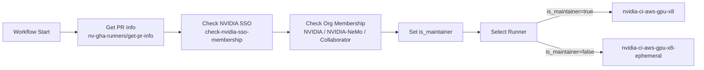
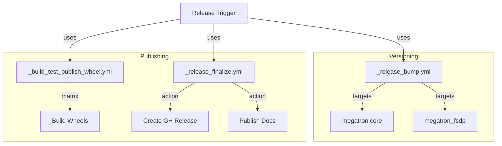
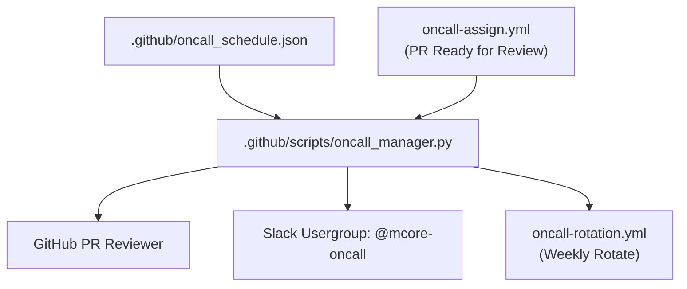

<!-- source: DeepWiki mcp.deepwiki.com · repo NVIDIA/Megatron-LM · page 9.7 GitHub Actions and Release Management · fetched 2026-10-26 -->

# GitHub Actions and Release Management

Relevant source files

The following files were used as context for generating this wiki page:

- [.claude/settings.json](.claude/settings.json)
- [.cursorrules](.cursorrules)
- [.github/actions/action.yml](.github/actions/action.yml)
- [.github/oncall_schedule.json](.github/oncall_schedule.json)
- [.github/scripts/cancel_superseded_merge_group_runs.py](.github/scripts/cancel_superseded_merge_group_runs.py)
- [.github/scripts/community_request_assignee.py](.github/scripts/community_request_assignee.py)
- [.github/scripts/github_slack_utils.py](.github/scripts/github_slack_utils.py)
- [.github/scripts/oncall_manager.py](.github/scripts/oncall_manager.py)
- [.github/scripts/sync_team_usergroups.py](.github/scripts/sync_team_usergroups.py)
- [.github/scripts/test_approve_test_queue.sh](.github/scripts/test_approve_test_queue.sh)
- [.github/scripts/test_cancel_superseded_merge_group_runs.py](.github/scripts/test_cancel_superseded_merge_group_runs.py)
- [.github/workflows/_update_dependencies.yml](.github/workflows/_update_dependencies.yml)
- [.github/workflows/auto-reminder-bot.yml](.github/workflows/auto-reminder-bot.yml)
- [.github/workflows/auto-update-copy-pr-bot.yml](.github/workflows/auto-update-copy-pr-bot.yml)
- [.github/workflows/cicd-approve-test-queue.yml](.github/workflows/cicd-approve-test-queue.yml)
- [.github/workflows/cicd-cancel-superseded-merge-groups.yml](.github/workflows/cicd-cancel-superseded-merge-groups.yml)
- [.github/workflows/cicd-main.yml](.github/workflows/cicd-main.yml)
- [.github/workflows/claude-complexity-label.yml](.github/workflows/claude-complexity-label.yml)
- [.github/workflows/claude-copy-to-main.yml](.github/workflows/claude-copy-to-main.yml)
- [.github/workflows/claude_review.yml](.github/workflows/claude_review.yml)
- [.github/workflows/community-request-assignee.yml](.github/workflows/community-request-assignee.yml)
- [.github/workflows/copyright-check.yml](.github/workflows/copyright-check.yml)
- [.github/workflows/dependabot.yml](.github/workflows/dependabot.yml)
- [.github/workflows/install-test.yml](.github/workflows/install-test.yml)
- [.github/workflows/multi-approval-bot.yml](.github/workflows/multi-approval-bot.yml)
- [.github/workflows/nightly-sync-main-to-dev.yml](.github/workflows/nightly-sync-main-to-dev.yml)
- [.github/workflows/oncall-assign.yml](.github/workflows/oncall-assign.yml)
- [.github/workflows/oncall-rotation.yml](.github/workflows/oncall-rotation.yml)
- [.github/workflows/release.yaml](.github/workflows/release.yaml)
- [.github/workflows/sync-team-usergroups.yml](.github/workflows/sync-team-usergroups.yml)
- [AGENTS.md](AGENTS.md)
- [CLAUDE.md](CLAUDE.md)
- [skills/nightly-sync/SKILL.md](skills/nightly-sync/SKILL.md)
- [skills/respond-to-issue/SKILL.md](skills/respond-to-issue/SKILL.md)
- [tests/test_utils/python_scripts/launch_nemo_run_workload.py](tests/test_utils/python_scripts/launch_nemo_run_workload.py)
- [tests/test_utils/python_scripts/test_oncall_manager.py](tests/test_utils/python_scripts/test_oncall_manager.py)
- [tests/test_utils/test_community_request_assignee.py](tests/test_utils/test_community_request_assignee.py)
- [tests/test_utils/test_github_slack_utils.py](tests/test_utils/test_github_slack_utils.py)
- [tests/test_utils/test_launch_nemo_run_workload.py](tests/test_utils/test_launch_nemo_run_workload.py)

## Purpose and Scope

This document covers the GitHub Actions workflows that manage continuous integration, testing, release automation, and PyPI package publishing for Megatron-LM. These workflows validate pull requests, build and test Python wheels, and automate the release process for both `megatron-core` and `megatron-fsdp` packages. It also details the automated oncall management system used to rotate reviewers and assign PRs.

For information about GitLab CI pipelines used for internal testing, see [9.1](). For test execution infrastructure (JET), see [9.5](). For test recipe configuration, see [9.6]().

---

## Workflow Architecture Overview

The GitHub Actions system consists of several interconnected workflows that handle different aspects of the CI/CD pipeline:

Title: GitHub Actions Workflow Interconnections

```mermaid
graph TB
    subgraph "PR Validation Workflows"
        CICDMain["cicd-main.yml<br/>Main PR validation"]
        Copyright["copyright-check.yml<br/>Copyright validation"]
        CodeOwners["multi-approval-bot.yml<br/>Codeowner approval"]
        InstallTest["install-test.yml<br/>Installation verification"]
        WheelBuild["build-test-publish-wheel.yml<br/>Wheel build validation"]
        ClaudeReview["claude_review.yml<br/>LLM-based code review"]
    end
    
    subgraph "Release Workflows"
        ReleaseLib["release.yaml<br/>Release orchestration"]
        BuildTestPub["_build_test_publish_wheel.yml<br/>Multi-platform wheel build"]
    end
    
    subgraph "Queue & Management"
        ApproveQueue["cicd-approve-test-queue.yml<br/>Test queue manager"]
        OncallAssign["oncall-assign.yml<br/>Reviewer assignment"]
        OncallRotate["oncall-rotation.yml<br/>Weekly schedule rotation"]
    end
    
    subgraph "Shared Actions"
        TestTemplate[".github/actions/action.yml<br/>Reusable test execution"]
    end
    
    subgraph "Version Management"
        McoreVersion["megatron/core/package_info.py<br/>VERSION metadata"]
        MFSDPVersion["megatron/core/distributed/fsdp/src/megatron_fsdp/package_info.py"]
    end
    
    CICDMain -->|uses| TestTemplate
    CICDMain -->|awaits| ApproveQueue
    
    ReleaseLib -->|builds| BuildTestPub
    ReleaseLib -->|bumps| McoreVersion
    ReleaseLib -->|bumps| MFSDPVersion
    
    WheelBuild -->|calls| BuildTestPub
    
    OncallRotate -->|updates| OncallJSON[".github/oncall_schedule.json"]
    OncallAssign -->|reads| OncallJSON
```

Sources: [.github/workflows/cicd-main.yml:15-39](), [.github/workflows/cicd-approve-test-queue.yml:15-30](), [.github/oncall_schedule.json:1-50](), [.github/workflows/claude_review.yml:1-110]()

---

## Main CI/CD Pipeline

### Workflow Trigger Configuration

The `cicd-main.yml` workflow handles primary PR validation and is triggered by push events to PR branches and merge group requests.

| Trigger Type | Pattern | Purpose |
|--------------|---------|---------|
| `push` | `pull-request/[0-9]+` | PR branch updates [.github/workflows/cicd-main.yml:19]() |
| `push` | `deploy-release/*` | Release deployment branches [.github/workflows/cicd-main.yml:20]() |
| `merge_group` | `checks_requested` | GitHub merge queue validation [.github/workflows/cicd-main.yml:21-22]() |
| `workflow_dispatch` | Manual | On-demand execution [.github/workflows/cicd-main.yml:23]() |

Sources: [.github/workflows/cicd-main.yml:16-27]()

### Contributor and Runner Selection
The pipeline performs an SSO membership check to determine if the contributor is internal or external. This determines the runner type and resource allocation. The `is-not-external-contributor` job determines if the user is a maintainer and selects appropriate runners like `nvidia-ci-aws-gpu-x8` or `nvidia-ci-aws-use2-gpu-x4`.

Title: Contributor Validation and Runner Selection

Sources: [.github/workflows/cicd-main.yml:38-45](), [.github/workflows/cicd-main.yml:72-158]()

---

## Release Management

### Release Workflow Architecture

The release process uses `release.yaml` to orchestrate version bumping, wheel building, and finalization. It supports `dry-run` modes to validate the process without publishing.

Title: Release Orchestration and Wheel Generation

Sources: [.github/workflows/release.yaml:90-155]()

### Versioning and Metadata

Versions are managed via `package_info.py` files. The release workflow targets both the main `megatron.core` package and the sharded data parallel package `megatron_fsdp` located at `megatron/core/distributed/fsdp/src/`.

Sources: [.github/workflows/release.yaml:108-112]()

---

## Wheel Building and Publishing

### Multi-Platform Build Matrix

The wheel building workflow `_build_test_publish_wheel.yml` supports multiple platforms using Dockerized `manylinux` environments.

| Package | Platform | Image |
|---------|----------|-------|
| `megatron-core` | `arm64` | `quay.io/pypa/manylinux_2_28_aarch64` |
| `megatron-core` | `amd64` | `quay.io/pypa/manylinux_2_28_x86_64` |
| `megatron-fsdp` | `amd64` | `quay.io/pypa/manylinux_2_28_x86_64` |

Sources: [.github/workflows/_build_test_publish_wheel.yml:24-42]()

---

## Queue and Oncall Management

### Queue Approval System
The `cicd-approve-test-queue.yml` workflow manages test execution concurrency by checking for waiting deployments. It classifies PRs into internal and external contributors using a downloaded `users_sso.json` from the `NVIDIA-GitHub-Management/github-audits` repository.

Sources: [.github/workflows/cicd-approve-test-queue.yml:61-66](), [.github/workflows/cicd-approve-test-queue.yml:89-96]()

### Oncall Reviewer Assignment
The repository maintains an oncall rotation defined in `.github/oncall_schedule.json`. 

1. **Rotation:** The `oncall-rotation.yml` workflow runs every Wednesday at 09:00 UTC to rotate the schedule using `oncall_manager.py rotate`.
2. **Assignment:** When a PR is marked "Ready for Review", `oncall-assign.yml` calls `oncall_manager.py assign` to select the current oncall engineer and assign them as a reviewer.
3. **Slack Integration:** The `oncall_manager.py` script updates the Slack usergroup `mcore-oncall` to ensure mentions reach the active oncall.

Title: Oncall Management Flow

Sources: [.github/workflows/oncall-assign.yml:15-47](), [.github/workflows/oncall-rotation.yml:15-60](), [.github/scripts/oncall_manager.py:105-150]()

---

## LLM-Based Code Review

The repository integrates LLM-based code review via `claude_review.yml`. This workflow provides two levels of analysis:
*   **Light Review:** Triggered by `/claude review`, focusing on typos, critical bugs, and test gaps [.github/workflows/claude_review.yml:12-102]().
*   **Strict Review:** Triggered by `/claude strict-review`, covering parallelism correctness, precision, and performance [.github/workflows/claude_review.yml:109-158]().

The reviewer is specifically instructed to flag new direct global process group access in `megatron/core` production code, preferring the use of `ProcessGroupCollection`.

Sources: [.github/workflows/claude_review.yml:79-85]()

---

## Test Execution Action

### Reusable Test Template
The `.github/actions/action.yml` composite action provides a standardized test execution interface. It handles environment setup including `uv` installation and executes `launch_nemo_run_workload.py`.

### Flaky Failure Detection
The `launch_nemo_run_workload.py` script includes logic to detect and handle flaky failures. It monitors logs for specific keywords like `Watchdog caught collective operation timeout` or `NCCL operations have failed` and can trigger retries via `n-repeat`.

Sources: [tests/test_utils/python_scripts/launch_nemo_run_workload.py:20-61](), [tests/test_utils/python_scripts/launch_nemo_run_workload.py:142-144]()

### Installation Verification
The `install-test.yml` workflow ensures that `megatron-core` and `megatron.training` can be installed in clean environments. It validates imports for both packages using `check-imports`.

Sources: [.github/workflows/install-test.yml:74-85]()

---

