# Page: Overview

# Overview

<details>
<summary>Relevant source files</summary>

The following files were used as context for generating this wiki page:

- [.gitignore](.gitignore)
- [MANIFEST.in](MANIFEST.in)
- [README.md](README.md)
- [docs/api-guide/core/index.md](docs/api-guide/core/index.md)
- [docs/index.md](docs/index.md)
- [docs/user-guide/features/context_parallel.md](docs/user-guide/features/context_parallel.md)
- [docs/user-guide/features/dist_optimizer.md](docs/user-guide/features/dist_optimizer.md)
- [docs/user-guide/features/index.md](docs/user-guide/features/index.md)
- [docs/user-guide/features/megatron_energon.md](docs/user-guide/features/megatron_energon.md)
- [docs/user-guide/features/megatron_rl.md](docs/user-guide/features/megatron_rl.md)
- [docs/user-guide/features/multi_latent_attention.md](docs/user-guide/features/multi_latent_attention.md)
- [docs/user-guide/features/multi_token_prediction.md](docs/user-guide/features/multi_token_prediction.md)
- [docs/user-guide/features/pipeline_parallel_layout.md](docs/user-guide/features/pipeline_parallel_layout.md)
- [docs/user-guide/features/tokenizers.md](docs/user-guide/features/tokenizers.md)
- [docs/user-guide/hybrid-model-migration.md](docs/user-guide/hybrid-model-migration.md)
- [docs/user-guide/index.md](docs/user-guide/index.md)
- [docs/user-guide/parallelism-guide.md](docs/user-guide/parallelism-guide.md)
- [examples/run_simple_mcore_train_loop.py](examples/run_simple_mcore_train_loop.py)
- [megatron/core/QuickStart.md](megatron/core/QuickStart.md)
- [megatron/core/README.md](megatron/core/README.md)
- [megatron/core/__init__.py](megatron/core/__init__.py)
- [megatron/core/dist_checkpointing/gpt_checkpoint_interop.py](megatron/core/dist_checkpointing/gpt_checkpoint_interop.py)
- [megatron/core/distributed/fsdp/src/megatron_fsdp/package_info.py](megatron/core/distributed/fsdp/src/megatron_fsdp/package_info.py)
- [megatron/core/models/common/__init__.py](megatron/core/models/common/__init__.py)
- [megatron/core/num_microbatches_calculator.py](megatron/core/num_microbatches_calculator.py)
- [megatron/core/package_info.py](megatron/core/package_info.py)
- [megatron/core/requirements.txt](megatron/core/requirements.txt)
- [megatron/core/safe_globals.py](megatron/core/safe_globals.py)
- [megatron/core/transformer/custom_layers/__init__.py](megatron/core/transformer/custom_layers/__init__.py)
- [megatron/training/global_vars.py](megatron/training/global_vars.py)
- [setup.py](setup.py)
- [skills/mcore-migrate-gpt-to-hybrid/SKILL.md](skills/mcore-migrate-gpt-to-hybrid/SKILL.md)
- [tests/unit_tests/data/test_multimodal_dataset.py](tests/unit_tests/data/test_multimodal_dataset.py)
- [tests/unit_tests/dist_checkpointing/test_safe_globals.py](tests/unit_tests/dist_checkpointing/test_safe_globals.py)
- [tests/unit_tests/test_num_microbatches_calculator.py](tests/unit_tests/test_num_microbatches_calculator.py)

</details>


This repository contains two primary components: **Megatron-LM** and **Megatron Core**.

**Megatron Core** is a GPU-optimized PyTorch library providing composable building blocks for training large transformer models. It contains transformer components, advanced parallelism strategies (TP, PP, DP, EP, CP), mixed precision support (FP16, BF16, FP8, and FP4), and model architectures [README.md:20-21]().

**Megatron-LM** is a reference training framework that demonstrates how to use Megatron Core. It includes pre-configured training scripts, argument parsing, distributed initialization, and examples for GPT, BERT, T5, Mamba, and Mixture-of-Experts models [README.md:18-19]().

Together, they enable training models from 2B to 462B parameters across thousands of GPUs, achieving up to 47% Model FLOP Utilization (MFU) on H100 clusters [README.md:95-98]().

## When to Use What

| Use Case | Recommended Component |
|----------|----------------------|
| Building custom training frameworks | **Megatron Core** - composable library with modular APIs [README.md:21](), [megatron/core/README.md:21]() |
| Training standard models (GPT, LLaMA, etc.) | **Megatron-LM** - reference scripts and pre-configured recipes [README.md:18-19]() |
| Research on new architectures | **Megatron Core** - flexible building blocks for attention, MLP, and MoE [megatron/core/README.md:25-28]() |
| Production training pipelines | **Megatron-LM** + **Megatron Core** - complete high-performance framework [README.md:16-17]() |
| Framework development (like NeMo) | **Megatron Core** - integrate as a library dependency via PyPI [README.md:29](), [megatron/core/package_info.py:34]() |

**Key subsystems documented in detail:**
- Getting started and installation: [Getting Started](#1.1)
- High-level system architecture: [Architecture Overview](#1.2)
- Package structure and external integrations: [Package Structure and Ecosystem](#1.3)

**Sources:** [README.md:14-23](), [README.md:95-113](), [megatron/core/package_info.py:34-42](), [megatron/core/README.md:21-36]()

---

## Repository Structure

The codebase follows a hierarchical organization that separates library code (Megatron Core) from application code (Megatron-LM training scripts) [README.md:69-89]():

```
Megatron-LM/
├── megatron/
│   ├── core/                      # Megatron Core library (kernels, parallelism)
│   │   ├── models/                # Model implementations (GPT, BERT, T5, Mamba)
│   │   ├── transformer/           # Transformer building blocks (attention, MLP, layers)
│   │   ├── tensor_parallel/       # Tensor parallelism layers and communication
│   │   ├── pipeline_parallel/     # Pipeline parallelism schedules (1F1B, interleaving)
│   │   ├── distributed/           # Data parallelism (DDP, FSDP, gradient buffers)
│   │   ├── optimizer/             # Optimizers
│   │   ├── datasets/              # Dataset loaders
│   │   ├── inference/             # Inference engines and server
│   │   └── export/                # Model export (example: TensorRT-LLM)
│   ├── training/                  # Training scripts
│   ├── legacy/                    # Legacy components
│   ├── post_training/             # Post-training (quantization, distillation, pruning, etc.)
│   └── rl/                        # Reinforcement learning (including RLHF)
├── examples/                      # Ready-to-use training examples
├── tools/                         # Utility tools
├── tests/                         # Comprehensive test suite
└── docs/                          # Documentation
```

**Sources:** [README.md:69-89](), [megatron/core/package_info.py:38]()

---

## System Architecture: Core Components

### Two-Layer Architecture

**Diagram: Megatron Core vs Megatron-LM**

```mermaid
graph TD
    subgraph ApplicationLayer["Application Layer: Megatron-LM"]
        Training["megatron/training/"]
        Examples["examples/"]
        GlobalVars["megatron.training.global_vars"]
        RunSimpleTrainLoop["examples/run_simple_mcore_train_loop.py"]
    end
    
    subgraph LibraryLayer["Library Layer: Megatron Core (megatron/core/)"]
        Models["megatron/core/models/"]
        GPTModel["megatron.core.models.gpt.GPTModel"]
        
        Transformer["megatron/core/transformer/"]
        TransformerConfig["megatron.core.transformer.transformer_config.TransformerConfig"]
        
        ParallelState["megatron.core.parallel_state"]
        
        DistributedModule["megatron.core.distributed/"]
        DDP["megatron.core.distributed.DistributedDataParallel"]
        
        OptimizerModule["megatron.core.optimizer/"]
        
        DatasetsModule["megatron.core.datasets/"]
        BlendedBuilder["megatron.core.datasets.blended_megatron_dataset_builder.BlendedMegatronDatasetBuilder"]
        
        InferenceModule["megatron.core.inference/"]
        MicrobatchCalc["megatron.core.num_microbatches_calculator"]
    end
    
    subgraph ExternalDeps["External Dependencies"]
        PyTorch["PyTorch"]
        TE["Transformer Engine"]
    end
    
    GlobalVars --> MicrobatchCalc
    GlobalVars --> ParallelState
    
    RunSimpleTrainLoop --> GPTModel
    RunSimpleTrainLoop --> ParallelState
    RunSimpleTrainLoop --> TransformerConfig
    RunSimpleTrainLoop --> DDP
    RunSimpleTrainLoop --> BlendedBuilder

    GPTModel --> Transformer
    
    Transformer --> TE
    Transformer --> DistributedModule
```
**Sources:** [README.md:18-21](), [megatron/training/global_vars.py:137-166](), [examples/run_simple_mcore_train_loop.py:10-25](), [examples/run_simple_mcore_train_loop.py:72-77](), [megatron/core/README.md:25-34](), [megatron/core/num_microbatches_calculator.py:64-73]()

### Megatron Core: Composable Library

Megatron Core (`megatron/core/`) is a standalone PyTorch library providing GPU-optimized building blocks. It abstracts complex parallelism and optimization techniques into modular APIs [README.md:20-21](), [megatron/core/README.md:21]().

**Core modules:**

| Module | Key Classes/Functions | Purpose |
|--------|----------------------|---------|
| `transformer/` | `TransformerConfig` [examples/run_simple_mcore_train_loop.py:64]() | Model configuration and transformer architecture parameters |
| `models/gpt/` | `GPTModel` [examples/run_simple_mcore_train_loop.py:72]() | Reference GPT implementation using Core components |
| `distributed/` | `DistributedDataParallel` [examples/run_simple_mcore_train_loop.py:22]() | Core DDP implementation for gradient management |
| `parallel_state` | `initialize_model_parallel` [examples/run_simple_mcore_train_loop.py:52]() | Initialization of TP and PP process groups |
| `num_microbatches_calculator` | `init_num_microbatches_calculator` [megatron/core/num_microbatches_calculator.py:64]() | Logic for calculating microbatches and ramp-up schedules |

**Installation:**
```bash
uv pip install megatron-core
```
[README.md:29]()

**Sources:** [README.md:29](), [megatron/core/README.md:21](), [examples/run_simple_mcore_train_loop.py:10-25](), [megatron/core/num_microbatches_calculator.py:64-114]()

### Megatron-LM: Reference Training Framework

Megatron-LM provides pre-configured training scripts and orchestration logic. It handles the high-level loop and global state management required to use the Core library [README.md:18-19]().

**Key components:**

| Component | File/Module | Purpose |
|-----------|-------------|---------|
| Training Scripts | `megatron/training/` | Scripts for pre-training and fine-tuning [README.md:81]() |
| Global Variables | `megatron/training/global_vars.py` | Centralized access to `args`, `tokenizer`, and `timers` [megatron/training/global_vars.py:31-83]() |
| Simple Example | `examples/run_simple_mcore_train_loop.py` | A minimal end-to-end training script for learning [examples/run_simple_mcore_train_loop.py:1-10]() |
| Tokenizer Setup | `build_tokenizer` | Orchestrates tokenizer instantiation based on arguments [megatron/training/global_vars.py:17]() |

**Sources:** [README.md:18-19](), [README.md:81](), [megatron/training/global_vars.py:31-83](), [examples/run_simple_mcore_train_loop.py:1-10]()

---

## Configuration and Initialization

Megatron-LM uses a centralized configuration approach where model architecture and parallelism settings are defined in `TransformerConfig`. The system initialization involves setting up the distributed environment and process groups.

**Diagram: Configuration and Initialization Flow**

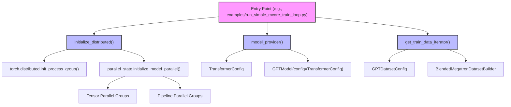

**Sources:** [examples/run_simple_mcore_train_loop.py:29-54](), [examples/run_simple_mcore_train_loop.py:57-79](), [examples/run_simple_mcore_train_loop.py:82-121]()

### Key Architecture Components

| Component | Location | Purpose |
|----------|----------|---------|
| `TransformerConfig` | `megatron/core/transformer/transformer_config.py` | Defines model dimensions and parallelism settings [examples/run_simple_mcore_train_loop.py:64-70]() |
| `parallel_state` | `megatron/core/parallel_state.py` | Manages distributed process groups for all parallelism types [examples/run_simple_mcore_train_loop.py:52]() |
| `dist_checkpointing` | `megatron/core/dist_checkpointing/` | Provides sharded model saving and loading utilities [examples/run_simple_mcore_train_loop.py:169-182]() |
| `finalize_model_grads` | `megatron/core/distributed/finalize_model_grads.py` | Orchestrates gradient reduction and clipping across parallel groups [examples/run_simple_mcore_train_loop.py:24]() |
| `ModelParallelConfig` | `megatron/core/model_parallel_config.py` | Base configuration for model parallelism settings [megatron/core/__init__.py:10]() |

**Sources:** [examples/run_simple_mcore_train_loop.py:10-25](), [examples/run_simple_mcore_train_loop.py:169-182](), [megatron/core/__init__.py:10-24]()

---

## Summary

Megatron-LM and Megatron Core provide a tiered approach to LLM development:

- **Megatron Core** serves as the foundational library for high-performance, distributed transformer components.
- **Megatron-LM** provides the reference implementation and training orchestration required for massive-scale pre-training.

For more details on specific subsystems, please refer to the following child pages:
- [Getting Started](#1.1) — Installation and first training run.
- [Architecture Overview](#1.2) — Deep dive into the system components.
- [Package Structure and Ecosystem](#1.3) — Integration with TE, NeMo, and external tools.

**Sources:** [README.md:14-23](), [megatron/core/README.md:19-21]()

---

# Page: Getting Started

# Getting Started

<details>
<summary>Relevant source files</summary>

The following files were used as context for generating this wiki page:

- [.github/workflows/_build_test_publish_wheel.yml](.github/workflows/_build_test_publish_wheel.yml)
- [.gitignore](.gitignore)
- [MANIFEST.in](MANIFEST.in)
- [README.md](README.md)
- [docker/Dockerfile.ci.dev](docker/Dockerfile.ci.dev)
- [docker/Dockerfile.ci.lts](docker/Dockerfile.ci.lts)
- [docker/common/install.sh](docker/common/install.sh)
- [docker/common/install_source_wheels.sh](docker/common/install_source_wheels.sh)
- [docs/get-started/install.md](docs/get-started/install.md)
- [docs/get-started/overview.md](docs/get-started/overview.md)
- [docs/get-started/quickstart.md](docs/get-started/quickstart.md)
- [docs/get-started/releasenotes.md](docs/get-started/releasenotes.md)
- [docs/user-guide/data-preparation.md](docs/user-guide/data-preparation.md)
- [docs/user-guide/training-examples.md](docs/user-guide/training-examples.md)
- [examples/run_simple_mcore_train_loop.py](examples/run_simple_mcore_train_loop.py)
- [megatron/core/QuickStart.md](megatron/core/QuickStart.md)
- [megatron/core/README.md](megatron/core/README.md)
- [megatron/core/distributed/fsdp/src/megatron_fsdp/__init__.py](megatron/core/distributed/fsdp/src/megatron_fsdp/__init__.py)
- [megatron/core/distributed/fsdp/src/megatron_fsdp/package_info.py](megatron/core/distributed/fsdp/src/megatron_fsdp/package_info.py)
- [megatron/core/distributed/fsdp/src/pyproject.toml](megatron/core/distributed/fsdp/src/pyproject.toml)
- [megatron/core/models/common/__init__.py](megatron/core/models/common/__init__.py)
- [megatron/core/package_info.py](megatron/core/package_info.py)
- [megatron/core/requirements.txt](megatron/core/requirements.txt)
- [megatron/core/transformer/custom_layers/__init__.py](megatron/core/transformer/custom_layers/__init__.py)
- [pyproject.toml](pyproject.toml)
- [setup.py](setup.py)
- [tests/functional_tests/shell_test_utils/_run_training.sh](tests/functional_tests/shell_test_utils/_run_training.sh)
- [tests/functional_tests/shell_test_utils/run_ci_test.sh](tests/functional_tests/shell_test_utils/run_ci_test.sh)
- [tests/performance_tests/shell_test_utils/determinism/print_nsys_leaderboard.py](tests/performance_tests/shell_test_utils/determinism/print_nsys_leaderboard.py)
- [tests/test_utils/test_training_script_secret_redaction.py](tests/test_utils/test_training_script_secret_redaction.py)
- [tests/unit_tests/data/test_multimodal_dataset.py](tests/unit_tests/data/test_multimodal_dataset.py)
- [uv.lock](uv.lock)

</details>


This document provides installation instructions and a simple training example to help users begin using Megatron-LM. It covers environment setup, basic model training with distributed parallelism, and checkpoint management. For detailed architecture information, see [Architecture Overview](#1.2). For information about the codebase organization, see [Package Structure and Ecosystem](#1.3).

## Overview

Megatron-LM provides two components: **Megatron-LM** and **Megatron Core**.

1.  **Megatron-LM**: A reference example including Megatron Core plus pre-configured training scripts. Best for research teams and quick experimentation [README.md:16-19]().
2.  **Megatron Core**: A composable library with GPU-optimized building blocks (kernels, parallelism, building blocks). Best for framework developers building custom pipelines [README.md:20-21](), [megatron/core/README.md:19-21]().

**Sources:** [README.md:1-21](), [megatron/core/README.md:19-21]()

## Installation

### Prerequisites

Megatron-LM requires:
- NVIDIA GPU with compute capability 7.0 or higher [README.md:98-100]().
- Python 3.12 or higher (Note: Python 3.10 support is deprecated as of version 0.17.0) [README.md:55-55](), [uv.lock:3-3](), [pyproject.toml:26-26]().
- PyTorch 2.6.0 or higher [pyproject.toml:28-28]().

### Installing Megatron Core (Library Only)

You can install the core library directly from PyPI using `uv`:

```bash
uv pip install megatron-core
```

**Sources:** [README.md:26-30](), [pyproject.toml:23-28]()

### Installing from Source (Full Repository)

Clone the repository to access pre-configured training scripts, examples, and tools:

```bash
git clone https://github.com/NVIDIA/Megatron-LM.git
cd Megatron-LM
uv pip install -e .
```

The build system utilizes `setuptools` with `pybind11` to compile C++ helper extensions [pyproject.toml:3-5](), [setup.py:3-5](). The main extension is defined in `setup.py`:

| Extension | Source | Purpose |
|-----------|--------|---------|
| `helpers_cpp` | [megatron/core/datasets/helpers.cpp]() | C++ optimized dataset sampling operations [setup.py:8-15]() |

**Note:** Building from source can be memory-intensive. Limit parallel jobs if needed using `MAX_JOBS=4 uv pip install -e .` [README.md:40-40]().

**Sources:** [README.md:32-40](), [pyproject.toml:3-5](), [setup.py:1-16]()

## First Training Loop

The following example demonstrates the complete workflow for training a small GPT model using Megatron Core APIs. This example is implemented in `examples/run_simple_mcore_train_loop.py`.

### Training Workflow

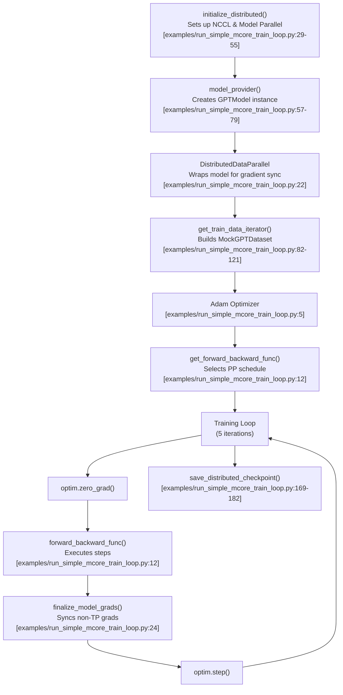

**Sources:** [examples/run_simple_mcore_train_loop.py:1-182](), [megatron/core/QuickStart.md:1-10]()

### Step 1: Initialize Distributed Environment

Initialize PyTorch's distributed backend and Megatron's model parallel process groups via `parallel_state`:

```python
from megatron.core import parallel_state

def initialize_distributed(tensor_model_parallel_size=1, pipeline_model_parallel_size=1):
    rank = int(os.environ["RANK"])
    world_size = int(os.environ["WORLD_SIZE"])
    local_rank = int(os.environ["LOCAL_RANK"])
    
    torch.cuda.set_device(local_rank)
    torch.distributed.init_process_group(backend="nccl", rank=rank, world_size=world_size)
    
    # Initialize TP, PP, DP, etc.
    parallel_state.initialize_model_parallel(tensor_model_parallel_size, pipeline_model_parallel_size)
```

**Sources:** [examples/run_simple_mcore_train_loop.py:29-55](), [megatron/core/QuickStart.md:44-62]()

### Step 2: Define Model Provider

Create a `GPTModel` using a `TransformerConfig`. This configuration drives the internal architecture of the transformer blocks.

```python
from megatron.core.transformer.transformer_config import TransformerConfig
from megatron.core.models.gpt.gpt_model import GPTModel
from megatron.core.models.gpt.gpt_layer_specs import get_gpt_layer_local_spec

def model_provider():
    config = TransformerConfig(
        num_layers=2, 
        hidden_size=12, 
        num_attention_heads=4, 
        use_cpu_initialization=True, 
        pipeline_dtype=torch.float32)

    return GPTModel(
        config=config, 
        transformer_layer_spec=get_gpt_layer_local_spec(), 
        vocab_size=100, 
        max_sequence_length=64)
```

**Sources:** [examples/run_simple_mcore_train_loop.py:57-79](), [megatron/core/QuickStart.md:66-92]()

### Step 3: Create Data Iterator

Use the `BlendedMegatronDatasetBuilder` to construct datasets. For quick starts, `MockGPTDataset` generates synthetic data.

```python
from megatron.core.datasets.blended_megatron_dataset_builder import BlendedMegatronDatasetBuilder
from megatron.core.datasets.gpt_dataset import GPTDatasetConfig, MockGPTDataset

def get_train_data_iterator():
    config = GPTDatasetConfig(
        random_seed=0,
        sequence_length=64,
        tokenizer=MegatronTokenizer.from_pretrained(...)
    )
    datasets = BlendedMegatronDatasetBuilder(
        MockGPTDataset, [1000, None, None], lambda: True, config
    ).build()
    return iter(DataLoader(datasets[0], batch_size=8, shuffle=True))
```

**Sources:** [examples/run_simple_mcore_train_loop.py:82-121](), [megatron/core/QuickStart.md:96-142]()

### Step 4: Define Forward Step Function

Define how a single microbatch is processed. This function is passed to the pipeline scheduler.

```python
def forward_step_func(data_iterator, model):
    data = next(data_iterator)
    # Extract tokens, labels, masks from data...
    output_tensor = model(tokens, position_ids, attention_mask, labels=labels)
    
    def loss_func(loss_mask, output_tensor):
        # Compute loss...
        return loss, {'lm loss': loss}
        
    return output_tensor, partial(loss_func, loss_mask)
```

**Sources:** [examples/run_simple_mcore_train_loop.py:124-167](), [megatron/core/QuickStart.md:146-176]()

### Step 5: Execute Training Loop

The training loop orchestrates the forward and backward passes using the selected schedule and finalizes gradients before the optimizer step.

```python
# Wrap model with DistributedDataParallel for gradient reduction
gpt_model = DistributedDataParallel(config=config, ddp_config=ddp_config, module=gpt_model)

for iteration in range(5):
    optim.zero_grad()
    # forward_backward_func handles microbatching and PP logic
    forward_backward_func(model=gpt_model, ...)
    # Sync non-tensor-parallel gradients (e.g. LayerNorm)
    finalize_model_grads([gpt_model])
    optim.step()
```

**Sources:** [examples/run_simple_mcore_train_loop.py:22-24](), [megatron/core/QuickStart.md:201-241]()

## Running the Example

### Using torchrun

To run the provided simple training loop on 2 GPUs:

```bash
export PYTHONPATH=$PYTHONPATH:./megatron
torchrun --nproc_per_node 2 examples/run_simple_mcore_train_loop.py
```

**Sources:** [megatron/core/QuickStart.md:38-41](), [megatron/core/README.md:15-16]()

## Checkpointing

Megatron Core uses **Distributed Checkpointing** (`dist_checkpointing`). This system saves the `sharded_state_dict`, allowing models to be loaded with different parallelism configurations (e.g., train on TP=2, load on TP=4).

```python
from megatron.core import dist_checkpointing

# Saving
sharded_state_dict = model.sharded_state_dict(prefix="")
dist_checkpointing.save(sharded_state_dict=sharded_state_dict, checkpoint_dir=path)

# Loading
checkpoint = dist_checkpointing.load(sharded_state_dict=sharded_state_dict, checkpoint_dir=path)
model.load_state_dict(checkpoint)
```

**Sources:** [examples/run_simple_mcore_train_loop.py:169-205](), [megatron/core/QuickStart.md:180-200]()

## Summary of Code Entities

The following diagram maps high-level system components to their specific code implementations within the repository.

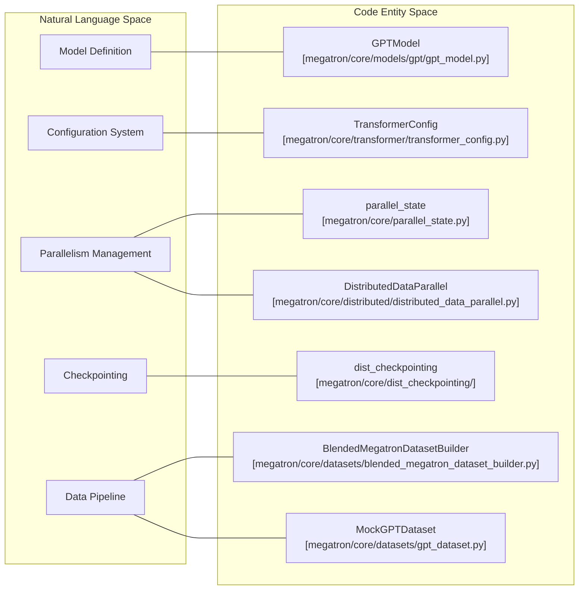

| Entity | Path | Role |
|--------|------|------|
| `GPTModel` | [megatron/core/models/gpt/gpt_model.py]() | Reference GPT implementation |
| `TransformerConfig` | [megatron/core/transformer/transformer_config.py]() | Central configuration for transformer blocks |
| `parallel_state` | [megatron/core/parallel_state.py]() | Manages distributed process groups |
| `DistributedDataParallel` | [megatron/core/distributed/distributed_data_parallel.py]() | Megatron-optimized DDP implementation |
| `dist_checkpointing` | [megatron/core/dist_checkpointing/]() | Distributed checkpointing logic |
| `BlendedMegatronDatasetBuilder` | [megatron/core/datasets/blended_megatron_dataset_builder.py]() | Builds blended datasets from multiple sources |
| `MockGPTDataset` | [megatron/core/datasets/gpt_dataset.py]() | Generates synthetic data for GPT models |

**Sources:** [examples/run_simple_mcore_train_loop.py:10-25](), [README.md:72-87](), [megatron/core/package_info.py:34-42]()

---

# Page: Architecture Overview

# Architecture Overview

<details>
<summary>Relevant source files</summary>

The following files were used as context for generating this wiki page:

- [.gitignore](.gitignore)
- [MANIFEST.in](MANIFEST.in)
- [README.md](README.md)
- [examples/run_simple_mcore_train_loop.py](examples/run_simple_mcore_train_loop.py)
- [megatron/core/QuickStart.md](megatron/core/QuickStart.md)
- [megatron/core/README.md](megatron/core/README.md)
- [megatron/core/dist_checkpointing/strategies/fully_parallel.py](megatron/core/dist_checkpointing/strategies/fully_parallel.py)
- [megatron/core/distributed/fsdp/src/megatron_fsdp/package_info.py](megatron/core/distributed/fsdp/src/megatron_fsdp/package_info.py)
- [megatron/core/extensions/transformer_engine.py](megatron/core/extensions/transformer_engine.py)
- [megatron/core/fusions/fused_bias_swiglu.py](megatron/core/fusions/fused_bias_swiglu.py)
- [megatron/core/model_parallel_config.py](megatron/core/model_parallel_config.py)
- [megatron/core/models/common/__init__.py](megatron/core/models/common/__init__.py)
- [megatron/core/models/gpt/gpt_model.py](megatron/core/models/gpt/gpt_model.py)
- [megatron/core/package_info.py](megatron/core/package_info.py)
- [megatron/core/parallel_state.py](megatron/core/parallel_state.py)
- [megatron/core/pipeline_parallel/p2p_communication.py](megatron/core/pipeline_parallel/p2p_communication.py)
- [megatron/core/pipeline_parallel/schedules.py](megatron/core/pipeline_parallel/schedules.py)
- [megatron/core/requirements.txt](megatron/core/requirements.txt)
- [megatron/core/tensor_parallel/__init__.py](megatron/core/tensor_parallel/__init__.py)
- [megatron/core/tensor_parallel/layers.py](megatron/core/tensor_parallel/layers.py)
- [megatron/core/tensor_parallel/random.py](megatron/core/tensor_parallel/random.py)
- [megatron/core/transformer/attention.py](megatron/core/transformer/attention.py)
- [megatron/core/transformer/cuda_graphs.py](megatron/core/transformer/cuda_graphs.py)
- [megatron/core/transformer/custom_layers/__init__.py](megatron/core/transformer/custom_layers/__init__.py)
- [megatron/core/transformer/mlp.py](megatron/core/transformer/mlp.py)
- [megatron/core/transformer/module.py](megatron/core/transformer/module.py)
- [megatron/core/transformer/torch_norm.py](megatron/core/transformer/torch_norm.py)
- [megatron/core/transformer/transformer_block.py](megatron/core/transformer/transformer_block.py)
- [megatron/core/transformer/transformer_config.py](megatron/core/transformer/transformer_config.py)
- [megatron/core/transformer/transformer_layer.py](megatron/core/transformer/transformer_layer.py)
- [megatron/core/transformer/utils.py](megatron/core/transformer/utils.py)
- [megatron/core/utils.py](megatron/core/utils.py)
- [megatron/training/arguments.py](megatron/training/arguments.py)
- [megatron/training/checkpointing.py](megatron/training/checkpointing.py)
- [megatron/training/config/training_config.py](megatron/training/config/training_config.py)
- [megatron/training/initialize.py](megatron/training/initialize.py)
- [megatron/training/training.py](megatron/training/training.py)
- [pretrain_gpt.py](pretrain_gpt.py)
- [pretrain_hybrid.py](pretrain_hybrid.py)
- [pretrain_mamba.py](pretrain_mamba.py)
- [setup.py](setup.py)
- [tests/unit_tests/data/test_multimodal_dataset.py](tests/unit_tests/data/test_multimodal_dataset.py)
- [tests/unit_tests/dist_checkpointing/test_pipeline_parallel_layout.py](tests/unit_tests/dist_checkpointing/test_pipeline_parallel_layout.py)
- [tests/unit_tests/dist_checkpointing/utils.py](tests/unit_tests/dist_checkpointing/utils.py)
- [tests/unit_tests/fusions/test_swiglu_fusion.py](tests/unit_tests/fusions/test_swiglu_fusion.py)
- [tests/unit_tests/pipeline_parallel/test_pipeline_layout.py](tests/unit_tests/pipeline_parallel/test_pipeline_layout.py)
- [tests/unit_tests/tensor_parallel/test_random.py](tests/unit_tests/tensor_parallel/test_random.py)
- [tests/unit_tests/test_checkpointing.py](tests/unit_tests/test_checkpointing.py)
- [tests/unit_tests/test_parallel_state.py](tests/unit_tests/test_parallel_state.py)
- [tests/unit_tests/transformer/test_cuda_graphs.py](tests/unit_tests/transformer/test_cuda_graphs.py)
- [tests/unit_tests/transformer/test_utils.py](tests/unit_tests/transformer/test_utils.py)

</details>


## Purpose and Scope

This page provides a high-level architectural overview of Megatron-LM, describing its major components, architectural layers, and how they interact to enable large-scale transformer model training and inference. It focuses on the structural organization of the codebase and the flow of control through the system.

Megatron-LM consists of two primary components: **Megatron-LM** (the reference training framework) and **Megatron Core** (the modular library of GPU-optimized building blocks) [[README.md:14-21]]().

## System Architecture Layers

Megatron-LM is organized into three architectural layers that separate concerns and enable flexible composition:

Title: Megatron-LM System Layers
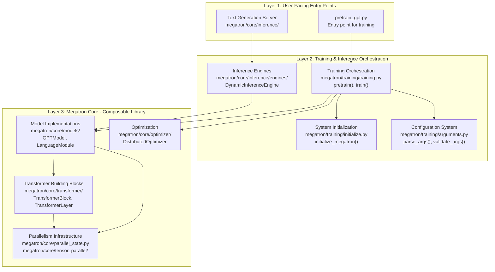

**Layer 1** provides command-line scripts and API servers. **Layer 2** contains orchestration logic for training runs and inference serving. **Layer 3** (Megatron Core) provides the underlying infrastructure for models, parallelism, and optimization [[README.md:71-92]]().

Sources: [[megatron/training/training.py:1-195]](), [[megatron/training/initialize.py:1-155]](), [[megatron/core/models/gpt/gpt_model.py:52-154]](), [[megatron/core/transformer/transformer_block.py:1-170]](), [[README.md:71-92]]()

## Core Components and Data Flow

### Training Pipeline Components

Title: Training Data and Control Flow
```mermaid
graph LR
    subgraph "Configuration"
        Args["parse_args()<br/>megatron/training/arguments.py"]
        TConfig["TransformerConfig<br/>megatron/core/transformer/transformer_config.py"]
    end
    
    subgraph "Initialization"
        InitMegatron["initialize_megatron()<br/>megatron/training/initialize.py"]
        ParallelState["parallel_state.py<br/>Process group creation"]
    end
    
    subgraph "Model Construction"
        ModelProvider["model_provider()<br/>User-defined function"]
        GPTModel["GPTModel<br/>megatron/core/models/gpt/gpt_model.py"]
        TransformerBlock["TransformerBlock<br/>megatron/core/transformer/transformer_block.py"]
    end
    
    subgraph "Optimization"
        GetOptimizer["get_megatron_optimizer()<br/>megatron/core/optimizer/"]
        DistOptimizer["DistributedOptimizer<br/>megatron/core/optimizer/distrib_optimizer.py"]
    end
    
    subgraph "Training Execution"
        Pretrain["pretrain()<br/>megatron/training/training.py"]
        Train["train_step()<br/>Main training loop"]
    end
    
    Args --> InitMegatron
    InitMegatron --> ParallelState
    ParallelState --> ModelProvider
    TConfig --> ModelProvider
    
    ModelProvider --> GPTModel
    GPTModel --> TransformerBlock
    
    GPTModel --> GetOptimizer
    TConfig --> GetOptimizer
    GetOptimizer --> DistOptimizer
    
    DistOptimizer --> Pretrain
    GPTModel --> Pretrain
    Pretrain --> Train
```

The training pipeline starts with argument parsing via `parse_args` [[megatron/training/arguments.py:116]]() which initializes the global configuration. `initialize_megatron()` [[megatron/training/initialize.py:152]]() sets up the distributed environment and initializes `parallel_state.py`. Models like `GPTModel` [[megatron/core/models/gpt/gpt_model.py:52]]() are constructed using modular components like `TransformerBlock` [[megatron/core/transformer/transformer_block.py:1]]() and `TransformerConfig` [[megatron/core/transformer/transformer_config.py:54]]().

Sources: [[megatron/training/arguments.py:87-168]](), [[megatron/training/initialize.py:151-155]](), [[megatron/training/training.py:1-195]](), [[megatron/core/models/gpt/gpt_model.py:98-154]](), [[megatron/core/parallel_state.py:28-178]]()

### Model Architecture Hierarchy

Title: Transformer Model Entity Hierarchy
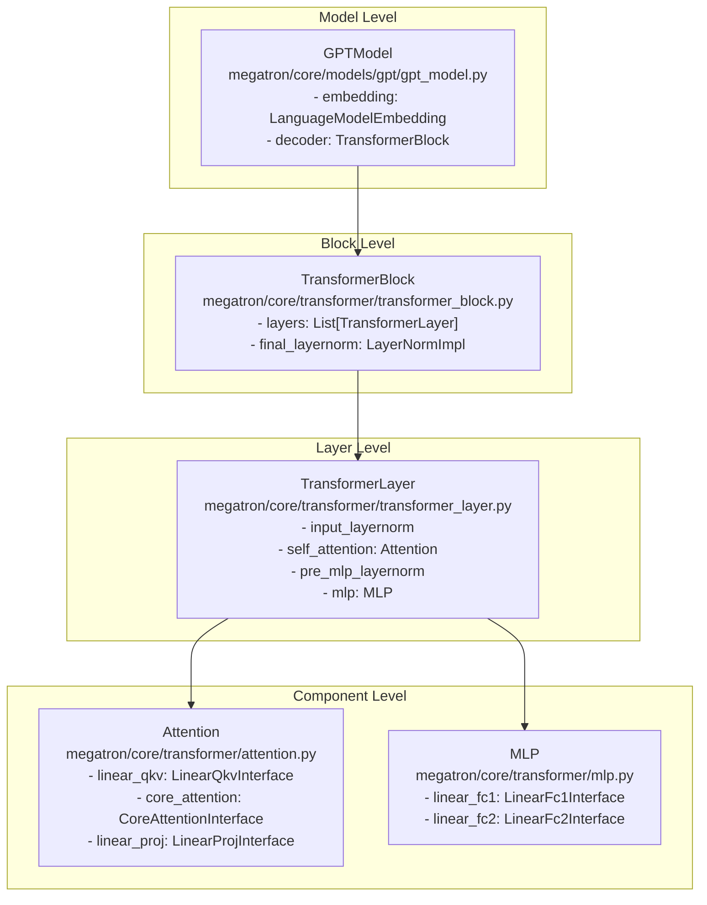

`GPTModel` [[megatron/core/models/gpt/gpt_model.py:52]]() encapsulates the full transformer. It contains a `TransformerBlock` [[megatron/core/transformer/transformer_block.py:1]](), which manages a list of `TransformerLayer` [[megatron/core/transformer/transformer_layer.py:1]]() instances. Each layer is composed of an `Attention` [[megatron/core/transformer/attention.py:1]]() and an `MLP` [[megatron/core/transformer/mlp.py:32]]() module.

Sources: [[megatron/core/models/gpt/gpt_model.py:98-154]](), [[megatron/core/transformer/transformer_block.py:1-170]](), [[megatron/core/transformer/transformer_layer.py:1-170]](), [[megatron/core/transformer/attention.py:139-235]](), [[megatron/core/transformer/mlp.py:32]]()

## Configuration System

Megatron uses a configuration system centered around dataclasses:

- **ModelParallelConfig**: Base configuration for distributed settings [[megatron/core/model_parallel_config.py:26]]().
- **TransformerConfig**: Extends `ModelParallelConfig` with transformer-specific parameters like `num_layers`, `hidden_size`, and `attention_backend` [[megatron/core/transformer/transformer_config.py:54-163]]().
- **MLATransformerConfig**: Specialized config for Multi-Latent Attention [[megatron/core/transformer/transformer_config.py:113]]().

The `add_megatron_arguments` function [[megatron/training/arguments.py:45]]() adds a comprehensive set of arguments to an `argparse.ArgumentParser`. These arguments are then parsed and validated by `parse_and_validate_args` [[megatron/training/arguments.py:87]](), which also sets global variables [[megatron/training/arguments.py:111]]().

Sources: [[megatron/core/transformer/transformer_config.py:54-163]](), [[megatron/core/model_parallel_config.py:26]](), [[megatron/training/arguments.py:45]](), [[megatron/training/arguments.py:87]]()

## Parallelism Architecture

### Process Group Hierarchy

Initialization logic in `parallel_state.py` defines the various process groups required for 3D parallelism and advanced strategies:

| Variable Name | Purpose |
|---------------|---------|
| `_TENSOR_MODEL_PARALLEL_GROUP` | Intra-layer model parallelism [[megatron/core/parallel_state.py:29]]() |
| `_PIPELINE_MODEL_PARALLEL_GROUP` | Inter-layer pipeline parallelism [[megatron/core/parallel_state.py:34]]() |
| `_MODEL_PARALLEL_GROUP` | Combined intra- and pipeline model parallelism [[megatron/core/parallel_state.py:36]]() |
| `_DATA_PARALLEL_GROUP` | Standard data parallelism [[megatron/core/parallel_state.py:43]]() |
| `_TENSOR_AND_DATA_PARALLEL_GROUP` | Tensor and data parallel group combined [[megatron/core/parallel_state.py:47]]() |
| `_EXPERT_MODEL_PARALLEL_GROUP` | Expert model parallel group for MoE models [[megatron/core/parallel_state.py:60]]() |
| `_EXPERT_TENSOR_PARALLEL_GROUP` | Expert tensor parallel group [[megatron/core/parallel_state.py:62]]() |
| `_EXPERT_DATA_PARALLEL_GROUP` | Expert data parallel group [[megatron/core/parallel_state.py:71]]() |
| `_CONTEXT_PARALLEL_GROUP` | Sequence-based context parallelism [[megatron/core/parallel_state.py:124]]() |

Sources: [[megatron/core/parallel_state.py:28-178]]()

### Tensor Parallelism (TP)

TP splits weight matrices across GPUs. `VocabParallelEmbedding` [[megatron/core/tensor_parallel/layers.py:198]]() shards the vocabulary dimension. `ColumnParallelLinear` [[megatron/core/tensor_parallel/layers.py:351]]() shards weights along the output dimension, while `RowParallelLinear` [[megatron/core/tensor_parallel/layers.py:514]]() shards along the input dimension. Communication primitives like `gather_from_tensor_model_parallel_region` [[megatron/core/extensions/transformer_engine.py:43]]() handle data movement.

Sources: [[megatron/core/tensor_parallel/layers.py:198-514]](), [[megatron/core/extensions/transformer_engine.py:43]]()

### Pipeline Parallelism (PP)

Pipeline parallelism divides model layers across GPUs. The `schedules.py` module defines various pipeline schedules, including `forward_backward_pipelining_with_interleaving` for interleaved PP and `forward_backward_pipelining_without_interleaving` for non-interleaved PP [[megatron/core/pipeline_parallel/schedules.py:161-165]](). The `PipelineParallelLayerLayout` class allows for custom definitions of pipeline parallel partitioning [[megatron/core/transformer/transformer_config.py:104]](). The `get_transformer_layer_offset` function calculates the layer index offset for the current pipeline stage [[megatron/core/transformer/transformer_layer.py:65]]().

Sources: [[megatron/core/pipeline_parallel/schedules.py:157-166]](), [[megatron/core/transformer/transformer_config.py:104]](), [[megatron/core/transformer/transformer_layer.py:65]]()

## Training Execution Flow

The training lifecycle is orchestrated by utilities in `megatron/training/training.py`. It selects a pipeline schedule via `get_forward_backward_func()` [[megatron/core/pipeline_parallel/schedules.py:53]](). This function handles microbatching and communication logic. The training loop manages forward/backward passes, gradient synchronization via `finalize_model_grads` [[megatron/training/training.py:51]](), and optimizer steps using `DistributedOptimizer` [[megatron/core/optimizer/distrib_optimizer.py:82]]().

Sources: [[megatron/training/training.py:1-195]](), [[megatron/core/pipeline_parallel/schedules.py:53-166]](), [[megatron/core/optimizer/distrib_optimizer.py:82]]()

## Checkpointing System

Megatron implements a distributed checkpointing system. The `checkpointing.py` module provides functions for saving and loading model, optimizer, and training states [[megatron/training/checkpointing.py:3]](). Key functions include `save_checkpoint` [[megatron/training/checkpointing.py:145]]() and `load_checkpoint` [[megatron/training/checkpointing.py:144]](). It supports `ShardedStateDict` [[megatron/core/dist_checkpointing/mapping.py:12]]() for flexible loading across different parallelism configurations.

Sources: [[megatron/training/checkpointing.py:1-161]](), [[megatron/core/dist_checkpointing/mapping.py:12]]()

## Key Abstractions and Interfaces

### Module Specification System
Megatron Core uses `ModuleSpec` [[megatron/core/transformer/spec_utils.py:39]]() to define module structures. This allows users to swap implementations (e.g., replacing a standard MLP with an MoE MLP) by providing a different specification to the `TransformerLayer`.

### Distributed Data Parallel (DDP)
Megatron supports distributed data parallelism through its own `DistributedDataParallel` class [[megatron/core/distributed/distributed_data_parallel.py:47]]() and an adapter for `megatron_FSDP` [[megatron/core/distributed/fsdp/mcore_fsdp_adapter.py:53]]().

Sources: [[megatron/core/transformer/spec_utils.py:39]](), [[megatron/core/distributed/distributed_data_parallel.py:47]](), [[megatron/core/distributed/fsdp/mcore_fsdp_adapter.py:53]]()

## Integration Points

| Library | Purpose | Integration Point |
|---------|---------|------------------|
| **Transformer Engine (TE)** | FP8 support, fused kernels | `megatron/core/extensions/transformer_engine.py` [[megatron/core/extensions/transformer_engine.py:1]]() |
| **Flash Attention** | Memory-efficient attention | `megatron/core/transformer/attention.py` [[megatron/core/transformer/attention.py:65-120]]() |
| **Multi-Storage Client (MSC)** | Support for various storage backends | `megatron/core/msc_utils.py` [[megatron/training/arguments.py:39]](), [[megatron/training/arguments.py:156]]() |
| **ModelOpt** | Post-training optimization | `megatron/training/checkpointing.py` [[megatron/training/checkpointing.py:82-90]]() |

Sources: [[megatron/core/extensions/transformer_engine.py:1-187]](), [[megatron/core/transformer/attention.py:65-120]](), [[megatron/training/arguments.py:146-167]](), [[megatron/training/checkpointing.py:82-90]]()

---

# Page: Package Structure and Ecosystem

# Package Structure and Ecosystem

<details>
<summary>Relevant source files</summary>

The following files were used as context for generating this wiki page:

- [.github/workflows/_build_test_publish_wheel.yml](.github/workflows/_build_test_publish_wheel.yml)
- [.gitignore](.gitignore)
- [MANIFEST.in](MANIFEST.in)
- [README.md](README.md)
- [docker/Dockerfile.ci.dev](docker/Dockerfile.ci.dev)
- [docker/Dockerfile.ci.lts](docker/Dockerfile.ci.lts)
- [docker/common/install.sh](docker/common/install.sh)
- [docker/common/install_source_wheels.sh](docker/common/install_source_wheels.sh)
- [docs/api-guide/core/index.md](docs/api-guide/core/index.md)
- [docs/index.md](docs/index.md)
- [docs/user-guide/features/context_parallel.md](docs/user-guide/features/context_parallel.md)
- [docs/user-guide/features/dist_optimizer.md](docs/user-guide/features/dist_optimizer.md)
- [docs/user-guide/features/index.md](docs/user-guide/features/index.md)
- [docs/user-guide/features/megatron_energon.md](docs/user-guide/features/megatron_energon.md)
- [docs/user-guide/features/megatron_rl.md](docs/user-guide/features/megatron_rl.md)
- [docs/user-guide/features/multi_latent_attention.md](docs/user-guide/features/multi_latent_attention.md)
- [docs/user-guide/features/multi_token_prediction.md](docs/user-guide/features/multi_token_prediction.md)
- [docs/user-guide/features/pipeline_parallel_layout.md](docs/user-guide/features/pipeline_parallel_layout.md)
- [docs/user-guide/features/tokenizers.md](docs/user-guide/features/tokenizers.md)
- [docs/user-guide/hybrid-model-migration.md](docs/user-guide/hybrid-model-migration.md)
- [docs/user-guide/index.md](docs/user-guide/index.md)
- [docs/user-guide/parallelism-guide.md](docs/user-guide/parallelism-guide.md)
- [examples/run_simple_mcore_train_loop.py](examples/run_simple_mcore_train_loop.py)
- [megatron/core/QuickStart.md](megatron/core/QuickStart.md)
- [megatron/core/README.md](megatron/core/README.md)
- [megatron/core/dist_checkpointing/gpt_checkpoint_interop.py](megatron/core/dist_checkpointing/gpt_checkpoint_interop.py)
- [megatron/core/distributed/fsdp/src/megatron_fsdp/__init__.py](megatron/core/distributed/fsdp/src/megatron_fsdp/__init__.py)
- [megatron/core/distributed/fsdp/src/megatron_fsdp/package_info.py](megatron/core/distributed/fsdp/src/megatron_fsdp/package_info.py)
- [megatron/core/distributed/fsdp/src/pyproject.toml](megatron/core/distributed/fsdp/src/pyproject.toml)
- [megatron/core/models/common/__init__.py](megatron/core/models/common/__init__.py)
- [megatron/core/package_info.py](megatron/core/package_info.py)
- [megatron/core/requirements.txt](megatron/core/requirements.txt)
- [megatron/core/transformer/custom_layers/__init__.py](megatron/core/transformer/custom_layers/__init__.py)
- [pyproject.toml](pyproject.toml)
- [setup.py](setup.py)
- [skills/mcore-migrate-gpt-to-hybrid/SKILL.md](skills/mcore-migrate-gpt-to-hybrid/SKILL.md)
- [tests/functional_tests/shell_test_utils/_run_training.sh](tests/functional_tests/shell_test_utils/_run_training.sh)
- [tests/functional_tests/shell_test_utils/run_ci_test.sh](tests/functional_tests/shell_test_utils/run_ci_test.sh)
- [tests/performance_tests/shell_test_utils/determinism/print_nsys_leaderboard.py](tests/performance_tests/shell_test_utils/determinism/print_nsys_leaderboard.py)
- [tests/test_utils/test_training_script_secret_redaction.py](tests/test_utils/test_training_script_secret_redaction.py)
- [tests/unit_tests/data/test_multimodal_dataset.py](tests/unit_tests/data/test_multimodal_dataset.py)
- [uv.lock](uv.lock)

</details>


This page describes the repository organization, package distribution model, and external ecosystem of Megatron-LM and Megatron Core. It covers the directory structure, key modules, installation methods, and how Megatron Core integrates with external libraries and frameworks.

---

## Repository Organization

The Megatron-LM repository contains two distinct but complementary components: **Megatron-LM** (the reference training framework) and **Megatron Core** (the composable library). The repository is organized to support both library usage and end-to-end training workflows.

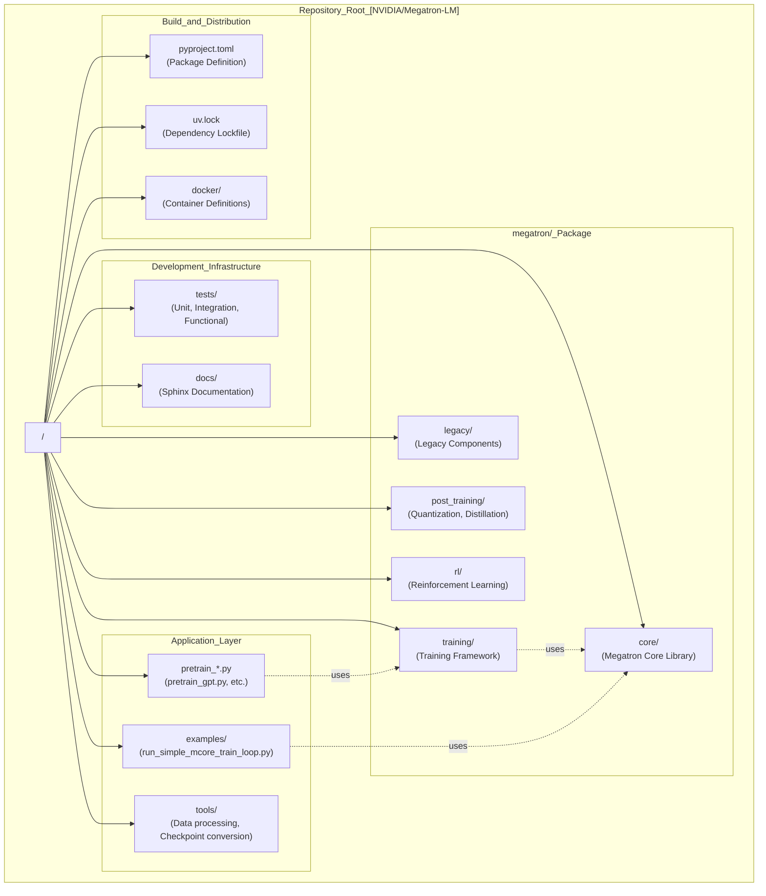

**Sources:** [README.md:16-21](), [README.md:69-89](), [pyproject.toml:11-16]()

The repository follows a layered architecture:

1.  **Core Library Layer** (`megatron/core/`): Composable library with GPU-optimized building blocks for custom training frameworks [README.md:20-21]().
2.  **Training Framework Layer** (`megatron/training/`): Reference example including Megatron Core plus pre-configured training scripts [README.md:18-19]().
3.  **Application Layer**: Entry points for pre-configured training (e.g., `pretrain_gpt.py`) and usage examples [README.md:81-85](), [megatron/core/QuickStart.md:38-42]().
4.  **Development Infrastructure**: Comprehensive testing suite and automated CI/CD configurations [README.md:87](), [pyproject.toml:140-155]().

---

## Megatron Core Internal Structure

Megatron Core (`megatron/core/`) is the foundational library providing modular, GPU-optimized components. It is organized into functional subsystems that correspond to different aspects of transformer training.

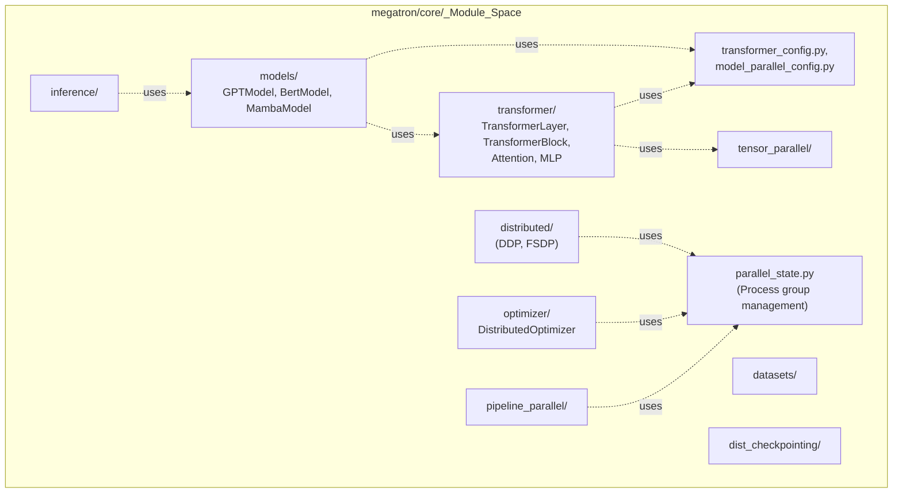

**Sources:** [README.md:70-80](), [megatron/core/QuickStart.md:68-73](), [megatron/core/QuickStart.md:85-92]()

### Core Module Breakdown

| Module | Purpose | Key Entities |
| :--- | :--- | :--- |
| `models/` | High-level model definitions | `GPTModel` [megatron/core/QuickStart.md:85](), `LanguageModule` [README.md:72]() |
| `transformer/` | Foundational blocks | `TransformerBlock` [README.md:73](), `TransformerConfig` [megatron/core/QuickStart.md:78]() |
| `tensor_parallel/` | Intra-layer sharding | `parallel_state.initialize_model_parallel` [megatron/core/QuickStart.md:61]() |
| `pipeline_parallel/` | Inter-layer sharding | `schedules.py` [megatron/core/QuickStart.md:148]() |
| `distributed/` | Gradient/Param sharding | `DistributedDataParallel`, `FSDP` [README.md:76](), `megatron_fsdp` [pyproject.toml:35]() |
| `optimizer/` | State management | `DistributedOptimizer` [README.md:77]() |
| `dist_checkpointing/` | Sharded IO | `dist_checkpointing` [megatron/core/QuickStart.md:186]() |
| `parallel_state.py` | Distributed orchestration | `parallel_state` [megatron/core/QuickStart.md:51]() |

---

## Integration with External Ecosystems

Megatron-LM serves as a hub for several specialized NVIDIA libraries, enabling state-of-the-art performance and interoperability.

### Transformer Engine (TE) Integration
Megatron-LM heavily integrates with [Transformer Engine](https://github.com/NVIDIA/TransformerEngine) to provide optimized kernels and mixed-precision support (FP8/FP4).
*   **Module Overrides**: Core transformer blocks are designed to be compatible with TE's FP8/FP4 support [README.md:20-21]().
*   **Build Support**: `uv` handles TE as a non-build-isolation package to ensure compatibility with local CUDA environments [pyproject.toml:192-193]().
*   **CI/CD**: The CI infrastructure specifically installs `transformer-engine[pytorch,core_cu13]` for development and testing [pyproject.toml:130-132](), [docker/Dockerfile.ci.dev:78]().

### NeMo and Ecosystem Tools
*   **Megatron Bridge**: Provides bidirectional Hugging Face ↔ Megatron checkpoint conversion with production-ready recipes [README.md:22](), [README.md:59]().
*   **ModelOpt**: Integrated for post-training optimizations including quantization, pruning, and distillation [README.md:83](), [pyproject.toml:93]().
*   **Mamba/SSM**: Native support for state-space models via `mamba-ssm` and `causal-conv1d` [pyproject.toml:134-137]().
*   **Emerging Optimizers**: Support for `Muon` and other emerging optimizers via the `Emerging-Optimizers` library [README.md:51](), [pyproject.toml:110]().
*   **DeepSeek Integration**: Support for DeepSeek-V4 and MoE optimizations via `flash-mla` and `DeepGEMM` [README.md:50](), [pyproject.toml:182-183]().

---

## Package Distribution and Installation

Megatron Core is distributed via PyPI and source, supporting various use cases from research to production.

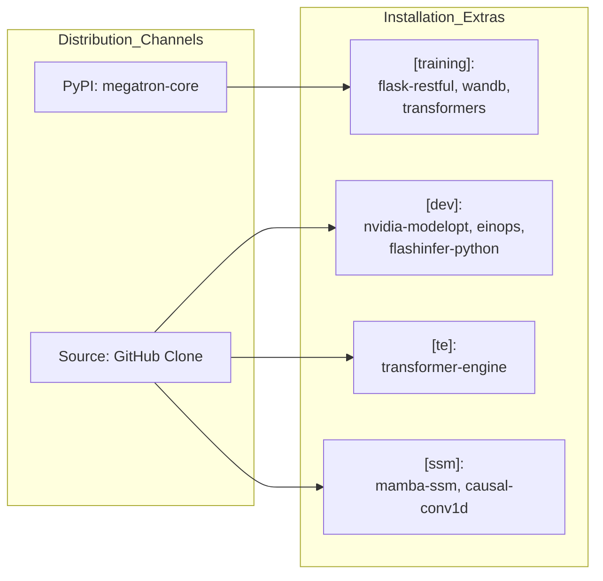

**Sources:** [pyproject.toml:23-28](), [pyproject.toml:70-137](), [README.md:26-38]()

### Dependency Management
The project utilizes `uv` for modern dependency resolution and `pyproject.toml` for metadata:
*   **Python Version**: Supports `>=3.12` [pyproject.toml:26](). Note: Python 3.10 support is deprecated as of release 0.17.0 [README.md:55]().
*   **Core Dependencies**: `torch>=2.6.0`, `numpy`, and `packaging>=24.2` [pyproject.toml:28]().
*   **Optional Groups**:
    *   `training`: Necessary for running the reference training scripts, including `wandb` and `transformers` [pyproject.toml:71-79]().
    *   `dev`: Includes the full suite of ecosystem integrations like `nvidia-modelopt`, `nemo-lens`, and `flashinfer-python` [pyproject.toml:92-117]().
    *   `te`: Specifically for Transformer Engine [pyproject.toml:130-132]().
    *   `ssm`: For Mamba and SSM model support [pyproject.toml:134-137]().
    *   `linting`: Quality gates including `ruff`, `black`, and `pylint` [pyproject.toml:174-180]().

**Sources:** [pyproject.toml:1-208](), [uv.lock:1-37](), [megatron/core/package_info.py:1-14]()

---

# Page: Core Model Architecture

# Core Model Architecture

<details>
<summary>Relevant source files</summary>

The following files were used as context for generating this wiki page:

- [gpt_builders.py](gpt_builders.py)
- [mamba_builders.py](mamba_builders.py)
- [megatron/core/extensions/transformer_engine.py](megatron/core/extensions/transformer_engine.py)
- [megatron/core/fusions/fused_bias_swiglu.py](megatron/core/fusions/fused_bias_swiglu.py)
- [megatron/core/models/gpt/gpt_layer_specs.py](megatron/core/models/gpt/gpt_layer_specs.py)
- [megatron/core/models/gpt/gpt_model.py](megatron/core/models/gpt/gpt_model.py)
- [megatron/core/tensor_parallel/__init__.py](megatron/core/tensor_parallel/__init__.py)
- [megatron/core/tensor_parallel/layers.py](megatron/core/tensor_parallel/layers.py)
- [megatron/core/tensor_parallel/random.py](megatron/core/tensor_parallel/random.py)
- [megatron/core/transformer/attention.py](megatron/core/transformer/attention.py)
- [megatron/core/transformer/cuda_graphs.py](megatron/core/transformer/cuda_graphs.py)
- [megatron/core/transformer/mlp.py](megatron/core/transformer/mlp.py)
- [megatron/core/transformer/module.py](megatron/core/transformer/module.py)
- [megatron/core/transformer/multi_latent_attention.py](megatron/core/transformer/multi_latent_attention.py)
- [megatron/core/transformer/torch_norm.py](megatron/core/transformer/torch_norm.py)
- [megatron/core/transformer/transformer_block.py](megatron/core/transformer/transformer_block.py)
- [megatron/core/transformer/transformer_config.py](megatron/core/transformer/transformer_config.py)
- [megatron/core/transformer/transformer_layer.py](megatron/core/transformer/transformer_layer.py)
- [megatron/core/transformer/utils.py](megatron/core/transformer/utils.py)
- [megatron/core/utils.py](megatron/core/utils.py)
- [model_provider.py](model_provider.py)
- [tests/unit_tests/fusions/test_swiglu_fusion.py](tests/unit_tests/fusions/test_swiglu_fusion.py)
- [tests/unit_tests/tensor_parallel/test_random.py](tests/unit_tests/tensor_parallel/test_random.py)
- [tests/unit_tests/transformer/test_cuda_graphs.py](tests/unit_tests/transformer/test_cuda_graphs.py)
- [tests/unit_tests/transformer/test_multi_latent_attention.py](tests/unit_tests/transformer/test_multi_latent_attention.py)
- [tests/unit_tests/transformer/test_utils.py](tests/unit_tests/transformer/test_utils.py)

</details>


## Purpose and Scope

This document describes the foundational transformer architecture components in Megatron-LM. It covers the configuration system, base module hierarchy, and core building blocks (attention, MLP, normalization) that compose all transformer models in the framework.

Megatron-LM provides a modular approach where models like GPT, BERT, and T5 are assembled from these common components. This design allows for seamless scaling using various parallelism strategies while maintaining a consistent interface for optimization and checkpointing.

---

## Configuration System

Megatron-LM uses a hierarchical configuration system where `TransformerConfig` extends `ModelParallelConfig` to provide comprehensive model and parallelism settings.

### Configuration Class Hierarchy

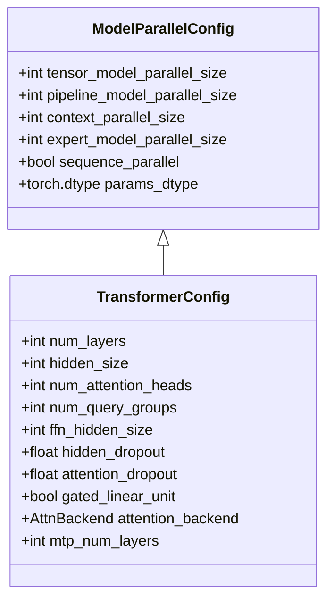
Sources: [megatron/core/transformer/transformer_config.py:53-58](), [megatron/core/model_parallel_config.py:17-17]()

### Key Configuration Categories

| Category | Key Parameters | Description |
|----------|---------------|-------------|
| **Architecture** | `num_layers`, `hidden_size`, `num_attention_heads`, `ffn_hidden_size` | Basic transformer dimensions [megatron/core/transformer/transformer_config.py:64-159](). |
| **Attention** | `num_query_groups`, `kv_channels`, `attention_backend`, `softmax_scale` | Attention mechanism configuration [megatron/core/transformer/transformer_config.py:135-163](). |
| **MTP** | `mtp_num_layers`, `mtp_loss_scaling_factor` | Multi-Token Prediction settings for predicting multiple future tokens [megatron/core/transformer/transformer_config.py:67-79](). |
| **Precision** | `fp8`, `fp8_recipe`, `fp4`, `params_dtype` | Mixed precision training settings including FP8/FP4 recipes [megatron/core/transformer/transformer_config.py:333-352](). |
| **Parallelism** | `pipeline_model_parallel_layout`, `account_for_embedding_in_pipeline_split` | Advanced pipeline partitioning and layout definitions [megatron/core/transformer/transformer_config.py:98-126](). |

For details, see [TransformerConfig and ModelParallelConfig](#2.1).

Sources:
[megatron/core/transformer/transformer_config.py:64-163]()
[megatron/core/transformer/transformer_config.py:67-79]()
[megatron/core/transformer/transformer_config.py:333-352]()
[megatron/core/transformer/transformer_config.py:98-126]()
[megatron/core/transformer/transformer_config.py:53-58]()

---

## Module Hierarchy

All transformer components in Megatron-LM inherit from `MegatronModule`, which provides distributed checkpointing support and configuration management.

### Core Module Structure

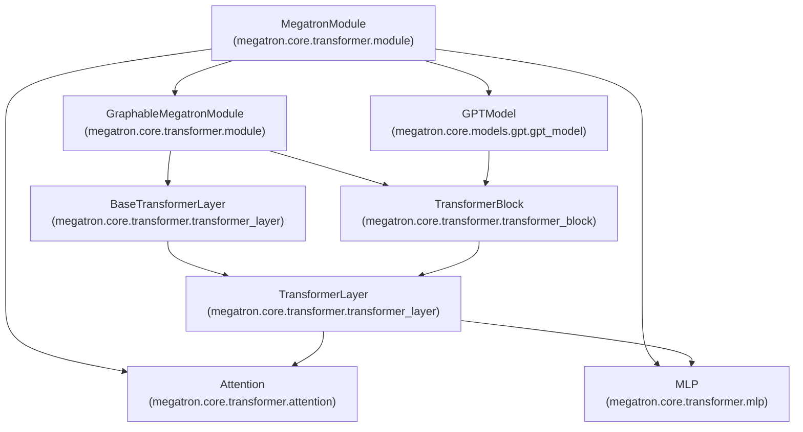
Sources: [megatron/core/transformer/module.py:29-42](), [megatron/core/transformer/transformer_block.py:32-32](), [megatron/core/transformer/transformer_layer.py:36-40](), [megatron/core/transformer/attention.py:236-241](), [megatron/core/transformer/mlp.py:155-155](), [megatron/core/models/gpt/gpt_model.py:52-52]()

### MegatronModule Base Class

`MegatronModule` provides:
- Configuration storage via `self.config` [megatron/core/transformer/module.py:42-42]().
- Distributed checkpointing through `sharded_state_dict()` which recursively gathers sharded tensors from submodules using `sharded_state_dict_default` [megatron/core/transformer/module.py:58-103]().
- Flag management for training states like `is_first_microbatch` for FP8/FP4 parameter cache updates in TE modules [megatron/core/transformer/module.py:105-121]().

Sources:
[megatron/core/transformer/module.py:42-42]()
[megatron/core/transformer/module.py:58-103]()
[megatron/core/transformer/module.py:105-121]()

---

## TransformerBlock: Layer Container

`TransformerBlock` manages a stack of transformer layers. It handles the logic for determining which layers belong to the current pipeline stage and manages shared resources like final layer normalization.

- **Layer Construction**: Based on `pipeline_model_parallel_layout`, it builds the appropriate number of layers for the current rank [megatron/core/transformer/transformer_block.py:91-94]().
- **Uneven Pipeline Support**: Supports configurations where the first or last stages have a different number of layers [megatron/core/transformer/transformer_block.py:120-146]().
- **Virtual Pipeline Parallelism**: Handles interleaved scheduling by managing multiple model chunks [megatron/core/transformer/transformer_block.py:162-178]().

For details, see [Transformer Layers and Blocks](#2.2).

Sources:
[megatron/core/transformer/transformer_block.py:91-94]()
[megatron/core/transformer/transformer_block.py:120-146]()
[megatron/core/transformer/transformer_block.py:162-178]()

---

## TransformerLayer: Single Layer Structure

A `TransformerLayer` combines attention, MLP, and normalization components with residual connections.

### Layer Component Specification

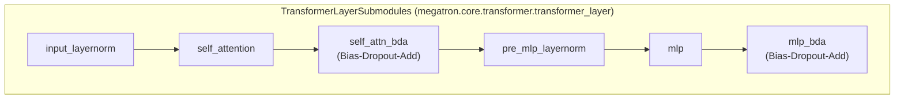
Sources: [megatron/core/transformer/transformer_layer.py:202-218](), [megatron/core/models/gpt/gpt_layer_specs.py:112-133]()

### Residual Connection Patterns

The layer supports standard Transformer residual patterns:
- **Pre-Normalization**: The input is normalized before being passed to the sublayer (Attention or MLP) [megatron/core/transformer/transformer_layer.py:738-744]().
- **Bias-Dropout-Add Fusion**: Uses optimized kernels like `get_bias_dropout_add` for the residual addition [megatron/core/fusions/fused_bias_dropout.py:7-7]().

Sources:
[megatron/core/transformer/transformer_layer.py:738-744]()
[megatron/core/fusions/fused_bias_dropout.py:7-7]()

---

## Attention Mechanisms

The attention subsystem provides flexible implementations for Self-Attention and Cross-Attention, supporting Grouped Query Attention (GQA) and Multi-Head Attention (MHA).

- **Core Attention**: The framework supports multiple backends (FlashAttention, FusedAttention, Local) via the `CoreAttention` protocol [megatron/core/transformer/attention.py:197-230]().
- **Multi-Latent Attention (MLA)**: Optimized implementation using latent compression for KV caches, supporting RoPE and YaRN [megatron/core/transformer/multi_latent_attention.py:130-158]().

For details, see [Attention Mechanisms](#2.3).

Sources:
[megatron/core/transformer/attention.py:197-230]()
[megatron/core/transformer/multi_latent_attention.py:130-158]()

---

## MLP: Feed-Forward Networks

The MLP module implements the standard position-wise feed-forward network.

- **Gated Linear Units (GLU)**: Support for SwiGLU, GeGLU, and other gated activations. When enabled, the first linear layer (`linear_fc1`) has a stride of 2 to handle interleaved gate and up-projection weights [megatron/core/transformer/mlp.py:205-207]().
- **Fused Activations**: Support for bias-activation fusions (e.g., `bias_swiglu_impl`, `bias_geglu_impl`) to reduce memory bandwidth [megatron/core/transformer/mlp.py:19-25]().

For details, see [MLP and Activation Functions](#2.5).

Sources:
[megatron/core/transformer/mlp.py:205-207]()
[megatron/core/transformer/mlp.py:19-25]()

---

## Positional Embeddings

Megatron-LM supports various positional encoding strategies:
- **Learned Absolute**: Standard absolute positional embeddings [megatron/core/models/gpt/gpt_model.py:110-112]().
- **Rotary (RoPE)**: Rotary Position Embeddings applied to the QK projections, including multimodal variants [megatron/core/models/common/embeddings/rotary_pos_embedding.py:19-22]().
- **YaRN**: Context window extension via YaRN RoPE scaling [megatron/core/models/common/embeddings/yarn_rotary_pos_embedding.py:53-55]().

For details, see [Positional Embeddings](#2.4).

Sources:
[megatron/core/models/gpt/gpt_model.py:110-112]()
[megatron/core/models/common/embeddings/rotary_pos_embedding.py:19-22]()
[megatron/core/models/common/embeddings/yarn_rotary_pos_embedding.py:53-55]()

---

## Transformer Engine Integration

Megatron Core is tightly integrated with [Transformer Engine (TE)](https://github.com/NVIDIA/TransformerEngine).
- **FP8/FP4 Support**: Recipes like `TEQuantizationRecipe` enable training and inference in lower precision using TE's autocast contexts [megatron/core/extensions/transformer_engine.py:133-174]().
- **Fused Operations**: TE provides highly optimized fused kernels for attention and normalization modules like `TENorm` [megatron/core/extensions/transformer_engine.py:125-125]().

For details, see [Transformer Engine Integration](#2.6).

Sources:
[megatron/core/extensions/transformer_engine.py:133-174]()
[megatron/core/extensions/transformer_engine.py:125-125]()

---

# Page: TransformerConfig and ModelParallelConfig

# TransformerConfig and ModelParallelConfig

<details>
<summary>Relevant source files</summary>

The following files were used as context for generating this wiki page:

- [megatron/core/dist_checkpointing/strategies/fully_parallel.py](megatron/core/dist_checkpointing/strategies/fully_parallel.py)
- [megatron/core/extensions/transformer_engine.py](megatron/core/extensions/transformer_engine.py)
- [megatron/core/fusions/fused_bias_swiglu.py](megatron/core/fusions/fused_bias_swiglu.py)
- [megatron/core/model_parallel_config.py](megatron/core/model_parallel_config.py)
- [megatron/core/models/gpt/gpt_model.py](megatron/core/models/gpt/gpt_model.py)
- [megatron/core/parallel_state.py](megatron/core/parallel_state.py)
- [megatron/core/pipeline_parallel/p2p_communication.py](megatron/core/pipeline_parallel/p2p_communication.py)
- [megatron/core/pipeline_parallel/schedules.py](megatron/core/pipeline_parallel/schedules.py)
- [megatron/core/tensor_parallel/__init__.py](megatron/core/tensor_parallel/__init__.py)
- [megatron/core/tensor_parallel/layers.py](megatron/core/tensor_parallel/layers.py)
- [megatron/core/tensor_parallel/random.py](megatron/core/tensor_parallel/random.py)
- [megatron/core/transformer/attention.py](megatron/core/transformer/attention.py)
- [megatron/core/transformer/cuda_graphs.py](megatron/core/transformer/cuda_graphs.py)
- [megatron/core/transformer/mlp.py](megatron/core/transformer/mlp.py)
- [megatron/core/transformer/module.py](megatron/core/transformer/module.py)
- [megatron/core/transformer/torch_norm.py](megatron/core/transformer/torch_norm.py)
- [megatron/core/transformer/transformer_block.py](megatron/core/transformer/transformer_block.py)
- [megatron/core/transformer/transformer_config.py](megatron/core/transformer/transformer_config.py)
- [megatron/core/transformer/transformer_layer.py](megatron/core/transformer/transformer_layer.py)
- [megatron/core/transformer/utils.py](megatron/core/transformer/utils.py)
- [megatron/core/utils.py](megatron/core/utils.py)
- [megatron/training/arguments.py](megatron/training/arguments.py)
- [megatron/training/checkpointing.py](megatron/training/checkpointing.py)
- [megatron/training/config/training_config.py](megatron/training/config/training_config.py)
- [megatron/training/initialize.py](megatron/training/initialize.py)
- [megatron/training/training.py](megatron/training/training.py)
- [pretrain_gpt.py](pretrain_gpt.py)
- [pretrain_hybrid.py](pretrain_hybrid.py)
- [pretrain_mamba.py](pretrain_mamba.py)
- [tests/unit_tests/dist_checkpointing/test_pipeline_parallel_layout.py](tests/unit_tests/dist_checkpointing/test_pipeline_parallel_layout.py)
- [tests/unit_tests/dist_checkpointing/utils.py](tests/unit_tests/dist_checkpointing/utils.py)
- [tests/unit_tests/fusions/test_swiglu_fusion.py](tests/unit_tests/fusions/test_swiglu_fusion.py)
- [tests/unit_tests/pipeline_parallel/test_pipeline_layout.py](tests/unit_tests/pipeline_parallel/test_pipeline_layout.py)
- [tests/unit_tests/tensor_parallel/test_random.py](tests/unit_tests/tensor_parallel/test_random.py)
- [tests/unit_tests/test_checkpointing.py](tests/unit_tests/test_checkpointing.py)
- [tests/unit_tests/test_parallel_state.py](tests/unit_tests/test_parallel_state.py)
- [tests/unit_tests/transformer/test_cuda_graphs.py](tests/unit_tests/transformer/test_cuda_graphs.py)
- [tests/unit_tests/transformer/test_utils.py](tests/unit_tests/transformer/test_utils.py)

</details>


## Purpose and Scope

This document explains `TransformerConfig` and `ModelParallelConfig`, the central configuration system that controls all model hyperparameters and parallelism settings in Megatron-LM. `TransformerConfig` is the primary configuration object that inherits from `ModelParallelConfig`, combining parallelism parameters with transformer-specific architectural settings to provide a unified configuration interface.

`ModelParallelConfig` provides the base parallelism configuration (tensor parallelism, pipeline parallelism, data parallelism, expert parallelism, context parallelism), while `TransformerConfig` extends this with transformer architecture parameters (layers, hidden sizes, attention configuration), optimization settings (activation recomputation, kernel fusions), and quantization options (FP8, FP4).

## Configuration Hierarchy

`TransformerConfig` inherits from `ModelParallelConfig`, creating a two-level configuration hierarchy. This structure separates general parallelism concerns from transformer-specific architectural details.

Title: Configuration Hierarchy and Data Flow
```mermaid
graph TB
    [ModelParallelConfig] -->|"dataclass inheritance"| [TransformerConfig]
    
    [TransformerConfig] -->|"config: TransformerConfig"| [GPTModel]
    [TransformerConfig] -->|"config: TransformerConfig"| [TransformerBlock]
    [TransformerConfig] -->|"config: TransformerConfig"| [TransformerLayer]
    
    subgraph ParallelSettings ["Parallelism Dimensions"]
        tp_size["tensor_model_parallel_size"]
        pp_size["pipeline_model_parallel_size"]
        cp_size["context_parallel_size"]
        ep_size["expert_model_parallel_size"]
        vpp_size["virtual_pipeline_model_parallel_size"]
    end
    
    subgraph OptimizationSettings ["Distributed Optimization"]
        gaf["gradient_accumulation_fusion"]
        tco["tp_comm_overlap"]
        tcw["tp_comm_bulk_wgrad/dgrad"]
    end
    
    [ModelParallelConfig] -->|"provides"| ParallelSettings
    [ModelParallelConfig] -->|"provides"| OptimizationSettings
    
    subgraph ArchSettings ["Architecture Parameters"]
        nl["num_layers"]
        hs["hidden_size"]
        ah["num_attention_heads"]
        qg["num_query_groups"]
    end
    
    subgraph QuantSettings ["Quantization (FP8/FP4)"]
        fp8["fp8, fp8_recipe, fp8_param"]
        fp4["fp4, fp4_recipe, fp4_param"]
    end
    
    subgraph MTPSettings ["Multi-Token Prediction"]
        mtp_nl["mtp_num_layers"]
        mtp_lsf["mtp_loss_scaling_factor"]
        mtp_url["mtp_use_repeated_layer"]
    end
    
    [TransformerConfig] -->|"provides"| ArchSettings
    [TransformerConfig] -->|"provides"| QuantSettings
    [TransformerConfig] -->|"provides"| MTPSettings
```
Sources: [megatron/core/transformer/transformer_config.py:54-59](), [megatron/core/model_parallel_config.py:17-21]()

## ModelParallelConfig: Base Parallelism Configuration

`ModelParallelConfig` is defined in `megatron/core/model_parallel_config.py` and provides foundational distributed settings.

### Parallelism Dimensions

| Parallelism Type | Parameter | Description |
|------------------|-----------|-------------|
| **Tensor Parallelism (TP)** | `tensor_model_parallel_size` | Intra-layer parallelism. Splits weight matrices across GPUs. |
| **Pipeline Parallelism (PP)** | `pipeline_model_parallel_size` | Inter-layer parallelism. Distributes layers across GPU ranks. |
| **Virtual Pipeline Parallelism** | `virtual_pipeline_model_parallel_size` | Interleaved PP. Divides stages into smaller chunks to reduce bubble time. |
| **Context Parallelism (CP)** | `context_parallel_size` | Sequence parallelism. Splits sequence dimension across GPUs. |
| **Expert Parallelism (EP)** | `expert_model_parallel_size` | MoE parallelism. Distributes experts across GPUs. |

Sources: [megatron/core/model_parallel_config.py:24-76]()

### Distributed Optimization

| Parameter | Description |
|-----------|-------------|
| `gradient_accumulation_fusion` | Fuse weight gradient accumulation into GEMMs. |
| `tp_comm_overlap` | Overlap linear layer execution with TP communication (AllGather/ReduceScatter). |
| `tp_comm_bulk_wgrad` | Overlap AllGather with backward activation gradient GEMM. |
| `tp_comm_bulk_dgrad` | Overlap ReduceScatter with backward weight gradient GEMM. |

Sources: [megatron/core/model_parallel_config.py:167-205]()

## TransformerConfig: Architecture and Optimization

`TransformerConfig` extends `ModelParallelConfig` with transformer-specific parameters. It is defined in `megatron/core/transformer/transformer_config.py`.

### Core Architecture Parameters

| Parameter | Type | Description |
|-----------|------|-------------|
| `num_layers` | `int` | Number of transformer layers in a block. |
| `hidden_size` | `int` | Hidden dimension (model width). |
| `num_attention_heads` | `int` | Number of transformer attention heads. |
| `num_query_groups` | `Optional[int]` | Number of KV heads for GQA. None implies standard MHA. |
| `ffn_hidden_size` | `Optional[int]` | MLP hidden size. Defaults to 4 * hidden_size. |
| `kv_channels` | `Optional[int]` | Dimension per head. Defaults to hidden_size / num_attention_heads. |

Sources: [megatron/core/transformer/transformer_config.py:65-169]()

### Pipeline Parallelism Layer Layout

`TransformerConfig` allows defining custom partitioning via `PipelineParallelLayerLayout`.

| Parameter | Description |
|-----------|-------------|
| `pipeline_model_parallel_layout` | Custom partitioning using string notation (e.g., `'E|(tt|)*2,L'`) or list format. |
| `num_layers_in_first_pipeline_stage` | Specific layer count for the first PP stage. |
| `num_layers_in_last_pipeline_stage` | Specific layer count for the last PP stage. |

Sources: [megatron/core/transformer/transformer_config.py:96-128](), [megatron/core/transformer/pipeline_parallel_layer_layout.py:17-20]()

### Multi-Token Prediction (MTP)
Recent extensions include support for Multi-Token Prediction (MTP) which extends prediction scope to multiple future tokens at each position.

| Parameter | Description |
|-----------|-------------|
| `mtp_num_layers` | Number of MTP layers. |
| `mtp_loss_scaling_factor` | Weighting factor for MTP loss (default 0.1). |
| `mtp_use_repeated_layer` | If true, uses a single MTP layer repeatedly. |
| `mtp_detach_heads` | Detaches MTP head inputs from the main model graph to prevent gradient flow back. |

Sources: [megatron/core/transformer/transformer_config.py:68-88]()

### Quantization (FP8 and FP4)

Integration with Transformer Engine (TE) for low-precision training is driven by these fields:

| Parameter | Description |
|-----------|-------------|
| `fp8` | FP8 format ('e4m3' or 'hybrid'). |
| `fp8_recipe` | Scaling recipe ('delayed', 'tensorwise', etc.). |
| `fp4` | FP4 format ('nvfp4'). |
| `fp4_recipe` | FP4 quantization recipe. |
| `first_last_layers_bf16` | Keep the first and last layers in BF16 for training stability. |

Sources: [megatron/core/transformer/transformer_config.py:346-452](), [megatron/core/enums.py:12-12]()

### Mixture of Experts (MoE)

| Parameter | Description |
|-----------|-------------|
| `num_moe_experts` | Total number of experts. Enabling this replaces MLP with MoE layers. |
| `moe_router_topk` | Number of experts each token routes to. |
| `moe_router_load_balancing_type` | 'aux_loss', 'sinkhorn', or 'none'. |
| `moe_token_dispatcher_type` | 'allgather', 'alltoall', or 'flex'. |
| `moe_shared_expert_intermediate_size` | Size for dense shared experts (DeepSeek style). |

Sources: [megatron/core/transformer/transformer_config.py:454-638]()

## Configuration Flow through Code Entities

The following diagram maps the relationship between the configuration dataclasses and the core transformer modules that consume them.

Title: Config Entity Relationship
```mermaid
graph LR
    subgraph ConfigSpace ["Configuration Space"]
        [ModelParallelConfig]
        [TransformerConfig]
        [MLATransformerConfig]
    end

    subgraph ModuleSpace ["Code Entity Space (Modules)"]
        [GPTModel]
        [TransformerBlock]
        [TransformerLayer]
        [Attention]
        [MLP]
    end

    [ModelParallelConfig] -.->|"Inherited by"| [TransformerConfig]
    [TransformerConfig] -.->|"Inherited by"| [MLATransformerConfig]
    
    [TransformerConfig] -->|"Passed to"| [GPTModel]
    [TransformerConfig] -->|"Passed to"| [TransformerBlock]
    [TransformerConfig] -->|"Passed to"| [TransformerLayer]
    [TransformerConfig] -->|"Passed to"| [Attention]
    [TransformerConfig] -->|"Passed to"| [MLP]

    [TransformerLayer] -->|"Checks"| TL_RECOMPUTE["config.recompute_granularity"]
    [Attention] -->|"Checks"| ATTN_FP8["config.fp8"]
    [MLP] -->|"Checks"| MLP_MOE["config.num_moe_experts"]
```
Sources: [megatron/core/transformer/transformer_config.py:54-59](), [megatron/core/models/gpt/gpt_model.py:98-122](), [megatron/core/transformer/transformer_block.py:35-35](), [megatron/core/transformer/transformer_layer.py:36-36](), [megatron/core/transformer/attention.py:57-57](), [megatron/core/transformer/mlp.py:175-175]()

## Argument Parsing and Config Construction

In the training pipeline, `TransformerConfig` is constructed from command-line arguments. The `pretrain` function and model providers use these configurations to build the model and parallel state.

Title: Config Consumption in Model Construction
```mermaid
graph TD
    subgraph Initialization ["Initialization Phase"]
        [add_megatron_arguments] --> [parse_and_validate_args]
        [parse_and_validate_args] --> [core_transformer_config_from_args]
        [core_transformer_config_from_args] --> BUILD_TC["TransformerConfig Object"]
    end

    subgraph ModelCreation ["Model Creation"]
        [GPTModel]
        [get_num_layers_to_build]
        [get_transformer_layer_offset]
    end

    BUILD_TC --> [GPTModel]
    [GPTModel] --> [get_num_layers_to_build]
    [GPTModel] --> [get_transformer_layer_offset]
    
    [get_num_layers_to_build] -.->|"Uses"| TC_PP["config.pipeline_model_parallel_layout"]
    [get_transformer_layer_offset] -.->|"Uses"| TC_VPP["config.virtual_pipeline_model_parallel_size"]
```
Sources: [megatron/training/arguments.py:41-45](), [megatron/training/arguments.py:87-113](), [megatron/core/models/gpt/gpt_model.py:98-122](), [megatron/core/transformer/transformer_block.py:76-94](), [megatron/core/transformer/transformer_layer.py:65-80]()

### Post-Initialization Validation
The `TransformerConfig` dataclass relies on logic within consuming modules to perform critical sanity checks and defaults:
*   **Pipeline Layout**: The `get_num_layers_to_build` function uses `config.pipeline_model_parallel_layout` to determine how many layers to allocate per rank [megatron/core/transformer/transformer_block.py:91-94]().
*   **MLP Defaults**: The `MLP` module defaults `ffn_hidden_size` to `config.ffn_hidden_size` if not explicitly provided during construction [megatron/core/transformer/mlp.py:180-189]().
*   **Gated Units**: The `MLP` module adjusts `ffn_hidden_size` and stride based on `config.gated_linear_unit` [megatron/core/transformer/mlp.py:195-203]().
*   **MTP Validation**: The `GPTModel` determines if it should process MTP layers based on the `mtp_block_spec` and `mtp_on_this_rank` check, which inspects the `pipeline_model_parallel_layout` [megatron/core/models/gpt/gpt_model.py:34-38](), [megatron/core/transformer/transformer_config.py:68-88]().

Sources: [megatron/core/transformer/transformer_block.py:76-153](), [megatron/core/transformer/mlp.py:175-203](), [megatron/core/models/gpt/gpt_model.py:98-154]()

---

# Page: Transformer Layers and Blocks

# Transformer Layers and Blocks

<details>
<summary>Relevant source files</summary>

The following files were used as context for generating this wiki page:

- [megatron/core/extensions/transformer_engine.py](megatron/core/extensions/transformer_engine.py)
- [megatron/core/fusions/fused_bias_swiglu.py](megatron/core/fusions/fused_bias_swiglu.py)
- [megatron/core/models/gpt/gpt_model.py](megatron/core/models/gpt/gpt_model.py)
- [megatron/core/tensor_parallel/__init__.py](megatron/core/tensor_parallel/__init__.py)
- [megatron/core/tensor_parallel/layers.py](megatron/core/tensor_parallel/layers.py)
- [megatron/core/tensor_parallel/random.py](megatron/core/tensor_parallel/random.py)
- [megatron/core/transformer/__init__.py](megatron/core/transformer/__init__.py)
- [megatron/core/transformer/attention.py](megatron/core/transformer/attention.py)
- [megatron/core/transformer/cuda_graphs.py](megatron/core/transformer/cuda_graphs.py)
- [megatron/core/transformer/dot_product_attention.py](megatron/core/transformer/dot_product_attention.py)
- [megatron/core/transformer/mlp.py](megatron/core/transformer/mlp.py)
- [megatron/core/transformer/module.py](megatron/core/transformer/module.py)
- [megatron/core/transformer/pipeline_parallel_layer_layout.py](megatron/core/transformer/pipeline_parallel_layer_layout.py)
- [megatron/core/transformer/spec_utils.py](megatron/core/transformer/spec_utils.py)
- [megatron/core/transformer/torch_norm.py](megatron/core/transformer/torch_norm.py)
- [megatron/core/transformer/transformer_block.py](megatron/core/transformer/transformer_block.py)
- [megatron/core/transformer/transformer_config.py](megatron/core/transformer/transformer_config.py)
- [megatron/core/transformer/transformer_layer.py](megatron/core/transformer/transformer_layer.py)
- [megatron/core/transformer/utils.py](megatron/core/transformer/utils.py)
- [megatron/core/utils.py](megatron/core/utils.py)
- [tests/unit_tests/fusions/test_swiglu_fusion.py](tests/unit_tests/fusions/test_swiglu_fusion.py)
- [tests/unit_tests/models/test_gpt_model.py](tests/unit_tests/models/test_gpt_model.py)
- [tests/unit_tests/tensor_parallel/test_random.py](tests/unit_tests/tensor_parallel/test_random.py)
- [tests/unit_tests/transformer/__init__.py](tests/unit_tests/transformer/__init__.py)
- [tests/unit_tests/transformer/test_attention.py](tests/unit_tests/transformer/test_attention.py)
- [tests/unit_tests/transformer/test_core_attention.py](tests/unit_tests/transformer/test_core_attention.py)
- [tests/unit_tests/transformer/test_cuda_graphs.py](tests/unit_tests/transformer/test_cuda_graphs.py)
- [tests/unit_tests/transformer/test_mlp.py](tests/unit_tests/transformer/test_mlp.py)
- [tests/unit_tests/transformer/test_spec_customization.py](tests/unit_tests/transformer/test_spec_customization.py)
- [tests/unit_tests/transformer/test_spec_utils.py](tests/unit_tests/transformer/test_spec_utils.py)
- [tests/unit_tests/transformer/test_transformer_block.py](tests/unit_tests/transformer/test_transformer_block.py)
- [tests/unit_tests/transformer/test_transformer_layer.py](tests/unit_tests/transformer/test_transformer_layer.py)
- [tests/unit_tests/transformer/test_utils.py](tests/unit_tests/transformer/test_utils.py)

</details>


This document describes the `TransformerLayer` and `TransformerBlock` classes, which are the core building blocks for constructing transformer models in Megatron Core. A `TransformerLayer` represents a single transformer layer containing attention, MLP, and normalization components. A `TransformerBlock` is a container that holds multiple `TransformerLayer` instances and manages their sequential execution.

For information about the internal attention mechanisms within layers, see [Attention Mechanisms (2.3)](). For MLP implementations, see [MLP and Activation Functions (2.5)](). For configuration of these components, see [TransformerConfig and ModelParallelConfig (2.1)]().

## TransformerLayer Overview

The `TransformerLayer` class [[megatron/core/transformer/transformer_layer.py:262]]() represents a single transformer layer that processes input tensors through a series of submodules: input normalization, self-attention, optional cross-attention, pre-MLP normalization, and an MLP (or MoE layer). Each submodule is configurable through the `TransformerLayerSubmodules` dataclass.

### TransformerLayer Structure

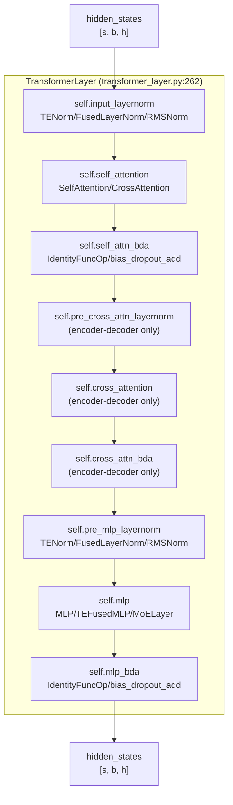

**TransformerLayer Submodule Flow (forward method at line 512)**

Sources: [[megatron/core/transformer/transformer_layer.py:262-390]](), [[megatron/core/transformer/transformer_layer.py:512-659]](), [[megatron/core/transformer/transformer_layer.py:202-244]]()

The `TransformerLayerSubmodules` dataclass [[megatron/core/transformer/transformer_layer.py:202-244]]() defines nine configurable components:

| Submodule Field | Type | Common Implementations | Purpose |
|-----------------|------|------------------------|---------|
| `input_layernorm` | `LayerNormBuilder` | `TENorm`, `FusedLayerNorm`, `WrappedTorchNorm` | Normalization before self-attention |
| `self_attention` | `ModuleSpec` or `type` | `SelfAttention`, `CrossAttention`, `MLASelfAttention` | Self-attention mechanism |
| `self_attn_bda` | `ModuleSpec` or `type` | `IdentityFuncOp`, `bias_dropout_add_fused_train` | Bias-dropout-add after self-attention |
| `pre_cross_attn_layernorm` | `LayerNormBuilder` | `IdentityOp` (decoder-only), norm classes (encoder-decoder) | Normalization before cross-attention |
| `cross_attention` | `ModuleSpec` or `type` | `IdentityOp` (decoder-only), `CrossAttention` (encoder-decoder) | Cross-attention mechanism |
| `cross_attn_bda` | `ModuleSpec` or `type` | `IdentityFuncOp` | Bias-dropout-add after cross-attention |
| `pre_mlp_layernorm` | `LayerNormBuilder` | `TENorm`, `FusedLayerNorm`, `WrappedTorchNorm` | Normalization before MLP |
| `mlp` | `ModuleSpec` or `type` | `MLP`, `TEFusedMLP`, `MoELayer` | Feed-forward network or MoE |
| `mlp_bda` | `ModuleSpec` or `type` | `IdentityFuncOp`, `bias_dropout_add_fused_train` | Bias-dropout-add after MLP |

Sources: [[megatron/core/transformer/transformer_layer.py:202-244]]()

### TransformerLayer Forward Pass

The `forward()` method [[megatron/core/transformer/transformer_layer.py:512-659]]() processes input through three sequential stages:

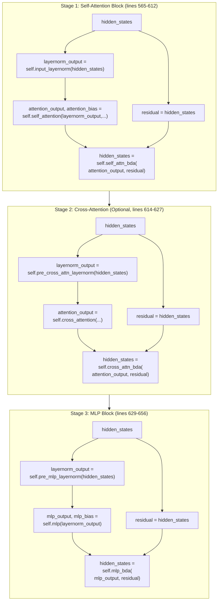

**Forward Pass Implementation with Residual Connections**

Each stage follows the pattern: `output = bda_func(submodule(layernorm(input)), input)`. Key features:
- **Residual connections**: Original `hidden_states` added back via bias-dropout-add functions.
- **Normalization first**: LayerNorm/RMSNorm applied before each submodule (Pre-LN architecture) unless `apply_residual_connection_post_layernorm` is enabled [[megatron/core/transformer/transformer_config.py:175]]().
- **FP32 Residuals**: Optional movement of residual connections to FP32 for numerical stability [[megatron/core/transformer/transformer_config.py:171]]().

Sources: [[megatron/core/transformer/transformer_layer.py:512-659]](), [[megatron/core/transformer/transformer_config.py:171-176]]()

### Layer Numbering and Offsets

Each `TransformerLayer` has a `layer_number` attribute [[megatron/core/transformer/transformer_layer.py:292]]() that accounts for its global position in the model, including pipeline parallelism offsets. The `get_transformer_layer_offset()` function [[megatron/core/transformer/transformer_layer.py:65]]() calculates the offset based on:

| Configuration | Impact on Offset |
|---------------|------------------|
| `pipeline_model_parallel_size` | Determines number of PP stages. |
| `pipeline_model_parallel_layout` | Custom layout with explicit layer assignments per stage [[megatron/core/transformer/transformer_config.py:104]](). |
| `virtual_pipeline_model_parallel_size` | Interleaved pipeline with multiple virtual chunks per stage [[megatron/core/transformer/transformer_block.py:161]](). |
| `num_layers_in_first_pipeline_stage` | Uneven distribution with custom first stage layer count [[megatron/core/transformer/transformer_config.py:96]](). |

Sources: [[megatron/core/transformer/transformer_layer.py:65-199]](), [[megatron/core/transformer/transformer_config.py:90-128]](), [[megatron/core/transformer/transformer_block.py:161-167]]()

## TransformerBlock Overview

The `TransformerBlock` class [[megatron/core/transformer/transformer_block.py:268]]() is a container that manages multiple `TransformerLayer` instances. It handles sequential execution, quantization context, and final layer normalization.

### TransformerBlock Structure

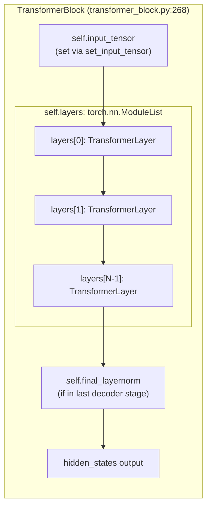

**TransformerBlock Component Architecture**

Sources: [[megatron/core/transformer/transformer_block.py:268-389]](), [[megatron/core/transformer/transformer_block.py:550-552]]()

### Building Layers with get_num_layers_to_build

The number of layers constructed is determined by `get_num_layers_to_build()` [[megatron/core/transformer/transformer_block.py:76]](), which accounts for pipeline parallelism configuration.

The function handles three distribution strategies:
1. **Custom Pipeline Layout** (lines 91-94): Uses `PipelineParallelLayerLayout` for explicit layer assignments.
2. **Uneven Pipeline Parallelism** (lines 104-146): Different layer counts for first/last stages via `num_layers_in_first_pipeline_stage`.
3. **Even Pipeline Parallelism** (lines 148-159): Uniform distribution across all pipeline stages.

Special handling for embedding/loss layers (lines 150-153): If `account_for_embedding_in_pipeline_split` or `account_for_loss_in_pipeline_split` is True, these are counted in the layer distribution but don't create actual `TransformerLayer` instances in the block.

Sources: [[megatron/core/transformer/transformer_block.py:76-204]](), [[megatron/core/transformer/transformer_config.py:130-136]]()

### TransformerBlock Forward Method

The `forward()` method [[megatron/core/transformer/transformer_block.py:471]]() executes layers sequentially with several optional features:

| Feature | Condition | Implementation |
|---------|-----------|----------------|
| **Quantization Context** | `config.fp8` or `config.fp4` | Uses `get_fp8_context` or `get_fp4_context` per layer [[megatron/core/transformer/transformer_block.py:524-538]](). |
| **CPU Offloading** | `config.cpu_offloading` | Uses `get_cpu_offload_context` from Transformer Engine [[megatron/core/transformer/transformer_block.py:60]](). |
| **Activation Checkpointing** | `config.recompute_granularity == 'full'` | Calls `checkpointed_forward` [[megatron/core/transformer/transformer_block.py:517-520]](). |
| **Final LayerNorm** | Last decoder stage | Applied after all layers [[megatron/core/transformer/transformer_block.py:550-552]](). |

Sources: [[megatron/core/transformer/transformer_block.py:471-758]](), [[megatron/core/transformer/transformer_config.py:392-434]]()

## Composition and Specifications

Megatron Core uses a specification-driven architecture to build models. `TransformerLayer` submodules are defined using `ModuleSpec` [[megatron/core/transformer/spec_utils.py:26]]().

### Multi-Token Prediction (MTP) Integration

Megatron Core supports Multi-Token Prediction via `MultiTokenPredictionBlock`. This is configured via `TransformerConfig.mtp_num_layers` [[megatron/core/transformer/transformer_config.py:68]]() and integrated into the model architecture as additional blocks after the main decoder [[megatron/core/models/gpt/gpt_model.py:245-266]]().

Sources: [[megatron/core/transformer/transformer_config.py:68-85]](), [[megatron/core/models/gpt/gpt_model.py:245-266]]()

## Pipeline Parallelism Integration

`TransformerBlock` integrates with pipeline parallelism through stage assignment and tensor passing.

### Input/Output Tensor Management

The `set_input_tensor()` method [[megatron/core/transformer/transformer_block.py:407]]() is called by pipeline schedules to provide activations from the previous stage:

```python
def set_input_tensor(self, input_tensor: Tensor):
    """Set the input tensor to be used in the forward pass."""
    self.input_tensor = input_tensor
```

In the `forward` pass, if the explicit `hidden_states` argument is `None`, the block uses `self.input_tensor` [[megatron/core/transformer/transformer_block.py:487-490]]().

Sources: [[megatron/core/transformer/transformer_block.py:407-413]](), [[megatron/core/transformer/transformer_block.py:487-490]]()

## Activation Recomputation

`TransformerBlock` and `TransformerLayer` support activation recomputation to trade compute for memory.

- **Full Recomputation**: Checkpoints the entire forward pass of a `TransformerLayer` using `checkpointed_forward` [[megatron/core/transformer/transformer_block.py:517-520]]().
- **Selective Recomputation**: Checkpoints specific submodules like `core_attention` or `mlp` [[megatron/core/transformer/transformer_config.py:420-434]](). This is managed within `TransformerLayer` by checking `config.recompute_modules` [[megatron/core/transformer/transformer_layer.py:394-463]]().

Sources: [[megatron/core/transformer/transformer_block.py:447-469]](), [[megatron/core/transformer/transformer_layer.py:394-463]](), [[megatron/core/transformer/transformer_config.py:392-434]]()

---

# Page: Attention Mechanisms

# Attention Mechanisms

<details>
<summary>Relevant source files</summary>

The following files were used as context for generating this wiki page:

- [gpt_builders.py](gpt_builders.py)
- [mamba_builders.py](mamba_builders.py)
- [megatron/core/extensions/transformer_engine.py](megatron/core/extensions/transformer_engine.py)
- [megatron/core/fusions/fused_bias_swiglu.py](megatron/core/fusions/fused_bias_swiglu.py)
- [megatron/core/models/gpt/gpt_layer_specs.py](megatron/core/models/gpt/gpt_layer_specs.py)
- [megatron/core/models/gpt/gpt_model.py](megatron/core/models/gpt/gpt_model.py)
- [megatron/core/tensor_parallel/__init__.py](megatron/core/tensor_parallel/__init__.py)
- [megatron/core/tensor_parallel/layers.py](megatron/core/tensor_parallel/layers.py)
- [megatron/core/tensor_parallel/random.py](megatron/core/tensor_parallel/random.py)
- [megatron/core/transformer/__init__.py](megatron/core/transformer/__init__.py)
- [megatron/core/transformer/attention.py](megatron/core/transformer/attention.py)
- [megatron/core/transformer/cuda_graphs.py](megatron/core/transformer/cuda_graphs.py)
- [megatron/core/transformer/dot_product_attention.py](megatron/core/transformer/dot_product_attention.py)
- [megatron/core/transformer/experimental_attention_variant/dsa.py](megatron/core/transformer/experimental_attention_variant/dsa.py)
- [megatron/core/transformer/experimental_attention_variant/dsa_cudnn_kernels.py](megatron/core/transformer/experimental_attention_variant/dsa_cudnn_kernels.py)
- [megatron/core/transformer/experimental_attention_variant/dsa_indexer_loss.py](megatron/core/transformer/experimental_attention_variant/dsa_indexer_loss.py)
- [megatron/core/transformer/experimental_attention_variant/dsa_kernels.py](megatron/core/transformer/experimental_attention_variant/dsa_kernels.py)
- [megatron/core/transformer/experimental_attention_variant/dsa_layout.py](megatron/core/transformer/experimental_attention_variant/dsa_layout.py)
- [megatron/core/transformer/experimental_attention_variant/dsa_masking.py](megatron/core/transformer/experimental_attention_variant/dsa_masking.py)
- [megatron/core/transformer/experimental_attention_variant/dsa_tilelang_kernels.py](megatron/core/transformer/experimental_attention_variant/dsa_tilelang_kernels.py)
- [megatron/core/transformer/experimental_attention_variant/ops/indexer.py](megatron/core/transformer/experimental_attention_variant/ops/indexer.py)
- [megatron/core/transformer/experimental_attention_variant/ops/sparse_mla.py](megatron/core/transformer/experimental_attention_variant/ops/sparse_mla.py)
- [megatron/core/transformer/experimental_attention_variant/ops/tilelang_dsa.py](megatron/core/transformer/experimental_attention_variant/ops/tilelang_dsa.py)
- [megatron/core/transformer/experimental_attention_variant/ops/tilelang_indexer_bwd.py](megatron/core/transformer/experimental_attention_variant/ops/tilelang_indexer_bwd.py)
- [megatron/core/transformer/experimental_attention_variant/ops/tilelang_indexer_fwd.py](megatron/core/transformer/experimental_attention_variant/ops/tilelang_indexer_fwd.py)
- [megatron/core/transformer/experimental_attention_variant/ops/tilelang_indexer_loss.py](megatron/core/transformer/experimental_attention_variant/ops/tilelang_indexer_loss.py)
- [megatron/core/transformer/experimental_attention_variant/ops/tilelang_sparse_mla_bwd.py](megatron/core/transformer/experimental_attention_variant/ops/tilelang_sparse_mla_bwd.py)
- [megatron/core/transformer/mlp.py](megatron/core/transformer/mlp.py)
- [megatron/core/transformer/module.py](megatron/core/transformer/module.py)
- [megatron/core/transformer/multi_latent_attention.py](megatron/core/transformer/multi_latent_attention.py)
- [megatron/core/transformer/pipeline_parallel_layer_layout.py](megatron/core/transformer/pipeline_parallel_layer_layout.py)
- [megatron/core/transformer/spec_utils.py](megatron/core/transformer/spec_utils.py)
- [megatron/core/transformer/torch_norm.py](megatron/core/transformer/torch_norm.py)
- [megatron/core/transformer/transformer_block.py](megatron/core/transformer/transformer_block.py)
- [megatron/core/transformer/transformer_config.py](megatron/core/transformer/transformer_config.py)
- [megatron/core/transformer/transformer_layer.py](megatron/core/transformer/transformer_layer.py)
- [megatron/core/transformer/utils.py](megatron/core/transformer/utils.py)
- [megatron/core/utils.py](megatron/core/utils.py)
- [model_provider.py](model_provider.py)
- [tests/functional_tests/test_cases/gpt/gpt3_mcore_te_tp2_pp2_dsa/model_config.yaml](tests/functional_tests/test_cases/gpt/gpt3_mcore_te_tp2_pp2_dsa/model_config.yaml)
- [tests/unit_tests/fusions/test_swiglu_fusion.py](tests/unit_tests/fusions/test_swiglu_fusion.py)
- [tests/unit_tests/models/test_dsa_gpt_mamba_equivalence.py](tests/unit_tests/models/test_dsa_gpt_mamba_equivalence.py)
- [tests/unit_tests/models/test_gpt_model.py](tests/unit_tests/models/test_gpt_model.py)
- [tests/unit_tests/tensor_parallel/test_random.py](tests/unit_tests/tensor_parallel/test_random.py)
- [tests/unit_tests/transformer/__init__.py](tests/unit_tests/transformer/__init__.py)
- [tests/unit_tests/transformer/experimental_attention_variant/dsa_native_parity_utils.py](tests/unit_tests/transformer/experimental_attention_variant/dsa_native_parity_utils.py)
- [tests/unit_tests/transformer/experimental_attention_variant/test_absorbed_mla.py](tests/unit_tests/transformer/experimental_attention_variant/test_absorbed_mla.py)
- [tests/unit_tests/transformer/experimental_attention_variant/test_attention_variant_dsa.py](tests/unit_tests/transformer/experimental_attention_variant/test_attention_variant_dsa.py)
- [tests/unit_tests/transformer/experimental_attention_variant/test_dsa_backend_tp_sp_parity.py](tests/unit_tests/transformer/experimental_attention_variant/test_dsa_backend_tp_sp_parity.py)
- [tests/unit_tests/transformer/experimental_attention_variant/test_dsa_native_parity.py](tests/unit_tests/transformer/experimental_attention_variant/test_dsa_native_parity.py)
- [tests/unit_tests/transformer/test_attention.py](tests/unit_tests/transformer/test_attention.py)
- [tests/unit_tests/transformer/test_core_attention.py](tests/unit_tests/transformer/test_core_attention.py)
- [tests/unit_tests/transformer/test_cuda_graphs.py](tests/unit_tests/transformer/test_cuda_graphs.py)
- [tests/unit_tests/transformer/test_mlp.py](tests/unit_tests/transformer/test_mlp.py)
- [tests/unit_tests/transformer/test_multi_latent_attention.py](tests/unit_tests/transformer/test_multi_latent_attention.py)
- [tests/unit_tests/transformer/test_spec_customization.py](tests/unit_tests/transformer/test_spec_customization.py)
- [tests/unit_tests/transformer/test_spec_utils.py](tests/unit_tests/transformer/test_spec_utils.py)
- [tests/unit_tests/transformer/test_transformer_block.py](tests/unit_tests/transformer/test_transformer_block.py)
- [tests/unit_tests/transformer/test_transformer_layer.py](tests/unit_tests/transformer/test_transformer_layer.py)
- [tests/unit_tests/transformer/test_utils.py](tests/unit_tests/transformer/test_utils.py)
- [tools/checkpoint/remap_gpt_dsa_to_mamba.py](tools/checkpoint/remap_gpt_dsa_to_mamba.py)

</details>


This document covers the attention mechanism implementations in Megatron-Core, focusing on the `Attention` base class, attention protocols, FlashAttention integration, Multi-Latent Attention (MLA), and inference optimizations. For transformer layer configuration, see page 2.1. For Transformer Engine integration details, see page 2.6.

## Architecture Overview

The attention system in Megatron-Core uses a protocol-based architecture that enables flexible implementations. The base `Attention` class (abstract) is specialized into `SelfAttention` and `CrossAttention`, both using configurable submodules for QKV projections, core attention computation, and output projection.

### Attention Class Hierarchy and Protocols

**Class Hierarchy Diagram**

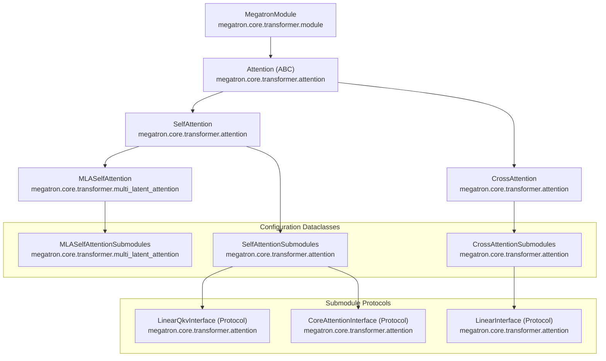

Sources: [megatron/core/transformer/attention.py:139-237](), [megatron/core/transformer/attention.py:239-244](), [megatron/core/transformer/multi_latent_attention.py:112-128]()

### Key Attention Components

The `Attention` base class provides common functionality for both self-attention and cross-attention:

| Component | Type | Purpose | Implementation |
|-----------|------|---------|----------------|
| `core_attention` | Protocol-based | Executes scaled dot-product attention | Built via `CoreAttentionBuilder` |
| `linear_proj` | Module | Output projection after attention | `RowParallelLinear` or `TERowParallelLinear` |
| `checkpoint_core_attention` | bool | Activation checkpointing for attention | Configured via `recompute_granularity` |
| `num_query_groups_per_partition` | int | GQA: KV heads per TP partition | Computed from `num_query_groups` |
| `num_attention_heads_per_partition` | int | Query heads per TP partition | Computed from `num_attention_heads` |

Sources: [megatron/core/transformer/attention.py:246-363]()

## Attention Configuration

Attention behavior is controlled through `TransformerConfig` parameters. The configuration determines both the attention backend (FlashAttention, fused, unfused, or local) and attention-specific features like GQA, sliding window attention, and RoPE.

### Core Attention Configuration Parameters

| Parameter | Type | Default | Purpose |
|-----------|------|---------|---------|
| `attention_backend` | `AttnBackend` | `auto` | Select attention implementation [megatron/core/transformer/transformer_config.py:144]() |
| `softmax_scale` | `Optional[float]` | `None` | Custom attention scaling (default: 1/√d_k) [megatron/core/transformer/transformer_config.py:160]() |
| `num_query_groups` | `Optional[int]` | `None` | Number of KV heads for GQA (None = MHA) [megatron/core/transformer/transformer_config.py:171-174]() |
| `qk_layernorm` | `bool` | `False` | Apply LayerNorm to Q and K projections [megatron/core/transformer/transformer_config.py:252]() |
| `qk_l2_norm` | `bool` | `False` | Apply L2 normalization (Llama 4 style) [megatron/core/transformer/transformer_config.py:255]() |
| `window_size` | `Optional[Tuple[int, int]]` | `None` | Sliding window size (backward, forward) [megatron/core/transformer/transformer_config.py:240]() |
| `multi_latent_attention` | `bool` | `False` | Enable Multi-Latent Attention (DeepSeek style) [megatron/core/transformer/transformer_config.py:258]() |

Sources: [megatron/core/transformer/transformer_config.py:138-355]()

### AttnBackend Enum and Selection

**Backend Selection Flow**

```mermaid
graph TD
    ConfigBackend["config.attention_backend<br/>AttnBackend enum"]
    
    subgraph "AttnBackend Values"
        auto["auto: Let TE decide"]
        flash["flash: FlashAttention"]
        fused["fused: FusedAttention"]
        unfused["unfused: UnfusedAttention"]
        local["local: PyTorch native"]
    end
    
    subgraph "Runtime Selection"
        HaveTE{"HAVE_TE<br/>megatron.core.extensions.transformer_engine"}
        UseLocal["Use DotProductAttention<br/>Pure PyTorch"]
        UseTEDotProduct["Use TEDotProductAttention<br/>TE-based backend"]
    end
    
    subgraph "Final Implementation"
        FlashAttnKernel["flash_attn_varlen_func<br/>FlashAttention-2"]
        TEFusedAttn["FusedAttention<br/>TE optimized"]
        TEUnfusedAttn["UnfusedAttention<br/>TE standard"]
        PyTorchAttn["torch.nn.functional<br/>scaled_dot_product_attention"]
    end
    
    ConfigBackend --> auto
    ConfigBackend --> flash
    ConfigBackend --> fused
    ConfigBackend --> unfused
    ConfigBackend --> local
    
    auto --> HaveTE
    flash --> HaveTE
    fused --> HaveTE
    unfused --> HaveTE
    local --> UseLocal
    
    HaveTE -->|Yes| UseTEDotProduct
    HaveTE -->|No| UseLocal
    
    UseTEDotProduct --> FlashAttnKernel
    UseTEDotProduct --> TEFusedAttn
    UseTEDotProduct --> TEUnfusedAttn
    UseLocal --> PyTorchAttn
```

Sources: [megatron/core/transformer/enums.py:60-68](), [megatron/core/extensions/transformer_engine.py:73-86]()

## Multi-Latent Attention (MLA)

MLA is an optimized attention mechanism (introduced by DeepSeek) that compresses Key-Value (KV) cache by projecting them into a low-dimensional latent space.

### MLA Architecture

MLA replaces standard QKV projections with a more complex set of up/down projections:
1.  **KV Compression**: Keys and values are compressed into a single latent vector `c_kv`.
2.  **Decoupled Queries**: Queries are split into a compressed latent part and a decoupled part for Rotary Positional Embeddings (RoPE).
3.  **Absorbed Scaling**: The output projection absorbs parts of the attention scaling.

**MLA Submodule Mapping**

| Submodule | Code Entity | Purpose |
|-----------|-------------|---------|
| `linear_q_proj` | `linear_q_proj` | Initial query projection [megatron/core/transformer/multi_latent_attention.py:121]() |
| `linear_q_up_proj` | `linear_q_up_proj` | Projects latent query to head dimension [megatron/core/transformer/multi_latent_attention.py:123]() |
| `linear_kv_down_proj` | `linear_kv_down_proj` | Compresses KV into latent space [megatron/core/transformer/multi_latent_attention.py:124]() |
| `linear_kv_up_proj` | `linear_kv_up_proj` | Projects latent KV back to heads [megatron/core/transformer/multi_latent_attention.py:125]() |

Sources: [megatron/core/transformer/multi_latent_attention.py:112-128](), [megatron/core/models/gpt/gpt_layer_specs.py:104-132]()

## SelfAttention Submodule Protocols

The `SelfAttention` class implements self-attention using a protocol-based design that allows different implementations for its submodules (QKV projection, core attention, output projection).

### SelfAttention Forward Pass

**Forward Pass Data Flow**

```mermaid
graph TD
    hidden_states["hidden_states<br/>[sq, b, h]"]
    
    subgraph "1. QKV Generation"
        linear_qkv_call["self.linear_qkv(hidden_states)<br/>Returns: (mixed_qkv, bias)"]
        viewasqkv["viewas_tensors()<br/>Split into Q, K, V"]
        qk_layernorm["Optional: qk_layernorm(Q), qk_layernorm(K)"]
    end
    
    subgraph "2. Apply RoPE"
        apply_rotary_pos_emb["apply_rotary_pos_emb()<br/>If rotary_pos_emb provided"]
    end
    
    subgraph "3. Inference KV Cache"
        adjust_kv["_adjust_key_value_for_inference()<br/>Update KV cache, get block_table"]
    end
    
    subgraph "4. Core Attention"
        core_attn_forward["self.core_attention.forward()<br/>(Q, K, V, mask) -> context"]
        checkpoint_wrapper["Optional: _checkpointed_attention_forward()<br/>If checkpoint_core_attention=True"]
    end
    
    subgraph "5. Output Projection"
        linear_proj_call["self.linear_proj(context)<br/>Returns: (output, bias)"]
    end
    
    hidden_states --> linear_qkv_call
    linear_qkv_call --> viewasqkv
    viewasqkv --> qk_layernorm
    qk_layernorm --> apply_rotary_pos_emb
    apply_rotary_pos_emb --> adjust_kv
    adjust_kv --> core_attn_forward
    core_attn_forward --> checkpoint_wrapper
    checkpoint_wrapper --> linear_proj_call
```

Sources: [megatron/core/transformer/attention.py:702-872]()

## FlashAttention Integration

FlashAttention is integrated through both Transformer Engine and direct flash-attn library usage. The system supports FlashAttention-2 for training and FlashAttention-3 for inference with KV cache.

### FlashAttention Backend Selection

| Mode | FA Version | Kernel Function | Use Case |
|------|-----------|----------------|----------|
| Training | FA2 | `flash_attn_varlen_func` | Variable-length sequences, packed format [megatron/core/transformer/attention.py:116-119]() |
| Inference (prefill) | FA2/FA3 | `flash_attn_varlen_func` | Initial prompt processing [megatron/core/transformer/attention.py:762-856]() |
| Inference (decode) | FA2 | `flash_attn_with_kvcache` | Single-token generation with KV cache [megatron/core/transformer/attention.py:116-119]() |
| Inference (decode) | FA3 | `flash_attn3_with_kvcache` | Optimized H100/Hopper decode [megatron/core/transformer/attention.py:65-68]() |

Sources: [megatron/core/transformer/attention.py:63-119]()

## Inference KV Cache Management

The `_adjust_key_value_for_inference()` method manages KV cache during inference, supporting both static and dynamic batching strategies.

### Static Batching (Pre-allocated Buffers)

```mermaid
graph TD
    subgraph "Cache Initialization"
        allocate_memory["_allocate_memory()<br/>Pre-allocate [max_seq, max_batch, ng, hn]"]
        store_in_dict["Store in inference_context.key_value_memory_dict"]
    end
    
    subgraph "Prefill Phase"
        sequence_start["sequence_start = 0"]
        sequence_end["sequence_end = prompt_length"]
        copy_to_cache["cache[start:end, batch] = key/value"]
    end
    
    subgraph "Decode Phase"
        increment_offset["sequence_len_offset += 1"]
        append_single_token["cache[offset, batch] = new_key/value"]
        attn_mask_no_mask["attn_mask_type = AttnMaskType.no_mask"]
    end
    
    allocate_memory --> store_in_dict
    store_in_dict --> sequence_start
    sequence_start --> copy_to_cache
    copy_to_cache --> increment_offset
    increment_offset --> append_single_token
    append_single_token --> attn_mask_no_mask
```

Sources: [megatron/core/transformer/attention.py:427-438](), [megatron/core/transformer/attention.py:497-594]()

### Dynamic Batching (Block Tables)

For dynamic inference with variable sequence lengths, block tables enable paged attention:

1.  **Append**: `inference_context.append_key_value_cache()` adds new tokens to the physical cache blocks [megatron/core/transformer/attention.py:595-610]().
2.  **Retrieve**: `get_cache_pointer` retrieves the block table mapping logical positions to physical blocks [megatron/core/transformer/attention.py:612-620]().
3.  **Execute**: FlashAttention kernels use the block table to perform paged attention computation [megatron/core/transformer/attention.py:622-629]().

Sources: [megatron/core/transformer/attention.py:595-629]()

## Attention Optimizations

### CUDA Graph Integration

Attention modules are designed to be compatible with CUDA graphs to reduce CPU overhead during inference. The `CudaGraphScope` enum defines different capture scopes (e.g., `local`, `global`) for managing memory buffers during graph capture.

Sources: [megatron/core/transformer/enums.py:73-77](), [megatron/core/transformer/transformer_config.py:25-27]()

### Activation Checkpointing for Attention

Core attention can be selectively checkpointed to save memory during training:
- **Selective Recompute**: Only recomputes the attention computation (the "core") rather than the entire transformer layer.
- **Implementation**: Managed via `_checkpointed_attention_forward()` which wraps the core attention call in `torch.utils.checkpoint`.

Sources: [megatron/core/transformer/attention.py:334-337](), [megatron/core/transformer/attention.py:387-425]()

### Softmax Variants

Megatron-Core supports several softmax modifications for different model families:
- **Vanilla**: Standard softmax.
- **Off-by-one**: Adds a fixed offset to the denominator (useful for models like BERT).
- **Learnable**: Uses a learnable parameter for the denominator offset.

Sources: [megatron/core/transformer/transformer_config.py:163-166]()

---

# Page: Positional Embeddings

# Positional Embeddings

<details>
<summary>Relevant source files</summary>

The following files were used as context for generating this wiki page:

- [megatron/core/fusions/fused_indices_converter.py](megatron/core/fusions/fused_indices_converter.py)
- [megatron/core/fusions/fused_mla_yarn_rope_apply.py](megatron/core/fusions/fused_mla_yarn_rope_apply.py)
- [megatron/core/fusions/fused_pad_routing_map.py](megatron/core/fusions/fused_pad_routing_map.py)
- [megatron/core/models/common/embeddings/rope_utils.py](megatron/core/models/common/embeddings/rope_utils.py)
- [megatron/core/models/common/embeddings/rotary_pos_embedding.py](megatron/core/models/common/embeddings/rotary_pos_embedding.py)
- [megatron/core/models/common/embeddings/yarn_rotary_pos_embedding.py](megatron/core/models/common/embeddings/yarn_rotary_pos_embedding.py)
- [megatron/core/transformer/experimental_attention_variant/absorbed_mla.py](megatron/core/transformer/experimental_attention_variant/absorbed_mla.py)
- [tests/unit_tests/fusions/test_mla_yarn_rope_apply.py](tests/unit_tests/fusions/test_mla_yarn_rope_apply.py)
- [tests/unit_tests/transformer/moe/test_multihot_indices_converter.py](tests/unit_tests/transformer/moe/test_multihot_indices_converter.py)

</details>


This document describes the positional embedding implementations in Megatron-LM. Positional embeddings encode sequence position information to enable transformer models to understand token ordering. For information about attention mechanisms that consume these embeddings, see [Attention Mechanisms](2.3). For general model architecture, see [Core Model Architecture](2).

---

## Overview

Megatron-LM supports multiple positional embedding strategies, each with different characteristics for sequence length handling, computational efficiency, and extrapolation capabilities. The system is designed to be modular, allowing different embedding types to be selected via configuration.

**Supported Position Embedding Types:**

| Type | Description | Key Use Case |
|------|-------------|--------------|
| `learned_absolute` | Learned position embeddings added to token embeddings | Standard transformer, fixed max length |
| `rope` | Rotary Position Embedding (RoPE) | Modern LLMs (LLaMa, GPT-NeoX style) |
| `yarn` | YARN (Yet Another RoPE extensioN) | Extended context length with better extrapolation |
| `mrope` | Multimodal RoPE | Vision-language models with spatial position encoding |
| `none` | No positional encoding | Specialized architectures |

Sources: [megatron/core/models/gpt/gpt_model.py:101-103]()

---

## Configuration Parameters

The `TransformerConfig` and model initialization parameters control positional embedding behavior:

### Core Configuration Fields

```python
# Position embedding type selection
position_embedding_type: Literal['learned_absolute', 'rope', 'mrope', 'yarn', 'none']

# RoPE-specific parameters
rotary_percent: float = 1.0          # Fraction of head_dim to apply RoPE to
rotary_base: int = 10000             # Base period for frequency computation
rotary_interleaved: bool = False     # RoFormer (True) vs LLaMa (False) style

# Scaling and interpolation
rope_scaling: bool = False           # Enable RoPE frequency scaling
rope_scaling_factor: float = 8.0     # Scaling factor for frequencies
seq_len_interpolation_factor: Optional[float] = None  # Linear interpolation

# Layer-specific control
no_rope_freq: Optional[Union[int, List[int]]] = None  # Skip RoPE on certain layers

# YARN-specific parameters
yarn_rotary_scaling_factor: float
yarn_original_max_position_embeddings: int
yarn_beta_fast: int = 32
yarn_beta_slow: int = 1
yarn_mscale: float = 1.0
yarn_mscale_all_dim: float = 0.0

# Multimodal RoPE
mrope_section: Optional[List[int]] = None  # Spatial dimension partitioning
```

Sources: [megatron/core/transformer/transformer_config.py:207-261](), [megatron/core/models/gpt/gpt_model.py:67-84]()

---

## Position Embedding Type Selection

### Initialization Flow

```mermaid
graph TD
    CONFIG["TransformerConfig<br/>position_embedding_type"]
    GPTMODEL["GPTModel.__init__"]
    
    CONFIG --> GPTMODEL
    
    GPTMODEL --> CHECK_TYPE{"position_embedding_type"}
    
    CHECK_TYPE -->|"'learned_absolute'"| LEARNED["LanguageModelEmbedding<br/>with position_ids"]
    CHECK_TYPE -->|"'rope'"| ROPE_INIT["RotaryEmbedding<br/>initialization"]
    CHECK_TYPE -->|"'yarn'"| YARN_INIT["YarnRotaryEmbedding<br/>initialization"]
    CHECK_TYPE -->|"'mrope'"| MROPE_INIT["MultimodalRotaryEmbedding<br/>initialization"]
    CHECK_TYPE -->|"'none'"| NO_PE["No positional<br/>encoding"]
    
    ROPE_INIT --> ROPE_OBJ["self.rotary_pos_emb<br/>RotaryEmbedding instance"]
    YARN_INIT --> YARN_OBJ["self.rotary_pos_emb<br/>YarnRotaryEmbedding instance"]
    MROPE_INIT --> MROPE_OBJ["self.rotary_pos_emb<br/>MultimodalRotaryEmbedding instance"]
    
    LEARNED --> EMBEDDING_LAYER["LanguageModelEmbedding<br/>position_embedding_type='learned_absolute'"]
    
    ROPE_OBJ --> CACHE["self.rotary_pos_emb_cache<br/>Dict[int, Tuple[Tensor, Tensor]]"]
    YARN_OBJ --> CACHE
    MROPE_OBJ --> CACHE
```

**Diagram: Position Embedding Initialization in GPTModel**

Sources: [megatron/core/models/gpt/gpt_model.py:127-205]()

---

## Rotary Position Embeddings (RoPE)

### Architecture and Implementation

RoPE applies rotations to query and key embeddings based on their absolute positions, enabling relative position encoding through dot-product attention. The system supports partial RoPE application (controlled by `rotary_percent`) and two rotation styles.

```mermaid
graph TB
    subgraph "RoPE Initialization"
        ROPE_CONFIG["RotaryEmbedding config:<br/>- kv_channels<br/>- rotary_percent<br/>- rotary_base<br/>- rotary_interleaved"]
        ROPE_INIT["RotaryEmbedding.__init__"]
        
        ROPE_CONFIG --> ROPE_INIT
        
        ROPE_INIT --> COMPUTE_DIM["dim = int(kv_channels * rotary_percent)"]
        ROPE_INIT --> INV_FREQ["inv_freq = 1.0 / (base ** (arange(0, dim, 2) / dim))"]
    end
    
    subgraph "Forward Pass"
        CALL["rotary_pos_emb(max_seq_len)"]
        
        CALL --> SEQ_RANGE["seq = torch.arange(max_seq_len)"]
        SEQ_RANGE --> FREQS["freqs = outer(seq, inv_freq)"]
        
        FREQS --> CHECK_INTERLEAVED{"rotary_interleaved?"}
        
        CHECK_INTERLEAVED -->|True| ROFORMER["RoFormer style:<br/>stack(freqs, freqs)"]
        CHECK_INTERLEAVED -->|False| LLAMA["LLaMa style:<br/>cat([freqs, freqs], dim=-1)"]
        
        ROFORMER --> EMB["emb = [cos(freqs), sin(freqs)]"]
        LLAMA --> EMB
        
        EMB --> RESHAPE["Reshape to [seq_len, 1, 1, dim]"]
    end
    
    subgraph "Application"
        QK["Query/Key tensors"]
        APPLY_FUNC["apply_rotary_pos_emb(q, k, cos, sin)"]
        
        RESHAPE --> APPLY_FUNC
        QK --> APPLY_FUNC
        
        APPLY_FUNC --> SPLIT["Split q/k into pairs"]
        SPLIT --> ROTATE["Rotate: [x1, x2] -> [x1*cos - x2*sin, x1*sin + x2*cos]"]
    end
```

**Diagram: RoPE Computation and Application Flow**

### RoPE Style: Interleaved vs Non-Interleaved

The `rotary_interleaved` parameter controls how dimensions are paired for rotation:

- **RoFormer style (`rotary_interleaved=True`)**: Rotates pairs of even and odd dimensions: `(d0, d1), (d2, d3), ...` [megatron/core/models/common/embeddings/rotary_pos_embedding.py:170-172]()
- **LLaMa style (`rotary_interleaved=False`)**: Rotates first half with second half: `(d0, d_{n/2}), (d1, d_{n/2+1}), ...` [megatron/core/models/common/embeddings/rotary_pos_embedding.py:168-169]()

Megatron-LM also supports MLA-style interleaving via `mla_rotary_interleaved` where dimensions are interleaved as `0, 2, 4...` and `1, 3, 5...` before rotation [megatron/core/models/common/embeddings/rope_utils.py:135-138]().

Sources: [megatron/core/transformer/transformer_config.py:207-209](), [megatron/core/models/gpt/gpt_model.py:160-171](), [megatron/core/models/common/embeddings/rope_utils.py:135-138]()

### Partial RoPE Application

The `rotary_percent` parameter (default 1.0) controls what fraction of the head dimension receives RoPE:

```python
# Example: With kv_channels=64 and rotary_percent=0.5
# Only the first 32 dimensions get RoPE, remaining 32 are identity
dim = int(kv_channels * rotary_percent)  # 32
# Frequencies computed only for dim=32
```

This allows models to use RoPE for some dimensions while leaving others for learned patterns. [megatron/core/models/common/embeddings/rotary_pos_embedding.py:73-74]()

Sources: [megatron/core/models/gpt/gpt_model.py:69-71]()

### Layer-Selective RoPE with `no_rope_freq`

The `no_rope_freq` parameter enables skipping RoPE on specific layers:

```python
# Option 1: Integer pattern - skip every N-1 layers
no_rope_freq = 4  # Apply RoPE for 3 layers, skip 1, repeat

# Option 2: Explicit list pattern
no_rope_freq = [0, 1, 1, 0]  # Skip layer 1 and 2, apply on 0 and 3
```

Sources: [megatron/core/transformer/transformer_config.py:255-260]()

---

## YARN (Yet Another RoPE extensioN)

YARN extends RoPE for longer context lengths by applying attention-aware scaling to different frequency components. It improves extrapolation to sequences longer than the training length.

### YARN Configuration Parameters

| Parameter | Type | Description |
|-----------|------|-------------|
| `yarn_rotary_scaling_factor` | float | Overall scaling factor for frequencies |
| `yarn_original_max_position_embeddings` | int | Original max sequence length (reference) |
| `yarn_beta_fast` | int | Fast wavelength threshold (default: 32) |
| `yarn_beta_slow` | int | Slow wavelength threshold (default: 1) |
| `yarn_mscale` | float | Magnitude scaling factor for attention scores |
| `yarn_mscale_all_dim` | float | Alternative mscale computation method |

### YARN Initialization Flow

```mermaid
graph TD
    YARN_INIT["YarnRotaryEmbedding.__init__"]
    
    YARN_INIT --> BASE_PARAMS["Base RoPE params:<br/>kv_channels, rotary_percent,<br/>rotary_base, rotary_interleaved"]
    YARN_INIT --> YARN_PARAMS["YARN params:<br/>scaling_factor, original_max_pos,<br/>beta_fast, beta_slow, mscale"]
    
    BASE_PARAMS --> COMPUTE_DIM["dim = int(kv_channels * rotary_percent)"]
    
    COMPUTE_DIM --> BASE_INV_FREQ["base_inv_freq = 1.0 / (base ** (arange(0, dim, 2) / dim))"]
    
    BASE_INV_FREQ --> WAVELENGTHS["wavelengths = 2π / base_inv_freq"]
    
    WAVELENGTHS --> CLASSIFY{"Classify each freq"}
    
    CLASSIFY --> LOW_FREQ["Low freq:<br/>wavelength > beta_slow * scaling_factor<br/>No scaling"]
    CLASSIFY --> HIGH_FREQ["High freq:<br/>Linear interpolation"]
    CLASSIFY --> MID_FREQ["Mid freq:<br/>Smooth interpolation"]
    
    LOW_FREQ --> COMBINE["Combine scaled frequencies"]
    HIGH_FREQ --> COMBINE
    MID_FREQ --> COMBINE
    
    COMBINE --> MSCALE_CALC["Calculate mscale factor"]
    MSCALE_CALC --> FINAL_EMB["Final YARN embeddings"]
```

**Diagram: YARN Frequency Scaling Strategy**

YARN applies different scaling to different frequency bands:
- **Low frequencies** (long wavelengths): No interpolation - these capture long-range dependencies well.
- **High frequencies** (short wavelengths): Linear interpolation - these need scaling for longer contexts.
- **Middle frequencies**: Smooth transition between the two regimes using a linear ramp mask [megatron/core/models/common/embeddings/yarn_rotary_pos_embedding.py:128-139]().

Sources: [megatron/core/models/gpt/gpt_model.py:173-192](), [megatron/core/models/common/embeddings/yarn_rotary_pos_embedding.py:13-100](), [megatron/core/models/common/embeddings/yarn_rotary_pos_embedding.py:128-139]()

---

## Multimodal RoPE (mRoPE)

Multimodal RoPE extends RoPE for vision-language models by partitioning the rotation dimensions to encode both temporal and spatial positions.

### mRoPE Section Configuration

The `mrope_section` parameter defines how the head dimension is partitioned:

```python
# Example: For spatial + temporal encoding
mrope_section = [16, 16, 32]  # [temporal, height, width]
# Total must equal head dimension (64 in this case)
```

Each section receives independent rotary embeddings based on different position indices:
- **Temporal section**: Uses sequence position (time dimension).
- **Height section**: Uses vertical spatial coordinate.
- **Width section**: Uses horizontal spatial coordinate.

### mRoPE Forward Flow

```mermaid
graph LR
    POS_IDS["position_ids<br/>[batch, seq_len, 3]<br/>(temporal, height, width)"]
    MROPE_SECTION["mrope_section config<br/>[dim_t, dim_h, dim_w]"]
    
    POS_IDS --> EXTRACT_T["temporal_ids = position_ids[:, :, 0]"]
    POS_IDS --> EXTRACT_H["height_ids = position_ids[:, :, 1]"]
    POS_IDS --> EXTRACT_W["width_ids = position_ids[:, :, 2]"]
    
    MROPE_SECTION --> DIM_T["temporal_dim = mrope_section[0]"]
    MROPE_SECTION --> DIM_H["height_dim = mrope_section[1]"]
    MROPE_SECTION --> DIM_W["width_dim = mrope_section[2]"]
    
    EXTRACT_T --> ROPE_T["RoPE(temporal_ids, dim_t)"]
    EXTRACT_H --> ROPE_H["RoPE(height_ids, dim_h)"]
    EXTRACT_W --> ROPE_W["RoPE(width_ids, dim_w)"]
    
    DIM_T --> ROPE_T
    DIM_H --> ROPE_H
    DIM_W --> ROPE_W
    
    ROPE_T --> CONCAT["Concatenate along head_dim:<br/>[emb_t, emb_h, emb_w]"]
    ROPE_H --> CONCAT
    ROPE_W --> CONCAT
    
    CONCAT --> FINAL["Final mRoPE embedding<br/>[batch, seq_len, 1, head_dim]"]
```

**Diagram: Multimodal RoPE Encoding Process**

Sources: [megatron/core/models/gpt/gpt_model.py:193-205](), [megatron/core/models/common/embeddings/rotary_pos_embedding.py:33]()

---

## Learned Absolute Position Embeddings

When `position_embedding_type='learned_absolute'`, positions are encoded through a learned embedding table within the `LanguageModelEmbedding` module.

### Implementation

```mermaid
graph TD
    INPUT["input_ids<br/>[batch, seq_len]"]
    POS_IDS["position_ids<br/>[batch, seq_len]"]
    
    INPUT --> TOKEN_EMB["Token Embedding<br/>vocab_size -> hidden_size"]
    POS_IDS --> POS_EMB["Position Embedding<br/>max_seq_len -> hidden_size"]
    
    TOKEN_EMB --> ADD["Add embeddings:<br/>output = token_emb + pos_emb"]
    POS_EMB --> ADD
    
    ADD --> OUTPUT["Decoder input<br/>[batch, seq_len, hidden_size]"]
```

**Diagram: Learned Absolute Position Embedding Application**

The position embedding table has shape `[max_sequence_length, hidden_size]` and is learned during training. This approach:
- **Advantages**: Simple, effective for fixed-length sequences.
- **Limitations**: Cannot extrapolate beyond `max_sequence_length`, requires more memory for long sequences.

Sources: [megatron/core/models/gpt/gpt_model.py:150-158](), [megatron/core/models/common/embeddings/language_model_embedding.py:14]()

---

## Position Embedding Flow in Model Forward Pass

### Preprocessing Stage

The `GPTModel._preprocess` method handles position embedding preparation before the transformer decoder:

```mermaid
graph TD
    PREPROCESS["GPTModel._preprocess"]
    
    PREPROCESS --> CHECK_INPUT{"decoder_input<br/>provided?"}
    
    CHECK_INPUT -->|Yes| SKIP_EMB["Skip embedding<br/>(from previous PP stage)"]
    CHECK_INPUT -->|No| APPLY_EMB["Apply LanguageModelEmbedding"]
    
    APPLY_EMB --> EMB_OUTPUT["decoder_input<br/>(includes position info if learned)"]
    
    PREPROCESS --> CHECK_POS_TYPE{"position_embedding_type"}
    
    CHECK_POS_TYPE -->|"'learned_absolute'"| NO_ROPE["rotary_pos_emb = None"]
    CHECK_POS_TYPE -->|"'rope'"| ROPE_COMPUTE["Compute RoPE embeddings"]
    CHECK_POS_TYPE -->|"'yarn'"| YARN_COMPUTE["Compute YARN embeddings"]
    CHECK_POS_TYPE -->|"'mrope'"| MROPE_COMPUTE["Compute mRoPE embeddings"]
    
    ROPE_COMPUTE --> GET_SEQ_LEN["rotary_seq_len = get_rotary_seq_len()"]
    YARN_COMPUTE --> GET_SEQ_LEN
    
    GET_SEQ_LEN --> CALL_ROPE["rotary_pos_emb(rotary_seq_len)"]
    
    MROPE_COMPUTE --> CALL_MROPE["rotary_pos_emb(position_ids, mrope_section)"]
    
    CALL_ROPE --> ROPE_TENSOR["rotary_pos_emb:<br/>Tuple[cos_tensor, sin_tensor]"]
    CALL_MROPE --> ROPE_TENSOR
    
    NO_ROPE --> RETURN["Return: decoder_input, rotary_pos_emb"]
    ROPE_TENSOR --> RETURN
    EMB_OUTPUT --> RETURN
    SKIP_EMB --> RETURN
```

**Diagram: Position Embedding Preparation in GPTModel._preprocess**

Sources: [megatron/core/models/gpt/gpt_model.py:289-455]()

### Inference Mode Optimizations

For inference with `flash_decode` enabled or flashinfer integration:

```mermaid
graph TD
    INFERENCE_CHECK{"inference_context<br/>and flash_decode?"}
    
    INFERENCE_CHECK -->|No| STANDARD["Standard RoPE computation"]
    INFERENCE_CHECK -->|Yes| PRECOMPUTE["Precompute cos/sin<br/>for max_sequence_length"]
    
    PRECOMPUTE --> CACHE_CHECK{"cos/sin in cache?"}
    
    CACHE_CHECK -->|No| COMPUTE_CACHE["cos, sin = rotary_pos_emb.get_cos_sin(max_len)"]
    CACHE_CHECK -->|Yes| FETCH_CACHE["Fetch from rotary_pos_emb_cache"]
    
    COMPUTE_CACHE --> STORE_CACHE["rotary_pos_emb_cache[max_len] = (cos, sin)"]
    
    STORE_CACHE --> USE_CACHED["Use cached cos/sin tensors"]
    FETCH_CACHE --> USE_CACHED
    
    USE_CACHED --> SLICE["Slice to current sequence position"]
    STANDARD --> NORMAL_FLOW["Compute on-demand per forward pass"]
```

**Diagram: RoPE Caching Strategy for Inference**

The caching mechanism (via `self.rotary_pos_emb_cache`) avoids recomputing cos/sin tensors for every token generation step during inference. [megatron/core/models/common/embeddings/rotary_pos_embedding.py:177-179]()

Sources: [megatron/core/models/gpt/gpt_model.py:206-207](), [megatron/core/models/gpt/gpt_model.py:344-364]()

---

## Application in Attention Layers

### RoPE Application in Self-Attention

The `Attention` module applies rotary embeddings to query and key tensors before computing attention scores:

```mermaid
graph TD
    subgraph "Attention.forward"
        HIDDEN["hidden_states"]
        ROPE_EMB["rotary_pos_emb<br/>(q_emb, k_emb) or (cos, sin)"]
        
        HIDDEN --> LINEAR_QKV["linear_qkv projection"]
        LINEAR_QKV --> SPLIT["Split into Q, K, V"]
        
        SPLIT --> Q["Query tensor"]
        SPLIT --> K["Key tensor"]
        SPLIT --> V["Value tensor"]
        
        Q --> CHECK_ROPE{"rotary_pos_emb<br/>provided?"}
        K --> CHECK_ROPE
        ROPE_EMB --> CHECK_ROPE
        
        CHECK_ROPE -->|Yes| APPLY_ROPE["apply_rotary_pos_emb(q, k, emb)"]
        CHECK_ROPE -->|No| SKIP_ROPE["Skip RoPE"]
        
        APPLY_ROPE --> ROTATED_Q["Rotated Q"]
        APPLY_ROPE --> ROTATED_K["Rotated K"]
        
        ROTATED_Q --> CORE_ATTN["core_attention(Q, K, V)"]
        ROTATED_K --> CORE_ATTN
        V --> CORE_ATTN
        
        SKIP_ROPE --> CORE_ATTN
    end
```

**Diagram: RoPE Application in Attention Forward Pass**

### Context Parallelism Support

When context parallelism (CP) is enabled, RoPE frequencies must be correctly sliced to match the sequence segment assigned to each rank. The function `get_pos_emb_on_this_cp_rank` handles this by selecting indices based on the CP rank and group size [megatron/core/models/common/embeddings/rope_utils.py:48-70]().

For THD format (Total sequence length, Heads, Dim), `_get_thd_freqs_on_this_cp_rank` provides a frequency slice that accounts for CP sharding and optional sequence offsets, which is critical for VLMs where spatial positions matter [megatron/core/models/common/embeddings/rope_utils.py:159-196]().

Sources: [megatron/core/models/common/embeddings/rope_utils.py:48-70](), [megatron/core/models/common/embeddings/rope_utils.py:159-196]()

---

## RoPE Fusion Optimizations

### Fused RoPE Kernel

When `apply_rope_fusion=True`, the system attempts to use fused CUDA kernels for RoPE application. This includes support for `fused_apply_rotary_pos_emb` and `fused_apply_rotary_pos_emb_thd` from Transformer Engine [megatron/core/models/common/embeddings/rope_utils.py:20-29]().

### Triton-based Fusions for MLA

For Multi-Latent Attention (MLA), specialized Triton kernels are available for inplace RoPE application. The kernel `_mla_rope_fwd_inplace_kernel` applies rotations to the trailing `emb_dim` elements of a query or KV tensor, supporting both interleaved and non-interleaved layouts [megatron/core/fusions/fused_mla_yarn_rope_apply.py:79-160]().

The `AbsorbedMLASelfAttention` class leverages these fusions to apply RoPE efficiently during the forward pass [megatron/core/transformer/experimental_attention_variant/absorbed_mla.py:44-50]().

Sources: [megatron/core/models/common/embeddings/rope_utils.py:20-29](), [megatron/core/fusions/fused_mla_yarn_rope_apply.py:79-160](), [megatron/core/transformer/experimental_attention_variant/absorbed_mla.py:44-50]()

---

## Configuration-to-Implementation Mapping

```mermaid
graph TD
    subgraph "TransformerConfig Options"
        POS_TYPE["position_embedding_type"]
        ROPE_PERCENT["rotary_percent"]
        ROPE_BASE["rotary_base"]
        ROPE_INTERLEAVED["rotary_interleaved"]
        ROPE_SCALING["rope_scaling"]
        SEQ_INTERP["seq_len_interpolation_factor"]
        NO_ROPE["no_rope_freq"]
        MROPE_SEC["mrope_section"]
        YARN_SCALE["yarn_rotary_scaling_factor"]
        YARN_ORIG["yarn_original_max_position_embeddings"]
        YARN_BETA_F["yarn_beta_fast"]
        YARN_BETA_S["yarn_beta_slow"]
        YARN_MSCALE["yarn_mscale"]
    end
    
    subgraph "GPTModel Implementation"
        POS_TYPE --> CHECK_TYPE{"Check type"}
        
        CHECK_TYPE -->|"'learned_absolute'"| LANG_EMB["LanguageModelEmbedding<br/>position_embedding_type='learned_absolute'"]
        
        CHECK_TYPE -->|"'rope'"| ROPE_CLASS["RotaryEmbedding instance"]
        ROPE_PERCENT --> ROPE_CLASS
        ROPE_BASE --> ROPE_CLASS
        ROPE_INTERLEAVED --> ROPE_CLASS
        ROPE_SCALING --> ROPE_CLASS
        SEQ_INTERP --> ROPE_CLASS
        
        CHECK_TYPE -->|"'yarn'"| YARN_CLASS["YarnRotaryEmbedding instance"]
        ROPE_PERCENT --> YARN_CLASS
        ROPE_BASE --> YARN_CLASS
        ROPE_INTERLEAVED --> YARN_CLASS
        SEQ_INTERP --> YARN_CLASS
        YARN_SCALE --> YARN_CLASS
        YARN_ORIG --> YARN_CLASS
        YARN_BETA_F --> YARN_CLASS
        YARN_BETA_S --> YARN_CLASS
        YARN_MSCALE --> YARN_CLASS
        
        CHECK_TYPE -->|"'mrope'"| MROPE_CLASS["MultimodalRotaryEmbedding instance"]
        ROPE_PERCENT --> MROPE_CLASS
        ROPE_BASE --> MROPE_CLASS
        ROPE_INTERLEAVED --> MROPE_CLASS
        SEQ_INTERP --> MROPE_CLASS
        MROPE_SEC --> MROPE_CLASS
    end
    
    subgraph "Attention Layer Usage"
        ROPE_CLASS --> ATTN_APPLY["Attention.forward<br/>applies rotary_pos_emb"]
        YARN_CLASS --> ATTN_APPLY
        MROPE_CLASS --> ATTN_APPLY
        
        NO_ROPE --> LAYER_CHECK["TransformerLayer checks<br/>layer_number against pattern"]
        LAYER_CHECK --> SKIP_ROPE_LAYER["Skip RoPE for specific layers"]
    end
```

**Diagram: Configuration Parameters to Implementation Classes**

Sources: [megatron/core/transformer/transformer_config.py:207-261](), [megatron/core/models/gpt/gpt_model.py:127-205]()

---

## Key Classes and Functions

### Core Classes

| Class | Location | Purpose |
|-------|----------|---------|
| `RotaryEmbedding` | [megatron/core/models/common/embeddings/rotary_pos_embedding.py:36]() | Standard RoPE implementation |
| `YarnRotaryEmbedding` | [megatron/core/models/common/embeddings/yarn_rotary_pos_embedding.py:21]() | YARN-extended RoPE |
| `MultimodalRotaryEmbedding` | [megatron/core/models/common/embeddings/rotary_pos_embedding.py:33]() | Multimodal RoPE for vision-language |
| `LanguageModelEmbedding` | [megatron/core/models/common/embeddings/language_model_embedding.py:14]() | Token + position embeddings container |

### Key Functions

| Function | Location | Purpose |
|----------|----------|---------|
| `apply_rotary_pos_emb` | [megatron/core/models/common/embeddings/rope_utils.py:39]() | Entry point for applying RoPE rotations |
| `_apply_rotary_pos_emb_bshd` | [megatron/core/models/common/embeddings/rope_utils.py:92]() | RoPE application for [S, B, H, D] format |
| `_apply_rotary_pos_emb_thd` | [megatron/core/models/common/embeddings/rope_utils.py:202]() | RoPE application for [T, H, D] format |
| `get_pos_emb_on_this_cp_rank` | [megatron/core/models/common/embeddings/rope_utils.py:48]() | CP-aware position embedding slicing |

Sources: [megatron/core/models/common/embeddings/rotary_pos_embedding.py:36-176](), [megatron/core/models/common/embeddings/rope_utils.py:39-202]()

---

# Page: MLP and Activation Functions

# MLP and Activation Functions

<details>
<summary>Relevant source files</summary>

The following files were used as context for generating this wiki page:

- [examples/multimodal/layer_specs.py](examples/multimodal/layer_specs.py)
- [examples/multimodal/nvlm/internvit.py](examples/multimodal/nvlm/internvit.py)
- [examples/multimodal/radio/radio_g.py](examples/multimodal/radio/radio_g.py)
- [megatron/core/extensions/transformer_engine.py](megatron/core/extensions/transformer_engine.py)
- [megatron/core/extensions/transformer_engine_spec_provider.py](megatron/core/extensions/transformer_engine_spec_provider.py)
- [megatron/core/fusions/fused_bias_dropout.py](megatron/core/fusions/fused_bias_dropout.py)
- [megatron/core/fusions/fused_bias_swiglu.py](megatron/core/fusions/fused_bias_swiglu.py)
- [megatron/core/models/T5/t5_model.py](megatron/core/models/T5/t5_model.py)
- [megatron/core/models/T5/t5_spec.py](megatron/core/models/T5/t5_spec.py)
- [megatron/core/models/backends.py](megatron/core/models/backends.py)
- [megatron/core/models/bert/bert_layer_specs.py](megatron/core/models/bert/bert_layer_specs.py)
- [megatron/core/models/common/embeddings/language_model_embedding.py](megatron/core/models/common/embeddings/language_model_embedding.py)
- [megatron/core/models/gpt/gpt_model.py](megatron/core/models/gpt/gpt_model.py)
- [megatron/core/models/gpt/heterogeneous/heterogeneous_layer_specs.py](megatron/core/models/gpt/heterogeneous/heterogeneous_layer_specs.py)
- [megatron/core/models/gpt/moe_module_specs.py](megatron/core/models/gpt/moe_module_specs.py)
- [megatron/core/tensor_parallel/__init__.py](megatron/core/tensor_parallel/__init__.py)
- [megatron/core/tensor_parallel/layers.py](megatron/core/tensor_parallel/layers.py)
- [megatron/core/tensor_parallel/random.py](megatron/core/tensor_parallel/random.py)
- [megatron/core/transformer/attention.py](megatron/core/transformer/attention.py)
- [megatron/core/transformer/cuda_graphs.py](megatron/core/transformer/cuda_graphs.py)
- [megatron/core/transformer/identity_op.py](megatron/core/transformer/identity_op.py)
- [megatron/core/transformer/mlp.py](megatron/core/transformer/mlp.py)
- [megatron/core/transformer/module.py](megatron/core/transformer/module.py)
- [megatron/core/transformer/moe/shared_experts.py](megatron/core/transformer/moe/shared_experts.py)
- [megatron/core/transformer/torch_norm.py](megatron/core/transformer/torch_norm.py)
- [megatron/core/transformer/transformer_block.py](megatron/core/transformer/transformer_block.py)
- [megatron/core/transformer/transformer_config.py](megatron/core/transformer/transformer_config.py)
- [megatron/core/transformer/transformer_layer.py](megatron/core/transformer/transformer_layer.py)
- [megatron/core/transformer/utils.py](megatron/core/transformer/utils.py)
- [megatron/core/utils.py](megatron/core/utils.py)
- [tests/unit_tests/fusions/test_bias_dropout_fusion.py](tests/unit_tests/fusions/test_bias_dropout_fusion.py)
- [tests/unit_tests/fusions/test_swiglu_fusion.py](tests/unit_tests/fusions/test_swiglu_fusion.py)
- [tests/unit_tests/models/test_t5_model.py](tests/unit_tests/models/test_t5_model.py)
- [tests/unit_tests/tensor_parallel/test_random.py](tests/unit_tests/tensor_parallel/test_random.py)
- [tests/unit_tests/transformer/moe/test_shared_experts.py](tests/unit_tests/transformer/moe/test_shared_experts.py)
- [tests/unit_tests/transformer/test_cuda_graphs.py](tests/unit_tests/transformer/test_cuda_graphs.py)
- [tests/unit_tests/transformer/test_utils.py](tests/unit_tests/transformer/test_utils.py)

</details>


This document describes the Multi-Layer Perceptron (MLP) implementations and activation functions in Megatron-LM. The MLP is the feed-forward network component within each transformer layer, responsible for applying non-linear transformations to hidden states.

For attention mechanisms, see [Attention Mechanisms](2.3). For the complete transformer layer that contains the MLP, see [Transformer Layers and Blocks](2.2). For MoE variants that replace the standard MLP, see [Mixture of Experts (MoE)](3.3).

---

## Overview

The MLP in Megatron-LM takes input with hidden size `h`, projects it to an intermediate size (typically `4*h`), applies a non-linear activation function, and projects back to hidden size `h` [[megatron/core/transformer/mlp.py:157-160]](). The implementation supports:

- Standard activations (GeLU, SiLU, etc.) and gated linear units (SwiGLU, GeGLU) [[megatron/core/transformer/mlp.py:19-25]]().
- Fused kernels for bias-activation combinations [[megatron/core/transformer/mlp.py:264-306]]().
- Tensor parallelism for distributed computation via `ColumnParallelLinear` and `RowParallelLinear` [[megatron/core/transformer/mlp.py:212-245]]().
- Transformer Engine integration for FP8 training and optimized activation modules [[megatron/core/transformer/transformer_config.py:205-207]]().

Sources: [megatron/core/transformer/mlp.py:155-170](), [megatron/core/transformer/transformer_config.py:157-210]()

---

## MLP Architecture

### Basic Structure

The MLP follows a standard two-layer projection pattern. In Megatron-LM, these are typically implemented using `ColumnParallelLinear` (FC1) and `RowParallelLinear` (FC2) to facilitate tensor model parallelism [[megatron/core/transformer/mlp.py:172-182]]().

Title: MLP Data Flow
```mermaid
graph TB
    Input["Input Hidden States<br/>[s, b, h]"]
    FC1["Linear FC1<br/>ColumnParallelLinear<br/>h → ffn_hidden_size"]
    Activation["Activation Function<br/>GeLU, SwiGLU, etc."]
    FC2["Linear FC2<br/>RowParallelLinear<br/>ffn_hidden_size → h"]
    Output["Output + Bias<br/>[s, b, h]"]
    
    Input --> FC1
    FC1 -->|"intermediate_parallel [s, b, ffn/p]"| Activation
    FC1 -->|"bias_parallel"| Activation
    Activation --> FC2
    FC2 --> Output
    
    classDef layer fill:#f9f9f9,stroke:#333,stroke-width:2px
    class FC1,FC2 layer
```

**Notation:**
- `h`: hidden size [[megatron/core/transformer/mlp.py:166]]()
- `p`: number of tensor model parallel partitions [[megatron/core/transformer/mlp.py:167]]()
- `b`: batch size [[megatron/core/transformer/mlp.py:168]]()
- `s`: sequence length [[megatron/core/transformer/mlp.py:169]]()
- `ffn`: FFN hidden size (typically `4*h`, doubled for gated linear units) [[megatron/core/transformer/mlp.py:194-206]]()

Sources: [megatron/core/transformer/mlp.py:155-170](), [megatron/core/transformer/mlp.py:194-213]()

### Code Entity Mapping

The `MLP` class is a `MegatronModule` that composes linear layers based on a provided `MLPSubmodules` specification [[megatron/core/transformer/mlp.py:138-155]]().

Title: MLP Code Structure and Specs
```mermaid
graph LR
    subgraph "MLP Class"
        MLPClass["MLP<br/>megatron.core.transformer.mlp.MLP"]
        linear_fc1["self.linear_fc1<br/>LinearFc1Interface"]
        activation_func["self.activation_func<br/>TEActivationFunctionInterface"]
        linear_fc2["self.linear_fc2<br/>LinearFc2Interface"]
    end
    
    subgraph "Submodules Spec"
        MLPSubmodules["MLPSubmodules<br/>megatron.core.transformer.mlp.MLPSubmodules"]
        spec_fc1["linear_fc1: LinearFc1Builder"]
        spec_act["activation_func: TEActivationFunctionBuilder"]
        spec_fc2["linear_fc2: LinearFc2Builder"]
    end
    
    subgraph "Linear Implementations"
        ColumnParallel["ColumnParallelLinear<br/>megatron.core.tensor_parallel.layers.ColumnParallelLinear"]
        RowParallel["RowParallelLinear<br/>megatron.core.tensor_parallel.layers.RowParallelLinear"]
        TELinear["TELinear<br/>megatron.core.extensions.transformer_engine.TELinear"]
    end
    
    MLPSubmodules --> spec_fc1
    MLPSubmodules --> spec_act
    MLPSubmodules --> spec_fc2
    
    spec_fc1 -.->|"builds"| linear_fc1
    spec_act -.->|"builds"| activation_func
    spec_fc2 -.->|"builds"| linear_fc2
    
    linear_fc1 -.->|"can be"| ColumnParallel
    linear_fc1 -.->|"can be"| TELinear
    linear_fc2 -.->|"can be"| RowParallel
    linear_fc2 -.->|"can be"| TELinear
```

Sources: [megatron/core/transformer/mlp.py:138-155](), [megatron/core/transformer/mlp.py:212-245](), [megatron/core/extensions/transformer_engine.py:122-124]()

---

## MLP Class Implementation

### Constructor Parameters

The `MLP` class is initialized with the following parameters [[megatron/core/transformer/mlp.py:172-182]]():

| Parameter | Type | Description |
|-----------|------|-------------|
| `config` | `TransformerConfig` | Configuration object containing model parameters |
| `submodules` | `MLPSubmodules` | Specifications for FC1, activation, and FC2 layers |
| `is_expert` | `bool` | Whether this MLP is an expert in MoE (affects TP groups) |
| `input_size` | `Optional[int]` | Input dimension (defaults to `config.hidden_size`) |
| `ffn_hidden_size` | `int` | Intermediate FFN size (required for experts) |
| `tp_group` | `ProcessGroup` | Tensor parallel process group |

Sources: [megatron/core/transformer/mlp.py:172-182]()

### Linear Layers Construction

The MLP constructs two tensor-parallel linear layers. If `config.gated_linear_unit` is `True`, the `ffn_hidden_size` is doubled and a stride of 2 is used for `linear_fc1` to handle interleaved `[gate, up]` projections correctly during weight resharding across different TP sizes [[megatron/core/transformer/mlp.py:205-207]]().

**FC1 (Input Projection):**
- Input: `hidden_size` (or `moe_latent_size` for routed experts) [[megatron/core/transformer/mlp.py:191-220]]()
- Output: `ffn_hidden_size` (doubled for GLU) [[megatron/core/transformer/mlp.py:206]]()
- Implementation: [megatron/core/transformer/mlp.py:216-228]()

**FC2 (Output Projection):**
- Input: `ffn_hidden_size` (original size, not doubled) [[megatron/core/transformer/mlp.py:230]]()
- Output: `hidden_size` [[megatron/core/transformer/mlp.py:231]]()
- Implementation: [megatron/core/transformer/mlp.py:230-245]()

---

## Activation Functions

### Supported Activations

Megatron-LM supports multiple activation functions through `TransformerConfig.activation_func`.

| Activation | Function | Configuration |
|------------|----------|---------------|
| **GeLU** | `torch.nn.functional.gelu` | Default Gaussian Error Linear Unit [[megatron/core/transformer/transformer_config.py:194]]() |
| **SiLU (Swish)** | `torch.nn.functional.silu` | Sigmoid Linear Unit, common in GLU variants [[megatron/core/transformer/transformer_config.py:195]]() |
| **Quick GeLU** | `quick_gelu` | Approximation: `x * sigmoid(1.702 * x)` [[megatron/core/fusions/fused_bias_geglu.py:31]]() |

Sources: [megatron/core/transformer/transformer_config.py:193-195](), [megatron/core/fusions/fused_bias_geglu.py:31]()

### Activation Execution Paths

The MLP forward pass selects an execution path based on fusion and Transformer Engine (TE) configuration [[megatron/core/transformer/mlp.py:264-327]]():

Title: Activation Execution Logic
```mermaid
graph TD
    Start["Activation Selection"]
    
    UseTEAct{"config.use_te_activation_func?"}
    BiasActFusion{"config.bias_activation_fusion?"}
    
    TEPath["Transformer Engine Activation<br/>self.activation_func(x + bias)"]
    FusedPath["Fused Kernel Path<br/>bias_swiglu_impl, bias_gelu_impl, etc."]
    UnfusedPath["Unfused Path<br/>Manual bias add + activation"]
    
    Start --> UseTEAct
    UseTEAct -->|"True"| TEPath
    UseTEAct -->|"False"| BiasActFusion
    BiasActFusion -->|"True"| FusedPath
    BiasActFusion -->|"False"| UnfusedPath
```

Sources: [megatron/core/transformer/mlp.py:264-327]()

---

## Gated Linear Units (GLU)

### GLU Concept

Gated Linear Units split the intermediate representation into a "gate" and a "linear" part, applying the activation to the gate before element-wise multiplication [[megatron/core/transformer/mlp.py:205-207]]().

```
GLU(x) = activation(x_gate) * x_linear
```

When `config.gated_linear_unit=True`, the MLP implementation handles the chunking and multiplication [[megatron/core/transformer/mlp.py:308-323]]().

Sources: [megatron/core/transformer/mlp.py:205-207](), [megatron/core/transformer/mlp.py:308-323]()

### GLU Variants

Title: GLU Logic and Fusion
```mermaid
graph TB
    subgraph "GLU Variants"
        SwiGLU["SwiGLU<br/>activation=SiLU<br/>bias_swiglu_impl"]
        GeGLU["GeGLU<br/>activation=GeLU<br/>bias_geglu_impl"]
        QuickGeGLU["Quick GeGLU<br/>activation=quick_gelu<br/>weighted_bias_quick_geglu_impl"]
    end
    
    subgraph "Configuration"
        GLUFlag["gated_linear_unit=True"]
        ActFunc["activation_func"]
        BiasActFusion["bias_activation_fusion=True"]
        Offset["glu_linear_offset"]
    end
    
    GLUFlag --> ActFunc
    ActFunc --> BiasActFusion
    BiasActFusion --> SwiGLU
    BiasActFusion --> GeGLU
    BiasActFusion --> QuickGeGLU
    Offset -.->|"adds to linear part"| SwiGLU
```

Sources: [megatron/core/transformer/mlp.py:296-306](), [megatron/core/transformer/transformer_config.py:198-202]()

---

## Fused Implementations

### Fused Bias-Activation Kernels

Megatron-LM utilizes custom CUDA kernels to fuse bias addition with activation functions to reduce memory bandwidth overhead [[megatron/core/transformer/mlp.py:19-25]]().

| Kernel Function | Activation | GLU | Description |
|----------------|------------|-----|-------------|
| `bias_gelu_impl` | GeLU | No | Standard fused bias-gelu [[megatron/core/fusions/fused_bias_gelu.py:24]]() |
| `bias_geglu_impl` | GeLU | Yes | Fused bias and GeGLU [[megatron/core/fusions/fused_bias_geglu.py:20]]() |
| `bias_swiglu_impl` | SiLU | Yes | Fused bias and SwiGLU [[megatron/core/fusions/fused_bias_swiglu.py:25]]() |
| `weighted_bias_swiglu_impl` | SiLU | Yes | SwiGLU with per-token expert scaling [[megatron/core/fusions/fused_bias_swiglu.py:25]]() |

Sources: [megatron/core/transformer/mlp.py:264-306](), [megatron/core/fusions/fused_bias_swiglu.py:25](), [megatron/core/fusions/fused_bias_gelu.py:24]()

### Weighted Variants for MoE

Expert MLPs in Mixture of Experts (MoE) often require scaling the output by routing weights. The `weighted_bias_swiglu_impl` kernel applies this scale inside the fused operation for efficiency [[megatron/core/transformer/mlp.py:270-286]]().

Sources: [megatron/core/transformer/mlp.py:270-286](), [megatron/core/fusions/fused_bias_swiglu.py:25]()

---

## Tensor Parallelism in MLP

The MLP utilizes `ColumnParallelLinear` for `fc1` and `RowParallelLinear` for `fc2` [[megatron/core/transformer/mlp.py:216-245]]().

1. **FC1 (ColumnParallel):** Splits the output dimension. Each GPU rank computes a subset of the intermediate hidden states [[megatron/core/tensor_parallel/layers.py:136-144]](). No communication is required for the forward pass until the activation.
2. **FC2 (RowParallel):** Splits the input dimension [[megatron/core/tensor_parallel/layers.py:136-144]](). It takes the sharded intermediate states and performs a reduction to sum the results and produce the final hidden states [[megatron/core/tensor_parallel/layers.py:42-45]]().

Sources: [megatron/core/transformer/mlp.py:212-245](), [megatron/core/tensor_parallel/layers.py:136-166]()

---

## Configuration Options

### TransformerConfig Parameters

| Parameter | Type | Default | Description |
|-----------|------|---------|-------------|
| `ffn_hidden_size` | `Optional[int]` | `None` | Intermediate size (defaults to 4x hidden) [[megatron/core/transformer/transformer_config.py:163]]() |
| `gated_linear_unit` | `bool` | `False` | Enables GLU architecture [[megatron/core/transformer/transformer_config.py:198]]() |
| `activation_func` | `Callable` | `F.gelu` | Activation function used in non-GLU or GLU gate [[megatron/core/transformer/transformer_config.py:194]]() |
| `bias_activation_fusion` | `bool` | `False` | Enables custom fused CUDA kernels [[megatron/core/transformer/transformer_config.py:202]]() |
| `use_te_activation_func` | `bool` | `False` | Uses Transformer Engine's activation modules [[megatron/core/transformer/transformer_config.py:205]]() |
| `glu_linear_offset` | `float` | `0.0` | Offset added to the linear part of GLU [[megatron/core/transformer/transformer_config.py:201]]() |

Sources: [megatron/core/transformer/transformer_config.py:157-210]()

---

## Forward Pass Execution

The forward pass coordinates the two linear projections and the activation function, wrapped in NVTX ranges for profiling [[megatron/core/transformer/mlp.py:246-340]]().

```python
def forward(self, hidden_states, probe_dict=None, per_token_scale=None):
    # [s, b, h] -> [s, b, ffn/p]
    intermediate_parallel, bias_parallel = self.linear_fc1(hidden_states)
    
    # Apply Activation (Fused or Unfused)
    intermediate_parallel = self.apply_activation(intermediate_parallel, bias_parallel, per_token_scale)
    
    # [s, b, ffn/p] -> [s, b, h]
    output, output_bias = self.linear_fc2(intermediate_parallel)
    
    return output, output_bias
```

Sources: [megatron/core/transformer/mlp.py:246-340]()

### Gradient Accumulation Fusion

The MLP supports `backward_dw`, which triggers weight gradient computation in the underlying linear layers [[megatron/core/transformer/mlp.py:58-60]](). This is critical for overlapping gradient communication with computation.

Sources: [megatron/core/transformer/mlp.py:58-60](), [megatron/core/transformer/mlp.py:110-112]()

---

## Sharded State Dict for Checkpointing

The MLP handles state dictionary generation for distributed checkpointing [[megatron/core/transformer/mlp.py:343-414]](). A special `ShardedTensorFactory` logic is used for GLU layers to ensure that weights are correctly partitioned even when the number of tensor parallel ranks changes between save and load [[megatron/core/transformer/mlp.py:365-385]]().

Sources: [megatron/core/transformer/mlp.py:343-414](), [megatron/core/transformer/module.py:58-103]()

---

# Page: Transformer Engine Integration

# Transformer Engine Integration

<details>
<summary>Relevant source files</summary>

The following files were used as context for generating this wiki page:

- [megatron/core/enums.py](megatron/core/enums.py)
- [megatron/core/extensions/transformer_engine.py](megatron/core/extensions/transformer_engine.py)
- [megatron/core/fp4_utils.py](megatron/core/fp4_utils.py)
- [megatron/core/fusions/fused_bias_swiglu.py](megatron/core/fusions/fused_bias_swiglu.py)
- [megatron/core/models/gpt/gpt_model.py](megatron/core/models/gpt/gpt_model.py)
- [megatron/core/tensor_parallel/__init__.py](megatron/core/tensor_parallel/__init__.py)
- [megatron/core/tensor_parallel/layers.py](megatron/core/tensor_parallel/layers.py)
- [megatron/core/tensor_parallel/random.py](megatron/core/tensor_parallel/random.py)
- [megatron/core/transformer/attention.py](megatron/core/transformer/attention.py)
- [megatron/core/transformer/cuda_graphs.py](megatron/core/transformer/cuda_graphs.py)
- [megatron/core/transformer/enums.py](megatron/core/transformer/enums.py)
- [megatron/core/transformer/mlp.py](megatron/core/transformer/mlp.py)
- [megatron/core/transformer/module.py](megatron/core/transformer/module.py)
- [megatron/core/transformer/torch_norm.py](megatron/core/transformer/torch_norm.py)
- [megatron/core/transformer/transformer_block.py](megatron/core/transformer/transformer_block.py)
- [megatron/core/transformer/transformer_config.py](megatron/core/transformer/transformer_config.py)
- [megatron/core/transformer/transformer_layer.py](megatron/core/transformer/transformer_layer.py)
- [megatron/core/transformer/utils.py](megatron/core/transformer/utils.py)
- [megatron/core/utils.py](megatron/core/utils.py)
- [tests/unit_tests/fusions/test_swiglu_fusion.py](tests/unit_tests/fusions/test_swiglu_fusion.py)
- [tests/unit_tests/optimizer/test_distrib_optimizer_grouped_quantized.py](tests/unit_tests/optimizer/test_distrib_optimizer_grouped_quantized.py)
- [tests/unit_tests/tensor_parallel/test_random.py](tests/unit_tests/tensor_parallel/test_random.py)
- [tests/unit_tests/transformer/test_cuda_graphs.py](tests/unit_tests/transformer/test_cuda_graphs.py)
- [tests/unit_tests/transformer/test_utils.py](tests/unit_tests/transformer/test_utils.py)

</details>


## Purpose and Scope

This page documents how Megatron-LM integrates with [NVIDIA Transformer Engine](https://github.com/NVIDIA/TransformerEngine) (TE) to provide FP8/FP4 training support, fused kernels, and performance optimizations. Transformer Engine is a library that accelerates transformer model training through low-precision data types (FP8, FP4) and kernel fusion.

The integration provides:
- **Low-precision training**: FP8 and FP4 quantization with multiple scaling recipes `[megatron/core/transformer/transformer_config.py:499-602]()`.
- **Fused operations**: Combined operations like LayerNorm+Linear, bias-dropout-add, and specialized attention kernels `[megatron/core/extensions/transformer_engine.py:1033-1254]()`.
- **Module wrappers**: Drop-in replacements for PyTorch/Megatron layers that leverage TE (`TELinear`, `TENorm`, `TEColumnParallelLinear`, etc.) `[megatron/core/extensions/transformer_engine.py:269-528]()`.
- **Flexible configuration**: Global and per-module quantization control through `QuantizationConfig` and `TEQuantizationParams` `[megatron/core/extensions/transformer_engine.py:163-206]()`.

Sources: `[megatron/core/extensions/transformer_engine.py:1-82]()`, `[megatron/core/transformer/transformer_config.py:499-602]()`

---

## Integration Architecture

### Module Hierarchy

The following diagram illustrates how Megatron Core entities map to Transformer Engine components.

**Figure 1: Natural Language to Code Entity Space - Module Mapping**
```mermaid
graph TB
    subgraph "Megatron_Core_Code_Entities"
        CONFIG["TransformerConfig<br/>(fp8, fp4, recipes)"]
        LAYER["TransformerLayer"]
        ATTN["Attention"]
        MLP_MOD["MLP"]
    end
    
    subgraph "TE_Wrappers_megatron_core_extensions_transformer_engine_py"
        TE_LINEAR["TELinear"]
        TE_COL["TEColumnParallelLinear"]
        TE_ROW["TERowParallelLinear"]
        TE_NORM["TENorm"]
        TE_FUSED_LN["TELayerNormColumnParallelLinear"]
        TE_FUSED_MLP["TEFusedMLP"]
    end
    
    subgraph "TE_External_Library_transformer_engine_pytorch"
        TE_LIB_LINEAR["te.Linear"]
        TE_LIB_NORM["te.LayerNorm / te.RMSNorm"]
        TE_LIB_ATTN["te.DotProductAttention"]
    end
    
    CONFIG --> LAYER
    LAYER --> ATTN
    LAYER --> MLP_MOD
    
    ATTN -.builds.-> TE_COL
    ATTN -.builds.-> TE_ROW
    MLP_MOD -.builds.-> TE_COL
    MLP_MOD -.builds.-> TE_ROW
    
    TE_COL --> TE_LINEAR
    TE_ROW --> TE_LINEAR
    TE_LINEAR --> TE_LIB_LINEAR
    TE_NORM --> TE_LIB_NORM
    TE_FUSED_LN --> TE_LIB_LINEAR
    TE_FUSED_MLP --> TE_LIB_LINEAR
```

The integration works through multiple layers:
1.  **Configuration Layer**: `TransformerConfig` defines FP8/FP4 settings globally `[megatron/core/transformer/transformer_config.py:499-602]()`.
2.  **Specification Layer**: Specification providers (like `TESpecProvider`) create module specifications that build TE-based layers `[megatron/core/extensions/transformer_engine.py:1972-2167]()`.
3.  **Module Layer**: TE wrappers (`TELinear`, `TENorm`, etc.) replace standard PyTorch layers `[megatron/core/extensions/transformer_engine.py:269-1254]()`.
4.  **Context Layer**: `fp8_autocast` manages precision and scaling during forward/backward passes `[megatron/core/extensions/transformer_engine.py:66-67]()`.

Sources: `[megatron/core/extensions/transformer_engine.py:85-266]()`, `[megatron/core/transformer/transformer_config.py:499-602]()`, `[megatron/core/models/gpt/gpt_layer_specs.py:48-52]()`

---

## FP8 and FP4 Precision Support

### Configuration Parameters

Transformer Engine support is configured through `TransformerConfig` `[megatron/core/transformer/transformer_config.py:53]()`:

| Parameter | Type | Description |
|-----------|------|-------------|
| `fp8` | `str` | Enable FP8 training; 'e4m3' or 'hybrid' `[megatron/core/transformer/transformer_config.py:499]()`. |
| `fp8_recipe` | `Fp8Recipe` | Scaling strategy (delayed, tensorwise, mxfp8, blockwise) `[megatron/core/transformer/transformer_config.py:508]()`. |
| `fp8_param` | `bool` | Store parameters in FP8 to save memory `[megatron/core/transformer/transformer_config.py:534]()`. |
| `fp4` | `str` | Enable FP4 training (requires TE >= 2.7.0) `[megatron/core/transformer/transformer_config.py:584]()`. |
| `fp4_recipe` | `Fp4Recipe` | Scaling strategy for FP4 (nvfp4) `[megatron/core/transformer/transformer_config.py:588]()`. |
| `tp_only_amax_red` | `bool` | Reduce FP8 AMAX only in TP/TP-CP domain `[megatron/core/transformer/transformer_config.py:554]()`. |

Sources: `[megatron/core/transformer/transformer_config.py:499-602]()`, `[megatron/core/enums.py:12-13]()`

### FP8/FP4 Context Management

Megatron Core manages low-precision execution through context managers that wrap the forward pass.

**Figure 2: Precision Context Flow and Code Entities**
```mermaid
graph TB
    subgraph "Context_Dispatch_megatron_core_transformer_block_py"
        GET_FP8["get_fp8_context()"]
        GET_FP4["get_fp4_context()"]
    end
    
    subgraph "TE_Backend_transformer_engine_pytorch_fp8"
        AUTOCAST["fp8_autocast(recipe, fp8_group)"]
        GLOBAL_STATE["FP8GlobalStateManager"]
    end
    
    subgraph "Execution_Logic"
        BLOCK_FWD["TransformerBlock.forward()"]
        TE_MOD_FWD["TELinear.forward()"]
    end
    
    BLOCK_FWD --> GET_FP8
    BLOCK_FWD --> GET_FP4
    GET_FP8 --> AUTOCAST
    AUTOCAST --> TE_MOD_FWD
    TE_MOD_FWD --> GLOBAL_STATE
```

The `get_fp8_context()` and `get_fp4_context()` functions (imported in `[megatron/core/transformer/transformer_block.py:16-17]()`) set up the `fp8_autocast` environment by retrieving the correct process group for AMAX reduction via `get_amax_reduction_group()` `[megatron/core/extensions/transformer_engine.py:29]()`.

Sources: `[megatron/core/extensions/transformer_engine.py:208-266]()`, `[megatron/core/transformer/transformer_block.py:16-17]()`

---

## TE Module Wrappers

### Core Linear Layers

Megatron provides wrappers around Transformer Engine's linear layers to integrate with its parallelism and configuration systems.

#### TELinear
The base `TELinear` class wraps `te.Linear` `[megatron/core/extensions/transformer_engine.py:269]()`.
- **FP8 parameter storage**: If `config.fp8_param` is True, it handles FP8 weight storage `[megatron/core/extensions/transformer_engine.py:284]()`.
- **Quantization config**: Accepts per-module overrides via `quant_config` `[megatron/core/extensions/transformer_engine.py:276]()`.
- **Communication buffer registration**: Supports overlapping TP communication via `tp_comm_buffer_name` `[megatron/core/extensions/transformer_engine.py:302]()`.

Sources: `[megatron/core/extensions/transformer_engine.py:269-528]()`

#### TEColumnParallelLinear & TERowParallelLinear
These classes adapt TE's linear layers for Megatron's tensor model parallelism:
- `TEColumnParallelLinear`: Splits output features across TP ranks `[megatron/core/extensions/transformer_engine.py:607-841]()`.
- `TERowParallelLinear`: Splits input features across TP ranks and performs reduction at the output `[megatron/core/extensions/transformer_engine.py:844-1030]()`.

Sources: `[megatron/core/extensions/transformer_engine.py:607-1030]()`

### Normalization Layers

#### TENorm
Wraps TE's normalization implementations, supporting both LayerNorm and RMSNorm `[megatron/core/extensions/transformer_engine.py:1257]()`.
- Integrates with `TransformerConfig.normalization` setting.
- Supports `sequence_parallel` `[megatron/core/extensions/transformer_engine.py:1268]()`.
- Fuses residual connections if `has_residual` is enabled `[megatron/core/extensions/transformer_engine.py:1269]()`.

Sources: `[megatron/core/extensions/transformer_engine.py:1257-1375]()`

---

## Module Specifications and Builders

### TESpecProvider
The `TESpecProvider` class implements the specification pattern for building TE-based modules `[megatron/core/extensions/transformer_engine.py:1972]()`. This allows the model to remain agnostic of the specific implementation (TE vs. local PyTorch).

Key builder methods:
- `linear_qkv()`: Returns a `ModuleSpec` for `TEColumnParallelLinear` `[megatron/core/extensions/transformer_engine.py:1987-2007]()`.
- `linear_fc1()`: Returns a `ModuleSpec` for `TEColumnParallelLinear` used in MLP `[megatron/core/extensions/transformer_engine.py:2038-2059]()`.
- `core_attention()`: Returns a `ModuleSpec` for `TEDotProductAttention` `[megatron/core/extensions/transformer_engine.py:2119-2140]()`.

Sources: `[megatron/core/extensions/transformer_engine.py:1972-2167]()`, `[megatron/core/transformer/spec_utils.py:26]()`

---

## Per-Module Quantization

### Quantization Configuration System
Megatron supports per-module quantization overrides, allowing different precision for different layers through `TEQuantizationParams` `[megatron/core/extensions/transformer_engine.py:175]()`.

The `TEQuantizationRecipe` dataclass `[megatron/core/extensions/transformer_engine.py:133]()` defines:
- `fp8_quantization_recipe`: Override for FP8 (e.g., `Fp8Recipe.tensorwise`) `[megatron/core/extensions/transformer_engine.py:136]()`.
- `fp4_quantization_recipe`: Override for FP4 `[megatron/core/extensions/transformer_engine.py:142]()`.
- `override_quantized_autocast`: Whether to change the global quantization recipe for a specific module `[megatron/core/extensions/transformer_engine.py:152]()`.

Sources: `[megatron/core/extensions/transformer_engine.py:91-206]()`, `[megatron/core/quantization/quant_config.py:14]()`

---

## Fused Operations

### Saving Original Inputs
For FP8/FP4 training with certain recipes, TE modules save quantized tensors. To avoid redundant memory usage, Megatron uses `set_save_original_input()` `[megatron/core/transformer/attention.py:127]()`.

In `Attention.__init__`, if TE is used for projection layers:
```python
if HAVE_TE and isinstance(self.linear_proj, TELinear):
    if (config.fp8 and config.fp8_recipe != 'delayed') or config.fp4:
        set_save_original_input(self.linear_proj)
```
This optimization ensures that the original input is preserved for the backward pass without extra copies when quantization scales are active `[megatron/core/extensions/transformer_engine.py:127]()`.

Sources: `[megatron/core/transformer/attention.py:121-129]()`, `[megatron/core/extensions/transformer_engine.py:127]()`

### CUDA Graph Integration
Transformer Engine modules are compatible with Megatron's CUDA graph capture system. The `CudaGraphScope` enum `[megatron/core/transformer/enums.py:25]()` helps define the capture boundaries. Megatron modules check `config.cuda_graph_impl == "local"` to initialize graph managers `[megatron/core/transformer/module.py:173-175]()`.

For TE-specific graphs, the `CudaGraphManager` utilizes `transformer_engine.pytorch.graph` utilities such as `make_graphed_callables`, `save_fp8_tensors`, and `restore_fp8_tensors` `[megatron/core/transformer/cuda_graphs.py:47-50]()`. It also manages TE's global state flags like `set_skip_fp8_weight_update_tensor` (via `FP8GlobalStateManager`) to prevent redundant weight refreshes during replay `[megatron/core/transformer/cuda_graphs.py:45-53]()`.

Sources: `[megatron/core/transformer/module.py:159-181]()`, `[megatron/core/transformer/enums.py:22-27]()`, `[megatron/core/transformer/cuda_graphs.py:42-93]()`

---

# Page: Model Implementations

# Model Implementations

<details>
<summary>Relevant source files</summary>

The following files were used as context for generating this wiki page:

- [gpt_builders.py](gpt_builders.py)
- [mamba_builders.py](mamba_builders.py)
- [megatron/core/fusions/fused_layer_norm.py](megatron/core/fusions/fused_layer_norm.py)
- [megatron/core/models/bert/bert_lm_head.py](megatron/core/models/bert/bert_lm_head.py)
- [megatron/core/models/bert/bert_model.py](megatron/core/models/bert/bert_model.py)
- [megatron/core/models/bert/pooler.py](megatron/core/models/bert/pooler.py)
- [megatron/core/models/common/language_module/language_module.py](megatron/core/models/common/language_module/language_module.py)
- [megatron/core/models/gpt/gpt_layer_specs.py](megatron/core/models/gpt/gpt_layer_specs.py)
- [megatron/core/transformer/multi_latent_attention.py](megatron/core/transformer/multi_latent_attention.py)
- [model_provider.py](model_provider.py)
- [tests/unit_tests/models/test_bert_model.py](tests/unit_tests/models/test_bert_model.py)
- [tests/unit_tests/transformer/test_multi_latent_attention.py](tests/unit_tests/transformer/test_multi_latent_attention.py)

</details>


## Purpose and Scope

This page documents the model implementations in Megatron-LM, focusing on the architecture and building blocks used to construct transformer-based language models. It covers the foundational components (`TransformerConfig`, `TransformerBlock`, `TransformerLayer`, `Attention`, `MLP`) and the specification system used to assemble them into complete models like GPT, BERT, and T5.

For details on specific model architectures:
- GPT models: see [GPT Models](#3.1)
- BERT and T5 models: see [BERT and T5 Models](#3.2)
- Mixture of Experts (MoE) layers: see [Mixture of Experts (MoE)](#3.3)
- Mamba and SSM models: see [Mamba and SSM Models](#3.4)
- Multimodal models: see [Multimodal Models](#3.5)
- Elastification and Flextron: see [Elastification and Flextron](#3.6)

---

## Model Architecture Overview

Megatron-LM models are built hierarchically from configuration objects to reusable components. The central pattern is: `TransformerConfig` drives the construction of a `Model` (e.g., `GPTModel` or `BertModel`), which contains a `TransformerBlock`, which is a stack of `TransformerLayer` instances, each composed of `Attention` and `MLP` submodules.

### Model Construction Hierarchy

The following diagram maps high-level model concepts to specific code entities within the `megatron/core/transformer` and `megatron/core/models` directories.

```mermaid
graph TD
    CONFIG["TransformerConfig<br/>(megatron/core/transformer/transformer_config.py)"]
    MODEL["GPTModel<br/>(megatron/core/models/gpt/gpt_model.py)"]
    EMBEDDING["LanguageModelEmbedding<br/>(megatron/core/models/common/embeddings/language_model_embedding.py)"]
    BLOCK["TransformerBlock<br/>(megatron/core/transformer/transformer_block.py)"]
    LAYERS["List[BaseTransformerLayer]"]
    OUTPUT["TELMHeadColumnParallelLinear<br/>(megatron/core/extensions/transformer_engine.py)"]
    
    LAYER["TransformerLayer<br/>(megatron/core/transformer/transformer_layer.py)"]
    INPUT_LN["input_layernorm<br/>(TENorm / LNImpl)"]
    SELF_ATTN["self_attention<br/>(megatron/core/transformer/attention.py)"]
    PRE_MLP_LN["pre_mlp_layernorm"]
    MLP_MODULE["mlp / MoELayer<br/>(megatron/core/transformer/moe/moe_layer.py)"]
    
    ATTN_COMPONENTS["Attention Components"]
    LINEAR_QKV["linear_qkv<br/>(TELinear / ColumnParallelLinear)"]
    CORE_ATTN["core_attention<br/>(CoreAttentionInterface)"]
    LINEAR_PROJ["linear_proj<br/>(RowParallelLinear)"]
    
    MLP_COMPONENTS["MLP / MoE Components"]
    ROUTER["router<br/>(megatron/core/transformer/moe/router.py)"]
    DISPATCHER["token_dispatcher<br/>(megatron/core/transformer/moe/token_dispatcher.py)"]
    EXPERTS["experts<br/>(megatron/core/transformer/moe/experts.py)"]
    
    CONFIG --> MODEL
    MODEL --> EMBEDDING
    MODEL --> BLOCK
    MODEL --> OUTPUT
    
    BLOCK --> LAYERS
    LAYERS --> LAYER
    
    LAYER --> INPUT_LN
    LAYER --> SELF_ATTN
    LAYER --> PRE_MLP_LN
    LAYER --> MLP_MODULE
    
    SELF_ATTN --> ATTN_COMPONENTS
    ATTN_COMPONENTS --> LINEAR_QKV
    ATTN_COMPONENTS --> CORE_ATTN
    ATTN_COMPONENTS --> LINEAR_PROJ
    
    MLP_MODULE --> MLP_COMPONENTS
    MLP_COMPONENTS --> ROUTER
    MLP_COMPONENTS --> DISPATCHER
    MLP_COMPONENTS --> EXPERTS
```

**Sources:**
- [megatron/core/models/gpt/gpt_model.py:47-154]()
- [megatron/core/transformer/transformer_block.py:25-35]()
- [megatron/core/transformer/transformer_layer.py:37-42]()
- [megatron/core/transformer/attention.py:37-37]()

---

## Core Building Blocks

### TransformerConfig

`TransformerConfig` [megatron/core/transformer/transformer_config.py:53-53]() is the central configuration object that drives all model construction. It defines architecture parameters, parallelism settings, precision options, and optimization choices.

**Key Configuration Categories:**

| Category | Key Parameters |
|----------|----------------|
| Architecture | `num_layers`, `hidden_size`, `num_attention_heads` [megatron/core/transformer/transformer_config.py:64-136]() |
| Attention | `num_query_groups`, `kv_channels`, `attention_backend` [megatron/core/transformer/transformer_config.py:138-163]() |
| Multi-Token Prediction | `mtp_num_layers`, `mtp_loss_scaling_factor` [megatron/core/transformer/transformer_config.py:67-79]() |
| Precision | `fp16`, `bf16`, `fp8`, `params_dtype` [megatron/core/transformer/transformer_config.py:200-250]() |

**Sources:**
- [megatron/core/transformer/transformer_config.py:53-170]()

### TransformerBlock and Layer

The `TransformerBlock` [megatron/core/transformer/transformer_block.py:25-25]() manages a stack of `TransformerLayer` instances. It calculates the number of layers to build based on pipeline parallel rank and stage [megatron/core/transformer/transformer_block.py:69-152](). A `TransformerLayer` [megatron/core/transformer/transformer_layer.py:39-39]() combines self-attention and MLP/MoE submodules.

**Architecture Flow:**
1. Input is normalized via `input_layernorm` (e.g., `TENorm` [megatron/core/models/gpt/gpt_layer_specs.py:50-50]() or `FusedLayerNorm` [megatron/core/fusions/fused_layer_norm.py:30-30]()).
2. Self-attention is computed using the `self_attention` submodule [megatron/core/models/gpt/gpt_layer_specs.py:118-132]().
3. Residual connection and dropout are applied via `self_attn_bda` [megatron/core/models/gpt/gpt_layer_specs.py:133-133]().
4. MLP (or `MoELayer`) computation occurs [megatron/core/models/gpt/gpt_layer_specs.py:135-135](), followed by a final residual connection `mlp_bda`.

**Sources:**
- [megatron/core/transformer/transformer_block.py:25-170]()
- [megatron/core/transformer/transformer_layer.py:37-42]()
- [megatron/core/models/gpt/gpt_layer_specs.py:79-168]()

### Attention and MLA

The architecture supports standard `SelfAttention` and optimized variants like `MultiLatentAttention` (MLA). MLA [megatron/core/transformer/multi_latent_attention.py:130-130]() uses latent compression for KV caches to reduce memory footprint and is configured via `MLATransformerConfig` [megatron/core/transformer/transformer_config.py:42-42](). It supports advanced positional embeddings like `YarnRotaryEmbedding` [megatron/core/transformer/multi_latent_attention.py:188-190]().

**Sources:**
- [megatron/core/transformer/multi_latent_attention.py:130-200]()
- [megatron/core/models/gpt/gpt_layer_specs.py:104-137]()

---

## Model Specification System

Megatron-LM uses a **specification system** (`ModuleSpec`) [megatron/core/transformer/spec_utils.py:30-30]() to decouple model architecture definitions from their instantiation. This allows switching between backends (Transformer Engine, Local PyTorch, or Inference Optimized) without changing the core model logic.

### Specification Mapping to Code Entities

```mermaid
graph LR
    subgraph "Natural Language Space"
        Spec["Model Specification"]
        Backend["Backend Choice"]
    end

    subgraph "Code Entity Space"
        ModuleSpec["ModuleSpec<br/>(megatron/core/transformer/spec_utils.py)"]
        GPT_Specs["gpt_layer_specs.py<br/>(megatron/core/models/gpt/gpt_layer_specs.py)"]
        InferenceSpec["InferenceSpecProvider<br/>(megatron/core/models/backends.py)"]
        Build["gpt_builder()<br/>(gpt_builders.py)"]
    end

    Spec --> ModuleSpec
    Backend --> GPT_Specs
    Backend --> InferenceSpec
    ModuleSpec --> Build
    GPT_Specs --> Build
```

**Sources:**
- [megatron/core/transformer/spec_utils.py:30-30]()
- [megatron/core/models/gpt/gpt_layer_specs.py:8-30]()
- [gpt_builders.py:25-105]()

---

## Supported Model Families

### GPT Models
Decoder-only models implemented in `GPTModel` [megatron/core/models/gpt/gpt_model.py:3-3](). They support advanced features like Multi-Token Prediction (MTP) [megatron/core/transformer/multi_token_prediction.py:23-28]() and rotary position embeddings (RoPE). Construction is typically handled via `gpt_builder` [gpt_builders.py:25-25]().
For details, see [GPT Models](#3.1).

### BERT and T5 Models
Encoder-only and Encoder-Decoder architectures. `BertModel` [megatron/core/models/bert/bert_model.py:31-31]() uses a `Pooler` [megatron/core/models/bert/pooler.py:11-11]() for pooling specific token hidden states and a `BertLMHead` [megatron/core/models/bert/bert_lm_head.py:19-19]() for masked language modeling.
For details, see [BERT and T5 Models](#3.2).

### Mixture of Experts (MoE)
Conditional computation models where tokens are routed to a subset of experts. MoE modules are integrated into GPT specs via `get_moe_module_spec_for_backend` [megatron/core/models/gpt/gpt_layer_specs.py:13-13]().
For details, see [Mixture of Experts (MoE)](#3.3).

### Mamba and SSM Models
State Space Model implementations and hybrid Mamba-Transformer models. These are built using `hybrid_builder` re-exported in `mamba_builders.py` [mamba_builders.py:14-15]().
For details, see [Mamba and SSM Models](#3.4).

### Multimodal Models
Architectures combining vision and language, including LLaVA and NVLM. These models involve vision encoders (like CLIP ViT) and multimodal projectors to bridge modalities.
For details, see [Multimodal Models](#3.5).

### Elastification and Flextron
The Flextron system provides budget-aware routing and elastic training capabilities for MoE models, allowing for dynamic adjustment of computation.
For details, see [Elastification and Flextron](#3.6).

**Sources:**
- [megatron/core/models/gpt/gpt_model.py:47-154]()
- [megatron/core/models/bert/bert_model.py:31-160]()
- [gpt_builders.py:25-105]()
- [mamba_builders.py:1-15]()

---

# Page: GPT Models

# GPT Models

<details>
<summary>Relevant source files</summary>

The following files were used as context for generating this wiki page:

- [examples/academic_paper_scripts/detxoify_lm/generate_samples_gpt.py](examples/academic_paper_scripts/detxoify_lm/generate_samples_gpt.py)
- [examples/bert/README.md](examples/bert/README.md)
- [examples/bert/train_bert_340m_distributed.sh](examples/bert/train_bert_340m_distributed.sh)
- [examples/gpt3/README.md](examples/gpt3/README.md)
- [examples/gpt3/train_gpt3_175b_distributed.sh](examples/gpt3/train_gpt3_175b_distributed.sh)
- [examples/mimo/model_providers/__init__.py](examples/mimo/model_providers/__init__.py)
- [examples/mimo/training/builder.py](examples/mimo/training/builder.py)
- [examples/t5/train_t5_220m_distributed.sh](examples/t5/train_t5_220m_distributed.sh)
- [gpt_builders.py](gpt_builders.py)
- [hybrid_builders.py](hybrid_builders.py)
- [mamba_builders.py](mamba_builders.py)
- [megatron/core/extensions/transformer_engine.py](megatron/core/extensions/transformer_engine.py)
- [megatron/core/fusions/fused_bias_swiglu.py](megatron/core/fusions/fused_bias_swiglu.py)
- [megatron/core/models/gpt/gpt_layer_specs.py](megatron/core/models/gpt/gpt_layer_specs.py)
- [megatron/core/models/gpt/gpt_model.py](megatron/core/models/gpt/gpt_model.py)
- [megatron/core/tensor_parallel/__init__.py](megatron/core/tensor_parallel/__init__.py)
- [megatron/core/tensor_parallel/layers.py](megatron/core/tensor_parallel/layers.py)
- [megatron/core/tensor_parallel/random.py](megatron/core/tensor_parallel/random.py)
- [megatron/core/transformer/attention.py](megatron/core/transformer/attention.py)
- [megatron/core/transformer/cuda_graphs.py](megatron/core/transformer/cuda_graphs.py)
- [megatron/core/transformer/mlp.py](megatron/core/transformer/mlp.py)
- [megatron/core/transformer/module.py](megatron/core/transformer/module.py)
- [megatron/core/transformer/multi_latent_attention.py](megatron/core/transformer/multi_latent_attention.py)
- [megatron/core/transformer/torch_norm.py](megatron/core/transformer/torch_norm.py)
- [megatron/core/transformer/transformer_block.py](megatron/core/transformer/transformer_block.py)
- [megatron/core/transformer/transformer_config.py](megatron/core/transformer/transformer_config.py)
- [megatron/core/transformer/transformer_layer.py](megatron/core/transformer/transformer_layer.py)
- [megatron/core/transformer/utils.py](megatron/core/transformer/utils.py)
- [megatron/core/utils.py](megatron/core/utils.py)
- [megatron/elastification/pretrain_hybrid_flex.py](megatron/elastification/pretrain_hybrid_flex.py)
- [megatron/training/models/base.py](megatron/training/models/base.py)
- [megatron/training/models/dist_utils.py](megatron/training/models/dist_utils.py)
- [megatron/training/models/gpt.py](megatron/training/models/gpt.py)
- [megatron/training/models/hybrid.py](megatron/training/models/hybrid.py)
- [model_provider.py](model_provider.py)
- [tests/unit_tests/__init__.py](tests/unit_tests/__init__.py)
- [tests/unit_tests/fusions/test_swiglu_fusion.py](tests/unit_tests/fusions/test_swiglu_fusion.py)
- [tests/unit_tests/tensor_parallel/test_random.py](tests/unit_tests/tensor_parallel/test_random.py)
- [tests/unit_tests/training/models/test_dist_utils.py](tests/unit_tests/training/models/test_dist_utils.py)
- [tests/unit_tests/training/models/test_gpt_builder.py](tests/unit_tests/training/models/test_gpt_builder.py)
- [tests/unit_tests/training/models/test_hybrid_builder.py](tests/unit_tests/training/models/test_hybrid_builder.py)
- [tests/unit_tests/transformer/test_cuda_graphs.py](tests/unit_tests/transformer/test_cuda_graphs.py)
- [tests/unit_tests/transformer/test_full_cuda_graph.py](tests/unit_tests/transformer/test_full_cuda_graph.py)
- [tests/unit_tests/transformer/test_multi_latent_attention.py](tests/unit_tests/transformer/test_multi_latent_attention.py)
- [tests/unit_tests/transformer/test_utils.py](tests/unit_tests/transformer/test_utils.py)

</details>


This page documents the GPT (Generative Pre-trained Transformer) model implementation in Megatron Core. It covers the `GPTModel` class architecture, layer specification system, model construction workflow, and training/inference interfaces.

---

## GPTModel Class Overview

The `GPTModel` class implements a decoder-only transformer architecture for autoregressive language modeling. It orchestrates three main components: an embedding layer, a transformer decoder block, and an output layer. Note that `GPTModel` is currently marked as deprecated in favor of `HybridModel` for new features [megatron/core/models/gpt/gpt_model.py:123-129]().

### Structural Composition
The diagram below bridges the natural language concepts of a transformer to the specific code entities in the Megatron-LM repository.

Title: GPTModel Structural Composition
```mermaid
graph TB
    subgraph "GPTModel_Structure_[megatron/core/models/gpt/gpt_model.py]"
        GPT["GPTModel [Line 52]<br/>(LanguageModule)"]
        
        subgraph "Pre-process_Components"
            EMB["LanguageModelEmbedding [Line 161]<br/>embedding"]
            ROPE["RotaryEmbedding [Line 166]<br/>rotary_pos_emb"]
        end
        
        subgraph "Core_Processing"
            DEC["TransformerBlock [Line 214]<br/>decoder"]
            LAYERS["List[TransformerLayer]<br/>decoder.layers"]
        end
        
        subgraph "Post-process_Components"
            OUT["TELMHeadColumnParallelLinear [Line 248]<br/>output_layer"]
            MTP["MultiTokenPredictionBlock [Line 150]<br/>mtp (optional)"]
        end
        
        GPT --> EMB
        GPT --> ROPE
        GPT --> DEC
        DEC --> LAYERS
        GPT --> OUT
        GPT --> MTP
    end
    
    CONFIG["TransformerConfig [megatron/core/transformer/transformer_config.py]<br/>config parameter"]
    SPEC["ModuleSpec [megatron/core/transformer/spec_utils.py]<br/>transformer_layer_spec"]
    
    CONFIG -.configures.-> GPT
    SPEC -.defines_layers_in.-> DEC
```

**GPTModel Class Hierarchy**

The `GPTModel` class extends `LanguageModule` and `GraphableMegatronModule` [megatron/core/models/gpt/gpt_model.py:52]() and is initialized with architecture settings defined in `TransformerConfig` [megatron/core/transformer/transformer_config.py:54](). Key parameters include:
- `transformer_layer_spec: ModuleSpec` - Specifies the module structure to use for transformer layers [megatron/core/models/gpt/gpt_model.py:58-59]().
- `vocab_size: int` - Vocabulary size for embeddings [megatron/core/models/gpt/gpt_model.py:60-61]().
- `max_sequence_length: int` - Maximum sequence length for positional embedding [megatron/core/models/gpt/gpt_model.py:62-63]().
- `pre_process: bool` - Whether to include the embedding layer (typically the first pipeline stage) [megatron/core/models/gpt/gpt_model.py:64-65]().
- `post_process: bool` - Whether to include the output head (typically the last pipeline stage) [megatron/core/models/gpt/gpt_model.py:66-67]().

Sources: [megatron/core/models/gpt/gpt_model.py:52-154](), [megatron/core/transformer/transformer_config.py:54-142]()

---

## Model Construction Flow

The GPT model construction follows a multi-stage initialization process controlled by pipeline parallelism settings and specifications.

Title: GPTModel Initialization Logic
```mermaid
graph TD
    START["GPTModel.__init__ [Line 98]"] --> CHECK_PP{"Pipeline Parallelism<br/>Enabled?"}
    
    CHECK_PP -->|"pre_process=True"| BUILD_EMB["Build LanguageModelEmbedding [Line 161]"]
    CHECK_PP -->|"post_process=True"| BUILD_OUT["Build TELMHeadColumnParallelLinear [Line 248]"]
    
    BUILD_EMB --> CHECK_POS{"position_embedding_type"}
    CHECK_POS -->|"rope"| BUILD_ROPE["Build RotaryEmbedding [Line 166]"]
    CHECK_POS -->|"yarn"| BUILD_YARN["Build YarnRotaryEmbedding [Line 180]"]
    CHECK_POS -->|"mrope"| BUILD_MROPE["Build MultimodalRotaryEmbedding [Line 193]"]
    
    BUILD_ROPE --> BUILD_DEC
    BUILD_YARN --> BUILD_DEC
    BUILD_MROPE --> BUILD_DEC
    
    BUILD_DEC["Build TransformerBlock [Line 214]"] --> BUILD_LAYERS["decoder._build_layers [Line 414]<br/>Creates TransformerLayer list"]
    
    BUILD_LAYERS --> CHECK_MTP{"mtp_block_spec<br/>provided?"}
    CHECK_MTP -->|Yes| BUILD_MTP["Build MultiTokenPredictionBlock [Line 150]"]
    CHECK_MTP -->|No| SETUP_SHARE
    
    BUILD_MTP --> SETUP_SHARE
    BUILD_OUT --> SETUP_SHARE
    
    SETUP_SHARE["setup_embeddings_and_output_layer [Line 266]"] --> FINISH["Initialization Complete"]
```

### Key Initialization Steps

1. **Embedding Layer Construction**:
   Constructed when `pre_process=True` [megatron/core/models/gpt/gpt_model.py:160](). It uses `LanguageModelEmbedding` to handle token and positional embeddings [megatron/core/models/gpt/gpt_model.py:161-162]().

2. **Rotary Position Embeddings**:
   Constructed based on `position_embedding_type`. Supports standard `RotaryEmbedding` [megatron/core/models/gpt/gpt_model.py:166](), `YarnRotaryEmbedding` for long context [megatron/core/models/gpt/gpt_model.py:180](), and `MultimodalRotaryEmbedding` [megatron/core/models/gpt/gpt_model.py:193]().

3. **Decoder Block Construction**:
   The `TransformerBlock` is instantiated with the provided `transformer_layer_spec` [megatron/core/models/gpt/gpt_model.py:214-222](). It manages the distribution of `TransformerLayer` instances across pipeline stages [megatron/core/transformer/transformer_block.py:414-445]().

4. **Output Layer Construction**:
   Constructed when `post_process=True` [megatron/core/models/gpt/gpt_model.py:230](). It typically uses `TELMHeadColumnParallelLinear` if Transformer Engine is available [megatron/core/models/gpt/gpt_model.py:248]().

Sources: [megatron/core/models/gpt/gpt_model.py:160-266](), [megatron/core/transformer/transformer_block.py:414-445]()

---

## Transformer Layer and Block Structure

The `TransformerBlock` acts as a container for multiple `TransformerLayer` objects.

### Layer Offset and Count
In pipeline-parallel training, each rank only builds a subset of the total layers. The number of layers is determined by `get_num_layers_to_build` [megatron/core/transformer/transformer_block.py:76](). The starting index for these layers is calculated via `get_transformer_layer_offset` [megatron/core/transformer/transformer_layer.py:65](). Megatron supports custom pipeline layouts via `PipelineParallelLayerLayout` [megatron/core/transformer/transformer_config.py:104]().

### Heterogeneous Layer Configurations
Megatron Core supports heterogeneous transformer configurations where different stages or layers can have different layouts. This is defined in `TransformerConfig` via `pipeline_model_parallel_layout`, which can be a string (e.g., `'Et*3|(tt|)*29,m|L'`) or a list of layer types per stage [megatron/core/transformer/transformer_config.py:104-128]().

### TransformerLayer Submodules
A standard `TransformerLayer` consists of:
- **Input LayerNorm**: Normalizes hidden states before attention [megatron/core/transformer/transformer_layer.py:321]().
- **Self-Attention**: Implemented via the attention module specified in the `ModuleSpec`, such as `SelfAttention` [megatron/core/transformer/attention.py:257]() or `MLASelfAttention` [megatron/core/transformer/multi_latent_attention.py:130]().
- **MLP**: The feed-forward network, supporting configurations like SwiGLU or GeLU [megatron/core/transformer/mlp.py:155]().

Sources: [megatron/core/transformer/transformer_block.py:76-160](), [megatron/core/transformer/transformer_layer.py:65-168](), [megatron/core/transformer/transformer_config.py:104-128]()

---

## Training and Forward Pass

The training flow for GPT models involves batch preparation followed by a sequenced forward pass through the model's components.

Title: Data Flow and Batch Handling
```mermaid
graph LR
    subgraph "GPTModel_forward_[megatron/core/models/gpt/gpt_model.py:480]"
        FWD["forward"]
        PRE["_preprocess [Line 294]"]
        DEC_FWD["decoder.forward [Line 569]"]
        POST["_postprocess [Line 574]"]
        
        FWD --> PRE
        PRE --> DEC_FWD
        DEC_FWD --> POST
    end
    
    DATA["Dataloader"] -- "tokens, labels, masks" --> FWD
```

### Batch Processing
The forward pass accepts `input_ids`, `position_ids`, and `attention_mask` [megatron/core/models/gpt/gpt_model.py:480-484](). It supports variable sequence lengths through `PackedSeqParams` [megatron/core/models/gpt/gpt_model.py:488]().

### Multi-Token Prediction (MTP)
Megatron-LM supports Multi-Token Prediction to extend the prediction scope beyond the next token [megatron/core/transformer/transformer_config.py:68-73](). 
- `MultiTokenPredictionBlock` [megatron/core/transformer/multi_token_prediction.py:34]() handles the sequential prediction of additional tokens.
- Loss is weighted by `mtp_loss_scaling_factor` [megatron/core/transformer/transformer_config.py:75]() and processed using `process_mtp_loss` [megatron/core/transformer/multi_token_prediction.py:37]().

### Multi-Latent Attention (MLA)
Megatron-LM supports Multi-Latent Attention (MLA) for efficient scaling. 
- `MLATransformerConfig` extends the base config with MLA-specific parameters like `qk_head_dim` and `v_head_dim` [megatron/core/transformer/transformer_config.py:113]().
- The `MLASelfAttention` module implements the compressed KV cache mechanism [megatron/core/transformer/multi_latent_attention.py:130]().

Sources: [megatron/core/models/gpt/gpt_model.py:480-574](), [megatron/core/transformer/transformer_config.py:68-113](), [megatron/core/transformer/multi_latent_attention.py:130-160]()

---

## Inference and CUDA Graphs

For high-performance inference, GPT models support CUDA graph capture to reduce CPU overhead and kernel launch latency.

### CUDA Graph Capture
The `GraphableMegatronModule` base class allows capturing the forward passes of a model [megatron/core/transformer/module.py:158](). 
- `CudaGraphScope`: Defines the granularity of graph capture (e.g., `full_iteration`) [megatron/core/transformer/enums.py:25]().
- `is_graph_capturing()`: Utility to check if a graph is currently being recorded [megatron/core/transformer/cuda_graphs.py:29]().

### Transformer Engine (TE) Integration
GPT models leverage Transformer Engine for optimized kernels and FP8 support.
- `TELinear`: Provides optimized linear layers with built-in quantization support [megatron/core/extensions/transformer_engine.py:65]().
- `get_gpt_layer_with_transformer_engine_spec`: A utility to generate a layer specification that uses TE components [megatron/core/models/gpt/gpt_layer_specs.py:179]().

Sources: [megatron/core/transformer/module.py:158-180](), [megatron/core/transformer/cuda_graphs.py:29-32](), [megatron/core/extensions/transformer_engine.py:62-68](), [megatron/core/models/gpt/gpt_layer_specs.py:179-185]()

---

# Page: BERT and T5 Models

# BERT and T5 Models

<details>
<summary>Relevant source files</summary>

The following files were used as context for generating this wiki page:

- [examples/multimodal/layer_specs.py](examples/multimodal/layer_specs.py)
- [examples/multimodal/nvlm/internvit.py](examples/multimodal/nvlm/internvit.py)
- [examples/multimodal/radio/radio_g.py](examples/multimodal/radio/radio_g.py)
- [megatron/core/extensions/transformer_engine_spec_provider.py](megatron/core/extensions/transformer_engine_spec_provider.py)
- [megatron/core/fusions/fused_layer_norm.py](megatron/core/fusions/fused_layer_norm.py)
- [megatron/core/models/T5/t5_model.py](megatron/core/models/T5/t5_model.py)
- [megatron/core/models/T5/t5_spec.py](megatron/core/models/T5/t5_spec.py)
- [megatron/core/models/backends.py](megatron/core/models/backends.py)
- [megatron/core/models/bert/bert_layer_specs.py](megatron/core/models/bert/bert_layer_specs.py)
- [megatron/core/models/bert/bert_lm_head.py](megatron/core/models/bert/bert_lm_head.py)
- [megatron/core/models/bert/bert_model.py](megatron/core/models/bert/bert_model.py)
- [megatron/core/models/bert/pooler.py](megatron/core/models/bert/pooler.py)
- [megatron/core/models/common/embeddings/language_model_embedding.py](megatron/core/models/common/embeddings/language_model_embedding.py)
- [megatron/core/models/common/language_module/language_module.py](megatron/core/models/common/language_module/language_module.py)
- [megatron/core/models/gpt/heterogeneous/heterogeneous_layer_specs.py](megatron/core/models/gpt/heterogeneous/heterogeneous_layer_specs.py)
- [megatron/core/models/gpt/moe_module_specs.py](megatron/core/models/gpt/moe_module_specs.py)
- [megatron/core/transformer/moe/shared_experts.py](megatron/core/transformer/moe/shared_experts.py)
- [tests/unit_tests/models/test_bert_model.py](tests/unit_tests/models/test_bert_model.py)
- [tests/unit_tests/models/test_t5_model.py](tests/unit_tests/models/test_t5_model.py)
- [tests/unit_tests/transformer/moe/test_shared_experts.py](tests/unit_tests/transformer/moe/test_shared_experts.py)

</details>


## Purpose and Scope

This document describes the BERT and T5 model implementations in Megatron-LM, which are built on the core transformer architecture components. BERT is an encoder-only model designed for bidirectional language understanding tasks, while T5 is an encoder-decoder model for text-to-text generation. Both models utilize foundational transformer components but differ in their architectural patterns, pretraining objectives, and specific output heads.

For decoder-only GPT models, see [GPT Models](#3.1). For the underlying transformer layers and attention mechanisms, see [Transformer Layers and Blocks](#2.2) and [Attention Mechanisms](#2.3).

---

## BERT Model Architecture

### Overview and Model Structure

BERT (Bidirectional Encoder Representations from Transformers) is implemented in the `BertModel` class [megatron/core/models/bert/bert_model.py:31](). It uses bidirectional attention to process input sequences, making it suitable for tasks requiring full context understanding such as masked language modeling (MLM) and next sentence prediction (NSP).

The model architecture follows this hierarchical structure:

**BERT Architecture and Code Entity Mapping**
```mermaid
graph TB
    BertModel["BertModel (bert_model.py)"]
    
    subgraph "Embedding Layer"
        LanguageEmbedding["LanguageModelEmbedding (language_model_embedding.py)"]
        TokenEmbedding["VocabParallelEmbedding"]
        PositionEmbedding["Learned/RoPE Position Embeddings"]
        TypeEmbedding["Tokentype Embeddings (num_tokentypes)"]
    end
    
    subgraph "Transformer Encoder"
        TransformerBlock["TransformerBlock (transformer_block.py)"]
        LayerStack["Stack of TransformerLayer"]
        Attention["Self-Attention (Bidirectional)"]
        MLP["MLP"]
    end
    
    subgraph "Output Heads"
        Pooler["Pooler (pooler.py)"]
        BertLMHead["BertLMHead (bert_lm_head.py)"]
        OutputLayer["ColumnParallelLinear (output_layer)"]
        BinaryHead["Binary Classification Head (binary_head)"]
    end
    
    BertModel --> LanguageEmbedding
    LanguageEmbedding --> TokenEmbedding
    LanguageEmbedding --> PositionEmbedding
    LanguageEmbedding --> TypeEmbedding
    
    LanguageEmbedding --> TransformerBlock
    TransformerBlock --> LayerStack
    LayerStack --> Attention
    LayerStack --> MLP
    
    TransformerBlock --> Pooler
    TransformerBlock --> BertLMHead
    BertLMHead --> OutputLayer
    Pooler --> BinaryHead
```
**Sources:** [megatron/core/models/bert/bert_model.py:31-160](), [megatron/core/models/bert/bert_lm_head.py:19-50](), [megatron/core/models/bert/pooler.py:11-52](), [megatron/core/models/common/embeddings/language_model_embedding.py:15-91]()

### Layer Specifications

BERT models use `ModuleSpec` to define the implementation of transformer layers. Megatron-LM provides primary specifications in `bert_layer_specs.py`:

| Specification | Description | Usage |
|---------------|-------------|-------|
| `get_bert_layer_with_transformer_engine_spec()` | Spec using Transformer Engine (TE) for FP8 support and fused kernels. | [megatron/core/models/bert/bert_layer_specs.py:84-92]() |
| `bert_layer_local_spec` | Local spec using only Megatron Core components (no TE dependency). | [megatron/core/models/bert/bert_layer_specs.py:107-134]() |

**Sources:** [megatron/core/models/bert/bert_layer_specs.py:45-134]()

### Model Components and Classes

| Class | File | Role |
|-------|------|------|
| `BertModel` | [megatron/core/models/bert/bert_model.py:31]() | Main model container, manages embeddings, encoder, and heads. |
| `BertLMHead` | [megatron/core/models/bert/bert_lm_head.py:19]() | Processes encoder hidden states (`Dense` + `GELU` + `LayerNorm`) before vocab projection [megatron/core/models/bert/bert_lm_head.py:44-50](). |
| `Pooler` | [megatron/core/models/bert/pooler.py:11]() | Extracts and transforms the first token (`[CLS]`) representation for classification via `tanh` activation [megatron/core/models/bert/pooler.py:49-51](). |
| `LanguageModelEmbedding` | [megatron/core/models/common/embeddings/language_model_embedding.py:15]() | Handles token, position, and tokentype embedding lookups [megatron/core/models/common/embeddings/language_model_embedding.py:115-158](). |

**Sources:** [megatron/core/models/bert/bert_model.py:113-159](), [megatron/core/models/bert/bert_lm_head.py:19-50](), [megatron/core/models/bert/pooler.py:11-52]()

---

## T5 Model Architecture

T5 (Text-to-Text Transfer Transformer) is an encoder-decoder model implemented in `T5Model` [megatron/core/models/T5/t5_model.py:86]().

### Overview and Model Structure

The T5 architecture consists of an encoder stack and a decoder stack. The decoder includes cross-attention layers that attend to the encoder's final hidden states.

**T5 Architecture and Data Flow**
```mermaid
graph TB
    T5Model["T5Model (t5_model.py)"]
    
    subgraph "Encoder Stack"
        EncBlock["TransformerBlock (encoder)"]
        EncSelfAttn["Self-Attention (Bidirectional)"]
    end
    
    subgraph "Decoder Stack"
        DecBlock["TransformerBlock (decoder)"]
        DecSelfAttn["Self-Attention (Causal)"]
        DecCrossAttn["Cross-Attention (Encoder-Decoder)"]
    end
    
    subgraph "Output"
        T5LMHead["T5LMHead (t5_model.py)"]
        T5Output["ColumnParallelLinear (output_layer)"]
    end
    
    T5Model --> EncBlock
    T5Model --> DecBlock
    EncBlock --> EncSelfAttn
    DecBlock --> DecSelfAttn
    DecBlock --> DecCrossAttn
    EncBlock -. "encoder_hidden_states" .-> DecCrossAttn
    DecBlock --> T5LMHead
    T5LMHead --> T5Output
```
**Sources:** [megatron/core/models/T5/t5_model.py:86-173](), [megatron/core/models/T5/t5_spec.py:56-125]()

### Implementation Details

T5 supports multiple position embedding types including `learned_absolute`, `rope`, and `relative` [megatron/core/models/T5/t5_model.py:149-151](). For relative position embeddings, it uses the `RelativePositionEmbedding` class [megatron/core/models/T5/t5_model.py:14]().

Layer specifications for T5 are defined in `t5_spec.py`, providing both Transformer Engine and Local variants:
- `encoder_model_with_transformer_engine_default_spec` [megatron/core/models/T5/t5_spec.py:56]()
- `decoder_model_with_transformer_engine_default_spec` [megatron/core/models/T5/t5_spec.py:86]()
- `encoder_model_with_local_spec` [megatron/core/models/T5/t5_spec.py:128]()
- `decoder_model_with_local_spec` [megatron/core/models/T5/t5_spec.py:163]()

**Sources:** [megatron/core/models/T5/t5_model.py:136-220](), [megatron/core/models/T5/t5_spec.py:56-184]()

---

## Shared Utilities and Loss Computation

### LanguageModule Base Class

Both BERT and T5 inherit from `LanguageModule` [megatron/core/models/common/language_module/language_module.py:37](), which provides shared utilities for loss calculation and attention backend management.

| Function | Description |
|----------|-------------|
| `_set_attention_backend` | Configures `NVTE` environment variables (e.g., `NVTE_FLASH_ATTN`) based on `AttnBackend` configuration [megatron/core/models/common/language_module/language_module.py:108-149](). |
| `_setup_mtp_cuda_graphs` | Wraps multi-token prediction steps with `CudaGraphManager` if configured [megatron/core/models/common/language_module/language_module.py:67-79](). |

### BERT Specifics

The BERT implementation includes a `_sanity_check_attention_and_get_attn_mask_dimension` method to ensure the attention backend matches the layer specification [megatron/core/models/bert/bert_model.py:202](). For instance, when using `AttnBackend.local`, it expects the mask dimension to be `b1ss` [megatron/core/models/bert/bert_model.py:221]().

**Sources:** [megatron/core/models/common/language_module/language_module.py:37-149](), [megatron/core/models/bert/bert_model.py:202-230]()

---

## Summary of Key Classes

| Class | File | Purpose |
|-------|------|---------|
| `BertModel` | [megatron/core/models/bert/bert_model.py:31]() | Core BERT implementation inheriting from `LanguageModule`. |
| `T5Model` | [megatron/core/models/T5/t5_model.py:86]() | Core T5 implementation with encoder/decoder stack management. |
| `BertLMHead` | [megatron/core/models/bert/bert_lm_head.py:19]() | BERT-specific output head with dense layer and normalization. |
| `T5LMHead` | [megatron/core/models/T5/t5_model.py:27]() | T5-specific output head using `ColumnParallelLinear`. |
| `Pooler` | [megatron/core/models/bert/pooler.py:11]() | Extracts sequence-level representations for classification tasks. |
| `LanguageModule` | [megatron/core/models/common/language_module/language_module.py:37]() | Base class providing common helper functions for loss and attention. |
| `SharedExpertMLP` | [megatron/core/transformer/moe/shared_experts.py:102]() | MLP layer specifically for shared experts in MoE configurations, supporting communication overlap [megatron/core/transformer/moe/shared_experts.py:163-184](). |

**Sources:** [megatron/core/models/bert/bert_model.py:31](), [megatron/core/models/T5/t5_model.py:86](), [megatron/core/models/bert/bert_lm_head.py:19](), [megatron/core/models/T5/t5_model.py:27](), [megatron/core/models/bert/pooler.py:11](), [megatron/core/models/common/language_module/language_module.py:37](), [megatron/core/transformer/moe/shared_experts.py:102]()

---

# Page: Mixture of Experts (MoE)

# Mixture of Experts (MoE)

<details>
<summary>Relevant source files</summary>

The following files were used as context for generating this wiki page:

- [megatron/core/transformer/moe/README.md](megatron/core/transformer/moe/README.md)
- [megatron/core/transformer/moe/experts.py](megatron/core/transformer/moe/experts.py)
- [megatron/core/transformer/moe/fused_a2a.py](megatron/core/transformer/moe/fused_a2a.py)
- [megatron/core/transformer/moe/moe_layer.py](megatron/core/transformer/moe/moe_layer.py)
- [megatron/core/transformer/moe/moe_utils.py](megatron/core/transformer/moe/moe_utils.py)
- [megatron/core/transformer/moe/paged_stash.py](megatron/core/transformer/moe/paged_stash.py)
- [megatron/core/transformer/moe/router.py](megatron/core/transformer/moe/router.py)
- [megatron/core/transformer/moe/token_dispatcher.py](megatron/core/transformer/moe/token_dispatcher.py)
- [tests/unit_tests/a2a_overlap/utils.py](tests/unit_tests/a2a_overlap/utils.py)
- [tests/unit_tests/models/test_hybrid_moe_model.py](tests/unit_tests/models/test_hybrid_moe_model.py)
- [tests/unit_tests/transformer/moe/test_aux_loss.py](tests/unit_tests/transformer/moe/test_aux_loss.py)
- [tests/unit_tests/transformer/moe/test_grouped_mlp.py](tests/unit_tests/transformer/moe/test_grouped_mlp.py)
- [tests/unit_tests/transformer/moe/test_paged_stash_runner.py](tests/unit_tests/transformer/moe/test_paged_stash_runner.py)
- [tests/unit_tests/transformer/moe/test_paged_stashing.py](tests/unit_tests/transformer/moe/test_paged_stashing.py)
- [tests/unit_tests/transformer/moe/test_routers.py](tests/unit_tests/transformer/moe/test_routers.py)
- [tests/unit_tests/transformer/moe/test_token_dispatcher.py](tests/unit_tests/transformer/moe/test_token_dispatcher.py)

</details>


## Purpose and Scope

This page provides an overview of the Mixture of Experts (MoE) architecture in Megatron-LM, covering the high-level design, data flow, and core components. MoE enables scaling model capacity by routing tokens to a subset of specialized expert networks, achieving better parameter efficiency than dense models.

For detailed information on specific subsystems, see:
- [MoE Router and Load Balancing](#3.3.1) — Explain the routing mechanisms (top-k, sinkhorn), gating functions, and auxiliary loss for load balancing.
- [Token Dispatcher and Communication](#3.3.2) — Detail the token dispatching strategies (AlltoAll, AllGather, Flex) and communication patterns for expert parallelism.
- [Expert Computation](#3.3.3) — Document expert implementations including `SequentialMLP`, `GroupedMLP`, and inference-optimized variants.
- [Shared Experts and MoE Optimizations](#3.3.4) — Explain shared expert mechanisms, communication-computation overlap, fine-grained activation offloading, and MoE-specific optimizations.

For information on Expert Parallelism (EP), see [Expert Parallelism](#4.6).

## MoE Architecture Overview

The MoE system in Megatron-LM consists of four primary components that work together to route tokens through expert networks:

**MoE System Architecture**

```mermaid
graph TB
    subgraph MoELayer["MoELayer (moe_layer.py)"]
        Router["Router<br/>(TopKRouter)"]
        TokenDispatcher["Token Dispatcher<br/>(MoEAlltoAllTokenDispatcher,<br/>MoEAllGatherTokenDispatcher,<br/>MoEFlexTokenDispatcher)"]
        Experts["Experts<br/>(TEGroupedMLP,<br/>SequentialMLP,<br/>GroupedMLP)"]
        SharedExperts["Shared Experts<br/>(SharedExpertMLP)<br/>[Optional]"]
    end
    
    Input["Input Tokens<br/>[seq_len, batch, hidden]"] --> Router
    Router -->|"probs, routing_map"| Preprocess["dispatch_preprocess()"]
    Preprocess --> Dispatch["token_dispatch()"]
    Dispatch --> Postprocess["dispatch_postprocess()"]
    Postprocess -->|"permuted tokens,<br/>tokens_per_expert"| Experts
    Experts -->|"expert outputs"| CombinePrep["combine_preprocess()"]
    CombinePrep --> Combine["token_combine()"]
    Combine --> CombinePost["combine_postprocess()"]
    
    Input -.->|"[if enabled]"| SharedExperts
    SharedExperts -.->|"shared output"| Final["Final Output"]
    CombinePost --> Final
    
    style MoELayer fill:#f9f9f9
    style Router fill:#e1f0ff
    style TokenDispatcher fill:#fff4e1
    style Experts fill:#f0e1ff
    style SharedExperts fill:#e8f5e9
```

Sources: [megatron/core/transformer/moe/moe_layer.py:153-160](), [megatron/core/transformer/moe/moe_layer.py:214-250]()

## Data Flow Through MoE Layer

The forward pass through an MoE layer follows a structured pipeline with distinct phases for routing, dispatching, computation, and combining:

**MoE Forward Pass Pipeline**

```mermaid
graph LR
    subgraph Route["1. Route"]
        Input["hidden_states<br/>[S, B, H]"]
        RouterFwd["router.forward()"]
        Input --> RouterFwd
        RouterFwd --> Probs["probs<br/>[S*B, num_experts]"]
        RouterFwd --> RoutingMap["routing_map<br/>[S*B, num_experts]"]
    end
    
    subgraph Preprocess["2. Preprocess"]
        DispPrep["dispatch_preprocess()"]
        Probs --> DispPrep
        RoutingMap --> DispPrep
        Input --> DispPrep
        DispPrep --> PrepTokens["preprocessed tokens"]
        DispPrep --> PrepProbs["preprocessed probs"]
    end
    
    subgraph Dispatch["3. Dispatch"]
        TokenDisp["token_dispatch()"]
        PrepTokens --> TokenDisp
        PrepProbs --> TokenDisp
        TokenDisp --> DispTokens["dispatched tokens<br/>[via AlltoAll/AllGather]"]
        TokenDisp --> DispProbs["dispatched probs"]
    end
    
    subgraph PostDisp["4. Dispatch Postprocess"]
        DispPost["dispatch_postprocess()"]
        DispTokens --> DispPost
        DispProbs --> DispPost
        DispPost --> PermTokens["permuted_tokens<br/>[num_tokens, H]"]
        DispPost --> TokensPerExp["tokens_per_expert<br/>[num_local_experts]"]
        DispPost --> PermProbs["permuted_probs"]
    end
    
    subgraph ExpertComp["5. Expert Computation"]
        ExpertsFwd["experts.forward()"]
        PermTokens --> ExpertsFwd
        TokensPerExp --> ExpertsFwd
        PermProbs --> ExpertsFwd
        ExpertsFwd --> ExpertOut["expert_output<br/>[num_tokens, H]"]
    end
    
    subgraph CombPrep["6. Combine Preprocess"]
        CombPre["combine_preprocess()"]
        ExpertOut --> CombPre
        CombPre --> PrepCombine["prepared output"]
    end
    
    subgraph Combine["7. Combine"]
        TokenComb["token_combine()"]
        PrepCombine --> TokenComb
        TokenComb --> Combined["combined tokens<br/>[via AlltoAll/ReduceScatter]"]
    end
    
    subgraph PostComb["8. Postprocess"]
        CombPost["combine_postprocess()"]
        Combined --> CombPost
        CombPost --> Output["output<br/>[S, B, H]"]
    end
```

Sources: [megatron/core/transformer/moe/moe_layer.py:404-515](), [megatron/core/transformer/moe/token_dispatcher.py:99-206]()

## Core Components

### MoELayer

`MoELayer` is the main orchestration class that coordinates routing, dispatching, expert computation, and output combining. It inherits from `BaseMoELayer` and implements the complete MoE forward pass.

**Key attributes:**
- `router`: Instance of `RouterInterface` (typically `TopKRouter`) [megatron/core/transformer/moe/moe_layer.py:197]()
- `token_dispatcher`: Instance of `MoETokenDispatcher` subclass [megatron/core/transformer/moe/moe_layer.py:200]()
- `experts`: Expert implementation (`TEGroupedMLP`, `SequentialMLP`, or `GroupedMLP`) [megatron/core/transformer/moe/moe_layer.py:198]()
- `shared_experts`: Optional `SharedExpertMLP` for shared capacity [megatron/core/transformer/moe/moe_layer.py:199]()
- `num_local_experts`: Number of experts hosted on the current device [megatron/core/transformer/moe/moe_layer.py:187]()

Sources: [megatron/core/transformer/moe/moe_layer.py:214-515]()

### Router

The router determines which experts process each token. `TopKRouter` is the primary implementation, computing routing probabilities and selecting top-K experts while supporting load balancing.

**Routing workflow:**
1. `gating()`: Compute logits via linear projection [megatron/core/transformer/moe/router.py:90-112]()
2. `routing()`: Apply score function and select top-K experts [megatron/core/transformer/moe/router.py:115-126]()
3. Auxiliary losses: `switch_load_balancing_loss_func` [megatron/core/transformer/moe/moe_utils.py:63-150]() and `z_loss_func` [megatron/core/transformer/moe/moe_utils.py:153-180]() for stability.

Sources: [megatron/core/transformer/moe/router.py:144-270](), [megatron/core/transformer/moe/moe_utils.py:63-180]()

### Token Dispatcher

Token dispatchers handle communication and permutation. Megatron-LM supports standard and highly optimized dispatchers:

| Dispatcher | Communication Pattern | Best Use Case |
|------------|----------------------|---------------|
| `MoEAllGatherTokenDispatcher` | AllGather + ReduceScatter | TP-only or small EP configurations [megatron/core/transformer/moe/moe_layer.py:26]() |
| `MoEAlltoAllTokenDispatcher` | AlltoAll (EP) | Standard Expert Parallelism [megatron/core/transformer/moe/moe_layer.py:27]() |
| `MoEFlexTokenDispatcher` | DeepEP / HybridEP | Optimized dispatch for H100/B200 [megatron/core/transformer/moe/moe_layer.py:28]() |

Sources: [megatron/core/transformer/moe/token_dispatcher.py:63-206](), [megatron/core/transformer/moe/fused_a2a.py:71-163]()

### Experts

Experts execute the feed-forward computation. Megatron-LM provides several implementations:

| Implementation | Execution | Precision | Best For |
|----------------|-----------|-----------|----------|
| `SequentialMLP` | Loop over experts | BF16/FP16 | Debugging, legacy |
| `GroupedMLP` | Grouped GEMM | BF16/FP16 | High performance BF16 |
| `TEGroupedMLP` | TE GroupedLinear | FP8/FP4 | Maximum throughput [megatron/core/transformer/moe/experts.py:183]() |

Sources: [megatron/core/transformer/moe/experts.py:183-208]()

### Shared Experts

`SharedExpertMLP` provides a dense MLP layer processed by all tokens in addition to the routed experts. This improves model quality and can be overlapped with MoE communication [megatron/core/transformer/moe/shared_experts.py:152-180]().

Sources: [megatron/core/transformer/moe/shared_experts.py:96-180](), [megatron/core/transformer/moe/moe_layer.py:190-191]()

## MoE Utilities

The `moe_utils.py` module provides essential utility functions used throughout the MoE system:

### Key Utility Functions

| Function | Purpose | File Location |
|----------|---------|---------------|
| `switch_load_balancing_loss_func()` | Compute auxiliary load balancing loss | [megatron/core/transformer/moe/moe_utils.py:63-150]() |
| `z_loss_func()` | Compute z-loss for router stability | [megatron/core/transformer/moe/moe_utils.py:153-180]() |
| `topk_routing_with_score_function()` | Perform top-K routing logic | [megatron/core/transformer/moe/moe_utils.py:656-795]() |
| `permute()` | Permute tokens based on routing map | [megatron/core/transformer/moe/moe_utils.py:292-413]() |
| `unpermute()` | Restore original token order | [megatron/core/transformer/moe/moe_utils.py:416-515]() |

Sources: [megatron/core/transformer/moe/moe_utils.py:1-795]()

---

# Page: MoE Router and Load Balancing

# MoE Router and Load Balancing

<details>
<summary>Relevant source files</summary>

The following files were used as context for generating this wiki page:

- [megatron/core/transformer/moe/README.md](megatron/core/transformer/moe/README.md)
- [megatron/core/transformer/moe/experts.py](megatron/core/transformer/moe/experts.py)
- [megatron/core/transformer/moe/fused_a2a.py](megatron/core/transformer/moe/fused_a2a.py)
- [megatron/core/transformer/moe/moe_layer.py](megatron/core/transformer/moe/moe_layer.py)
- [megatron/core/transformer/moe/moe_utils.py](megatron/core/transformer/moe/moe_utils.py)
- [megatron/core/transformer/moe/paged_stash.py](megatron/core/transformer/moe/paged_stash.py)
- [megatron/core/transformer/moe/router.py](megatron/core/transformer/moe/router.py)
- [megatron/core/transformer/moe/token_dispatcher.py](megatron/core/transformer/moe/token_dispatcher.py)
- [megatron/core/transformer/moe/upcycling_utils.py](megatron/core/transformer/moe/upcycling_utils.py)
- [tests/unit_tests/a2a_overlap/utils.py](tests/unit_tests/a2a_overlap/utils.py)
- [tests/unit_tests/models/test_hybrid_moe_model.py](tests/unit_tests/models/test_hybrid_moe_model.py)
- [tests/unit_tests/transformer/moe/test_a2a_token_dispatcher.py](tests/unit_tests/transformer/moe/test_a2a_token_dispatcher.py)
- [tests/unit_tests/transformer/moe/test_aux_loss.py](tests/unit_tests/transformer/moe/test_aux_loss.py)
- [tests/unit_tests/transformer/moe/test_grouped_mlp.py](tests/unit_tests/transformer/moe/test_grouped_mlp.py)
- [tests/unit_tests/transformer/moe/test_paged_stash_runner.py](tests/unit_tests/transformer/moe/test_paged_stash_runner.py)
- [tests/unit_tests/transformer/moe/test_paged_stashing.py](tests/unit_tests/transformer/moe/test_paged_stashing.py)
- [tests/unit_tests/transformer/moe/test_routers.py](tests/unit_tests/transformer/moe/test_routers.py)
- [tests/unit_tests/transformer/moe/test_token_dispatcher.py](tests/unit_tests/transformer/moe/test_token_dispatcher.py)
- [tests/unit_tests/transformer/moe/test_upcycling.py](tests/unit_tests/transformer/moe/test_upcycling.py)

</details>


The MoE Router is responsible for determining which experts process which tokens in a Mixture of Experts (MoE) model. It computes routing probabilities for each token, selects the top-k experts, and applies load balancing mechanisms to ensure efficient expert utilization. This page covers the router architecture, routing algorithms, load balancing strategies, and auxiliary loss functions.

For information about token dispatching and communication patterns after routing, see [3.3.2 Token Dispatcher and Communication](). For expert computation details, see [3.3.3 Expert Computation](). For the overall MoE layer orchestration, see [3.3 Mixture of Experts (MoE)]().

## Router Architecture

The router system consists of a base `Router` class and a concrete `TopKRouter` implementation. The router transforms input token representations into routing decisions through a gating network.

**Class Hierarchy**

```mermaid
classDiagram
    class MegatronModule {
        <<interface>>
        [megatron/core/transformer/module.py]
    }
    class Router {
        <<abstract>>
        +TransformerConfig config
        +Parameter weight
        +Parameter bias
        +ProcessGroup tp_group
        +ProcessGroup cp_group
        +int layer_number
        +gating(input) Tensor
        +routing(logits)* Tuple
        +forward(input)* Tuple
        +set_layer_number(layer_number)
    }
    
    class TopKRouter {
        +int topk
        +str routing_type
        +str score_function
        +Tensor local_tokens_per_expert
        +Tensor global_tokens_per_expert
        +routing(logits) Tuple
        +forward(input) Tuple
        +sinkhorn_load_balancing(logits) Tuple
        +apply_z_loss(logits) Tensor
        +apply_input_jitter(input) Tensor
        +_apply_aux_loss(probs, scores, routing_map) Tensor
        +_apply_seq_aux_loss(probs, scores, routing_map) Tensor
        +_apply_global_aux_loss(probs, scores, routing_map) Tensor
    }
    
    MegatronModule <|-- Router
    Router <|-- TopKRouter
```

Sources: [megatron/core/transformer/moe/router.py:34-142](), [megatron/core/transformer/moe/router.py:144-996]()

## Router Workflow

The `TopKRouter` follows a multi-step workflow to route tokens. Each step is configurable based on the training strategy.

**TopKRouter Processing Pipeline**

```mermaid
graph TB
    Input["Input: hidden_states<br/>[num_tokens, hidden_size]"]
    
    subgraph "Step 1: Gating"
        Jitter["apply_input_jitter()<br/>[megatron/core/transformer/moe/moe_utils.py:1218]"]
        Gating["gating()<br/>[megatron/core/transformer/moe/router.py:90]"]
        Logits["logits<br/>[num_tokens, num_experts]"]
        ZLoss["apply_z_loss()<br/>[megatron/core/transformer/moe/router.py:777]"]
    end
    
    subgraph "Step 2: Routing"
        ScoreFunc["topk_routing_with_score_function()<br/>[megatron/core/transformer/moe/moe_utils.py:1003]"]
        GroupLimit["group_limited_topk()<br/>[megatron/core/transformer/moe/moe_utils.py:910]"]
        TopK["torch.topk()<br/>Select top-k experts"]
        Probs["probs, routing_map<br/>[num_tokens, num_experts]"]
    end
    
    subgraph "Step 3: Token Dropping (Optional)"
        CapCheck{"capacity_factor<br/>configured?"}
        TokenDrop["apply_router_token_dropping()<br/>[megatron/core/transformer/moe/moe_utils.py:1137]"]
        PadCheck{"pad_to_capacity?"}
        Padding["Pad to capacity"]
    end
    
    subgraph "Step 4: Auxiliary Loss (Optional)"
        AuxCheck{"aux_loss enabled<br/>and training?"}
        ComputeScores["compute_routing_scores_for_aux_loss()<br/>[megatron/core/transformer/moe/moe_utils.py:837]"]
        AuxLoss["_apply_aux_loss()<br/>[megatron/core/transformer/moe/router.py:302]"]
        SeqAuxLoss["_apply_seq_aux_loss()<br/>[megatron/core/transformer/moe/router.py:330]"]
        GlobalAuxLoss["_apply_global_aux_loss()<br/>[megatron/core/transformer/moe/router.py:374]"]
        AttachLoss["MoEAuxLossAutoScaler.apply()<br/>[megatron/core/transformer/moe/moe_utils.py:1164]"]
    end
    
    subgraph "Step 5: Expert Bias (Optional)"
        BiasCheck{"expert_bias<br/>enabled?"}
        UpdateBias["_apply_expert_bias()<br/>[megatron/core/transformer/moe/router.py:833]"]
    end
    
    Output["Output: probs, routing_map"]
    
    Input --> Jitter
    Jitter --> Gating
    Gating --> Logits
    Logits --> ZLoss
    ZLoss --> ScoreFunc
    ScoreFunc --> GroupLimit
    GroupLimit --> TopK
    TopK --> Probs
    
    Probs --> CapCheck
    CapCheck -->|Yes| TokenDrop
    CapCheck -->|No| AuxCheck
    TokenDrop --> PadCheck
    PadCheck -->|Yes| Padding
    PadCheck -->|No| AuxCheck
    Padding --> AuxCheck
    
    AuxCheck -->|Yes| ComputeScores
    AuxCheck -->|No| BiasCheck
    ComputeScores --> AuxLoss
    AuxLoss --> SeqAuxLoss
    SeqAuxLoss --> GlobalAuxLoss
    GlobalAuxLoss --> AttachLoss
    AttachLoss --> BiasCheck
    
    BiasCheck -->|Yes| UpdateBias
    BiasCheck -->|No| Output
    UpdateBias --> Output
```

Sources: [megatron/core/transformer/moe/router.py:843-996](), [megatron/core/transformer/moe/moe_utils.py:1003-1110](), [megatron/core/transformer/moe/moe_utils.py:1218-1234]()

## Gating Network

The gating network is a linear transformation mapping token representations to expert selection logits.

**Gating Implementation**

The `gating()` method performs a linear projection using router-specific weights and optional bias. The computation can be performed in higher precision (FP32/FP64) for numerical stability via `moe_router_dtype` [megatron/core/transformer/moe/router.py:105-111]().

| Component | Description | Configuration |
|-----------|-------------|---------------|
| `weight` | Shape `[num_experts, hidden_size]` | [megatron/core/transformer/moe/router.py:64-66]() |
| `bias` | Shape `[num_experts]` (optional) | [megatron/core/transformer/moe/router.py:67-72]() |
| `router_dtype` | Computation precision | [megatron/core/transformer/moe/router.py:105-111]() |
| Sequence Parallel | Weight attribute | [megatron/core/transformer/moe/router.py:85-88]() |

The gating linear operation is performed by the `router_gating_linear` helper [megatron/core/transformer/moe/moe_utils.py:1349-1382]().

Sources: [megatron/core/transformer/moe/router.py:90-112](), [megatron/core/transformer/moe/moe_utils.py:1349-1382]()

## Routing Algorithms

### Top-K Routing with Score Functions

The `topk_routing_with_score_function` utility computes routing probabilities using either softmax or sigmoid score functions [megatron/core/transformer/moe/moe_utils.py:1003-1110]().

**Score Function Logic**:
- **Softmax**:
  - Pre-softmax: Apply softmax to all logits, then select top-k [megatron/core/transformer/moe/moe_utils.py:1044-1045]().
  - Post-softmax: Select top-k logits, then apply softmax (default) [megatron/core/transformer/moe/moe_utils.py:1053-1057]().
- **Sigmoid**:
  - Apply sigmoid to logits [megatron/core/transformer/moe/moe_utils.py:1034]().
  - Optionally add `expert_bias` for biased routing [megatron/core/transformer/moe/moe_utils.py:1033]().
  - Normalize selected scores to sum to 1 [megatron/core/transformer/moe/moe_utils.py:1063]().

Sources: [megatron/core/transformer/moe/moe_utils.py:1003-1110](), [megatron/core/transformer/moe/router.py:853-938]()

### Sinkhorn Routing

Sinkhorn routing applies an iterative normalization algorithm to ensure balanced token distribution across experts. This is used when `moe_router_load_balancing_type="sinkhorn"` [megatron/core/transformer/moe/router.py:215-246]().

The `sinkhorn` algorithm iteratively normalizes rows and columns to converge to a doubly-stochastic matrix [megatron/core/transformer/moe/moe_utils.py:1268-1310]().

Sources: [megatron/core/transformer/moe/moe_utils.py:1268-1310](), [megatron/core/transformer/moe/router.py:215-246]()

### Group-Limited Routing

Group-limited routing restricts tokens to communicate with experts on a subset of devices or nodes, reducing communication overhead (e.g., DeepSeek-V3 node-limited routing) [megatron/core/transformer/moe/moe_utils.py:910-965]().

**Parameters**:
- `moe_router_num_groups`: Number of expert groups.
- `moe_router_group_topk`: Number of groups to select per token.

Sources: [megatron/core/transformer/moe/moe_utils.py:910-965](), [megatron/core/transformer/moe/router.py:882-892]()

## Load Balancing Strategies

### Auxiliary Loss (aux_loss)

The auxiliary loss penalizes uneven token distribution [megatron/core/transformer/moe/moe_utils.py:63-150]().

**Formula**:
`loss = E * Σ(f_i * P_i)`
where `f_i` is the fraction of tokens dispatched to expert `i`, and `P_i` is the averaged router probability [megatron/core/transformer/moe/moe_utils.py:79-87]().

**Implementation**:
The `switch_load_balancing_loss_func` computes this loss, supporting fused versions via Transformer Engine [megatron/core/transformer/moe/moe_utils.py:134-144]().

Sources: [megatron/core/transformer/moe/moe_utils.py:63-150](), [megatron/core/transformer/moe/router.py:302-328]()

### Sequence-Level and Global Auxiliary Loss

- **Sequence-Level (`seq_aux_loss`)**: Computes load balancing loss separately for each sequence in the batch [megatron/core/transformer/moe/router.py:330-372]().
- **Global Load Balancing Loss**: A specialized variant for distributed training with sequence or context parallelism [megatron/core/transformer/moe/moe_utils.py:89-103](), implemented in `_apply_global_aux_loss` [megatron/core/transformer/moe/router.py:374-411]().

Sources: [megatron/core/transformer/moe/router.py:330-411](), [megatron/core/transformer/moe/moe_utils.py:89-103]()

### Z-Loss

Z-loss encourages router logits to remain small, improving training stability [megatron/core/transformer/moe/moe_utils.py:153-178]().
It penalizes the logsumexp of logits to prevent them from growing too large [megatron/core/transformer/moe/moe_utils.py:156-157]().

Sources: [megatron/core/transformer/moe/moe_utils.py:153-178](), [megatron/core/transformer/moe/router.py:777-810]()

## Token Dropping and Capacity

Token dropping limits the number of tokens each expert processes to prevent memory overflow and ensure static execution shapes.

**Capacity Calculation**:
`capacity = ceil((num_tokens / num_experts) * capacity_factor)` [megatron/core/transformer/moe/moe_utils.py:1313-1329]().

**Token Dropping Logic**:
The `apply_router_token_dropping` function drops tokens exceeding capacity based on a policy (`probs` or `position`) [megatron/core/transformer/moe/moe_utils.py:1137-1199]().

Sources: [megatron/core/transformer/moe/moe_utils.py:1137-1199](), [megatron/core/transformer/moe/router.py:895-903]()

## Advanced Features

### Expert Bias

Expert bias adjusts routing scores based on historical token assignments to achieve load balancing without explicit auxiliary loss terms [megatron/core/transformer/moe/router.py:172-213](). It tracks `local_tokens_per_expert` and updates a bias buffer periodically [megatron/core/transformer/moe/router.py:833-841]().

Sources: [megatron/core/transformer/moe/router.py:172-213](), [megatron/core/transformer/moe/moe_utils.py:1385-1411]()

### Router Padding for Quantization

For FP8/FP4 training, the router can pad the number of tokens per expert to a multiple (e.g., alignment size) to satisfy hardware alignment requirements [megatron/core/transformer/moe/moe_utils.py:968-1000]().

Sources: [megatron/core/transformer/moe/moe_utils.py:968-1000]()

### Auxiliary Loss Auto-Scaling

The `MoEAuxLossAutoScaler` attaches auxiliary losses to the activation tensor, ensuring gradients are scaled correctly during the backward pass relative to the main loss [megatron/core/transformer/moe/moe_utils.py:1164-1215]().

Sources: [megatron/core/transformer/moe/moe_utils.py:1164-1215](), [megatron/core/transformer/moe/router.py:728-775]()

### DeepEP Integration

For high-performance routing on H100 and B200 architectures, Megatron-LM integrates DeepSeek's DeepEP via the `FusedDispatch` and `FusedCombine` operations, which combine computation (permutation/probs) with communication (All-to-All) [megatron/core/transformer/moe/fused_a2a.py:71-206]().

Sources: [megatron/core/transformer/moe/fused_a2a.py:71-206]()

---

# Page: Token Dispatcher and Communication

# Token Dispatcher and Communication

<details>
<summary>Relevant source files</summary>

The following files were used as context for generating this wiki page:

- [megatron/core/transformer/moe/README.md](megatron/core/transformer/moe/README.md)
- [megatron/core/transformer/moe/experts.py](megatron/core/transformer/moe/experts.py)
- [megatron/core/transformer/moe/fused_a2a.py](megatron/core/transformer/moe/fused_a2a.py)
- [megatron/core/transformer/moe/moe_layer.py](megatron/core/transformer/moe/moe_layer.py)
- [megatron/core/transformer/moe/moe_utils.py](megatron/core/transformer/moe/moe_utils.py)
- [megatron/core/transformer/moe/paged_stash.py](megatron/core/transformer/moe/paged_stash.py)
- [megatron/core/transformer/moe/router.py](megatron/core/transformer/moe/router.py)
- [megatron/core/transformer/moe/token_dispatcher.py](megatron/core/transformer/moe/token_dispatcher.py)
- [tests/unit_tests/a2a_overlap/utils.py](tests/unit_tests/a2a_overlap/utils.py)
- [tests/unit_tests/models/test_hybrid_moe_model.py](tests/unit_tests/models/test_hybrid_moe_model.py)
- [tests/unit_tests/transformer/moe/test_aux_loss.py](tests/unit_tests/transformer/moe/test_aux_loss.py)
- [tests/unit_tests/transformer/moe/test_grouped_mlp.py](tests/unit_tests/transformer/moe/test_grouped_mlp.py)
- [tests/unit_tests/transformer/moe/test_moe_layer.py](tests/unit_tests/transformer/moe/test_moe_layer.py)
- [tests/unit_tests/transformer/moe/test_paged_stash_runner.py](tests/unit_tests/transformer/moe/test_paged_stash_runner.py)
- [tests/unit_tests/transformer/moe/test_paged_stashing.py](tests/unit_tests/transformer/moe/test_paged_stashing.py)
- [tests/unit_tests/transformer/moe/test_routers.py](tests/unit_tests/transformer/moe/test_routers.py)
- [tests/unit_tests/transformer/moe/test_sequential_mlp.py](tests/unit_tests/transformer/moe/test_sequential_mlp.py)
- [tests/unit_tests/transformer/moe/test_token_dispatcher.py](tests/unit_tests/transformer/moe/test_token_dispatcher.py)

</details>


## Purpose and Scope

The Token Dispatcher is the communication orchestration layer within the Mixture of Experts (MoE) system. It manages the distribution and gathering of tokens across expert parallel ranks, handling the complex communication patterns required to route tokens from their origin ranks to the devices hosting their assigned experts, and then combining the expert outputs back to the original token positions.

The system supports multiple dispatch strategies (All-to-All, All-Gather, and Flex) to optimize for different parallelism configurations and hardware interconnects.

**Sources:** [megatron/core/transformer/moe/token_dispatcher.py:63-77](), [megatron/core/transformer/moe/moe_layer.py:197-203]()

## Token Dispatcher Workflow

The `MoETokenDispatcher` defines a multi-stage pipeline designed to separate local computation from inter-device communication. This modularity enables communication-computation overlap when `--overlap-moe-expert-parallel-comm` is enabled.

| Phase | Stage | Code Entity | Description |
| :--- | :--- | :--- | :--- |
| **Dispatch** | 1. Preprocess | `dispatch_preprocess` | Local computation to prepare metadata and initial permutations. |
| | 2. Communication | `token_dispatch` | Inter-device communication (e.g., All-to-All) to move tokens to expert ranks. |
| | 3. Postprocess | `dispatch_postprocess` | Local computation to finalize token ordering for expert consumption. |
| **Expert** | 4. Compute | `ExpertsInterface.forward` | Execution of local expert MLP layers (Sequential or Grouped). |
| **Combine** | 5. Preprocess | `combine_preprocess` | Local preparation of expert outputs for return communication. |
| | 6. Communication | `token_combine` | Inter-device communication to gather outputs back to original ranks. |
| | 7. Postprocess | `combine_postprocess` | Local un-permutation to restore original sequence order. |

**Sources:** [megatron/core/transformer/moe/token_dispatcher.py:98-194](), [megatron/core/transformer/moe/moe_layer.py:288-334](), [tests/unit_tests/transformer/moe/test_token_dispatcher.py:27-40]()

## Token Dispatcher Class Hierarchy

The abstract base class `MoETokenDispatcher` provides the interface, while concrete subclasses implement specific communication strategies. Megatron-Core also includes specialized inference dispatchers to support CUDA graphs and variable token counts.

```mermaid
classDiagram
    class MoETokenDispatcher {
        <<abstract>>
        +TransformerConfig config
        +ProcessGroup ep_group
        +ProcessGroup tp_group
        +dispatch_preprocess(tokens, routing_map, probs)*
        +token_dispatch(hidden_states, probs)*
        +dispatch_postprocess(hidden_states, probs)*
        +combine_preprocess(hidden_states)*
        +token_combine(hidden_states)*
        +combine_postprocess(hidden_states)*
    }
    
    class MoEAllGatherTokenDispatcher {
        +token_dispatch() : AllGather
        +token_combine() : ReduceScatter
    }

    class InferenceAllGatherDispatcherBase {
        <<abstract>>
        +update_metadata(local_tokens)*
    }
    
    class MoEAlltoAllTokenDispatcher {
        +Tensor input_splits
        +Tensor output_splits
        +token_dispatch() : AlltoAll
        +token_combine() : AlltoAll
    }
    
    class MoEFlexTokenDispatcher {
        +str backend
        +deepep_dispatch()
        +hybridep_dispatch()
    }
    
    MoETokenDispatcher <|-- MoEAllGatherTokenDispatcher
    MoETokenDispatcher <|-- MoEAlltoAllTokenDispatcher
    MoETokenDispatcher <|-- MoEFlexTokenDispatcher
    InferenceAllGatherDispatcherBase <|-- NCCLAllGatherDispatcher
    InferenceAllGatherDispatcherBase <|-- NVLSAllGatherVDispatcher
```

**Sources:** [megatron/core/transformer/moe/token_dispatcher.py:63-97](), [megatron/core/transformer/moe/token_dispatcher.py:205-218](), [megatron/core/transformer/moe/token_dispatcher.py:384-396](), [megatron/core/transformer/moe/token_dispatcher.py:973-985](), [megatron/core/transformer/moe/token_dispatcher_inference.py:50-57]()

## All-to-All Token Dispatcher

The `MoEAlltoAllTokenDispatcher` is the most common production strategy. It uses point-to-point All-to-All communication to exchange tokens directly between ranks, sending only the tokens required by each rank's local experts.

### Communication Metadata Calculation
The dispatcher calculates communication splits based on routing decisions. This involves:
1. **Token Counting**: Calculating `num_local_tokens_per_expert` by summing the routing map [megatron/core/transformer/moe/token_dispatcher.py:434-440]().
2. **Global Exchange**: Gathering counts across the expert parallel group to determine `input_splits` (tokens to send) and `output_splits` (tokens to receive) [megatron/core/transformer/moe/token_dispatcher.py:488-510]().
3. **Capacity Management**: If `--moe-expert-capacity-factor` is set, the dispatcher enforces limits and optionally pads inputs using `get_capacity` [megatron/core/transformer/moe/moe_utils.py:644-664]().

### Multi-Expert Sorting
When `num_local_experts > 1`, tokens received from other ranks must be sorted to group them by the specific local expert they are assigned to.
- **Fused Path**: Uses `fused_sort_chunks_by_index` from Transformer Engine [megatron/core/transformer/moe/moe_utils.py:42-43]().
- **Unfused Path**: Uses `sort_chunks_by_idxs` which performs PyTorch-based splitting and concatenation [megatron/core/transformer/moe/moe_utils.py:400-431]().

**Sources:** [megatron/core/transformer/moe/token_dispatcher.py:434-620](), [megatron/core/transformer/moe/moe_utils.py:42-43]()

## Token Permutation Operations

Permutation and un-permutation are the core local compute kernels for MoE. They transform the hidden states from "Natural Language Space" (Sequence/Batch order) to "Expert Parallel Space" (Expert order).

### Code Entity Association

```mermaid
graph TD
    subgraph "Natural Space"
        Input["hidden_states [S, B, H]"]
        Probs["probs [S*B, num_experts]"]
    end

    subgraph "Transformation Logic (moe_utils.py)"
        Permute["permute() function"]
        Unpermute["unpermute() function"]
        FusedPerm["fused_permute (TE)"]
        FusedUnperm["fused_unpermute (TE)"]
    end

    subgraph "Expert Space"
        Dispatched["permuted_local_hidden_states"]
        ExpertOut["expert_output"]
    end

    Input --> Permute
    Input --> FusedPerm
    Permute --> Dispatched
    FusedPerm --> Dispatched
    
    Dispatched --> ExpertOut
    
    ExpertOut --> Unpermute
    ExpertOut --> FusedUnperm
    Unpermute --> Input
    FusedUnperm --> Input
```

### Implementation Details
- **Permute**: Reorders tokens based on a routing map. If `moe_permute_fusion` is enabled, it uses `fused_permute` to combine the reordering and optional probability multiplication into one kernel [megatron/core/transformer/moe/moe_utils.py:251-264]().
- **Unpermute**: Restores the original order. It supports deterministic execution via `index_add` if `torch.are_deterministic_algorithms_enabled()` is True, otherwise it defaults to the faster `scatter_add` [megatron/core/transformer/moe/moe_utils.py:349-368]().

**Sources:** [megatron/core/transformer/moe/moe_utils.py:223-307](), [megatron/core/transformer/moe/moe_utils.py:310-398]()

## Flex Token Dispatcher and Advanced Backends

The `MoEFlexTokenDispatcher` allows Megatron-Core to leverage highly optimized external communication backends like DeepEP or HybridEP.

### DeepEP Backend
Optimized for large-scale MoE (e.g., DeepSeek-V3), DeepEP provides fused kernels that combine permutation and communication. It is enabled via `--moe-token-dispatcher-type flex` and `--moe-flex-dispatcher-backend deepep` [megatron/core/transformer/moe/README.md:116-118](). It uses `FusedDispatch` and `FusedCombine` for optimized throughput [megatron/core/transformer/moe/fused_a2a.py:71-206]().

### HybridEP Backend
Optimized for hardware with high-speed intra-node interconnects (like NVLink), HybridEP reduces SM resource consumption by offloading communication logic to specialized kernels [megatron/core/transformer/moe/README.md:16-17](). It is integrated via `MoEFlexTokenDispatcher` when the backend is set to `"hybridep"` [megatron/core/transformer/moe/token_dispatcher.py:1057-1093]().

**Sources:** [megatron/core/transformer/moe/token_dispatcher.py:973-1100](), [megatron/core/transformer/moe/fused_a2a.py:71-163](), [megatron/core/transformer/moe/README.md:116-118]()

## Inference Dispatchers

For inference workloads, Megatron-Core provides specialized dispatchers in `token_dispatcher_inference.py` that focus on CUDA graph compatibility and low-latency communication.

- **NCCLAllGatherDispatcher**: Standard NCCL-based AllGather. It automatically forces decode-only CUDA graphs and requires all EP ranks to contribute the same token count per step [megatron/core/transformer/moe/token_dispatcher_inference.py:32-34]().
- **NVLSAllGatherVDispatcher**: Uses variable-count NVLS (NVIDIA Link Service) AllGather-V via multimem kernels. This supports different token counts per rank per step, which is critical for prefill/decode mixed workloads on Hopper+ GPUs [megatron/core/transformer/moe/token_dispatcher_inference.py:33-35]().
- **Metadata Management**: Both dispatchers utilize `_valid_tokens_tensor` to gate kernel work to the valid token prefix, ensuring that expert kernels do not process padding tokens [megatron/core/transformer/moe/token_dispatcher_inference.py:53-63]().

**Sources:** [megatron/core/transformer/moe/token_dispatcher_inference.py:50-101](), [megatron/core/transformer/moe/moe_layer.py:31-34]()

## Shared Expert Overlap

The system supports overlapping the execution of "Shared Experts" (dense MLP layers applied to all tokens) with the communication of routed experts. This is managed by the `SharedExpertMLP` class and the `MoETokenDispatcher`.

When `--moe-shared-expert-overlap` is enabled, the dispatcher manages a dedicated NCCL stream for communication to prevent blocking the default compute stream [megatron/core/transformer/moe/token_dispatcher.py:80-81](). The dispatcher triggers shared expert forward passes between its own dispatch/combine communication phases to hide communication latency [megatron/core/transformer/moe/token_dispatcher.py:79-81]().

**Sources:** [megatron/core/transformer/moe/shared_experts.py:96-180](), [megatron/core/transformer/moe/token_dispatcher.py:79-81]()

## Integration with MoE Layer

The `MoELayer` coordinates the interaction between the Router, the Token Dispatcher, and the Experts.

```mermaid
sequenceDiagram
    participant L as MoELayer
    participant R as TopKRouter
    participant D as MoETokenDispatcher
    participant E as ExpertsInterface

    L->>R: forward(hidden_states)
    R-->>L: probs, routing_map
    L->>D: dispatch_preprocess(hidden_states, routing_map, probs)
    L->>D: token_dispatch()
    D-->>L: dispatched_hidden_states
    L->>D: dispatch_postprocess()
    L->>E: forward(dispatched_hidden_states, tokens_per_expert, permuted_probs)
    E-->>L: expert_output
    L->>D: combine_preprocess(expert_output)
    L->>D: token_combine()
    L->>D: combine_postprocess()
    D-->>L: final_hidden_states
```

**Sources:** [megatron/core/transformer/moe/moe_layer.py:288-334](), [megatron/core/transformer/moe/moe_layer.py:161-201]()

---

# Page: Expert Computation

# Expert Computation

<details>
<summary>Relevant source files</summary>

The following files were used as context for generating this wiki page:

- [megatron/core/inference/moe/activations.py](megatron/core/inference/moe/activations.py)
- [megatron/core/inference/moe/fused_moe.py](megatron/core/inference/moe/fused_moe.py)
- [megatron/core/inference/moe/permute.py](megatron/core/inference/moe/permute.py)
- [megatron/core/inference/quantization/mxfp8_quantize.py](megatron/core/inference/quantization/mxfp8_quantize.py)
- [megatron/core/inference/quantization/mxfp8_tensor.py](megatron/core/inference/quantization/mxfp8_tensor.py)
- [megatron/core/inference/quantization/utils.py](megatron/core/inference/quantization/utils.py)
- [megatron/core/resharding/transforms.py](megatron/core/resharding/transforms.py)
- [megatron/core/transformer/moe/README.md](megatron/core/transformer/moe/README.md)
- [megatron/core/transformer/moe/experts.py](megatron/core/transformer/moe/experts.py)
- [megatron/core/transformer/moe/fused_a2a.py](megatron/core/transformer/moe/fused_a2a.py)
- [megatron/core/transformer/moe/moe_layer.py](megatron/core/transformer/moe/moe_layer.py)
- [megatron/core/transformer/moe/moe_utils.py](megatron/core/transformer/moe/moe_utils.py)
- [megatron/core/transformer/moe/paged_stash.py](megatron/core/transformer/moe/paged_stash.py)
- [megatron/core/transformer/moe/router.py](megatron/core/transformer/moe/router.py)
- [megatron/core/transformer/moe/token_dispatcher.py](megatron/core/transformer/moe/token_dispatcher.py)
- [tests/unit_tests/a2a_overlap/utils.py](tests/unit_tests/a2a_overlap/utils.py)
- [tests/unit_tests/inference/test_mxfp8_utils.py](tests/unit_tests/inference/test_mxfp8_utils.py)
- [tests/unit_tests/models/test_hybrid_moe_model.py](tests/unit_tests/models/test_hybrid_moe_model.py)
- [tests/unit_tests/resharding/test_mxfp8_refit.py](tests/unit_tests/resharding/test_mxfp8_refit.py)
- [tests/unit_tests/transformer/moe/test_aux_loss.py](tests/unit_tests/transformer/moe/test_aux_loss.py)
- [tests/unit_tests/transformer/moe/test_grouped_mlp.py](tests/unit_tests/transformer/moe/test_grouped_mlp.py)
- [tests/unit_tests/transformer/moe/test_paged_stash_runner.py](tests/unit_tests/transformer/moe/test_paged_stash_runner.py)
- [tests/unit_tests/transformer/moe/test_paged_stashing.py](tests/unit_tests/transformer/moe/test_paged_stashing.py)
- [tests/unit_tests/transformer/moe/test_routers.py](tests/unit_tests/transformer/moe/test_routers.py)
- [tests/unit_tests/transformer/moe/test_token_dispatcher.py](tests/unit_tests/transformer/moe/test_token_dispatcher.py)

</details>


## Purpose and Scope

This document describes the expert computation components in Megatron-LM's Mixture of Experts (MoE) implementation. It covers how expert networks are implemented, including the MLP architectures used, optimization strategies through grouped GEMM operations, and memory/compute optimizations like DeepEP and HybridEP integration.

For information about how tokens are routed to experts, see [MoE Router and Load Balancing (3.3.1)](). For token dispatching and communication patterns, see [Token Dispatcher and Communication (3.3.2)](). For shared experts and additional MoE optimizations, see [Shared Experts and MoE Optimizations (3.3.4)]().

---

## Expert Network Architecture

Each expert in MoE is a Multi-Layer Perceptron (MLP) network that follows the standard transformer FFN structure. The basic architecture consists of three main operations:

1.  **Input projection** (`linear_fc1`): Projects hidden states from `hidden_size` to `ffn_hidden_size` [megatron/core/transformer/moe/experts.py:202-211]().
2.  **Activation function**: Applies non-linearity (GELU, SwiGLU, etc.) [megatron/core/transformer/moe/experts.py:214-222]().
3.  **Output projection** (`linear_fc2`): Projects back from `ffn_hidden_size` to `hidden_size` [megatron/core/transformer/moe/experts.py:224-233]().

For gated linear units (GLU), the `ffn_hidden_size` is doubled to accommodate both the gate and up projection weights [megatron/core/transformer/moe/experts.py:203-205]().

### Expert Architecture Mapping

The following diagram maps high-level MoE concepts to the specific code entities responsible for expert execution.

```mermaid
graph TB
    subgraph "Natural Language Space"
        Expert["MoE Expert"]
        GroupedGEMM["Grouped GEMM Execution"]
        Quantization["FP8/FP4 Quantization"]
        DispatcherOverlap["Comm-Comp Overlap"]
    end

    subgraph "Code Entity Space"
        TEGMLP["TEGroupedMLP Class"]
        FC1["linear_fc1 (GroupedLinearFc1Interface)"]
        FC2["linear_fc2 (GroupedLinearFc2Interface)"]
        FusedOps["_make_fused_ops()"]
        DeepEP["FusedDispatch/FusedCombine"]
    end

    Expert --> TEGMLP
    GroupedGEMM --> FC1
    GroupedGEMM --> FC2
    Quantization --> FusedOps
    DispatcherOverlap --> DeepEP
    
    TEGMLP --> FC1
    TEGMLP --> FC2
    TEGMLP --> FusedOps
```

**Sources:** [megatron/core/transformer/moe/experts.py:183-233](), [megatron/core/transformer/moe/moe_layer.py:68-83](), [megatron/core/transformer/moe/fused_a2a.py:71-206]()

---

## Expert Implementation Variants

Megatron-LM provides implementations for expert computation optimized for different scenarios:

| Implementation | Use Case | Key Features |
| :--- | :--- | :--- |
| **SequentialMLP** | Few experts per rank, debugging | Processes experts one-by-one, simple implementation [megatron/core/transformer/moe/experts.py:1264]() |
| **TEGroupedMLP** | Multiple experts per rank with TE | Transformer Engine optimized, FP8/FP4 support, GroupedGEMM [megatron/core/transformer/moe/experts.py:183]() |
| **DeepEP/HybridEP** | High-performance A2A | Fused dispatch/combine for NVLink and RDMA [megatron/core/transformer/moe/fused_a2a.py:71]() |
| **Inference variants** | Deployment / Generation | FlashInfer, vLLM, and MCore optimized backends [megatron/core/transformer/moe/experts.py:82-87]() |

### SequentialMLP

`SequentialMLP` processes each local expert sequentially. It maintains a list of separate MLP instances and iterates through them during the forward pass [megatron/core/transformer/moe/experts.py:1264-1284]().

**Key characteristics:**
*   Creates `num_local_experts` separate MLP modules [megatron/core/transformer/moe/experts.py:1286-1288]().
*   Processes expert computations in a loop [megatron/core/transformer/moe/experts.py:1326-1348]().
*   Useful when few experts per rank or for debugging.

**Sources:** [megatron/core/transformer/moe/experts.py:1264-1348]()

### TEGroupedMLP

`TEGroupedMLP` leverages NVIDIA Transformer Engine for optimized grouped linear operations, supporting FP8/FP4 quantization and fused operations [megatron/core/transformer/moe/experts.py:183-187]().

**Key features:**
*   Uses `linear_fc1` and `linear_fc2` builders for grouped execution [megatron/core/transformer/moe/experts.py:207-233]().
*   Supports fused bias + activation functions [megatron/core/transformer/moe/experts.py:214-222]().
*   Integrated with TE's low-precision training (FP8/FP4) [megatron/core/transformer/moe/moe_utils.py:11-13]().

**Sources:** [megatron/core/transformer/moe/experts.py:183-233](), [megatron/core/transformer/moe/moe_utils.py:35-47]()

---

## Grouped GEMM Optimization

Grouped GEMM is a critical optimization that enables efficient multi-expert computation. Instead of launching separate matrix multiplications for each expert, Grouped GEMM batches them into a single kernel.

### Grouped GEMM Data Flow

This diagram illustrates how tokens are processed through the grouped GEMM interface in `TEGroupedMLP`.

```mermaid
graph LR
    Tokens["permuted_local_hidden_states<br/>[num_tokens, H]"]
    TPE["tokens_per_expert<br/>List[int]"]
    
    subgraph "TEGroupedMLP.forward()"
        FC1["linear_fc1.forward()"]
        Act["activation_func()"]
        FC2["linear_fc2.forward()"]
    end
    
    Tokens --> FC1
    TPE --> FC1
    FC1 --> Act
    Act --> FC2
    TPE --> FC2
    FC2 --> Output["Expert Output<br/>[num_tokens, H]"]
```

**Sources:** [megatron/core/transformer/moe/experts.py:92-99](), [megatron/core/transformer/moe/experts.py:246-270]()

---

## Activation Functions and Fusion

Expert networks support various activation functions with specialized fused kernels for performance, particularly when applying routing probabilities.

### Supported Activation Functions

| Activation | Description | Fused Implementation |
| :--- | :--- | :--- |
| **SwiGLU** | Swish-Gated Linear Unit | `weighted_bias_swiglu_impl` [megatron/core/fusions/fused_bias_swiglu.py]() |
| **GeGLU** | GELU-Gated Linear Unit | `weighted_bias_quick_geglu_impl` [megatron/core/fusions/fused_bias_geglu.py]() |
| **Squared ReLU** | Squared ReLU | `weighted_squared_relu_impl` [megatron/core/fusions/fused_weighted_squared_relu.py]() |

### Weighted Activation Fusion

For MoE models, specialized kernels multiply the routing probability into the activation computation to avoid a separate multiplication pass [megatron/core/transformer/moe/experts.py:23-25](). In `TEGroupedMLP`, this is handled by `_fused_forward` when `moe_router_fusion` is enabled [megatron/core/transformer/moe/experts.py:355-365]().

**Sources:** [megatron/core/transformer/moe/experts.py:23-25](), [megatron/core/transformer/moe/experts.py:214-222]()

---

## Quantization Support

Expert computation supports FP8 and FP4 quantization through Transformer Engine integration and custom inference backends.

### FP8/FP4 Alignment

When using low-precision formats, token counts must be aligned to specific boundaries for optimal kernel performance [megatron/core/transformer/moe/moe_utils.py:12-13]().

```python
# megatron/core/transformer/moe/moe_utils.py:41
def get_align_size_for_quantization(config):
    if config.fp8:
        return get_fp8_align_size(config.fp8_recipe)
    elif config.fp4:
        return get_fp4_align_size(config.fp4_recipe)
    return 1
```

**Sources:** [megatron/core/transformer/moe/moe_utils.py:12-13](), [megatron/core/transformer/moe/moe_utils.py:41-47]()

---

## Expert Integration in MoE Layer

Expert computation is integrated into the `MoELayer` via the `ExpertsInterface` protocol [megatron/core/transformer/moe/moe_layer.py:68-83]().

### Expert Execution Flow

```mermaid
graph TB
    Input["Input Tokens<br/>[S, B, H]"]
    
    Router["Router<br/>TopKRouter"]
    
    Dispatcher["Token Dispatcher<br/>MoETokenDispatcher"]
    
    ExpertComp["Expert Computation<br/>ExpertsInterface.forward()"]
    
    Combine["Token Combine<br/>token_combine"]
    
    Output["Output Tokens<br/>[S, B, H]"]
    
    Input --> Router
    Router --> Dispatcher
    Dispatcher --> ExpertComp
    ExpertComp --> Combine
    Combine --> Output
```

**Sources:** [megatron/core/transformer/moe/moe_layer.py:235-250](), [megatron/core/transformer/moe/moe_layer.py:68-83]()

---

## Key Classes and Functions

### Core Classes

| Class | File | Purpose |
| :--- | :--- | :--- |
| `TEGroupedMLP` | [megatron/core/transformer/moe/experts.py:183]() | TE-based grouped expert implementation |
| `SequentialMLP` | [megatron/core/transformer/moe/experts.py:1264]() | List-based sequential expert implementation |
| `MoELayer` | [megatron/core/transformer/moe/moe_layer.py:214]() | Top-level MoE layer coordinating routing and experts |
| `FusedDispatch` | [megatron/core/transformer/moe/fused_a2a.py:71]() | DeepEP fused dispatch for MoE communication |

### Key Functions

| Function | File | Purpose |
| :--- | :--- | :--- |
| `switch_load_balancing_loss_func` | [megatron/core/transformer/moe/moe_utils.py:63]() | Calculates MoE auxiliary load balancing loss |
| `z_loss_func` | [megatron/core/transformer/moe/moe_utils.py:153]() | Encourages small router logits for stability |
| `mcore_fused_moe` | [megatron/core/inference/moe/fused_moe.py]() | Inference-optimized grouped GEMM kernel |
| `router_gating_linear` | [megatron/core/transformer/moe/moe_utils.py:189]() | Computes router logits from input hidden states |

**Sources:** [megatron/core/transformer/moe/experts.py:183](), [megatron/core/transformer/moe/experts.py:1264](), [megatron/core/transformer/moe/moe_utils.py:63](), [megatron/core/transformer/moe/moe_utils.py:153](), [megatron/core/transformer/moe/moe_utils.py:189]()

---

# Page: Shared Experts and MoE Optimizations

# Shared Experts and MoE Optimizations

<details>
<summary>Relevant source files</summary>

The following files were used as context for generating this wiki page:

- [docs/user-guide/features/fine_grained_activation_offloading.md](docs/user-guide/features/fine_grained_activation_offloading.md)
- [examples/multimodal/layer_specs.py](examples/multimodal/layer_specs.py)
- [examples/multimodal/nvlm/internvit.py](examples/multimodal/nvlm/internvit.py)
- [examples/multimodal/radio/radio_g.py](examples/multimodal/radio/radio_g.py)
- [megatron/core/extensions/transformer_engine_spec_provider.py](megatron/core/extensions/transformer_engine_spec_provider.py)
- [megatron/core/models/T5/t5_model.py](megatron/core/models/T5/t5_model.py)
- [megatron/core/models/T5/t5_spec.py](megatron/core/models/T5/t5_spec.py)
- [megatron/core/models/backends.py](megatron/core/models/backends.py)
- [megatron/core/models/bert/bert_layer_specs.py](megatron/core/models/bert/bert_layer_specs.py)
- [megatron/core/models/common/embeddings/language_model_embedding.py](megatron/core/models/common/embeddings/language_model_embedding.py)
- [megatron/core/models/gpt/heterogeneous/heterogeneous_layer_specs.py](megatron/core/models/gpt/heterogeneous/heterogeneous_layer_specs.py)
- [megatron/core/models/gpt/moe_module_specs.py](megatron/core/models/gpt/moe_module_specs.py)
- [megatron/core/pipeline_parallel/fine_grained_activation_offload.py](megatron/core/pipeline_parallel/fine_grained_activation_offload.py)
- [megatron/core/ssm/causal_conv1d.py](megatron/core/ssm/causal_conv1d.py)
- [megatron/core/transformer/moe/README.md](megatron/core/transformer/moe/README.md)
- [megatron/core/transformer/moe/experts.py](megatron/core/transformer/moe/experts.py)
- [megatron/core/transformer/moe/fused_a2a.py](megatron/core/transformer/moe/fused_a2a.py)
- [megatron/core/transformer/moe/moe_layer.py](megatron/core/transformer/moe/moe_layer.py)
- [megatron/core/transformer/moe/moe_utils.py](megatron/core/transformer/moe/moe_utils.py)
- [megatron/core/transformer/moe/paged_stash.py](megatron/core/transformer/moe/paged_stash.py)
- [megatron/core/transformer/moe/router.py](megatron/core/transformer/moe/router.py)
- [megatron/core/transformer/moe/shared_experts.py](megatron/core/transformer/moe/shared_experts.py)
- [megatron/core/transformer/moe/token_dispatcher.py](megatron/core/transformer/moe/token_dispatcher.py)
- [tests/unit_tests/a2a_overlap/utils.py](tests/unit_tests/a2a_overlap/utils.py)
- [tests/unit_tests/models/test_hybrid_moe_model.py](tests/unit_tests/models/test_hybrid_moe_model.py)
- [tests/unit_tests/models/test_t5_model.py](tests/unit_tests/models/test_t5_model.py)
- [tests/unit_tests/pipeline_parallel/test_fine_grained_activation_offloading.py](tests/unit_tests/pipeline_parallel/test_fine_grained_activation_offloading.py)
- [tests/unit_tests/ssm/test_causal_conv1d.py](tests/unit_tests/ssm/test_causal_conv1d.py)
- [tests/unit_tests/ssm/test_gated_delta_product.py](tests/unit_tests/ssm/test_gated_delta_product.py)
- [tests/unit_tests/transformer/moe/test_aux_loss.py](tests/unit_tests/transformer/moe/test_aux_loss.py)
- [tests/unit_tests/transformer/moe/test_grouped_mlp.py](tests/unit_tests/transformer/moe/test_grouped_mlp.py)
- [tests/unit_tests/transformer/moe/test_paged_stash_runner.py](tests/unit_tests/transformer/moe/test_paged_stash_runner.py)
- [tests/unit_tests/transformer/moe/test_paged_stashing.py](tests/unit_tests/transformer/moe/test_paged_stashing.py)
- [tests/unit_tests/transformer/moe/test_routers.py](tests/unit_tests/transformer/moe/test_routers.py)
- [tests/unit_tests/transformer/moe/test_shared_experts.py](tests/unit_tests/transformer/moe/test_shared_experts.py)
- [tests/unit_tests/transformer/moe/test_token_dispatcher.py](tests/unit_tests/transformer/moe/test_token_dispatcher.py)

</details>


## Purpose and Scope

This page documents **Shared Experts** and various **performance optimizations** for Megatron-LM's Mixture of Experts (MoE) system. Shared experts are a special type of expert that processes all tokens (unlike routed experts which process only assigned tokens), providing a dense component within the MoE architecture. This page also covers optimization techniques including:

- **Communication Overlap**: Hiding communication latency by overlapping shared expert computation with token dispatch operations.
- **Fine-Grained Activation Offloading**: Memory management for MoE activations in pipeline-parallel configurations.
- **Router and Permutation Fusion**: Fused kernels for routing (top-k, scores, aux loss) and token (un)permutation.
- **Memory-Efficient Permutation**: Moving probability multiplication to the activation function to reduce memory.
- **Expert Bias**: Dynamic load balancing without auxiliary loss.
- **DeepEP & Flex Dispatcher**: High-performance communication backends for MoE dispatching.
- **Multi-Token Prediction (MTP) Support**: Integration of MoE optimizations with MTP layers.

Sources: [megatron/core/transformer/moe/moe_layer.py:190-192](), [megatron/core/transformer/moe/shared_experts.py:102-136](), [megatron/core/transformer/moe/README.md:32-36]()

---

## Shared Expert Architecture

### Overview

Shared experts are MLP layers that process all input tokens, serving as a dense component within the MoE architecture. They provide a stable gradient signal and improve model quality by ensuring every token undergoes a common transformation.

| Property | Shared Experts | Routed Experts |
|----------|---------------|----------------|
| **Token Processing** | All tokens | Subset of tokens (Top-K) |
| **Parallelism** | Follows TP/DP/CP | Expert Parallelism (EP) |
| **Communication** | All-Gather/Reduce-Scatter (TP) | All-to-All/All-Gather (EP) |
| **Implementation** | `SharedExpertMLP` | `TEGroupedMLP` / `SequentialMLP` |

Sources: [megatron/core/transformer/moe/shared_experts.py:102-136](), [megatron/core/transformer/moe/moe_layer.py:182-192]()

### Integration in MoE Layer

The `MoELayer` orchestrates both shared and routed expert computation. The shared expert output is added element-wise to the combined output of the routed experts.

```mermaid
graph TB
    Input["Input Hidden States<br/>(megatron.core.transformer.moe.moe_layer.MoELayer.forward)"]
    Router["Router<br/>(megatron.core.transformer.moe.router.TopKRouter)"]
    SharedExpert["Shared Experts<br/>(megatron.core.transformer.moe.shared_experts.SharedExpertMLP)"]
    Dispatcher["Token Dispatcher<br/>(megatron.core.transformer.moe.token_dispatcher.MoETokenDispatcher)"]
    RoutedExperts["Routed Experts<br/>(megatron.core.transformer.moe.experts.TEGroupedMLP)"]
    
    Input --> Router
    Input --> SharedExpert
    Router -->|"probs, routing_map"| Dispatcher
    Dispatcher --> RoutedExperts
    RoutedExperts --> Dispatcher
    Dispatcher -->|"routed output"| Combine["Add"]
    SharedExpert -->|"shared output"| Combine
    Combine --> Output["Output"]
```
**Diagram: MoE Layer with Shared Experts and Code Entities**

Sources: [megatron/core/transformer/moe/moe_layer.py:255-296](), [megatron/core/transformer/moe/moe_layer.py:326-351]()

---

## Communication Overlap Mechanism

### Motivation and Implementation

MoE training involves significant communication overhead from token dispatching (`All-to-All` on EP group). Communication overlap hides this latency by executing independent shared expert computation (on the TP group) concurrently with the routed expert dispatch.

**Overlap Strategy:**
1. **Phase 1**: `pre_forward_comm` (All-Gather for Shared Expert) overlaps with `dispatch_preprocess`.
2. **Phase 2**: `linear_fc1_forward_and_act` (Shared Expert) overlaps with `token_dispatch` (All-to-All).
3. **Phase 3**: `linear_fc2_forward` (Shared Expert) overlaps with routed expert compute.
4. **Phase 4**: `post_forward_comm` (Reduce-Scatter for Shared Expert) overlaps with `token_combine`.

Sources: [megatron/core/transformer/moe/shared_experts.py:163-183](), [megatron/core/transformer/moe/token_dispatcher.py:99-158]()

### Stream Management

The `SharedExpertMLP` uses a dedicated CUDA stream to achieve true concurrency with the main compute stream. The `SharedExpertState` enum tracks the progress of the overlapped operations to ensure correct ordering.

| Component | Class/Function | Stream/State Usage |
|-----------|----------------|--------------|
| **Static Stream** | `SharedExpertMLP.stream` | Static class variable for overlap |
| **State Machine** | `SharedExpertState` | IDLE, FC1_FORWARD_DONE, etc. |
| **Sync Point** | `_BackwardStreamWait` | Custom autograd function for backward sync |
| **Dispatcher** | `MoETokenDispatcher` | Orchestrates overlap calls |

Sources: [megatron/core/transformer/moe/shared_experts.py:45-53](), [megatron/core/transformer/moe/shared_experts.py:88-100](), [megatron/core/transformer/moe/shared_experts.py:109-110]()

---

## MoE Specific Optimizations

### 1. Router and Permutation Fusion
Megatron Core utilizes **Transformer Engine (TE)** fused kernels to accelerate routing and permutation operations, reducing kernel launch overhead and memory bandwidth pressure.

| Optimization | Config Flag | TE Function |
|--------------|-------------|-------------|
| **Router Fusion** | `--moe-router-fusion` | `fused_topk_with_score_function` |
| **Permute Fusion** | `--moe-permute-fusion` | `fused_permute`, `fused_permute_with_probs` |
| **Aux Loss Fusion** | `--moe-router-fusion` | `fused_moe_aux_loss` |

Sources: [megatron/core/transformer/moe/moe_utils.py:35-60](), [megatron/core/transformer/moe/moe_utils.py:134-144]()

### 2. Fine-Grained Activation Offloading
To support extremely large MoE models in pipeline-parallel (PP) setups, Megatron Core provides fine-grained activation offloading. This mechanism specifically targets MoE modules to free memory during the forward pass.

- **Interface**: The `FineGrainedActivationOffloadingInterface` is implemented by experts to handle offloading logic.
- **GroupedMLP Integration**: `TEGroupedMLP` supports offloading for both sequential and grouped linear operations.
- **Paging Support**: `paged_stash_group_start` and `paged_stash_group_commit` manage the stashing of activations to non-pinned memory or CPU to reduce peak memory.

Sources: [megatron/core/transformer/moe/experts.py:29-31](), [megatron/core/transformer/moe/experts.py:44-48](), [megatron/core/transformer/moe/paged_stash.py:1-20]()

### 3. Memory-Efficient Token Permutation
To reduce activation memory, the system can move the routing probability multiplication from the unpermutation step (after expert compute) to the activation function within `TEGroupedMLP`. This avoids storing large intermediate tensors multiplied by probabilities.

Sources: [megatron/core/transformer/moe/experts.py:183-207](), [megatron/core/transformer/moe/README.md:29-30]()

### 4. Expert Bias (Dynamic Load Balancing)
Expert bias provides a mechanism for load balancing without the explicit penalty of an auxiliary loss. It dynamically adjusts the router's logits based on expert utilization tracked in a local buffer.

**Key Logic:**
- Utilization is tracked per expert.
- `apply_biased_logits` modifies routing scores before Top-K selection based on the `moe_router_enable_expert_bias` configuration.

Sources: [megatron/core/transformer/moe/router.py:180-185](), [megatron/core/transformer/moe/moe_utils.py:18-23]()

### 5. DeepEP and Flex Dispatcher
The `MoEFlexTokenDispatcher` supports high-performance backends like **DeepEP** (from DeepSeek) for efficient token dispatching on H100 and B200 architectures.

```mermaid
graph LR
    subgraph "Flex Dispatcher Flow"
        A["megatron.core.transformer.moe.token_dispatcher.MoEFlexTokenDispatcher"]
        B["DeepEP Backend<br/>(megatron.core.transformer.moe.fused_a2a.nccl_ep_dispatch)"]
        C["Grouped GEMM<br/>(megatron.core.transformer.moe.experts.TEGroupedMLP)"]
        D["DeepEP Combine<br/>(megatron.core.transformer.moe.fused_a2a.nccl_ep_combine)"]
    end
    
    A --> B --> C --> D
```
**Diagram: Flex Dispatcher with DeepEP Backend**

Sources: [megatron/core/transformer/moe/token_dispatcher.py:22-36](), [megatron/core/transformer/moe/fused_a2a.py:1-50]()

---

## Load Balancing and Loss Functions

Megatron-LM implements several auxiliary losses to ensure experts are utilized evenly across the distributed system.

### Switch Load Balancing Loss
Implements the auxiliary loss from the Switch Transformer paper.
- **Formula**: $loss = E \cdot \sum_{i=1}^{E} (f_i \cdot P_i)$
- **Implementation**: `switch_load_balancing_loss_func` in `moe_utils.py`.
- **Fusing**: Can be fused via TE for performance if `fused=True` is passed.

Sources: [megatron/core/transformer/moe/moe_utils.py:63-150]()

### Z-Loss
Encourages router logits to remain small to enhance training stability, particularly useful for large-scale MoE models.
- **Implementation**: `z_loss_func` in `moe_utils.py`.

Sources: [megatron/core/transformer/moe/moe_utils.py:153-168]()

---

## Precision and Alignment Optimizations

### FP8 and FP4 Support
For low-precision training (FP8/FP4), MoE layers require specific alignment to satisfy hardware constraints (e.g., NVIDIA Blackwell).

- **Quantization Alignment**: `get_align_size_for_quantization` ensures expert inputs are padded to the required size (e.g., multiples of 16 for FP8 or 32 for FP4).
- **Shared Expert Optimization**: In FP8/FP4 mode, `set_save_original_input` is used on `TELinear` within `SharedExpertMLP` to avoid redundant memory usage from saving both quantized and original tensors.

Sources: [megatron/core/transformer/moe/shared_experts.py:147-161](), [megatron/core/transformer/moe/moe_utils.py:12-13]()

---

## Multi-Token Prediction (MTP) Optimizations

MTP models integrate MoE optimizations by treating MTP blocks as specialized transformer layers. The `Router` and `MoELayer` classes accept an `is_mtp_layer` flag to adjust behavior for prediction heads.

- **Router Integration**: `Router.__init__` tracks the `is_mtp_layer` status to ensure correct routing for multi-token objectives.
- **Layer Integration**: `BaseMoELayer` passes the MTP flag down to the router and submodules.

Sources: [megatron/core/transformer/moe/router.py:41-56](), [megatron/core/transformer/moe/moe_layer.py:173-178]()

---

# Page: Mamba and SSM Models

# Mamba and SSM Models

<details>
<summary>Relevant source files</summary>

The following files were used as context for generating this wiki page:

- [megatron/core/inference/contexts/attention_context/mamba_metadata.py](megatron/core/inference/contexts/attention_context/mamba_metadata.py)
- [megatron/core/inference/contexts/kv_block_allocator.py](megatron/core/inference/contexts/kv_block_allocator.py)
- [megatron/core/inference/contexts/mamba_slot_allocator.py](megatron/core/inference/contexts/mamba_slot_allocator.py)
- [megatron/core/models/gpt/experimental_attention_variant_module_specs.py](megatron/core/models/gpt/experimental_attention_variant_module_specs.py)
- [megatron/core/models/hybrid/hybrid_block.py](megatron/core/models/hybrid/hybrid_block.py)
- [megatron/core/models/hybrid/hybrid_layer_allocation.py](megatron/core/models/hybrid/hybrid_layer_allocation.py)
- [megatron/core/models/hybrid/hybrid_layer_specs.py](megatron/core/models/hybrid/hybrid_layer_specs.py)
- [megatron/core/models/hybrid/hybrid_model.py](megatron/core/models/hybrid/hybrid_model.py)
- [megatron/core/models/mamba/mamba_layer_specs.py](megatron/core/models/mamba/mamba_layer_specs.py)
- [megatron/core/models/mamba/mamba_model.py](megatron/core/models/mamba/mamba_model.py)
- [megatron/core/recompute.py](megatron/core/recompute.py)
- [megatron/core/ssm/gated_delta_net/__init__.py](megatron/core/ssm/gated_delta_net/__init__.py)
- [megatron/core/ssm/gated_delta_net/common.py](megatron/core/ssm/gated_delta_net/common.py)
- [megatron/core/ssm/gated_delta_net/gdn.py](megatron/core/ssm/gated_delta_net/gdn.py)
- [megatron/core/ssm/gated_delta_net/gdn2.py](megatron/core/ssm/gated_delta_net/gdn2.py)
- [megatron/core/ssm/gated_delta_product.py](megatron/core/ssm/gated_delta_product.py)
- [megatron/core/ssm/gdp_context_parallel.py](megatron/core/ssm/gdp_context_parallel.py)
- [megatron/core/ssm/mamba_block.py](megatron/core/ssm/mamba_block.py)
- [megatron/core/ssm/mamba_context_parallel.py](megatron/core/ssm/mamba_context_parallel.py)
- [megatron/core/ssm/mamba_hybrid_layer_allocation.py](megatron/core/ssm/mamba_hybrid_layer_allocation.py)
- [megatron/core/ssm/mamba_layer.py](megatron/core/ssm/mamba_layer.py)
- [megatron/core/ssm/mamba_mixer.py](megatron/core/ssm/mamba_mixer.py)
- [megatron/core/ssm/mlp_layer.py](megatron/core/ssm/mlp_layer.py)
- [megatron/core/ssm/ops/gdp/__init__.py](megatron/core/ssm/ops/gdp/__init__.py)
- [megatron/core/ssm/ops/gdp/chunk.py](megatron/core/ssm/ops/gdp/chunk.py)
- [megatron/core/ssm/ops/gdp/chunk_h.py](megatron/core/ssm/ops/gdp/chunk_h.py)
- [megatron/core/ssm/ops/gdp/chunk_o.py](megatron/core/ssm/ops/gdp/chunk_o.py)
- [megatron/core/ssm/ops/gdp/common.py](megatron/core/ssm/ops/gdp/common.py)
- [megatron/core/ssm/ops/gdp/cumsum.py](megatron/core/ssm/ops/gdp/cumsum.py)
- [megatron/core/ssm/ops/gdp/fused_recurrent.py](megatron/core/ssm/ops/gdp/fused_recurrent.py)
- [megatron/core/ssm/ops/gdp/scaled_dot_kkt.py](megatron/core/ssm/ops/gdp/scaled_dot_kkt.py)
- [megatron/core/ssm/ops/gdp/solve_tril.py](megatron/core/ssm/ops/gdp/solve_tril.py)
- [megatron/core/ssm/ops/gdp/wy_fast.py](megatron/core/ssm/ops/gdp/wy_fast.py)
- [megatron/core/ssm/packed_seq_helpers.py](megatron/core/ssm/packed_seq_helpers.py)
- [megatron/core/transformer/mla_qk_norm_config.py](megatron/core/transformer/mla_qk_norm_config.py)
- [megatron/core/transformer/multi_token_prediction.py](megatron/core/transformer/multi_token_prediction.py)
- [megatron/elastification/__init__.py](megatron/elastification/__init__.py)
- [megatron/elastification/arguments.py](megatron/elastification/arguments.py)
- [megatron/elastification/flextron_config.py](megatron/elastification/flextron_config.py)
- [megatron/elastification/flextron_elasticity_hooks.py](megatron/elastification/flextron_elasticity_hooks.py)
- [megatron/elastification/flextron_utils.py](megatron/elastification/flextron_utils.py)
- [megatron/elastification/loss_func.py](megatron/elastification/loss_func.py)
- [megatron/elastification/memory_config.py](megatron/elastification/memory_config.py)
- [megatron/elastification/memory_profiles.yaml](megatron/elastification/memory_profiles.yaml)
- [megatron/elastification/router/__init__.py](megatron/elastification/router/__init__.py)
- [tests/unit_tests/elastification/test_loss_func.py](tests/unit_tests/elastification/test_loss_func.py)
- [tests/unit_tests/inference/contexts/attention_metadata/test_mamba_metadata.py](tests/unit_tests/inference/contexts/attention_metadata/test_mamba_metadata.py)
- [tests/unit_tests/inference/contexts/test_dynamic_prefix_caching.py](tests/unit_tests/inference/contexts/test_dynamic_prefix_caching.py)
- [tests/unit_tests/inference/contexts/test_kv_block_allocator.py](tests/unit_tests/inference/contexts/test_kv_block_allocator.py)
- [tests/unit_tests/models/test_experimental_attention_variant_module_specs.py](tests/unit_tests/models/test_experimental_attention_variant_module_specs.py)
- [tests/unit_tests/models/test_hybrid_model.py](tests/unit_tests/models/test_hybrid_model.py)
- [tests/unit_tests/ssm/test_gated_delta_net.py](tests/unit_tests/ssm/test_gated_delta_net.py)
- [tests/unit_tests/ssm/test_hybrid_block.py](tests/unit_tests/ssm/test_hybrid_block.py)
- [tests/unit_tests/ssm/test_hybrid_layer_allocation.py](tests/unit_tests/ssm/test_hybrid_layer_allocation.py)
- [tests/unit_tests/ssm/test_mamba_context_parallel.py](tests/unit_tests/ssm/test_mamba_context_parallel.py)
- [tests/unit_tests/ssm/test_mamba_layer.py](tests/unit_tests/ssm/test_mamba_layer.py)
- [tests/unit_tests/ssm/test_mamba_mixer.py](tests/unit_tests/ssm/test_mamba_mixer.py)
- [tests/unit_tests/transformer/test_multi_token_prediction.py](tests/unit_tests/transformer/test_multi_token_prediction.py)

</details>


Megatron-LM provides a high-performance implementation of State Space Models (SSMs), specifically focusing on the Mamba architecture and its integration into hybrid Transformer-Mamba models. These models offer linear scaling with sequence length and efficient state management for long-context tasks.

## Mamba Architecture Overview

The Mamba implementation in Megatron Core is built around the selective state space model mechanism. It replaces or complements the standard attention mechanism with a Mamba mixer that utilizes parallel associative scans and causal convolutions.

### Key Components

1.  **Hybrid Model**: The top-level class `HybridModel` [megatron/core/models/hybrid/hybrid_model.py:56-56]() coordinates the embedding, the stack of SSM/Transformer layers, and the output head. Note that `MambaModel` is now a deprecated wrapper for `HybridModel` [megatron/core/models/mamba/mamba_model.py:12-12]().
2.  **Mamba Mixer**: The core computation block `MambaMixer` [megatron/core/ssm/mamba_mixer.py:142-142]() implements the selective SSM logic, including the $B$, $C$, and $\Delta$ projections, the discrete-time SSM transition, and the $D$ skip connection.
3.  **Hybrid Stack**: A container `HybridStack` [megatron/core/models/hybrid/hybrid_block.py:5-5]() (previously `MambaStack`) that manages a sequence of layers (Mamba, Attention, MLP, or MoE), handling pipeline parallelism and virtual pipeline stages.
4.  **Mamba Layer**: The individual layer unit `MambaLayer` [megatron/core/ssm/mamba_layer.py:59-59]() which wraps the `MambaMixer` with normalization and residual connections.

### Data Flow: Mamba Layer

The following diagram illustrates the data flow through a single Mamba layer, mapping architectural concepts to Megatron Core class entities.

**Mamba Layer Data Flow**
```mermaid
graph TD
    subgraph "MambaLayer_[megatron/core/ssm/mamba_layer.py]"
        Input["Input Tensor [s, b, h]"] --> LN["norm [LayerNormBuilder]"]
        LN --> Mixer["mixer [MambaMixer]"]
        Mixer --> BDA["mamba_bda [bias_dropout_add]"]
        Input --> BDA
        BDA --> Output["Output Tensor"]
    end

    subgraph "MambaMixer_[megatron/core/ssm/mamba_mixer.py]"
        MixerIn["Mixer Input"] --> InProj["in_proj [ModuleSpec]"]
        InProj --> Split["Split (x, z)"]
        Split -- "x path" --> Conv["causal_conv1d_fn"]
        Conv --> Act["SiLU Activation"]
        Act --> SSM["mamba_chunk_scan_combined"]
        Split -- "z path" --> Gating["RMSNormGated Branch"]
        SSM --> OutProj["out_proj [ModuleSpec]"]
    end
```
Sources: [megatron/core/ssm/mamba_layer.py:59-170](), [megatron/core/ssm/mamba_mixer.py:142-210](), [megatron/core/ssm/mamba_layer.py:36-53]()

## Hybrid Mamba-Transformer Models

Megatron-LM supports hybrid models where layers alternate between Mamba, Self-Attention, MLP, and Mixture of Experts (MoE). This is controlled via the `hybrid_layer_pattern`.

### Configuration and Allocation

The `HybridModel` [megatron/core/models/hybrid/hybrid_model.py:56-130]() uses a pattern-based approach for model construction:
*   **Hybrid Layer Pattern**: A string defining the sequence of layers. For example, `"M*M*"` represents Mamba layers, while patterns like `"M-M-|M-M*-"` define pipeline segments [megatron/core/models/hybrid/hybrid_model.py:65-73]().
*   **Layer Symbols**: The symbols used in patterns identify the layer type: `MAMBA` ('M'), `ATTENTION` ('A'), `MLP` ('L'), `MOE` ('E'), and `GATED_DELTA_PRODUCT` ('D') [megatron/core/models/hybrid/hybrid_layer_allocation.py:18-24]().
*   **Multi-Token Prediction (MTP)**: The pattern also supports MTP depth specifications, e.g., `"M*M*/MM/MM"` where "MM" defines MTP patterns for additional depths [megatron/core/models/hybrid/hybrid_model.py:71-71]().

**Hybrid Model Architecture Mapping**
```mermaid
graph LR
    subgraph "HybridModel_[megatron/core/models/hybrid/hybrid_model.py]"
        Config["TransformerConfig"] --> Stack["HybridStack [megatron/core/models/hybrid/hybrid_block.py]"]
    end

    subgraph "HybridStack_Layer_Dispatch"
        Stack -- "Symbol 'M'" --> L_M["MambaLayer [megatron/core/ssm/mamba_layer.py]"]
        Stack -- "Symbol 'A'" --> L_A["TransformerLayer (Attention)"]
        Stack -- "Symbol 'D'" --> L_D["MambaLayer with GatedDeltaProductMixer"]
        Stack -- "Symbol 'E'" --> L_E["MoE Layer"]
    end
```
Sources: [megatron/core/models/hybrid/hybrid_model.py:56-130](), [megatron/core/models/hybrid/hybrid_block.py:5-5](), [megatron/core/ssm/mamba_layer.py:59-170]()

## SSM Layer Implementation Details

The SSM implementation relies on specialized kernels for performance, specifically the `mamba_ssm`, `causal_conv1d`, and `flash-linear-attention` (FLA) libraries.

### MambaMixer Internal Logic
The `MambaMixer` performs the following steps:
1.  **Input Projection**: Projects the input to a higher dimension using `in_proj`. This is configured via `MambaMixerSubmodules` [megatron/core/ssm/mamba_mixer.py:133-140]().
2.  **Causal Convolution**: Applies a 1D convolution to capture local context via `causal_conv1d_fn` [megatron/core/ssm/mamba_mixer.py:61-61]().
3.  **Selective Scan**: Executes the core SSM recurrence using `mamba_chunk_scan_combined` for $O(L)$ efficiency [megatron/core/ssm/mamba_mixer.py:71-74]().
4.  **Output Projection**: Projects the mixer output back to the model dimension using `out_proj` [megatron/core/ssm/mamba_mixer.py:139-139]().

### Gated Delta Product (GDP)
The `GatedDeltaProductMixer` [megatron/core/ssm/gated_delta_product.py:143-143]() is a sequence mixer variant that uses the gated delta rule. It projects each token into an output gate and terms (V, K, Q, beta, decay) for Householder updates [megatron/core/ssm/gated_delta_product.py:151-155](). It leverages the `fla` library for chunked operations [megatron/core/ssm/gated_delta_product.py:78-79]().

### Inference and State Management
Mamba layers require persistent state (convolutional and SSM states) during inference.
*   **State Shapes**: The `MambaLayer` provides `mamba_state_shapes_per_request()` to define required buffer sizes [megatron/core/ssm/mamba_layer.py:118-120]().
*   **Metadata Management**: `MambaMetadata` [megatron/core/inference/contexts/attention_context/mamba_metadata.py:14-14]() manages the tensors required for Mamba layers during inference, including request-to-slot mapping and chunk boundaries for varlen kernels [megatron/core/inference/contexts/attention_context/mamba_metadata.py:65-98]().
*   **Context Parallelism**: Mamba supports Context Parallelism (CP) via `MambaContextParallel` [megatron/core/ssm/mamba_context_parallel.py:24-24](), which handles the necessary communications to maintain state continuity across ranks.

### Multi-Token Prediction (MTP)
Hybrid models can be extended with MTP blocks [megatron/core/transformer/multi_token_prediction.py:27-27](). These blocks predict multiple future tokens by rolling input tensors along the sequence dimension [megatron/core/transformer/multi_token_prediction.py:138-163]() and applying dedicated MTP layers that share embeddings with the main model [megatron/core/transformer/multi_token_prediction.py:68-100]().

| Component | Class Name | File Path |
| :--- | :--- | :--- |
| **Model** | `HybridModel` | [megatron/core/models/hybrid/hybrid_model.py]() |
| **Mixer** | `MambaMixer` | [megatron/core/ssm/mamba_mixer.py]() |
| **GDP Mixer** | `GatedDeltaProductMixer` | [megatron/core/ssm/gated_delta_product.py]() |
| **Layer** | `MambaLayer` | [megatron/core/ssm/mamba_layer.py]() |
| **MTP Block** | `MultiTokenPredictionBlock` | [megatron/core/transformer/multi_token_prediction.py]() |
| **Metadata** | `MambaMetadata` | [megatron/core/inference/contexts/attention_context/mamba_metadata.py]() |

Sources: [megatron/core/models/hybrid/hybrid_model.py:56-130](), [megatron/core/ssm/mamba_mixer.py:142-210](), [megatron/core/ssm/mamba_layer.py:59-170](), [megatron/core/transformer/multi_token_prediction.py:27-163](), [megatron/core/ssm/gated_delta_product.py:143-180](), [megatron/core/inference/contexts/attention_context/mamba_metadata.py:14-153]()

---

# Page: Multimodal Models

# Multimodal Models

<details>
<summary>Relevant source files</summary>

The following files were used as context for generating this wiki page:

- [.github/CODEOWNERS](.github/CODEOWNERS)
- [examples/mimo/model_providers/nemotron_moe_vlm.py](examples/mimo/model_providers/nemotron_moe_vlm.py)
- [examples/mimo/model_providers/radio_encoder.py](examples/mimo/model_providers/radio_encoder.py)
- [examples/mimo/pretrain_mimo.py](examples/mimo/pretrain_mimo.py)
- [examples/mimo/scripts/run_hetero_nemotron_20l_mock_train.sh](examples/mimo/scripts/run_hetero_nemotron_20l_mock_train.sh)
- [examples/mimo/training/args.py](examples/mimo/training/args.py)
- [examples/mimo/training/data.py](examples/mimo/training/data.py)
- [examples/mimo/training/grad_sync.py](examples/mimo/training/grad_sync.py)
- [examples/mimo/training/runtime.py](examples/mimo/training/runtime.py)
- [examples/mimo/training/topology.py](examples/mimo/training/topology.py)
- [examples/multimodal/config.py](examples/multimodal/config.py)
- [examples/multimodal/dataloader_provider.py](examples/multimodal/dataloader_provider.py)
- [examples/multimodal/dataset_helpers.py](examples/multimodal/dataset_helpers.py)
- [examples/multimodal/image_processing.py](examples/multimodal/image_processing.py)
- [examples/multimodal/layer_scaling.py](examples/multimodal/layer_scaling.py)
- [examples/multimodal/model.py](examples/multimodal/model.py)
- [examples/multimodal/model_converter/radio_converter.py](examples/multimodal/model_converter/radio_converter.py)
- [examples/multimodal/multimodal_args.py](examples/multimodal/multimodal_args.py)
- [examples/multimodal/run_text_generation.py](examples/multimodal/run_text_generation.py)
- [examples/multimodal/train.py](examples/multimodal/train.py)
- [megatron/core/models/audio/__init__.py](megatron/core/models/audio/__init__.py)
- [megatron/core/models/audio/audio_feature_config.py](megatron/core/models/audio/audio_feature_config.py)
- [megatron/core/models/audio/audio_processor.py](megatron/core/models/audio/audio_processor.py)
- [megatron/core/models/audio/audio_projector.py](megatron/core/models/audio/audio_projector.py)
- [megatron/core/models/audio/nemo_audio_checkpoint.py](megatron/core/models/audio/nemo_audio_checkpoint.py)
- [megatron/core/models/audio/nemo_audio_preprocessing.py](megatron/core/models/audio/nemo_audio_preprocessing.py)
- [megatron/core/models/audio/nemo_transformer_audio_model.py](megatron/core/models/audio/nemo_transformer_audio_model.py)
- [megatron/core/models/audio/nemo_transformer_encoder.py](megatron/core/models/audio/nemo_transformer_encoder.py)
- [megatron/core/models/audio/packed_audio.py](megatron/core/models/audio/packed_audio.py)
- [megatron/core/models/mimo/model/base.py](megatron/core/models/mimo/model/base.py)
- [megatron/core/models/mimo/optimizer.py](megatron/core/models/mimo/optimizer.py)
- [megatron/core/models/multimodal/llava_model.py](megatron/core/models/multimodal/llava_model.py)
- [megatron/core/models/vision/clip_vit_model.py](megatron/core/models/vision/clip_vit_model.py)
- [megatron/core/models/vision/multimodal_projector.py](megatron/core/models/vision/multimodal_projector.py)
- [megatron/core/models/vision/radio.py](megatron/core/models/vision/radio.py)
- [pretrain_vlm.py](pretrain_vlm.py)
- [tests/unit_tests/models/mimo/test_mimo_hetero_grid_args.py](tests/unit_tests/models/mimo/test_mimo_hetero_grid_args.py)
- [tests/unit_tests/models/mimo/test_mimo_mock_data.py](tests/unit_tests/models/mimo/test_mimo_mock_data.py)
- [tests/unit_tests/models/test_audio_modules.py](tests/unit_tests/models/test_audio_modules.py)
- [tests/unit_tests/models/test_llava_model.py](tests/unit_tests/models/test_llava_model.py)
- [tests/unit_tests/models/test_nemo_audio_preprocessor.py](tests/unit_tests/models/test_nemo_audio_preprocessor.py)
- [tests/unit_tests/models/test_nemo_audio_processor.py](tests/unit_tests/models/test_nemo_audio_processor.py)
- [tests/unit_tests/test_mimo_hetero_topology.py](tests/unit_tests/test_mimo_hetero_topology.py)

</details>


Megatron-LM provides a robust framework for training and deploying large-scale multimodal models, with a primary focus on Vision-Language Models (VLMs). The architecture supports modular integration of diverse encoders (e.g., CLIP ViT, RADIO) and language decoders (e.g., Llama, Mistral, Nemotron, and Mamba) through specialized projection layers. Beyond standard VLMs, Megatron-LM introduces the **MIMO (Multimodal In/Out)** framework, designed to handle arbitrary combinations of modalities (including audio) and complex pipeline parallel configurations.

## Architecture Overview

The multimodal implementation in Megatron-LM is built on top of Megatron Core (MCore) modules. A typical multimodal model consists of a vision backbone, a multimodal projector, and a language model.

### Vision-Language Integration
The integration is primarily handled by the `LLaVAModel` class [megatron/core/models/multimodal/llava_model.py:57-146](), which orchestrates the interaction between:
*   **Vision Model**: Typically a CLIP-based Vision Transformer (ViT) [megatron/core/models/vision/clip_vit_model.py:26-56]() or specialized backbones like SigLIP, InternViT, and RADIO [megatron/core/models/vision/clip_vit_model.py:58-64]().
*   **Multimodal Projector**: A module (usually a 2-layer MLP) that maps vision hidden states to the language model's input space [megatron/core/models/vision/multimodal_projector.py:20]().
*   **Language Model**: A decoder-only transformer such as GPT [megatron/core/models/multimodal/llava_model.py:13]() or a hybrid model like Nemotron-5 [examples/multimodal/model.py:101-106]().

### Data Pipeline and Processing
Multimodal training requires specialized data handling to manage image tiling, aspect ratio matching, and sequence packing.
*   **Image Processing**: The `ImageTransform` class [examples/multimodal/dataset_helpers.py:11]() and associated functions handle resizing and tiling for high-resolution images, supporting different aspect ratio strategies [examples/multimodal/dataset_helpers.py:11]().
*   **Sequence Packing**: To maximize computational efficiency, the `greedy_knapsack` algorithm [examples/multimodal/dataset_helpers.py:103-142]() is used to pack multiple samples into a single sequence, filling the `dataloader_seq_length` [examples/multimodal/dataset_helpers.py:158-160]().

## Code-to-System Mapping

The following diagrams illustrate how high-level multimodal concepts map to specific classes and files within the Megatron-LM codebase.

### Vision-Language Pipeline Mapping
```mermaid
graph TD
    subgraph "Natural Language Space"
        Input["User Prompt + Image"]
        Loss["Cross Entropy Loss"]
    end

    subgraph "Code Entity Space (Megatron-LM)"
        DataIter["DataIterator (pretrain_vlm.py)"]
        Batch["get_batch (examples/multimodal/train.py)"]
        Model["LLaVAModel (llava_model.py)"]
        ViT["CLIPViTModel (clip_vit_model.py)"]
        Proj["MultimodalProjector (multimodal_projector.py)"]
        LLM["GPTModel (gpt_model.py)"]
        Wrapper["VLMInferenceWrapper (run_text_generation.py)"]
    end

    Input --> DataIter
    DataIter --> Batch
    Batch --> Model
    Model --> ViT
    ViT --> Proj
    Proj --> LLM
    LLM --> Loss
    Model -.-> Wrapper
```
**Sources:** [megatron/core/models/multimodal/llava_model.py:57-146](), [examples/multimodal/train.py:36-152](), [pretrain_vlm.py:45-69](), [examples/multimodal/run_text_generation.py:192-205]()

### Multimodal Input Processing Flow
```mermaid
graph LR
    subgraph "Input Entities"
        RAW["Raw Images/Text"]
        IDS["input_ids"]
    end

    subgraph "Processing Logic"
        DP["ImageTransform (dataset_helpers.py)"]
        TE["TaskEncoder (dataset_helpers.py)"]
        PD["_preprocess_data (llava_model.py)"]
    end

    subgraph "Model Components"
        EMB["language_embeddings"]
        IMG_EMB["image_embeddings"]
        FINAL["Combined Embeddings"]
    end

    RAW --> DP
    DP --> TE
    TE --> IDS
    IDS --> PD
    PD --> EMB
    PD --> IMG_EMB
    EMB & IMG_EMB --> FINAL
```
**Sources:** [examples/multimodal/dataset_helpers.py:11-142](), [examples/multimodal/dataset_helpers.py:145-178](), [megatron/core/models/multimodal/llava_model.py:147-157]()

## Supported Model Families

Megatron-LM supports several state-of-the-art multimodal architectures through configurable model providers [examples/multimodal/model.py:18-38]():

| Model Type | Description | Key Components |
| :--- | :--- | :--- |
| **LLaVA** | Large Language-and-Vision Assistant | CLIP ViT + MLP Projector + Llama/Mistral [megatron/core/models/multimodal/llava_model.py:57]() |
| **NVLM** | NVIDIA Vision Language Model | InternViT backbones + specialized layer specs [examples/multimodal/model.py:138-143]() |
| **RADIO** | Reference-Agnostic Distilled Image Optimization | RADIO ViT encoders for high-performance vision [megatron/core/models/vision/radio.py:32]() |
| **MIMO** | Multimodal In/Out | Flexible framework for multi-modal inputs and outputs [megatron/core/models/mimo/model/base.py:25]() |
| **Hybrid** | Mamba-Transformer Hybrids | Nemotron-5 hybrid models with multimodal support [examples/multimodal/model.py:101-106]() |

## Distributed Multimodal Training

Training large multimodal models requires complex parallelism strategies, especially when the vision and language components have different scaling properties.

### Context Parallelism (CP)
Megatron-LM supports Context Parallelism for multimodal sequences, requiring specialized padding logic to ensure sequence lengths are divisible by the CP size [examples/multimodal/train.py:126-141](). The `get_padding` function [megatron/core/models/multimodal/context_parallel.py:15-18]() calculates necessary adjustments for sharded inputs.

### Pipeline Parallelism (PP)
In pipeline parallel configurations, the encoder (vision model) typically resides on the first stage, while the decoder (language model) is distributed across subsequent stages [pretrain_vlm.py:61-64](). This is controlled by `add_encoder` and `add_decoder` flags in the model provider [pretrain_vlm.py:45-53]().

## Detailed Documentation

For in-depth technical details on specific multimodal subsystems, refer to the following child pages:

### [LLaVA and Vision-Language Models](#3.5.1)
Covers the detailed implementation of the `LLaVAModel`, including the `CLIPViTModel` encoder [megatron/core/models/vision/clip_vit_model.py:26](), the `MultimodalProjector` logic [megatron/core/models/vision/multimodal_projector.py](), and the standard VLM training workflow used in `pretrain_vlm.py`. For details, see [LLaVA and Vision-Language Models](#3.5.1).

### [MIMO: Multimodal In/Out Architecture](#3.5.2)
Documents the advanced MIMO framework designed for models that process and generate multiple modalities (Audio, Vision, Text) simultaneously [megatron/core/models/mimo/model/base.py:25](). It explains the use of modality-specific submodules, integrated audio models [megatron/core/models/audio/nemo_transformer_audio_model.py](), and optimized pipeline parallelism communication using the `ColocatedBridgeCommunicator` [megatron/core/models/mimo/comm/colocated_communicator.py:11](). For details, see [MIMO: Multimodal In/Out Architecture](#3.5.2).

**Sources:**
* [megatron/core/models/multimodal/llava_model.py:57-157]()
* [megatron/core/models/vision/clip_vit_model.py:26-154]()
* [examples/multimodal/train.py:36-152]()
* [pretrain_vlm.py:45-155]()
* [examples/multimodal/model.py:18-155]()
* [examples/multimodal/dataset_helpers.py:11-178]()
* [examples/multimodal/run_text_generation.py:157-205]()
* [megatron/core/models/mimo/model/base.py:25-150]()
* [megatron/core/models/vision/radio.py:32-166]()

---

# Page: LLaVA and Vision-Language Models

# LLaVA and Vision-Language Models

<details>
<summary>Relevant source files</summary>

The following files were used as context for generating this wiki page:

- [docker/Dockerfile.ci.nemo](docker/Dockerfile.ci.nemo)
- [docs/llama_mistral.md](docs/llama_mistral.md)
- [examples/multimodal/Dockerfile](examples/multimodal/Dockerfile)
- [examples/multimodal/README.md](examples/multimodal/README.md)
- [examples/multimodal/combine_lm_vision_checkpoints.sh](examples/multimodal/combine_lm_vision_checkpoints.sh)
- [examples/multimodal/config.py](examples/multimodal/config.py)
- [examples/multimodal/dataloader_provider.py](examples/multimodal/dataloader_provider.py)
- [examples/multimodal/dataset_helpers.py](examples/multimodal/dataset_helpers.py)
- [examples/multimodal/image_processing.py](examples/multimodal/image_processing.py)
- [examples/multimodal/layer_scaling.py](examples/multimodal/layer_scaling.py)
- [examples/multimodal/model.py](examples/multimodal/model.py)
- [examples/multimodal/model_converter/clip_converter.py](examples/multimodal/model_converter/clip_converter.py)
- [examples/multimodal/model_converter/internvit_converter.py](examples/multimodal/model_converter/internvit_converter.py)
- [examples/multimodal/model_converter/radio_converter.py](examples/multimodal/model_converter/radio_converter.py)
- [examples/multimodal/model_converter/siglip_converter.py](examples/multimodal/model_converter/siglip_converter.py)
- [examples/multimodal/multimodal_args.py](examples/multimodal/multimodal_args.py)
- [examples/multimodal/nvlm/nvlm_prompts.json](examples/multimodal/nvlm/nvlm_prompts.json)
- [examples/multimodal/nvlm/pp_checkpoint_converter.py](examples/multimodal/nvlm/pp_checkpoint_converter.py)
- [examples/multimodal/nvlm/pretrain_blend.yaml](examples/multimodal/nvlm/pretrain_blend.yaml)
- [examples/multimodal/pretrain_mistral_clip.sh](examples/multimodal/pretrain_mistral_clip.sh)
- [examples/multimodal/run_text_generation.py](examples/multimodal/run_text_generation.py)
- [examples/multimodal/sft_mistral_clip.sh](examples/multimodal/sft_mistral_clip.sh)
- [examples/multimodal/text_generation_mistral_clip.sh](examples/multimodal/text_generation_mistral_clip.sh)
- [examples/multimodal/train.py](examples/multimodal/train.py)
- [megatron/core/models/multimodal/llava_model.py](megatron/core/models/multimodal/llava_model.py)
- [megatron/core/models/vision/clip_vit_model.py](megatron/core/models/vision/clip_vit_model.py)
- [megatron/core/models/vision/multimodal_projector.py](megatron/core/models/vision/multimodal_projector.py)
- [megatron/core/models/vision/radio.py](megatron/core/models/vision/radio.py)
- [pretrain_vlm.py](pretrain_vlm.py)
- [tests/unit_tests/models/test_llava_model.py](tests/unit_tests/models/test_llava_model.py)
- [tools/checkpoint/convert.py](tools/checkpoint/convert.py)

</details>


This page details the implementation of Vision-Language Models (VLM) in Megatron-LM, focusing on the LLaVA (Large Language-and-Vision Assistant) architecture. The implementation integrates a vision encoder (typically CLIP ViT), a multimodal projector, and a language model (GPT-style) into a unified pipeline capable of processing interleaved image, video, sound, and text data.

## Overview of LLaVA Architecture

The `LLaVAModel` class is the primary entry point for multimodal models in Megatron-LM [megatron/core/models/multimodal/llava_model.py:57](). It is designed to be flexible, supporting various vision backbones and language models through the use of `ModuleSpec` and `TransformerConfig`.

### Key Components
1.  **Vision Model**: Typically a `CLIPViTModel` [megatron/core/models/vision/clip_vit_model.py:26]() or similar encoder (e.g., SigLIP, InternViT, or RADIO [megatron/core/models/vision/clip_vit_model.py:59](), [megatron/core/models/vision/radio.py:32]()) that processes raw images into visual features.
2.  **Vision Projection**: A bridge module, usually an MLP, that projects vision features into the same hidden dimension as the language model [megatron/core/models/vision/multimodal_projector.py:16]().
3.  **Language Model**: A decoder-only transformer (e.g., Mistral, Llama, or Nemotron) that processes the combined sequence of visual and textual embeddings [megatron/core/models/multimodal/llava_model.py:13](), [examples/multimodal/config.py:9-163]().

### Data Flow and Embedding Integration
The model processes input by extracting image features, projecting them, and then "splicing" them into the text embedding sequence at positions marked by a special `<image>` token [megatron/core/models/multimodal/llava_model.py:51]().

**Vision-Language Embedding Fusion**
```mermaid
graph TD
    subgraph "InputSpace"
        Images["Images (Batch, C, H, W)"]
        Tokens["Text Tokens (Batch, SeqLen)"]
    end

    subgraph "VisionBackbone [CLIPViTModel]"
        Conv["Conv2d (Patch Embedding)"]
        ViT["TransformerBlock (Encoder)"]
    end

    subgraph "MultimodalBridge"
        Projector["MultimodalProjector (MLP)"]
    end

    subgraph "LanguageSpace"
        Embed["Token Embedding"]
        Splicer["LLaVAModel._preprocess_data"]
        LLM["GPTModel (Decoder)"]
    end

    Images --> Conv
    Conv --> ViT
    ViT --> Projector
    Tokens --> Embed
    Projector --> Splicer
    Embed --> Splicer
    Splicer --> LLM
    LLM --> Output["Logits"]
```
Sources: [megatron/core/models/multimodal/llava_model.py:466-546](), [megatron/core/models/vision/clip_vit_model.py:177-180]()

## Implementation Details

### LLaVAModel Class
The `LLaVAModel` inherits from `MegatronModule` [megatron/core/models/multimodal/llava_model.py:57](). It manages the sub-modules and handles the complex logic of interleaving vision and text features during the forward pass.

*   **Initialization**: The constructor takes separate configurations for the language model, vision model, and the projector [megatron/core/models/multimodal/llava_model.py:97-146]().
*   **Pipeline Parallelism**: It supports pipeline parallelism (PP) by optionally instantiating only the vision model/projector (on the first stage via `add_encoder`) or only the language model (on subsequent stages via `add_decoder`) [megatron/core/models/multimodal/llava_model.py:116-117]().
*   **Preprocessing**: The `_preprocess_data` method is critical; it calculates the offsets for image tokens and merges `image_embeddings` with `language_embeddings` into a single sequence [megatron/core/models/multimodal/llava_model.py:312-455]().
*   **Dynamic Resolution**: Supports high-resolution images via tiling, where images are split into multiple patches (tiles) and processed as separate embeddings [megatron/core/models/multimodal/llava_model.py:134]().
*   **Audio/Video Support**: Recent extensions include support for sound tokens (`<so_embedding>`) and video tokens (`<video>`), allowing the model to handle more diverse multimodal inputs [megatron/core/models/multimodal/llava_model.py:52-53](), [megatron/core/models/multimodal/llava_model.py:135-137]().

### Vision Encoder: CLIP ViT
The `CLIPViTModel` implements the Vision Transformer architecture [megatron/core/models/vision/clip_vit_model.py:26]().
*   **Patching**: Uses a `Conv2d` layer with `stride == kernel_size == patch_dim` to convert images into patches [megatron/core/models/vision/clip_vit_model.py:115-122]().
*   **Class Token**: Supports an optional class token (`[CLS]`) which can be expanded to a specific length (e.g., 1 or 8) [megatron/core/models/vision/clip_vit_model.py:131-139]().
*   **Flexibility**: Supports different subtypes like `clip`, `siglip`, `internvit`, and `internvit300M` [megatron/core/models/vision/clip_vit_model.py:59]().

### Multimodal Projector
The `MultimodalProjector` is a simple MLP that maps the vision encoder's output dimension to the language model's hidden size [megatron/core/models/vision/multimodal_projector.py:16](). It typically consists of a 2-layer MLP with a GELU activation [megatron/core/models/multimodal/llava_model.py:108]().

Sources: [megatron/core/models/multimodal/llava_model.py:57-146](), [megatron/core/models/vision/clip_vit_model.py:26-154]()

## Training Workflow

The training pipeline is orchestrated via `pretrain_vlm.py`. It differs from standard GPT training by requiring a specialized `model_provider` and `get_batch` function.

### Sequence Length Management
Because images are expanded into multiple tokens (e.g., a 336x336 image with patch size 14 results in 576 tokens), the `seq_length` must be adjusted.
*   The vision model sequence length is determined by `get_num_image_embeddings` [pretrain_vlm.py:81-90]().
*   The total decoder sequence length is the sum of text tokens and image embeddings [pretrain_vlm.py:98]().
*   **Context Parallelism (CP)**: Sequence length is padded to ensure divisibility by the CP size [pretrain_vlm.py:106-114]().

### Training Loop Entities
```mermaid
graph LR
    subgraph "pretrain_vlm.py"
        MP["model_provider"]
        BF["loss_func"]
    end

    subgraph "examples/multimodal/train.py"
        GB["get_batch"]
        LTOR["get_ltor_masks_and_position_ids"]
    end

    subgraph "megatron/core/models/multimodal/llava_model.py"
        LM["LLaVAModel.forward"]
        PRE["LLaVAModel._preprocess_data"]
    end

    GB -->|Tokens, Images| LM
    LM --> PRE
    PRE -->|Merged Embeds| LLM_Internal["GPTModel"]
    LLM_Internal --> BF
```
Sources: [pretrain_vlm.py:45-142](), [examples/multimodal/train.py:36-152]()

### Batch Construction and Packing
The `get_batch` function in `examples/multimodal/train.py` handles the retrieval of multimodal data:
1.  **Broadcast**: Data is broadcast across tensor parallel ranks using `tensor_parallel.broadcast_data` [examples/multimodal/train.py:65-72]().
2.  **Sequence Packing**: To optimize throughput, multiple samples can be packed into a single sequence. This is managed via `PackedSeqParams` [examples/multimodal/train.py:100-106]() and `greedy_knapsack` logic in the dataloader [examples/multimodal/dataset_helpers.py:103-142]().
3.  **Tiling Support**: If `use_tiling` is enabled, the dataloader provides `num_tiles` for each image, which is used during preprocessing to slice the vision embeddings correctly [examples/multimodal/train.py:69]().

## Inference

Inference for VLMs uses a specialized controller and wrapper to handle the transition between vision processing and autoregressive text generation.

### Key Inference Classes
*   **VLMInferenceWrapper**: Wraps the `LLaVAModel` to provide a consistent interface for the inference engine [examples/multimodal/run_text_generation.py:200]().
*   **VLMTextGenerationController**: Manages the generation loop, ensuring that image embeddings are only computed once and then cached [examples/multimodal/run_text_generation.py:202]().
*   **StaticInferenceEngine**: The core engine that orchestrates the forward steps and sampling [examples/multimodal/run_text_generation.py:205]().

Sources: [examples/multimodal/run_text_generation.py:192-210](), [megatron/core/inference/model_inference_wrappers/multimodal/vlm_inference_wrapper.py]()

## Configuration Parameters

| Parameter | Description | File Reference |
| :--- | :--- | :--- |
| `vision_model_type` | Specifies the backbone (e.g., `clip`, `siglip`, `radio`, `internvit`) | [pretrain_vlm.py:71](), [examples/multimodal/model.py:80]() |
| `img_h`, `img_w` | Input image dimensions | [megatron/core/models/multimodal/llava_model.py:118-119]() |
| `patch_dim` | Size of the image patches | [megatron/core/models/multimodal/llava_model.py:120]() |
| `vision_projection_type` | Architecture of the bridge (default `mlp`) | [megatron/core/models/multimodal/llava_model.py:108]() |
| `allow_missing_vision_projection_checkpoint` | Allows loading LM-only checkpoints for VLM fine-tuning | [megatron/core/models/multimodal/llava_model.py:109]() |
| `pixel_shuffle` | Enables pixel shuffle for vision feature resolution reduction | [megatron/core/models/multimodal/llava_model.py:127]() |
| `dynamic_resolution` | Enables dynamic resolution support (tiling) | [megatron/core/models/multimodal/llava_model.py:134]() |

Sources: [megatron/core/models/multimodal/llava_model.py:97-146](), [pretrain_vlm.py:45-169](), [examples/multimodal/model.py:18-150](), [examples/multimodal/multimodal_args.py:5-142]()

---

# Page: MIMO: Multimodal In/Out Architecture

# MIMO: Multimodal In/Out Architecture

<details>
<summary>Relevant source files</summary>

The following files were used as context for generating this wiki page:

- [.github/CODEOWNERS](.github/CODEOWNERS)
- [examples/mimo/model_providers/nemotron_moe_vlm.py](examples/mimo/model_providers/nemotron_moe_vlm.py)
- [examples/mimo/model_providers/radio_encoder.py](examples/mimo/model_providers/radio_encoder.py)
- [examples/mimo/pretrain_mimo.py](examples/mimo/pretrain_mimo.py)
- [examples/mimo/scripts/run_hetero_nemotron_20l_mock_train.sh](examples/mimo/scripts/run_hetero_nemotron_20l_mock_train.sh)
- [examples/mimo/training/args.py](examples/mimo/training/args.py)
- [examples/mimo/training/data.py](examples/mimo/training/data.py)
- [examples/mimo/training/grad_sync.py](examples/mimo/training/grad_sync.py)
- [examples/mimo/training/runtime.py](examples/mimo/training/runtime.py)
- [examples/mimo/training/topology.py](examples/mimo/training/topology.py)
- [megatron/core/hyper_comm_grid.py](megatron/core/hyper_comm_grid.py)
- [megatron/core/models/audio/__init__.py](megatron/core/models/audio/__init__.py)
- [megatron/core/models/audio/audio_feature_config.py](megatron/core/models/audio/audio_feature_config.py)
- [megatron/core/models/audio/audio_processor.py](megatron/core/models/audio/audio_processor.py)
- [megatron/core/models/audio/audio_projector.py](megatron/core/models/audio/audio_projector.py)
- [megatron/core/models/audio/nemo_audio_checkpoint.py](megatron/core/models/audio/nemo_audio_checkpoint.py)
- [megatron/core/models/audio/nemo_audio_preprocessing.py](megatron/core/models/audio/nemo_audio_preprocessing.py)
- [megatron/core/models/audio/nemo_transformer_audio_model.py](megatron/core/models/audio/nemo_transformer_audio_model.py)
- [megatron/core/models/audio/nemo_transformer_encoder.py](megatron/core/models/audio/nemo_transformer_encoder.py)
- [megatron/core/models/audio/packed_audio.py](megatron/core/models/audio/packed_audio.py)
- [megatron/core/models/mimo/model/base.py](megatron/core/models/mimo/model/base.py)
- [megatron/core/models/mimo/optimizer.py](megatron/core/models/mimo/optimizer.py)
- [megatron/core/pipeline_parallel/bridge_communicator.py](megatron/core/pipeline_parallel/bridge_communicator.py)
- [megatron/core/pipeline_parallel/multimodule_communicator.py](megatron/core/pipeline_parallel/multimodule_communicator.py)
- [tests/unit_tests/models/mimo/test_mimo_hetero_grid_args.py](tests/unit_tests/models/mimo/test_mimo_hetero_grid_args.py)
- [tests/unit_tests/models/mimo/test_mimo_mock_data.py](tests/unit_tests/models/mimo/test_mimo_mock_data.py)
- [tests/unit_tests/models/test_audio_modules.py](tests/unit_tests/models/test_audio_modules.py)
- [tests/unit_tests/models/test_nemo_audio_preprocessor.py](tests/unit_tests/models/test_nemo_audio_preprocessor.py)
- [tests/unit_tests/models/test_nemo_audio_processor.py](tests/unit_tests/models/test_nemo_audio_processor.py)
- [tests/unit_tests/pipeline_parallel/test_bridge_communicator.py](tests/unit_tests/pipeline_parallel/test_bridge_communicator.py)
- [tests/unit_tests/pipeline_parallel/test_multimodule_communicator.py](tests/unit_tests/pipeline_parallel/test_multimodule_communicator.py)
- [tests/unit_tests/pipeline_parallel/test_multimodule_schedules.py](tests/unit_tests/pipeline_parallel/test_multimodule_schedules.py)
- [tests/unit_tests/pipeline_parallel/test_schedules.py](tests/unit_tests/pipeline_parallel/test_schedules.py)
- [tests/unit_tests/test_mimo_hetero_topology.py](tests/unit_tests/test_mimo_hetero_topology.py)

</details>


The Multimodal In/Out (MIMO) architecture is an experimental framework within Megatron-LM designed to support models with arbitrary combinations of input and output modalities (e.g., vision, audio, text). It provides a structured way to manage modality-specific submodules, their projections into a shared latent space, and complex communication patterns required when different modalities or model components are distributed across different parallel grids.

## 1. Architecture Overview

The MIMO architecture is centered around the `MimoModel` class, which orchestrates the interaction between various `ModalitySubmodules` and a core language model.

### 1.1. Core Components

*   **`MimoModel`**: The top-level `MegatronModule` that manages the lifecycle of modality submodules and the language model. It handles embedding alignment and partitioning for sequence/context parallelism [megatron/core/models/mimo/model/base.py:25-42]().
*   **`ModalitySubmodules`**: An abstract base class for implementing modality-specific logic. It contains encoders, decoders, and projections (input/output) [megatron/core/models/mimo/submodules/base.py:18-38]().
*   **`MimoModelConfig`**: A centralized configuration object that defines the specifications for the language model and all modality submodules, as well as the mapping of modules to communication grids [megatron/core/models/mimo/config/base_configs.py:12-47]().
*   **`PartitionAdapter`**: Manages the mapping of tokens and embeddings across GPUs when using Context Parallelism (CP) or Sequence Parallelism (SP) [megatron/core/models/mimo/model/base.py:81-94]().

### 1.2. Data Flow and Embedding Alignment

MIMO uses special tokens in the input stream to mark where modality-specific embeddings should be inserted. The `align_embeddings_by_token_positions` method replaces these special tokens with the projected embeddings from the respective modality encoders [megatron/core/models/mimo/model/base.py:144-156]().

**MIMO Data Flow Diagram**

```mermaid
graph TD
    subgraph "InputSpace"
        InputIDs["input_ids (B, S)"]
        Images["Image Data"]
        Audio["Audio Data"]
    end

    subgraph "ModalitySubmodules"
        VisEnc["VisionModalitySubmodules (CLIPViT)"]
        AudEnc["AudioModalitySubmodules (Whisper)"]
    end

    subgraph "ProjectionAndAlignment"
        Proj["MultimodalProjector (MLP/Affine)"]
        Align["MimoModel.align_embeddings_by_token_positions"]
    end

    subgraph "CoreModel"
        LM["Language Model (GPTModel)"]
    end

    Images --> VisEnc
    Audio --> AudEnc
    VisEnc --> Proj
    AudEnc --> Proj
    Proj --> Align
    InputIDs --> Align
    Align --> LM
```
Sources: [megatron/core/models/mimo/model/base.py:144-160](), [megatron/core/models/vision/multimodal_projector.py:15-37]()

---

## 2. Multimodule Communication

MIMO introduces a robust communication layer to handle cases where different modules (e.g., a Vision Encoder and a Language Model) reside on different `HyperCommGrid` instances with varying degrees of Pipeline Parallelism (PP), Tensor Parallelism (TP), or Data Parallelism (DP).

### 2.1. Bridge Communicator

The `BridgeCommunicator` is responsible for point-to-point communication between two different grids. It handles:
*   **Fan-in/Fan-out**: Managing data movement when the source and destination have different DP or TP sizes [megatron/core/pipeline_parallel/bridge_communicator.py:41-49]().
*   **Rank Mapping**: Building a communication map (`comm_map`) that identifies which ranks in the source grid send to which ranks in the destination grid [megatron/core/pipeline_parallel/bridge_communicator.py:121-122]().
*   **Broadcast Groups**: Creating internal process groups (`src_grid_broadcast_pg`, `dest_grid_broadcast_pg`) to broadcast received data within a TP/CP replica at the destination [megatron/core/pipeline_parallel/bridge_communicator.py:135-160]().

### 2.2. MultiModulePipelineCommunicator

This class orchestrates multiple `BridgeCommunicator` instances based on a defined `topology` [megatron/core/pipeline_parallel/multimodule_communicator.py:110-120](). It allows for complex directed acyclic graph (DAG) execution patterns where a single module might send outputs to multiple downstream modules or receive from multiple upstream ones.

**Communication Entity Mapping**

```mermaid
graph LR
    subgraph "NaturalLanguageSpace"
        VEnc["Vision Encoder Module"]
        LLM["Language Model Module"]
        Topo["Topology Map"]
    end

    subgraph "CodeEntitySpace"
        HGrid_V["HyperCommGrid (Source)"]
        HGrid_L["HyperCommGrid (Dest)"]
        BComm["BridgeCommunicator"]
        MMComm["MultiModulePipelineCommunicator"]
        RMInfo["RankModuleInfo"]
    end

    VEnc --> HGrid_V
    LLM --> HGrid_L
    Topo --> MMComm
    MMComm --> BComm
    MMComm --> RMInfo
    BComm -- "manages" --> HGrid_V
    BComm -- "manages" --> HGrid_L
```
Sources: [megatron/core/pipeline_parallel/multimodule_communicator.py:20-47](), [megatron/core/pipeline_parallel/multimodule_communicator.py:113-153](), [megatron/core/pipeline_parallel/bridge_communicator.py:72-97]()

---

## 3. Modality Submodules

Modality submodules are implemented as subclasses of `ModalitySubmodules`. They are designed to be "PP-aware," meaning they only initialize certain components (like input projections) on specific pipeline stages.

| Component | Stage Requirement | Purpose |
| :--- | :--- | :--- |
| `encoders` | All Stages | Process modality-specific raw inputs [megatron/core/models/mimo/submodules/base.py:137-142]() |
| `input_projections` | Last Stage | Project encoder output to LLM hidden dimension [megatron/core/models/mimo/submodules/base.py:154-161]() |
| `output_projections`| First Stage | Project LLM output back to modality-specific dimension [megatron/core/models/mimo/submodules/base.py:166-170]() |
| `decoders` | All Stages | Generate modality-specific outputs [megatron/core/models/mimo/submodules/base.py:145-150]() |

### 3.1. Sharded State Dict
To support distributed checkpointing across complex grids, `MimoModel` manually implements `sharded_state_dict`. It iterates through `modality_submodules` and injects the `dp_cp_group` from each module's `pg_collection` into the metadata, ensuring that checkpointing logic uses the correct process groups for the module's specific grid rather than global defaults [megatron/core/models/mimo/model/base.py:101-142]().

Sources: [megatron/core/models/mimo/submodules/base.py:78-99](), [megatron/core/models/mimo/model/base.py:101-142]()

---

## 4. Heterogeneous Parallelism and Optimizers

MIMO supports "heterogeneous parallelism," where different modules (e.g., Vision Encoder vs. LLM) can have different TP, DP, or PP configurations.

### 4.1. MimoOptimizer
Because modules can reside on different process groups, a standard optimizer cannot be used. The `MimoOptimizer` manages multiple `MegatronOptimizer` instances (one per module) via `ModuleOptimizerInfo` [megatron/core/models/mimo/optimizer.py:25-40](). It synchronizes gradient clipping by calculating a global gradient norm across all modules using `all_reduce` with the `MAX` operator [megatron/core/models/mimo/optimizer.py:63-74](). It also handles synchronized `found_inf` detection to prevent deadlocks across ranks with different module responsibilities [megatron/core/models/mimo/optimizer.py:79-85]().

### 4.2. Rank Roles
Ranks within a MIMO execution are assigned roles based on their position in the `module_to_grid_map`. A rank can be a `SENDER`, `RECEIVER`, or `MEMBER` within the context of a bridge communication [megatron/core/pipeline_parallel/bridge_communicator.py:16-29](). The `RankRole` class tracks which modules a specific rank participates in and its stage position [megatron/core/models/mimo/config/role.py:54-68]().

**Rank Interaction Diagram**

```mermaid
sequenceDiagram
    participant S_Leader as Source TP Leader (SENDER)
    participant S_Member as Source TP Member
    participant D_Leader as Dest TP Leader (RECEIVER)
    participant D_Member as Dest TP Member (MEMBER)

    Note over S_Leader, S_Member: Source Grid (TP=2)
    Note over D_Leader, D_Member: Dest Grid (TP=2)

    S_Leader->>D_Leader: BridgeCommunicator.send_forward() (P2P)
    Note right of D_Leader: Received Data
    D_Leader-->>D_Member: dist.broadcast (dest_grid_broadcast_pg)
    Note over D_Leader, D_Member: All ranks have data
```
Sources: [megatron/core/pipeline_parallel/bridge_communicator.py:16-29](), [megatron/core/pipeline_parallel/bridge_communicator.py:135-160](), [megatron/core/models/mimo/config/role.py:104-140]()

---

## 5. Audio Model Integration

MIMO supports audio as a first-class modality. The integration involves specialized processors and encoders that handle the temporal nature of audio data.

### 5.1. Audio Components
*   **`AudioProcessor`**: Handles raw audio signal processing, including feature extraction (e.g., Mel-spectrograms) [megatron/core/models/audio/audio_processor.py:15-30]().
*   **`NemoTransformerAudioModel`**: A specialized transformer-based encoder for audio features, often utilizing NeMo-compatible architectures [megatron/core/models/audio/nemo_transformer_audio_model.py:20-45]().
*   **`AudioProjector`**: Projects the audio encoder's hidden states to the language model's latent space, similar to the `MultimodalProjector` used for vision [megatron/core/models/audio/audio_projector.py:12-28]().

### 5.2. Audio Feature Handling
Audio sequences are often packed to optimize throughput. The `PackedAudio` utility manages variable-length audio samples within a single batch, ensuring correct padding and masking during the encoder forward pass [megatron/core/models/audio/packed_audio.py:10-35]().

Sources: [megatron/core/models/audio/audio_processor.py](), [megatron/core/models/audio/nemo_transformer_audio_model.py](), [megatron/core/models/audio/audio_projector.py](), [megatron/core/models/audio/packed_audio.py]()

---

## 6. Key Classes and Functions

| Class/Function | File Path | Role |
| :--- | :--- | :--- |
| `MimoModel` | [megatron/core/models/mimo/model/base.py:25]() | Primary model class orchestrating text and modality submodules. |
| `BridgeCommunicator` | [megatron/core/pipeline_parallel/bridge_communicator.py:41]() | Low-level P2P communicator between two disjoint grids. |
| `MultiModulePipelineCommunicator` | [megatron/core/pipeline_parallel/multimodule_communicator.py:110]() | High-level manager for multi-grid pipeline schedules. |
| `MimoOptimizer` | [megatron/core/models/mimo/optimizer.py:35]() | Specialized optimizer for modules with heterogeneous parallelism. |
| `ModalitySubmodules` | [megatron/core/models/mimo/submodules/base.py:18]() | Base class for modality-specific encoders and projections. |
| `RankRole` | [megatron/core/models/mimo/config/role.py:54]() | Manages rank participation in modules and pipeline stage info. |
| `HyperCommGrid` | [megatron/core/hyper_comm_grid.py:46]() | N-dimensional communication grid for managing arbitrary parallelisms. |

Sources: [megatron/core/models/mimo/model/base.py](), [megatron/core/pipeline_parallel/bridge_communicator.py](), [megatron/core/pipeline_parallel/multimodule_communicator.py](), [megatron/core/models/mimo/optimizer.py](), [megatron/core/models/mimo/config/role.py](), [megatron/core/hyper_comm_grid.py]()

---

# Page: Elastification and Flextron

# Elastification and Flextron

<details>
<summary>Relevant source files</summary>

The following files were used as context for generating this wiki page:

- [examples/academic_paper_scripts/detxoify_lm/generate_samples_gpt.py](examples/academic_paper_scripts/detxoify_lm/generate_samples_gpt.py)
- [examples/mimo/model_providers/__init__.py](examples/mimo/model_providers/__init__.py)
- [examples/mimo/training/builder.py](examples/mimo/training/builder.py)
- [hybrid_builders.py](hybrid_builders.py)
- [megatron/core/ssm/mamba_context_parallel.py](megatron/core/ssm/mamba_context_parallel.py)
- [megatron/core/ssm/mlp_layer.py](megatron/core/ssm/mlp_layer.py)
- [megatron/elastification/__init__.py](megatron/elastification/__init__.py)
- [megatron/elastification/arguments.py](megatron/elastification/arguments.py)
- [megatron/elastification/flextron_config.py](megatron/elastification/flextron_config.py)
- [megatron/elastification/flextron_elasticity_hooks.py](megatron/elastification/flextron_elasticity_hooks.py)
- [megatron/elastification/flextron_utils.py](megatron/elastification/flextron_utils.py)
- [megatron/elastification/loss_func.py](megatron/elastification/loss_func.py)
- [megatron/elastification/memory_config.py](megatron/elastification/memory_config.py)
- [megatron/elastification/memory_profiles.yaml](megatron/elastification/memory_profiles.yaml)
- [megatron/elastification/pretrain_hybrid_flex.py](megatron/elastification/pretrain_hybrid_flex.py)
- [megatron/elastification/router/__init__.py](megatron/elastification/router/__init__.py)
- [megatron/training/models/base.py](megatron/training/models/base.py)
- [megatron/training/models/dist_utils.py](megatron/training/models/dist_utils.py)
- [megatron/training/models/gpt.py](megatron/training/models/gpt.py)
- [megatron/training/models/hybrid.py](megatron/training/models/hybrid.py)
- [tests/unit_tests/elastification/test_loss_func.py](tests/unit_tests/elastification/test_loss_func.py)
- [tests/unit_tests/ssm/test_mamba_context_parallel.py](tests/unit_tests/ssm/test_mamba_context_parallel.py)
- [tests/unit_tests/ssm/test_mamba_layer.py](tests/unit_tests/ssm/test_mamba_layer.py)
- [tests/unit_tests/ssm/test_mamba_mixer.py](tests/unit_tests/ssm/test_mamba_mixer.py)
- [tests/unit_tests/training/models/test_dist_utils.py](tests/unit_tests/training/models/test_dist_utils.py)
- [tests/unit_tests/training/models/test_gpt_builder.py](tests/unit_tests/training/models/test_gpt_builder.py)
- [tests/unit_tests/training/models/test_hybrid_builder.py](tests/unit_tests/training/models/test_hybrid_builder.py)
- [tests/unit_tests/transformer/test_full_cuda_graph.py](tests/unit_tests/transformer/test_full_cuda_graph.py)

</details>


The Flextron system in Megatron-LM provides a framework for "elastification"—the ability to train and deploy models with dynamic computational budgets. This is achieved through a combination of advanced Mixture of Experts (MoE) routing, budget-aware dispatching, and a hybrid-flex pretraining workflow. Additionally, Flextron introduces Multi-Token Prediction (MTP) and elasticity hooks that allow for masking components of the model architecture at runtime without structural modifications [megatron/elastification/flextron_elasticity_hooks.py:3-9]().

## System Architecture

Flextron is built upon the core MoE and Hybrid Model infrastructure but introduces specialized dispatchers, routers, and elasticity managers that handle varying expert capacities and heterogeneous resource allocation. It integrates closely with `HybridModel` to support mixed architectures (e.g., Mamba and Transformer) with elastification logic [megatron/elastification/pretrain_hybrid_flex.py:84-116]().

### Core Components

| Component | Code Entity | Responsibility |
| :--- | :--- | :--- |
| **Configuration** | `FlextronConfig` | Defines elastification parameters, budget constraints, and masking ratios [megatron/elastification/flextron_config.py:1-40](). |
| **Elasticity Hooks** | `FlextronMambaElasticityManager` | Applies elasticity masking through PyTorch hooks to modules like `MambaMixer` [megatron/elastification/flextron_elasticity_hooks.py:37-43](). |
| **Hybrid Stack** | `HybridStack` | Orchestrates a sequence of heterogeneous layers (Mamba, Attention, MLP, MoE) defined by a pattern [megatron/core/models/hybrid/hybrid_block.py:51-74](). |
| **MTP Block** | `MultiTokenPredictionBlock` | Implements parallel prediction heads for multiple future tokens to improve training efficiency [megatron/core/transformer/multi_token_prediction.py:236-241](). |
| **Model Setup** | `setup_flextron_model` | Initializes the Flextron-specific state and logic within a `HybridModel` [megatron/elastification/flextron_utils.py:101-103](). |

### Flextron Data Flow and Code Entities

The following diagram illustrates how tokens move from the input space through the elastification and hybrid layers, specifically focusing on how the Hybrid Model integrates these components during pretraining.

**Figure 1: Flextron Hybrid Routing and Layer Logic**
```mermaid
graph TD
    subgraph "Natural_Language_Space"
        InputTokens["Input Tokens [S, B]"]
    end

    subgraph "Code_Entity_Space: HybridModel"
        HModel["HybridModel.forward()"]
        HStack["HybridStack.forward()"]
        SetupFlex["setup_flextron_model()"]
        InjectFlex["inject_flextron_forward_logic()"]
    end

    subgraph "Elastification_&_MTP"
        MTPBlock["MultiTokenPredictionBlock"]
        ElasticHooks["FlextronMambaElasticityManager"]
        MambaMixer["MambaMixer"]
        FlexRouter["megatron.elastification.router"]
    end

    InputTokens --> HModel
    HModel --> SetupFlex
    SetupFlex --> InjectFlex
    InjectFlex --> HStack
    HStack --> MTPBlock
    HStack --> MambaMixer
    HStack --> FlexRouter
    ElasticHooks -.->|"Applies Masks via Hooks"| MambaMixer
```
**Sources:** [megatron/core/models/hybrid/hybrid_model.py:55-101](), [megatron/core/models/hybrid/hybrid_block.py:51-74](), [megatron/core/transformer/multi_token_prediction.py:236-241](), [megatron/elastification/flextron_elasticity_hooks.py:37-43](), [megatron/elastification/pretrain_hybrid_flex.py:98-104](), [megatron/elastification/router/__init__.py:1]()

## Multi-Token Prediction (MTP)

MTP is a core feature of the Flextron elastification suite, allowing the model to predict $n$ future tokens simultaneously rather than just the next token. This is implemented via the `MultiTokenPredictionBlock` [megatron/core/transformer/multi_token_prediction.py:236-241]().

### MTP Implementation Details
*   **Layer Structure**: Each MTP depth consists of a specialized layer that combines the current hidden state with the embedding of the previous prediction [megatron/core/transformer/multi_token_prediction.py:246-260]().
*   **Tensor Rolling**: To align targets for multiple depths, Flextron uses `roll_tensor`, which supports **Context Parallelism (CP)** by exchanging boundary elements between CP ranks using `ring_exchange` logic [megatron/core/transformer/multi_token_prediction.py:137-162]().
*   **Loss Processing**: The `process_mtp_loss` function handles the calculation of cross-entropy across all MTP depths, potentially using a different `mtp_grad_scale_func` than the main decoder [megatron/core/transformer/multi_token_prediction.py:657-674]().
*   **MTP Layer Offset**: The system uses `get_mtp_layer_offset` to determine the starting layer index for MTP blocks within a pipeline-parallel stage [megatron/core/models/gpt/gpt_layer_specs.py:23-28]().

**Sources:** [megatron/core/transformer/multi_token_prediction.py:137-162](), [megatron/core/transformer/multi_token_prediction.py:236-260](), [megatron/core/transformer/multi_token_prediction.py:657-674](), [megatron/core/models/gpt/gpt_layer_specs.py:23-28]()

## Elasticity Hooks and Masking

The `FlextronMambaElasticityManager` (and similar managers for Attention and MLP) provides a non-invasive way to simulate smaller models within a larger "super-model" during training or inference [megatron/elastification/flextron_elasticity_hooks.py:3-9]().

### Masking Logic
The manager initializes masks for embedding dimensions (`emb_masks`) and internal layer widths (`in_proj_mask_list`, `conv1d_mask_list`) [megatron/elastification/flextron_elasticity_hooks.py:58-72](). These are applied via `register_forward_hook` to the `MambaMixer` or other transformer components.

**Figure 2: Elasticity Hook Interaction**
```mermaid
classDiagram
    class FlextronMambaElasticityManager {
        +config FlextronConfig
        +emb_masks Tensor
        +in_proj_mask_list List
        +_init_embedding_masks()
        +_init_mamba_masks()
    }
    class MambaMixer {
        +forward(hidden_states)
    }
    class FlextronUtils {
        +setup_flextron_model()
        +inject_flextron_forward_logic()
    }
    FlextronMambaElasticityManager ..> MambaMixer : "register_forward_hook()"
    FlextronUtils ..> FlextronMambaElasticityManager : "instantiates"
```
**Sources:** [megatron/elastification/flextron_elasticity_hooks.py:37-72](), [megatron/elastification/pretrain_hybrid_flex.py:99-104](), [megatron/core/ssm/mamba_mixer.py:12-56]()

## Hybrid-Flex Pretraining Workflow

The `pretrain_hybrid_flex.py` script extends standard pretraining to support elastic models. It includes logic to freeze specific parts of the model, such as the router or the backbone, to facilitate budget-aware training [megatron/elastification/pretrain_hybrid_flex.py:106-114]().

### Batch Processing and Context Parallelism
Flextron supports complex data loading scenarios, including **Supervised Fine-Tuning (SFT)** and inter-document masking [megatron/elastification/pretrain_hybrid_flex.py:180-182]().
*   **get_batch**: Generates and broadcasts batches across tensor-parallel and context-parallel ranks [megatron/elastification/pretrain_hybrid_flex.py:172-205]().
*   **Sequence Balancing**: When `dataloader_inter_document_masking` is enabled, it uses `get_batch_on_this_cp_rank` with per-sequence balancing to ensure even distribution of tokens across context-parallel groups [megatron/elastification/pretrain_hybrid_flex.py:218-224]().

### Distributed Initialization
The system leverages `unimodal_build_distributed_models` to wrap the `HybridModel` for distributed training, supporting DDP and FSDP wrappers [megatron/training/models/dist_utils.py:44-59](). It also supports `LayerWiseDistributedOptimizer` for more granular gradient management [megatron/training/models/dist_utils.py:16-19]().

### Layer Allocation Patterns
Flextron relies on a flexible layer allocation system defined by a `hybrid_layer_pattern` [megatron/core/models/hybrid/hybrid_layer_allocation.py:41-47]().
*   `M`: Mamba Layer [megatron/core/models/hybrid/hybrid_layer_allocation.py:17]()
*   `*`: Attention Layer [megatron/core/models/hybrid/hybrid_layer_allocation.py:19]()
*   `-`: MLP Layer [megatron/core/models/hybrid/hybrid_layer_allocation.py:21]()
*   `/`: MTP Depth Separator [megatron/core/models/hybrid/hybrid_layer_allocation.py:24]()
*   `|`: Pipeline Parallel (PP) Boundary [megatron/core/models/hybrid/hybrid_layer_allocation.py:23]()

**Sources:** [megatron/elastification/pretrain_hybrid_flex.py:106-224](), [megatron/core/models/hybrid/hybrid_layer_allocation.py:14-66](), [megatron/training/models/dist_utils.py:44-59](), [megatron/training/models/dist_utils.py:16-19]()

## Mamba Context Parallelism

Flextron integrates Mamba-specific context parallelism via `MambaContextParallel`. This class handles the collective operations (All-to-All) required to shard sequence dimensions across GPUs while maintaining the stateful nature of SSMs [megatron/core/ssm/mamba_context_parallel.py:30-62]().

*   **Collective Operations**: The `pre_conv_ssm` and `post_conv_ssm` methods handle sharding and gathering activations before and after the Mamba convolution and SSM kernels [megatron/core/ssm/mamba_context_parallel.py:140-166]().
*   **Head Partitioning**: Ensures that each context parallel rank receives a valid number of heads and groups [megatron/core/ssm/mamba_context_parallel.py:106-117]().

**Sources:** [megatron/core/ssm/mamba_context_parallel.py:30-62](), [megatron/core/ssm/mamba_context_parallel.py:106-166]()

---

# Page: Parallelism Strategies

# Parallelism Strategies

<details>
<summary>Relevant source files</summary>

The following files were used as context for generating this wiki page:

- [megatron/core/dist_checkpointing/strategies/fully_parallel.py](megatron/core/dist_checkpointing/strategies/fully_parallel.py)
- [megatron/core/model_parallel_config.py](megatron/core/model_parallel_config.py)
- [megatron/core/parallel_state.py](megatron/core/parallel_state.py)
- [megatron/core/pipeline_parallel/p2p_communication.py](megatron/core/pipeline_parallel/p2p_communication.py)
- [megatron/core/pipeline_parallel/schedules.py](megatron/core/pipeline_parallel/schedules.py)
- [megatron/core/process_groups_config.py](megatron/core/process_groups_config.py)
- [megatron/training/arguments.py](megatron/training/arguments.py)
- [megatron/training/checkpointing.py](megatron/training/checkpointing.py)
- [megatron/training/config/training_config.py](megatron/training/config/training_config.py)
- [megatron/training/initialize.py](megatron/training/initialize.py)
- [megatron/training/training.py](megatron/training/training.py)
- [pretrain_gpt.py](pretrain_gpt.py)
- [pretrain_hybrid.py](pretrain_hybrid.py)
- [pretrain_mamba.py](pretrain_mamba.py)
- [tests/unit_tests/dist_checkpointing/test_pipeline_parallel_layout.py](tests/unit_tests/dist_checkpointing/test_pipeline_parallel_layout.py)
- [tests/unit_tests/dist_checkpointing/utils.py](tests/unit_tests/dist_checkpointing/utils.py)
- [tests/unit_tests/distributed/test_distributed_data_parallel.py](tests/unit_tests/distributed/test_distributed_data_parallel.py)
- [tests/unit_tests/inference/test_communication_utils.py](tests/unit_tests/inference/test_communication_utils.py)
- [tests/unit_tests/pipeline_parallel/test_pipeline_layout.py](tests/unit_tests/pipeline_parallel/test_pipeline_layout.py)
- [tests/unit_tests/test_checkpointing.py](tests/unit_tests/test_checkpointing.py)
- [tests/unit_tests/test_hyper_comm_grid.py](tests/unit_tests/test_hyper_comm_grid.py)
- [tests/unit_tests/test_parallel_state.py](tests/unit_tests/test_parallel_state.py)
- [tests/unit_tests/test_process_groups_config.py](tests/unit_tests/test_process_groups_config.py)
- [tests/unit_tests/transformer/test_transformer_block_custom_pgs.py](tests/unit_tests/transformer/test_transformer_block_custom_pgs.py)

</details>


This page documents the distributed training strategies that enable Megatron-LM to scale to thousands of GPUs. Megatron-LM supports five orthogonal parallelism dimensions that can be composed: Tensor Parallelism (TP), Pipeline Parallelism (PP), Data Parallelism (DP), Context Parallelism (CP), and Expert Parallelism (EP). These strategies partition the model, data, and computation across GPUs to enable training models with trillions of parameters.

For implementation details of specific parallelism types, see:
- [Parallel State Management](#4.1) — Explain the `parallel_state` module, process group initialization, and `ProcessGroupCollection`.
- [Tensor Parallelism](#4.2) — Detail tensor model parallelism including column/row parallel layers and communication patterns.
- [Pipeline Parallelism](#4.3) — Document pipeline parallel schedules (1F1B, interleaved), virtual pipeline stages, P2P communication, and the custom pipeline layout API.
- [Data Parallelism and DistributedDataParallel](#4.4) — Explain the DDP implementation with gradient bucketing, hooks, and communication overlap.
- [Context and Sequence Parallelism](#4.5) — Document context parallelism for long sequences including communication strategies and ring exchanges.
- [Expert Parallelism](#4.6) — Explain expert model parallelism and how it differs from data parallelism in MoE models.
- [Fully Sharded Data Parallelism (FSDP)](#4.7) — Document the Megatron-FSDP implementation, custom FSDP adapter, DTensor integration, and how FSDP interacts with other parallelism strategies.

## Overview of Parallelism Dimensions

Megatron-LM's parallelism strategies divide the total number of GPUs (`world_size`) into orthogonal dimensions. The constraint is managed by the configuration in `ModelParallelConfig` [megatron/core/model_parallel_config.py:46-150]():

```
world_size = tensor_model_parallel_size × pipeline_model_parallel_size × 
             context_parallel_size × expert_model_parallel_size × data_parallel_size
```

Each dimension serves a specific purpose:

| Dimension | Abbreviation | Purpose | Memory Impact | Communication Pattern |
|-----------|--------------|---------|---------------|----------------------|
| Tensor Parallelism | TP | Splits individual tensors (weights, activations) across GPUs | Reduces per-GPU memory for large layers | All-Reduce within TP group |
| Pipeline Parallelism | PP | Splits layers vertically across pipeline stages | Reduces per-GPU memory proportionally | P2P Send/Recv between stages |
| Data Parallelism | DP | Replicates full model, different data batches | No memory reduction | All-Reduce gradients across DP group |
| Context Parallelism | CP | Splits sequence length across GPUs | Reduces activation memory for long sequences | Ring exchange or All-Gather KV |
| Expert Parallelism | EP | Distributes MoE experts across GPUs | Reduces expert parameter memory | All-to-All for token routing |

**Parallelism Dimension Composition**

```mermaid
graph TD
    WORLD["World: All GPUs<br/>(world_size)"]
    
    WORLD --> TP["Tensor Parallel Groups<br/>(tensor_model_parallel_size)"]
    WORLD --> PP["Pipeline Parallel Groups<br/>(pipeline_model_parallel_size)"]
    WORLD --> DP["Data Parallel Groups<br/>(data_parallel_size)"]
    WORLD --> CP["Context Parallel Groups<br/>(context_parallel_size)"]
    WORLD --> EP["Expert Parallel Groups<br/>(expert_model_parallel_size)"]
    
    TP --> TP_DESC["• Splits QKV, FC1, FC2 weights<br/>• Column/Row parallel layers<br/>• All-Reduce gradients"]
    PP --> PP_DESC["• Splits transformer layers<br/>• Microbatching with 1F1B<br/>• P2P communication"]
    DP --> DP_DESC["• Full model replicas<br/>• Gradient all-reduce<br/>• Overlapped with backward"]
    CP --> CP_DESC["• Splits sequence dimension<br/>• Ring exchange for KV<br/>• Requires full-sequence attention"]
    EP --> EP_DESC["• Distributes experts<br/>• All-to-All token routing<br/>• Independent from DP"]
    
    CONSTRAINT["Constraint:<br/>world_size = TP × PP × DP × CP × EP"]
    
    WORLD --> CONSTRAINT
```

Sources: [megatron/core/model_parallel_config.py:55-150](), [megatron/core/parallel_state.py:28-156]()

## Process Group Initialization

The `parallel_state` module is responsible for initializing all process groups at the start of training. Process groups define which GPUs communicate with each other for different parallelism strategies. The `initialize_megatron` function [megatron/training/initialize.py:48-168]() orchestrates this setup.

**Key Components:**

| Component | File | Purpose |
|-----------|-----------|---------|
| `initialize_model_parallel()` | [megatron/core/parallel_state.py:549-972]() | Main entry point for creating all process groups |
| `ProcessGroupCollection` | [megatron/core/process_groups_config.py:112-166]() | Centralized access to all process groups |
| `initialize_megatron()` | [megatron/training/initialize.py:48-168]() | High-level training initialization including MPU |

**Process Group Creation Flow**

```mermaid
graph TD
    INIT["initialize_megatron()<br/>[megatron/training/initialize.py:48]()"]
    
    INIT --> FINISH["finish_mpu_init()<br/>[megatron/training/initialize.py:107]()"]
    
    FINISH --> DIST["_initialize_distributed()<br/>[megatron/training/initialize.py:110]()"]
    
    DIST --> MPU_INIT["initialize_model_parallel()<br/>[megatron/core/parallel_state.py:549]()"]
    
    MPU_INIT --> CREATE_TP["_TENSOR_MODEL_PARALLEL_GROUP<br/>[megatron/core/parallel_state.py:29]()"]
    MPU_INIT --> CREATE_PP["_PIPELINE_MODEL_PARALLEL_GROUP<br/>[megatron/core/parallel_state.py:34]()"]
    MPU_INIT --> CREATE_DP["_DATA_PARALLEL_GROUP<br/>[megatron/core/parallel_state.py:43]()"]
    MPU_INIT --> CREATE_CP["_CONTEXT_PARALLEL_GROUP<br/>[megatron/core/parallel_state.py:124]()"]
    MPU_INIT --> CREATE_EP["_EXPERT_MODEL_PARALLEL_GROUP<br/>[megatron/core/parallel_state.py:60]()"]
```

Sources: [megatron/core/parallel_state.py:549-972](), [megatron/training/initialize.py:48-168](), [megatron/core/process_groups_config.py:112-166]()

## Tensor Parallelism (TP)

Tensor Parallelism splits individual tensors (weights and activations) horizontally across GPUs within a layer. This reduces per-GPU memory for large layers without changing the model architecture. Megatron also supports Generalized Tensor Parallelism (GTP) via `gtp_weight_remat_size` [megatron/core/model_parallel_config.py:67-76]().

**Core Components:**
- `_TENSOR_MODEL_PARALLEL_GROUP`: Intra-layer model parallel group [megatron/core/parallel_state.py:29]().
- `tensor_model_parallel_size`: Configuration for the degree of splitting [megatron/core/model_parallel_config.py:55-57]().

Sources: [megatron/core/parallel_state.py:29](), [megatron/core/model_parallel_config.py:55-76](), [megatron/core/parallel_state.py:90-94]()

## Pipeline Parallelism (PP)

Pipeline Parallelism splits the model's layers vertically into stages, with each stage assigned to different GPUs. Megatron supports interleaved pipeline schedules to reduce the "pipeline bubble" via the `virtual_pipeline_model_parallel_size` [megatron/core/model_parallel_config.py:86-92]().

**Schedule Selection**

The appropriate forward-backward function is retrieved via `get_forward_backward_func` [megatron/core/pipeline_parallel/schedules.py:53-171]().

```mermaid
graph TD
    SELECT["get_forward_backward_func()<br/>[megatron/core/pipeline_parallel/schedules.py:53]()"]
    
    SELECT --> CHECK_PP{"pp_size > 1?"}
    
    CHECK_PP -->|No| NO_PP["forward_backward_no_pipelining<br/>[megatron/core/pipeline_parallel/schedules.py:168]()"]
    
    CHECK_PP -->|Yes| CHECK_VPP{"vp_size?"}
    
    CHECK_VPP -->|None| PP_ONLY["forward_backward_pipelining_without_interleaving<br/>[megatron/core/pipeline_parallel/schedules.py:165]()"]
    
    CHECK_VPP -->|Set| VPP["forward_backward_pipelining_with_interleaving<br/>[megatron/core/pipeline_parallel/schedules.py:163]()"]
```

Sources: [megatron/core/pipeline_parallel/schedules.py:53-171](), [megatron/core/model_parallel_config.py:83-92](), [megatron/core/pipeline_parallel/p2p_communication.py:140-185]()

## Data Parallelism (DP)

Data Parallelism replicates the model on each GPU. Megatron-LM provides a custom `DistributedDataParallel` (DDP) implementation [megatron/training/training.py:47-49]() and integrates with Distributed Optimizer for memory efficiency [megatron/training/training.py:82]().

**DP State Management:**
- `_DATA_PARALLEL_GROUP`: The standard group for gradient synchronization [megatron/core/parallel_state.py:43]().
- `_TENSOR_AND_DATA_PARALLEL_GROUP`: Combined group used for MoE and FP8 training [megatron/core/parallel_state.py:47]().

Sources: [megatron/core/parallel_state.py:43-47](), [megatron/training/training.py:47-52]()

## Context Parallelism (CP)

Context Parallelism splits the sequence dimension across GPUs to handle very long sequences. This is managed by the `context_parallel_size` parameter [megatron/core/model_parallel_config.py:100]().

**CP Groups:**
- `_CONTEXT_PARALLEL_GROUP`: Primary group for sequence dimension splitting [megatron/core/parallel_state.py:124]().
- `_HYBRID_DP_CP_GROUPS`: Used to balance workloads when using variable sequence lengths with `hybrid_context_parallel` [megatron/core/parallel_state.py:131](), [megatron/core/model_parallel_config.py:120-125]().

Sources: [megatron/core/parallel_state.py:123-144](), [megatron/core/model_parallel_config.py:100-125]()

## Expert Parallelism (EP)

Expert Parallelism distributes MoE experts across GPUs, allowing the model to have more parameters than can fit on a single GPU's memory.

**Expert Parallel States:**
Megatron defines specific groups to manage the hierarchy of MoE parallelism [megatron/core/parallel_state.py:49-84]():
- `_EXPERT_MODEL_PARALLEL_GROUP`: Splits the number of experts across the group [megatron/core/parallel_state.py:60]().
- `_EXPERT_TENSOR_PARALLEL_GROUP`: Splits internal expert tensors [megatron/core/parallel_state.py:62]().
- `_EXPERT_DATA_PARALLEL_GROUP`: Replicates expert weights [megatron/core/parallel_state.py:71]().

Sources: [megatron/core/parallel_state.py:49-84](), [megatron/core/model_parallel_config.py:127-146]()

## Fully Sharded Data Parallelism (FSDP)

Megatron Core supports FSDP as an alternative to standard DDP. This is controlled via configuration and integrates with the `parallel_state` management.

| Component | Description |
|-----------|-------------|
| `FullyShardedDataParallel` | Custom FSDP adapter for Megatron modules [megatron/training/training.py:53-57](). |
| `TorchFullyShardedDataParallelConfig` | Configuration for FSDP parameters [megatron/training/training.py:50](). |
| `preprocess_state_dict_for_uneven_dtensor` | Utility for sharded state dict management in FSDP [megatron/training/checkpointing.py:64-66](). |

Sources: [megatron/training/training.py:47-57](), [megatron/training/checkpointing.py:63-79](), [megatron/core/dist_checkpointing/strategies/fully_parallel.py:46-167]()

---

# Page: Parallel State Management

# Parallel State Management

<details>
<summary>Relevant source files</summary>

The following files were used as context for generating this wiki page:

- [megatron/core/dist_checkpointing/strategies/fully_parallel.py](megatron/core/dist_checkpointing/strategies/fully_parallel.py)
- [megatron/core/model_parallel_config.py](megatron/core/model_parallel_config.py)
- [megatron/core/parallel_state.py](megatron/core/parallel_state.py)
- [megatron/core/pipeline_parallel/p2p_communication.py](megatron/core/pipeline_parallel/p2p_communication.py)
- [megatron/core/pipeline_parallel/schedules.py](megatron/core/pipeline_parallel/schedules.py)
- [megatron/core/process_groups_config.py](megatron/core/process_groups_config.py)
- [megatron/training/arguments.py](megatron/training/arguments.py)
- [megatron/training/checkpointing.py](megatron/training/checkpointing.py)
- [megatron/training/config/training_config.py](megatron/training/config/training_config.py)
- [megatron/training/initialize.py](megatron/training/initialize.py)
- [megatron/training/training.py](megatron/training/training.py)
- [pretrain_gpt.py](pretrain_gpt.py)
- [pretrain_hybrid.py](pretrain_hybrid.py)
- [pretrain_mamba.py](pretrain_mamba.py)
- [tests/unit_tests/dist_checkpointing/test_pipeline_parallel_layout.py](tests/unit_tests/dist_checkpointing/test_pipeline_parallel_layout.py)
- [tests/unit_tests/dist_checkpointing/utils.py](tests/unit_tests/dist_checkpointing/utils.py)
- [tests/unit_tests/distributed/test_distributed_data_parallel.py](tests/unit_tests/distributed/test_distributed_data_parallel.py)
- [tests/unit_tests/inference/test_communication_utils.py](tests/unit_tests/inference/test_communication_utils.py)
- [tests/unit_tests/pipeline_parallel/test_pipeline_layout.py](tests/unit_tests/pipeline_parallel/test_pipeline_layout.py)
- [tests/unit_tests/test_checkpointing.py](tests/unit_tests/test_checkpointing.py)
- [tests/unit_tests/test_hyper_comm_grid.py](tests/unit_tests/test_hyper_comm_grid.py)
- [tests/unit_tests/test_parallel_state.py](tests/unit_tests/test_parallel_state.py)
- [tests/unit_tests/test_process_groups_config.py](tests/unit_tests/test_process_groups_config.py)
- [tests/unit_tests/transformer/test_transformer_block_custom_pgs.py](tests/unit_tests/transformer/test_transformer_block_custom_pgs.py)

</details>


The parallel state management system in [megatron/core/parallel_state.py]() coordinates distributed training across multiple parallelism dimensions. The primary entry point is `initialize_model_parallel()`, which creates process groups, assigns ranks, and maintains global state for tensor parallelism (TP), pipeline parallelism (PP), data parallelism (DP), context parallelism (CP), and expert parallelism (EP).

Key components:
- `initialize_model_parallel()` - Main initialization function [megatron/core/parallel_state.py:550-707]()
- `RankGenerator` - Generates orthogonal rank groups [megatron/core/parallel_state.py:449-525]()
- `ProcessGroupCollection` - Encapsulates groups for complex distributed operations [megatron/core/process_groups_config.py:27-141]()
- Global process group variables (e.g., `_TENSOR_MODEL_PARALLEL_GROUP`, `_DATA_PARALLEL_GROUP`) [megatron/core/parallel_state.py:28-149]()
- Getter functions (e.g., `get_tensor_model_parallel_group()`, `get_data_parallel_rank()`) [megatron/core/parallel_state.py:1393-1722]()

For specific parallelism strategies, see [Tensor Parallelism](4.2), [Pipeline Parallelism](4.3), [Data Parallelism and DistributedDataParallel](4.4), [Context and Sequence Parallelism](4.5), and [Expert Parallelism](4.6).

## Overview of Parallelism Dimensions

Megatron-LM supports five orthogonal parallelism dimensions coordinated through `initialize_model_parallel()`:

**Parallelism Dimensions and Process Groups**

| Dimension | Global Variable | Size Parameter | Getter Function |
|-----------|----------------|----------------|-----------------|
| Tensor Parallelism (TP) | `_TENSOR_MODEL_PARALLEL_GROUP` | `tensor_model_parallel_size` | `get_tensor_model_parallel_group()` |
| Pipeline Parallelism (PP) | `_PIPELINE_MODEL_PARALLEL_GROUP` | `pipeline_model_parallel_size` | `get_pipeline_model_parallel_group()` |
| Data Parallelism (DP) | `_DATA_PARALLEL_GROUP` | Computed from world_size | `get_data_parallel_group()` |
| Context Parallelism (CP) | `_CONTEXT_PARALLEL_GROUP` | `context_parallel_size` | `get_context_parallel_group()` |
| Expert Parallelism (EP) | `_EXPERT_MODEL_PARALLEL_GROUP` | `expert_model_parallel_size` | `get_expert_model_parallel_group()` |

### Code Entity Space: Parallel State Variables
The following diagram maps the logical parallelism dimensions to the internal Python variables managed in `parallel_state.py`.

```mermaid
graph TB
    subgraph "CoreInitialization[megatron/core/parallel_state.py]"
        Init["initialize_model_parallel()"]
        RG["RankGenerator<br/>(tp, pp, dp, cp, ep, order)"]
    end
    
    subgraph "ProcessGroupEntities[megatron/core/parallel_state.py]"
        TPG["_TENSOR_MODEL_PARALLEL_GROUP[Line 29]"]
        PPG["_PIPELINE_MODEL_PARALLEL_GROUP[Line 34]"]
        DPG["_DATA_PARALLEL_GROUP[Line 43]"]
        CPG["_CONTEXT_PARALLEL_GROUP[Line 124]"]
        EPG["_EXPERT_MODEL_PARALLEL_GROUP[Line 60]"]
        ETPG["_EXPERT_TENSOR_PARALLEL_GROUP[Line 62]"]
    end
    
    Init --> RG
    RG --> TPG
    RG --> PPG
    RG --> DPG
    RG --> CPG
    RG --> EPG
    RG --> ETPG
```
Sources: [megatron/core/parallel_state.py:28-149](), [megatron/core/parallel_state.py:550-707]()

## Core Initialization Flow

The parallel state initialization follows a structured sequence during training startup, typically triggered by `initialize_megatron` in the training entry point.

```mermaid
sequenceDiagram
    participant Main as "Training Script"
    participant Init as "initialize_megatron() [megatron/training/initialize.py]"
    participant Dist as "_initialize_distributed() [megatron/training/initialize.py]"
    participant PS as "initialize_model_parallel() [megatron/core/parallel_state.py]"
    participant RG as "RankGenerator"
    participant PG as "Process Groups"

    Main->>Init: Call with args
    Init->>Dist: Setup distributed environment [Line 110]
    Dist->>PS: Initialize parallel groups
    PS->>RG: Create rank generators [Line 777]
    RG->>PG: Generate process groups [Line 517]
    PG-->>PS: Return group handles
    PS-->>Dist: Complete initialization
    Dist-->>Init: Ready for training
    Init-->>Main: Parallel state ready
```
Sources: [megatron/training/initialize.py:48-169](), [megatron/core/parallel_state.py:468-487](), [megatron/core/parallel_state.py:777-808]()

## Process Group Initialization

The `initialize_model_parallel()` function at [megatron/core/parallel_state.py:550-707]() creates all necessary process groups. It supports advanced features like NVIDIA SHARP and hierarchical context parallelism.

**Function Signature Highlights:**
```python
def initialize_model_parallel(
    tensor_model_parallel_size: int = 1,
    pipeline_model_parallel_size: int = 1,
    virtual_pipeline_model_parallel_size: Optional[int] = None,
    context_parallel_size: int = 1,
    expert_model_parallel_size: int = 1,
    expert_tensor_parallel_size: Optional[int] = None,
    order: str = "tp-cp-ep-dp-pp",
    # ... other options
) -> None
```

### RankGenerator System

The `RankGenerator` class at [megatron/core/parallel_state.py:449-525]() creates orthogonal rank groups using mathematical rank mapping. It is essential for determining which global ranks belong to which specific sub-groups (e.g., which 8 GPUs form a TP group).

**Code Entity Space: Rank Generation Logic**

```mermaid
classDiagram
    class RankGenerator {
        +tp: int
        +ep: int  
        +dp: int
        +pp: int
        +cp: int
        +order: str
        +get_ranks(token) List~List~int~~
    }
    
    class generate_masked_orthogonal_rank_groups {
        <<function>>
        +world_size: int
        +parallel_size: List~int~
        +mask: List~bool~
    }
    
    RankGenerator --> generate_masked_orthogonal_rank_groups : calls [Line 517]
```

**Rank Mapping Algorithm:**
The mapping relies on `decompose()` and `recompose()` helpers to convert between a multi-dimensional index (TP, PP, DP, etc.) and the flat global rank.
- `global_rank = sum(idx[i] * stride[i])` [megatron/core/parallel_state.py:253-359]()
- The `order` argument (default `"tp-cp-ep-dp-pp"`) defines the stride of each dimension, effectively controlling the locality of ranks (e.g., whether TP ranks are adjacent or spread across nodes).

Sources: [megatron/core/parallel_state.py:253-359](), [megatron/core/parallel_state.py:449-525]()

## ProcessGroupCollection

The `ProcessGroupCollection` defined in [megatron/core/process_groups_config.py:27-141]() is a dataclass used to manage related process groups across different parallelism domains. It provides a unified container for transformer model parallelism, gradient communication, and finalization.

Key features:
- Stores various process groups like `tp`, `pp`, `dp`, `cp`, `ep`, and combined groups like `tp_cp` or `tp_dp_cp` [megatron/core/process_groups_config.py:71-140]().
- Includes a metaclass `ProcessGroupHelperMeta` to protect certain attributes like `virtual_pipeline_model_parallel_size` from direct assignment [megatron/core/process_groups_config.py:14-25]().
- The method `use_mpu_process_groups()` allows for easy initialization of the collection using the global states from the `parallel_state` module [megatron/core/process_groups_config.py:168-190]().
- Pipeline schedules use this collection to determine communication paths [megatron/core/pipeline_parallel/schedules.py:53-163]().

Sources: [megatron/core/process_groups_config.py:27-141](), [megatron/core/pipeline_parallel/schedules.py:53-163]()

## Global State Variables

Parallel state is maintained through global module-level variables at [megatron/core/parallel_state.py:28-149]().

### Rank Tracking and Dynamic Variables
The module caches ranks and world sizes to avoid repeated `torch.distributed` calls:
- `_MPU_TENSOR_MODEL_PARALLEL_RANK`: Current rank in TP group [megatron/core/parallel_state.py:94]().
- `_MPU_DATA_PARALLEL_WORLD_SIZE`: Total number of DP replicas [megatron/core/parallel_state.py:92]().
- `_VIRTUAL_PIPELINE_MODEL_PARALLEL_RANK`: Used for interleaved pipeline schedules [megatron/core/parallel_state.py:86]().

### Expert Parallelism Groups
For Mixture-of-Experts (MoE), specialized groups are created to handle expert sharding:
- `_EXPERT_MODEL_PARALLEL_GROUP`: Groups sharding experts [megatron/core/parallel_state.py:60]().
- `_EXPERT_TENSOR_PARALLEL_GROUP`: Tensor parallelism within an expert [megatron/core/parallel_state.py:62]().
- `_EXPERT_DATA_PARALLEL_GROUP`: Data parallelism for expert weights [megatron/core/parallel_state.py:71]().

Sources: [megatron/core/parallel_state.py:28-149](), [megatron/core/parallel_state.py:86-95]()

## Process Group Access Functions

Getter functions safely access these globals and include assertions to ensure the system is initialized.

| Function | Code Entity Returned | Purpose |
|----------|----------------------|---------|
| `get_tensor_model_parallel_group()` | `_TENSOR_MODEL_PARALLEL_GROUP` | Intra-layer model parallelism [megatron/core/parallel_state.py:1393]() |
| `get_pipeline_model_parallel_group()` | `_PIPELINE_MODEL_PARALLEL_GROUP` | Inter-layer pipeline parallelism [megatron/core/parallel_state.py:1403]() |
| `get_data_parallel_group()` | `_DATA_PARALLEL_GROUP` | Standard data parallelism [megatron/core/parallel_state.py:1413]() |
| `get_context_parallel_group()` | `_CONTEXT_PARALLEL_GROUP` | Sequence/Context parallelism [megatron/core/parallel_state.py:1469]() |
| `get_expert_model_parallel_group()` | `_EXPERT_MODEL_PARALLEL_GROUP` | Expert sharding group [megatron/core/parallel_state.py:1439]() |

Sources: [megatron/core/parallel_state.py:1393-1722]()

## Cleanup and Destruction

To support multiple runs or unit tests within the same process, the module provides destruction functions that reset the global state.
- `destroy_model_parallel()`: Resets all process group variables to `None` [megatron/core/parallel_state.py:1800-1850]().
- Resetting logic is critical for isolation in unit tests like `test_initialize_and_destroy_model_parallel` [tests/unit_tests/test_parallel_state.py:20-53]().

Sources: [megatron/core/parallel_state.py:1800-1850](), [tests/unit_tests/test_parallel_state.py:20-53]()

---

# Page: Tensor Parallelism

# Tensor Parallelism

<details>
<summary>Relevant source files</summary>

The following files were used as context for generating this wiki page:

- [megatron/core/extensions/transformer_engine.py](megatron/core/extensions/transformer_engine.py)
- [megatron/core/fusions/fused_bias_swiglu.py](megatron/core/fusions/fused_bias_swiglu.py)
- [megatron/core/fusions/fused_cross_entropy.py](megatron/core/fusions/fused_cross_entropy.py)
- [megatron/core/models/gpt/gpt_model.py](megatron/core/models/gpt/gpt_model.py)
- [megatron/core/tensor_parallel/__init__.py](megatron/core/tensor_parallel/__init__.py)
- [megatron/core/tensor_parallel/cross_entropy.py](megatron/core/tensor_parallel/cross_entropy.py)
- [megatron/core/tensor_parallel/layers.py](megatron/core/tensor_parallel/layers.py)
- [megatron/core/tensor_parallel/random.py](megatron/core/tensor_parallel/random.py)
- [megatron/core/tensor_parallel/utils.py](megatron/core/tensor_parallel/utils.py)
- [megatron/core/transformer/attention.py](megatron/core/transformer/attention.py)
- [megatron/core/transformer/cuda_graphs.py](megatron/core/transformer/cuda_graphs.py)
- [megatron/core/transformer/mlp.py](megatron/core/transformer/mlp.py)
- [megatron/core/transformer/module.py](megatron/core/transformer/module.py)
- [megatron/core/transformer/torch_norm.py](megatron/core/transformer/torch_norm.py)
- [megatron/core/transformer/transformer_block.py](megatron/core/transformer/transformer_block.py)
- [megatron/core/transformer/transformer_config.py](megatron/core/transformer/transformer_config.py)
- [megatron/core/transformer/transformer_layer.py](megatron/core/transformer/transformer_layer.py)
- [megatron/core/transformer/utils.py](megatron/core/transformer/utils.py)
- [megatron/core/utils.py](megatron/core/utils.py)
- [tests/unit_tests/fusions/test_swiglu_fusion.py](tests/unit_tests/fusions/test_swiglu_fusion.py)
- [tests/unit_tests/tensor_parallel/test_cross_entropy.py](tests/unit_tests/tensor_parallel/test_cross_entropy.py)
- [tests/unit_tests/tensor_parallel/test_random.py](tests/unit_tests/tensor_parallel/test_random.py)
- [tests/unit_tests/transformer/test_cuda_graphs.py](tests/unit_tests/transformer/test_cuda_graphs.py)
- [tests/unit_tests/transformer/test_utils.py](tests/unit_tests/transformer/test_utils.py)

</details>


## Purpose and Scope

Tensor Parallelism (TP) is an intra-layer model parallelism strategy that splits tensors (weights and activations) across multiple GPU ranks within individual transformer layers. This document details the implementation of tensor parallelism in Megatron Core, including:

- Core tensor parallel layer implementations (`ColumnParallelLinear`, `RowParallelLinear`, `VocabParallelEmbedding`).
- Communication primitives and mapping operations in `megatron/core/tensor_parallel/mappings.py`.
- Integration with transformer components like Attention and MLP.
- Data flow and weight initialization strategies.
- CUDA Graph support for tensor parallel regions.

For inter-layer splitting, see [Pipeline Parallelism](). For parallel state initialization, see [Parallel State Management]().

**Sources:** [megatron/core/tensor_parallel/layers.py:1-5](), [megatron/core/transformer/transformer_config.py:32-54]()

---

## Overview: Intra-Layer Model Parallelism

Tensor Parallelism partitions the weights and computation of individual layers across `tensor_model_parallel_size` GPU ranks. Unlike pipeline parallelism which partitions layers across ranks, TP partitions tensors *within* each layer. This enables training of models whose individual layer weights or activations cannot fit on a single GPU.

### Key Characteristics

- **Partitioning Dimension**: Weights are split along specific dimensions (input or output dimension).
- **Communication**: Requires collective operations (all-reduce, all-gather, reduce-scatter) during forward and backward passes.
- **Granularity**: Operates at the level of individual linear layers and embeddings.
- **Memory Efficiency**: Reduces per-GPU memory for weights but introduces communication overhead.

**Sources:** [megatron/core/tensor_parallel/layers.py:95-112](), [megatron/core/transformer/transformer_config.py:138-161]()

---

## Core Tensor Parallel Layers

### ColumnParallelLinear

`ColumnParallelLinear` splits the weight matrix along the output dimension (column-wise). Each rank computes a partial output using its weight partition.

```mermaid
graph LR
    subgraph "ColumnParallelLinear: Output Dimension Partitioned"
        Input["Input [s, b, h] Replicated"]
        
        subgraph "Rank0[Rank 0]"
            W0["Weight Partition 0 [h, o/p]"]
        end
        
        subgraph "Rank1[Rank 1]"
            W1["Weight Partition 1 [h, o/p]"]
        end
        
        Output0["Output 0 [s, b, o/p]"]
        Output1["Output 1 [s, b, o/p]"]
        
        Input --> W0
        Input --> W1
        W0 --> Output0
        W1 --> Output1
    end
    
    Note["h: hidden_size; o: output_size; p: tp_size; s: seq_len; b: batch_size"]
```

**Implementation Details:**
- **Weight Partitioning**: The weight is sharded along the output dimension. Attributes like `tensor_model_parallel` and `partition_dim` are set to track this sharding [megatron/core/tensor_parallel/layers.py:136-145]().
- **Input Handling**: If `input_is_parallel` is false, the input is replicated across the TP group using `copy_to_tensor_model_parallel_region` [megatron/core/tensor_parallel/layers.py:39]().
- **Output Handling**: If `gather_output` is true, an all-gather is performed to reconstruct the full output tensor. If false (typical for FC1 in MLP), the output remains sharded for the next layer [megatron/core/transformer/mlp.py:216-225]().

**Sources:** [megatron/core/tensor_parallel/layers.py:136-150](), [megatron/core/transformer/mlp.py:216-225]()

---

### RowParallelLinear

`RowParallelLinear` splits the weight matrix along the input dimension (row-wise). Each rank computes a partial result using its input and weight partitions, then results are aggregated.

```mermaid
graph LR
    subgraph "RowParallelLinear: Input Dimension Partitioned"
        subgraph "Rank0[Rank 0]"
            Input0["Input Partition 0 [s, b, i/p]"]
            W0["Weight Partition 0 [i/p, o]"]
        end
        
        subgraph "Rank1[Rank 1]"
            Input1["Input Partition 1 [s, b, i/p]"]
            W1["Weight Partition 1 [i/p, o]"]
        end
        
        Partial0["Partial Output 0 [s, b, o]"]
        Partial1["Partial Output 1 [s, b, o]"]
        
        AllReduce["All-Reduce Sum across TP ranks"]
        
        Output["Final Output [s, b, o] Replicated"]
        
        Input0 --> W0
        Input1 --> W1
        W0 --> Partial0
        W1 --> Partial1
        Partial0 --> AllReduce
        Partial1 --> AllReduce
        AllReduce --> Output
    end
```

**Implementation Details:**
- **Input Handling**: Assumes input is already partitioned (e.g., from a `ColumnParallelLinear` output).
- **Communication**: Typically uses `reduce_from_tensor_model_parallel_region` (all-reduce) to sum partial results [megatron/core/tensor_parallel/layers.py:42]().
- **Sequence Parallelism**: If sequence parallelism is enabled, it uses `reduce_scatter_to_sequence_parallel_region` to shard the output along the sequence dimension instead of replicating it [megatron/core/tensor_parallel/layers.py:43]().

**Sources:** [megatron/core/tensor_parallel/layers.py:38-45](), [megatron/core/tensor_parallel/layers.py:136-145]()

---

### VocabParallelEmbedding

`VocabParallelEmbedding` partitions the vocabulary dimension across TP ranks. Each rank stores only a subset of the embedding table.

**Key Logic:**
- **Range Mapping**: Uses `VocabUtility` to determine which slice of the vocabulary is handled by the current rank [megatron/core/tensor_parallel/layers.py:47]().
- **Forward Pass**: Indices outside the local rank's range are masked/zeroed out before the embedding lookup, and an all-gather or all-reduce is performed to gather the result depending on configuration.

**Sources:** [megatron/core/tensor_parallel/layers.py:47](), [megatron/core/tensor_parallel/utils.py:1-20]()

---

## Communication Primitives and Mappings

Megatron Core defines custom autograd functions in `mappings.py` to handle communication during the forward and backward passes of tensor parallel layers.

| Operation | Forward Pass | Backward Pass |
|-----------|-------------|---------------|
| `copy_to_tensor_model_parallel_region` | Identity | All-Reduce |
| `reduce_from_tensor_model_parallel_region` | All-Reduce | Identity |
| `scatter_to_tensor_model_parallel_region` | Split/Scatter | All-Gather |
| `gather_from_tensor_model_parallel_region` | All-Gather | Split/Scatter |
| `reduce_scatter_to_sequence_parallel_region` | Reduce-Scatter | All-Gather |
| `gather_from_sequence_parallel_region` | All-Gather | Reduce-Scatter |

**Sources:** [megatron/core/tensor_parallel/mappings.py:38-45]()

---

## Transformer Integration

### MLP Block
The MLP block uses a combination of `ColumnParallelLinear` (FC1) and `RowParallelLinear` (FC2).

- **FC1**: Projects from `hidden_size` to `ffn_hidden_size`. Weights are split column-wise. For GLU/SwiGLU, `stride=2` is used to store interleaved [gate, up] portions to ensure correct weight resharding across different TP sizes [megatron/core/transformer/mlp.py:202-211]().
- **Activation**: Applied element-wise on the sharded output of FC1.
- **FC2**: Projects back to `hidden_size`. Weights are split row-wise. It performs an all-reduce (or reduce-scatter) to aggregate results [megatron/core/transformer/mlp.py:233-248]().

**Sources:** [megatron/core/transformer/mlp.py:155-250]()

### Attention Block
- **LinearQKV**: A module builder that constructs sharded Query, Key, and Value layers. It often uses `TELinear` from Transformer Engine if available to benefit from fused kernels and FP8 support [megatron/core/transformer/attention.py:121-127](), [megatron/core/extensions/transformer_engine.py:112]().
- **LinearProj**: Aggregates the output of the attention mechanism, typically using a row-parallel implementation to project back to the model's hidden size [megatron/core/transformer/attention.py:232-245]().

**Sources:** [megatron/core/transformer/attention.py:121-245](), [megatron/core/extensions/transformer_engine.py:109-125]()

---

## CUDA Graph Integration

Megatron Core supports capturing tensor parallel operations within CUDA Graphs to reduce CPU overhead.

- **CudaGraphManager**: Manages the capture and replay of graphs. It interacts with the `MegatronModule` to handle the `is_first_microbatch` flag, which triggers weight cache updates in Transformer Engine [megatron/core/transformer/cuda_graphs.py:177-180](), [megatron/core/transformer/module.py:105-124]().
- **Local Capture**: The `cuda_graph_impl="local"` setting allows for capturing individual modules (like Attention or MLP) as separate graphs [megatron/core/transformer/transformer_config.py:173-180](), [megatron/core/transformer/module.py:172-180]().
- **Stream Management**: Uses a bounded pool of CUDA streams to avoid false dependencies and implicit aliasing [megatron/core/transformer/cuda_graphs.py:106-150]().

**Sources:** [megatron/core/transformer/cuda_graphs.py:106-180](), [megatron/core/transformer/module.py:105-180](), [megatron/core/transformer/transformer_config.py:173-180]()

---

## Weight Initialization

Weights must be initialized consistently across TP ranks to maintain model symmetry.

- **GPU Initialization**: `_initialize_affine_weight_gpu` uses the `get_cuda_rng_tracker` to fork the random state. This ensures that even though weights are sharded, the initialization logic (like `init_method`) is applied consistently across the TP group [megatron/core/tensor_parallel/layers.py:169-182]().
- **CPU Initialization**: `_initialize_affine_weight_cpu` initializes a master weight on CPU, then shards and copies the relevant chunk to each rank's GPU. It uses `set_tensor_model_parallel_attributes` to tag the resulting parameters [megatron/core/tensor_parallel/layers.py:184-200]().
- **Expert Weights**: For Mixture-of-Experts (MoE), expert parameters are marked with `allreduce=False` to select the expert topology [megatron/core/extensions/transformer_engine.py:91-125]().

**Sources:** [megatron/core/tensor_parallel/layers.py:169-200](), [megatron/core/extensions/transformer_engine.py:91-125](), [megatron/core/tensor_parallel/random.py:25-32]()

---

## Code Entity Map: Layers and Configs

The following diagram maps high-level transformer components to the specific tensor parallel implementations and configurations used in the code.

```mermaid
classDiagram
    class TransformerConfig {
        +int hidden_size
        +int ffn_hidden_size
        +bool sequence_parallel
        +bool gated_linear_unit
        +str cuda_graph_impl
    }
    class MLP {
        +LinearFc1Interface linear_fc1
        +LinearFc2Interface linear_fc2
        +forward(hidden_states)
    }
    class ColumnParallelLinear {
        +Parameter weight
        +Parameter bias
        +bool gather_output
    }
    class RowParallelLinear {
        +Parameter weight
        +Parameter bias
        +bool input_is_parallel
    }
    class VocabParallelEmbedding {
        +Parameter weight
        +forward(input)
    }
    class CudaGraphManager {
        +capture_graph()
        +replay_graph()
    }
    
    TransformerConfig --* MLP : config
    MLP ..> ColumnParallelLinear : uses_as_linear_fc1
    MLP ..> RowParallelLinear : uses_as_linear_fc2
    ColumnParallelLinear ..> copy_to_tensor_model_parallel_region : calls_in_forward
    RowParallelLinear ..> reduce_from_tensor_model_parallel_region : calls_in_forward
    MLP --* CudaGraphManager : managed_by (if local)
```

**Sources:** [megatron/core/transformer/transformer_config.py:54-139](), [megatron/core/transformer/mlp.py:155-175](), [megatron/core/transformer/cuda_graphs.py:177-180]()

---

# Page: Pipeline Parallelism

# Pipeline Parallelism

<details>
<summary>Relevant source files</summary>

The following files were used as context for generating this wiki page:

- [megatron/core/dist_checkpointing/strategies/fully_parallel.py](megatron/core/dist_checkpointing/strategies/fully_parallel.py)
- [megatron/core/hyper_comm_grid.py](megatron/core/hyper_comm_grid.py)
- [megatron/core/model_parallel_config.py](megatron/core/model_parallel_config.py)
- [megatron/core/models/common/fine_grained_callables.py](megatron/core/models/common/fine_grained_callables.py)
- [megatron/core/models/common/model_chunk_schedule_plan.py](megatron/core/models/common/model_chunk_schedule_plan.py)
- [megatron/core/models/gpt/fine_grained_callables.py](megatron/core/models/gpt/fine_grained_callables.py)
- [megatron/core/parallel_state.py](megatron/core/parallel_state.py)
- [megatron/core/pipeline_parallel/bridge_communicator.py](megatron/core/pipeline_parallel/bridge_communicator.py)
- [megatron/core/pipeline_parallel/combined_1f1b.py](megatron/core/pipeline_parallel/combined_1f1b.py)
- [megatron/core/pipeline_parallel/multimodule_communicator.py](megatron/core/pipeline_parallel/multimodule_communicator.py)
- [megatron/core/pipeline_parallel/p2p_communication.py](megatron/core/pipeline_parallel/p2p_communication.py)
- [megatron/core/pipeline_parallel/schedules.py](megatron/core/pipeline_parallel/schedules.py)
- [megatron/core/pipeline_parallel/utils.py](megatron/core/pipeline_parallel/utils.py)
- [megatron/training/arguments.py](megatron/training/arguments.py)
- [megatron/training/checkpointing.py](megatron/training/checkpointing.py)
- [megatron/training/config/training_config.py](megatron/training/config/training_config.py)
- [megatron/training/initialize.py](megatron/training/initialize.py)
- [megatron/training/training.py](megatron/training/training.py)
- [pretrain_gpt.py](pretrain_gpt.py)
- [pretrain_hybrid.py](pretrain_hybrid.py)
- [pretrain_mamba.py](pretrain_mamba.py)
- [tests/unit_tests/a2a_overlap/test_cuda_graphed_schedule_chunk_1f1b.py](tests/unit_tests/a2a_overlap/test_cuda_graphed_schedule_chunk_1f1b.py)
- [tests/unit_tests/a2a_overlap/test_delay_wgrad_compute.py](tests/unit_tests/a2a_overlap/test_delay_wgrad_compute.py)
- [tests/unit_tests/a2a_overlap/test_fsdp_1f1b_overlap.py](tests/unit_tests/a2a_overlap/test_fsdp_1f1b_overlap.py)
- [tests/unit_tests/a2a_overlap/test_schedule_chunk_1f1b.py](tests/unit_tests/a2a_overlap/test_schedule_chunk_1f1b.py)
- [tests/unit_tests/a2a_overlap/test_schedule_layer_1f1b.py](tests/unit_tests/a2a_overlap/test_schedule_layer_1f1b.py)
- [tests/unit_tests/dist_checkpointing/test_pipeline_parallel_layout.py](tests/unit_tests/dist_checkpointing/test_pipeline_parallel_layout.py)
- [tests/unit_tests/dist_checkpointing/utils.py](tests/unit_tests/dist_checkpointing/utils.py)
- [tests/unit_tests/pipeline_parallel/test_bridge_communicator.py](tests/unit_tests/pipeline_parallel/test_bridge_communicator.py)
- [tests/unit_tests/pipeline_parallel/test_multimodule_communicator.py](tests/unit_tests/pipeline_parallel/test_multimodule_communicator.py)
- [tests/unit_tests/pipeline_parallel/test_multimodule_schedules.py](tests/unit_tests/pipeline_parallel/test_multimodule_schedules.py)
- [tests/unit_tests/pipeline_parallel/test_pipeline_layout.py](tests/unit_tests/pipeline_parallel/test_pipeline_layout.py)
- [tests/unit_tests/pipeline_parallel/test_schedules.py](tests/unit_tests/pipeline_parallel/test_schedules.py)
- [tests/unit_tests/test_checkpointing.py](tests/unit_tests/test_checkpointing.py)
- [tests/unit_tests/test_parallel_state.py](tests/unit_tests/test_parallel_state.py)
- [tests/unit_tests/transformer/test_submodule_callables.py](tests/unit_tests/transformer/test_submodule_callables.py)

</details>


This document describes the pipeline parallelism implementation in Megatron-LM, which partitions transformer layers across multiple GPUs to enable training of models that exceed single-GPU memory capacity. For tensor parallelism within layers, see [4.2 Tensor Parallelism](). For data parallelism across replicas, see [4.4 Data Parallelism and DistributedDataParallel]().

## Purpose and Scope

Pipeline parallelism (PP) divides a model's layers into sequential stages distributed across different GPUs. Each stage processes a portion of the model, passing activations forward and gradients backward through point-to-point (P2P) communication. This document covers:

- Schedule selection and execution functions.
- Forward-backward pass scheduling strategies (1F1B, interleaved).
- P2P communication primitives for activation and gradient exchange.
- Virtual pipeline parallelism for improved efficiency.
- Integration with microbatching and fine-grained scheduling for MoE/MTP.

**Sources:** [megatron/core/pipeline_parallel/schedules.py:1-154](), [megatron/core/model_parallel_config.py:83-92]()

## Core Concepts

### Pipeline Stages and Ranks

In pipeline parallelism, the model is divided into `pipeline_model_parallel_size` stages. Each GPU rank owns one or more consecutive layers.

Title: Pipeline Stage Data Flow
```mermaid
graph LR
    subgraph "Pipeline_Stage_0"
        L0["Layers_0_to_N/4"]
    end
    subgraph "Pipeline_Stage_1"
        L1["Layers_N/4_to_N/2"]
    end
    subgraph "Pipeline_Stage_2"
        L2["Layers_N/2_to_3N/4"]
    end
    subgraph "Pipeline_Stage_3"
        L3["Layers_3N/4_to_N"]
    end
    
    L0 -->|"send_forward"| L1
    L1 -->|"send_forward"| L2
    L2 -->|"send_forward"| L3
    L3 -->|"send_backward"| L2
    L2 -->|"send_backward"| L1
    L1 -->|"send_backward"| L0
```

- **First stage** (`is_pp_first_stage()`): Receives input from data loader, no input tensor from previous stage. [megatron/core/pipeline_parallel/utils.py:105-105]()
- **Last stage** (`is_pp_last_stage()`): Computes loss, no output tensor sent to next stage. [megatron/core/pipeline_parallel/utils.py:106-106]()
- **Intermediate stages**: Receive activations from previous stage, send to next stage.

**Sources:** [megatron/core/pipeline_parallel/schedules.py:16-21](), [megatron/core/pipeline_parallel/utils.py:104-109](), [megatron/core/parallel_state.py:33-34]()

### Microbatches

A global batch is divided into microbatches. Pipeline stages process different microbatches concurrently to hide communication latency. The number of microbatches is managed by the `num_microbatches_calculator`.

| Microbatch Phase | Purpose |
|------------|---------|
| Warmup | Fills pipeline stages with forward passes |
| Steady State | Overlaps forward and backward passes (1F1B) |
| Cooldown | Drains pipeline with remaining backward passes |

**Sources:** [megatron/core/pipeline_parallel/schedules.py:113-115](), [megatron/core/num_microbatches_calculator.py:68-74]()

### Virtual Pipeline Parallelism

When `virtual_pipeline_model_parallel_size` is set, each GPU owns multiple non-contiguous model chunks (virtual stages). This improves pipeline efficiency by reducing the pipeline bubble.

Title: Interleaved Pipeline Layout
```mermaid
graph TD
    subgraph "GPU_Rank_0"
        V0_0["Chunk_0:_Layers_0-3"]
        V0_1["Chunk_1:_Layers_8-11"]
    end
    subgraph "GPU_Rank_1"
        V1_0["Chunk_0:_Layers_4-7"]
        V1_1["Chunk_1:_Layers_12-15"]
    end
    
    V0_0 -->|"activations"| V1_0
    V1_0 -->|"activations"| V0_1
    V0_1 -->|"activations"| V1_1
```

Each GPU alternates between processing its model chunks, allowing better overlap. This is managed by `_VIRTUAL_PIPELINE_MODEL_PARALLEL_RANK` and `_VIRTUAL_PIPELINE_MODEL_PARALLEL_WORLD_SIZE`. [megatron/core/parallel_state.py:86-87]()

**Sources:** [megatron/core/pipeline_parallel/schedules.py:157-163](), [megatron/core/model_parallel_config.py:86-92](), [megatron/core/parallel_state.py:86-87]()

## Schedule Selection

### get_forward_backward_func

The `get_forward_backward_func` function selects the appropriate schedule based on pipeline configuration.

Title: Pipeline Schedule Selection Logic
```mermaid
graph TD
    START["get_forward_backward_func"]
    CHECK_PG{"schedule_pg_collection?"}
    CHECK_PP{"pp_size > 1?"}
    CHECK_VP{"vp_size != None?"}
    
    START --> CHECK_PG
    CHECK_PG -->|"Yes"| NO_INTERLEAVE["forward_backward_pipelining_without_interleaving"]
    CHECK_PG -->|"No"| CHECK_PP
    CHECK_PP -->|"No"| NO_PP["forward_backward_no_pipelining"]
    CHECK_PP -->|"Yes"| CHECK_VP
    CHECK_VP -->|"Yes"| INTERLEAVED["forward_backward_pipelining_with_interleaving"]
    CHECK_VP -->|"No"| NO_INTERLEAVE
```

**Function signature:**
```python
def get_forward_backward_func(pp_size: Optional[int] = None, vp_size: Optional[int] = None, schedule_pg_collection: Optional[MultiModuleProcessGroupCollection] = None)
```

**Returns:** One of three schedule functions:
- `forward_backward_no_pipelining`: Single-stage or PP disabled. [megatron/core/pipeline_parallel/schedules.py:167]()
- `forward_backward_pipelining_without_interleaving`: Standard 1F1B schedule. [megatron/core/pipeline_parallel/schedules.py:165]()
- `forward_backward_pipelining_with_interleaving`: Interleaved 1F1B with virtual stages. [megatron/core/pipeline_parallel/schedules.py:163]()

**Sources:** [megatron/core/pipeline_parallel/schedules.py:53-167]()

## Forward-Backward Schedules

### forward_step and backward_step

These core functions execute a single forward or backward pass for one microbatch.

- **forward_step**:
  1. Sets input tensor via `model.set_input_tensor(input_tensor)`.
  2. Calls user-provided `forward_step_func(data_iterator, model)`. [megatron/core/pipeline_parallel/schedules.py:97-100]()
  3. Returns `(output_tensor, loss_func)` tuple.
  4. Sets MoE loss scaling via `MoEAuxLossAutoScaler`. [megatron/core/pipeline_parallel/schedules.py:28-28]()

- **backward_step**:
  1. Retains gradients on input tensors if required.
  2. Calls `torch.autograd.backward()`.

**Sources:** [megatron/core/pipeline_parallel/schedules.py:28-153]()

### Fine-Grained Scheduling (MoE and MTP)

For Mixture of Experts (MoE) and Multi-Token Prediction (MTP), Megatron uses a fine-grained scheduling plan to overlap communication (All-to-All) with computation (GEMMs).

- **TransformerLayer Callables**: Divides the transformer layer's operations into a sequence of smaller functions: `pre_dispatch_computation`, `moe_dispatch`, `mlp`, and `moe_combine`. [megatron/core/models/gpt/fine_grained_callables.py:20-51]()
- **ScheduleNode**: Represents a computational unit that can run on specific streams to overlap computation and communication. [megatron/core/models/gpt/fine_grained_callables.py:67-72]()

Title: Fine-Grained Node Execution Flow
```mermaid
graph TD
    subgraph "TransformerLayer_Callables"
        NODE_PRE["pre_dispatch_computation:Attn+Router"]
        NODE_DISP["moe_dispatch:All-to-All"]
        NODE_MLP["mlp:Expert_GEMMs"]
        NODE_COMB["moe_combine:All-to-All+Residual"]
    end
    
    NODE_PRE --> NODE_DISP
    NODE_DISP --> NODE_MLP
    NODE_MLP --> NODE_COMB
```

**Sources:** [megatron/core/models/gpt/fine_grained_callables.py:20-140]()

## P2P Communication

### P2PCommunicator Class

The `P2PCommunicator` class manages point-to-point tensor exchanges between adjacent pipeline stages.

Title: P2P Communication Code Entities
```mermaid
classDiagram
    class P2PCommunicator {
        +config: ModelParallelConfig
        +send_forward(output_tensor)
        +recv_forward(tensor_shape)
        +send_backward(input_tensor_grad)
        +recv_backward(tensor_shape)
        -_batched_p2p_ops()
    }
    class MultiModulePipelineCommunicator {
        +send_forward()
        +recv_forward()
    }
    P2PCommunicator <|-- MultiModulePipelineCommunicator : inherits
```

- **_batched_p2p_ops**: Uses `torch.distributed.batch_isend_irecv` to execute multiple P2P operations atomically, preventing deadlocks.
- **send_forward / recv_forward**: Facilitates the movement of activation tensors during the forward pass. [megatron/core/pipeline_parallel/p2p_communication.py:103-103]()

**Sources:** [megatron/core/pipeline_parallel/p2p_communication.py:15-103](), [megatron/core/pipeline_parallel/schedules.py:14-15]()

## Custom Pipeline Layout API

The `PipelineParallelLayerLayout` class allows users to define custom mappings of layers to pipeline stages, which is particularly useful for heterogeneous models or specialized architectures like MTP.

- **PipelineParallelLayerLayout**: Encapsulates the logic for how layers are distributed across pipeline ranks and virtual stages. [megatron/training/arguments.py:17-17]()
- **mtp_on_this_rank**: A utility to determine if a rank participates in Multi-Token Prediction based on the pipeline layout and layer configuration. [pretrain_gpt.py:53-56]()

**Sources:** [megatron/training/arguments.py:17-17](), [pretrain_gpt.py:53-56](), [megatron/core/model_parallel_config.py:78-92]()

---

# Page: Data Parallelism and DistributedDataParallel

# Data Parallelism and DistributedDataParallel

<details>
<summary>Relevant source files</summary>

The following files were used as context for generating this wiki page:

- [megatron/core/distributed/distributed_data_parallel.py](megatron/core/distributed/distributed_data_parallel.py)
- [megatron/core/distributed/finalize_model_grads.py](megatron/core/distributed/finalize_model_grads.py)
- [megatron/core/distributed/param_and_grad_buffer.py](megatron/core/distributed/param_and_grad_buffer.py)
- [megatron/core/fp8_utils.py](megatron/core/fp8_utils.py)
- [megatron/core/optimizer/__init__.py](megatron/core/optimizer/__init__.py)
- [megatron/core/optimizer/clip_grads.py](megatron/core/optimizer/clip_grads.py)
- [megatron/core/optimizer/cpu_offloading/README.md](megatron/core/optimizer/cpu_offloading/README.md)
- [megatron/core/optimizer/cpu_offloading/__init__.py](megatron/core/optimizer/cpu_offloading/__init__.py)
- [megatron/core/optimizer/cpu_offloading/hybrid_optimizer.py](megatron/core/optimizer/cpu_offloading/hybrid_optimizer.py)
- [megatron/core/optimizer/distrib_optimizer.py](megatron/core/optimizer/distrib_optimizer.py)
- [megatron/core/optimizer/optimizer.py](megatron/core/optimizer/optimizer.py)
- [megatron/core/optimizer/optimizer_config.py](megatron/core/optimizer/optimizer_config.py)
- [tests/unit_tests/distributed/test_finalize_model_grads.py](tests/unit_tests/distributed/test_finalize_model_grads.py)
- [tests/unit_tests/distributed/test_param_and_grad_buffer.py](tests/unit_tests/distributed/test_param_and_grad_buffer.py)
- [tests/unit_tests/test_fp8_param.py](tests/unit_tests/test_fp8_param.py)
- [tests/unit_tests/test_fp8_utils.py](tests/unit_tests/test_fp8_utils.py)
- [tests/unit_tests/test_optimizer.py](tests/unit_tests/test_optimizer.py)
- [tests/unit_tests/test_optimizer_cpu_offloading.py](tests/unit_tests/test_optimizer_cpu_offloading.py)
- [tests/unit_tests/transformer/test_module.py](tests/unit_tests/transformer/test_module.py)

</details>


## Purpose and Scope

This page documents Megatron-LM's **Data Parallelism** implementation through the `DistributedDataParallel` (DDP) wrapper. Data parallelism replicates the model across multiple GPUs, with each GPU processing different data. Gradients are synchronized across replicas through collective communication operations.

This implementation is highly optimized for large-scale training, featuring contiguous memory buffers for parameters and gradients, asynchronous communication overlap with backward computation, and specialized support for FP8/FP4 precision and Mixture of Experts (MoE) models.

---

## System Architecture

### High-Level Data Parallel Flow

The following diagram illustrates the relationship between the DDP wrapper, the contiguous buffers, and the execution flow from forward pass to parameter synchronization.

```mermaid
graph TB
    subgraph "Megatron DDP Components"
        DDPWrap["DistributedDataParallel (megatron/core/distributed/distributed_data_parallel.py)"]
        Buffers["_ParamAndGradBuffer (megatron/core/distributed/param_and_grad_buffer.py)"]
        Buckets["_ParamAndGradBucket (megatron/core/distributed/param_and_grad_buffer.py)"]
        BucketGroups["_ParamAndGradBucketGroup (megatron/core/distributed/param_and_grad_buffer.py)"]
    end
    
    DDPWrap -->|"allocates"| Buffers
    Buffers -->|"partitioned into"| Buckets
    Buckets -->|"aggregated into"| BucketGroups
    
    subgraph "Training Iteration Flow"
        FwdCompute["Model Forward<br/>(activations)"]
        BwdCompute["Model Backward<br/>(gradients)"]
        GradAccum["Grad Accumulation<br/>(to buffers via hooks)"]
        GradSync["Grad Synchronization<br/>(AllReduce/ReduceScatter)"]
        OptimUpdate["DistributedOptimizer.step()<br/>(Update shards)"]
        ParamSync["Param All-Gather<br/>(Full param reconstruction)"]
    end
    
    DDPWrap --> FwdCompute
    FwdCompute --> BwdCompute
    BwdCompute --> GradAccum
    GradAccum --> GradSync
    GradSync --> OptimUpdate
    OptimUpdate --> ParamSync
    ParamSync --> FwdCompute
    
    BucketGroups -.->|"triggers async"| GradSync
```

**Sources:** [megatron/core/distributed/distributed_data_parallel.py:87-118](), [megatron/core/distributed/param_and_grad_buffer.py:92-141](), [megatron/core/distributed/param_and_grad_buffer.py:179-200]()

---

## DistributedDataParallel Class

### Class Hierarchy and Initialization

The `DistributedDataParallel` class wraps a model to enable gradient synchronization across data-parallel replicas. It inherits from `_BaseDataParallel` [megatron/core/distributed/distributed_data_parallel.py:87-87]().

```mermaid
classDiagram
    class _BaseDataParallel {
        +TransformerConfig config
        +torch.nn.Module module
    }
    
    class DistributedDataParallel {
        +DistributedDataParallelConfig ddp_config
        +ProcessGroup dp_group
        +ProcessGroup dp_cp_group
        +ProcessGroup expt_dp_group
        +int bucket_size
        +Dict param_to_bucket_group
        +List~_ParamAndGradBuffer~ buffers
        +forward()
        +zero_grad_buffer()
    }
    
    class DistributedDataParallelConfig {
        +bool grad_reduce_in_fp32
        +bool overlap_grad_reduce
        +bool overlap_param_gather
        +bool use_distributed_optimizer
        +int bucket_size
        +bool average_in_collective
        +bool fp8_param_gather
    }
    
    class _ParamAndGradBuffer {
        +torch.Tensor param_data
        +torch.Tensor grad_data
        +List~_ParamAndGradBucket~ buckets
        +register_grad_ready()
    }
    
    _BaseDataParallel <|-- DistributedDataParallel
    DistributedDataParallel --> DistributedDataParallelConfig
    DistributedDataParallel --> _ParamAndGradBuffer
```

**Key initialization steps** from [megatron/core/distributed/distributed_data_parallel.py:109-200]():

1. **Process Group Setup**: Determines `dp_group`, `dp_cp_group`, and `expt_dp_group` using `ProcessGroupCollection.setup_process_groups_for_ddp` [megatron/core/distributed/distributed_data_parallel.py:127-129]().
2. **Bucket Size Determination**: Defaults to `max(40000000, 1000000 * dp_group.size())` if not provided and `overlap_grad_reduce` is enabled [megatron/core/distributed/distributed_data_parallel.py:133-134]().
3. **Parameter Grouping**: Parameters are split into buffers based on `param_dtype`, `grad_dtype`, and `is_expert_parallel` using `group_params_for_buffers` [megatron/core/distributed/distributed_data_parallel.py:175-175]().
4. **Buffer Allocation**: Creates contiguous memory for parameters and gradients. If using `DistributedOptimizer`, it auto-computes layouts if not provided [megatron/core/distributed/distributed_data_parallel.py:177-200]().

**Sources:** [megatron/core/distributed/distributed_data_parallel.py:87-200](), [megatron/core/distributed/param_and_grad_buffer.py:443-500]()

---

## Gradient Buffers and Bucketing

### Buffer Structure

Gradients and parameters are stored in contiguous `_ParamAndGradBuffer` objects. This design enables efficient collective communication and memory management by allowing operations on large, flat tensors [megatron/core/distributed/param_and_grad_buffer.py:443-460]().

```mermaid
graph TB
    subgraph "_ParamAndGradBuffer"
        ParamData["param_data: torch.Tensor<br/>(Contiguous Params)"]
        GradData["grad_data: torch.Tensor<br/>(Contiguous Grads)"]
        
        Bucket0["_ParamAndGradBucket 0<br/>offset: 0"]
        Bucket1["_ParamAndGradBucket 1<br/>offset: bucket_size"]
        
        GradData --> Bucket0
        GradData --> Bucket1
    end
    
    subgraph "_ParamAndGradBucketGroup"
        BG["Manages aggregate communication"]
    end
    
    Bucket0 -.-> BG
    Bucket1 -.-> BG
```

### Bucketing Strategy

Parameters are partitioned into buckets to enable overlapping communication with computation. If `overlap_grad_reduce` is disabled, `bucket_size` is effectively set to infinity, putting all parameters in one bucket [megatron/core/distributed/distributed_data_parallel.py:136-137]().

**Bucketing Logic**:
- Parameters are added to a bucket until the `bucket_size` threshold is reached [megatron/core/distributed/param_and_grad_buffer.py:92-100]().
- Padded offsets are maintained for 128-byte alignment required by the distributed optimizer [megatron/core/distributed/param_and_grad_buffer.py:131-140]().
- This allows the backward pass to trigger communication for "finished" buckets while other layers are still computing gradients.

**Sources:** [megatron/core/distributed/param_and_grad_buffer.py:92-141](), [megatron/core/distributed/distributed_data_parallel.py:131-137]()

---

## Communication Patterns

### Gradient Synchronization and Overlap

Megatron-LM achieves overlap by using `_ParamAndGradBucketGroup`. When all parameters in a bucket group have their gradients ready (tracked via `register_grad_ready`), an asynchronous collective is launched [megatron/core/distributed/param_and_grad_buffer.py:179-200]().

1. **Standard DDP (All-Reduce)**: Sums gradients across the DP group.
2. **Distributed Optimizer (Reduce-Scatter)**: Gradients are reduce-scattered across the DP group. Each rank becomes responsible for a specific shard [megatron/core/distributed/param_and_grad_buffer.py:50-57]().
3. **Async Param Gather**: When `overlap_param_gather` is enabled, parameters for the next bucket are pre-fetched (All-Gather) while the current bucket's computation is ongoing [megatron/core/distributed/param_and_grad_buffer.py:162-177]().

### FP8 and NVFP4 Support

Special handling is provided for low-precision tensors:
- **FP8**: Uses `post_all_gather_processing` from Transformer Engine to handle scaling factors after parameter reconstruction [megatron/core/fp8_utils.py:97-101]().
- **NVFP4**: Implements row-wise packed storage management and specialized quantization for parameter shards [megatron/core/fp4_utils.py:23-29](), [megatron/core/distributed/param_and_grad_buffer.py:23-29]().

**Sources:** [megatron/core/distributed/param_and_grad_buffer.py:179-200](), [megatron/core/fp8_utils.py:97-101](), [megatron/core/fp4_utils.py:23-29]()

---

## Finalizing Model Gradients

After the backward pass, `finalize_model_grads` ensures all shared weights and replicated parameters are synchronized [megatron/core/distributed/finalize_model_grads.py:265-270]().

### Synchronization Types

| Component | Synchronization Method | Logic |
| :--- | :--- | :--- |
| **Word Embeddings** | `_allreduce_word_embedding_grads` | All-reduce across first and last PP stages if weights are shared [megatron/core/distributed/finalize_model_grads.py:164-184](). |
| **Position Embeddings** | `_allreduce_position_embedding_grads` | All-reduce across PP stages for learned position embeddings [megatron/core/distributed/finalize_model_grads.py:214-234](). |
| **Conditional Embedders** | `_allreduce_conditional_embedding_grads` | Syncs gradients for timestep/label embedders in diffusion models [megatron/core/distributed/finalize_model_grads.py:89-130](). |
| **Non-TP Parameters** | `_allreduce_non_tensor_model_parallel_grads` | Syncs parameters like LayerNorm that are replicated across TP ranks [megatron/core/distributed/finalize_model_grads.py:249-262](). |

```mermaid
sequenceDiagram
    participant FirstStage as PP Stage 0
    participant LastStage as PP Stage N
    
    FirstStage->>FirstStage: Compute Embedding Grads
    LastStage->>LastStage: Compute Output Grads
    
    Note over FirstStage,LastStage: finalize_model_grads()
    
    FirstStage->>LastStage: Exchange & Sum Gradients
    LastStage->>FirstStage: Exchange & Sum Gradients
    
    Note over FirstStage,LastStage: Shared Weights Synchronized
```

**Sources:** [megatron/core/distributed/finalize_model_grads.py:34-270]()

---

## Configuration Summary

The `DistributedDataParallelConfig` provides several tuning knobs for performance:

| Option | Effect |
| :--- | :--- |
| `grad_reduce_in_fp32` | Performs gradient reduction in FP32 even if params are lower precision [megatron/core/distributed/distributed_data_parallel.py:175-175](). |
| `overlap_grad_reduce` | Enables asynchronous gradient communication during backward [megatron/core/distributed/distributed_data_parallel.py:136-137](). |
| `use_distributed_optimizer` | Shards optimizer states and uses reduce-scatter for grads [megatron/core/distributed/distributed_data_parallel.py:177-185](). |
| `bucket_size` | Controls the granularity of communication units [megatron/core/distributed/distributed_data_parallel.py:133-134](). |
| `average_in_collective` | Divides by world size within the NCCL collective rather than after [megatron/core/distributed/param_and_grad_buffer.py:102-104](). |
| `fp8_param_gather` | Optimizes parameter reconstruction for FP8 models by gathering sharded FP8 data [megatron/core/fp8_utils.py:193-200](). |

**Sources:** [megatron/core/distributed/distributed_data_parallel.py:109-200](), [megatron/core/distributed/param_and_grad_buffer.py:92-120]()

---

# Page: Context and Sequence Parallelism

# Context and Sequence Parallelism

<details>
<summary>Relevant source files</summary>

The following files were used as context for generating this wiki page:

- [docs/api-guide/core/generalized_tensor_parallel.md](docs/api-guide/core/generalized_tensor_parallel.md)
- [docs/images/generalized_tensor_parallel/0725_gtp_grouped_oneblock_prefetch.png](docs/images/generalized_tensor_parallel/0725_gtp_grouped_oneblock_prefetch.png)
- [megatron/core/dist_checkpointing/strategies/fully_parallel.py](megatron/core/dist_checkpointing/strategies/fully_parallel.py)
- [megatron/core/model_parallel_config.py](megatron/core/model_parallel_config.py)
- [megatron/core/parallel_state.py](megatron/core/parallel_state.py)
- [megatron/core/pipeline_parallel/p2p_communication.py](megatron/core/pipeline_parallel/p2p_communication.py)
- [megatron/core/pipeline_parallel/schedules.py](megatron/core/pipeline_parallel/schedules.py)
- [megatron/core/tensor_parallel/generalized_tensor_parallelism.py](megatron/core/tensor_parallel/generalized_tensor_parallelism.py)
- [megatron/core/tensor_parallel/gtp_api.py](megatron/core/tensor_parallel/gtp_api.py)
- [megatron/core/tensor_parallel/gtp_cuda_graphs.py](megatron/core/tensor_parallel/gtp_cuda_graphs.py)
- [megatron/training/arguments.py](megatron/training/arguments.py)
- [megatron/training/checkpointing.py](megatron/training/checkpointing.py)
- [megatron/training/config/training_config.py](megatron/training/config/training_config.py)
- [megatron/training/initialize.py](megatron/training/initialize.py)
- [megatron/training/training.py](megatron/training/training.py)
- [pretrain_gpt.py](pretrain_gpt.py)
- [pretrain_hybrid.py](pretrain_hybrid.py)
- [pretrain_mamba.py](pretrain_mamba.py)
- [tests/unit_tests/dist_checkpointing/test_pipeline_parallel_layout.py](tests/unit_tests/dist_checkpointing/test_pipeline_parallel_layout.py)
- [tests/unit_tests/dist_checkpointing/utils.py](tests/unit_tests/dist_checkpointing/utils.py)
- [tests/unit_tests/distributed/test_param_readiness.py](tests/unit_tests/distributed/test_param_readiness.py)
- [tests/unit_tests/generalized_tensor_parallel/gtp_test_utils.py](tests/unit_tests/generalized_tensor_parallel/gtp_test_utils.py)
- [tests/unit_tests/generalized_tensor_parallel/test_gtp_basics.py](tests/unit_tests/generalized_tensor_parallel/test_gtp_basics.py)
- [tests/unit_tests/generalized_tensor_parallel/test_gtp_dcp.py](tests/unit_tests/generalized_tensor_parallel/test_gtp_dcp.py)
- [tests/unit_tests/generalized_tensor_parallel/test_gtp_ddp_param_sync_race.py](tests/unit_tests/generalized_tensor_parallel/test_gtp_ddp_param_sync_race.py)
- [tests/unit_tests/generalized_tensor_parallel/test_gtp_grad_correctness.py](tests/unit_tests/generalized_tensor_parallel/test_gtp_grad_correctness.py)
- [tests/unit_tests/generalized_tensor_parallel/test_gtp_mtp.py](tests/unit_tests/generalized_tensor_parallel/test_gtp_mtp.py)
- [tests/unit_tests/generalized_tensor_parallel/test_gtp_muon_dcp.py](tests/unit_tests/generalized_tensor_parallel/test_gtp_muon_dcp.py)
- [tests/unit_tests/generalized_tensor_parallel/test_gtp_partial_cg.py](tests/unit_tests/generalized_tensor_parallel/test_gtp_partial_cg.py)
- [tests/unit_tests/generalized_tensor_parallel/test_gtp_recompute_chain.py](tests/unit_tests/generalized_tensor_parallel/test_gtp_recompute_chain.py)
- [tests/unit_tests/pipeline_parallel/test_pipeline_layout.py](tests/unit_tests/pipeline_parallel/test_pipeline_layout.py)
- [tests/unit_tests/test_checkpointing.py](tests/unit_tests/test_checkpointing.py)
- [tests/unit_tests/test_parallel_state.py](tests/unit_tests/test_parallel_state.py)

</details>


## Purpose and Scope

This document describes Context Parallelism (CP) and Sequence Parallelism (SP), two complementary strategies for distributing sequence-length dimensions across GPUs in Megatron-LM. Context Parallelism partitions input sequences to enable training on very long contexts by splitting the sequence across multiple GPUs, while Sequence Parallelism distributes activations along the sequence dimension within a Tensor Parallel group to reduce memory consumption in non-attention layers.

For information about other parallelism strategies, see [Tensor Parallelism](4.2), [Pipeline Parallelism](4.3), [Data Parallelism](4.4), and [Expert Parallelism](4.6). For process group initialization, see [Parallel State Management](4.1).

## Overview

Megatron-LM provides two distinct approaches to parallelizing the sequence dimension:

- **Context Parallelism (CP)**: Splits the input sequence across multiple GPUs, enabling training on sequences longer than what fits on a single GPU. Each GPU processes a chunk of the sequence and communicates with other GPUs during attention computation to access the full context.
- **Sequence Parallelism (SP)**: Distributes activations (but not weights) along the sequence dimension within a Tensor Parallel group. This reduces per-GPU memory for activations in non-attention layers (e.g., LayerNorm, Dropout, MLP) without requiring cross-GPU communication during forward/backward passes [megatron/core/model_parallel_config.py:94-98]().

### Logical to Code Mapping: Parallelism Types

The following diagram maps high-level parallelism concepts to the specific process group variables managed in `megatron/core/parallel_state.py`.

```mermaid
graph TB
    subgraph "Natural Language Space"
        CP_Logic["Context Parallelism"]
        SP_Logic["Sequence Parallelism"]
        TP_Logic["Tensor Parallelism"]
        GTP_Logic["Generalized Tensor Parallelism"]
    end

    subgraph "Code Entity Space (megatron/core/parallel_state.py)"
        _CONTEXT_PARALLEL_GROUP["_CONTEXT_PARALLEL_GROUP"]
        _TENSOR_MODEL_PARALLEL_GROUP["_TENSOR_MODEL_PARALLEL_GROUP"]
        _TENSOR_AND_CONTEXT_PARALLEL_GROUP["_TENSOR_AND_CONTEXT_PARALLEL_GROUP"]
        _DATA_PARALLEL_GROUP_WITH_CP["_DATA_PARALLEL_GROUP_WITH_CP"]
        _TENSOR_AND_DATA_PARALLEL_GROUP_WITH_CP["_TENSOR_AND_DATA_PARALLEL_GROUP_WITH_CP"]
        _GTP_WEIGHT_REMAT_GROUP["_GTP_WEIGHT_REMAT_GROUP"]
    end

    CP_Logic --> _CONTEXT_PARALLEL_GROUP
    SP_Logic --> _TENSOR_MODEL_PARALLEL_GROUP
    TP_Logic --> _TENSOR_MODEL_PARALLEL_GROUP
    GTP_Logic --> _GTP_WEIGHT_REMAT_GROUP
    
    CP_Logic & TP_Logic --> _TENSOR_AND_CONTEXT_PARALLEL_GROUP
    CP_Logic --> _DATA_PARALLEL_GROUP_WITH_CP
    CP_Logic & TP_Logic & _DATA_PARALLEL_GROUP_WITH_CP --> _TENSOR_AND_DATA_PARALLEL_GROUP_WITH_CP
```

**Sources**: [megatron/core/parallel_state.py:29-32](), [megatron/core/parallel_state.py:124-125](), [megatron/core/parallel_state.py:141-143](), [megatron/core/parallel_state.py:150-153]()

## Context Parallelism (CP)

### Basic Concept

Context Parallelism partitions the sequence length across a set of GPUs called a context parallel group. For a sequence of length `S` and context parallel size `CP`, each GPU processes `S / CP` tokens. This allows training on sequences that exceed single-GPU memory capacity [megatron/core/model_parallel_config.py:100-101]().

During attention computation, GPUs must exchange key-value (KV) pairs to compute attention over the full sequence. This communication is handled within the core attention implementations, often utilizing ring-exchange or all-to-all patterns depending on the backend and configuration.

### Process Group Initialization

Context parallel groups are initialized during the distributed setup phase. The `parallel_state` module manages several CP-related process groups to ensure correct communication during forward/backward passes and gradient reduction.

| Process Group | Purpose | Code Identifier |
|---------------|---------|-----------------|
| Context Parallel Group | Main CP group for sequence splitting | `_CONTEXT_PARALLEL_GROUP` [megatron/core/parallel_state.py:124]() |
| Tensor + Context | Combined TP+CP for joint operations | `_TENSOR_AND_CONTEXT_PARALLEL_GROUP` [megatron/core/parallel_state.py:150]() |
| DP with Context | DP group including CP ranks for weight grads | `_DATA_PARALLEL_GROUP_WITH_CP` [megatron/core/parallel_state.py:141]() |
| Hierarchical CP | Multi-level CP groups for complex topologies | `_HIERARCHICAL_CONTEXT_PARALLEL_GROUPS` [megatron/core/parallel_state.py:129]() |

### Configuration and Hybrid CP

Context parallelism is configured via the `ModelParallelConfig` [megatron/core/model_parallel_config.py:100-125](). A specialized mode called **Hybrid Context Parallel** balances workloads when using packed samples with variable sequence lengths [megatron/core/model_parallel_config.py:120-125]().

| Argument | Type | Description |
|----------|------|-------------|
| `context_parallel_size` | int | Number of GPUs in a CP group [megatron/core/model_parallel_config.py:100](). |
| `hierarchical_context_parallel_sizes` | list | Sizes for multi-level CP communication (e.g., a2a + p2p) [megatron/core/model_parallel_config.py:103-109](). |
| `hybrid_context_parallel` | bool | Enables workload balancing for variable sequence lengths [megatron/core/model_parallel_config.py:120](). |
| `max_seqlen_per_dp_cp_rank` | int | Max sequence length handled per DPxCP rank to avoid OOM [megatron/core/model_parallel_config.py:111-118](). |

**Sources**: [megatron/core/model_parallel_config.py:100-125]()

## Sequence Parallelism (SP)

### Basic Concept

Sequence Parallelism distributes activations along the sequence dimension within a Tensor Parallel group. It is enabled by setting `sequence_parallel=True` in the configuration [megatron/core/model_parallel_config.py:94-98]().

Unlike CP, SP does not split the input sequence at the data loader level for the entire model; rather, it shards the activations specifically in regions where weights are not split (like LayerNorm or Dropout) to save memory [megatron/core/model_parallel_config.py:95-97]().

### Data Flow and Communication

The `megatron/core/pipeline_parallel/schedules.py` logic adjusts tensor shapes when SP is active. Specifically, the sequence length component is updated to `original_sequence_length / tensor_model_parallel_world_size` [megatron/core/pipeline_parallel/schedules.py:66-68]().

```mermaid
graph LR
    subgraph "Forward Pass Logic"
        LayerNorm["LayerNorm (Distributed Seq)"]
        Comm["Communication Primitive"]
        LinearTP["Linear Layer (TP Split)"]
    end

    subgraph "Code Implementation (megatron/core/)"
        parallel_state["parallel_state.py: get_tensor_model_parallel_group"]
        config["model_parallel_config.py: sequence_parallel"]
    end

    config --> Comm
    parallel_state --> Comm
```

**Sources**: [megatron/core/model_parallel_config.py:94-98](), [megatron/core/pipeline_parallel/schedules.py:66-68]()

## Integration with Training and Communication

### ProcessGroupCollection

The `ProcessGroupCollection` class serves as a unified container for all parallelism groups, including CP-specific groups like `cp`, `tp_cp`, `hcp`, and `dp_cp`. This collection can be initialized from the global `parallel_state` using `use_mpu_process_groups()`.

### Communication Overlap

Megatron-LM supports high-performance communication overlap for tensor and context parallelism. During initialization, `_initialize_tp_communicators` in `megatron/training/initialize.py` sets up communicators with user buffers [megatron/training/initialize.py:193-195](). The input shapes for these communicators are adjusted based on the `context_parallel_size` to ensure the correct sequence slice is considered [megatron/training/initialize.py:216-218]().

### Hybrid CP Scheduling

For models utilizing hybrid context parallelism, a specialized forward-backward schedule `hybrid_context_parallel_forward_backward` is used to manage the execution flow [megatron/core/pipeline_parallel/schedules.py:42](). Data loading for this mode is handled by `HybridCPDataLoaderWrapper` [megatron/training/training.py:46]().

### Batch Processing for CP

In the GPT pretraining pipeline, `get_batch` in `pretrain_gpt.py` uses `get_batch_on_this_cp_rank` to partition the batch according to the context parallel rank [pretrain_gpt.py:180-186](). This function handles per-sequence balancing when document masking is enabled [pretrain_gpt.py:185]().

```mermaid
graph TD
    subgraph "pretrain_gpt.py: get_batch"
        GB["get_batch"] --> GBT["get_batch_on_this_tp_rank"]
        GBT --> GBC["get_batch_on_this_cp_rank"]
    end

    subgraph "megatron/core/utils.py"
        GBC_Func["get_batch_on_this_cp_rank"]
    end

    subgraph "megatron/core/parallel_state.py"
        CP_Grp["get_context_parallel_group"]
    end

    GBC --> GBC_Func
    CP_Grp --> GBC_Func
```

**Sources**: [megatron/training/initialize.py:193-218](), [megatron/core/pipeline_parallel/schedules.py:42](), [pretrain_gpt.py:180-186](), [megatron/training/training.py:46](), [megatron/core/utils.py:134-135]()

## Generalized Tensor Parallelism (GTP)

Megatron-LM introduces **Generalized Tensor Parallelism (GTP)**, which factors the weight-parallel domain into `TP x GTP_remat`. While TP shards activations, `GTP_remat` shards model weights (and optimizer states/gradients) across ranks, rematerializing them via async all-gather just before the GEMM [megatron/core/tensor_parallel/generalized_tensor_parallelism.py:5-13]().

- **Communication**: Uses a per-weight prefetch chain designed for CUDA graph capture [megatron/core/tensor_parallel/generalized_tensor_parallelism.py:18-19]().
- **Memory Efficiency**: Trades extra all-gather traffic for `1/GTP_remat` lower weight memory, functioning as ZeRO-3 on the weights within a TP group [megatron/core/tensor_parallel/generalized_tensor_parallelism.py:12-13]().

**Sources**: [megatron/core/tensor_parallel/generalized_tensor_parallelism.py:3-23](), [megatron/core/model_parallel_config.py:67-76]()

## Summary of Parallel Dimensions

| Parallelism | Dimension Split | Group Variable (Internal) |
|-------------|-----------------|---------------------------|
| **Context (CP)** | Sequence Length | `_CONTEXT_PARALLEL_GROUP` [megatron/core/parallel_state.py:124]() |
| **Sequence (SP)** | Sequence Length (Activations) | `_TENSOR_MODEL_PARALLEL_GROUP` [megatron/core/parallel_state.py:29]() |
| **Tensor (TP)** | Hidden/Intermediate | `_TENSOR_MODEL_PARALLEL_GROUP` [megatron/core/parallel_state.py:29]() |
| **GTP Remat** | Weight Partition Dim | `_GTP_WEIGHT_REMAT_GROUP` [megatron/core/parallel_state.py:31]() |
| **Pipeline (PP)** | Layers | `_PIPELINE_MODEL_PARALLEL_GROUP` [megatron/core/parallel_state.py:34]() |

**Sources**: [megatron/core/parallel_state.py:29-44](), [megatron/core/parallel_state.py:124-127]()

---

# Page: Expert Parallelism

# Expert Parallelism

<details>
<summary>Relevant source files</summary>

The following files were used as context for generating this wiki page:

- [megatron/core/process_groups_config.py](megatron/core/process_groups_config.py)
- [megatron/core/transformer/moe/README.md](megatron/core/transformer/moe/README.md)
- [megatron/core/transformer/moe/experts.py](megatron/core/transformer/moe/experts.py)
- [megatron/core/transformer/moe/fused_a2a.py](megatron/core/transformer/moe/fused_a2a.py)
- [megatron/core/transformer/moe/moe_layer.py](megatron/core/transformer/moe/moe_layer.py)
- [megatron/core/transformer/moe/moe_utils.py](megatron/core/transformer/moe/moe_utils.py)
- [megatron/core/transformer/moe/paged_stash.py](megatron/core/transformer/moe/paged_stash.py)
- [megatron/core/transformer/moe/router.py](megatron/core/transformer/moe/router.py)
- [megatron/core/transformer/moe/token_dispatcher.py](megatron/core/transformer/moe/token_dispatcher.py)
- [tests/unit_tests/a2a_overlap/utils.py](tests/unit_tests/a2a_overlap/utils.py)
- [tests/unit_tests/distributed/test_distributed_data_parallel.py](tests/unit_tests/distributed/test_distributed_data_parallel.py)
- [tests/unit_tests/inference/test_communication_utils.py](tests/unit_tests/inference/test_communication_utils.py)
- [tests/unit_tests/models/test_hybrid_moe_model.py](tests/unit_tests/models/test_hybrid_moe_model.py)
- [tests/unit_tests/test_hyper_comm_grid.py](tests/unit_tests/test_hyper_comm_grid.py)
- [tests/unit_tests/test_process_groups_config.py](tests/unit_tests/test_process_groups_config.py)
- [tests/unit_tests/transformer/moe/test_aux_loss.py](tests/unit_tests/transformer/moe/test_aux_loss.py)
- [tests/unit_tests/transformer/moe/test_grouped_mlp.py](tests/unit_tests/transformer/moe/test_grouped_mlp.py)
- [tests/unit_tests/transformer/moe/test_paged_stash_runner.py](tests/unit_tests/transformer/moe/test_paged_stash_runner.py)
- [tests/unit_tests/transformer/moe/test_paged_stashing.py](tests/unit_tests/transformer/moe/test_paged_stashing.py)
- [tests/unit_tests/transformer/moe/test_routers.py](tests/unit_tests/transformer/moe/test_routers.py)
- [tests/unit_tests/transformer/moe/test_token_dispatcher.py](tests/unit_tests/transformer/moe/test_token_dispatcher.py)
- [tests/unit_tests/transformer/test_transformer_block_custom_pgs.py](tests/unit_tests/transformer/test_transformer_block_custom_pgs.py)

</details>


## Purpose and Scope

This document explains Expert Parallelism (EP), a distributed training strategy specific to Mixture of Experts (MoE) models. EP partitions the expert layers across multiple GPUs, enabling the training of MoE models with large numbers of experts that cannot fit on a single device. 

For information about MoE architecture and routing, see [Mixture of Experts (MoE)](#3.3). For other parallelism strategies, see [Data Parallelism and DistributedDataParallel](#4.4), [Tensor Parallelism](#4.2), and [Pipeline Parallelism](#4.3). For the overall parallelism strategy composition, see [Parallel State Management](#4.1).

Expert Parallelism differs from Data Parallelism in that:
- **Data Parallelism**: Replicates the entire model (including all experts) across devices. [[megatron/core/transformer/moe/README.md:160-162]()]
- **Expert Parallelism**: Partitions experts across devices, with each device hosting a subset of experts. [[megatron/core/transformer/moe/moe_layer.py:185-187]()]

---

## Overview of Expert Parallelism

### Key Concept

In a Mixture of Experts model with `N` experts and expert parallelism size `EP`, each GPU hosts `N/EP` experts. [[megatron/core/transformer/moe/moe_layer.py:185-186]()] Tokens are dynamically routed to their assigned experts via All-to-All communication, where tokens are sent to the device hosting the required expert. [[megatron/core/transformer/moe/token_dispatcher.py:123-135]()]

### Expert Distribution

Title: Expert Distribution with and without EP
```mermaid
graph TB
    subgraph "Without EP (EP=1)"
        GPU0_noEP["GPU 0<br/>Experts 0-7"]
        GPU1_noEP["GPU 1<br/>Experts 0-7<br/>(replicated)"]
        GPU2_noEP["GPU 2<br/>Experts 0-7<br/>(replicated)"]
        GPU3_noEP["GPU 3<br/>Experts 0-7<br/>(replicated)"]
    end
    
    subgraph "With EP (EP=4)"
        GPU0_EP["GPU 0<br/>Experts 0-1"]
        GPU1_EP["GPU 1<br/>Experts 2-3"]
        GPU2_EP["GPU 2<br/>Experts 4-5"]
        GPU3_EP["GPU 3<br/>Experts 6-7"]
    end
    
    TOKENS["Input Tokens"] --> GPU0_noEP
    TOKENS --> GPU1_noEP
    TOKENS --> GPU2_noEP
    TOKENS --> GPU3_noEP
    
    TOKENS2["Input Tokens"] --> A2A["All-to-All<br/>Communication"]
    A2A --> GPU0_EP
    A2A --> GPU1_EP
    A2A --> GPU2_EP
    A2A --> GPU3_EP
```

The diagram shows how 8 experts are distributed:
- **Without EP**: Each GPU replicates all 8 experts (high memory cost).
- **With EP=4**: Each GPU hosts 2 experts, requiring All-to-All communication to route tokens.

**Sources:** [[megatron/core/transformer/moe/moe_layer.py:181-187]()], [[megatron/core/transformer/moe/token_dispatcher.py:88-91]()]

---

## Process Group Initialization

### EP Process Groups

Expert Parallelism uses several process groups managed through the `ProcessGroupCollection`. [[megatron/core/transformer/moe/moe_utils.py:14]()]

| Process Group Attribute | Purpose |
|------------------------|---------|
| `ep` | Expert Model Parallel Group. Experts distributed across this group. [[megatron/core/transformer/moe/moe_layer.py:179]()] |
| `expt_tp` | Expert Tensor Parallel Group. Tensor parallelism within experts. [[megatron/core/transformer/moe/token_dispatcher.py:85]()] |
| `tp_ep` | Combined expert TP and EP group for complex communication patterns. [[megatron/core/transformer/moe/token_dispatcher.py:86]()] |
| `tp_dp_cp` | Combined TP, DP, and CP group for load balancing calculations. [[megatron/core/transformer/moe/router.py:60]()] |

Title: Rank Hierarchy for Expert Parallelism
```mermaid
graph LR
    subgraph "ProcessGroupCollection Hierarchy"
        WORLD["World: All GPUs"]
        
        EP_GROUP["Expert Parallel Group<br/>pg_collection.ep<br/>Size: EP"]
        
        EXPT_TP_GROUP["Expert TP Group<br/>pg_collection.expt_tp<br/>Size: expert_tp"]
        
        TP_DP_CP["TP+DP+CP Group<br/>pg_collection.tp_dp_cp<br/>Global router sync"]
    end
    
    WORLD --> EP_GROUP
    WORLD --> EXPT_TP_GROUP
    WORLD --> TP_DP_CP
```

**Sources:** [[megatron/core/transformer/moe/moe_layer.py:179-182]()], [[megatron/core/transformer/moe/router.py:57-60]()], [[megatron/core/transformer/moe/experts.py:209-210]()]

---

## Expert Distribution and Local Experts

### Local Expert Indices Calculation

Each GPU determines which experts it hosts based on its EP rank. This logic is implemented in the `BaseMoELayer`. [[megatron/core/transformer/moe/moe_layer.py:161-212]()]

Title: Local Expert Index Assignment in BaseMoELayer
```mermaid
graph TD
    CONFIG["TransformerConfig<br/>num_moe_experts = 8"]
    
    EP_RANK["EP Rank from<br/>pg_collection.ep"]
    
    CALC["Calculate Local Experts<br/>num_local_experts = total / ep_size<br/>offset = ep_rank * num_local_experts"]
    
    LOCAL_INDICES["local_expert_indices<br/>[offset, ..., offset + num_local_experts - 1]"]
    
    CONFIG --> CALC
    EP_RANK --> CALC
    CALC --> LOCAL_INDICES
    
    subgraph "Example: 8 experts, EP=4"
        RANK0["Rank 0: [0, 1]"]
        RANK1["Rank 1: [2, 3]"]
        RANK2["Rank 2: [4, 5]"]
        RANK3["Rank 3: [6, 7]"]
    end
    
    LOCAL_INDICES -.-> RANK0
    LOCAL_INDICES -.-> RANK1
    LOCAL_INDICES -.-> RANK2
    LOCAL_INDICES -.-> RANK3
```

The calculation is performed in `BaseMoELayer.__init__`: [[megatron/core/transformer/moe/moe_layer.py:187-195]()]
- `self.num_local_experts = self.config.num_moe_experts // ep_size` [[megatron/core/transformer/moe/moe_layer.py:187]()]
- `local_expert_indices_offset = ep_rank * self.num_local_experts` [[megatron/core/transformer/moe/moe_layer.py:188]()]
- `self.local_expert_indices = [local_expert_indices_offset + i for i in range(self.num_local_experts)]` [[megatron/core/transformer/moe/moe_layer.py:193-195]()]

**Sources:** [[megatron/core/transformer/moe/moe_layer.py:171-196]()]

---

## Token Dispatching with Expert Parallelism

### Token Dispatch Flow

Token dispatching with EP involves multiple phases of local preprocessing, communication, and post-processing defined in the `MoETokenDispatcher` interface. [[megatron/core/transformer/moe/token_dispatcher.py:63-189]()]

Title: Token Dispatch and Combine Flow in MoETokenDispatcher
```mermaid
graph TB
    subgraph "Phase 1: Routing"
        TOKENS["Input Tokens"] --> ROUTER["TopKRouter.forward()"]
        ROUTER --> PROBS["Probabilities"]
        ROUTER --> MAP["Routing Map"]
    end
    
    subgraph "Phase 2: Dispatch (EP Communication)"
        MAP --> PREPROCESS["dispatch_preprocess()"]
        PROBS --> PREPROCESS
        TOKENS --> PREPROCESS
        
        PREPROCESS --> DISPATCH["token_dispatch()<br/>All-to-All / All-Gather"]
        
        DISPATCH --> POSTPROCESS["dispatch_postprocess()"]
        
        POSTPROCESS --> LOCAL_TOKENS["Local Tokens for Experts"]
    end
    
    subgraph "Phase 3: Expert Computation"
        LOCAL_TOKENS --> EXPERTS["TEGroupedMLP.forward()"]
        EXPERTS --> EXPERT_OUTPUT["Expert Outputs"]
    end
    
    subgraph "Phase 4: Combine (EP Communication)"
        EXPERT_OUTPUT --> COMBINE_PRE["combine_preprocess()"]
        COMBINE_PRE --> COMBINE["token_combine()"]
        COMBINE --> COMBINE_POST["combine_postprocess()"]
        COMBINE_POST --> OUTPUT["Output Tokens"]
    end
```

**Sources:** [[megatron/core/transformer/moe/token_dispatcher.py:98-189]()], [[megatron/core/transformer/moe/moe_layer.py:214-260]()]

### All-to-All Communication Pattern

The `MoEAlltoAllTokenDispatcher` uses All-to-All communication to distribute tokens across the expert parallel group. [[megatron/core/transformer/moe/moe_layer.py:27]()]

Title: All-to-All Communication for Token Dispatch
```mermaid
sequenceDiagram
    participant Rank0 as Rank 0<br/>Experts [0,1]
    participant Rank1 as Rank 1<br/>Experts [2,3]
    participant Rank2 as Rank 2<br/>Experts [4,5]
    participant Rank3 as Rank 3<br/>Experts [6,7]
    
    Note over Rank0,Rank3: Phase 1: Router assigns tokens to experts
    
    Rank0->>Rank0: Tokens for Experts 0,1
    Rank0->>Rank1: Tokens for Experts 2,3
    Rank0->>Rank2: Tokens for Experts 4,5
    Rank0->>Rank3: Tokens for Experts 6,7
    
    Rank1->>Rank0: Tokens for Experts 0,1
    Rank1->>Rank1: Tokens for Experts 2,3
    Rank1->>Rank2: Tokens for Experts 4,5
    Rank1->>Rank3: Tokens for Experts 6,7
    
    Note over Rank0,Rank3: All-to-All Communication<br/>via ep_group
    
    Rank0->>Rank0: Process tokens with Experts 0,1
    Rank1->>Rank1: Process tokens with Experts 2,3
    Rank2->>Rank2: Process tokens with Experts 4,5
    Rank3->>Rank3: Process tokens with Experts 6,7
    
    Note over Rank0,Rank3: Phase 2: Combine outputs via All-to-All
```

**Sources:** [[megatron/core/transformer/moe/token_dispatcher.py:123-136]()], [[megatron/core/transformer/moe/token_dispatcher.py:181-189]()]

---

## EP with Other Parallelism Strategies

### Multi-Dimensional Parallelism

Expert Parallelism is integrated into the multi-dimensional parallelism strategy, constrained by GPU memory and communication overhead. [[megatron/core/transformer/moe/README.md:150-165]()]

Title: EP in Multi-Dimensional Parallelism
```mermaid
graph TB
    subgraph "Parallelism Dimensions"
        TP["Tensor Parallel (TP)"]
        PP["Pipeline Parallel (PP)"]
        DP["Data Parallel (DP)"]
        CP["Context Parallel (CP)"]
        EP["Expert Parallel (EP)"]
    end
    
    CONSTRAINT["world_size = TP * PP * DP * CP * EP"]
    
    TP --> CONSTRAINT
    PP --> CONSTRAINT
    DP --> CONSTRAINT
    CP --> CONSTRAINT
    EP --> CONSTRAINT
```

### Process Group Collection in MoE

The `ProcessGroupCollection` class provides the specific groups needed for MoE modules. [[megatron/core/transformer/moe/moe_utils.py:14]()]

| Group Attribute | Role in MoE |
|-----------------|-------------|
| `ep` | Token dispatch/combine across experts. [[megatron/core/transformer/moe/moe_layer.py:179]()] |
| `expt_tp` | Tensor parallelism within the experts (e.g., `TEGroupedMLP`). [[megatron/core/transformer/moe/token_dispatcher.py:85]()] |
| `tp_dp_cp` | Used for global router synchronization and load balancing. [[megatron/core/transformer/moe/router.py:60]()] |

**Sources:** [[megatron/core/transformer/moe/moe_layer.py:172-182]()], [[megatron/core/transformer/moe/router.py:53-61]()]

---

## Expert Parallelism vs Data Parallelism

### Communication and Memory Trade-offs

EP reduces weight memory by sharding experts but introduces communication overhead via All-to-All. DP replicates weights but avoids this routing communication. [[megatron/core/transformer/moe/README.md:160-165]()]

Title: Gradient Synchronization: DP vs EP
```mermaid
graph TB
    subgraph "Dense Layers (Data Parallelism)"
        DENSE_FWD["Forward Pass"]
        DENSE_BWD["Backward Pass"]
        DENSE_ALLREDUCE["All-Reduce Gradients<br/>across DP group"]
        
        DENSE_FWD --> DENSE_BWD
        DENSE_BWD --> DENSE_ALLREDUCE
    end
    
    subgraph "Expert Layers (Expert Parallelism)"
        EXPERT_FWD["Forward Pass"]
        EXPERT_A2A_FWD["All-to-All Dispatch"]
        EXPERT_LOCAL["Local Expert Computation"]
        EXPERT_A2A_BWD["All-to-All Combine"]
        EXPERT_BWD["Backward Pass"]
        EXPERT_ALLREDUCE["All-Reduce Gradients<br/>across Expert DP group"]
        
        EXPERT_FWD --> EXPERT_A2A_FWD
        EXPERT_A2A_FWD --> EXPERT_LOCAL
        EXPERT_LOCAL --> EXPERT_A2A_BWD
        EXPERT_A2A_BWD --> EXPERT_BWD
        EXPERT_BWD --> EXPERT_ALLREDUCE
    end
```

**Sources:** [[megatron/core/transformer/moe/README.md:150-165]()], [[megatron/core/transformer/moe/token_dispatcher.py:123-189]()]

---

## Implementation Details

### Key Classes and Their Roles

Title: MoE and Expert Parallelism Class Structure
```mermaid
classDiagram
    class BaseMoELayer {
        +num_local_experts: int
        +local_expert_indices: List[int]
        +ep_group: ProcessGroup
        +forward(hidden_states)
    }
    
    class MoETokenDispatcher {
        +ep_group: ProcessGroup
        +token_dispatch(hidden_states, probs)
        +token_combine(hidden_states)
    }
    
    class MoEAlltoAllTokenDispatcher {
        +token_dispatch()
        +token_combine()
    }
    
    class Router {
        +num_experts: int
        +gating(input)
        +routing(logits)
    }
    
    class ExpertsInterface {
        +forward(dispatched_input, tokens_per_expert)
    }
    
    BaseMoELayer --> MoETokenDispatcher : uses
    BaseMoELayer --> Router : uses
    BaseMoELayer --> ExpertsInterface : uses
    MoETokenDispatcher <|-- MoEAlltoAllTokenDispatcher : implements
```

- **BaseMoELayer**: Manages the high-level flow and expert partitioning. [[megatron/core/transformer/moe/moe_layer.py:161-212]()]
- **MoETokenDispatcher**: Orchestrates token movement between ranks. [[megatron/core/transformer/moe/token_dispatcher.py:63-189]()]
- **TEGroupedMLP**: Implements the expert computation, optimized for executing multiple local experts in parallel using TE's GroupedLinear. [[megatron/core/transformer/moe/experts.py:183-230]()]
- **FusedDispatch / FusedCombine**: Provides high-performance fused operations for MoE routing when using backends like DeepEP. [[megatron/core/transformer/moe/fused_a2a.py:71-206]()]

**Sources:** [[megatron/core/transformer/moe/moe_layer.py:154-212]()], [[megatron/core/transformer/moe/token_dispatcher.py:63-189]()], [[megatron/core/transformer/moe/experts.py:183-210]()], [[megatron/core/transformer/moe/fused_a2a.py:71-206]()]

---

# Page: Fully Sharded Data Parallelism (FSDP)

# Fully Sharded Data Parallelism (FSDP)

<details>
<summary>Relevant source files</summary>

The following files were used as context for generating this wiki page:

- [megatron/core/README_STRAGGLER.md](megatron/core/README_STRAGGLER.md)
- [megatron/core/_rank_utils.py](megatron/core/_rank_utils.py)
- [megatron/core/distributed/__init__.py](megatron/core/distributed/__init__.py)
- [megatron/core/distributed/distributed_data_parallel_config.py](megatron/core/distributed/distributed_data_parallel_config.py)
- [megatron/core/distributed/fsdp/mcore_fsdp_adapter.py](megatron/core/distributed/fsdp/mcore_fsdp_adapter.py)
- [megatron/core/distributed/fsdp/src/README.md](megatron/core/distributed/fsdp/src/README.md)
- [megatron/core/distributed/fsdp/src/megatron_fsdp/distributed_data_parallel_config.py](megatron/core/distributed/fsdp/src/megatron_fsdp/distributed_data_parallel_config.py)
- [megatron/core/distributed/fsdp/src/megatron_fsdp/experimental/__init__.py](megatron/core/distributed/fsdp/src/megatron_fsdp/experimental/__init__.py)
- [megatron/core/distributed/fsdp/src/megatron_fsdp/experimental/checkpoint.py](megatron/core/distributed/fsdp/src/megatron_fsdp/experimental/checkpoint.py)
- [megatron/core/distributed/fsdp/src/megatron_fsdp/experimental/dbuffer.py](megatron/core/distributed/fsdp/src/megatron_fsdp/experimental/dbuffer.py)
- [megatron/core/distributed/fsdp/src/megatron_fsdp/experimental/fully_shard.py](megatron/core/distributed/fsdp/src/megatron_fsdp/experimental/fully_shard.py)
- [megatron/core/distributed/fsdp/src/megatron_fsdp/experimental/indexed_order.py](megatron/core/distributed/fsdp/src/megatron_fsdp/experimental/indexed_order.py)
- [megatron/core/distributed/fsdp/src/megatron_fsdp/experimental/layout.py](megatron/core/distributed/fsdp/src/megatron_fsdp/experimental/layout.py)
- [megatron/core/distributed/fsdp/src/megatron_fsdp/experimental/module.py](megatron/core/distributed/fsdp/src/megatron_fsdp/experimental/module.py)
- [megatron/core/distributed/fsdp/src/megatron_fsdp/experimental/optimizer.py](megatron/core/distributed/fsdp/src/megatron_fsdp/experimental/optimizer.py)
- [megatron/core/distributed/fsdp/src/megatron_fsdp/experimental/parameter_group.py](megatron/core/distributed/fsdp/src/megatron_fsdp/experimental/parameter_group.py)
- [megatron/core/distributed/fsdp/src/megatron_fsdp/experimental/placement.py](megatron/core/distributed/fsdp/src/megatron_fsdp/experimental/placement.py)
- [megatron/core/distributed/fsdp/src/megatron_fsdp/fully_shard.py](megatron/core/distributed/fsdp/src/megatron_fsdp/fully_shard.py)
- [megatron/core/distributed/fsdp/src/megatron_fsdp/megatron_fsdp.py](megatron/core/distributed/fsdp/src/megatron_fsdp/megatron_fsdp.py)
- [megatron/core/distributed/fsdp/src/megatron_fsdp/param_and_grad_buffer.py](megatron/core/distributed/fsdp/src/megatron_fsdp/param_and_grad_buffer.py)
- [megatron/core/distributed/fsdp/src/megatron_fsdp/utils.py](megatron/core/distributed/fsdp/src/megatron_fsdp/utils.py)
- [megatron/core/distributed/torch_fully_sharded_data_parallel.py](megatron/core/distributed/torch_fully_sharded_data_parallel.py)
- [megatron/core/distributed/torch_fully_sharded_data_parallel_config.py](megatron/core/distributed/torch_fully_sharded_data_parallel_config.py)
- [megatron/core/models/huggingface/clip_model.py](megatron/core/models/huggingface/clip_model.py)
- [megatron/core/models/huggingface/module.py](megatron/core/models/huggingface/module.py)
- [megatron/core/models/huggingface/qwen_model.py](megatron/core/models/huggingface/qwen_model.py)
- [megatron/core/optimizer/fully_sharded_optimizer.py](megatron/core/optimizer/fully_sharded_optimizer.py)
- [tests/unit_tests/distributed/mfsdp_v1/test_mcore_tensor_parallelism_detect.py](tests/unit_tests/distributed/mfsdp_v1/test_mcore_tensor_parallelism_detect.py)
- [tests/unit_tests/distributed/mfsdp_v2/conftest.py](tests/unit_tests/distributed/mfsdp_v2/conftest.py)
- [tests/unit_tests/distributed/mfsdp_v2/test_annotation.py](tests/unit_tests/distributed/mfsdp_v2/test_annotation.py)
- [tests/unit_tests/distributed/mfsdp_v2/test_checkpoint.py](tests/unit_tests/distributed/mfsdp_v2/test_checkpoint.py)
- [tests/unit_tests/distributed/mfsdp_v2/test_context.py](tests/unit_tests/distributed/mfsdp_v2/test_context.py)
- [tests/unit_tests/distributed/mfsdp_v2/test_cuda_graph.py](tests/unit_tests/distributed/mfsdp_v2/test_cuda_graph.py)
- [tests/unit_tests/distributed/mfsdp_v2/test_dbuffer.py](tests/unit_tests/distributed/mfsdp_v2/test_dbuffer.py)
- [tests/unit_tests/distributed/mfsdp_v2/test_fully_shard.py](tests/unit_tests/distributed/mfsdp_v2/test_fully_shard.py)
- [tests/unit_tests/distributed/mfsdp_v2/test_mcore_adapter.py](tests/unit_tests/distributed/mfsdp_v2/test_mcore_adapter.py)
- [tests/unit_tests/distributed/mfsdp_v2/test_memory.py](tests/unit_tests/distributed/mfsdp_v2/test_memory.py)
- [tests/unit_tests/distributed/mfsdp_v2/test_optimizer.py](tests/unit_tests/distributed/mfsdp_v2/test_optimizer.py)
- [tests/unit_tests/distributed/mfsdp_v2/test_overlap.py](tests/unit_tests/distributed/mfsdp_v2/test_overlap.py)
- [tests/unit_tests/distributed/mfsdp_v2/test_symmetric_memory.py](tests/unit_tests/distributed/mfsdp_v2/test_symmetric_memory.py)
- [tests/unit_tests/distributed/test_torch_fully_sharded_parallel.py](tests/unit_tests/distributed/test_torch_fully_sharded_parallel.py)
- [tests/unit_tests/test_utils.py](tests/unit_tests/test_utils.py)

</details>


Fully Sharded Data Parallelism (FSDP) is a distributed training strategy that shards model parameters, gradients, and optimizer states across data parallel workers to reduce memory overhead. Megatron-LM provides a high-performance implementation, **Megatron-FSDP**, which is optimized for NVIDIA GPUs and integrates with Megatron Core (MCore) features like tensor parallelism and expert parallelism.

## Overview

Megatron-FSDP is an NVIDIA-developed PyTorch extension that provides a high-performance alternative to native FSDP implementations [megatron/core/distributed/fsdp/src/README.md:13-17](). It achieves zero-copy communication by reorganizing the storage of parameters and gradients using a contiguous buffer architecture [megatron/core/distributed/fsdp/src/README.md:13-17]().

### Key Sharding Strategies
Megatron-FSDP supports several sharding modes defined in the sharding strategy configuration [megatron/core/distributed/distributed_data_parallel_config.py:103-105]():
*   **`no_shard`**: Traditional data parallel training; similar to DDP [megatron/core/distributed/fsdp/src/megatron_fsdp/megatron_fsdp.py:114-114]().
*   **`optim`**: Shards only optimizer states; conceptually similar to ZeRO-1 [megatron/core/distributed/fsdp/src/megatron_fsdp/megatron_fsdp.py:115-118]().
*   **`optim_grads`**: Shards optimizer states and gradients; conceptually similar to ZeRO-2 [megatron/core/distributed/fsdp/src/megatron_fsdp/megatron_fsdp.py:119-120]().
*   **`optim_grads_params`**: Shards parameters, gradients, and optimizer states; conceptually similar to ZeRO-3 [megatron/core/distributed/fsdp/src/megatron_fsdp/megatron_fsdp.py:121-122]().

## System Architecture

The Megatron-FSDP implementation is centered around the `MegatronFSDP` class, which wraps a standard `torch.nn.Module`. It uses a `ParamAndGradBuffer` to manage the underlying memory for sharded parameters and their corresponding gradients [megatron/core/distributed/fsdp/src/megatron_fsdp/megatron_fsdp.py:106-130]().

### Code Entity Relationship
The following diagram shows how the user-facing adapter interacts with the core Megatron-FSDP implementation and the buffer management system.

**Megatron-FSDP Core Components**
```mermaid
graph TD
    subgraph "Megatron Core Layer"
        A["FullyShardedDataParallel (mcore_fsdp_adapter.py)"] -- "wraps" --> B["MegatronFSDP (megatron_fsdp.py)"]
    end

    subgraph "Megatron-FSDP Internal"
        B -- "manages" --> C["ParamAndGradBuffer (param_and_grad_buffer.py)"]
        B -- "uses" --> D["MixedPrecisionPolicy (mixed_precision.py)"]
        C -- "creates" --> E["Bucket (AllGather/GradReduce)"]
    end

    subgraph "Communication Layer"
        E -- "triggers" --> F["NCCL Collectives (AG/RS)"]
        F -- "optionally uses" --> G["MultiGroupUBRAllocator (UserBuffer)"]
    end

    style A stroke-width:2px
    style B stroke-width:2px
    style C stroke-width:2px
```
**Sources:** [megatron/core/distributed/fsdp/mcore_fsdp_adapter.py:72-130](), [megatron/core/distributed/fsdp/src/megatron_fsdp/megatron_fsdp.py:106-155](), [megatron/core/distributed/fsdp/src/megatron_fsdp/param_and_grad_buffer.py:172-194]()

## Implementation Details

### Parameter and Gradient Buffers
The `ParamAndGradBuffer` is the primary mechanism for memory management. It allocates contiguous memory for parameters and gradients to enable efficient collective operations [megatron/core/distributed/fsdp/src/megatron_fsdp/param_and_grad_buffer.py:37-42]().

Key functionalities include:
*   **Storage Management**: Dynamically allocates and frees storage for unsharded parameters during forward/backward passes using `_alloc_storage` and `_free_storage` [megatron/core/distributed/fsdp/src/megatron_fsdp/param_and_grad_buffer.py:120-161]().
*   **Bucketing**: Groups parameters into buckets to overlap communication with computation. The `BucketIndex` and `ShardBucketIndex` track these groupings [megatron/core/distributed/fsdp/src/megatron_fsdp/param_and_grad_buffer.py:165-170]().
*   **DTensor Integration**: Supports PyTorch `DTensor` for distributed tensor management, including converting local buffers to global views via `to_local_if_dtensor` [megatron/core/distributed/fsdp/src/megatron_fsdp/param_and_grad_buffer.py:40-42]().

### Training States
The `TrainingState` enum tracks the lifecycle of parameter groups during a training step, which dictates when parameters should be unsharded or resharded [megatron/core/distributed/fsdp/src/megatron_fsdp/megatron_fsdp.py:63-75]():

| State | Description |
| :--- | :--- |
| `FORWARD` | Parameters are unsharded for the forward pass. |
| `PRE_BACKWARD` | Parameters are unsharded prior to backward computation. |
| `POST_BACKWARD` | Gradients are resharded after backward computation. |
| `IDLE` | No un/sharding activity; occurs between forward/backward passes. |

**Sources:** [megatron/core/distributed/fsdp/src/megatron_fsdp/megatron_fsdp.py:63-75]()

### Mixed Precision Policy
The `MixedPrecisionPolicy` class defines the data types for parameters, gradients, and communications [megatron/core/distributed/fsdp/src/megatron_fsdp/mixed_precision.py:27-35](). In MCore, this is configured via the `DistributedDataParallelConfig` [megatron/core/distributed/fsdp/mcore_fsdp_adapter.py:145-149]():
*   `megatron_fsdp_main_params_dtype`: The dtype for sharded parameters (defaults to FP32) [megatron/core/distributed/distributed_data_parallel_config.py:154-159]().
*   `megatron_fsdp_main_grads_dtype`: The dtype for gradient accumulation [megatron/core/distributed/distributed_data_parallel_config.py:161-166]().
*   `megatron_fsdp_grad_comm_dtype`: The dtype used during collective communications (e.g., BF16) [megatron/core/distributed/distributed_data_parallel_config.py:167-177]().

## Communication and Computation Overlap

Megatron-FSDP implements several optimizations to overlap communication with computation:

1.  **Prefetching**: All-gather operations for parameters are prefetched before they are needed. This is controlled by `suggested_communication_unit_size` [megatron/core/distributed/distributed_data_parallel_config.py:110-117]().
2.  **User Buffer Registration (NCCL UB)**: If `nccl_ub` is enabled, FSDP communication buffers are registered as NCCL user buffers, which can reduce SM usage during collectives [megatron/core/distributed/distributed_data_parallel_config.py:121-136]().
3.  **Multi-Group Allocator**: For Mixture of Experts (MoE) models, the `MultiGroupUBRAllocator` allows registering a single memory pool with multiple process groups (e.g., `dp_cp_group` and `ep_dp_group`) [megatron/core/distributed/fsdp/src/megatron_fsdp/param_and_grad_buffer.py:172-184]().

### Communication Data Flow
The following diagram illustrates the data flow during a backward pass when expert parameters are involved.

**Backward Pass with Delayed Expert WGrad**
```mermaid
sequenceDiagram
    participant TL as TransformerLayer
    participant FSDP as MegatronFSDP
    participant Buffer as ParamAndGradBuffer
    participant NCCL as NCCL Collective

    TL->>FSDP: Backward pass starts
    FSDP->>Buffer: Prepare parameter shards
    Buffer->>NCCL: all_gather(parameters)
    TL->>TL: Compute expert wgrad (delayed)
    Note over TL: overlap_dispatch_backward_with_experts_wgrad
    TL->>FSDP: setup_delayed_wgrad_acc_hook
    TL->>Buffer: post_wgrad_grad_acc_hook
    Buffer->>NCCL: reduce_scatter(gradients)
```
**Sources:** [megatron/core/distributed/fsdp/src/megatron_fsdp/megatron_fsdp.py:78-105](), [megatron/core/distributed/fsdp/src/megatron_fsdp/param_and_grad_buffer.py:172-184]()

## Experimental FSDP Path (v2)

Megatron-FSDP is introducing a minimal experimental path (v2) utilizing `DBuffer` and `DTensor` integration for improved performance and flexibility [megatron/core/distributed/fsdp/src/megatron_fsdp/experimental/dbuffer.py:53-60]().

### DBuffer and Parameter Groups
The `DBuffer` class manages a group of logical tensors within a single local storage tensor, analogous to `DTensor` but for groups [megatron/core/distributed/fsdp/src/megatron_fsdp/experimental/dbuffer.py:53-60](). The `FsdpModule` mixin handles the runtime state for this experimental path, including phase tracking (FORWARD, BACKWARD, RESTING) [megatron/core/distributed/fsdp/src/megatron_fsdp/experimental/module.py:144-150]().

**Experimental FSDP Structure**
```mermaid
graph LR
    subgraph "Experimental Module"
        M["FsdpModule (module.py)"] -- "owns" --> PG["FsdpParameterGroup (parameter_group.py)"]
        PG -- "manages" --> DB["DBuffer (dbuffer.py)"]
        DB -- "provides views" --> T["Logical Tensors"]
    end
    
    subgraph "Global State"
        M -- "resolves" --> C["FsdpContext (module.py)"]
        C -- "manages" --> AS["allgather_stream"]
        C -- "manages" --> RS["reduce_scatter_stream"]
    end
```
**Sources:** [megatron/core/distributed/fsdp/src/megatron_fsdp/experimental/module.py:36-72](), [megatron/core/distributed/fsdp/src/megatron_fsdp/experimental/parameter_group.py:72-87](), [megatron/core/distributed/fsdp/src/megatron_fsdp/experimental/dbuffer.py:53-73]()

## Integration with Parallelism Strategies

### Tensor Parallelism (TP)
Megatron-FSDP is "strided sharding" aware when combined with Tensor Parallelism. It ensures that the sharding of parameters across the FSDP dimension does not conflict with the partitioning required by TP, particularly for Column/Row parallel layers [megatron/core/distributed/fsdp/mcore_fsdp_adapter.py:78-101]().

### Expert Parallelism (EP)
For Mixture of Experts (MoE), expert parameters are sharded within an expert data parallel group. The `MultiGroupUBRAllocator` is specifically designed to handle the dual process group requirements of MoE models [megatron/core/distributed/fsdp/src/megatron_fsdp/param_and_grad_buffer.py:172-184](). Additionally, `grad_divisor` is used to correctly average gradients when experts process tokens from multiple ranks [megatron/core/distributed/fsdp/src/megatron_fsdp/experimental/fully_shard.py:95-105]().

### Hybrid Sharded Data Parallelism (HSDP)
HSDP allows for sharding within a node (using FSDP) and replication across nodes (using DDP). This is configured via `dp_axes` in the `Placements` object, which supports complex sharding schemes like HSDP (replicated outer, sharded inner) [tests/unit_tests/distributed/mfsdp_v2/test_fully_shard.py:160-169]().

## Usage in Megatron Core

In the Megatron Core ecosystem, FSDP is initialized via the `FullyShardedDataParallelV1` adapter [megatron/core/distributed/fsdp/mcore_fsdp_adapter.py:72-75]().

### Initialization Flow
1.  **Config Creation**: A `DistributedDataParallelConfig` is created with `use_megatron_fsdp=True` [megatron/core/distributed/distributed_data_parallel_config.py:90-91]().
2.  **Adapter Wrapping**: The model is wrapped in `FullyShardedDataParallelV1` [megatron/core/distributed/fsdp/mcore_fsdp_adapter.py:119-130]().
3.  **Unit Modules**: Modules like `TransformerLayer`, `MoETransformerLayer`, and `MambaLayer` are identified as `fsdp_unit_modules` to define sharding granularity [megatron/core/distributed/fsdp/mcore_fsdp_adapter.py:177-179]().
4.  **Buffer Allocation**: `MegatronFSDP` initializes the `ParamAndGradBuffer` and shards the model parameters [megatron/core/distributed/fsdp/src/megatron_fsdp/megatron_fsdp.py:106-155]().

**Sources:** [megatron/core/distributed/fsdp/mcore_fsdp_adapter.py:72-181](), [megatron/core/distributed/distributed_data_parallel_config.py:90-153]()

---

# Page: Training System

# Training System

<details>
<summary>Relevant source files</summary>

The following files were used as context for generating this wiki page:

- [megatron/core/dist_checkpointing/strategies/fully_parallel.py](megatron/core/dist_checkpointing/strategies/fully_parallel.py)
- [megatron/core/model_parallel_config.py](megatron/core/model_parallel_config.py)
- [megatron/core/parallel_state.py](megatron/core/parallel_state.py)
- [megatron/core/pipeline_parallel/p2p_communication.py](megatron/core/pipeline_parallel/p2p_communication.py)
- [megatron/core/pipeline_parallel/schedules.py](megatron/core/pipeline_parallel/schedules.py)
- [megatron/training/arguments.py](megatron/training/arguments.py)
- [megatron/training/checkpointing.py](megatron/training/checkpointing.py)
- [megatron/training/config/training_config.py](megatron/training/config/training_config.py)
- [megatron/training/initialize.py](megatron/training/initialize.py)
- [megatron/training/training.py](megatron/training/training.py)
- [pretrain_gpt.py](pretrain_gpt.py)
- [pretrain_hybrid.py](pretrain_hybrid.py)
- [pretrain_mamba.py](pretrain_mamba.py)
- [tests/unit_tests/dist_checkpointing/test_pipeline_parallel_layout.py](tests/unit_tests/dist_checkpointing/test_pipeline_parallel_layout.py)
- [tests/unit_tests/dist_checkpointing/utils.py](tests/unit_tests/dist_checkpointing/utils.py)
- [tests/unit_tests/pipeline_parallel/test_pipeline_layout.py](tests/unit_tests/pipeline_parallel/test_pipeline_layout.py)
- [tests/unit_tests/test_checkpointing.py](tests/unit_tests/test_checkpointing.py)
- [tests/unit_tests/test_parallel_state.py](tests/unit_tests/test_parallel_state.py)

</details>


## Purpose and Scope

The Training System orchestrates the complete training pipeline in Megatron-LM, from initialization through model construction to the training loop execution. This document covers the high-level training workflow, argument parsing, model building, and the core training loop. For details on specific subsystems, see:
- Arguments and Configuration: [Arguments and Configuration System](#5.1)
- Initialization: [Initialization and Setup](#5.2)
- Model Builders: [Model Builders and Providers](#5.3)
- Training Loop: [Training Loop and Orchestration](#5.4)
- Reinforcement Learning: [Reinforcement Learning Training](#5.5)
- Data loading: [Data Loading and Dataset Pipeline](#5.6)
- Pretraining Workflows: [Pretraining Workflows](#5.7)
- Post-Training: [Post-Training and Model Optimization](#5.8)

The training system is implemented primarily in `megatron/training/training.py` and provides both standard supervised learning (via `pretrain_gpt.py`, `pretrain_bert.py`) and reinforcement learning (via `train_rl.py`).

**Sources**: [megatron/training/training.py:1-67](), [pretrain_gpt.py:1-60](), [megatron/training/arguments.py:1-50]()

---

## Training Entry Point: `pretrain()` Function

The `pretrain()` function in [megatron/training/training.py:575-871]() is the main entry point for all training jobs. It orchestrates initialization, model setup, data loading, and the training loop.

### Training Execution Pipeline
Title: "Training Execution Pipeline"
```mermaid
graph TB
    Entry["pretrain() Entry Point"] --> InitMegatron["initialize_megatron()"]
    InitMegatron --> ParseArgs["Parse CLI Arguments<br/>+ YAML Config"]
    InitMegatron --> InitDist["Initialize Distributed<br/>Process Groups"]
    InitMegatron --> InitRNG["Initialize RNG Seeds"]
    
    InitMegatron --> SetupModel["setup_model_and_optimizer()"]
    SetupModel --> CallProvider["Call model_provider()"]
    CallProvider --> BuildModel["Model Builder<br/>(gpt_builder, mamba_builder)"]
    BuildModel --> WrapDDP["Wrap with DDP/FSDP"]
    WrapDDP --> CreateOptim["Create Optimizer<br/>get_megatron_optimizer()"]
    CreateOptim --> LoadCkpt{"Load<br/>Checkpoint?"}
    
    LoadCkpt -->|Yes| RestoreState["load_checkpoint()"]
    LoadCkpt -->|No| FreshModel["Fresh Model"]
    
    RestoreState --> BuildData["build_train_valid_test_data_iterators()"]
    FreshModel --> BuildData
    
    BuildData --> CallDatasetProvider["Call train_valid_test_dataset_provider()"]
    CallDatasetProvider --> BuildLoader["build_pretraining_data_loader()"]
    BuildLoader --> IteratorsReady["Data Iterators Ready"]
    
    IteratorsReady --> CheckSkip{"args.skip_train?"}
    CheckSkip -->|No| TrainLoop["train()"]
    CheckSkip -->|Yes| SkipToEval["Skip to Evaluation"]
    
    TrainLoop --> PostTrain["Post-Training Tasks"]
    SkipToEval --> PostTrain
    PostTrain --> Eval{"args.do_valid<br/>or args.do_test?"}
    Eval -->|Yes| RunEval["evaluate_and_print_results()"]
    Eval -->|No| Cleanup
    RunEval --> Cleanup["Cleanup & Finalize"]
```

**Key Parameters**:
- `train_valid_test_dataset_provider`: Function that returns train/valid/test datasets.
- `model_provider`: Function that constructs the model (wraps model builder).
- `forward_step_func`: Function computing loss for a batch.
- `extra_args_provider`: Function adding custom CLI arguments.

**Sources**: [megatron/training/training.py:575-650](), [megatron/training/initialize.py:48-168]()

---

## Initialization Sequence

The `initialize_megatron()` function in [megatron/training/initialize.py:48-168]() sets up the entire training environment, including distributed process groups and random seeds.

### Initialization Logic Flow
Title: "Initialization Logic Flow"
```mermaid
graph TB
    Start["initialize_megatron()"] --> ParseCLI["parse_and_validate_args()"]
    ParseCLI --> ValidateArgs["validate_args()"]
    ValidateArgs --> SetGlobal["set_global_variables()"]
    
    SetGlobal --> InitRerun["initialize_rerun_state_machine()"]
    InitRerun --> FinishMPU["finish_mpu_init()"]
    
    subgraph "finish_mpu_init"
        FinishMPU --> InitDist["_initialize_distributed()"]
        InitDist --> SetSeeds["_set_random_seed()"]
    end
    
    SetSeeds --> CompileDeps["_compile_dependencies()"]
    CompileDeps --> Ready["Initialization Complete"]
```

**Critical Global State**:
- `_GLOBAL_ARGS`: Parsed command-line arguments (accessed via `get_args()`).
- `_GLOBAL_TIMERS`: Performance timers (accessed via `get_timers()`).
- `_GLOBAL_TOKENIZER`: Tokenizer instance (accessed via `get_tokenizer()`).

**Sources**: [megatron/training/initialize.py:48-168](), [megatron/training/arguments.py:87-113]()

---

## Argument and Configuration System

Megatron-LM uses a hybrid configuration approach combining command-line arguments (via `argparse`) and YAML files. The `parse_and_validate_args` function handles the lifecycle of argument ingestion, including loading from checkpoints and YAML configurations.

### Configuration Entity Association
Title: "Configuration Mapping"
```mermaid
graph LR
    subgraph "NaturalLanguageSpace"
        CLIOpt["CLI Options"]
        YAMLFile["YAML Configuration"]
        ModelArch["Model Architecture"]
    end

    subgraph "CodeEntitySpace"
        CLIOpt --> ParseArgs["parse_and_validate_args()"]
        YAMLFile --> LoadYaml["load_yaml()"]
        ModelArch --> TransConfig["TransformerConfig"]
        
        ParseArgs --> AddArgs["add_megatron_arguments()"]
        AddArgs --> NetworkArgs["_add_network_size_args()"]
        AddArgs --> DistArgs["_add_distributed_args()"]
        
        TransConfig --> CoreArgs["core_transformer_config_from_args()"]
    end
```

For details, see [Arguments and Configuration System](#5.1).

**Sources**: [megatron/training/arguments.py:45-85](), [megatron/training/arguments.py:87-113](), [megatron/training/arguments.py:116-168](), [megatron/training/argument_utils.py:41]()

---

## Model Provider and Builders

Megatron uses a model provider pattern to abstract model construction. This enables different model types (GPT, Mamba, BERT) to be built through a uniform interface using model specifications.

- **`model_provider`**: Generic wrapper that calls the specific model builder. Examples in [pretrain_gpt.py:80]() and `pretrain_bert.py`.
- **`GPTModel`**: Constructs GPT models (including MoE and MLA variants). [megatron/core/models/gpt/gpt_model.py]() (referenced in [pretrain_gpt.py:45]()).
- **`gpt_builder`**: Specialized builder logic for GPT architectures. [pretrain_gpt.py:39]().
- **`MambaModel`**: Constructs state-space models, unified under pretraining scripts. [pretrain_mamba.py:1-19]().

For details, see [Model Builders and Providers](#5.3).

**Sources**: [pretrain_gpt.py:80](), [pretrain_gpt.py:39-45](), [pretrain_mamba.py:1-19]()

---

## Training Loop and Orchestration

The main training loop is implemented in the `train()` function at [megatron/training/training.py:1404-1823](). It manages microbatching, forward/backward execution via pipeline schedules, and optimizer steps.

### Training Loop Entity Association
Title: "Training Loop Entities"
```mermaid
graph LR
    subgraph "NaturalLanguageSpace"
        BatchGen["Batch Generation"]
        Step["Forward/Backward"]
        Optim["Weight Update"]
    end

    subgraph "CodeEntitySpace"
        BatchGen --> GetBatch["get_batch()"]
        Step --> FBFunc["get_forward_backward_func()"]
        Optim --> OptimStep["optimizer.step()"]
        
        FBFunc --> Schedule["schedules.py"]
        OptimStep --> DistOptim["DistributedOptimizer"]
        
        GetBatch --> CPBatch["get_batch_on_this_cp_rank()"]
    end
```

For details, see [Training Loop and Orchestration](#5.4).

**Sources**: [megatron/training/training.py:1404-1823](), [pretrain_gpt.py:110-194](), [megatron/core/pipeline_parallel/schedules.py:53-165]()

---

## Reinforcement Learning Training

The RL training path implements algorithms like GRPO (Group Relative Policy Optimization) and reward model training. It uses specialized timers and data preparation phases including sequence packing for variable-length trajectories.

- **RL Timers**: Specialized timers for rollout collection and sequence packing. [megatron/training/training.py:199-201]().
- **Sequence Packing**: Utilities for packing variable-length trajectories to improve throughput. [megatron/training/training.py:195]().
- **Arguments**: RL-specific arguments are added via `_add_rl_args`. [megatron/training/arguments.py:52]().

For details, see [Reinforcement Learning Training](#5.5).

**Sources**: [megatron/training/training.py:195-201](), [megatron/training/arguments.py:52]()

---

## Data Loading and Dataset Pipeline

Megatron-LM supports complex data blending and sharding. The pipeline builds datasets based on provided prefixes and weights, often using the `BlendedMegatronDatasetBuilder`.

- **`BlendedMegatronDatasetBuilder`**: Orchestrates the creation of blended datasets across train, validation, and test splits. [pretrain_gpt.py:41]().
- **`GPTDataset`**: Base dataset implementation for GPT-style models. [pretrain_gpt.py:42]().
- **`MultiStorageClient`**: Integration for loading data from various storage backends like S3. [megatron/training/arguments.py:39](), [megatron/training/arguments.py:146-167]().

For details, see [Data Loading and Dataset Pipeline](#5.6).

**Sources**: [pretrain_gpt.py:41-42](), [megatron/training/arguments.py:146-167](), [megatron/training/arguments.py:39]()

---

## Fault Tolerance and Rerun State Machine

Megatron includes a **Rerun State Machine** to diagnose transient vs. persistent errors (e.g., NaNs or hardware failures) by re-running specific iterations with consistent RNG state.

- **`initialize_rerun_state_machine`**: Sets up the diagnostic and error injection framework. [megatron/training/initialize.py:91-100]().
- **RNG Tracking**: Captures and restores CUDA RNG states to ensure deterministic re-runs. [megatron/training/initialize.py:83-89]().
- **Arguments**: Configured via `--rerun-mode` and `--error-injection-rate`. [megatron/training/arguments.py:78]().

**Sources**: [megatron/training/initialize.py:83-100](), [megatron/training/arguments.py:78]()

---

# Page: Arguments and Configuration System

# Arguments and Configuration System

<details>
<summary>Relevant source files</summary>

The following files were used as context for generating this wiki page:

- [megatron/core/dist_checkpointing/strategies/fully_parallel.py](megatron/core/dist_checkpointing/strategies/fully_parallel.py)
- [megatron/core/fault_injector.py](megatron/core/fault_injector.py)
- [megatron/core/model_parallel_config.py](megatron/core/model_parallel_config.py)
- [megatron/core/parallel_state.py](megatron/core/parallel_state.py)
- [megatron/core/pipeline_parallel/p2p_communication.py](megatron/core/pipeline_parallel/p2p_communication.py)
- [megatron/core/pipeline_parallel/schedules.py](megatron/core/pipeline_parallel/schedules.py)
- [megatron/training/argument_utils.py](megatron/training/argument_utils.py)
- [megatron/training/arguments.py](megatron/training/arguments.py)
- [megatron/training/checkpointing.py](megatron/training/checkpointing.py)
- [megatron/training/config/__init__.py](megatron/training/config/__init__.py)
- [megatron/training/config/container.py](megatron/training/config/container.py)
- [megatron/training/config/instantiate_utils.py](megatron/training/config/instantiate_utils.py)
- [megatron/training/config/resilience_config.py](megatron/training/config/resilience_config.py)
- [megatron/training/config/training_config.py](megatron/training/config/training_config.py)
- [megatron/training/config/utils.py](megatron/training/config/utils.py)
- [megatron/training/config/yaml_utils.py](megatron/training/config/yaml_utils.py)
- [megatron/training/distillation/__init__.py](megatron/training/distillation/__init__.py)
- [megatron/training/distillation/cached_logits_loss.py](megatron/training/distillation/cached_logits_loss.py)
- [megatron/training/distillation/logits_saver.py](megatron/training/distillation/logits_saver.py)
- [megatron/training/distillation/utils_logits.py](megatron/training/distillation/utils_logits.py)
- [megatron/training/initialize.py](megatron/training/initialize.py)
- [megatron/training/models/__init__.py](megatron/training/models/__init__.py)
- [megatron/training/training.py](megatron/training/training.py)
- [pretrain_gpt.py](pretrain_gpt.py)
- [pretrain_hybrid.py](pretrain_hybrid.py)
- [pretrain_mamba.py](pretrain_mamba.py)
- [tests/unit_tests/dist_checkpointing/test_pipeline_parallel_layout.py](tests/unit_tests/dist_checkpointing/test_pipeline_parallel_layout.py)
- [tests/unit_tests/dist_checkpointing/utils.py](tests/unit_tests/dist_checkpointing/utils.py)
- [tests/unit_tests/pipeline_parallel/test_pipeline_layout.py](tests/unit_tests/pipeline_parallel/test_pipeline_layout.py)
- [tests/unit_tests/test_argument_utils.py](tests/unit_tests/test_argument_utils.py)
- [tests/unit_tests/test_checkpointing.py](tests/unit_tests/test_checkpointing.py)
- [tests/unit_tests/test_fault_injector.py](tests/unit_tests/test_fault_injector.py)
- [tests/unit_tests/test_parallel_state.py](tests/unit_tests/test_parallel_state.py)
- [tests/unit_tests/training/config/test_container_base.py](tests/unit_tests/training/config/test_container_base.py)
- [tests/unit_tests/training/config/test_instantiate_utils.py](tests/unit_tests/training/config/test_instantiate_utils.py)
- [tests/unit_tests/training/config/test_target_allowlist.py](tests/unit_tests/training/config/test_target_allowlist.py)
- [tests/unit_tests/training/config/test_utils.py](tests/unit_tests/training/config/test_utils.py)
- [tests/unit_tests/training/config/test_yaml_utils.py](tests/unit_tests/training/config/test_yaml_utils.py)

</details>


## Purpose and Scope

The Arguments and Configuration System is the entry point for configuring all aspects of Megatron-LM training and inference. This system parses command-line arguments, YAML configurations, and environment variables to control model architecture, parallelism strategies, optimization settings, data loading, checkpointing, and all other runtime behaviors.

This page covers argument parsing, validation, type conversion, and global state management. For details on how arguments control specific subsystems, see [Initialization and Setup](5.2), [Model Builders and Providers](5.3), and [Parallelism Strategies](4).

## System Architecture

The configuration system follows a structured pipeline from input sources through validation to global state. The process begins with `parse_args` which gathers inputs from the CLI and environment, followed by `parse_and_validate_args` which handles checkpoint-based arguments and YAML validation.

Title: Configuration System Data Flow
```mermaid
graph TB
    subgraph "Input_Sources"
        CLI["Command-Line Arguments<br/>--arg value"]
        YAML["YAML Configuration<br/>yaml_arguments.py"]
        ENV["Environment Variables<br/>RANK, WORLD_SIZE"]
        Checkpoint["Checkpoint Args<br/>--use-checkpoint-args"]
    end
    
    subgraph "Parsing_Layer"
        ParseArgs["parse_args()<br/>arguments.py:116-168"]
        ArgParser["argparse.ArgumentParser"]
        AddMegatron["add_megatron_arguments()<br/>arguments.py:45-85"]
        ArgGroups["Argument Groups<br/>_add_*_args() functions"]
    end
    
    subgraph "Validation_Layer"
        ValidateArgs["validate_args()<br/>arguments.py:314-937"]
        HeteroValidate["validate_model_config_args_from_heterogeneous_config<br/>arguments.py:171-189"]
        CrossCheck["Cross-Argument Validation"]
        TypeConvert["Type Converters<br/>moe_freq_type, tuple_type, etc."]
    end
    
    subgraph "Global_State"
        SetGlobalVars["set_global_variables()<br/>global_vars.py"]
        GlobalArgs["Global Args Object<br/>Accessible via get_args()"]
    end
    
    subgraph "Consumption"
        Initialize["initialize_megatron()<br/>initialize.py:48-168"]
        ModelInit["Model Initialization"]
        ParallelInit["Parallelism Setup<br/>_initialize_distributed()"]
        TrainingLoop["Training Loop<br/>pretrain()"]
    end
    
    CLI --> ParseArgs
    YAML --> ParseArgs
    ENV --> ParseArgs
    Checkpoint --> ParseArgs
    
    ParseArgs --> ArgParser
    ArgParser --> AddMegatron
    AddMegatron --> ArgGroups
    
    ArgGroups --> ValidateArgs
    ParseArgs --> ValidateArgs
    ValidateArgs --> HeteroValidate
    ValidateArgs --> CrossCheck
    ValidateArgs --> TypeConvert
    
    ValidateArgs --> SetGlobalVars
    SetGlobalVars --> GlobalArgs
    
    GlobalArgs --> Initialize
    GlobalArgs --> ModelInit
    GlobalArgs --> ParallelInit
    GlobalArgs --> TrainingLoop
```
Sources: [megatron/training/arguments.py:45-189](), [megatron/training/initialize.py:48-168](), [megatron/training/global_vars.py]()

## Argument Parsing Entry Point

The `parse_args()` function is the main entry point for argument parsing, called during initialization [megatron/training/arguments.py:116-168](). It initializes the `argparse.ArgumentParser` and orchestrates the addition of Megatron-specific and custom user arguments.

Title: Argument Parsing Logic
```mermaid
graph LR
    Entry["parse_args()<br/>arguments.py:116"]
    CreateParser["argparse.ArgumentParser<br/>allow_abbrev=False"]
    AddArgs["add_megatron_arguments()"]
    ExtraProvider["extra_args_provider<br/>Custom arguments"]
    Parser["parser.parse_args()"]
    YAMLLoad["load_yaml()<br/>yaml_arguments.py"]
    EnvVars["Environment Variables<br/>RANK, WORLD_SIZE"]
    MSCCheck["MSC Feature Check<br/>--enable-msc"]
    Return["Return args"]
    
    Entry --> CreateParser
    CreateParser --> AddArgs
    AddArgs --> ExtraProvider
    ExtraProvider --> Parser
    Parser --> YAMLLoad
    YAMLLoad --> EnvVars
    EnvVars --> MSCCheck
    MSCCheck --> Return
```

The parsing flow accommodates multiple configuration sources:

| Configuration Source | Priority | Mechanism | Example |
|---------------------|----------|-----------|---------|
| YAML Configuration | Highest | `--yaml-cfg` flag, loaded via `load_yaml` [megatron/training/arguments.py:136-140]() | `--yaml-cfg config.yaml` |
| Command-Line Args | High | Standard argparse [megatron/training/arguments.py:118-131]() | `--num-layers 32 --hidden-size 4096` |
| Environment Variables | Medium | `os.getenv` for `RANK`, `WORLD_SIZE` [megatron/training/arguments.py:143-144]() | `RANK=0 WORLD_SIZE=8` |
| Checkpoint Args | Medium | `--use-checkpoint-args` [megatron/training/arguments.py:90-101]() | `load_args_from_checkpoint` |
| Default Values | Lowest | `args_defaults` dict | Provided to `parse_and_validate_args` |

Sources: [megatron/training/arguments.py:87-168](), [megatron/training/initialize.py:74-152](), [megatron/training/yaml_arguments.py]()

## Argument Categories and Groups

Arguments are organized into logical groups using the `ArgumentGroupFactory` pattern. Each group is added by a dedicated private function within `arguments.py` [megatron/training/arguments.py:45-85]().

Title: Megatron Argument Groups
```mermaid
graph TB
    AddMegatron["add_megatron_arguments()<br/>arguments.py:45-85"]
    
    Network["_add_network_size_args<br/>num_layers, hidden_size<br/>num_attention_heads"]
    Reg["_add_regularization_args<br/>attention_dropout, hidden_dropout"]
    Training["_add_training_args<br/>micro_batch_size, seq_length<br/>train_iters"]
    RL["_add_rl_args<br/>RL-specific settings"]
    Init["_add_initialization_args<br/>init_method_std, seed"]
    LR["_add_learning_rate_args<br/>lr, lr_decay_style, lr_warmup_iters"]
    Ckpt["_add_checkpointing_args<br/>save, load, save_interval"]
    Mixed["_add_mixed_precision_args<br/>fp16, bf16, fp8"]
    Dist["_add_distributed_args<br/>tensor_model_parallel_size<br/>pipeline_model_parallel_size"]
    Valid["_add_validation_args<br/>eval_interval, eval_iters"]
    Data["_add_data_args<br/>data_path, split, vocab_file"]
    Tokenizer["_add_tokenizer_args<br/>tokenizer_type, vocab_size"]
    MoE["_add_moe_args<br/>num_experts, moe_router_topk"]
    MLA["_add_mla_args<br/>Multi-latent attention"]
    Hetero["_add_heterogeneous_args<br/>Heterogeneous layer config"]
    Logging["_add_logging_args<br/>log_interval, tensorboard_dir"]
    Inference["_add_inference_args<br/>Inference-specific settings"]
    TE["_add_transformer_engine_args<br/>FP8 settings"]
    Exp["_add_experimental_args<br/>Experimental features"]
    
    AddMegatron --> Network
    AddMegatron --> Reg
    AddMegatron --> Training
    AddMegatron --> RL
    AddMegatron --> Init
    AddMegatron --> LR
    AddMegatron --> Ckpt
    AddMegatron --> Mixed
    AddMegatron --> Dist
    AddMegatron --> Valid
    AddMegatron --> Data
    AddMegatron --> Tokenizer
    AddMegatron --> MoE
    AddMegatron --> MLA
    AddMegatron --> Hetero
    AddMegatron --> Logging
    AddMegatron --> Inference
    AddMegatron --> TE
    AddMegatron --> Exp
```

Key groups are also managed through `PretrainConfigContainer`, which serves as a unified container for configuration dataclasses like `TrainingConfig` [megatron/training/config/training_config.py:8-110]() and `ValidationConfig` [megatron/training/config/training_config.py:112-163]().

Sources: [megatron/training/arguments.py:45-85](), [megatron/training/config/container.py:10-44](), [megatron/training/config/training_config.py]()

## Validation System

The `validate_args()` function ensures argument consistency and sets derived values [megatron/training/arguments.py:314-937](). It performs critical checks such as verifying that the world size is divisible by the product of parallelism dimensions.

Title: Validation Logic Flow
```mermaid
graph TB
    Validate["validate_args()<br/>arguments.py:314"]
    
    subgraph "Structural_Validation"
        NonPersist["Non-Persistent Checkpoint Type<br/>local vs global"]
        Hetero["Heterogeneous Config Validation<br/>validate_model_config_args_from_heterogeneous_config()"]
        CkptFormat["Checkpoint Format<br/>update_use_dist_ckpt()"]
    end
    
    subgraph "Parallelism_Validation"
        WorldSize["World Size Divisibility<br/>world_size % total_model_size == 0"]
        SetDP["Calculate data_parallel_size<br/>world_size // total_model_size"]
        VPP["Virtual Pipeline Validation<br/>num_layers % vpp_size == 0"]
        CP["Context Parallel Checks<br/>hierarchical_context_parallel_sizes"]
    end
    
    subgraph "Model_Config_Validation"
        MTP["Multi-Token Prediction<br/>MTP pattern parsing"]
        BatchSize["Batch Size Consistency<br/>micro vs global batch size"]
        RLChecks["RL-Specific Validation<br/>KV cache, batch size"]
        MoEFreq["MoE Layer Frequency<br/>Pattern validation"]
    end
    
    subgraph "Optimizer_Validation"
        DistOpt["Distributed Optimizer<br/>overlap_param_gather checks"]
        FSDP["FSDP Validation<br/>FSDP2 vs Megatron FSDP"]
        FP8["FP8/FP4 Checks<br/>Mutually exclusive"]
    end
    
    subgraph "Derived_Values"
        ParamsType["Set params_dtype<br/>fp16 → torch.half<br/>bf16 → torch.bfloat16"]
        PhaseTransition["Phase Transition Iterations<br/>Parse comma-separated list"]
    end
    
    Validate --> NonPersist
    Validate --> Hetero
    Validate --> CkptFormat
    
    Validate --> WorldSize
    WorldSize --> SetDP
    Validate --> VPP
    Validate --> CP
    
    Validate --> MTP
    Validate --> BatchSize
    Validate --> RLChecks
    Validate --> MoEFreq
    
    Validate --> DistOpt
    Validate --> FSDP
    Validate --> FP8
    
    Validate --> ParamsType
    Validate --> PhaseTransition
```

**Key Validation Checks:**

| Validation Type | Check | Code Reference |
|----------------|-------|----------|
| World Size | `args.world_size % (tp * pp * cp) == 0` | [megatron/training/arguments.py:314-319]() |
| Data Parallel Size | `args.data_parallel_size = args.world_size // (tp * pp * cp)` | [megatron/training/arguments.py:328]() |
| Batch Size | `args.global_batch_size % (args.micro_batch_size * args.data_parallel_size) == 0` | [megatron/training/arguments.py:500-505]() |
| Virtual Pipeline | `args.num_layers % args.virtual_pipeline_model_parallel_size == 0` | [megatron/training/arguments.py:621-649]() |
| MoE Frequency | Pattern length must match `args.num_layers` | [megatron/training/arguments.py:362-366]() |
| FP8/FP4 Mutual Exclusion | `not (args.fp8 and args.fp4)` | [megatron/training/arguments.py:738-739]() |

Sources: [megatron/training/arguments.py:314-937]()

## Type Converters and Custom Parsing

The system uses specialized type converters to parse complex command-line inputs into Python structures like lists or tuples [megatron/training/arguments.py:198-291]().

Title: Custom Type Conversion
```mermaid
graph LR
    subgraph "Type_Converter_Functions"
        MoEFreq["moe_freq_type()<br/>arguments.py:231-254"]
        LAFreq["la_freq_type()<br/>arguments.py:256-279"]
        NoRopeFreq["no_rope_freq_type()<br/>arguments.py:208-229"]
        TupleType["tuple_type()<br/>arguments.py:281-291"]
        EvalPattern["_eval_pattern()<br/>arguments.py:198-206"]
    end
    
    subgraph "Input_Formats"
        IntFormat["Integer: 4<br/>Ratio: 1:4"]
        StrFormat["String: '4'<br/>Same as integer"]
        ListFormat["List Pattern:<br/>'[1,1,0,1]*2'"]
    end
    
    subgraph "Parsed_Output"
        IntOut["Integer Value"]
        ListOut["Python List<br/>[1,1,0,1,1,1,0,1]"]
    end
    
    IntFormat --> MoEFreq
    StrFormat --> MoEFreq
    ListFormat --> EvalPattern
    
    MoEFreq --> IntOut
    MoEFreq --> ListOut
    EvalPattern --> ListOut
    
    TupleType -.-> TupleOut["Tuple<br/>(1,2,3)"]
```

**Type Converter Details:**

| Function | Purpose | Input Examples |
|----------|---------|----------------|
| `moe_freq_type()` | Parses MoE layer patterns. | `4`, `"[1,1,1,0]*3"` |
| `la_freq_type()` | Parses Linear Attention frequency. | `2`, `"[1,1,0]*4"` |
| `tuple_type()` | Converts comma-separated strings to tuples. | `"1,2,3"`, `"(1,2,3)"` |

Sources: [megatron/training/arguments.py:198-291]()

## Global State Management

Validated arguments are stored in a global singleton accessible via `get_args()` [megatron/training/global_vars.py](). This ensures that configuration is consistent across all modules without needing to pass an `args` object through every function call.

Title: Global Variables Access
```mermaid
graph TB
    ValidatedArgs["Validated Arguments"]
    SetGlobal["set_global_variables()<br/>global_vars.py"]
    
    subgraph "Global_State_Components"
        ArgsObj["_GLOBAL_ARGS<br/>Namespace object"]
        Tokenizer["_GLOBAL_TOKENIZER"]
        Timers["_GLOBAL_TIMERS"]
    end
    
    subgraph "Access_Points"
        GetArgs["get_args()<br/>Returns _GLOBAL_ARGS"]
        GetTokenizer["get_tokenizer()"]
    end
    
    subgraph "Consumers"
        Initialize["initialize_megatron()"]
        Training["pretrain()"]
        ModelInit["Model Builders"]
        DataLoading["Data Samplers"]
    end
    
    ValidatedArgs --> SetGlobal
    SetGlobal --> ArgsObj
    SetGlobal --> Tokenizer
    SetGlobal --> Timers
    
    ArgsObj --> GetArgs
    Tokenizer --> GetTokenizer
    
    GetArgs --> Initialize
    GetArgs --> Training
    GetArgs --> ModelInit
    GetArgs --> DataLoading
```

Sources: [megatron/training/global_vars.py](), [megatron/training/initialize.py:74](), [megatron/training/training.py:172]()

## Integration with Initialization

The `initialize_megatron` function acts as the orchestrator, consuming parsed arguments to set up the distributed environment, random seeds, and fused kernels [megatron/training/initialize.py:48-168]().

| Initialization Phase | Action | Reference |
|---------------------|--------|-----------|
| Argument Loading | Calls `get_args` to retrieve the global configuration. | [megatron/training/initialize.py:74]() |
| Distributed Setup | Calls `_initialize_distributed` for NCCL/Gloo. | [megatron/training/initialize.py:110]() |
| Randomness | Calls `_set_random_seed` for reproducibility. | [megatron/training/initialize.py:120-131]() |
| Performance | Calls `_compile_dependencies` for dataset helpers. | [megatron/training/initialize.py:161]() |
| TP Communication | Calls `_initialize_tp_communicators` for overlap. | [megatron/training/initialize.py:163-165]() |

Sources: [megatron/training/initialize.py:48-168](), [megatron/training/arguments.py:87-113]()

## Checkpoint-Based Argument Loading

When `--use-checkpoint-args` is enabled, Megatron-LM loads architecture-critical arguments from the checkpoint metadata to prevent configuration mismatches during resumption [megatron/training/arguments.py:90-101]().

Title: Checkpoint Argument Validation
```mermaid
graph TB
    LoadFlag["--use-checkpoint-args"]
    LoadArg["--load <path>"]
    
    subgraph "Loading_Process"
        LoadArgsFunc["load_args_from_checkpoint()"]
        ExtractArgs["Extract args from<br/>checkpoint state_dict"]
        Merge["Merge with current args"]
    end
    
    CheckCkpt["check_checkpoint_args()<br/>checkpointing.py:161"]
    
    subgraph "Validation"
        FixedArgs["Fixed Arguments<br/>num_layers, hidden_size<br/>num_attention_heads"]
        MustMatch["Assert match<br/>checkpoint vs current"]
    end
    
    LoadFlag --> LoadArgsFunc
    LoadArg --> LoadArgsFunc
    LoadArgsFunc --> ExtractArgs
    ExtractArgs --> Merge
    Merge --> CheckCkpt
    CheckCkpt --> FixedArgs
    FixedArgs --> MustMatch
```

The `check_checkpoint_args` function specifically enforces that parameters like `num_layers`, `hidden_size`, and `num_attention_heads` remain constant between the original run and the resumption run [megatron/training/checkpointing.py:186-188]().

Sources: [megatron/training/checkpointing.py:161-198](), [megatron/training/arguments.py:90-100]()

---

# Page: Initialization and Setup

# Initialization and Setup

<details>
<summary>Relevant source files</summary>

The following files were used as context for generating this wiki page:

- [megatron/core/__init__.py](megatron/core/__init__.py)
- [megatron/core/dist_checkpointing/strategies/fully_parallel.py](megatron/core/dist_checkpointing/strategies/fully_parallel.py)
- [megatron/core/model_parallel_config.py](megatron/core/model_parallel_config.py)
- [megatron/core/num_microbatches_calculator.py](megatron/core/num_microbatches_calculator.py)
- [megatron/core/parallel_state.py](megatron/core/parallel_state.py)
- [megatron/core/pipeline_parallel/p2p_communication.py](megatron/core/pipeline_parallel/p2p_communication.py)
- [megatron/core/pipeline_parallel/schedules.py](megatron/core/pipeline_parallel/schedules.py)
- [megatron/core/safe_globals.py](megatron/core/safe_globals.py)
- [megatron/training/arguments.py](megatron/training/arguments.py)
- [megatron/training/checkpointing.py](megatron/training/checkpointing.py)
- [megatron/training/config/training_config.py](megatron/training/config/training_config.py)
- [megatron/training/global_vars.py](megatron/training/global_vars.py)
- [megatron/training/initialize.py](megatron/training/initialize.py)
- [megatron/training/training.py](megatron/training/training.py)
- [pretrain_gpt.py](pretrain_gpt.py)
- [pretrain_hybrid.py](pretrain_hybrid.py)
- [pretrain_mamba.py](pretrain_mamba.py)
- [tests/unit_tests/dist_checkpointing/test_pipeline_parallel_layout.py](tests/unit_tests/dist_checkpointing/test_pipeline_parallel_layout.py)
- [tests/unit_tests/dist_checkpointing/test_safe_globals.py](tests/unit_tests/dist_checkpointing/test_safe_globals.py)
- [tests/unit_tests/dist_checkpointing/utils.py](tests/unit_tests/dist_checkpointing/utils.py)
- [tests/unit_tests/pipeline_parallel/test_pipeline_layout.py](tests/unit_tests/pipeline_parallel/test_pipeline_layout.py)
- [tests/unit_tests/test_checkpointing.py](tests/unit_tests/test_checkpointing.py)
- [tests/unit_tests/test_num_microbatches_calculator.py](tests/unit_tests/test_num_microbatches_calculator.py)
- [tests/unit_tests/test_parallel_state.py](tests/unit_tests/test_parallel_state.py)

</details>


## Purpose and Scope

This page documents the initialization and setup phase of Megatron-LM training, specifically the `initialize_megatron` function and the foundational environment preparation that occurs before training begins. This includes distributed PyTorch initialization, parallel process group creation, random seed management, and compilation of dependencies.

For information about argument parsing and configuration that occurs before initialization, see **5.1 Arguments and Configuration System**. For information about model construction that occurs after initialization, see **5.3 Model Builders and Providers**.

---

## Overview of Initialization Flow

The initialization phase transforms a collection of command-line arguments into a fully configured distributed training environment. The primary entry point is `initialize_megatron`, which orchestrates multiple setup steps in a specific order to ensure all components are properly configured before training begins.

### High-Level Initialization Sequence

```mermaid
graph TD
    Start["Training Script Entry (e.g., pretrain_gpt.py)"] --> ParseArgs["parse_and_validate_args()"]
    ParseArgs --> SetGlobalVars["set_global_variables()"]
    SetGlobalVars --> InitRerun["initialize_rerun_state_machine()"]
    InitRerun --> InitDistributed["_initialize_distributed()"]
    InitDistributed --> InitMPU["Initialize Model Parallel (mpu)"]
    InitMPU --> SetSeeds["_set_random_seed()"]
    SetSeeds --> InitAutoresume["_init_autoresume()"]
    InitAutoresume --> CompileDeps["_compile_dependencies()"]
    CompileDeps --> TPOverlap["_initialize_tp_communicators()"]
    TPOverlap --> Ready["Ready for Training"]
```
Sources: [megatron/training/initialize.py:48-168](), [megatron/training/arguments.py:87-113](), [pretrain_gpt.py:75-80]()

---

## The `initialize_megatron` Function

The `initialize_megatron` function serves as the single initialization entry point for all Megatron-LM training scripts. It is defined in `megatron/training/initialize.py`.

### Function Signature
[megatron/training/initialize.py:48-61]()
```python
def initialize_megatron(
    allow_no_cuda=False,
    skip_mpu_initialization=False,
    get_embedding_ranks=None,
    get_position_embedding_ranks=None,
    store=None,
    skip_model_parallel_init=False,
    seed_pp_group=None,
    seed_dp_group=None,
    seed_tp_group=None,
    seed_ep_group=None,
    seed_etp_group=None,
    skip_random_seed=False,
):
```

### Core Responsibilities
1.  **CUDA Availability**: Ensures `torch.cuda.is_available()` unless `allow_no_cuda` is specified for CPU-only data processing [megatron/training/initialize.py:70-72]().
2.  **Persistent Async Workers**: If `async_save` and `use_persistent_ckpt_worker` are enabled, it initializes a persistent worker process using `forkserver` [megatron/training/initialize.py:79-80]().
3.  **Rerun State Machine**: Initializes the `rerun_state_machine` to handle transient error detection and iteration re-runs. It registers RNG state saving and restoration functions via `state_save_func` and `state_restore_func` to ensure determinism during retries [megatron/training/initialize.py:83-100]().
4.  **Batch Invariant Mode**: Optionally enables `batch_invariant_mode` for specific kernel optimizations [megatron/training/initialize.py:102-104]().
5.  **Distributed Initialization**: Calls `_initialize_distributed` to set up the PyTorch distributed backend and all model-parallel process groups [megatron/training/initialize.py:110-115]().
6.  **Random Seed Configuration**: Sets reproducible seeds via `_set_random_seed` across TP, DP, and expert dimensions [megatron/training/initialize.py:118-131]().
7.  **MoE Setup**: Configures the `MoEAuxLossAutoScaler` if Mixture-of-Experts (MoE) is enabled [megatron/training/initialize.py:134-137]().
8.  **Dependency Compilation**: Triggers compilation of C++ dataset helpers [megatron/training/initialize.py:161]().
9.  **Communication Overlap**: If `tp_comm_overlap` is enabled, initializes high-performance communicators for GEMM/Communication overlap [megatron/training/initialize.py:163-165]().

Sources: [megatron/training/initialize.py:48-168]()

---

## Distributed and Model Parallel Initialization

### PyTorch Distributed Backend Setup
The `_initialize_distributed` function establishes the distributed environment using `torch.distributed.init_process_group`. It also assigns each rank to a specific GPU using `torch.cuda.set_device` based on the local rank [megatron/training/initialize.py:258-308]().

### Model Parallel Group Initialization
The initialization of parallelism is handled by `megatron.core.parallel_state` (aliased as `mpu` in training scripts [pretrain_gpt.py:40]()). This module manages the creation of orthogonal process groups for various parallelism strategies.

**Parallel Group Hierarchy Mapping:**
```mermaid
graph TB
    subgraph "Natural Language Space"
    TP["Tensor Parallel"]
    PP["Pipeline Parallel"]
    DP["Data Parallel"]
    CP["Context Parallel"]
    EP["Expert Parallel"]
    GTP["Generalized Tensor Parallel"]
    end

    subgraph "Code Entity Space (megatron/core/parallel_state.py)"
    G_TP["_TENSOR_MODEL_PARALLEL_GROUP"]
    G_PP["_PIPELINE_MODEL_PARALLEL_GROUP"]
    G_DP["_DATA_PARALLEL_GROUP"]
    G_CP["_CONTEXT_PARALLEL_GROUP"]
    G_EP["_EXPERT_MODEL_PARALLEL_GROUP"]
    G_GTP["_GTP_WEIGHT_REMAT_GROUP"]
    end

    TP --- G_TP
    PP --- G_PP
    DP --- G_DP
    CP --- G_CP
    EP --- G_EP
    GTP --- G_GTP
```
Sources: [megatron/core/parallel_state.py:29-146](), [megatron/training/initialize.py:310-361]()

### NCCL Configuration
Process groups can be configured with custom NCCL options via `get_nccl_options`. This allows setting high-priority streams or specific cluster sizes for Hopper architecture (e.g., `max_ctas`, `min_ctas`) [megatron/core/parallel_state.py:168-185]().

---

## Random Seed Management

Megatron-LM uses a sophisticated RNG tracking system to ensure reproducibility across different parallelism configurations, managed via `_set_random_seed` [megatron/training/initialize.py:363-458]().

### Seed Implementation
*   **Standard Seeds**: Configures Python `random`, `numpy.random`, and PyTorch CPU/CUDA manual seeds [megatron/training/initialize.py:375-378]().
*   **CudaRNGStatesTracker**: A custom tracker that maintains separate RNG states for model-parallel regions. It is accessed via `tensor_parallel.get_cuda_rng_tracker()` [megatron/training/initialize.py:407-436]().

### RNG State Distribution
| Tracker Name | Purpose | Seed Logic |
| :--- | :--- | :--- |
| `model-parallel-rng` | Parameter initialization | `args.seed` (Consistent across DP) |
| `tensor-parallel-rng` | Dropout in TP layers | `seed + 2*tp_rank + 1` (Unique per TP rank) |
| `data-parallel-rng` | Data sampling | `seed + dp_rank` (Unique per DP replica) |

Sources: [megatron/training/initialize.py:363-458](), [megatron/core/parallel_state.py:79-84]()

---

## Environment and Compilation

### Dependency Compilation
Megatron-LM compiles performance-critical components during initialization:
1.  **Dataset Helpers**: C++ code for fast indexing of binary datasets is compiled via `compile_helpers()` from `megatron.core.datasets.utils`. This compilation is restricted to rank 0 and synchronized via a barrier [megatron/training/initialize.py:179-191]().
2.  **TP Communication Overlap**: Initializes `transformer_engine` user buffers for GEMM/Communication overlap if `tp_comm_overlap` is set. This setup handles various quantization modes including FP8 [megatron/training/initialize.py:193-256]().

### Serialization Safety
Megatron Core implements a `register_safe_globals()` function to allow specific classes during `torch.load` when `weights_only=True` is enabled. This includes enums like `ModelType`, `AttnBackend`, and configuration classes like `OptimizerConfig`.
Sources: [megatron/core/safe_globals.py:26-54]()

### Rerun State Machine
The `initialize_rerun_state_machine` function is a diagnostic tool for attribution of unexpected results (e.g., NaNs). It captures the program state (including RNG tracker states) and allows for re-running an iteration to distinguish between transient (hardware) and persistent (software/algorithmic) errors [megatron/training/initialize.py:83-100]().

---

## Global Variables Access
After initialization, several global variables are accessible throughout the codebase via `megatron.training.global_vars`:

| Variable | Accessor | Description |
| :--- | :--- | :--- |
| `_GLOBAL_ARGS` | `get_args()` | Parsed command line arguments [megatron/training/global_vars.py:30-33]() |
| `_GLOBAL_TOKENIZER` | `get_tokenizer()` | The active model tokenizer [megatron/training/global_vars.py:36-39]() |
| `_GLOBAL_TIMERS` | `get_timers()` | Performance measurement timers [megatron/training/global_vars.py:65-68]() |
| `_GLOBAL_ADLR_AUTORESUME` | `get_adlr_autoresume()` | Autoresume logic for clusters [megatron/training/global_vars.py:59-62]() |
| `_GLOBAL_ENERGY_MONITOR` | `get_energy_monitor()` | Monitor for GPU energy consumption [megatron/training/global_vars.py:70-73]() |

Sources: [megatron/training/global_vars.py:20-28](), [megatron/training/initialize.py:158]()

---

# Page: Model Builders and Providers

# Model Builders and Providers

<details>
<summary>Relevant source files</summary>

The following files were used as context for generating this wiki page:

- [examples/academic_paper_scripts/detxoify_lm/generate_samples_gpt.py](examples/academic_paper_scripts/detxoify_lm/generate_samples_gpt.py)
- [examples/mimo/model_providers/__init__.py](examples/mimo/model_providers/__init__.py)
- [examples/mimo/training/builder.py](examples/mimo/training/builder.py)
- [gpt_builders.py](gpt_builders.py)
- [hybrid_builders.py](hybrid_builders.py)
- [mamba_builders.py](mamba_builders.py)
- [megatron/core/models/gpt/gpt_layer_specs.py](megatron/core/models/gpt/gpt_layer_specs.py)
- [megatron/core/transformer/multi_latent_attention.py](megatron/core/transformer/multi_latent_attention.py)
- [megatron/elastification/pretrain_hybrid_flex.py](megatron/elastification/pretrain_hybrid_flex.py)
- [megatron/training/models/base.py](megatron/training/models/base.py)
- [megatron/training/models/dist_utils.py](megatron/training/models/dist_utils.py)
- [megatron/training/models/gpt.py](megatron/training/models/gpt.py)
- [megatron/training/models/hybrid.py](megatron/training/models/hybrid.py)
- [model_provider.py](model_provider.py)
- [tests/unit_tests/training/models/test_dist_utils.py](tests/unit_tests/training/models/test_dist_utils.py)
- [tests/unit_tests/training/models/test_gpt_builder.py](tests/unit_tests/training/models/test_gpt_builder.py)
- [tests/unit_tests/training/models/test_hybrid_builder.py](tests/unit_tests/training/models/test_hybrid_builder.py)
- [tests/unit_tests/transformer/test_full_cuda_graph.py](tests/unit_tests/transformer/test_full_cuda_graph.py)
- [tests/unit_tests/transformer/test_multi_latent_attention.py](tests/unit_tests/transformer/test_multi_latent_attention.py)

</details>


This page documents the `model_provider` pattern and the architectural builders used in Megatron-LM. These components decouple model construction and specification from the training orchestration system, allowing the same training loop to support diverse architectures like GPT, BERT, T5, and Mamba/Hybrid models.

## Overview of the Provider Pattern

Megatron-LM utilizes a **provider pattern** to inject model construction logic into the core training infrastructure. The training entry points (e.g., `pretrain_gpt.py`) do not instantiate models directly. Instead, they pass a builder function to the training orchestration system via the `pretrain` utility.

### Natural Language to Code Entity Space: Provider Orchestration

| Natural Language Concept | Code Entity | File Path |
| :--- | :--- | :--- |
| **Model Provider Wrapper** | `model_provider` | [model_provider.py:20-60]() |
| **GPT Architecture Builder** | `gpt_builder` | [gpt_builders.py:25-105]() |
| **Hybrid Architecture Builder** | `hybrid_builder` | [megatron/training/models/hybrid.py:116-116]() |
| **Model Specification** | `ModuleSpec` | [megatron/core/transformer/spec_utils.py:30-30]() |
| **Argument to Config Converter** | `core_transformer_config_from_args` | [megatron/training/arguments.py:21-21]() |

Title: "Provider Orchestration Flow"
```mermaid
graph TB
    subgraph "Script_Entry_Point"
        [PretrainGPT] -->|"passes model_provider"| [Pretrain]
    end
    
    subgraph "Training_Orchestrator"
        [Pretrain] --> [SetupModel]
    end
    
    subgraph "Builder_Logic"
        [SetupModel] -->|"calls"| [ModelProvider]
        [ModelProvider] -->|"calls"| [GPTBuilder]
    end
    
    subgraph "Core_Model"
        [GPTBuilder] -->|"instantiates"| [GPTModel]
    end
    
    [GPTModel] -->|"returns instance"| [ModelProvider]
    [ModelProvider] -->|"returns to training loop"| [SetupModel]
```
**Sources**: [model_provider.py:20-60](), [gpt_builders.py:25-105](), [megatron/training/models/gpt.py:140-155]()

## The Model Provider Function

The `model_provider` function (defined in `model_provider.py`) acts as a common wrapper for architecture-specific builders. Its primary roles include:

1.  **Memory History Tracking**: If enabled via arguments, it initializes CUDA memory history recording to debug Out-Of-Memory (OOM) issues [model_provider.py:37-53]().
2.  **ModelOpt Integration**: If NVIDIA ModelOpt is enabled for post-training optimization (quantization/distillation), it swaps the default builder for `modelopt_gpt_hybrid_builder` [model_provider.py:55-57]().
3.  **Builder Execution**: It executes the passed `model_builder` with the global arguments and parallel state configurations [model_provider.py:59-59]().

**Sources**: [model_provider.py:20-60]()

## Model Builders and Specifications

Builders translate command-line arguments and YAML configurations into concrete model instances. A key part of this process is selecting the correct **Layer Specification** (`ModuleSpec`), which defines which submodules (e.g., Attention, MLP) and backends (e.g., Local, Transformer Engine) the model will use.

### Distributed Model Construction
The building process often involves wrapping the model for distributed training. The function `unimodal_build_distributed_models` orchestrates the building of virtual pipeline stages, moving models to GPU, and applying DDP/FSDP wrappers [megatron/training/models/dist_utils.py:44-128](). It uses `build_virtual_pipeline_stages` to handle models with or without virtual pipeline model parallelism [megatron/training/models/dist_utils.py:101-103]().

### GPT Layer Specifications
The function `_get_transformer_layer_spec` in `gpt_builders.py` handles the logic for selecting the appropriate specification based on user arguments:

*   **Transformer Engine (TE) Spec**: Used for high-performance training with FP8 support. It leverages `TENorm` and `TEFusedMLP` [megatron/core/models/gpt/gpt_layer_specs.py:202-230]().
*   **Inference Optimized Spec**: Selected when `config.transformer_impl == "inference_optimized"`. It uses submodules tailored for low-latency generation, such as `InferenceSpecProvider` [megatron/core/models/gpt/gpt_layer_specs.py:79-168]().
*   **Local Spec**: A standard PyTorch-based implementation used when TE is explicitly disabled or unavailable [megatron/core/models/gpt/gpt_layer_specs.py:311-340]().

### Natural Language to Code Entity Space: Builder Implementation

| Natural Language Concept | Code Entity | File Path |
| :--- | :--- | :--- |
| **TE Optimized Spec** | `get_gpt_layer_with_transformer_engine_spec` | [megatron/core/models/gpt/gpt_layer_specs.py:202-206]() |
| **Local Spec** | `get_gpt_layer_local_spec` | [megatron/core/models/gpt/gpt_layer_specs.py:311-315]() |
| **Inference Spec** | `get_gpt_layer_with_inference_spec` | [megatron/core/models/gpt/gpt_layer_specs.py:171-176]() |
| **Distributed Builder** | `unimodal_build_distributed_models` | [megatron/training/models/dist_utils.py:44-59]() |

Title: "GPT Specification Selection Logic"
```mermaid
graph TD
    [gpt_builder] --> ImplCheck{"transformer_impl?"}
    
    ImplCheck -- "transformer_engine" --> [get_gpt_layer_with_transformer_engine_spec]
    ImplCheck -- "inference_optimized" --> [get_gpt_layer_with_inference_spec]
    ImplCheck -- "local" --> [get_gpt_layer_local_spec]
    
    [get_gpt_layer_with_transformer_engine_spec] --> MTPCheck{"mtp_num_layers?"}
    [get_gpt_layer_with_inference_spec] --> MTPCheck
    [get_gpt_layer_local_spec] --> MTPCheck
    
    MTPCheck -- "Set" --> [get_gpt_mtp_block_spec]
    MTPCheck -- "None" --> [GPTModel]
    [get_gpt_mtp_block_spec] --> [GPTModel]
```
**Sources**: [gpt_builders.py:25-105](), [megatron/core/models/gpt/gpt_layer_specs.py:79-340](), [megatron/training/models/dist_utils.py:44-128]()

## Multi-Latent Attention (MLA) and Hybrid Models

Modern architectures supported by the builders include Multi-Latent Attention (MLA) and Hybrid Transformer-SSM models.

*   **MLA Support**: The `MultiLatentAttention` class provides a specialized attention mechanism that caches latents during inference [megatron/core/transformer/multi_latent_attention.py:130-180](). It can be configured to use `FusedMLASelfAttention` for optimized performance [megatron/core/transformer/multi_latent_attention.py:26-27]().
*   **Hybrid Models**: The `HybridModelBuilder` constructs models that mix different layer types (e.g., Attention and Mamba) based on a `hybrid_layer_pattern` [megatron/training/models/hybrid.py:116-173]().
*   **Flextron Integration**: For elastic training, the `model_provider` in `pretrain_hybrid_flex.py` injects specialized forward logic and setup routines into the model instance [megatron/elastification/pretrain_hybrid_flex.py:84-156]().

## Configuration Management

The builders rely on validated configuration objects to drive model construction:
1.  **GPT Configuration**: `GPTModelConfig` contains a `TransformerConfig` alongside GPT-specific parameters like `vocab_size` and `mtp_num_layers` [megatron/training/models/gpt.py:140-165]().
2.  **Hybrid Configuration**: `HybridModelConfig` supports architecture patterns and ratios for mixing attention and MLP/SSM layers [megatron/training/models/hybrid.py:34-71]().
3.  **YAML Support**: `gpt_builder` supports loading configurations directly from YAML files via `core_transformer_config_from_yaml` [gpt_builders.py:28-29]().

**Sources**: [gpt_builders.py:25-105](), [megatron/training/models/gpt.py:140-165](), [megatron/training/models/hybrid.py:34-173](), [megatron/core/transformer/multi_latent_attention.py:130-180]()

---

# Page: Training Loop and Orchestration

# Training Loop and Orchestration

<details>
<summary>Relevant source files</summary>

The following files were used as context for generating this wiki page:

- [megatron/core/__init__.py](megatron/core/__init__.py)
- [megatron/core/dist_checkpointing/strategies/fully_parallel.py](megatron/core/dist_checkpointing/strategies/fully_parallel.py)
- [megatron/core/model_parallel_config.py](megatron/core/model_parallel_config.py)
- [megatron/core/num_microbatches_calculator.py](megatron/core/num_microbatches_calculator.py)
- [megatron/core/parallel_state.py](megatron/core/parallel_state.py)
- [megatron/core/pipeline_parallel/p2p_communication.py](megatron/core/pipeline_parallel/p2p_communication.py)
- [megatron/core/pipeline_parallel/schedules.py](megatron/core/pipeline_parallel/schedules.py)
- [megatron/core/safe_globals.py](megatron/core/safe_globals.py)
- [megatron/training/arguments.py](megatron/training/arguments.py)
- [megatron/training/checkpointing.py](megatron/training/checkpointing.py)
- [megatron/training/config/training_config.py](megatron/training/config/training_config.py)
- [megatron/training/datasets/data_samplers.py](megatron/training/datasets/data_samplers.py)
- [megatron/training/global_vars.py](megatron/training/global_vars.py)
- [megatron/training/initialize.py](megatron/training/initialize.py)
- [megatron/training/training.py](megatron/training/training.py)
- [pretrain_gpt.py](pretrain_gpt.py)
- [pretrain_hybrid.py](pretrain_hybrid.py)
- [pretrain_mamba.py](pretrain_mamba.py)
- [tests/unit_tests/dist_checkpointing/test_pipeline_parallel_layout.py](tests/unit_tests/dist_checkpointing/test_pipeline_parallel_layout.py)
- [tests/unit_tests/dist_checkpointing/test_safe_globals.py](tests/unit_tests/dist_checkpointing/test_safe_globals.py)
- [tests/unit_tests/dist_checkpointing/utils.py](tests/unit_tests/dist_checkpointing/utils.py)
- [tests/unit_tests/pipeline_parallel/test_pipeline_layout.py](tests/unit_tests/pipeline_parallel/test_pipeline_layout.py)
- [tests/unit_tests/test_checkpointing.py](tests/unit_tests/test_checkpointing.py)
- [tests/unit_tests/test_eval_batch_size.py](tests/unit_tests/test_eval_batch_size.py)
- [tests/unit_tests/test_frozen_ckpt_resume.py](tests/unit_tests/test_frozen_ckpt_resume.py)
- [tests/unit_tests/test_num_microbatches_calculator.py](tests/unit_tests/test_num_microbatches_calculator.py)
- [tests/unit_tests/test_parallel_state.py](tests/unit_tests/test_parallel_state.py)
- [tests/unit_tests/test_start_eval_at_iter.py](tests/unit_tests/test_start_eval_at_iter.py)
- [tests/unit_tests/test_training.py](tests/unit_tests/test_training.py)
- [tests/unit_tests/training/test_freeze_all_layers.py](tests/unit_tests/training/test_freeze_all_layers.py)

</details>


This document details the main training loop orchestration in Megatron-LM, including initialization, the core training iteration, forward/backward execution coordination, optimization, and gradient management. This encompasses the high-level control flow that coordinates all distributed training components.

## Overview

The training loop orchestration in Megatron-LM is built around the `pretrain` function, which manages the complex interplay between distributed execution, pipeline scheduling, optimization, and state management. The system supports multiple execution modes including standard data parallel training, pipeline parallel training, and interleaved virtual pipeline parallel training.

### Orchestration Architecture
The following diagram bridges the natural language concepts of training orchestration to the specific code entities in the Megatron-LM training system.

**Training Orchestration: Concept to Code Mapping**
```mermaid
graph TB
    subgraph "Natural Language Space"
        Direction["Training Direction"]
        Coordination["Execution Coordination"]
        State["State Management"]
        Communication["Gradient Sync"]
    end

    subgraph "Code Entity Space"
        Pretrain["pretrain() in megatron/training/training.py"]
        Sched["get_forward_backward_func() in megatron/core/pipeline_parallel/schedules.py"]
        Opt["get_megatron_optimizer() in megatron/core/optimizer/__init__.py"]
        DDP["DistributedDataParallel in megatron/core/distributed/distributed_data_parallel.py"]
        DistOpt["DistributedOptimizer in megatron/core/optimizer/distrib_optimizer.py"]
    end

    Direction -- "orchestrates" --> Pretrain
    Coordination -- "determines schedule" --> Sched
    State -- "manages weights" --> Opt
    Communication -- "wraps model" --> DDP
    State -- "shards states" --> DistOpt

    Pretrain --> Sched
    Pretrain --> Opt
    Sched --> DDP
```
Sources: [megatron/training/training.py:70-70](), [megatron/core/optimizer/distrib_optimizer.py:82-82](), [megatron/core/pipeline_parallel/schedules.py:53-153]()

## Training Initialization Process

The training initialization follows a structured sequence that establishes distributed communication, parses arguments, and sets up all necessary components via `initialize_megatron`.

| Phase | Function | File Reference | Purpose |
|-------|----------|----------------|---------|
| Argument Parsing | `parse_and_validate_args` | [megatron/training/arguments.py:87-113]() | Parse CLI/YAML, set global variables, and validate training arguments. |
| Global Variables | `set_global_variables` | [megatron/training/arguments.py:111-111]() | Initialize global timers, tensorboard, and data providers. |
| Distributed Setup | `initialize_megatron` | [megatron/training/initialize.py:48-168]() | Initialize PyTorch distributed and MPU process groups. |
| Rerun State | `initialize_rerun_state_machine` | [megatron/training/initialize.py:91-100]() | Setup fault tolerance and error injection tracking. |
| Kernel Compilation | `_compile_dependencies` | [megatron/training/initialize.py:171-192]() | Compile dataset C++ helpers and index builders. |

Sources: [megatron/training/initialize.py:48-168](), [megatron/training/arguments.py:87-113](), [megatron/training/arguments.py:116-168]()

## Main Training Loop Orchestration

The `pretrain()` function in `megatron/training/training.py` is the entry point for all pretraining workflows. It coordinates model building, optimizer initialization, and the iterative training steps.

### The Core Training Iteration
The `train_step` function (called within the training loop in `pretrain`) executes a single global batch iteration. It performs the following sequence:
1.  **Gradient Zeroing**: Clears previous gradients via `optimizer.zero_grad()`.
2.  **Forward/Backward Execution**: Calls the schedule-specific function returned by `get_forward_backward_func`.
3.  **Gradient Finalization**: Synchronizes gradients across data-parallel replicas using `finalize_model_grads`.
4.  **Weight Update**: Performs the optimizer step and updates learning rates using the `OptimizerParamScheduler`.

Sources: [megatron/training/training.py:102-102](), [megatron/core/optimizer_param_scheduler.py:90-93](), [megatron/core/pipeline_parallel/schedules.py:53-167]()

## Forward/Backward Execution Coordination

The system selects the appropriate pipeline schedule based on the pipeline model parallel (PP) and virtual pipeline (VP) configuration.

**Schedule Selection Logic**
```mermaid
graph TD
    subgraph "megatron/core/pipeline_parallel/schedules.py"
        Start["get_forward_backward_func()"] --> PP_Check{"pp_size > 1?"}
        PP_Check -- "No" --> NoPipe["forward_backward_no_pipelining"]
        PP_Check -- "Yes" --> VP_Check{"vp_size is set?"}
        VP_Check -- "No" --> Standard["forward_backward_pipelining_without_interleaving"]
        VP_Check -- "Yes" --> Interleaved["forward_backward_pipelining_with_interleaving"]
    end

    subgraph "Execution Primitives"
        Step["get_batch() in pretrain_gpt.py"]
        Back["backward_step() in schedules.py"]
        Comm["P2PCommunicator"]
    end

    Standard --> Step
    Standard --> Back
    Standard --> Comm
    Interleaved --> Comm
```

The `get_batch` function (e.g., in `pretrain_gpt.py`) generates a batch for the current microbatch, handling broadcast across tensor-parallel ranks and slicing for context-parallel ranks via `get_batch_on_this_tp_rank` and `get_batch_on_this_cp_rank`.

Sources: [pretrain_gpt.py:110-194](), [megatron/core/pipeline_parallel/schedules.py:53-167](), [megatron/core/pipeline_parallel/p2p_communication.py:21-25]()

## Optimization Coordination

Megatron-LM uses specialized optimizers to manage training state, particularly when using distributed data parallelism or mixture-of-experts.

### Distributed Optimizer and Parameter Management
The `DistributedOptimizer` [megatron/core/optimizer/distrib_optimizer.py:82]() manages parameter sharding across data-parallel ranks.

- **Contiguous Buffers**: It interacts with parameter and gradient buffers to enable efficient collective communication.
- **Gradient Finalization**: `finalize_model_grads` [megatron/core/distributed/__init__.py:13]() ensures gradients are reduced across DP, PP, and CP dimensions.
- **L2 Norm Calculation**: `calc_params_l2_norm` [megatron/training/training.py:184-184]() calculates the global parameter norm, accounting for sharded parameters in the distributed optimizer.

### Gradient Clipping and Finalization
Gradient clipping is a critical step before the weight update. The system calculates the global norm and scales gradients if they exceed a threshold. QK clipping can also be applied via `clip_qk` [megatron/core/optimizer/qk_clip.py:52]().

Sources: [megatron/core/optimizer/distrib_optimizer.py:82-82](), [megatron/core/optimizer/qk_clip.py:52](), [megatron/training/training.py:184-184]()

## Checkpointing Integration

Checkpointing is orchestrated by `save_checkpoint` and `load_checkpoint` in `megatron/training/checkpointing.py`.

- **State Aggregation**: The training loop gathers state from the model, optimizer, and learning rate scheduler.
- **Distributed Checkpointing**: Supports sharded state saving through `megatron.core.dist_checkpointing` strategies like `TorchDistSaveShardedStrategy` [megatron/training/checkpointing.py:40-44]() and `FullyParallelSaveStrategyWrapper` [megatron/training/checkpointing.py:36-39]().
- **Iteration Tracking**: `_LOADED_ITERATION` [megatron/training/checkpointing.py:94]() is tracked to ensure the training loop and data loaders resume correctly after a restart.

Sources: [megatron/training/checkpointing.py:93-158](), [megatron/training/checkpointing.py:161-201](), [megatron/training/checkpointing.py:202-207]()

## Training Loop State Management

The loop tracks several metrics for logging and analysis:
- **Timers**: Uses a timing system to track program phases. `_TRAIN_START_TIME` is captured at the very beginning of module import [megatron/training/training.py:9]().
- **Startup Tracking**: The `pretrain_gpt.py` script captures `_PROGRAM_START_TIME` [pretrain_gpt.py:8]() to measure total execution overhead.
- **Rerun Machine**: The `RerunStateMachine` [megatron/core/rerun_state_machine.py:129]() tracks states like `INITIAL_RUN` and `RERUNNING_IN_PLACE` [megatron/core/rerun_state_machine.py:82-112]() to handle diagnostic re-execution of spiky iterations.

Sources: [megatron/training/training.py:5-10](), [pretrain_gpt.py:5-9](), [megatron/core/rerun_state_machine.py:82-112]()

---

# Page: Reinforcement Learning Training

# Reinforcement Learning Training

<details>
<summary>Relevant source files</summary>

The following files were used as context for generating this wiki page:

- [examples/rl/environment_configs/countdown.yaml](examples/rl/environment_configs/countdown.yaml)
- [examples/rl/environment_configs/dapo.yaml](examples/rl/environment_configs/dapo.yaml)
- [examples/rl/environment_configs/default.yaml](examples/rl/environment_configs/default.yaml)
- [examples/rl/environment_configs/gsm8k.yaml](examples/rl/environment_configs/gsm8k.yaml)
- [examples/rl/environment_configs/gsm8k_nanov3.yaml](examples/rl/environment_configs/gsm8k_nanov3.yaml)
- [examples/rl/environment_configs/math.yaml](examples/rl/environment_configs/math.yaml)
- [examples/rl/environment_configs/openmathinstructv2.yaml](examples/rl/environment_configs/openmathinstructv2.yaml)
- [examples/rl/model_configs/llama3p1_8b_instruct.sh](examples/rl/model_configs/llama3p1_8b_instruct.sh)
- [examples/rl/model_configs/nemotron6_3b_moe.sh](examples/rl/model_configs/nemotron6_3b_moe.sh)
- [examples/rl/model_configs/qwen3_30b_a3b_moe.sh](examples/rl/model_configs/qwen3_30b_a3b_moe.sh)
- [examples/rl/model_configs/qwen3_32b.sh](examples/rl/model_configs/qwen3_32b.sh)
- [examples/rl/model_configs/qwen_2p5_32b.sh](examples/rl/model_configs/qwen_2p5_32b.sh)
- [examples/rl/model_configs/qwen_2p5_3b.sh](examples/rl/model_configs/qwen_2p5_3b.sh)
- [examples/rl/model_configs/qwen_2p5_math_7b.sh](examples/rl/model_configs/qwen_2p5_math_7b.sh)
- [megatron/core/packed_seq_params.py](megatron/core/packed_seq_params.py)
- [megatron/rl/__init__.py](megatron/rl/__init__.py)
- [megatron/rl/agent/api.py](megatron/rl/agent/api.py)
- [megatron/rl/agent/registry.py](megatron/rl/agent/registry.py)
- [megatron/rl/agent/reward_only_agent.py](megatron/rl/agent/reward_only_agent.py)
- [megatron/rl/agent/rollout_pipeline.py](megatron/rl/agent/rollout_pipeline.py)
- [megatron/rl/agent/weighted_multi_task.py](megatron/rl/agent/weighted_multi_task.py)
- [megatron/rl/inference/api.py](megatron/rl/inference/api.py)
- [megatron/rl/inference/megatron.py](megatron/rl/inference/megatron.py)
- [megatron/rl/rl_utils.py](megatron/rl/rl_utils.py)
- [megatron/rl/rollout_granularity.py](megatron/rl/rollout_granularity.py)
- [megatron/rl/sequence_packing_utils.py](megatron/rl/sequence_packing_utils.py)
- [megatron/rl/server/agent/fastapi_env_server.py](megatron/rl/server/agent/fastapi_env_server.py)
- [tests/functional_tests/python_test_utils/test_grpo_training_loop.py](tests/functional_tests/python_test_utils/test_grpo_training_loop.py)
- [tests/unit_tests/rl/test_context_parallel.py](tests/unit_tests/rl/test_context_parallel.py)
- [tests/unit_tests/rl/test_rl_utils.py](tests/unit_tests/rl/test_rl_utils.py)
- [tests/unit_tests/rl/test_rollout_generation.py](tests/unit_tests/rl/test_rollout_generation.py)
- [tests/unit_tests/rl/test_sequence_packing_utils.py](tests/unit_tests/rl/test_sequence_packing_utils.py)
- [train_rl.py](train_rl.py)

</details>


## Purpose and Scope

This document covers the Reinforcement Learning (RL) training system in Megatron-LM, specifically focusing on the Group Relative Policy Optimization (GRPO) implementation. The RL training system enables training language models through reinforcement learning by generating rollouts, computing rewards, and optimizing policies. It includes specialized features for sequence packing, reward model integration, and the Megatron-RL agent/environment framework.

For standard supervised pretraining without RL, see [Training Loop and Orchestration](5.4). For inference-only usage without training, see [Inference and Text Generation](8).

## Overview

The RL training system extends Megatron's standard training pipeline to support reinforcement learning workflows. It integrates a dynamic inference engine for generating rollouts during training, implements the GRPO algorithm for policy optimization, and provides an agent/environment framework for defining RL tasks.

Key features:
- **GRPO algorithm**: Group-based policy gradient method with KL divergence regularization and advantage normalization within groups [megatron/rl/rl_utils.py:18-20]().
- **Megatron-RL Agent/Environment Framework**: A multi-agent orchestration system that manages task distribution, multi-turn interactions, and reward calculation [megatron/rl/agent/api.py:159-229]().
- **Rollout Pipeline**: An asynchronous orchestration layer that manages the lifecycle of rollout generation, from prompt preparation to inference and assembly [megatron/rl/agent/rollout_pipeline.py:194-200]().
- **Sequence packing**: Utilities to pack variable-length trajectories into fixed-size bins to maximize GPU utilization [megatron/rl/sequence_packing_utils.py:43-70]().
- **In-place inference**: The `MegatronLocal` interface allows the training process to act as its own inference server for rollout generation [megatron/rl/inference/megatron.py:39-90]().

**Sources**: [megatron/rl/rl_utils.py:1-130](), [megatron/rl/agent/api.py:1-229](), [megatron/rl/agent/rollout_pipeline.py:1-200](), [megatron/rl/sequence_packing_utils.py:1-70](), [megatron/rl/inference/megatron.py:1-90]()

## RL Training Architecture

The RL training system bridges the gap between the generative "Natural Language Space" and the structured "Code Entity Space" by coordinating model generation and policy optimization.

### System Interaction Diagram

```mermaid
graph TB
    subgraph "Natural Language Space"
        Prompts["Prompts / Problems"]
        Responses["Model Completions"]
        Rewards["Numerical Scores"]
    end
    
    subgraph "Code Entity Space (megatron.rl)"
        subgraph "Agent & Pipeline"
            Agent["Agent (e.g. RewardOnlyAgent)<br/>megatron.rl.agent.reward_only_agent"]
            Pipeline["RolloutPipeline<br/>megatron.rl.agent.rollout_pipeline"]
            MultiTask["WeightedMultiTask<br/>megatron.rl.agent.weighted_multi_task"]
        end
        
        subgraph "Inference System"
            LocalInf["MegatronLocal<br/>megatron.rl.inference.megatron"]
            DynEngine["DynamicInferenceEngine<br/>megatron.core.inference.engines.dynamic_engine"]
        end
        
        subgraph "Training Logic"
            TrainRL["train_rl.py<br/>Main Entry Point"]
            GRPOLoss["calculate_grpo_loss<br/>megatron.rl.rl_utils"]
            SeqPack["SequencePacker<br/>megatron.rl.sequence_packing_utils"]
        end
    end
    
    Prompts --> MultiTask
    MultiTask --> Pipeline
    Pipeline --> Agent
    Agent --> LocalInf
    LocalInf --> DynEngine
    DynEngine --> Responses
    Responses --> Agent
    Agent --> Rewards
    Rewards --> GRPOLoss
    TrainRL --> SeqPack
    SeqPack --> GRPOLoss
```

**Sources**: [train_rl.py:17-27](), [megatron/rl/agent/api.py:198-222](), [megatron/rl/agent/rollout_pipeline.py:194-200](), [megatron/rl/agent/weighted_multi_task.py:41-46](), [megatron/rl/inference/megatron.py:39-49]()

## GRPO Algorithm and Loss Computation

GRPO (Group Relative Policy Optimization) optimizes the policy by comparing log probabilities between the current policy and a reference policy within groups of trajectories generated from the same prompt.

### GRPO Loss Components

The loss function is implemented in `loss_func` within `train_rl.py` and utilizes `calculate_grpo_loss` from the RL utilities.

| Term | Code Entity / Argument | Purpose |
|------|------------------------|---------|
| **Policy Ratio** | `ratios` | $\frac{\pi_{\theta}(a|s)}{\pi_{old}(a|s)}$ [train_rl.py:87, 98]() |
| **KL Divergence** | `kl_term` | Regularization against reference model [train_rl.py:86, 97]() |
| **Entropy** | `entropy_term` | Encourages exploration [train_rl.py:88, 99]() |
| **Advantage** | `advantages` | Relative quality of completion in group [megatron/rl/rl_utils.py:18-20]() |

### Implementation Details

The `loss_func` handles the aggregation of metrics across data-parallel ranks and provides safety checks for training stability.

- **NaN Checks**: If enabled, the `RerunStateMachine` validates the loss to catch numerical instabilities [train_rl.py:143-151]().
- **Spiky Loss Detection**: Detects sudden variations in loss (default >20%) to trigger potential reruns via `SPIKY_LOSS_PERC` [train_rl.py:81, 153-160]().
- **Micro-batch Handling**: The loss function returns the number of non-padded tokens to correctly normalize gradients across micro-batches [train_rl.py:122-126]().

**Sources**: [train_rl.py:84-176](), [megatron/rl/rl_utils.py:18-20](), [megatron/core/rerun_state_machine.py:15-16]()

## Megatron-RL Agent and Environment Framework

Megatron-LM uses a hierarchical agent system to manage complex RL tasks, including multi-task learning and multi-turn environments.

### Agent Hierarchy and Roles

```mermaid
classDiagram
    class Agent {
        <<abstract>>
        +get_rollout_response()
    }
    class RolloutGenerator {
        <<abstract>>
        +get_reward_rollouts()
    }
    class GroupedRolloutGenerator {
        <<abstract>>
        +prepare_group_rollout()
        +rollout_allocations()
    }
    class WeightedMultiTask {
        +agents: List[Agent]
        +rollout_allocations()
    }
    class RewardOnlyAgent {
        +get_reward()
        +get_observation()
        +max_turns: int
    }

    Agent <|-- RolloutGenerator
    Agent <|-- GroupedRolloutGenerator
    GroupedRolloutGenerator <|-- WeightedMultiTask
    GroupedRolloutGenerator <|-- RewardOnlyAgent
    RolloutGenerator <|-- RewardOnlyAgent
```

- **`WeightedMultiTask`**: Distributes rollout requests across multiple sub-agents based on weights. It uses `_quantized_counts` to ensure every weighted environment gets at least one group per batch [megatron/rl/agent/weighted_multi_task.py:41-46, 133-156]().
- **`RewardOnlyAgent`**: A template for standard RL tasks. It manages multi-turn episodes via `_run_episode`, consulting `get_observation` after each turn to determine if the episode continues [megatron/rl/agent/reward_only_agent.py:41-112, 128-178]().
- **`RolloutPipeline`**: Orchestrates the asynchronous execution of `prepare_group_rollout`, inference, and assembly. It uses a `_SubmissionGate` to control the number of rollouts in flight, preventing engine oversubscription [megatron/rl/agent/rollout_pipeline.py:109-167, 194-200]().

**Sources**: [megatron/rl/agent/api.py:159-229](), [megatron/rl/agent/weighted_multi_task.py:41-180](), [megatron/rl/agent/reward_only_agent.py:41-178](), [megatron/rl/agent/rollout_pipeline.py:1-200]()

## Sequence Packing Utilities

RL trajectories vary significantly in length. To avoid massive padding overhead, Megatron-RL uses a sequence packing framework to maximize throughput.

### Packing Logic Flow

- **`PackingContext`**: A dataclass that stores the packed tensors (`packed_trajs`, `packed_position_ids`, `packed_loss_mask`) and pre-computed `PackedSeqParams` for each bin [megatron/rl/sequence_packing_utils.py:43-70]().
- **`load_packed_data_by_index`**: Retrieves a specific bin and prepares it for the transformer forward pass. It handles the shifting of `loss_mask` relative to tokens (predicting the next token) by slicing `loss_mask` from position 1 [megatron/rl/sequence_packing_utils.py:72-135]().
- **`PackedSeqParams`**: Communicates sequence boundaries to Transformer Engine backends. It pre-computes `seq_idx` to support CUDA graph compatibility for models like Mamba [megatron/core/packed_seq_params.py:10-69]().
- **Efficiency Logging**: `log_packing_efficiency` calculates the ratio of actual tokens to total bin capacity across data-parallel ranks [megatron/rl/sequence_packing_utils.py:138-180]().

**Sources**: [megatron/rl/sequence_packing_utils.py:24-180](), [megatron/core/packed_seq_params.py:9-69](), [train_rl.py:29-30]()

## Memory and Performance Optimizations

### Weight Offloading and UVM
To maximize available GPU memory for training, Megatron-RL supports offloading the inference model weights when idle.
- **UVM Offloading**: When enabled, parameters are managed via `advise_managed_module_parameters_preferred_location` and `prefetch_managed_module_parameters` [megatron/rl/rl_utils.py:174-192]().
- **`torch_memory_saver`**: An alternative path that uses `pause()` and `resume()` to transfer weights between CPU and GPU for specific memory regions [megatron/rl/rl_utils.py:141-172]().

### CUDA Graphs for Inference
Megatron-RL leverages CUDA graphs to minimize CPU overhead during the auto-regressive decoding phase of rollout generation.
- **`FullCudaGraphWrapper`**: Wraps the model to capture and replay execution graphs [megatron/rl/rl_utils.py:48]().
- **Inference Mode Management**: The system manages the transition between training and inference states, including toggling CUDA graphs and prefetching weights [megatron/rl/rl_utils.py:67-76]().
- **Expert Padding**: Integration with `set_decode_expert_padding` for MoE models ensures consistent tensor shapes required for CUDA graph compatibility [megatron/rl/rl_utils.py:55]().

**Sources**: [megatron/rl/rl_utils.py:48-192](), [megatron/rl/inference/megatron.py:111-146](), [tests/unit_tests/rl/test_rl_utils.py:31-36]()

---

# Page: Data Loading and Dataset Pipeline

# Data Loading and Dataset Pipeline

<details>
<summary>Relevant source files</summary>

The following files were used as context for generating this wiki page:

- [docs/user-guide/data-loading.md](docs/user-guide/data-loading.md)
- [megatron/core/datasets/bert_dataset.py](megatron/core/datasets/bert_dataset.py)
- [megatron/core/datasets/blended_dataset.py](megatron/core/datasets/blended_dataset.py)
- [megatron/core/datasets/blended_megatron_dataset_builder.py](megatron/core/datasets/blended_megatron_dataset_builder.py)
- [megatron/core/datasets/blended_megatron_dataset_config.py](megatron/core/datasets/blended_megatron_dataset_config.py)
- [megatron/core/datasets/gpt_dataset.py](megatron/core/datasets/gpt_dataset.py)
- [megatron/core/datasets/indexed_dataset.py](megatron/core/datasets/indexed_dataset.py)
- [megatron/core/datasets/masked_dataset.py](megatron/core/datasets/masked_dataset.py)
- [megatron/core/datasets/megatron_dataset.py](megatron/core/datasets/megatron_dataset.py)
- [megatron/core/datasets/object_storage_utils.py](megatron/core/datasets/object_storage_utils.py)
- [megatron/core/datasets/readme.md](megatron/core/datasets/readme.md)
- [megatron/core/datasets/t5_dataset.py](megatron/core/datasets/t5_dataset.py)
- [megatron/core/datasets/utils.py](megatron/core/datasets/utils.py)
- [megatron/core/datasets/utils_s3.py](megatron/core/datasets/utils_s3.py)
- [megatron/core/tokenizers/base_tokenizer.py](megatron/core/tokenizers/base_tokenizer.py)
- [megatron/core/tokenizers/megatron_tokenizer.py](megatron/core/tokenizers/megatron_tokenizer.py)
- [megatron/core/tokenizers/text/libraries/huggingface_tokenizer.py](megatron/core/tokenizers/text/libraries/huggingface_tokenizer.py)
- [megatron/core/tokenizers/text/text_tokenizer.py](megatron/core/tokenizers/text/text_tokenizer.py)
- [megatron/core/tokenizers/utils/build_tokenizer.py](megatron/core/tokenizers/utils/build_tokenizer.py)
- [tests/unit_tests/data/test_bin_reader.py](tests/unit_tests/data/test_bin_reader.py)
- [tests/unit_tests/data/test_builder.py](tests/unit_tests/data/test_builder.py)
- [tests/unit_tests/data/test_gpt_dataset.py](tests/unit_tests/data/test_gpt_dataset.py)
- [tests/unit_tests/data/test_prepare_cache.py](tests/unit_tests/data/test_prepare_cache.py)
- [tests/unit_tests/data/test_preprocess_data.py](tests/unit_tests/data/test_preprocess_data.py)
- [tests/unit_tests/dist_checkpointing/models/test_mamba.py](tests/unit_tests/dist_checkpointing/models/test_mamba.py)
- [tests/unit_tests/dist_checkpointing/test_fp8.py](tests/unit_tests/dist_checkpointing/test_fp8.py)
- [tests/unit_tests/dist_checkpointing/test_fully_parallel.py](tests/unit_tests/dist_checkpointing/test_fully_parallel.py)
- [tests/unit_tests/dist_checkpointing/test_global_metadata_reuse.py](tests/unit_tests/dist_checkpointing/test_global_metadata_reuse.py)
- [tests/unit_tests/dist_checkpointing/test_local.py](tests/unit_tests/dist_checkpointing/test_local.py)
- [tests/unit_tests/dist_checkpointing/test_nonpersistent.py](tests/unit_tests/dist_checkpointing/test_nonpersistent.py)
- [tests/unit_tests/dist_checkpointing/test_replication.py](tests/unit_tests/dist_checkpointing/test_replication.py)
- [tests/unit_tests/tokenizers/test_tokenizer.py](tests/unit_tests/tokenizers/test_tokenizer.py)
- [tools/prepare_cache.py](tools/prepare_cache.py)
- [tools/preprocess_data.py](tools/preprocess_data.py)
- [tools/preprocess_data_nmt.py](tools/preprocess_data_nmt.py)
- [tools/preprocess_mmdata.py](tools/preprocess_mmdata.py)

</details>


## Overview

The Data Loading and Dataset Pipeline provides the infrastructure for efficiently loading and sampling training data in Megatron-LM. This system handles preprocessing tokenized text into indexed binary formats, constructing datasets with sophisticated sampling strategies, blending multiple data sources, and integrating with distributed training.

**Scope**: This document covers the data pipeline from preprocessed binary files through to batch consumption in the training loop. For information about the training loop itself, see [Training Loop and Orchestration](#5.4). For model architectures that consume the data, see [Core Model Architecture](#2).

**Key capabilities**:
- Memory-mapped access to multi-terabyte datasets via `IndexedDataset` [megatron/core/datasets/indexed_dataset.py:578-720]()
- Configurable sampling with document/sample/shuffle index mappings [megatron/core/datasets/gpt_dataset.py:143-145]()
- Weighted blending of multiple datasets with precise sampling control [megatron/core/datasets/blended_dataset.py:24-47]()
- Distributed-aware construction with rank coordination and caching [megatron/core/datasets/blended_megatron_dataset_builder.py:77-134]()
- Support for GPT, Mamba, BERT, T5, and SFT dataset types [megatron/core/datasets/gpt_dataset.py:101](), [megatron/core/datasets/bert_dataset.py:28]()
- Integration with the **Multi-Storage Client (MSC)** for object storage and distributed environments [megatron/core/datasets/indexed_dataset.py:141-145]()

**Sources**: [megatron/core/datasets/gpt_dataset.py:101-145](), [megatron/core/datasets/indexed_dataset.py:578-720](), [megatron/core/datasets/blended_megatron_dataset_builder.py:29-134]()

---

## Architecture Overview

The data pipeline consists of three main phases: preprocessing (offline), construction (at training start), and consumption (during training).

### Data Flow Pipeline
Title: Data Pipeline Architecture
```mermaid
graph TB
    subgraph "Phase 1: Offline Preprocessing"
        RawText["Raw Text Files<br/>(JSONL)"]
        Preprocess["preprocess_data.py<br/>Encoder.encode"]
        BinFile["dataset_prefix.bin<br/>(Token Data)"]
        IdxFile["dataset_prefix.idx<br/>(Metadata)"]
        
        RawText --> Preprocess
        Preprocess --> BinFile
        Preprocess --> IdxFile
    end
    
    subgraph "Phase 2: Construction (Training Init)"
        Config["GPTDatasetConfig<br/>BlendedMegatronDatasetConfig"]
        Builder["BlendedMegatronDatasetBuilder"]
        IndexedDS["IndexedDataset<br/>(Memory-Mapped I/O)"]
        
        BinFile --> IndexedDS
        IdxFile --> IndexedDS
        
        Config --> Builder
        IndexedDS --> Builder
        
        Builder --> BuildIndices["Build Indices<br/>helpers.cpp"]
        BuildIndices --> DocIndex["document_index.npy"]
        BuildIndices --> SampleIndex["sample_index.npy"]
        BuildIndices --> ShuffleIndex["shuffle_index.npy"]
        
        DocIndex --> GPTDataset
        SampleIndex --> GPTDataset
        ShuffleIndex --> GPTDataset
        
        GPTDataset["GPTDataset<br/>(Sampling Logic)"]
        BlendedDS["BlendedDataset<br/>(Optional, Multi-Source)"]
        
        GPTDataset --> BlendedDS
    end
    
    subgraph "Phase 3: Consumption (Training Loop)"
        BlendedDS --> DistSampler["DistributedSampler<br/>(Partition by DP Rank)"]
        GPTDataset --> DistSampler
        DistSampler --> DataLoader["PyTorch DataLoader"]
        DataLoader --> GetBatch["get_batch_on_this_tp_rank<br/>get_batch_on_this_cp_rank"]
        GetBatch --> ForwardStep["forward_step"]
    end
```

**Sources**: [megatron/core/datasets/gpt_dataset.py:101-145](), [megatron/core/datasets/blended_megatron_dataset_builder.py:29-134](), [tools/preprocess_data.py:151-165]()

---

## Indexed Dataset Format

The `IndexedDataset` class provides the low-level interface to tokenized data stored in binary files. It uses a custom index format to allow random access to variable-length documents.

### File Structure

**Index File (`.idx`)**: Stores metadata about documents and sequences.

| Offset | Type | Description |
|--------|------|-------------|
| 0-8 | bytes | Header: `MMIDIDX\x00\x00` [megatron/core/datasets/indexed_dataset.py:47]() |
| 9-16 | uint64 | Version (currently 1) [megatron/core/datasets/indexed_dataset.py:145]() |
| 17 | uint8 | Data type code (e.g., 4 for int32, 8 for uint16) [megatron/core/datasets/indexed_dataset.py:147]() |
| 18-25 | uint64 | Number of sequences [megatron/core/datasets/indexed_dataset.py:190]() |
| 26-33 | uint64 | Number of documents [megatron/core/datasets/indexed_dataset.py:194]() |
| 34+ | int32[] | Sequence lengths (one per sequence) [megatron/core/datasets/indexed_dataset.py:197]() |
| + | int64[] | Sequence pointers (byte offsets into .bin) [megatron/core/datasets/indexed_dataset.py:200]() |
| + | int64[] | Document indices (sequence boundaries) [megatron/core/datasets/indexed_dataset.py:203]() |

**Data File (`.bin`)**: Stores the actual tokenized sequences as a flat array of integers.

Title: IndexedDataset Access Patterns
```mermaid
graph LR
    subgraph "IndexedDataset Components"
        IdxFile[".idx File<br/>_IndexReader"]
        BinFile[".bin File<br/>_BinReader Variants"]
        
        IdxFile --> Meta["sequence_lengths<br/>sequence_pointers<br/>document_indices"]
        
        BinFile --> MMap["_MMapBinReader<br/>(Memory-Mapped)"]
        BinFile --> FilePtr["_FileBinReader<br/>(File Pointer)"]
        BinFile --> MSC["MultiStorageClient<br/>(Object Storage)"]
    end
    
    subgraph "Access Pattern"
        GetItem["__getitem__(idx)"]
        GetItem --> LookupIdx["Look up in<br/>_IndexReader"]
        LookupIdx --> Pointer["Get pointer, length"]
        Pointer --> ReadBin["Read from<br/>_BinReader"]
        ReadBin --> Tokens["Return tokens"]
    end
```

### Multi-Storage Client (MSC) Integration
Megatron-LM supports a **Multi-Storage Client** for cloud-native data loading. When `MultiStorageClientFeature` is used, the `_IndexWriter` and `_BinReader` classes use the MSC API (e.g., `maybe_msc.open`) instead of standard Python file handles [megatron/core/datasets/indexed_dataset.py:141-145](). This allows for transparent access to S3 or other object storage backends while maintaining the `IndexedDataset` interface [megatron/core/datasets/indexed_dataset.py:33-41]().

**Sources**: [megatron/core/datasets/indexed_dataset.py:46-212](), [megatron/core/datasets/indexed_dataset.py:578-720](), [megatron/core/datasets/object_storage_utils.py:10-40]()

---

## Dataset Construction Pipeline

The `BlendedMegatronDatasetBuilder` orchestrates the construction of dataset hierarchies from configuration to consumable datasets.

### Builder Pattern

The `BlendedMegatronDatasetBuilder` ([megatron/core/datasets/blended_megatron_dataset_builder.py:30-51]()) implements a distributed-aware builder pattern:

```python
class BlendedMegatronDatasetBuilder(object):
    def __init__(
        self,
        cls: Type[MidLevelDataset],  # e.g., GPTDataset
        sizes: List[int],             # [train_size, valid_size, test_size]
        is_built_on_rank: Callable,   # Determines which ranks build
        config: BlendedMegatronDatasetConfig,
    )
```

**Key methods**:
- `build()`: Orchestrates the creation of all dataset splits (Train, Valid, Test) [megatron/core/datasets/blended_megatron_dataset_builder.py:81-138]().
- `_build_blended_dataset_splits`: Logic for splitting data across distributions [megatron/core/datasets/blended_megatron_dataset_builder.py:140-218]().
- `_build_megatron_datasets_parallel`: Uses a `ThreadPoolExecutor` to instantiate multiple mid-level datasets concurrently [megatron/core/datasets/blended_megatron_dataset_builder.py:331-414]().

**Sources**: [megatron/core/datasets/blended_megatron_dataset_builder.py:30-138](), [megatron/core/datasets/blended_megatron_dataset_builder.py:331-414]()

---

## GPTDataset and Index Mappings

The `GPTDataset` class builds three index mappings to enable efficient sampling of sequences from documents across multiple epochs.

### Index Mapping Architecture

Title: GPTDataset Sampling Pipeline
```mermaid
graph TB
    subgraph "Input"
        IndexedDS["IndexedDataset<br/>documents[0..N-1]"]
        Indices["indexed_indices<br/>e.g., [5, 6, 7, 8, 9]"]
        NumSamples["num_samples<br/>e.g., 15"]
        SeqLen["sequence_length<br/>e.g., 1024"]
        Seed["random_seed"]
    end
    
    subgraph "Index Building"
        BuildDoc["_build_document_index"]
        BuildSample["helpers.cpp::build_sample_idx"]
        BuildShuffle["_build_shuffle_index"]
        
        Indices --> BuildDoc
        NumSamples --> BuildDoc
        Seed --> BuildDoc
        
        BuildDoc --> DocIdx["document_index<br/>Shuffled doc IDs"]
        
        DocIdx --> BuildSample
        SeqLen --> BuildSample
        
        BuildSample --> SampleIdx["sample_index<br/>Sequence boundaries"]
        
        SampleIdx --> BuildShuffle
        Seed --> BuildShuffle
        
        BuildShuffle --> ShuffleIdx["shuffle_index<br/>Random permutation"]
    end
```

### Index Implementation Details
- **Document Index**: Repeats and shuffles document IDs to satisfy the requested `num_samples` [megatron/core/datasets/gpt_dataset.py:149-152]().
- **Sample Index**: Determines the starting point for each sample. It ensures that samples are drawn such that the input and output tokens both meet the required sequence length [megatron/core/datasets/gpt_dataset.py:46-49]().
- **Shuffle Index**: Provides global shuffling of samples across the entire dataset to improve training stability [megatron/core/datasets/gpt_dataset.py:159-167]().

**Sources**: [megatron/core/datasets/gpt_dataset.py:141-185](), [megatron/core/datasets/gpt_dataset.py:619-682]()

---

## Blended Datasets

The `BlendedDataset` class combines multiple `MegatronDataset` instances with configurable weights.

### Blending Logic

Title: BlendedDataset Sampling Mechanism
```mermaid
graph TB
    subgraph "Input Configuration"
        Datasets["datasets: List[MegatronDataset]<br/>[ds0, ds1, ds2]"]
        Weights["weights: List[float]<br/>[0.5, 0.3, 0.2]"]
        Size["size: Optional[int]"]
    end
    
    subgraph "Index Construction"
        Datasets --> BuildBlend["build_blending_indices<br/>(C++ helpers.cpp)"]
        Weights --> BuildBlend
        
        BuildBlend --> SamplingLoop["Greedy Error Minimization"]
        SamplingLoop --> Assign["dataset_index[i] = selected_dataset<br/>dataset_sample_index[i] = sampled_id"]
    end
    
    subgraph "Query"
        GetItem["__getitem__(idx)"]
        GetItem --> LookupDS["dataset_id = dataset_index[idx]"]
        LookupDS --> LookupSample["sample_id = dataset_sample_index[idx]"]
        LookupSample --> FetchSample["datasets[dataset_id][sample_id]"]
    end
```

### BlendedDataset Implementation
The `BlendedDataset` ([megatron/core/datasets/blended_dataset.py:25-47]()) uses C++ helpers to build indices that minimize the error between target weights and actual sampling ratios. It supports:
- **Weighted Blending**: Specific ratios for different datasets [megatron/core/datasets/blended_megatron_dataset_config.py:25-30]().
- **Exhaustive Blending**: Drawing exactly all samples from contributing datasets [megatron/core/datasets/blended_dataset.py:180-184]().
- **Caching**: Storing built indices as `.npy` files to skip re-computation in subsequent runs [megatron/core/datasets/blended_dataset.py:131-150]().

**Sources**: [megatron/core/datasets/blended_dataset.py:25-108](), [megatron/core/datasets/blended_megatron_dataset_config.py:25-35]()

---

## Tokenizers

Megatron-LM uses a modular tokenizer interface defined by `MegatronTokenizerBase`.

### Supported Tokenizers
- **HuggingFace Tokenizer**: Wrapper for the `transformers` library tokenizers [megatron/core/tokenizers/text/libraries/huggingface_tokenizer.py:19]().
- **SentencePiece**: Support for `.model` files via `SentencePieceTokenizer` [tests/unit_tests/tokenizers/test_tokenizer.py:71-75]().
- **ByteLevelTokenizer**: Byte-level BPE implementation [megatron/core/tokenizers/text/libraries/bytelevel_tokenizer.py:13]().

The tokenizer is responsible for:
- Mapping text to token IDs [tools/preprocess_data.py:99]().
- Handling special tokens like `EOD` (End of Document) and `PAD` [megatron/core/datasets/megatron_dataset.py:73-78]().
- Providing vocabulary size for determining optimal integer types for indices [megatron/core/datasets/gpt_dataset.py:129-133]().

**Sources**: [megatron/core/tokenizers/utils/build_tokenizer.py:24](), [megatron/core/datasets/megatron_dataset.py:73-114](), [tools/preprocess_data.py:86-108]()

---

## Advanced Features

### Fast Cache Loading and Deferred MMap
To optimize startup time on large clusters:
- **Fast Cache Load**: Skips validation of dataset caches if they are known to be complete [megatron/core/datasets/blended_megatron_dataset_config.py:91-92]().
- **Deferred MMap**: Defers the memory mapping of `.npy` index files until the first access, allowing DataLoader workers to handle the I/O initialization independently [megatron/core/datasets/blended_megatron_dataset_config.py:94-95]().

### Preprocessing Tooling
The `tools/preprocess_data.py` script provides a multi-processed pipeline for converting raw text into the `IndexedDataset` format [tools/preprocess_data.py:151-160](). It handles:
- **NLTK Sentence Splitting**: Optional splitting of documents into sentences [tools/preprocess_data.py:54-71]().
- **Binarization**: Writing tokens into `.bin` files using optimal data types based on vocabulary size [tools/preprocess_data.py:177]().
- **Multi-modal Support**: `tools/preprocess_mmdata.py` extends this for vision-language data, including image path handling.

**Sources**: [megatron/core/datasets/blended_megatron_dataset_config.py:91-113](), [tools/preprocess_data.py:54-71](), [tools/preprocess_data.py:151-160]()

---

# Page: Pretraining Workflows

# Pretraining Workflows

<details>
<summary>Relevant source files</summary>

The following files were used as context for generating this wiki page:

- [examples/bert/README.md](examples/bert/README.md)
- [examples/bert/train_bert_340m_distributed.sh](examples/bert/train_bert_340m_distributed.sh)
- [examples/gpt3/README.md](examples/gpt3/README.md)
- [examples/gpt3/train_gpt3_175b_distributed.sh](examples/gpt3/train_gpt3_175b_distributed.sh)
- [examples/t5/train_t5_220m_distributed.sh](examples/t5/train_t5_220m_distributed.sh)
- [megatron/core/dist_checkpointing/strategies/fully_parallel.py](megatron/core/dist_checkpointing/strategies/fully_parallel.py)
- [megatron/core/model_parallel_config.py](megatron/core/model_parallel_config.py)
- [megatron/core/parallel_state.py](megatron/core/parallel_state.py)
- [megatron/core/pipeline_parallel/p2p_communication.py](megatron/core/pipeline_parallel/p2p_communication.py)
- [megatron/core/pipeline_parallel/schedules.py](megatron/core/pipeline_parallel/schedules.py)
- [megatron/training/arguments.py](megatron/training/arguments.py)
- [megatron/training/checkpointing.py](megatron/training/checkpointing.py)
- [megatron/training/config/training_config.py](megatron/training/config/training_config.py)
- [megatron/training/initialize.py](megatron/training/initialize.py)
- [megatron/training/training.py](megatron/training/training.py)
- [pretrain_gpt.py](pretrain_gpt.py)
- [pretrain_hybrid.py](pretrain_hybrid.py)
- [pretrain_mamba.py](pretrain_mamba.py)
- [tasks/eval_utils.py](tasks/eval_utils.py)
- [tasks/finetune_utils.py](tasks/finetune_utils.py)
- [tests/unit_tests/__init__.py](tests/unit_tests/__init__.py)
- [tests/unit_tests/dist_checkpointing/test_pipeline_parallel_layout.py](tests/unit_tests/dist_checkpointing/test_pipeline_parallel_layout.py)
- [tests/unit_tests/dist_checkpointing/utils.py](tests/unit_tests/dist_checkpointing/utils.py)
- [tests/unit_tests/pipeline_parallel/test_pipeline_layout.py](tests/unit_tests/pipeline_parallel/test_pipeline_layout.py)
- [tests/unit_tests/test_checkpointing.py](tests/unit_tests/test_checkpointing.py)
- [tests/unit_tests/test_parallel_state.py](tests/unit_tests/test_parallel_state.py)

</details>


## Purpose and Scope

This document describes the complete pretraining workflows for GPT, BERT, T5, and Mamba models in Megatron-LM. It covers the structure of pretraining scripts, data loading mechanics, and the specific configurations and procedures for each model architecture.

For the underlying training loop mechanics, see [Training Loop and Orchestration](5.4). For dataset implementation details, see [Data Loading and Dataset Pipeline](5.6). For model architectures, see [Model Implementations](3).

**Sources:** [pretrain_gpt.py:1-41](), [megatron/training/training.py:1-46](), [pretrain_mamba.py:1-19]()

---

## Pretraining Workflow Overview

All pretraining scripts follow a common workflow pattern centered around the `pretrain()` orchestration function located in `megatron/training/training.py` [megatron/training/training.py:211-257]().

### Workflow Execution Flow
The following diagram bridges the high-level workflow to specific code entities in the pretraining scripts and core training utilities.

Title: Pretraining Entry Point and Orchestration
```mermaid
graph TB
    subgraph "Entry Point Structure"
        Main["__main__ block (pretrain_gpt.py)"] --> ParseArgs["parse_and_validate_args()"]
        ParseArgs --> InitM["initialize_megatron()"]
        InitM --> Pretrain["pretrain()"]
    end
    
    subgraph "pretrain() Arguments"
        Pretrain --> TVDProvider["train_valid_test_datasets_provider"]
        Pretrain --> ModelProv["model_provider"]
        Pretrain --> ModelType["ModelType enum"]
        Pretrain --> FwdStep["forward_step"]
    end
    
    subgraph "Dataset Provider"
        TVDProvider --> DataConfig["GPTDatasetConfig / GPTFIMDatasetConfig"]
        DataConfig --> Builder["BlendedMegatronDatasetBuilder"]
        Builder --> Datasets["train_ds, valid_ds, test_ds"]
    end
    
    subgraph "Model Provider"
        ModelProv --> CoreConfig["core_transformer_config_from_args()"]
        CoreConfig --> ModelClass["GPTModel"]
    end
    
    subgraph "Forward Step"
        FwdStep --> GetBatch["get_batch()"]
        GetBatch --> ModelFwd["model() forward pass"]
        ModelFwd --> LossFunc["loss_func()"]
    end
```

**Common Components Across All Models:**

| Component | Description | Location |
|-----------|-------------|----------|
| `initialize_megatron` | Sets global variables, distributed env, and seeds | [megatron/training/initialize.py:48-168]() |
| `parse_and_validate_args` | Argument parsing and YAML validation | [megatron/training/arguments.py:87-113]() |
| `pretrain()` | Main orchestration function for the training loop | [megatron/training/training.py:211-257]() |
| `model_provider` | Factory function to build the specific model | [pretrain_gpt.py:80]() |

**Sources:** [pretrain_gpt.py:75-80](), [megatron/training/training.py:211-257](), [megatron/training/initialize.py:48-168](), [megatron/training/arguments.py:87-113]()

---

## Dataset Preparation and Format

Megatron-LM uses the `BlendedMegatronDatasetBuilder` to create training, validation, and test sets from one or more data sources [pretrain_gpt.py:41-42]().

### Data Flow: From Storage to Microbatches
This diagram maps the natural language space (Raw Tokens) to the code entities responsible for processing it during pretraining.

Title: Data Pipeline from Storage to GPU Ranks
```mermaid
graph LR
    subgraph "Storage (Code Entity Space)"
        BinFile[".bin data"] --> Builder["BlendedMegatronDatasetBuilder"]
        IdxFile[".idx metadata"] --> Builder
    end

    subgraph "Loading (Code Entity Space)"
        Builder --> GPTDS["GPTDataset / SFTDataset / GPTFIMDataset"]
        GPTDS --> DataIter["Data Iterator"]
        DataIter --> GetBatch["get_batch()"]
    end

    subgraph "Model Input (Code Entity Space)"
        GetBatch --> TP_Broadcast["get_batch_on_this_tp_rank()"]
        TP_Broadcast --> CP_Slicing["get_batch_on_this_cp_rank()"]
    end
```

**Sources:** [pretrain_gpt.py:41-43](), [pretrain_gpt.py:110-194](), [megatron/core/utils.py:129-140]()

---

## GPT Pretraining Workflow

The GPT workflow focuses on causal language modeling and supports advanced features like Context Parallelism (CP) and Multi-Token Prediction (MTP).

### GPT Batch Processing
GPT's `get_batch` function handles the distribution of data across model parallel ranks [pretrain_gpt.py:110-194]().

1. **TP Rank Fetch**: Rank 0 of each Tensor Parallel (TP) group fetches data from the iterator [pretrain_gpt.py:137-138]().
2. **TP Broadcast**: Data is broadcast to all ranks within the TP group using `get_batch_on_this_tp_rank` [pretrain_gpt.py:146-161]().
3. **MTP Handling**: Checks if MTP is active on the current rank via `mtp_on_this_rank_func` to adjust batch requirements [pretrain_gpt.py:121-126]().
4. **Context Parallel Slicing**: The batch is sliced along the sequence dimension for CP ranks using `get_batch_on_this_cp_rank` [pretrain_gpt.py:180-186]().

### Loss Computation
The `loss_func` computes cross-entropy loss and performs validation:
- **NaN/Inf Check**: If `args.check_for_nan_in_loss_and_grad` is set, the `rerun_state_machine` validates the loss scalar [pretrain_gpt.py:268-280]().
- **Spiky Loss Detection**: Checks if current loss exceeds `SPIKY_LOSS_FACTOR` (10x) of observed max loss [pretrain_gpt.py:200](), [pretrain_gpt.py:283-290]().

**Sources:** [pretrain_gpt.py:110-290](), [megatron/core/transformer/multi_token_prediction.py:53-56]()

---

## Mamba Pretraining Workflow

The `pretrain_mamba.py` script serves as a backward-compatible wrapper for hybrid pretraining workflows.

### Transition to Hybrid Pretraining
Modern Mamba/SSM (State Space Model) training in Megatron-LM is unified under the hybrid pretraining infrastructure. The `pretrain_mamba.py` script uses `runpy` to execute `pretrain_hybrid.py` [pretrain_mamba.py:16-19](). This allows Mamba models to leverage the same parallelism and data loading optimizations as GPT models.

**Sources:** [pretrain_mamba.py:1-19]()

---

## Parallelism and Configuration

The pretraining workflow is driven by `ModelParallelConfig` and `TransformerConfig`.

| Configuration Class | Role |
|---------------------|------|
| `ModelParallelConfig` | Defines TP, PP, CP, and Expert Parallel sizes [megatron/core/model_parallel_config.py:46]() |
| `TransformerConfig` | Defines architecture hyperparameters (hidden size, layers, etc.) [megatron/core/transformer/transformer_config.py:16]() |
| `PipelineParallelLayerLayout` | Manages the mapping of layers to pipeline stages [megatron/core/transformer/pipeline_parallel_layer_layout.py:17]() |

### Pipeline Schedules
The training loop uses schedules like `1F1B` (one forward, one backward) to manage microbatches across pipeline stages, retrieved via `get_forward_backward_func` [megatron/core/pipeline_parallel/schedules.py:53-170]().

**Sources:** [megatron/core/model_parallel_config.py:46-145](), [megatron/core/pipeline_parallel/schedules.py:53-170]()

---

## Execution and Checkpointing

Pretraining involves periodic state saving to ensure fault tolerance.

### Checkpoint Lifecycle
1. **Loading**: `load_checkpoint` is called during initialization to resume from the latest iteration [megatron/training/checkpointing.py:144]().
2. **Saving**: `save_checkpoint` is triggered at intervals defined by `args.save_interval` [megatron/training/checkpointing.py:145]().
3. **Verification**: Arguments from the checkpoint are compared against runtime arguments to ensure architectural consistency via `check_checkpoint_args` [megatron/training/checkpointing.py:161-201]().

### Fully Parallel Strategies
Megatron supports distributed checkpointing strategies that minimize metadata overhead. `FullyParallelSaveStrategyWrapper` distributes the save process across ranks by exchanging metadata without redundant data communication [megatron/core/dist_checkpointing/strategies/fully_parallel.py:46-82]().

**Sources:** [megatron/training/checkpointing.py:141-201](), [megatron/core/dist_checkpointing/strategies/fully_parallel.py:46-103]()

---

# Page: Post-Training and Model Optimization

# Post-Training and Model Optimization

<details>
<summary>Relevant source files</summary>

The following files were used as context for generating this wiki page:

- [examples/export/README.md](examples/export/README.md)
- [examples/post_training/modelopt/README.md](examples/post_training/modelopt/README.md)
- [examples/post_training/modelopt/conf/arguments.sh](examples/post_training/modelopt/conf/arguments.sh)
- [examples/post_training/modelopt/conf/deepseek-ai/DeepSeek-R1.sh](examples/post_training/modelopt/conf/deepseek-ai/DeepSeek-R1.sh)
- [examples/post_training/modelopt/convert.sh](examples/post_training/modelopt/convert.sh)
- [examples/post_training/modelopt/convert_model.py](examples/post_training/modelopt/convert_model.py)
- [examples/post_training/modelopt/export.py](examples/post_training/modelopt/export.py)
- [examples/post_training/modelopt/export.sh](examples/post_training/modelopt/export.sh)
- [examples/post_training/modelopt/finetune.py](examples/post_training/modelopt/finetune.py)
- [examples/post_training/modelopt/finetune.sh](examples/post_training/modelopt/finetune.sh)
- [examples/post_training/modelopt/generate.py](examples/post_training/modelopt/generate.py)
- [examples/post_training/modelopt/generate.sh](examples/post_training/modelopt/generate.sh)
- [examples/post_training/modelopt/mmlu.py](examples/post_training/modelopt/mmlu.py)
- [examples/post_training/modelopt/mmlu.sh](examples/post_training/modelopt/mmlu.sh)
- [examples/post_training/modelopt/offline_feature_extract.py](examples/post_training/modelopt/offline_feature_extract.py)
- [examples/post_training/modelopt/prune.py](examples/post_training/modelopt/prune.py)
- [examples/post_training/modelopt/prune.sh](examples/post_training/modelopt/prune.sh)
- [examples/post_training/modelopt/quantize.py](examples/post_training/modelopt/quantize.py)
- [examples/post_training/modelopt/quantize.sh](examples/post_training/modelopt/quantize.sh)
- [examples/post_training/modelopt/requirements.txt](examples/post_training/modelopt/requirements.txt)
- [examples/post_training/modelopt/utils.py](examples/post_training/modelopt/utils.py)
- [examples/post_training/modelopt/validate.py](examples/post_training/modelopt/validate.py)
- [examples/post_training/modelopt/validate.sh](examples/post_training/modelopt/validate.sh)
- [megatron/core/post_training/modelopt/__init__.py](megatron/core/post_training/modelopt/__init__.py)
- [megatron/core/post_training/modelopt/gpt/model_specs.py](megatron/core/post_training/modelopt/gpt/model_specs.py)
- [megatron/core/post_training/modelopt/hybrid/model_specs.py](megatron/core/post_training/modelopt/hybrid/model_specs.py)
- [megatron/core/post_training/modelopt/layers.py](megatron/core/post_training/modelopt/layers.py)
- [megatron/core/post_training/modelopt/mamba/model_specs.py](megatron/core/post_training/modelopt/mamba/model_specs.py)
- [megatron/post_training/arguments.py](megatron/post_training/arguments.py)
- [megatron/post_training/checkpointing.py](megatron/post_training/checkpointing.py)
- [megatron/post_training/generate.py](megatron/post_training/generate.py)
- [megatron/post_training/loss_func.py](megatron/post_training/loss_func.py)
- [megatron/post_training/model_builder.py](megatron/post_training/model_builder.py)
- [megatron/post_training/non_loss_data_func.py](megatron/post_training/non_loss_data_func.py)
- [megatron/post_training/utils.py](megatron/post_training/utils.py)
- [tests/unit_tests/distributed/test_grad_sync_with_expert_parallel.py](tests/unit_tests/distributed/test_grad_sync_with_expert_parallel.py)
- [tests/unit_tests/post_training/test_modelopt_finetune_dataset.py](tests/unit_tests/post_training/test_modelopt_finetune_dataset.py)
- [tests/unit_tests/post_training/test_modelopt_module_spec.py](tests/unit_tests/post_training/test_modelopt_module_spec.py)
- [tests/unit_tests/training/test_param_norm.py](tests/unit_tests/training/test_param_norm.py)

</details>


Post-training in Megatron-LM is facilitated through integration with the **NVIDIA Model Optimizer (ModelOpt)**. This framework provides end-to-end workflows for model compression and efficiency improvements, including quantization (PTQ/QAT), structural pruning, knowledge distillation, and speculative decoding (EAGLE3).

## Overview and Integration Architecture

The post-training system bridges Megatron-LM's distributed training capabilities with ModelOpt's optimization algorithms. It supports on-the-fly conversion from Hugging Face checkpoints to Megatron-LM formats and handles various model parallelism strategies (TP, PP, EP, CP) during the optimization process [examples/post_training/modelopt/README.md:16-25]().

### Key Components
*   **Model Builders**: Specialized builders like `modelopt_gpt_hybrid_builder` create models using ModelOpt-compatible specifications [megatron/post_training/model_builder.py:68-86]().
*   **Layer Substitutions**: Standard Megatron layers are replaced with optimized variants (e.g., `megatron.core.post_training.modelopt.layers.Linear`) to support local execution and specific quantization requirements [megatron/core/post_training/modelopt/layers.py:105-129]().
*   **Workflow Scripts**: Entry points for quantization (`quantize.py`), pruning (`prune.py`), speculative decoding (`convert_model.py`), and distillation/finetuning (`finetune.py`).

### Data Flow: Post-Training Optimization Pipeline

The following diagram illustrates the flow from a pretrained checkpoint to an optimized, deployable model.

Title: Post-Training Data Flow
```mermaid
graph TD
    subgraph "Input_Space"
        HF_CKPT["Hugging Face Checkpoint"]
        MLM_CKPT["Megatron-LM Checkpoint"]
    end

    subgraph "Core_Optimization_Logic"
        MB["modelopt_gpt_hybrid_builder"]
        IMP["import_mcore_gpt_from_hf"]
        MTQ["mtq.quantize"]
        MTP["mtp.prune"]
        MTD["mtd.distill"]
    end

    subgraph "Output_Space"
        QUANT_CKPT["Quantized Checkpoint"]
        PRUNED_CKPT["Pruned Checkpoint"]
        EXPORT_DIR["TensorRT-LLM / vLLM Export"]
    end

    HF_CKPT --> IMP
    MLM_CKPT --> MB
    IMP --> MB
    MB --> MTQ
    MB --> MTP
    MB --> MTD
    MTQ --> QUANT_CKPT
    MTP --> PRUNED_CKPT
    QUANT_CKPT --> EXPORT_DIR
```
Sources: [examples/post_training/modelopt/quantize.py:23-25](), [megatron/post_training/model_builder.py:80-86](), [examples/post_training/modelopt/README.md:57-84]().

---

## Quantization

Megatron-LM supports Post-Training Quantization (PTQ) and Quantization-Aware Training (QAT) for various formats, including FP8, INT8, and NVFP4 [examples/post_training/modelopt/quantize.py:74-87]().

### Implementation Details
Quantization is managed by the `mtq` (ModelOpt Torch Quantization) module. The process typically involves:
1.  **Calibration**: Running a small dataset through the model to determine dynamic ranges for activations and weights. Users can specify `calib-size` and `calib-dataset-path-or-name` [examples/post_training/modelopt/quantize.py:99-110]().
2.  **Auto-Quantize**: Per-layer mixed-precision search using `mtq.auto_quantize` to assign different formats (e.g., NVFP4 vs FP8) to different layers based on a target bit-width [examples/post_training/modelopt/README.md:100-113]().
3.  **Real Quantization**: Transitioning from simulated (fake) quantization to actual low-bit storage. Supported configs include `fp8_real_quant` and `fp8_blockwise_real_quant` [megatron/post_training/arguments.py:50-55]().

### KV Cache Quantization
KV cache can be quantized to `fp8`, `fp8_affine`, `nvfp4`, `nvfp4_affine`, and `nvfp4_rotate` to reduce memory footprint during inference [megatron/post_training/arguments.py:44-48]().

Sources: [examples/post_training/modelopt/quantize.py:74-110](), [megatron/post_training/arguments.py:42-62](), [examples/post_training/modelopt/README.md:100-113]().

---

## Pruning and Distillation

Structural pruning and knowledge distillation are used to create smaller, faster "student" models from large "teacher" models.

### Structural Pruning
The `prune.py` script utilizes the `mtp` (ModelOpt Torch Prune) plugin to reduce model dimensions.
*   **Target Metrics**: Users specify targets for `hidden_size`, `ffn_hidden_size`, and other hyperparameters via `--prune-export-config` [examples/post_training/modelopt/prune.py:107-116]().
*   **SequentialMLP Requirement**: Pruning operates on per-expert linears, requiring the model to be built with `disable_moe_grouped_gemm=True` to force the use of `SequentialMLP` instead of `TEGroupedMLP` [examples/post_training/modelopt/prune.py:190-192]().

### Knowledge Distillation (KD)
The system supports both online and offline distillation.
*   **Teacher Loading**: The teacher model is loaded via `_build_teacher_model`, which handles architecture differences from the student (e.g., layer counts, hidden sizes) [megatron/post_training/model_builder.py:164-188]().
*   **Offline Feature Extraction**: For offline KD, base model features (hidden states) are precomputed and dumped to disk, then loaded during student training using `OfflineDataset` [examples/post_training/modelopt/finetune.py:44-62]().

Title: Distillation Model Building
```mermaid
graph LR
    subgraph "Distillation_Setup"
        ARGS["get_args()"]
        TC_CFG["_load_teacher_model_config"]
        ST_BUILD["modelopt_gpt_hybrid_builder"]
    end

    subgraph "Model_Entities"
        TEACHER["MCoreGPTModel (Teacher)"]
        STUDENT["MCoreGPTModel (Student)"]
    end

    ARGS --> TC_CFG
    TC_CFG --> TEACHER
    ST_BUILD --> STUDENT
    TEACHER -.->|"Provides Logits/Features"| STUDENT
```
Sources: [megatron/post_training/model_builder.py:117-161](), [megatron/post_training/model_builder.py:164-188](), [examples/post_training/modelopt/finetune.py:44-62]().

---

## Speculative Decoding (EAGLE3)

Integration with EAGLE3 allows training a "draft" model that predicts the next token's hidden states to accelerate inference.

*   **Conversion**: The `convert_model.py` script uses `mtsp.convert` to transform a standard GPT model into an EAGLE-augmented model [examples/post_training/modelopt/convert_model.py:166]().
*   **Algorithms**: Supports `eagle3` and `eagle-mtp` [examples/post_training/modelopt/convert_model.py:32-35]().
*   **Training Target**: In MTP (Multi-Token Prediction) QAT, users can select whether to train the `base` model, the `mtp` heads, or `both` via `--qad-train-target` [megatron/post_training/arguments.py:106-116]().

Sources: [examples/post_training/modelopt/convert_model.py:32-35](), [examples/post_training/modelopt/convert_model.py:154-166](), [megatron/post_training/arguments.py:106-116]().

---

## Configuration and Execution

Post-training workflows are configured through specialized arguments added to the Megatron parser via `add_modelopt_args` [megatron/post_training/arguments.py:4-159]().

### Key Arguments
| Argument | Purpose |
| :--- | :--- |
| `--export-quant-cfg` | Specifies the ModelOpt quantization configuration (e.g., `NVFP4_DEFAULT_CFG`) [megatron/post_training/arguments.py:57-62](). |
| `--export-kd-teacher-load` | Path to the teacher checkpoint for distillation [megatron/post_training/arguments.py:64-68](). |
| `--auto-quantize-bits` | Target effective bits for mixed-precision search [examples/post_training/modelopt/quantize.py:177-185](). |
| `--export-te-mcore-model` | Remaps state dict keys for Transformer Engine compatibility [megatron/post_training/arguments.py:23-29](). |

### Execution Workflow
Post-training tasks follow a standard pattern:
1.  Initialize the distributed environment via `initialize_megatron` [examples/post_training/modelopt/quantize.py:65]().
2.  Build the model using `modelopt_gpt_hybrid_builder` [megatron/post_training/model_builder.py:80]().
3.  Load weights from HF or Megatron checkpoints using `load_modelopt_checkpoint` [megatron/post_training/checkpointing.py:140-147]().
4.  Apply transformations and optionally evaluate using `mmlu.py` [examples/post_training/modelopt/mmlu.py:136-142]() or `generate.py` [examples/post_training/modelopt/generate.py:164-166]().
5.  Save the optimized checkpoint using `save_checkpoint` [examples/post_training/modelopt/convert_model.py:177]().

Sources: [megatron/post_training/arguments.py:4-159](), [examples/post_training/modelopt/quantize.py:61-69](), [examples/post_training/modelopt/convert_model.py:104-179](), [megatron/post_training/checkpointing.py:140-181]().

---

# Page: Optimization and Gradient Management

# Optimization and Gradient Management

<details>
<summary>Relevant source files</summary>

The following files were used as context for generating this wiki page:

- [megatron/core/distributed/distributed_data_parallel.py](megatron/core/distributed/distributed_data_parallel.py)
- [megatron/core/distributed/param_and_grad_buffer.py](megatron/core/distributed/param_and_grad_buffer.py)
- [megatron/core/fp8_utils.py](megatron/core/fp8_utils.py)
- [megatron/core/optimizer/__init__.py](megatron/core/optimizer/__init__.py)
- [megatron/core/optimizer/clip_grads.py](megatron/core/optimizer/clip_grads.py)
- [megatron/core/optimizer/cpu_offloading/README.md](megatron/core/optimizer/cpu_offloading/README.md)
- [megatron/core/optimizer/cpu_offloading/__init__.py](megatron/core/optimizer/cpu_offloading/__init__.py)
- [megatron/core/optimizer/cpu_offloading/hybrid_optimizer.py](megatron/core/optimizer/cpu_offloading/hybrid_optimizer.py)
- [megatron/core/optimizer/distrib_optimizer.py](megatron/core/optimizer/distrib_optimizer.py)
- [megatron/core/optimizer/optimizer.py](megatron/core/optimizer/optimizer.py)
- [megatron/core/optimizer/optimizer_config.py](megatron/core/optimizer/optimizer_config.py)
- [tests/unit_tests/distributed/test_param_and_grad_buffer.py](tests/unit_tests/distributed/test_param_and_grad_buffer.py)
- [tests/unit_tests/test_fp8_param.py](tests/unit_tests/test_fp8_param.py)
- [tests/unit_tests/test_fp8_utils.py](tests/unit_tests/test_fp8_utils.py)
- [tests/unit_tests/test_optimizer.py](tests/unit_tests/test_optimizer.py)
- [tests/unit_tests/test_optimizer_cpu_offloading.py](tests/unit_tests/test_optimizer_cpu_offloading.py)
- [tests/unit_tests/transformer/test_module.py](tests/unit_tests/transformer/test_module.py)

</details>


This page documents Megatron-LM's optimization system, which manages parameter updates, gradient communication, and state sharding across distributed processes. The system provides efficient gradient handling through contiguous buffers, overlapped communication, and distributed optimizer state management.

**Scope:** This page covers the optimizer architecture, gradient buffer management, communication patterns, and clipping strategies. For training loop orchestration that calls these optimizers, see [Training Loop and Orchestration](#5.4). For pipeline scheduling that interleaves computation and optimizer steps, see [Pipeline Parallelism](#4.3).

---

## System Overview

Megatron-LM's optimization system consists of four main components:

1.  **Optimizer Hierarchy**: Base classes (`MegatronOptimizer`, `MixedPrecisionOptimizer`) that handle mixed-precision training, gradient scaling, and parameter updates.
2.  **Gradient Buffers**: Contiguous memory structures (`_ParamAndGradBuffer`) that store gradients for efficient communication.
3.  **Communication Layer**: Asynchronous gradient reduction (all-reduce/reduce-scatter) and parameter gathering (all-gather) operations.
4.  **Gradient Finalization**: Cross-rank synchronization for embeddings and sequence-parallel parameters.

### Optimizer Class Hierarchy

The optimizer architecture is built around the `MegatronOptimizer` abstract base class, which wraps standard PyTorch optimizers (like `Adam` or `SGD`) and provides Megatron-specific functionality for distributed training.

**Optimizer Entity Mapping**
```mermaid
graph TB
    MegatronOpt["MegatronOptimizer<br/>(optimizer.py)"]
    MixedPrecOpt["MixedPrecisionOptimizer<br/>(optimizer.py)"]
    Float16Opt["Float16OptimizerWithFloat16Params<br/>(optimizer.py)"]
    DistribOpt["DistributedOptimizer<br/>(distrib_optimizer.py)"]
    FP32Opt["FP32Optimizer<br/>(optimizer.py)"]
    ChainedOpt["ChainedOptimizer<br/>(optimizer.py)"]
    LayerWiseOpt["LayerWiseDistributedOptimizer<br/>(layer_wise_optimizer.py)"]
    HybridOpt["HybridDeviceOptimizer<br/>(hybrid_optimizer.py)"]
    
    BaseOptimizer["torch.optim.Optimizer<br/>(Adam, SGD, etc.)"]
    
    MegatronOpt --> MixedPrecOpt
    MegatronOpt --> FP32Opt
    MegatronOpt --> ChainedOpt
    MixedPrecOpt --> Float16Opt
    MixedPrecOpt --> DistribOpt
    DistribOpt --> LayerWiseOpt
    
    MegatronOpt -.wraps.-> BaseOptimizer
    DistribOpt -.uses.-> HybridOpt
    
    MegatronOpt --> |"get_parameters()<br/>clip_grad_norm()<br/>get_main_grads_for_grad_norm()"| Methods["Core Methods"]
    
    Float16Opt --> |"fp32_from_float16_groups<br/>Single-rank main params"| Behavior1["Non-Distributed"]
    DistribOpt --> |"shard_float16_groups<br/>Multi-rank main params"| Behavior2["State Sharded"]
    
    style MegatronOpt fill:#f9f9f9
    style MixedPrecOpt fill:#f9f9f9
    style DistribOpt fill:#e8f5e9
    style Float16Opt fill:#fff4e1
```

**Sources:** [megatron/core/optimizer/optimizer.py:133-161](), [megatron/core/optimizer/distrib_optimizer.py:113-131](), [megatron/core/optimizer/__init__.py:63-79](), [megatron/core/optimizer/cpu_offloading/hybrid_optimizer.py:14-43]()

---

## Gradient Flow: Backward to Optimizer Step

The system coordinates the transition from autograd-computed gradients to updated model parameters. This involves accumulating gradients into contiguous buffers, synchronizing them across the data-parallel group, and applying the optimizer update.

**Gradient Management Logic**
```mermaid
graph TB
    subgraph "Backward Pass"
        Backward["backward_step()"]
        AutogradBackward["torch.autograd.backward()"]
        BackwardHook["Backward Post Hook<br/>_make_backward_post_hook()"]
    end
    
    subgraph "Gradient Accumulation"
        AccumGrad["param.main_grad.add_(param.grad)"]
        GradReady["register_grad_ready()<br/>(param_and_grad_buffer.py)"]
    end
    
    subgraph "Gradient Communication"
        BucketCheck{"All grads in<br/>bucket ready?"}
        StartGradSync["start_grad_sync()<br/>(param_and_grad_buffer.py)"]
        ReduceScatter["Reduce-Scatter<br/>(DistributedOptimizer)"]
        AllReduce["All-Reduce<br/>(Float16Optimizer)"]
    end
    
    subgraph "Optimizer Step"
        PrepareGrads["prepare_grads()<br/>Copy to main params"]
        UnscaleCheck["_unscale_main_grads_and_check_for_nan()"]
        ClipGrads["clip_grad_norm()<br/>(clip_grads.py)"]
        OptimStep["optimizer.step()<br/>(torch.optim)"]
        CopyBack["_copy_main_params_to_model_params()"]
    end
    
    Backward --> AutogradBackward
    AutogradBackward --> BackwardHook
    BackwardHook --> AccumGrad
    AccumGrad --> GradReady
    
    GradReady --> BucketCheck
    BucketCheck -->|Yes| StartGradSync
    BucketCheck -->|No| WaitMore["Wait for more grads"]
    StartGradSync --> ReduceScatter
    StartGradSync --> AllReduce
    
    ReduceScatter --> PrepareGrads
    AllReduce --> PrepareGrads
    
    PrepareGrads --> UnscaleCheck
    UnscaleCheck --> ClipGrads
    ClipGrads --> OptimStep
    OptimStep --> CopyBack
    
    style StartGradSync fill:#e1f5ff
    style OptimStep fill:#fff4e1
```

**Sources:** [megatron/core/optimizer/optimizer.py:59-78](), [megatron/core/distributed/param_and_grad_buffer.py:179-183](), [megatron/core/optimizer/distrib_optimizer.py:113-131](), [megatron/core/distributed/distributed_data_parallel.py:87-107]()

---

## Parameter and Gradient Buffer Organization

Megatron-LM organizes gradients into contiguous buffers (`_ParamAndGradBuffer`) to minimize communication overhead. These buffers are partitioned into buckets, which serve as the unit of communication (e.g., all-reduce or reduce-scatter).

### Buffer Structure

| Component | Role | Code Entity |
| :--- | :--- | :--- |
| **Global Buffer** | Contiguous storage for all params/grads | `_ParamAndGradBuffer` |
| **Communication Unit** | Subset of parameters for overlapped sync | `_ParamAndGradBucket` |
| **Aggregator** | Groups buckets for collective calls | `_ParamAndGradBucketGroup` |
| **Layout Manager** | Maps model params to buffer offsets | `FullParamLayout` / `PerBufferParamLayout` |

**Key Concepts:**
*   **Contiguous Allocation**: Parameters and gradients are mapped to large contiguous tensors to enable single-kernel communication operations [megatron/core/distributed/param_and_grad_buffer.py:69-90]().
*   **Bucketing**: Buffers are split into buckets (controlled by `bucket_size` in `OptimizerConfig`) to allow overlapping communication with computation [megatron/core/distributed/distributed_data_parallel.py:133-138]().
*   **Quantized Storage**: Support for TE quantized storage (FP8/FP4) within buffers [megatron/core/distributed/param_and_grad_buffer.py:81-90]().

**Sources:** [megatron/core/distributed/param_and_grad_buffer.py:92-141](), [megatron/core/distributed/distributed_data_parallel.py:109-153](), [megatron/core/optimizer/optimizer_config.py:139-200](), [megatron/core/optimizer/param_layout.py:73-74]()

---

## Distributed Optimizer State Sharding

The `DistributedOptimizer` implements state sharding (ZeRO-1/2 style) by distributing optimizer states (like Adam's momentum and variance) across the data-parallel group.

### Parameter Range Mapping

The `DistributedOptimizer` calculates the exact slice of each parameter that a specific DP rank is responsible for updating. This is managed through the `Range` class [megatron/core/optimizer/distrib_optimizer.py:78-111]().

**Key Functions:**
*   **`_build_model_gbuf_param_range_map()`**: Computes the mapping between model parameters and the sharded gradient buffer owned by the current rank [megatron/core/optimizer/distrib_optimizer.py:134-200]().
*   **`shard_buffer()`**: Helper to split a contiguous buffer into equal chunks for DP ranks [megatron/core/distributed/param_and_grad_buffer.py:69-78]().

**Sources:** [megatron/core/optimizer/distrib_optimizer.py:78-200](), [megatron/core/distributed/param_and_grad_buffer.py:69-78]()

---

## Gradient Finalization and Clipping

Before the optimizer step, gradients must be finalized (synchronized across specific parallel groups) and clipped to prevent exploding gradients.

### Gradient Clipping Process
Gradient clipping is performed in FP32. The total norm is calculated across all model-parallel ranks before scaling.

| Feature | Description | Code Pointer |
| :--- | :--- | :--- |
| **Norm Calculation** | Calculates p-norm (default L2) across parallel groups | `get_grad_norm_fp32` [megatron/core/optimizer/clip_grads.py:55-140]() |
| **Clipping Execution** | Scales gradients in-place based on `max_norm` | `clip_grad_by_total_norm_fp32` [megatron/core/optimizer/clip_grads.py:143-183]() |
| **Separate Groups** | Special clipping groups for MTP (Multi-Token Prediction) | `SEPARATE_GRAD_NORM_GROUPS` [megatron/core/optimizer/optimizer.py:150-153]() |

**Sources:** [megatron/core/optimizer/clip_grads.py:55-183](), [megatron/core/optimizer/optimizer.py:150-168]()

---

## Mixed Precision and Gradient Scaling

Megatron supports multiple precision formats including FP16, BF16, and FP8. For formats that require it (like FP16), a `MegatronGradScaler` is used to manage loss scaling.

*   **`ConstantGradScaler`**: Uses a fixed scale factor [megatron/core/optimizer/grad_scaler.py:70-70]().
*   **`DynamicGradScaler`**: Adjusts the scale factor based on the presence of NaNs or Infs in gradients using a hysteresis and growth interval strategy [megatron/core/optimizer/grad_scaler.py:70-70]().
*   **Precision Aware Optimizer**: Allows master parameters and optimizer states to be stored in lower precision to save memory [megatron/core/optimizer/optimizer_config.py:187-191]().

**Sources:** [megatron/core/optimizer/grad_scaler.py:70-70](), [megatron/core/optimizer/optimizer.py:53-53](), [megatron/core/optimizer/optimizer_config.py:171-200]()

---

## Detailed Component Documentation

For more detailed information on specific subsystems, see the following child pages:

*   [Optimizer Architecture](#6.1) — Explain the optimizer base classes, initialization, parameter grouping logic, and emerging optimizers like Muon.
*   [Distributed Optimizer](#6.2) — Detail the `DistributedOptimizer` implementation with parameter sharding and state management.
*   [Gradient Scaling and Mixed Precision](#6.3) — Document gradient scaling, loss scaling, and mixed precision training (FP16, BF16, FP8, FP4).
*   [Parameter and Gradient Buffers](#6.4) — Explain the contiguous buffer architecture for parameters and gradients including bucketing.
*   [Gradient Clipping and Finalization](#6.5) — Document gradient clipping strategies, QK clipping, and the `finalize_model_grads` function.
*   [Optimizer CPU Offload and Learning Rate Scheduling](#6.6) — Document optimizer CPU offloading for memory reduction, the optimizer parameter scheduler, and learning rate scheduling strategies.

---

# Page: Optimizer Architecture

# Optimizer Architecture

<details>
<summary>Relevant source files</summary>

The following files were used as context for generating this wiki page:

- [megatron/core/distributed/distributed_data_parallel.py](megatron/core/distributed/distributed_data_parallel.py)
- [megatron/core/distributed/param_and_grad_buffer.py](megatron/core/distributed/param_and_grad_buffer.py)
- [megatron/core/fp8_utils.py](megatron/core/fp8_utils.py)
- [megatron/core/optimizer/__init__.py](megatron/core/optimizer/__init__.py)
- [megatron/core/optimizer/clip_grads.py](megatron/core/optimizer/clip_grads.py)
- [megatron/core/optimizer/cpu_offloading/README.md](megatron/core/optimizer/cpu_offloading/README.md)
- [megatron/core/optimizer/cpu_offloading/__init__.py](megatron/core/optimizer/cpu_offloading/__init__.py)
- [megatron/core/optimizer/cpu_offloading/hybrid_optimizer.py](megatron/core/optimizer/cpu_offloading/hybrid_optimizer.py)
- [megatron/core/optimizer/distrib_optimizer.py](megatron/core/optimizer/distrib_optimizer.py)
- [megatron/core/optimizer/emerging_optimizers.py](megatron/core/optimizer/emerging_optimizers.py)
- [megatron/core/optimizer/layer_wise_optimizer.py](megatron/core/optimizer/layer_wise_optimizer.py)
- [megatron/core/optimizer/muon.py](megatron/core/optimizer/muon.py)
- [megatron/core/optimizer/optimizer.py](megatron/core/optimizer/optimizer.py)
- [megatron/core/optimizer/optimizer_config.py](megatron/core/optimizer/optimizer_config.py)
- [megatron/core/optimizer/param_layout.py](megatron/core/optimizer/param_layout.py)
- [tests/unit_tests/distributed/test_layer_wise_param_layout.py](tests/unit_tests/distributed/test_layer_wise_param_layout.py)
- [tests/unit_tests/distributed/test_param_and_grad_buffer.py](tests/unit_tests/distributed/test_param_and_grad_buffer.py)
- [tests/unit_tests/test_emerging_optimizers.py](tests/unit_tests/test_emerging_optimizers.py)
- [tests/unit_tests/test_fp8_param.py](tests/unit_tests/test_fp8_param.py)
- [tests/unit_tests/test_fp8_utils.py](tests/unit_tests/test_fp8_utils.py)
- [tests/unit_tests/test_layer_wise_optimizer.py](tests/unit_tests/test_layer_wise_optimizer.py)
- [tests/unit_tests/test_lion_optimizer.py](tests/unit_tests/test_lion_optimizer.py)
- [tests/unit_tests/test_optimizer.py](tests/unit_tests/test_optimizer.py)
- [tests/unit_tests/test_optimizer_cpu_offloading.py](tests/unit_tests/test_optimizer_cpu_offloading.py)
- [tests/unit_tests/transformer/test_module.py](tests/unit_tests/transformer/test_module.py)

</details>


This page documents the base optimizer architecture in Megatron-LM, including the class hierarchy, initialization flow, parameter grouping system, and emerging optimizer integrations like Muon.

## Class Hierarchy

Megatron-LM implements a multi-tier optimizer architecture that separates concerns for mixed precision, distributed training, and custom optimization strategies.

### Core Optimizer Classes

The system uses a wrapper-based architecture where specialized optimizers wrap standard PyTorch optimizers to handle model parallelism and precision requirements.

| Class Name | File Path | Role |
| :--- | :--- | :--- |
| `MegatronOptimizer` | [megatron/core/optimizer/optimizer.py:133]() | Abstract base class defining the standard interface for all Megatron optimizers. |
| `MixedPrecisionOptimizer` | [megatron/core/optimizer/optimizer.py:471]() | Handles FP16/BF16 mixed precision by maintaining FP32 "main" parameters. |
| `DistributedOptimizer` | [megatron/core/optimizer/distrib_optimizer.py:113]() | Shards optimizer state across Data Parallel (DP) ranks to save memory. |
| `Float16OptimizerWithFloat16Params` | [megatron/core/optimizer/optimizer.py:666]() | Concrete implementation of `MixedPrecisionOptimizer` for half-precision training. |
| `ChainedOptimizer` | [megatron/core/optimizer/optimizer.py:770]() | A container for multiple optimizers, used when different model chunks require different optimizers. |
| `LayerWiseDistributedOptimizer` | [megatron/core/optimizer/layer_wise_optimizer.py:72]() | Experimental optimizer that distributes weights to DP ranks by layer rather than buffer shards. |

### Logic and Data Flow

Megatron Optimizer Entity Relationship:
```mermaid
graph TB
    subgraph "Megatron Optimizer Hierarchy"
        MegatronOptimizer["MegatronOptimizer (ABC)"]
        MixedPrecisionOptimizer["MixedPrecisionOptimizer (ABC)"]
        Float16Optimizer["Float16OptimizerWithFloat16Params"]
        FP32Optimizer["FP32Optimizer"]
        DistributedOptimizer["DistributedOptimizer"]
        ChainedOptimizer["ChainedOptimizer"]
        LayerWiseOptimizer["LayerWiseDistributedOptimizer"]
        
        BaseOptimizer["torch.optim.Optimizer<br/>(Adam, SGD, Muon, Lion)"]
        
        MegatronOptimizer --> MixedPrecisionOptimizer
        MixedPrecisionOptimizer --> Float16Optimizer
        MixedPrecisionOptimizer --> FP32Optimizer
        MixedPrecisionOptimizer --> DistributedOptimizer
        
        ChainedOptimizer -- "inherits" --> MegatronOptimizer
        LayerWiseOptimizer -- "inherits" --> ChainedOptimizer
        
        MegatronOptimizer -.wraps.-> BaseOptimizer
    end
    
    subgraph "Key Responsibilities"
        MegatronOptimizer_Resp["• Abstract interface<br/>• Gradient statistics<br/>• State management"]
        MixedPrecisionOptimizer_Resp["• Loss scaling<br/>• FP32 main params<br/>• Grad unscaling"]
        DistributedOptimizer_Resp["• Parameter sharding<br/>• All-gather/reduce-scatter<br/>• Buffer management"]
        ChainedOptimizer_Resp["• Multi-optimizer coordination<br/>• Param group partitioning"]
    end
    
    MegatronOptimizer --> MegatronOptimizer_Resp
    MixedPrecisionOptimizer --> MixedPrecisionOptimizer_Resp
    DistributedOptimizer --> DistributedOptimizer_Resp
    ChainedOptimizer --> ChainedOptimizer_Resp
```
**Sources:** [megatron/core/optimizer/optimizer.py:133-171](), [megatron/core/optimizer/optimizer.py:471-493](), [megatron/core/optimizer/distrib_optimizer.py:113-125](), [megatron/core/optimizer/layer_wise_optimizer.py:72-88]()

## Optimizer Initialization Flow

The `get_megatron_optimizer()` function orchestrates the creation of the optimizer. It processes the `OptimizerConfig`, groups parameters, and wraps them in the appropriate precision and distribution handlers.

### Initialization Sequence

1.  **Config Validation**: Validates the `OptimizerConfig` [megatron/core/optimizer/optimizer_config.py:139]() and checks for consistency between overrides via `check_config_overrides_consistency` [megatron/core/optimizer/__init__.py:25]().
2.  **Parameter Grouping**: Organizes model parameters into groups based on weight decay, learning rate multipliers, and parallelism settings using `_get_param_groups` [megatron/core/optimizer/__init__.py:24]().
3.  **Base Optimizer Creation**: Instantiates the underlying optimizer (e.g., `FusedAdam` from Transformer Engine [megatron/core/optimizer/__init__.py:14]() or Apex [megatron/core/optimizer/__init__.py:20]()).
4.  **Specialized Optimizers**: If the config specifies emerging optimizers like `muon` or `lion`, it creates specific implementations via `_create_emerging_optimizer` [megatron/core/optimizer/emerging_optimizers.py:67]().
5.  **Wrapping**:
    *   If `use_distributed_optimizer` is set, it wraps the base optimizer in a `DistributedOptimizer` [megatron/core/optimizer/distrib_optimizer.py:113]().
    *   Otherwise, it uses `Float16OptimizerWithFloat16Params` [megatron/core/optimizer/optimizer.py:666]() for mixed precision.

Optimizer Creation Workflow:
```mermaid
graph TD
    Start["get_megatron_optimizer()"]
    
    CheckConfig["Check OptimizerConfig"]
    CreateParamGroups["_get_param_groups()<br/>Create parameter groups with overrides"]
    
    CheckEmerging{"Is Emerging Opt?<br/>(Muon/Lion)"}
    BuildEmerging["_create_emerging_optimizer()"]
    BuildBaseOptimizer["Build base optimizer<br/>(Adam, SGD, etc.)"]
    
    CheckDistOpt{"use_distributed_optimizer?"}
    WrapDistOpt["DistributedOptimizer()<br/>Shard parameters across DP ranks"]
    WrapFloat16Opt["Float16OptimizerWithFloat16Params()<br/>or FP32Optimizer()"]
    
    InitGradScaler["Create MegatronGradScaler<br/>for loss scaling"]
    
    Return["Return wrapped optimizer"]
    
    Start --> CheckConfig
    CheckConfig --> CreateParamGroups
    CreateParamGroups --> CheckEmerging
    CheckEmerging -->|Yes| BuildEmerging
    CheckEmerging -->|No| BuildBaseOptimizer
    BuildEmerging --> InitGradScaler
    BuildBaseOptimizer --> InitGradScaler
    InitGradScaler --> CheckDistOpt
    CheckDistOpt -->|Yes| WrapDistOpt
    CheckDistOpt -->|No| WrapFloat16Opt
    WrapDistOpt --> Return
    WrapFloat16Opt --> Return
```
**Sources:** [megatron/core/optimizer/optimizer_config.py:139-200](), [megatron/core/optimizer/emerging_optimizers.py:67](), [megatron/core/optimizer/distrib_optimizer.py:113-125](), [megatron/core/optimizer/__init__.py:24-90]()

## Parameter Grouping Logic

Megatron-LM uses a flexible grouping system to apply different optimization hyperparameters to specific subsets of parameters.

### ParamKey and Overrides

A `ParamKey` [megatron/core/optimizer/optimizer_config.py:65]() can match parameters by:
*   **Name**: Glob patterns (e.g., `*.bias`) [megatron/core/optimizer/optimizer_config.py:71]().
*   **Attribute**: Boolean flags on the parameter (e.g., `is_expert_parallel`) [megatron/core/optimizer/optimizer_config.py:74]().
*   **Predicate**: Custom `ParamPredicate` lambda functions [megatron/core/optimizer/optimizer_config.py:13]().
*   **WithNamePredicate**: Predicates that receive both the parameter and its name [megatron/core/optimizer/optimizer_config.py:37]().

The `ParamGroupOverride` [megatron/core/optimizer_param_scheduler.py:52]() dictionary defines what to change for matched parameters (e.g., `wd_mult: 0.0` to disable weight decay).

### Standard and MuP Overrides
*   **Standard**: `get_standard_config_overrides()` [megatron/core/optimizer/__init__.py:94]() disables weight decay for 1D parameters and applies decoupled learning rates for embedding/output layers [megatron/core/optimizer/__init__.py:122]().
*   **MuP**: `get_mup_config_overrides()` [megatron/core/optimizer/__init__.py:132]() scales learning rates and Adam epsilon based on the width multiplier `mup_width_mult` [megatron/core/optimizer/__init__.py:160]().

**Sources:** [megatron/core/optimizer/optimizer_config.py:65-135](), [megatron/core/optimizer/__init__.py:94-129](), [megatron/core/optimizer/__init__.py:132-164]()

## Emerging Optimizers: Muon and Lion

Megatron-LM integrates high-performance optimizers via the `emerging-optimizers` package [megatron/core/optimizer/__init__.py:45]().

### Muon Optimizer
Muon is an orthogonal optimizer typically applied to internal 2D matrix parameters, while standard Adam/Lion is used for vector-like parameters (biases, layernorms).
*   **Tensor Parallel Support**: Implemented via `TensorParallelMuon` and `TensorParallelAdaptiveMuon` [megatron/core/optimizer/emerging_optimizers.py:47-68]().
*   **Routing**: The `is_managed_by_layer_wise_optimizer` function [megatron/core/optimizer/layer_wise_optimizer.py:38]() identifies parameters suitable for Muon, specifically internal 2D matrix weights that are not embeddings or output parameters.
*   **Chaining**: When Muon is enabled, Megatron often uses a `ChainedOptimizer` to manage Muon for matrices and Adam/Lion for other parameters [megatron/core/optimizer/optimizer.py:770]().

### Lion Optimizer
Lion is a memory-efficient alternative to Adam. Megatron provides plumbing to use Lion either as the primary optimizer or as the scalar optimizer paired with Muon [megatron/core/optimizer/__init__.py:48]().

**Sources:** [megatron/core/optimizer/__init__.py:45-48](), [megatron/core/optimizer/emerging_optimizers.py:47-68](), [megatron/core/optimizer/optimizer.py:770](), [megatron/core/optimizer/layer_wise_optimizer.py:38-53]()

## Optimizer Step Execution

The `MixedPrecisionOptimizer` [megatron/core/optimizer/optimizer.py:471]() manages the lifecycle of a training step, handling gradient unscaling and parameter updates.

### The Two-Phase Step

1.  **`prepare_grads()`**: 
    *   Copies model gradients (half-precision) to main gradients (FP32) via `_copy_model_grads_to_main_grads` [megatron/core/optimizer/optimizer.py:526]().
    *   Unscales the gradients using the `MegatronGradScaler` in `_unscale_main_grads_and_check_for_nan` [megatron/core/optimizer/optimizer.py:570]().
    *   Checks for `NaN` or `Inf` across the model parallel group [megatron/core/optimizer/optimizer.py:574]().
2.  **`step_with_ready_grads()`**:
    *   Calls the underlying `optimizer.step()` [megatron/core/optimizer/optimizer.py:608]().
    *   Copies the updated FP32 "main" parameters back to the model's half-precision parameters via `_copy_main_params_to_model_params` [megatron/core/optimizer/optimizer.py:620]().

Optimizer Step Sequence:
```mermaid
sequenceDiagram
    participant Training as Training Loop
    participant Optimizer as MixedPrecisionOptimizer
    participant BaseOpt as Base Optimizer (Adam/Muon)
    participant Scaler as GradScaler
    
    Training->>Optimizer: step()
    
    Note over Optimizer: Phase 1: prepare_grads()
    Optimizer->>Optimizer: _copy_model_grads_to_main_grads()
    Optimizer->>Optimizer: _unscale_main_grads_and_check_for_nan()
    Optimizer->>Scaler: update(found_inf_flag)
    
    alt found_inf_flag == True
        Optimizer-->>Training: Return (False, None, None)
    else found_inf_flag == False
        Optimizer->>Optimizer: clip_grad_norm(clip_grad)
        
        Note over Optimizer: Phase 2: step_with_ready_grads()
        Optimizer->>BaseOpt: step()
        BaseOpt->>BaseOpt: Update Parameters
        Optimizer->>Optimizer: _copy_main_params_to_model_params()
        Optimizer-->>Training: Return (True, grad_norm, num_zeros)
    end
```
**Sources:** [megatron/core/optimizer/optimizer.py:557-658](), [megatron/core/optimizer/grad_scaler.py:70]()

## Layer-Wise Distributed Optimizer

The `LayerWiseDistributedOptimizer` [megatron/core/optimizer/layer_wise_optimizer.py:72]() is designed to distribute model parameters to DP ranks at the layer level rather than across contiguous buffer shards.

*   **Parameter Sharding**: Assigns parameters to shards within each bucket so that parameters are not split across shard boundaries where possible.
*   **Routing Logic**: The `tag_params_for_buffer_routing` function [megatron/core/optimizer/layer_wise_optimizer.py:74]() tags every parameter with `is_managed_by_layer_wise_optimizer`. This tag is used by `group_params_for_buffers` to route parameters to either a shard-aligned LayerWise buffer or a standard DistOpt byte-level buffer.
*   **Checkpointing Integration**: Includes logic for folding replica IDs for GTP-replicated parameters [megatron/core/optimizer/layer_wise_optimizer.py:90]() to ensure correct distributed checkpointing behavior by disambiguating writers across DP ranks.

**Sources:** [megatron/core/optimizer/layer_wise_optimizer.py:72-88](), [megatron/core/optimizer/layer_wise_optimizer.py:38-53](), [megatron/core/optimizer/layer_wise_optimizer.py:90-142]()

---

# Page: Distributed Optimizer

# Distributed Optimizer

<details>
<summary>Relevant source files</summary>

The following files were used as context for generating this wiki page:

- [megatron/core/distributed/distributed_data_parallel.py](megatron/core/distributed/distributed_data_parallel.py)
- [megatron/core/distributed/param_and_grad_buffer.py](megatron/core/distributed/param_and_grad_buffer.py)
- [megatron/core/fp8_utils.py](megatron/core/fp8_utils.py)
- [megatron/core/optimizer/__init__.py](megatron/core/optimizer/__init__.py)
- [megatron/core/optimizer/clip_grads.py](megatron/core/optimizer/clip_grads.py)
- [megatron/core/optimizer/cpu_offloading/README.md](megatron/core/optimizer/cpu_offloading/README.md)
- [megatron/core/optimizer/cpu_offloading/__init__.py](megatron/core/optimizer/cpu_offloading/__init__.py)
- [megatron/core/optimizer/cpu_offloading/hybrid_optimizer.py](megatron/core/optimizer/cpu_offloading/hybrid_optimizer.py)
- [megatron/core/optimizer/distrib_optimizer.py](megatron/core/optimizer/distrib_optimizer.py)
- [megatron/core/optimizer/optimizer.py](megatron/core/optimizer/optimizer.py)
- [megatron/core/optimizer/optimizer_config.py](megatron/core/optimizer/optimizer_config.py)
- [tests/unit_tests/distributed/test_param_and_grad_buffer.py](tests/unit_tests/distributed/test_param_and_grad_buffer.py)
- [tests/unit_tests/test_fp8_param.py](tests/unit_tests/test_fp8_param.py)
- [tests/unit_tests/test_fp8_utils.py](tests/unit_tests/test_fp8_utils.py)
- [tests/unit_tests/test_optimizer.py](tests/unit_tests/test_optimizer.py)
- [tests/unit_tests/test_optimizer_cpu_offloading.py](tests/unit_tests/test_optimizer_cpu_offloading.py)
- [tests/unit_tests/transformer/test_module.py](tests/unit_tests/transformer/test_module.py)

</details>


## Purpose and Scope

The Distributed Optimizer is a memory-efficient optimizer implementation that shards optimizer state (master parameters, momentum, and variance) across data-parallel ranks. This reduces per-GPU memory consumption and enables training of larger models. The system is tightly integrated with the gradient buffer infrastructure and `DistributedDataParallel` (DDP) to coordinate parameter updates across ranks.

For information about the base optimizer architecture and non-distributed optimizers, see [Optimizer Architecture](6.1). For gradient scaling and mixed precision, see [Gradient Scaling and Mixed Precision](6.3). For the parameter and gradient buffer infrastructure, see [Parameter and Gradient Buffers](6.4).

**Sources:** [megatron/core/optimizer/distrib_optimizer.py:1-123](), [megatron/core/optimizer/optimizer.py:1-55]()

---

## Overview

The Distributed Optimizer reduces memory by distributing optimizer state across data-parallel ranks rather than replicating it on every GPU. Each rank owns a shard of the optimizer state and is responsible for:
1. Reducing its shard of gradients via reduce-scatter.
2. Updating its shard of FP32 main parameters.
3. Broadcasting updated parameters back to all ranks via all-gather.

This approach is particularly effective for Adam-like optimizers which maintain two state tensors (momentum and variance) per parameter, effectively requiring 3x the model parameter memory (FP32 main params + 2x FP32 state).

### Distributed Memory Diagram
```mermaid
graph TB
    subgraph "Without Distributed Optimizer"
        GPU0_NO["GPU 0<br/>Full Model (bf16)<br/>Full Main Params (fp32)<br/>Full State (fp32)"]
        GPU1_NO["GPU 1<br/>Full Model (bf16)<br/>Full Main Params (fp32)<br/>Full State (fp32)"]
        GPU0_NO -.replicated.-> GPU1_NO
    end
    
    subgraph "With Distributed Optimizer"
        GPU0_YES["GPU 0<br/>Full Model (bf16)<br/>Shard 0 Main Params (fp32)<br/>Shard 0 State (fp32)"]
        GPU1_YES["GPU 1<br/>Full Model (bf16)<br/>Shard 1 Main Params (fp32)<br/>Shard 1 State (fp32)"]
        GPU0_YES -.complementary shards.-> GPU1_YES
    end
```

**Memory Savings:** With data parallelism size N, the distributed optimizer reduces optimizer state memory by approximately N×, as each rank stores only 1/N of the state.

**Sources:** [megatron/core/optimizer/distrib_optimizer.py:114-123](), [megatron/core/optimizer/distrib_optimizer.py:459-600]()

---

## Architecture and Key Components

### Class Hierarchy

The `DistributedOptimizer` inherits from `MixedPrecisionOptimizer` to handle mixed-precision logic while adding sharding capabilities.

```mermaid
graph TB
    MegatronOptimizer["MegatronOptimizer<br/>(megatron/core/optimizer/optimizer.py)"]
    MixedPrecisionOptimizer["MixedPrecisionOptimizer<br/>(megatron/core/optimizer/optimizer.py)"]
    DistributedOptimizer["DistributedOptimizer<br/>(megatron/core/optimizer/distrib_optimizer.py)"]
    Float16Optimizer["Float16OptimizerWithFloat16Params<br/>(megatron/core/optimizer/optimizer.py)"]
    
    MegatronOptimizer --> MixedPrecisionOptimizer
    MixedPrecisionOptimizer --> DistributedOptimizer
    MixedPrecisionOptimizer --> Float16Optimizer
```

**Sources:** [megatron/core/optimizer/optimizer.py:182-205](), [megatron/core/optimizer/optimizer.py:438-442](), [megatron/core/optimizer/distrib_optimizer.py:113-131]()

### Core Data Structures

The Distributed Optimizer uses several key data structures to manage parameter sharding:

| Data Structure | Purpose | Location |
|---------------|---------|----------|
| `Range` | Represents start/end indices for a shard from a full tensor | [megatron/core/optimizer/distrib_optimizer.py:78-111]() |
| `gbuf_ranges` | Maps parameters to gradient buffer shard ranges per bucket | [megatron/core/optimizer/distrib_optimizer.py:551-571]() |
| `param_gbuf_map` | Maps parameters to (buffer_idx, dtype, bucket_idx) | [megatron/core/optimizer/distrib_optimizer.py:240-258]() |
| `model_float16_groups` | Original BF16/FP16 model parameters | [megatron/core/optimizer/distrib_optimizer.py:592-600]() |
| `shard_float16_groups` | Shards of model parameters owned by this rank | [megatron/core/optimizer/distrib_optimizer.py:593-600]() |
| `shard_fp32_from_float16_groups` | FP32 main parameter shards updated by optimizer | [megatron/core/optimizer/distrib_optimizer.py:597-600]() |

**Sources:** [megatron/core/optimizer/distrib_optimizer.py:78-111](), [megatron/core/optimizer/distrib_optimizer.py:459-600]()

---

## Parameter and Gradient Buffer Infrastructure

The Distributed Optimizer operates on contiguous parameter and gradient buffers managed by `_ParamAndGradBuffer`. This infrastructure organizes parameters into buckets for efficient communication.

```mermaid
graph TB
    subgraph "Buffer Organization"
        Buffer["_ParamAndGradBuffer<br/>(megatron/core/distributed/param_and_grad_buffer.py)"]
        Bucket0["_ParamAndGradBucket 0"]
        Bucket1["_ParamAndGradBucket 1"]
        
        Buffer --> Bucket0
        Buffer --> Bucket1
    end
    
    subgraph "DP Rank 0 View"
        Shard0_0["Shard 0 of Bucket 0"]
        Shard0_1["Shard 0 of Bucket 1"]
    end
    
    subgraph "DP Rank 1 View"
        Shard1_0["Shard 1 of Bucket 0"]
        Shard1_1["Shard 1 of Bucket 1"]
    end
    
    Bucket0 -.owns.-> Shard0_0
    Bucket0 -.owns.-> Shard1_0
    Bucket1 -.owns.-> Shard0_1
    Bucket1 -.owns.-> Shard1_1
```

### Buffer Sharding Strategy

Each `_ParamAndGradBuffer` is conceptually divided into `data_parallel_world_size` contiguous regions. The `DistributedOptimizer` determines which parameters (or parameter sub-ranges) each DP rank owns:

1. **Bucket Division:** Each bucket in the buffer is divided into equal-sized shards via `shard_buffer` [megatron/core/distributed/param_and_grad_buffer.py:69-78]().
2. **Parameter Mapping:** Parameters may span bucket boundaries; each rank computes which sub-range it owns.
3. **Range Calculation:** The `_build_model_gbuf_param_range_map` method computes four ranges per parameter [megatron/core/optimizer/distrib_optimizer.py:134-231]():
   - `gbuf_world`: Parameter's range in the global buffer.
   - `gbuf_world_in_bucket`: Parameter's range within its bucket.
   - `gbuf_local`: Parameter's range in the local rank's shard.
   - `param`: The sub-range within the parameter itself.

**Sources:** [megatron/core/optimizer/distrib_optimizer.py:134-231](), [megatron/core/distributed/param_and_grad_buffer.py:69-78]()

---

## Main Parameter Sharding

The Distributed Optimizer creates FP32 "main parameters" for each FP16/BF16 model parameter, sharded across DP ranks. This is handled by `_build_model_and_main_param_groups`.

```mermaid
graph LR
    subgraph "Model Parameters (BF16)"
        ModelParam["Model Param<br/>shape: [1024, 4096]"]
    end
    
    subgraph "DP Rank 0"
        Shard0["FP32 Main Param Shard 0"]
        State0["Optimizer State Shard 0"]
    end
    
    subgraph "DP Rank 1"
        Shard1["FP32 Main Param Shard 1"]
        State1["Optimizer State Shard 1"]
    end
    
    ModelParam -.creates.-> Shard0
    ModelParam -.creates.-> Shard1
    Shard0 --> State0
    Shard1 --> State1
```

### Shard Creation Process

The `_build_model_and_main_param_groups` method [megatron/core/optimizer/distrib_optimizer.py:306-457]():

1. **Iterates through optimizer groups:** Processes each parameter group defined in the optimizer config.
2. **Extracts parameter shard:** Uses the `param_range` from `gbuf_ranges` to slice the parameter [megatron/core/optimizer/distrib_optimizer.py:368-370]().
3. **Creates FP32 main param shard:** Clones and converts the shard to FP32 [megatron/core/optimizer/distrib_optimizer.py:377-399]().
4. **Links model param to main param:** Sets `model_param.main_param = shard_main_param` [megatron/core/optimizer/distrib_optimizer.py:411-412]().
5. **Updates optimizer param groups:** Replaces model params with main param shards in the underlying base optimizer.

**Sources:** [megatron/core/optimizer/distrib_optimizer.py:306-457]()

---

## Training Workflow

### Optimizer Step

The optimizer step is executed after gradient reduction. Each rank updates only its shard of parameters.

```mermaid
sequenceDiagram
    participant PrepGrads as prepare_grads()
    participant CopyGrads as _copy_model_grads_to_main_grads()
    participant OptStep as optimizer.step()
    participant CopyParams as _copy_main_params_to_model_params()
    participant AllGather as All-Gather
    
    PrepGrads->>CopyGrads: Copy buffer shards to main grads
    CopyGrads->>OptStep: Update FP32 main param shards
    Note over OptStep: Each rank updates<br/>its own shard
    OptStep->>CopyParams: Copy main shards to model shards
    CopyParams->>AllGather: start_param_gather()
    Note over AllGather: Reconstruct full params<br/>on all ranks
```

**Key Methods:**

1. **`prepare_grads()`** [megatron/core/optimizer/optimizer.py:524-558](): Prepares gradients for the optimizer step, including scaling and clipping.
2. **`_copy_model_grads_to_main_grads()`** [megatron/core/optimizer/distrib_optimizer.py:935-1035](): Copies gradient shards from the communication buffer to main param shards.
3. **`_copy_main_params_to_model_params()`** [megatron/core/optimizer/distrib_optimizer.py:1037-1154](): Copies updated main param shards back to model params and initiates all-gather.

**Sources:** [megatron/core/optimizer/optimizer.py:524-625](), [megatron/core/optimizer/distrib_optimizer.py:935-1154]()

---

## State Management and Checkpointing

### Sharded State Dict

The Distributed Optimizer's `sharded_state_dict()` provides a view of the optimizer state mapped to the model's parameter structure, enabling flexible resharding during checkpoint loading.

```mermaid
graph TB
    subgraph "ShardedStateDict Structure"
        SSD["ShardedStateDict<br/>(megatron/core/dist_checkpointing/mapping.py)"]
        ParamShards["Parameter shards:<br/>ShardedTensor"]
        StateShards["Optimizer state shards:<br/>exp_avg, exp_avg_sq"]
        
        SSD --> ParamShards
        SSD --> StateShards
    end
```

**Key Methods:**

- **`sharded_state_dict()`** [megatron/core/optimizer/distrib_optimizer.py:1156-1364](): Returns fully distributed state dict for distributed checkpointing. It uses `ShardedTensor` to describe how each optimizer state shard maps to the global model state.
- **`load_state_dict()`** [megatron/core/optimizer/distrib_optimizer.py:690-819](): Loads standard state dict (parameter state loaded separately).

**Sources:** [megatron/core/optimizer/distrib_optimizer.py:628-819](), [megatron/core/optimizer/distrib_optimizer.py:1156-1364]()

---

## Advanced Features

### FP8 and FP4 Parameter Support

The Distributed Optimizer handles specialized quantization formats during parameter management. When using FP8 or NVFP4 parameters, the optimizer maintains FP32 master weights but updates the sharded model weights in their target precision.

- **FP8 Quantization:** Handled via `quantize_param_shard` [megatron/core/optimizer/distrib_optimizer.py:61]() and [megatron/core/fp8_utils.py:203-292]().
- **NVFP4 Quantization:** Handled via `quantize_nvfp4_param_shard` [megatron/core/optimizer/distrib_optimizer.py:55]().

**Sources:** [megatron/core/optimizer/distrib_optimizer.py:55-61](), [megatron/core/optimizer/distrib_optimizer.py:1099-1123](), [megatron/core/fp8_utils.py:203-292]()

### Gradient Clipping

Gradient clipping is performed in FP32 precision. The `DistributedOptimizer` ensures gradient norms are reduced across the appropriate process group since gradients are sharded.

- **`clip_grad_by_total_norm_fp32`**: Clips gradients in-place based on a calculated total norm [megatron/core/optimizer/clip_grads.py:143-183]().
- **`get_grad_norm_fp32`**: Calculates the p-norm of gradients, handling model-parallel and data-parallel reductions [megatron/core/optimizer/clip_grads.py:55-140]().

**Sources:** [megatron/core/optimizer/clip_grads.py:55-183](), [megatron/core/optimizer/distrib_optimizer.py:821-837]()

### Precision-Aware Optimizer

If `use_precision_aware_optimizer` is enabled in `OptimizerConfig`, the optimizer allows related tensors like master parameters and optimizer states to be set to lower precision to further reduce memory footprint [megatron/core/optimizer/optimizer_config.py:187-190]().

**Sources:** [megatron/core/optimizer/optimizer_config.py:187-190](), [megatron/core/optimizer/optimizer.py:153-157]()

### CPU Offloading

The `HybridDeviceOptimizer` allows for offloading a fraction of the optimizer updates to the CPU. It manages two sub-optimizers (one for GPU, one for CPU) and handles the necessary data transfers (D2H for gradients, H2D for updated parameters) asynchronously to overlap computation and communication [megatron/core/optimizer/cpu_offloading/hybrid_optimizer.py:14-43]().

**Sources:** [megatron/core/optimizer/cpu_offloading/hybrid_optimizer.py:14-165]()

---

# Page: Gradient Scaling and Mixed Precision

# Gradient Scaling and Mixed Precision

<details>
<summary>Relevant source files</summary>

The following files were used as context for generating this wiki page:

- [megatron/core/distributed/distributed_data_parallel.py](megatron/core/distributed/distributed_data_parallel.py)
- [megatron/core/distributed/param_and_grad_buffer.py](megatron/core/distributed/param_and_grad_buffer.py)
- [megatron/core/enums.py](megatron/core/enums.py)
- [megatron/core/fp4_utils.py](megatron/core/fp4_utils.py)
- [megatron/core/fp8_utils.py](megatron/core/fp8_utils.py)
- [megatron/core/optimizer/__init__.py](megatron/core/optimizer/__init__.py)
- [megatron/core/optimizer/clip_grads.py](megatron/core/optimizer/clip_grads.py)
- [megatron/core/optimizer/cpu_offloading/README.md](megatron/core/optimizer/cpu_offloading/README.md)
- [megatron/core/optimizer/cpu_offloading/__init__.py](megatron/core/optimizer/cpu_offloading/__init__.py)
- [megatron/core/optimizer/cpu_offloading/hybrid_optimizer.py](megatron/core/optimizer/cpu_offloading/hybrid_optimizer.py)
- [megatron/core/optimizer/distrib_optimizer.py](megatron/core/optimizer/distrib_optimizer.py)
- [megatron/core/optimizer/optimizer.py](megatron/core/optimizer/optimizer.py)
- [megatron/core/optimizer/optimizer_config.py](megatron/core/optimizer/optimizer_config.py)
- [megatron/core/transformer/enums.py](megatron/core/transformer/enums.py)
- [tests/unit_tests/distributed/test_param_and_grad_buffer.py](tests/unit_tests/distributed/test_param_and_grad_buffer.py)
- [tests/unit_tests/optimizer/test_distrib_optimizer_grouped_quantized.py](tests/unit_tests/optimizer/test_distrib_optimizer_grouped_quantized.py)
- [tests/unit_tests/test_fp8_param.py](tests/unit_tests/test_fp8_param.py)
- [tests/unit_tests/test_fp8_utils.py](tests/unit_tests/test_fp8_utils.py)
- [tests/unit_tests/test_optimizer.py](tests/unit_tests/test_optimizer.py)
- [tests/unit_tests/test_optimizer_cpu_offloading.py](tests/unit_tests/test_optimizer_cpu_offloading.py)
- [tests/unit_tests/transformer/test_module.py](tests/unit_tests/transformer/test_module.py)

</details>


## Purpose and Scope

This page documents gradient scaling mechanisms and mixed precision training support in Megatron-LM. It covers the implementation of gradient scalers, support for various floating-point formats (FP16, BF16, FP8, FP4), and the integration between the training loop, distributed optimizer, and contiguous buffers.

## Overview

Gradient scaling is a technique used primarily in FP16 mixed precision training to prevent gradient underflow. Megatron-LM provides robust scaling strategies and extensive support for lower-precision formats to reduce memory footprint and increase throughput while maintaining numerical stability.

### Gradient Scaling Strategy
1.  **Constant Scaling**: Uses a fixed scaling factor throughout training, typically used for BF16 or FP32 where dynamic range is less of a concern [megatron/core/optimizer/grad_scaler.py:50-90]().
2.  **Dynamic Scaling**: Automatically adjusts the scaling factor based on gradient overflow (inf/NaN) detection, essential for FP16 [megatron/core/optimizer/grad_scaler.py:93-165]().

Title: Mixed Precision Training Data Flow
```mermaid
graph TD
    subgraph "Training Loop Logic"
        Loss["Compute Loss"]
        Scale["MegatronGradScaler.scale(loss)"]
        Backward["Backward Pass (Scaled Grads)"]
        Unscale["MegatronGradScaler.unscale(optimizer)"]
        Check["Check Overflow (inf/nan)"]
        Step["Optimizer Step (Update FP32 Master Weights)"]
    end

    subgraph "Code Entities"
        MGS["MegatronGradScaler (grad_scaler.py)"]
        DDP["DistributedDataParallel (distributed_data_parallel.py)"]
        DistOpt["DistributedOptimizer (distrib_optimizer.py)"]
        PGB["_ParamAndGradBuffer (param_and_grad_buffer.py)"]
    end

    Loss --> Scale
    Scale -- "Uses" --> MGS
    MGS -- "Monitors" --> PGB
    Backward -- "Writes to" --> PGB
    PGB -- "Owned by" --> DDP
    Unscale -- "Calls" --> DistOpt
    DistOpt -- "Updates" --> Step
    Check -- "Triggers" --> MGS
```
Sources: [megatron/core/optimizer/grad_scaler.py:12-47](), [megatron/core/optimizer/optimizer.py:53-54](), [megatron/core/distributed/distributed_data_parallel.py:87-107]()

## Gradient Scaler Implementations

### MegatronGradScaler Base Class
The `MegatronGradScaler` abstract base class defines the interface for all gradient scalers in Megatron Core [megatron/core/optimizer/grad_scaler.py:12-47]().

| Method | Purpose |
|--------|---------|
| `scale(loss)` | Multiplies the loss by the current scale factor before the backward pass [megatron/core/optimizer/grad_scaler.py:27-31](). |
| `unscale(optimizer)` | Divides gradients by the scale factor before the optimizer step. Returns `True` if overflow is found [megatron/core/optimizer/grad_scaler.py:33-39](). |
| `update()` | Updates the scaling factor based on the presence of overflows in the current step [megatron/core/optimizer/grad_scaler.py:41-43](). |

### DynamicGradScaler
The `DynamicGradScaler` manages a dynamic `loss_scale`. If an overflow is detected during `unscale`, the optimizer step is skipped, and the scale is reduced by a `backoff_factor`. Conversely, if no overflows occur for a `loss_scale_window`, the scale is increased by a `growth_factor` [megatron/core/optimizer/grad_scaler.py:93-165]().

Sources: [megatron/core/optimizer/grad_scaler.py:12-165]()

## Mixed Precision Training Modes

Megatron-LM supports multiple precisions configured via `OptimizerConfig` [megatron/core/optimizer/optimizer_config.py:139-200]().

### FP16 and BF16
- **FP16**: 16-bit precision with a narrow dynamic range. Requires `DynamicGradScaler` to prevent underflow [megatron/core/optimizer/optimizer_config.py:174-176]().
- **BF16**: 16-bit precision with the same exponent range as FP32. Often uses a `ConstantGradScaler` with a factor of 1.0 [megatron/core/optimizer/optimizer_config.py:177-179]().

### FP8 and FP4 (Transformer Engine Integration)
Megatron-LM utilizes NVIDIA Transformer Engine (TE) for ultra-low precision support.
- **FP8**: Supports recipes like `delayed` and `mxfp8` [megatron/core/enums.py:12-19](). Megatron Core provides utility functions to identify these tensors such as `is_float8tensor` and `is_mxfp8tensor` [megatron/core/fp8_utils.py:122-136]().
- **FP4**: Support for `nvfp4` formats, including row-wise packed shapes for parameter shards [megatron/core/fp4_utils.py:23-29](), [megatron/core/distributed/param_and_grad_buffer.py:23-29](), [megatron/core/enums.py:22-26]().

Title: Precision Mapping in Parameter and Gradient Buffers
```mermaid
classDiagram
    class _ParamAndGradBuffer {
        +torch.Tensor param_data
        +torch.Tensor grad_data
        +List buckets
    }
    class DistributedDataParallel {
        +List buffers
        +_allocate_buffers_for_parameters()
    }
    class PrecisionLogic {
        <<Logic>>
        +param_dtype: uint8 (FP8/FP4)
        +grad_dtype: float32 (grad_reduce_in_fp32)
    }
    DistributedDataParallel ..> _ParamAndGradBuffer : creates
    DistributedDataParallel ..> PrecisionLogic : uses
```
Sources: [megatron/core/distributed/distributed_data_parallel.py:109-152](), [megatron/core/distributed/param_and_grad_buffer.py:92-141]()

## Precision and Buffer Management

### Contiguous Buffers and DDP
The `DistributedDataParallel` (DDP) class manages contiguous buffers for parameters and gradients via `_ParamAndGradBuffer`. 
- **Grad Reduction Precision**: Controlled by `grad_reduce_in_fp32`. If true, gradients are accumulated and reduced in FP32 even if parameters are in lower precision [megatron/core/distributed/distributed_data_parallel.py:92-93]().
- **Low-Precision Parameters**: For FP8 and FP4, parameters are stored in the buffer with special handling for their underlying storage via `modify_underlying_storage` and `modify_nvfp4_rowwise_storage` [megatron/core/distributed/param_and_grad_buffer.py:23-40]().

### Distributed Optimizer Sharding
The `DistributedOptimizer` shards optimizer states across data-parallel ranks [megatron/core/optimizer/distrib_optimizer.py:113-123]().
- **Precision-Aware Optimizer**: If `use_precision_aware_optimizer` is enabled, optimizer states and master parameters can be stored in lower precision to save memory [megatron/core/optimizer/optimizer_config.py:187-190]().
- **Remainder Storage**: `store_param_remainders` allows storing the 16-bit FP32 remainders in the optimizer state when using BF16 master weights to maintain FP32 accuracy [megatron/core/optimizer/optimizer_config.py:192-195]().
- **FP8/FP4 Quantization**: The optimizer handles quantization of parameter shards for FP8 and FP4 during the update step using `quantize_param_shard` and `quantize_nvfp4_param_shard` [megatron/core/optimizer/distrib_optimizer.py:55-62]().

## Gradient Finalization and Clipping

### Finalizing Gradients
Before the optimizer step, gradients are finalized across parallel groups.
- **Shared Parameters**: The optimizer filters shared parameters using `param_is_not_shared` to avoid double-counting gradients during norm calculation [megatron/core/optimizer/optimizer.py:50-50](), [megatron/core/optimizer/clip_grads.py:51-51]().
- **TP Duplicate Filtering**: Gradients from tensor-parallel replicas are filtered out using `param_is_not_tensor_parallel_duplicate` [megatron/core/optimizer/clip_grads.py:50-50]().

### Gradient Clipping
Megatron-LM supports clipping gradients by their total norm in FP32 to ensure stability.
- **`get_grad_norm_fp32`**: Calculates the p-norm across all parallel groups (TP, DP, PP). It handles DTensors by reducing across the appropriate process groups [megatron/core/optimizer/clip_grads.py:55-140]().
- **`clip_grad_by_total_norm_fp32`**: Scales gradients in-place if the total norm exceeds `max_norm`. It supports both standard `.grad` and `.decoupled_grad` attributes [megatron/core/optimizer/clip_grads.py:143-183]().

Sources:
- [megatron/core/optimizer/grad_scaler.py:1-165]()
- [megatron/core/optimizer/optimizer.py:50-80]()
- [megatron/core/optimizer/distrib_optimizer.py:50-123]()
- [megatron/core/distributed/distributed_data_parallel.py:87-152]()
- [megatron/core/distributed/param_and_grad_buffer.py:23-141]()
- [megatron/core/optimizer/clip_grads.py:50-183]()
- [megatron/core/optimizer/optimizer_config.py:139-200]()
- [megatron/core/enums.py:12-26]()
- [megatron/core/fp8_utils.py:122-151]()

---

# Page: Parameter and Gradient Buffers

# Parameter and Gradient Buffers

<details>
<summary>Relevant source files</summary>

The following files were used as context for generating this wiki page:

- [megatron/core/distributed/distributed_data_parallel.py](megatron/core/distributed/distributed_data_parallel.py)
- [megatron/core/distributed/finalize_model_grads.py](megatron/core/distributed/finalize_model_grads.py)
- [megatron/core/distributed/param_and_grad_buffer.py](megatron/core/distributed/param_and_grad_buffer.py)
- [megatron/core/fp8_utils.py](megatron/core/fp8_utils.py)
- [megatron/core/optimizer/__init__.py](megatron/core/optimizer/__init__.py)
- [megatron/core/optimizer/clip_grads.py](megatron/core/optimizer/clip_grads.py)
- [megatron/core/optimizer/cpu_offloading/README.md](megatron/core/optimizer/cpu_offloading/README.md)
- [megatron/core/optimizer/cpu_offloading/__init__.py](megatron/core/optimizer/cpu_offloading/__init__.py)
- [megatron/core/optimizer/cpu_offloading/hybrid_optimizer.py](megatron/core/optimizer/cpu_offloading/hybrid_optimizer.py)
- [megatron/core/optimizer/distrib_optimizer.py](megatron/core/optimizer/distrib_optimizer.py)
- [megatron/core/optimizer/optimizer.py](megatron/core/optimizer/optimizer.py)
- [megatron/core/optimizer/optimizer_config.py](megatron/core/optimizer/optimizer_config.py)
- [tests/unit_tests/distributed/test_finalize_model_grads.py](tests/unit_tests/distributed/test_finalize_model_grads.py)
- [tests/unit_tests/distributed/test_param_and_grad_buffer.py](tests/unit_tests/distributed/test_param_and_grad_buffer.py)
- [tests/unit_tests/test_fp8_param.py](tests/unit_tests/test_fp8_param.py)
- [tests/unit_tests/test_fp8_utils.py](tests/unit_tests/test_fp8_utils.py)
- [tests/unit_tests/test_optimizer.py](tests/unit_tests/test_optimizer.py)
- [tests/unit_tests/test_optimizer_cpu_offloading.py](tests/unit_tests/test_optimizer_cpu_offloading.py)
- [tests/unit_tests/transformer/test_module.py](tests/unit_tests/transformer/test_module.py)

</details>


## Purpose and Scope

This document describes the contiguous buffer architecture used in Megatron-LM for efficient storage and communication of model parameters and gradients. The buffer system is fundamental to data-parallel gradient reduction, the distributed optimizer's sharding strategy, and memory-efficient mixed-precision training.

**Scope**: This page covers the `_ParamAndGradBuffer`, `_ParamAndGradBucket`, and `_ParamAndGradBucketGroup` classes, their organization, and how they integrate with distributed training. For information about:
- Gradient scaling and mixed precision: see [6.3 Gradient Scaling and Mixed Precision]()
- Distributed optimizer state management: see [6.2 Distributed Optimizer]()
- Data parallelism strategies: see [4.4 Data Parallelism and DistributedDataParallel]()

## Overview

The parameter and gradient buffer system stores model parameters and their gradients in **contiguous memory buffers** rather than leaving them scattered across individual parameter tensors. This design enables:

1. **Efficient Communication**: Contiguous buffers allow for single, large communication operations instead of many small ones. [megatron/core/distributed/param_and_grad_buffer.py:69-78]()
2. **Overlap Opportunities**: Large buffers are partitioned into buckets to overlap communication with computation during backpropagation. [megatron/core/distributed/distributed_data_parallel.py:89-93]()
3. **Memory Efficiency**: Reduces fragmentation and enables gradient accumulation in a type other than the parameter type (e.g., FP32 accumulation for BF16 models). [megatron/core/distributed/distributed_data_parallel.py:91-93]()
4. **Distributed Optimizer Support**: Provides clean parameter sharding and range-based indexing for optimizer state distribution. [megatron/core/distributed/distrib_optimizer.py:140-157]()

**Key Design Principle**: Each buffer manages parameters and gradients of a **single dtype pair** (parameter dtype + gradient dtype). Multiple buffers coexist when a model contains mixed precision components or Mixture of Experts (MoE) parameters. [megatron/core/distributed/distributed_data_parallel.py:126-129]()

Sources: [megatron/core/distributed/param_and_grad_buffer.py:60-78](), [megatron/core/distributed/distributed_data_parallel.py:87-107]()

## Buffer Architecture

The buffer system uses a three-level hierarchy to manage the lifecycle of parameters and gradients.

### Code Entity Space to System Architecture
This diagram associates the internal classes in `megatron/core/distributed/param_and_grad_buffer.py` with the logical hierarchy of the training system.

```mermaid
graph TB
    subgraph Buffer_Layer ["Buffer Management"]
        Buffer["_ParamAndGradBuffer<br/>(Contiguous Storage)"]
    end

    subgraph Partition_Layer ["Bucketing Strategy"]
        Bucket1["_ParamAndGradBucket 0"]
        Bucket2["_ParamAndGradBucket 1"]
        BucketN["_ParamAndGradBucket N"]
    end

    subgraph Sync_Layer ["Communication Aggregation"]
        BG1["_ParamAndGradBucketGroup<br/>(Manages sync hooks)"]
    end
    
    subgraph Model_Space ["Model Parameters"]
        Param1["torch.nn.Parameter 0"]
        Param2["torch.nn.Parameter 1"]
        Param3["torch.nn.Parameter 2"]
    end
    
    Buffer --> Bucket1
    Buffer --> Bucket2
    Buffer --> BucketN
    
    Bucket1 --> BG1
    Bucket2 --> BG1
    
    Bucket1 --> Param1
    Bucket1 --> Param2
    Bucket2 --> Param3
    
    ParamData["param_data:<br/>Contiguous parameter tensor"]
    GradData["grad_data:<br/>Contiguous gradient tensor"]
    
    Buffer --> ParamData
    Buffer --> GradData
```

**Hierarchy Explanation**:

- **`_ParamAndGradBuffer`**: Top-level container managing all parameters of a specific dtype pair. It allocates two large contiguous tensors (`param_data` and `grad_data`) and organizes them into buckets. [megatron/core/distributed/param_and_grad_buffer.py:648-662]()
- **`_ParamAndGradBucket`**: A contiguous slice of the buffer containing a subset of parameters. Buckets enable bucketing policies for communication overlap. Each bucket tracks views into the larger buffer and per-parameter offsets. [megatron/core/distributed/param_and_grad_buffer.py:92-123]()
- **`_ParamAndGradBucketGroup`**: Aggregates multiple buckets (potentially from different buffers) to enable coalesced communication. This is critical for MoE where expert and non-expert parameters reside in different buffers but require synchronized sync calls. [megatron/core/distributed/param_and_grad_buffer.py:179-183]()

Sources: [megatron/core/distributed/param_and_grad_buffer.py:92-123](), [megatron/core/distributed/param_and_grad_buffer.py:179-200](), [megatron/core/distributed/param_and_grad_buffer.py:648-665]()

### Key Data Structures

#### _ParamAndGradBuffer Fields
Defined in [megatron/core/distributed/param_and_grad_buffer.py:648-760]().

| Field | Type | Description |
|-------|------|-------------|
| `param_data` | `torch.Tensor` | Contiguous buffer storing flattened parameters. [megatron/core/distributed/param_and_grad_buffer.py:650]() |
| `grad_data` | `torch.Tensor` | Contiguous buffer storing flattened gradients. [megatron/core/distributed/param_and_grad_buffer.py:651]() |
| `buckets` | `List[_ParamAndGradBucket]` | List of bucket objects partitioning the buffer. [megatron/core/distributed/param_and_grad_buffer.py:652]() |
| `param_index_map` | `Dict[Parameter, Tuple]` | Maps each parameter to (start, end, bucket_id) indices in the global buffer. [megatron/core/distributed/param_and_grad_buffer.py:653]() |
| `param_dtype` | `torch.dtype` | Data type of parameters in this buffer. [megatron/core/distributed/param_and_grad_buffer.py:656]() |
| `grad_dtype` | `torch.dtype` | Data type of gradients in this buffer. [megatron/core/distributed/param_and_grad_buffer.py:657]() |

#### _ParamAndGradBucket Fields
Defined in [megatron/core/distributed/param_and_grad_buffer.py:92-123]().

| Field | Type | Description |
|-------|------|-------------|
| `params_list` | `List[Parameter]` | Original model parameters in this bucket. [megatron/core/distributed/param_and_grad_buffer.py:124]() |
| `param_data` | `torch.Tensor` | View into buffer's `param_data` for this bucket. [megatron/core/distributed/param_and_grad_buffer.py:128]() |
| `grad_data` | `torch.Tensor` | View into buffer's `grad_data` for this bucket. [megatron/core/distributed/param_and_grad_buffer.py:129]() |
| `offset` | `int` | Starting offset of this bucket in the full buffer. [megatron/core/distributed/param_and_grad_buffer.py:132]() |
| `numel_unpadded` | `int` | Number of unpadded elements in bucket. [megatron/core/distributed/param_and_grad_buffer.py:133]() |
| `param_to_index` | `Dict[Parameter, Tuple]` | Bucket-local offsets: `param -> (start, end)`. [megatron/core/distributed/param_and_grad_buffer.py:137-140]() |

Sources: [megatron/core/distributed/param_and_grad_buffer.py:92-123](), [megatron/core/distributed/param_and_grad_buffer.py:648-662]()

## Buffer Creation and Initialization

The initialization process transforms standard `torch.nn.Module` parameters into a contiguous memory layout managed by `DistributedDataParallel`.

```mermaid
graph TD
    DDP_Init["DistributedDataParallel.__init__"] --> Group_Params["group_params_for_buffers()"]
    Group_Params --> Alloc_Call["_allocate_buffers_for_parameters()"]
    Alloc_Call --> Buffer_Class["_ParamAndGradBuffer()"]
    
    subgraph Buffer_Internal ["Internal Initialization"]
        Buffer_Class --> Calc_Size["Calculate total numel + padding"]
        Calc_Size --> Malloc["Allocate contiguous tensors"]
        Malloc --> Bucket_Partition["Partition into _ParamAndGradBuckets"]
        Bucket_Partition --> Redirect["Redirect param.data and param.main_grad"]
    end
    
    Redirect --> Partition_Func["partition_buckets()"]
    Partition_Func --> Final_Groups["_ParamAndGradBucketGroup creation"]
```

### Initialization Flow

1. **Parameter Grouping**: Parameters are grouped by their `(param_dtype, grad_dtype, is_expert_parallel)` triplet using `group_params_for_buffers`. [megatron/core/distributed/distributed_data_parallel.py:127]()
2. **Buffer Allocation**: `_ParamAndGradBuffer` calculates total size needed, padded to ensure divisibility by the Data Parallel (DP) world size and alignment requirements. [megatron/core/distributed/param_and_grad_buffer.py:770-784]()
3. **Bucket Creation**: The buffer is partitioned based on `ddp_config.bucket_size`. If `overlap_grad_reduce` is disabled, `bucket_size` is set to `None` (infinity), forcing parameters into a single bucket. [megatron/core/distributed/distributed_data_parallel.py:133-137]()
4. **Gradient Redirection**: For each parameter, `param.main_grad` is set to point to the corresponding slice in the contiguous `grad_data`. This ensures that when gradients are accumulated, they write directly into the buffer. [megatron/core/distributed/param_and_grad_buffer.py:910-916]()
5. **Bucket Group Formation**: `partition_buckets` aggregates buckets across different buffers to allow coalesced communication. [megatron/core/distributed/param_and_grad_buffer.py:1288-1300]()

Sources: [megatron/core/distributed/distributed_data_parallel.py:109-151](), [megatron/core/distributed/param_and_grad_buffer.py:770-790](), [megatron/core/distributed/param_and_grad_buffer.py:1288-1354]()

## Gradient Accumulation and Communication

### Backward Hook Mechanism

Each parameter has a backward hook registered during DDP initialization via `_register_grad_accumulation_hooks`. [megatron/core/distributed/distributed_data_parallel.py:440-448]()

1. **Accumulation**: When a gradient is computed, the hook `_make_param_hook` is triggered. It adds `param.grad` to `param.main_grad` (the buffer slice). [megatron/core/distributed/distributed_data_parallel.py:317-325]()
2. **Cleanup**: `param.grad` is set to `None` to free the temporary gradient memory. [megatron/core/distributed/distributed_data_parallel.py:326]()
3. **Registration**: The hook calls `bucket_group.register_grad_ready(param)`. [megatron/core/distributed/distributed_data_parallel.py:345]()
4. **Communication Dispatch**: When the count of ready parameters matches the total parameters in a `_ParamAndGradBucketGroup`, `start_grad_sync()` is automatically launched. [megatron/core/distributed/param_and_grad_buffer.py:550-570]()

### Communication Operations

The `start_grad_sync()` method handles the collective operations: [megatron/core/distributed/param_and_grad_buffer.py:387-395]()

- **Distributed Optimizer**: Uses `reduce_scatter` to shard gradients across DP ranks. This is often optimized using `reduce_scatter_tensor` (or `_reduce_scatter_base` in older Torch versions). [megatron/core/distributed/param_and_grad_buffer.py:428-431](), [megatron/core/distributed/param_and_grad_buffer.py:50-57]()
- **Standard Optimizer**: Uses `all_reduce` to replicate full gradients on all ranks. [megatron/core/distributed/param_and_grad_buffer.py:448-450]()
- **Scaling**: Applies `gradient_scaling_factor` (e.g., `1/dp_size`) before communication to perform averaging. [megatron/core/distributed/param_and_grad_buffer.py:411-416]()

Sources: [megatron/core/distributed/distributed_data_parallel.py:317-345](), [megatron/core/distributed/param_and_grad_buffer.py:387-452](), [megatron/core/distributed/param_and_grad_buffer.py:550-570]()

## Advanced Optimization Features

### Communication Overlap
- **`overlap_grad_reduce`**: Overlaps gradient reduction with backward computation by partitioning parameters into multiple buckets. [megatron/core/distributed/distributed_data_parallel.py:89-93]()
- **Layer-wise Optimizer**: Supports async parameter all-gather during the forward pass by tracking per-rank parameter lists in `_ParamAndGradBucket`. [megatron/core/distributed/param_and_grad_buffer.py:148-160]()

### Numerical Stability and Performance
- **FP32 Accumulation**: `reduce_scatter_with_fp32_accumulation` allows lower-precision parameters while performing accumulation in FP32 locally for higher numerical stability. [megatron/core/distributed/param_and_grad_buffer.py:44-44]()
- **NCCL Allocator**: Uses `nccl_allocator` for memory management when specialized communication buffers are required. [megatron/core/distributed/param_and_grad_buffer.py:17-17]()
- **Alignment**: 
    - **FP8**: Parameters and buffers are padded to satisfy alignment requirements for optimized kernels (e.g., 32 for MXFP8). [megatron/core/fp8_utils.py:181-190]()
    - **Distributed Optimizer**: Buffers are padded to be even multiples of the DP world size and aligned to 128 bytes to ensure clean sharding and performance. [megatron/core/distributed/param_and_grad_buffer.py:770-784](), [megatron/core/optimizer/distrib_optimizer.py:133-138]()

Sources: [megatron/core/distributed/param_and_grad_buffer.py:17-46](), [megatron/core/distributed/param_and_grad_buffer.py:148-160](), [megatron/core/optimizer/distrib_optimizer.py:133-162](), [megatron/core/fp8_utils.py:181-190]()

---

# Page: Gradient Clipping and Finalization

# Gradient Clipping and Finalization

<details>
<summary>Relevant source files</summary>

The following files were used as context for generating this wiki page:

- [megatron/core/distributed/distributed_data_parallel.py](megatron/core/distributed/distributed_data_parallel.py)
- [megatron/core/distributed/finalize_model_grads.py](megatron/core/distributed/finalize_model_grads.py)
- [megatron/core/distributed/param_and_grad_buffer.py](megatron/core/distributed/param_and_grad_buffer.py)
- [megatron/core/fp8_utils.py](megatron/core/fp8_utils.py)
- [megatron/core/optimizer/__init__.py](megatron/core/optimizer/__init__.py)
- [megatron/core/optimizer/clip_grads.py](megatron/core/optimizer/clip_grads.py)
- [megatron/core/optimizer/cpu_offloading/README.md](megatron/core/optimizer/cpu_offloading/README.md)
- [megatron/core/optimizer/cpu_offloading/__init__.py](megatron/core/optimizer/cpu_offloading/__init__.py)
- [megatron/core/optimizer/cpu_offloading/hybrid_optimizer.py](megatron/core/optimizer/cpu_offloading/hybrid_optimizer.py)
- [megatron/core/optimizer/distrib_optimizer.py](megatron/core/optimizer/distrib_optimizer.py)
- [megatron/core/optimizer/optimizer.py](megatron/core/optimizer/optimizer.py)
- [megatron/core/optimizer/optimizer_config.py](megatron/core/optimizer/optimizer_config.py)
- [tests/unit_tests/distributed/test_finalize_model_grads.py](tests/unit_tests/distributed/test_finalize_model_grads.py)
- [tests/unit_tests/distributed/test_param_and_grad_buffer.py](tests/unit_tests/distributed/test_param_and_grad_buffer.py)
- [tests/unit_tests/test_fp8_param.py](tests/unit_tests/test_fp8_param.py)
- [tests/unit_tests/test_fp8_utils.py](tests/unit_tests/test_fp8_utils.py)
- [tests/unit_tests/test_optimizer.py](tests/unit_tests/test_optimizer.py)
- [tests/unit_tests/test_optimizer_cpu_offloading.py](tests/unit_tests/test_optimizer_cpu_offloading.py)
- [tests/unit_tests/transformer/test_module.py](tests/unit_tests/transformer/test_module.py)

</details>


This document describes the gradient clipping and finalization mechanisms in Megatron-LM. These operations occur after the backward pass but before the optimizer step, ensuring gradients are properly synchronized across parallel dimensions and scaled appropriately to prevent training instability.

For information about the optimizer architecture and gradient scaling, see [Optimizer Architecture](6.1) and [Gradient Scaling and Mixed Precision](6.3). For details on distributed optimizer state management, see [Distributed Optimizer](6.2).

## Overview

Gradient clipping and finalization involves several critical steps:

1.  **Gradient Norm Computation**: Computing the total norm of gradients across all parameters and parallel ranks.
2.  **Gradient Clipping**: Scaling gradients when the total norm exceeds a threshold.
3.  **Gradient Finalization**: Synchronizing gradients across various parallelism dimensions (TP, PP, DP).
4.  **Embedding Gradient Reduction**: Special handling for shared word or position embedding parameters.
5.  **Expert Bias Updates**: Updating router bias for Mixture-of-Experts (MoE) models based on global token distribution.
6.  **Precision Handling**: Managing `DTensor` sharding for FSDP and precision-aware optimizer gradients.

These operations are coordinated by the optimizer classes and the `finalize_model_grads` function callback mechanism.

Sources: [megatron/core/optimizer/clip_grads.py:1-249](), [megatron/core/distributed/finalize_model_grads.py:1-400](), [megatron/core/optimizer/optimizer.py:196-233]()

## Gradient Clipping Flow

The following diagram illustrates the sequence from the end of the backward pass to the optimizer update.

Title: Gradient Clipping and Finalization Workflow
```mermaid
graph TB
    Backward["Backward Pass Complete"]
    PrepareGrads["MixedPrecisionOptimizer.prepare_grads()"]
    CopyGrads["Copy model grads to main grads"]
    UnscaleCheck["Unscale and check for inf/nan"]
    UpdateScaler["Update grad scaler"]
    
    ClipGrads["Optimizer.clip_grad_norm()"]
    GetMainGrads["get_main_grads_for_grad_norm()"]
    ComputeNorm["get_grad_norm_fp32()"]
    ClipByNorm["clip_grad_by_total_norm_fp32()"]
    
    FinalizeGrads["finalize_model_grads()"]
    AllReduceEmbed["_allreduce_word_embedding_grads()"]
    AllReduceLN["_allreduce_non_tensor_model_parallel_grads()"]
    UpdateExpertBias["_update_router_expert_bias()"]
    
    OptimizerStep["optimizer.step()"]
    
    Backward --> PrepareGrads
    PrepareGrads --> CopyGrads
    CopyGrads --> UnscaleCheck
    UnscaleCheck --> UpdateScaler
    UpdateScaler --> ClipGrads
    
    ClipGrads --> GetMainGrads
    GetMainGrads --> ComputeNorm
    ComputeNorm --> ClipByNorm
    
    ClipGrads --> FinalizeGrads
    FinalizeGrads --> AllReduceEmbed
    FinalizeGrads --> AllReduceLN
    FinalizeGrads --> UpdateExpertBias
    
    FinalizeGrads --> OptimizerStep
```
Sources: [megatron/core/optimizer/optimizer.py:524-625](), [megatron/core/distributed/finalize_model_grads.py:164-187]()

## Gradient Norm Computation

The `get_grad_norm_fp32()` function computes the total norm of gradients. It supports L2 norm and infinity norm.

### Key Components

| Component | Purpose |
| :--- | :--- |
| `get_main_grads_for_grad_norm()` | Filters gradients to include in norm computation, excluding shared params and TP duplicates [megatron/core/optimizer/optimizer.py:140-179](). |
| `get_grad_norm_fp32()` | Computes norm in FP32 and all-reduces across the `grad_stats_parallel_group` [megatron/core/optimizer/clip_grads.py:55-144](). |
| `multi_tensor_l2norm` | Efficient fused kernel for computing L2 norm across multiple tensors [megatron/core/optimizer/optimizer.py:18-38](). |

Title: Gradient Norm Computation Process
```mermaid
graph TB
    Start["Input: grads_for_norm, norm_type"]
    
    CheckDTensor["Check for DTensor gradients"]
    LocalizeGrads["Convert DTensors to local tensors"]
    
    IsInf{"norm_type == inf?"}
    
    InfPath["Compute max absolute value"]
    AllReduceMax["AllReduce with MAX op"]
    
    L2Path["Compute L2 norm using multi_tensor_l2norm"]
    Power["Raise to power of norm_type"]
    AllReduceSum["AllReduce with SUM op"]
    Root["Take root of norm_type"]
    
    Return["Return total_norm"]
    
    Start --> CheckDTensor
    CheckDTensor --> LocalizeGrads
    LocalizeGrads --> IsInf
    
    IsInf -->|Yes| InfPath
    InfPath --> AllReduceMax
    AllReduceMax --> Return
    
    IsInf -->|No| L2Path
    L2Path --> Power
    Power --> AllReduceSum
    AllReduceSum --> Root
    Root --> Return
```
Sources: [megatron/core/optimizer/clip_grads.py:55-144](), [megatron/core/optimizer/optimizer.py:140-179]()

## Gradient Clipping

Gradient clipping scales gradients when their total norm exceeds a threshold defined in `OptimizerConfig`.

### Implementation Details
The `clip_grad_by_total_norm_fp32()` function uses `multi_tensor_scale` to perform the scaling.

*   **Coefficient Calculation**: `clip_coeff = max_norm / (total_norm + 1.0e-6)` [megatron/core/optimizer/clip_grads.py:183]().
*   **Application**: If `clip_coeff < 1.0`, all gradients are multiplied by this coefficient using `multi_tensor_applier` [megatron/core/optimizer/clip_grads.py:185-195]().
*   **Decoupled Grads**: Support for `decoupled_grad` (used in Distributed Optimizer or FSDP) is integrated via the `use_decoupled_grad` flag [megatron/core/optimizer/clip_grads.py:171-175]().
*   **Precision Aware Gradients**: For precision-aware optimizers, the gradient is retrieved from `param.decoupled_grad` and handled specifically if it is a DTensor local tensor [megatron/core/optimizer/optimizer.py:153-165]().

Sources: [megatron/core/optimizer/clip_grads.py:147-200](), [megatron/core/optimizer/optimizer.py:153-165](), [megatron/core/optimizer/optimizer.py:204-223]()

## QK Clipping and Separate Norm Groups

Megatron-LM supports separate gradient clipping for specific parameter groups, such as those used in Multi-Token Prediction (MTP).

*   **Separate Norm Groups**: Parameters can be tagged with `GRAD_NORM_GROUP_ATTR`. If tagged, the optimizer computes a separate norm for these groups rather than including them in the global total norm [megatron/core/optimizer/optimizer.py:150-168]().
*   **QK Clipping**: A specialized clipping strategy for Query and Key projections to prevent attention score instability, often used in conjunction with `apply_wd_to_qk_layernorm` in `OptimizerConfig` [megatron/core/optimizer/__init__.py:107-114]().

Sources: [megatron/core/optimizer/optimizer.py:150-168](), [megatron/core/optimizer/__init__.py:107-114]()

## Gradient Finalization

Gradient finalization ensures gradients are properly synchronized across all parallelism dimensions. This is handled by `finalize_model_grads` [megatron/core/distributed/finalize_model_grads.py:164-400]().

### Operations and Logic

Title: Gradient Finalization Logic
```mermaid
graph TB
    Start["finalize_model_grads()"]
    
    AllReduceEmbed["_allreduce_word_embedding_grads()"]
    EmbedCheck{"Embedding group size > 1?"}
    EmbedReduce["AllReduce embedding.weight.grad"]
    
    AllReduceLN["_allreduce_non_tensor_model_parallel_grads()"]
    TPCheck{"TP group size > 1?"}
    LNReduce["AllReduce layernorm and<br/>average_gradients_across_tp_domain params"]
    
    UpdateBias["_update_router_expert_bias()"]
    BiasCheck{"MoE with expert bias?"}
    BiasUpdate["Update expert bias from<br/>local_tokens_per_expert"]
    
    Start --> AllReduceEmbed
    AllReduceEmbed --> EmbedCheck
    EmbedCheck -->|Yes| EmbedReduce
    
    AllReduceEmbed --> AllReduceLN
    AllReduceLN --> TPCheck
    TPCheck -->|Yes| LNReduce
    
    AllReduceLN --> UpdateBias
    UpdateBias --> BiasCheck
    BiasCheck -->|Yes| BiasUpdate
```

### Word Embedding Synchronization
When word embeddings are shared between input and output layers (common in GPT-style models), their gradients must be synchronized across the first and last pipeline stages.
*   **Process Group**: Uses `parallel_state.get_embedding_group()` or a provided `embd_group` [megatron/core/distributed/finalize_model_grads.py:164-202]().
*   **MTP Support**: Also handles Multi-Token Prediction (MTP) where embeddings are shared differently [megatron/core/distributed/finalize_model_grads.py:132-148]().
*   **Conditional Embeddings**: Synchronizes gradients for replicated embedders (e.g., in diffusion models) across PP stages using `_allreduce_conditional_embedding_grads` [megatron/core/distributed/finalize_model_grads.py:89-131]().

Sources: [megatron/core/distributed/finalize_model_grads.py:164-202](), [megatron/core/distributed/finalize_model_grads.py:89-131](), [megatron/core/distributed/finalize_model_grads.py:132-148]()

### Tensor Parallel Gradient Reduction
Parameters that are not tensor-parallelized (like LayerNorm weights) but exist on all TP ranks must have their gradients reduced.
*   **Average Reduction**: Used for parameters with `average_gradients_across_tp_domain=True` [megatron/core/distributed/finalize_model_grads.py:355]().
*   **Sum Reduction**: Used for parameters when `sequence_parallel` is enabled [megatron/core/distributed/finalize_model_grads.py:358]().

Sources: [megatron/core/distributed/finalize_model_grads.py:322-399]()

## MoE Router Bias Update

For MoE models, the router bias is updated based on the global token distribution to prevent expert collapse and improve load balancing.
*   **Update Mechanism**: The function `_update_router_expert_bias` collects `local_tokens_per_expert` from all MoE layers, all-reduces them globally, and computes the new bias using `get_updated_expert_bias` [megatron/core/distributed/finalize_model_grads.py:293-320]().
*   **EMA Update**: Uses an exponential moving average (EMA) controlled by the `moe_router_bias_update_rate` parameter [megatron/core/transformer/moe/moe_utils.py:24-25]().

Sources: [megatron/core/distributed/finalize_model_grads.py:293-320](), [megatron/core/transformer/moe/moe_utils.py:24-25]()

## DTensor and FSDP Handling

Megatron-LM provides specialized logic for handling `DTensor` (Distributed Tensor) gradients, often used with FSDP.
*   **Unsharding**: `_unshard_if_dtensor` is used to gather the full tensor from a sharded DTensor before reduction [megatron/core/distributed/finalize_model_grads.py:40-57]().
*   **Resharding**: `_reshard_if_dtensor` restores the sharding state after synchronization [megatron/core/distributed/finalize_model_grads.py:60-86]().

Sources: [megatron/core/distributed/finalize_model_grads.py:40-86]()

---

# Page: Optimizer CPU Offload and Learning Rate Scheduling

# Optimizer CPU Offload and Learning Rate Scheduling

<details>
<summary>Relevant source files</summary>

The following files were used as context for generating this wiki page:

- [megatron/core/distributed/distributed_data_parallel.py](megatron/core/distributed/distributed_data_parallel.py)
- [megatron/core/distributed/param_and_grad_buffer.py](megatron/core/distributed/param_and_grad_buffer.py)
- [megatron/core/fp8_utils.py](megatron/core/fp8_utils.py)
- [megatron/core/optimizer/__init__.py](megatron/core/optimizer/__init__.py)
- [megatron/core/optimizer/clip_grads.py](megatron/core/optimizer/clip_grads.py)
- [megatron/core/optimizer/cpu_offloading/README.md](megatron/core/optimizer/cpu_offloading/README.md)
- [megatron/core/optimizer/cpu_offloading/__init__.py](megatron/core/optimizer/cpu_offloading/__init__.py)
- [megatron/core/optimizer/cpu_offloading/hybrid_optimizer.py](megatron/core/optimizer/cpu_offloading/hybrid_optimizer.py)
- [megatron/core/optimizer/distrib_optimizer.py](megatron/core/optimizer/distrib_optimizer.py)
- [megatron/core/optimizer/emerging_optimizers.py](megatron/core/optimizer/emerging_optimizers.py)
- [megatron/core/optimizer/layer_wise_optimizer.py](megatron/core/optimizer/layer_wise_optimizer.py)
- [megatron/core/optimizer/muon.py](megatron/core/optimizer/muon.py)
- [megatron/core/optimizer/optimizer.py](megatron/core/optimizer/optimizer.py)
- [megatron/core/optimizer/optimizer_config.py](megatron/core/optimizer/optimizer_config.py)
- [megatron/core/optimizer/param_layout.py](megatron/core/optimizer/param_layout.py)
- [tests/unit_tests/distributed/test_layer_wise_param_layout.py](tests/unit_tests/distributed/test_layer_wise_param_layout.py)
- [tests/unit_tests/distributed/test_param_and_grad_buffer.py](tests/unit_tests/distributed/test_param_and_grad_buffer.py)
- [tests/unit_tests/test_emerging_optimizers.py](tests/unit_tests/test_emerging_optimizers.py)
- [tests/unit_tests/test_fp8_param.py](tests/unit_tests/test_fp8_param.py)
- [tests/unit_tests/test_fp8_utils.py](tests/unit_tests/test_fp8_utils.py)
- [tests/unit_tests/test_layer_wise_optimizer.py](tests/unit_tests/test_layer_wise_optimizer.py)
- [tests/unit_tests/test_lion_optimizer.py](tests/unit_tests/test_lion_optimizer.py)
- [tests/unit_tests/test_optimizer.py](tests/unit_tests/test_optimizer.py)
- [tests/unit_tests/test_optimizer_cpu_offloading.py](tests/unit_tests/test_optimizer_cpu_offloading.py)
- [tests/unit_tests/transformer/test_module.py](tests/unit_tests/transformer/test_module.py)

</details>


This page documents the mechanisms for reducing GPU memory pressure through optimizer state offloading, the sophisticated learning rate and weight decay scheduling systems, and the specialized optimization strategies for matrix-like parameters in Megatron-LM.

## Optimizer CPU Offloading

To train increasingly large models, Megatron-LM provides a mechanism to offload optimizer states (such as momentum and variance buffers in Adam) to CPU memory. This is primarily managed by the `HybridDeviceOptimizer` class [megatron/core/optimizer/cpu_offloading/hybrid_optimizer.py:11]().

### HybridDeviceOptimizer
The `HybridDeviceOptimizer` manages the distribution of parameters and states between the GPU and CPU. It allows the model parameters and gradients to remain on the GPU for fast computation while keeping the bulky optimizer states on the host system.

Key characteristics:
- **Memory Savings**: Significant reduction in GPU memory consumption, as Adam optimizer states typically require 2-3x the memory of the parameters themselves.
- **Data Flow**: During the optimizer step, gradients are moved to the CPU, the update is computed on the CPU using CPU-optimized kernels (like `CPUAdam` [megatron/core/optimizer/__init__.py:11]()), and updated parameters are copied back to the GPU.
- **Integration**: It is utilized within the `DistributedOptimizer` when CPU offloading is enabled via the `OptimizerConfig` [megatron/core/optimizer/distrib_optimizer.py:37-38]().

Sources: [megatron/core/optimizer/cpu_offloading/hybrid_optimizer.py:11](), [megatron/core/optimizer/distrib_optimizer.py:37-38](), [megatron/core/optimizer/__init__.py:11-51]().

## Learning Rate and Parameter Scheduling

Megatron-LM uses the `OptimizerParamScheduler` to manage the annealing of learning rates (LR) and the increment of weight decay (WD) over the course of training [megatron/core/optimizer_param_scheduler.py:100]().

### Scheduling Strategies
The scheduler supports several decay and increment styles [megatron/core/optimizer_param_scheduler.py:133-137]():
- **Linear**: Constant rate of change until the target value is reached.
- **Cosine**: Follows a cosine curve, often used for smoother convergence.
- **WSD (Warmup-Stable-Decay)**: A three-stage schedule consisting of a warmup phase, a stable phase at maximum LR, and a final decay phase [megatron/core/optimizer_param_scheduler.py:163-164]().

### Parameter Group Overrides
The system allows for fine-grained control over specific parameters through `ParamGroupOverride` [megatron/core/optimizer_param_scheduler.py:19](). This is used to apply different LR or WD logic to specific layers:
- **Decoupled LR**: Assigning a different learning rate to embedding or output layers using the `decoupled_lr` and `decoupled_min_lr` configurations [megatron/core/optimizer/optimizer_config.py:154-161](). This is implemented by matching parameters with the `is_embedding_or_output_parameter` attribute [megatron/core/optimizer/__init__.py:123-126]().
- **Weight Decay Exclusion**: Automatically skipping weight decay for bias terms and LayerNorm parameters (or parameters with shape length 1) [megatron/core/optimizer/__init__.py:103-119]().
- **MuP Scaling**: When using Maximal Update Parameterization (MuP), the LR and Adam epsilon are scaled based on width multipliers (`mup_width_mult`) for hidden matrix-like parameters [megatron/core/optimizer/__init__.py:132-164]().

### Logical Flow of LR Update
The scheduler's `step()` method is called every iteration to calculate the new values based on the current `num_steps` and update the `optimizer.param_groups` [megatron/core/optimizer_param_scheduler.py:270-305]().

**Optimizer Parameter Scheduling Data Flow**
```mermaid
graph TD
    subgraph "NaturalLanguageSpace"
        LS["Learning Rate Strategy"]
        WS["Weight Decay Strategy"]
        PO["Per-layer Overrides"]
    end

    subgraph "CodeEntitySpace"
        OPS["OptimizerParamScheduler"]
        PGO["ParamGroupOverride"]
        MO["MegatronOptimizer"]
        OC["OptimizerConfig"]
        PK["ParamKey"]
    end

    LS --> OPS
    WS --> OPS
    PO --> PGO
    PGO --> OPS
    PK --> PGO
    OC --> MO
    OPS -- "updates" --> MO
    MO -- "contains" --> PG["param_groups"]
```
Sources: [megatron/core/optimizer_param_scheduler.py:19-123](), [megatron/core/optimizer/optimizer.py:133-171](), [megatron/core/optimizer/optimizer_config.py:65-135](), [megatron/core/optimizer/__init__.py:94-164]().

## Layer-Wise and Muon Optimization

Megatron-LM introduces specialized handling for matrix-like weights through the `LayerWiseDistributedOptimizer` [megatron/core/optimizer/layer_wise_optimizer.py:39](). This is specifically designed to support optimizers like **Muon**, which applies orthogonalization via Newton-Schulz to 2D parameters.

### Routing Logic
Parameters are tagged using `tag_params_for_buffer_routing` [megatron/core/optimizer/layer_wise_optimizer.py:74]() to decide their destination buffer:
1.  **LayerWise Buffer**: For 2D matrix-like weights (excluding embeddings and output layers) that Muon orthogonalizes [megatron/core/optimizer/layer_wise_optimizer.py:38-53]().
2.  **Standard Buffer**: For vector-like parameters (biases, layernorms) and embeddings, which use a scalar fallback optimizer (e.g., Adam or SGD).

### Implementation Details
- **Buffer Alignment**: The `LayerWiseDistributedOptimizer` requires shard-aligned buffers to ensure that the 2D weights can be orthogonalized efficiently across distributed ranks [megatron/core/optimizer/layer_wise_optimizer.py:76-88]().
- **GTP Replica Folding**: To handle checkpointing for (E)GTP-replicated parameters, `_build_gtp_replica_fold` manages replica IDs to ensure unique writers during distributed saves [megatron/core/optimizer/layer_wise_optimizer.py:90-142]().

Sources: [megatron/core/optimizer/layer_wise_optimizer.py:38-142](), [megatron/core/optimizer/muon.py:1](), [megatron/core/optimizer/emerging_optimizers.py:1]().

## Gradient Management and Clipping
Before the optimizer update, Megatron-LM performs gradient clipping to ensure stability.
- **Global Norm Clipping**: `get_grad_norm_fp32` calculates the total norm across all model-parallel and data-parallel ranks [megatron/core/optimizer/clip_grads.py:55-140]().
- **In-place Scaling**: `clip_grad_by_total_norm_fp32` modifies gradients in-place if the total norm exceeds `max_norm` [megatron/core/optimizer/clip_grads.py:143-183]().
- **Separate Norm Groups**: Parameters can be tagged with `grad_norm_group` (e.g., `mtp`) to be clipped separately from the main model parameters [megatron/core/optimizer/optimizer.py:150-168]().

**Gradient Clipping and Optimization Flow**
```mermaid
graph LR
    subgraph "Process"
        GCALC["Calculate Grads"]
        NORM["get_grad_norm_fp32"]
        CLIP["clip_grad_by_total_norm_fp32"]
        STEP["optimizer.step()"]
    end

    subgraph "Entities"
        DO["DistributedOptimizer"]
        CG["clip_grads.py"]
        OPS["OptimizerParamScheduler"]
        GBUF["_ParamAndGradBuffer"]
    end

    GCALC --> GBUF
    GBUF --> NORM
    NORM --> CLIP
    CLIP --> OPS
    OPS -- "Set LR/WD" --> STEP
    STEP --> DO
```
Sources: [megatron/core/optimizer/clip_grads.py:55-183](), [megatron/core/optimizer/distrib_optimizer.py:113-131](), [megatron/core/distributed/param_and_grad_buffer.py:92-123]().

## Precision-Aware Optimization
Megatron-LM supports `use_precision_aware_optimizer`, which allows optimizer-related tensors (master parameters, gradients, and states) to be set to lower precision (e.g., BF16 or FP8) to further reduce memory footprint [megatron/core/optimizer/optimizer_config.py:187-191]().

When enabled, the optimizer often uses `decoupled_grad` attributes on parameters to manage gradients separately from the standard PyTorch `.grad` attribute, facilitating high-precision accumulation or low-precision updates [megatron/core/optimizer/optimizer.py:67-77](). For example, `_zero_grad_group_helper` explicitly checks for `decoupled_grad` [megatron/core/optimizer/optimizer.py:59-79]().

Sources: [megatron/core/optimizer/optimizer_config.py:187-195](), [megatron/core/optimizer/optimizer.py:59-79](), [megatron/core/optimizer/optimizer.py:133-171]().

---

# Page: Checkpointing and State Management

# Checkpointing and State Management

<details>
<summary>Relevant source files</summary>

The following files were used as context for generating this wiki page:

- [megatron/core/dist_checkpointing/__init__.py](megatron/core/dist_checkpointing/__init__.py)
- [megatron/core/dist_checkpointing/core.py](megatron/core/dist_checkpointing/core.py)
- [megatron/core/dist_checkpointing/dict_utils.py](megatron/core/dist_checkpointing/dict_utils.py)
- [megatron/core/dist_checkpointing/mapping.py](megatron/core/dist_checkpointing/mapping.py)
- [megatron/core/dist_checkpointing/optimizer.py](megatron/core/dist_checkpointing/optimizer.py)
- [megatron/core/dist_checkpointing/serialization.py](megatron/core/dist_checkpointing/serialization.py)
- [megatron/core/dist_checkpointing/strategies/__init__.py](megatron/core/dist_checkpointing/strategies/__init__.py)
- [megatron/core/dist_checkpointing/strategies/common.py](megatron/core/dist_checkpointing/strategies/common.py)
- [megatron/core/dist_checkpointing/strategies/torch.py](megatron/core/dist_checkpointing/strategies/torch.py)
- [megatron/core/dist_checkpointing/utils.py](megatron/core/dist_checkpointing/utils.py)
- [megatron/core/dist_checkpointing/validation.py](megatron/core/dist_checkpointing/validation.py)
- [megatron/core/msc_utils.py](megatron/core/msc_utils.py)
- [tests/unit_tests/dist_checkpointing/__init__.py](tests/unit_tests/dist_checkpointing/__init__.py)
- [tests/unit_tests/dist_checkpointing/conftest.py](tests/unit_tests/dist_checkpointing/conftest.py)
- [tests/unit_tests/dist_checkpointing/test_mapping.py](tests/unit_tests/dist_checkpointing/test_mapping.py)
- [tests/unit_tests/dist_checkpointing/test_optimizer.py](tests/unit_tests/dist_checkpointing/test_optimizer.py)
- [tests/unit_tests/dist_checkpointing/test_serialization.py](tests/unit_tests/dist_checkpointing/test_serialization.py)
- [tests/unit_tests/dist_checkpointing/test_validation.py](tests/unit_tests/dist_checkpointing/test_validation.py)

</details>


## Purpose and Scope

This document provides an overview of Megatron-LM's checkpointing system, which enables saving and restoring the complete training state to support fault tolerance, training resumption, and model distribution. The checkpointing system handles model parameters, optimizer state, random number generator (RNG) states, data iterator position, and training metadata.

Megatron-LM has transitioned towards a **Distributed Checkpointing** architecture that decouples the model's parallel configuration (TP/PP/DP) from the physical storage on disk. This allows for seamless resharding—loading a checkpoint into a different number of GPUs or a different parallelism configuration than it was saved with.

For detailed information about specific aspects:
- Distributed checkpoint architecture and sharded state dictionaries: see [Distributed Checkpointing System](#7.1)
- Storage formats (torch, torch_dist, fsdp_dtensor) and backend implementations: see [Checkpoint Formats and Backends](#7.2)
- Optimizer state persistence in distributed settings: see [Optimizer State Checkpointing](#7.3)
- Local SSD and non-persistent checkpoint strategies: see [Local and Non-Persistent Checkpointing](#7.4)
- Model resharding and parallelism conversion: see [Model Resharding and Parallelism Conversion](#7.5)
- Conversion tools for external formats (HuggingFace): see [Checkpoint Conversion Tools](#7.6)

## Checkpoint Components

A Megatron checkpoint consists of multiple state components that together capture the complete training snapshot. The `save_checkpoint` function in `megatron/training/checkpointing.py` orchestrates the collection of these components [megatron/training/checkpointing.py:559-612]().

### Checkpoint Structure Diagram
Title: Megatron Checkpoint Composition
```mermaid
graph TB
    CKPT["Checkpoint<br/>(iteration N)"]
    
    subgraph "Model State"
        MODEL["model['module']<br/>Parameter tensors"]
        ARGS["args<br/>Configuration namespace"]
        ITER["iteration<br/>Training step number"]
        VERSION["checkpoint_version<br/>Format version"]
    end
    
    subgraph "Optimizer State"
        OPT_STATE["optimizer['optimizer']<br/>Inner optimizer state"]
        PARAM_GROUPS["param_groups<br/>Parameter group configs"]
        FP32_PARAMS["fp32_from_fp16_params<br/>(if mixed precision)"]
        DISTRIB_STATE["DistributedOptimizer state<br/>(if use_distributed_optimizer)"]
    end
    
    subgraph "RNG State"
        RNG_RANDOM["random_rng_state<br/>Python random"]
        RNG_NP["np_rng_state<br/>NumPy random"]
        RNG_TORCH["torch_rng_state<br/>PyTorch CPU RNG"]
        RNG_CUDA["cuda_rng_state<br/>PyTorch CUDA RNG"]
        RNG_TRACKER["rng_tracker_states<br/>Tensor parallel RNG"]
    end
    
    subgraph "Training Metadata"
        NUM_FLOAT_OPS["num_floating_point_operations_so_far<br/>FLOPs counter"]
        LR_SCHEDULER["opt_param_scheduler<br/>Learning rate state"]
        DATA_ITER["train_data_iterator<br/>Dataset position (optional)"]
    end
    
    CKPT --> MODEL
    CKPT --> ARGS
    CKPT --> ITER
    CKPT --> VERSION
    CKPT --> OPT_STATE
    CKPT --> PARAM_GROUPS
    CKPT --> FP32_PARAMS
    CKPT --> DISTRIB_STATE
    CKPT --> RNG_RANDOM
    CKPT --> RNG_NP
    CKPT --> RNG_TORCH
    CKPT --> RNG_CUDA
    CKPT --> RNG_TRACKER
    CKPT --> NUM_FLOAT_OPS
    CKPT --> LR_SCHEDULER
    CKPT --> DATA_ITER
```
**Sources:** [megatron/training/checkpointing.py:559-612](), [megatron/core/dist_checkpointing/mapping.py:25-27]()

### State Dictionary Structure

In the distributed checkpointing flow, the system differentiates between `CommonStateDict` (metadata/replicated state) and `ShardedStateDict` (large tensors) [megatron/core/dist_checkpointing/mapping.py:25-27]().

| Component | Key | Description |
|-----------|-----|-------------|
| Model Parameters | `'model'` | Module state dict with parameter tensors |
| Arguments | `'args'` | Complete argparse namespace with all config |
| Iteration | `'iteration'` | Current training step number |
| Optimizer | `'optimizer'` | Optimizer state dict (parameters, momentum, etc.) |
| Learning Rate | `'opt_param_scheduler'` | LR scheduler state |
| RNG States | `'rng_state'` | All random number generator states |
| FLOPs Counter | `'num_floating_point_operations_so_far'` | Total FLOPs for throughput tracking |
| Data Iterator | `'train_data_iterator'` | Dataset position (when supported) |

**Sources:** [megatron/training/checkpointing.py:559-612](), [megatron/core/dist_checkpointing/mapping.py:25-27]()

## Checkpoint Type System

Megatron supports multiple checkpoint types optimized for different use cases, defined primarily by arguments like `--use-dist-ckpt` and `--ckpt-format` [megatron/training/arguments.py:55-55]().

### Checkpoint Selection Logic
Title: Checkpoint Strategy Selection
```mermaid
graph TB
    START["Checkpoint Type Selection"]
    
    START --> NON_PERSISTENT{"non_persistent_ckpt=True?"}
    
    NON_PERSISTENT -->|Yes| NP_TYPE{"args.non_persistent_ckpt_type"}
    NON_PERSISTENT -->|No| DIST_CKPT{"args.use_dist_ckpt?"}
    
    NP_TYPE -->|"'global'"| GLOBAL["CheckpointType.GLOBAL<br/>Global non-persistent<br/>Shared storage with cleanup"]
    NP_TYPE -->|"'local'"| LOCAL["CheckpointType.LOCAL<br/>Local non-persistent<br/>Per-rank on SSD/ramdisk"]
    
    DIST_CKPT -->|True| FORMAT{"args.ckpt_format"}
    DIST_CKPT -->|False| LEGACY["CheckpointType.LEGACY<br/>torch.save per rank<br/>Separate files per TP/PP/EP"]
    
    FORMAT -->|"'torch_dist'"| TORCH_DCP["CheckpointType.TORCH_DCP<br/>PyTorch DCP<br/>Distributed checkpoint"]
    FORMAT -->|"'fsdp_dtensor'"| FSDP["CheckpointType.FSDP_DTENSOR<br/>FSDP with DTensor<br/>Fully Sharded Data Parallel"]
    FORMAT -->|"'torch'"| LEGACY
    
    GLOBAL -.save_dir.-> NP_DIR["args.non_persistent_global_ckpt_dir<br/>or args.save/non_persistent/"]
    LOCAL -.save_dir.-> LOCAL_DIR["LocalCheckpointManager<br/>manages per-rank storage"]
    TORCH_DCP -.save_dir.-> SAVE_DIR["args.save/iter_NNNNNNN/"]
    FSDP -.save_dir.-> SAVE_DIR
    LEGACY -.save_dir.-> SAVE_DIR
```
**Sources:** [megatron/training/arguments.py:55-55](), [megatron/training/checkpointing.py:402-408](), [megatron/training/checkpointing.py:517-531]()

## Core Checkpoint Entities

The distributed checkpointing system introduces specific abstractions in `megatron/core/dist_checkpointing/mapping.py` to handle sharded data:

- `ShardedTensor`: Represents a mapping between a local tensor shard and a global tensor. It contains metadata such as `global_offset`, `global_shape`, and `replica_id` [megatron/core/dist_checkpointing/mapping.py:52-91]().
- `ShardedObject`: Similar to `ShardedTensor` but for picklable Python objects that are replicated or partitioned across ranks [megatron/core/dist_checkpointing/mapping.py:236-250]().
- `ShardedStateDict`: A nested dictionary where leaf values are `ShardedTensor` or `ShardedObject` instances [megatron/core/dist_checkpointing/mapping.py:27-27]().

### Checkpoint Class Relationships
Title: Distributed Checkpointing Class Diagram
```mermaid
classDiagram
    class ShardedBase {
        <<abstract>>
        +str key
        +object data
        +ReplicaId replica_id
    }
    class ShardedTensor {
        +torch.dtype dtype
        +Tuple local_shape
        +Tuple global_shape
        +Tuple global_offset
        +Tuple axis_fragmentations
        +int prepend_axis_num
    }
    class ShardedObject {
        +Tuple global_shape
        +Tuple global_offset
    }
    ShardedBase <|-- ShardedTensor
    ShardedBase <|-- ShardedObject
    
    class Serialization {
        +save(sharded_state_dict, checkpoint_dir)
        +load(sharded_state_dict, checkpoint_dir)
    }
    
    Serialization ..> ShardedBase : processes
```
**Sources:** [megatron/core/dist_checkpointing/mapping.py:34-91](), [megatron/core/dist_checkpointing/serialization.py:69-77]()

## Save and Load Operations

### Saving Flow
The `save` entrypoint in `megatron.core.dist_checkpointing.serialization` handles the orchestration of distributed saving.

1. **Preprocessing**: Tensors are preprocessed, and FP8 tensors are forced to high precision via `force_all_tensors_to_non_fp8` to avoid quantization artifacts in the checkpoint [megatron/core/dist_checkpointing/serialization.py:135-135]().
2. **Metadata Generation**: The system determines global metadata to validate access integrity across ranks and generates integrity manifests if requested [megatron/core/dist_checkpointing/serialization.py:44-47]().
3. **Strategy Execution**: The `sharded_strategy.save` method is called to write the shards to disk [megatron/core/dist_checkpointing/serialization.py:58-60]().

### Loading Flow
The `load` entrypoint requires a `sharded_state_dict` from the current model to act as a "template" for what needs to be loaded.

1. **Common State**: Non-sharded objects (like `args`) are loaded first via `load_common_state_dict` [megatron/core/dist_checkpointing/serialization.py:143-143]().
2. **Integrity Check**: The system validates that the requested sharded state dict matches the checkpoint's content via `validate_integrity_and_strict_load`, handling missing or unexpected keys based on the `StrictHandling` policy [megatron/core/dist_checkpointing/validation.py:125-132]().
3. **Sharded Load**: The strategy (e.g., `TorchDistLoadShardedStrategy`) reads the required shards and populates the model's tensors [megatron/core/dist_checkpointing/serialization.py:72-76]().

**Sources:** [megatron/core/dist_checkpointing/serialization.py:69-118](), [megatron/core/dist_checkpointing/strategies/torch.py:34-36](), [megatron/core/dist_checkpointing/validation.py:125-162]()

## Optimizer State Management

Optimizer states (like Adam's `exp_avg` and `exp_avg_sq`) are automatically sharded based on the model parameter sharding. The system creates a mapping between optimizer parameter IDs and the corresponding `ShardedTensor` definitions from the model [megatron/core/dist_checkpointing/optimizer.py:45-59]().

When saving, the system transforms the standard optimizer state dict into a `ShardedStateDict` by wrapping each state tensor in a `ShardedTensor` with an appropriate prefix (e.g., `optimizer.state.exp_avg`) [megatron/core/dist_checkpointing/optimizer.py:111-150]().

**Sources:** [megatron/core/dist_checkpointing/optimizer.py:45-150]()

## Asynchronous Checkpointing

To minimize training downtime, Megatron supports asynchronous checkpointing. This is facilitated by `AsyncRequest` objects and specialized strategies.

- **Persistent Worker**: If `args.async_save` and `args.use_persistent_ckpt_worker` are set, a persistent background worker is initialized [megatron/training/initialize.py:73-74]().
- **Async Strategy**: The distributed checkpointing system uses `AsyncRequest` to track background saving operations [megatron/core/dist_checkpointing/serialization.py:32-32]().
- **Torch Dist Async**: Support for asynchronous requests is integrated into the `torch_dist` strategies, potentially leveraging `nvidia_resiliency_ext` (NVRx) if available [megatron/core/dist_checkpointing/strategies/torch.py:52-54]().

**Sources:** [megatron/core/dist_checkpointing/serialization.py:32-32](), [megatron/core/dist_checkpointing/strategies/torch.py:52-54](), [megatron/training/initialize.py:73-74]()

---

**Sources:**
- [megatron/training/checkpointing.py]()
- [megatron/core/dist_checkpointing/serialization.py]()
- [megatron/core/dist_checkpointing/mapping.py]()
- [megatron/core/dist_checkpointing/strategies/torch.py]()
- [megatron/core/dist_checkpointing/optimizer.py]()
- [megatron/core/dist_checkpointing/validation.py]()
- [megatron/training/initialize.py]()

---

# Page: Distributed Checkpointing System

# Distributed Checkpointing System

<details>
<summary>Relevant source files</summary>

The following files were used as context for generating this wiki page:

- [megatron/core/dist_checkpointing/__init__.py](megatron/core/dist_checkpointing/__init__.py)
- [megatron/core/dist_checkpointing/core.py](megatron/core/dist_checkpointing/core.py)
- [megatron/core/dist_checkpointing/dict_utils.py](megatron/core/dist_checkpointing/dict_utils.py)
- [megatron/core/dist_checkpointing/mapping.py](megatron/core/dist_checkpointing/mapping.py)
- [megatron/core/dist_checkpointing/optimizer.py](megatron/core/dist_checkpointing/optimizer.py)
- [megatron/core/dist_checkpointing/serialization.py](megatron/core/dist_checkpointing/serialization.py)
- [megatron/core/dist_checkpointing/strategies/__init__.py](megatron/core/dist_checkpointing/strategies/__init__.py)
- [megatron/core/dist_checkpointing/strategies/common.py](megatron/core/dist_checkpointing/strategies/common.py)
- [megatron/core/dist_checkpointing/strategies/fully_parallel.py](megatron/core/dist_checkpointing/strategies/fully_parallel.py)
- [megatron/core/dist_checkpointing/strategies/torch.py](megatron/core/dist_checkpointing/strategies/torch.py)
- [megatron/core/dist_checkpointing/utils.py](megatron/core/dist_checkpointing/utils.py)
- [megatron/core/dist_checkpointing/validation.py](megatron/core/dist_checkpointing/validation.py)
- [megatron/core/model_parallel_config.py](megatron/core/model_parallel_config.py)
- [megatron/core/msc_utils.py](megatron/core/msc_utils.py)
- [megatron/core/parallel_state.py](megatron/core/parallel_state.py)
- [megatron/core/pipeline_parallel/p2p_communication.py](megatron/core/pipeline_parallel/p2p_communication.py)
- [megatron/core/pipeline_parallel/schedules.py](megatron/core/pipeline_parallel/schedules.py)
- [megatron/training/arguments.py](megatron/training/arguments.py)
- [megatron/training/checkpointing.py](megatron/training/checkpointing.py)
- [megatron/training/config/training_config.py](megatron/training/config/training_config.py)
- [megatron/training/initialize.py](megatron/training/initialize.py)
- [megatron/training/training.py](megatron/training/training.py)
- [pretrain_gpt.py](pretrain_gpt.py)
- [pretrain_hybrid.py](pretrain_hybrid.py)
- [pretrain_mamba.py](pretrain_mamba.py)
- [tests/unit_tests/dist_checkpointing/__init__.py](tests/unit_tests/dist_checkpointing/__init__.py)
- [tests/unit_tests/dist_checkpointing/conftest.py](tests/unit_tests/dist_checkpointing/conftest.py)
- [tests/unit_tests/dist_checkpointing/test_mapping.py](tests/unit_tests/dist_checkpointing/test_mapping.py)
- [tests/unit_tests/dist_checkpointing/test_optimizer.py](tests/unit_tests/dist_checkpointing/test_optimizer.py)
- [tests/unit_tests/dist_checkpointing/test_pipeline_parallel_layout.py](tests/unit_tests/dist_checkpointing/test_pipeline_parallel_layout.py)
- [tests/unit_tests/dist_checkpointing/test_serialization.py](tests/unit_tests/dist_checkpointing/test_serialization.py)
- [tests/unit_tests/dist_checkpointing/test_validation.py](tests/unit_tests/dist_checkpointing/test_validation.py)
- [tests/unit_tests/dist_checkpointing/utils.py](tests/unit_tests/dist_checkpointing/utils.py)
- [tests/unit_tests/pipeline_parallel/test_pipeline_layout.py](tests/unit_tests/pipeline_parallel/test_pipeline_layout.py)
- [tests/unit_tests/test_checkpointing.py](tests/unit_tests/test_checkpointing.py)
- [tests/unit_tests/test_parallel_state.py](tests/unit_tests/test_parallel_state.py)

</details>


## Purpose and Scope

The Distributed Checkpointing System in Megatron-LM provides a scalable infrastructure for saving and loading model and optimizer states. It is designed to handle massive models that cannot fit on a single rank and must be sharded across thousands of GPUs. The core of this system is the `sharded_state_dict` mechanism, which abstracts the physical storage from the logical distribution of data, enabling automatic resharding when changing parallelism configurations (TP, PP, DP, EP, CP, FSDP).

The system supports various backends, including standard PyTorch Distributed Checkpoint (`torch_dist`), and specialized strategies for Fully Sharded Data Parallelism (FSDP), asynchronous I/O, and integration with `nvidia-resiliency-ext` (NVRx).

Sources: [megatron/core/dist_checkpointing/serialization.py:3-9](), [megatron/training/checkpointing.py:32-44]()

## Core Concepts

### Sharded State Dict

A **sharded state dict** is a dictionary where values are metadata wrappers (`ShardedTensor` or `ShardedObject`) instead of raw `torch.Tensor` objects. These wrappers describe the global shape, local offsets, and replication properties of the data, allowing the checkpointing engine to reconstruct the global state or redistribute it to a different number of ranks.

Sources: [megatron/core/dist_checkpointing/mapping.py:22-28](), [megatron/core/dist_checkpointing/serialization.py:64-65]()

### ShardedBase Primitives

The system uses two primary classes to represent distributed data:

- **`ShardedTensor`**: Describes a mapping between a local tensor and a global tensor. It includes metadata such as `global_shape`, `global_offset`, `axis_fragmentations`, and `replica_id`. [megatron/core/dist_checkpointing/mapping.py:52-91]()
- **`ShardedObject`**: Describes non-tensor picklable objects (e.g., RNG states, configuration dicts) that might be replicated or partitioned across ranks. [megatron/core/dist_checkpointing/mapping.py:207-228]()

### Metadata and Strategy Registry

Checkpointing behavior is governed by **Strategies**. The system maintains a registry of default strategies for different backends. For example, `TorchDistSaveShardedStrategy` leverages PyTorch's native distributed checkpointing format.

Sources: [megatron/core/dist_checkpointing/strategies/torch.py:27-35](), [megatron/core/dist_checkpointing/serialization.py:58-60]()

## Architecture Overview

The system bridges the gap between the high-level training loop and low-level storage backends. It handles the transformation of local model parameters into a globally consistent sharded representation.

### System Data Flow

```mermaid
graph TD
    subgraph "Natural Language Space"
        Model["Model Instance"]
        Opt["Optimizer Instance"]
        Plan["Resharding Plan"]
    end

    subgraph "Code Entity Space (megatron.core.dist_checkpointing)"
        M_SSD["Model.sharded_state_dict()"]
        O_SSD["Optimizer.sharded_state_dict()"]
        
        S_API["serialization.save()"]
        L_API["serialization.load()"]
        
        T_STRAT["TorchDistSaveShardedStrategy"]
        F_STRAT["FullyParallelSaveStrategyWrapper"]
        
        ST["ShardedTensor"]
        SO["ShardedObject"]
    end

    Model --> M_SSD
    Opt --> O_SSD
    M_SSD --> ST
    M_SSD --> SO
    
    ST --> S_API
    SO --> S_API
    
    S_API --> T_STRAT
    S_API --> F_STRAT
    
    T_STRAT --> DP_PLAN["DefaultSavePlanner"]
    F_STRAT --> ASYNC_W["FileSystemWriterAsync"]
```
**Diagram: Distributed Checkpointing Architecture**
Sources: [megatron/core/dist_checkpointing/serialization.py:69-118](), [megatron/core/dist_checkpointing/mapping.py:52-207](), [megatron/core/dist_checkpointing/strategies/torch.py:27-35](), [megatron/core/dist_checkpointing/strategies/fully_parallel.py:46-71]()

## Implementation Details

### Sharded State Dict Construction

The construction of the sharded state dict typically happens via constructors like `from_rank_offsets`, which calculates global offsets based on the current process's rank within a specific process group (e.g., Tensor Parallel or Pipeline Parallel group).

```python
# Conceptual usage in mapping.py
sh_ten = ShardedTensor.from_rank_offsets(
    key,
    data,
    (partition_dim, rank, world_size),
    replica_id=replica_id
)
```
Sources: [megatron/core/dist_checkpointing/mapping.py:188-205]()

### Serialization Flow

The `save` and `load` functions in `serialization.py` are the main entry points. They perform several critical preprocessing steps:
1. **Dequantization**: Converts FP8 tensors to high precision using `force_all_tensors_to_non_fp8` to prevent issues with delayed scaling or initialization during future loads. [megatron/core/dist_checkpointing/serialization.py:126-135]()
2. **Preprocessing**: Dispatches to `load_preprocess` or `save_preprocess` to handle nested dictionaries, non-persistent states, and factories. [megatron/core/dist_checkpointing/serialization.py:137-139](), [megatron/core/dist_checkpointing/serialization.py:217-219]()
3. **Common Data Handling**: Loads non-tensor data (like training arguments) up front via `load_common_state_dict`. [megatron/core/dist_checkpointing/serialization.py:143]()

### Fully Parallel Strategy

The `FullyParallelSaveStrategyWrapper` and `FullyParallelLoadStrategyWrapper` are used to maximize I/O throughput. They distribute the saving/loading workload uniformly across ranks by exchanging metadata without communicating actual tensor data during the planning phase.

Sources: [megatron/core/dist_checkpointing/strategies/fully_parallel.py:46-71](), [megatron/core/dist_checkpointing/strategies/fully_parallel.py:119-149]()

## Distributed Saving and Loading

### Async Saving
To minimize training downtime, Megatron-LM supports asynchronous checkpointing. The system moves tensors to CPU (D2H) or pinned memory synchronously and then offloads the actual file I/O to a separate process or thread using an `AsyncRequest`.

```mermaid
sequenceDiagram
    participant App as megatron.training.training
    participant Ckpt as megatron.training.checkpointing
    participant Core as dist_checkpointing.serialization
    participant Strat as AsyncSaveShardedStrategy
    participant Async as AsyncRequest

    App->>Ckpt: save_checkpoint(async=True)
    Ckpt->>Core: save(sharded_state_dict, path)
    Core->>Strat: async_save()
    Strat->>Async: Create AsyncRequest (D2H Copy)
    Async-->>Ckpt: Return Handle
    Ckpt-->>App: Continue Training Loop
    par Background Task
        Async->>Async: execute_sync() or background thread
    end
```
**Diagram: Asynchronous Save Sequence**
Sources: [megatron/core/dist_checkpointing/serialization.py:192-200](), [megatron/core/dist_checkpointing/strategies/torch.py:52](), [megatron/core/dist_checkpointing/strategies/async_utils.py:32]()

### Optimizer State Checkpointing
Optimizer states are sharded based on the model parameter sharding. The system maps optimizer parameter IDs to `ShardedTensor` objects using `optim_state_to_sharding_state`.

Sources: [megatron/core/dist_checkpointing/optimizer.py:45-80](), [megatron/core/dist_checkpointing/optimizer.py:16-19]()

## Key Classes and Functions

| Entity | Location | Role |
| :--- | :--- | :--- |
| `ShardedTensor` | `megatron/core/dist_checkpointing/mapping.py` | Metadata for a distributed tensor shard. |
| `ShardedObject` | `megatron/core/dist_checkpointing/mapping.py` | Metadata for distributed picklable objects. |
| `save` / `load` | `megatron/core/dist_checkpointing/serialization.py` | High-level API for distributed checkpointing. |
| `TorchDistSaveShardedStrategy` | `megatron/core/dist_checkpointing/strategies/torch.py` | Implementation using PyTorch Distributed Checkpoint. |
| `FullyParallelSaveStrategyWrapper` | `megatron/core/dist_checkpointing/strategies/fully_parallel.py` | Wrapper to balance I/O load across ranks. |
| `StrictHandling` | `megatron/core/dist_checkpointing/validation.py` | Defines behavior for missing/unexpected keys. |
| `AsyncRequest` | `megatron/core/dist_checkpointing/strategies/async_utils.py` | Represents the async save function and finalization. |
| `get_param_id_to_sharded_param_map` | `megatron/core/dist_checkpointing/optimizer.py` | Generates mapping from optimizer params to state IDs. |

Sources: [megatron/core/dist_checkpointing/mapping.py:52](), [megatron/core/dist_checkpointing/mapping.py:207](), [megatron/core/dist_checkpointing/serialization.py:69](), [megatron/core/dist_checkpointing/strategies/torch.py:27](), [megatron/core/dist_checkpointing/strategies/fully_parallel.py:46](), [megatron/core/dist_checkpointing/validation.py:41](), [megatron/core/dist_checkpointing/strategies/async_utils.py:32](), [megatron/core/dist_checkpointing/optimizer.py:16]()

## Validation and Integrity

The system includes rigorous validation to ensure checkpoint consistency:
- **Integrity Validation**: The `validate_integrity_and_strict_load` function checks if each tensor shard is accessed exactly once by a "main replica" process, preventing data loss or silent corruption. [megatron/core/dist_checkpointing/validation.py:126-150]()
- **Strict Loading**: Controlled by the `StrictHandling` enum, which determines if the system should ignore, log, or raise errors for unexpected or missing keys in the state dict. [megatron/core/dist_checkpointing/validation.py:41-85]()
- **Dequantization Safety**: FP8 tensors are dequantized during load to ensure compatibility and prevent corruption of TE `amax_history` buffers. [megatron/core/dist_checkpointing/serialization.py:126-135]()
- **Metadata Consistency**: `determine_global_metadata` aggregates sharding info from all ranks to validate that the union of shards covers the global tensor shape correctly. [megatron/core/dist_checkpointing/validation.py:149]()

Sources: [megatron/core/dist_checkpointing/validation.py:17-43](), [megatron/core/dist_checkpointing/serialization.py:120-158]()

---

# Page: Checkpoint Formats and Backends

# Checkpoint Formats and Backends

<details>
<summary>Relevant source files</summary>

The following files were used as context for generating this wiki page:

- [megatron/core/dist_checkpointing/__init__.py](megatron/core/dist_checkpointing/__init__.py)
- [megatron/core/dist_checkpointing/core.py](megatron/core/dist_checkpointing/core.py)
- [megatron/core/dist_checkpointing/dict_utils.py](megatron/core/dist_checkpointing/dict_utils.py)
- [megatron/core/dist_checkpointing/mapping.py](megatron/core/dist_checkpointing/mapping.py)
- [megatron/core/dist_checkpointing/optimizer.py](megatron/core/dist_checkpointing/optimizer.py)
- [megatron/core/dist_checkpointing/serialization.py](megatron/core/dist_checkpointing/serialization.py)
- [megatron/core/dist_checkpointing/strategies/__init__.py](megatron/core/dist_checkpointing/strategies/__init__.py)
- [megatron/core/dist_checkpointing/strategies/async_utils.py](megatron/core/dist_checkpointing/strategies/async_utils.py)
- [megatron/core/dist_checkpointing/strategies/cached_metadata_filesystem_reader.py](megatron/core/dist_checkpointing/strategies/cached_metadata_filesystem_reader.py)
- [megatron/core/dist_checkpointing/strategies/common.py](megatron/core/dist_checkpointing/strategies/common.py)
- [megatron/core/dist_checkpointing/strategies/filesystem_async.py](megatron/core/dist_checkpointing/strategies/filesystem_async.py)
- [megatron/core/dist_checkpointing/strategies/nvrx.py](megatron/core/dist_checkpointing/strategies/nvrx.py)
- [megatron/core/dist_checkpointing/strategies/state_dict_saver.py](megatron/core/dist_checkpointing/strategies/state_dict_saver.py)
- [megatron/core/dist_checkpointing/strategies/torch.py](megatron/core/dist_checkpointing/strategies/torch.py)
- [megatron/core/dist_checkpointing/utils.py](megatron/core/dist_checkpointing/utils.py)
- [megatron/core/dist_checkpointing/validation.py](megatron/core/dist_checkpointing/validation.py)
- [megatron/core/msc_utils.py](megatron/core/msc_utils.py)
- [megatron/training/async_utils.py](megatron/training/async_utils.py)
- [megatron/training/inprocess_restart.py](megatron/training/inprocess_restart.py)
- [tests/unit_tests/dist_checkpointing/__init__.py](tests/unit_tests/dist_checkpointing/__init__.py)
- [tests/unit_tests/dist_checkpointing/conftest.py](tests/unit_tests/dist_checkpointing/conftest.py)
- [tests/unit_tests/dist_checkpointing/test_async_save.py](tests/unit_tests/dist_checkpointing/test_async_save.py)
- [tests/unit_tests/dist_checkpointing/test_mapping.py](tests/unit_tests/dist_checkpointing/test_mapping.py)
- [tests/unit_tests/dist_checkpointing/test_optimizer.py](tests/unit_tests/dist_checkpointing/test_optimizer.py)
- [tests/unit_tests/dist_checkpointing/test_serialization.py](tests/unit_tests/dist_checkpointing/test_serialization.py)
- [tests/unit_tests/dist_checkpointing/test_torch_dist.py](tests/unit_tests/dist_checkpointing/test_torch_dist.py)
- [tests/unit_tests/dist_checkpointing/test_validation.py](tests/unit_tests/dist_checkpointing/test_validation.py)

</details>


This document covers the checkpoint formats and storage backends available in Megatron-LM for saving and loading distributed model state. The focus is on the practical checkpoint formats (`torch_dist`, `fsdp_dtensor`, legacy `torch`), asynchronous saving mechanisms, and checkpoint resharding capabilities.

For information about the core distributed checkpointing architecture and `ShardedTensor`/`ShardedObject` system, see [7.1 Distributed Checkpointing System]().

## Checkpoint Format Overview

Megatron-LM supports multiple checkpoint formats. The format determines how model state, optimizer state, and metadata are serialized and distributed across ranks.

**Supported Checkpoint Formats**

```mermaid
graph TB
    subgraph "Checkpoint Formats"
        A["torch (legacy)"]
        B["torch_dist / torch_dcp"]
        C["fsdp_dtensor"]
    end
    
    subgraph "Implementation Strategy"
        D["Single-file per rank<br/>Sequential load/save"]
        E["PyTorch DCP format<br/>Parallel & Reshardable"]
        F["FSDP2 DTensor format<br/>Megatron FSDP specific"]
    end
    
    A --> D
    B --> E
    C --> F
```

**Format Selection and Use Cases**

The internal representation of checkpoint types is managed through various strategies. The `torch_dist` backend is the primary modern implementation for large-scale distributed training.

| Format String | Strategy Class | Use Case |
|---------------|----------------|----------|
| `torch` | Legacy | Single-file checkpoints, one per rank |
| `torch_dist` | `TorchDistSaveShardedStrategy` | PyTorch distributed checkpoint format (recommended) |
| `fsdp_dtensor`| `TorchDistLoadShardedStrategy` | Megatron FSDP with DTensor sharding |

**Sources:** [megatron/core/dist_checkpointing/strategies/torch.py:34-36](), [megatron/core/dist_checkpointing/serialization.py:53-60]()

## torch_dist Format (PyTorch Distributed Checkpoint)

The `torch_dist` format is the recommended checkpoint format, using PyTorch's native distributed checkpointing infrastructure (`torch.distributed.checkpoint`) with Megatron-Core extensions. This format enables efficient parallel saving/loading and supports checkpoint resharding across different parallelism configurations.

**torch_dist Architecture**

```mermaid
graph TB
    subgraph "Natural Language Space"
        A["Save Entrypoint"]
        B["Load Entrypoint"]
        C["Metadata Validation"]
    end

    subgraph "Code Entity Space"
        D["serialization.save()"]
        E["serialization.load()"]
        F["TorchDistSaveShardedStrategy"]
        G["TorchDistLoadShardedStrategy"]
        H["FileSystemWriterAsync"]
        I["sharded_tensor_to_torch_sharded_tensor"]
    end

    A -- "calls" --> D
    B -- "calls" --> E
    D -- "uses" --> F
    E -- "uses" --> G
    F -- "delegates to" --> H
    F -- "converts formats" --> I
```

**Implementation Details**

The `torch_dist` backend is implemented in `megatron/core/dist_checkpointing/strategies/torch.py`. It provides the `TorchDistSaveShardedStrategy` and `TorchDistLoadShardedStrategy` classes [megatron/core/dist_checkpointing/strategies/torch.py:34-36]().

Key features include:
- **Flattening**: The `flatten_state_dict` function converts nested state dicts into a single-level mapping for PyTorch DCP compatibility while accepting `ShardedBase` tensors as terminal objects [megatron/core/dist_checkpointing/strategies/torch.py:108-133]().
- **Tensor Conversion**: `sharded_tensor_to_torch_sharded_tensor` converts MCore `ShardedTensor` objects into PyTorch `ShardedTensor` (DCP) types. It handles global shape adjustment for efficiency, treating N-D flattened tensors as partitioned along the last axis [megatron/core/dist_checkpointing/strategies/torch.py:136-203]().
- **Resharding Support**: By converting to the native PyTorch `TorchShardedTensor`, the system leverages the PyTorch DCP `LoadPlanner` and `SavePlanner` to calculate intersections between the checkpoint shards and the requested model shards [megatron/core/dist_checkpointing/strategies/torch.py:24-35]().

**Sources:** [megatron/core/dist_checkpointing/strategies/torch.py:108-203](), [megatron/core/dist_checkpointing/serialization.py:53-118]()

## fsdp_dtensor Format (Megatron FSDP)

The `fsdp_dtensor` format is designed for Megatron's FSDP implementation, which uses PyTorch DTensors for parameter sharding. 

**FSDP-Specific Handling**

FSDP checkpoints require specific handling of DTensor metadata. The system integrates `torch.distributed._tensor.DTensor` when available [megatron/core/dist_checkpointing/strategies/torch.py:77-81](). 

When loading into FSDP models, the `TorchDistLoadShardedStrategy` handles the restoration of `DTensor` objects from the underlying DCP storage. In unit tests, this is verified by using `DeviceMesh` configurations to map shards to the correct ranks [tests/unit_tests/dist_checkpointing/test_serialization.py:73-81]().

**Sources:** [megatron/core/dist_checkpointing/strategies/torch.py:77-81](), [tests/unit_tests/dist_checkpointing/test_serialization.py:73-81]()

## Asynchronous Checkpoint Saving

Asynchronous saving allows training to continue while checkpoint data is written to storage in the background. This is implemented via a proxy mechanism and a persistent worker process.

**Async Data Flow**

```mermaid
graph LR
    subgraph "Main Training Process"
        A["AsyncRequest"]
        B["preload_fn"]
        C["AsyncCallsQueue"]
    end

    subgraph "Background Worker"
        D["FileSystemWriterAsync"]
        E["prepare_write_data"]
        F["WriteBucket"]
    end

    A -- "stages to CPU" --> B
    B -- "schedules via" --> C
    C -- "triggers" --> D
    D -- "splits items into" --> E
    E -- "creates" --> F
```

**Implementation Components**

- **AsyncRequest**: Represents the async save and finalization functions. It includes a `preload_fn` to stage tensors from GPU to Host memory before background writing begins [megatron/core/dist_checkpointing/strategies/async_utils.py:98-123]().
- **FileSystemWriterAsync**: An async-enabled implementation of PyTorch's `FileSystemWriter`. It splits write items into buckets and moves tensors from GPU to CPU synchronously during `prepare_write_data` (D2H) before starting background I/O [megatron/core/dist_checkpointing/strategies/filesystem_async.py:69-188]().
- **QoS Management**: The system can set CPU and I/O priority (ionice) for background writer processes to ensure they do not interfere with training throughput [megatron/core/dist_checkpointing/strategies/async_utils.py:29-83]().
- **NVRX Support**: Integration with `nvidia-resiliency-ext` (NVRX) provides advanced asynchronous checkpointing capabilities if the library is installed [megatron/core/dist_checkpointing/strategies/torch.py:54-65]().

**Sources:** [megatron/core/dist_checkpointing/strategies/async_utils.py:98-171](), [megatron/core/dist_checkpointing/strategies/filesystem_async.py:69-188](), [megatron/core/dist_checkpointing/strategies/torch.py:54-65]()

## Checkpoint Resharding and Validation

The resharding system allows loading checkpoints into different parallelism configurations by matching global tensor keys and calculating shard intersections.

**Validation Logic**

The `validate_integrity_and_strict_load` function ensures that the requested `ShardedStateDict` matches the checkpoint content [megatron/core/dist_checkpointing/validation.py:125-162]().

| Strictness Level | Behavior |
|------------------|----------|
| `ASSUME_OK_UNEXPECTED` | Underlying strategy handles errors; fastest performance [megatron/core/dist_checkpointing/validation.py:65](). |
| `RAISE_ALL` | Error on any mismatch; requires metadata exchange [megatron/core/dist_checkpointing/validation.py:77](). |
| `RETURN_ALL` | Returns missing and unexpected keys along with the state dict [megatron/core/dist_checkpointing/validation.py:82](). |

**Strict Handling Logic**

The `StrictHandling` enum determines how to treat "unexpected" (present in checkpoint but not in model) or "missing" (present in model but not in checkpoint) keys [megatron/core/dist_checkpointing/validation.py:45-84](). Functions like `requires_explicit_ckpt_mismatch_check` determine if extra disk access is needed to load sharded metadata before loading [megatron/core/dist_checkpointing/validation.py:87-89]().

**Sources:** [megatron/core/dist_checkpointing/validation.py:45-162](), [megatron/core/dist_checkpointing/serialization.py:150-160]()

## Storage Backends

Megatron-LM supports various storage backends through PyTorch DCP abstractions:

- **Local Filesystem**: Default backend using `FileSystemWriter` and `FileSystemReader` [megatron/core/dist_checkpointing/strategies/torch.py:28-29]().
- **Multi-Storage Client (MSC)**: Support for cloud and object stores via the `msc://` prefix [megatron/core/dist_checkpointing/strategies/torch.py:85](). 
- **Common State Backend**: Non-sharded objects are typically stored in `common.pt`, though modern `torch_dist` integrates this into the main DCP flow [megatron/core/dist_checkpointing/strategies/common.py:15-32]().

**Sources:** [megatron/core/dist_checkpointing/strategies/torch.py:28-85](), [megatron/core/dist_checkpointing/strategies/common.py:15-32]()

---

# Page: Optimizer State Checkpointing

# Optimizer State Checkpointing

<details>
<summary>Relevant source files</summary>

The following files were used as context for generating this wiki page:

- [megatron/core/dist_checkpointing/__init__.py](megatron/core/dist_checkpointing/__init__.py)
- [megatron/core/dist_checkpointing/core.py](megatron/core/dist_checkpointing/core.py)
- [megatron/core/dist_checkpointing/dict_utils.py](megatron/core/dist_checkpointing/dict_utils.py)
- [megatron/core/dist_checkpointing/exchange_utils.py](megatron/core/dist_checkpointing/exchange_utils.py)
- [megatron/core/dist_checkpointing/mapping.py](megatron/core/dist_checkpointing/mapping.py)
- [megatron/core/dist_checkpointing/optimizer.py](megatron/core/dist_checkpointing/optimizer.py)
- [megatron/core/dist_checkpointing/serialization.py](megatron/core/dist_checkpointing/serialization.py)
- [megatron/core/dist_checkpointing/strategies/__init__.py](megatron/core/dist_checkpointing/strategies/__init__.py)
- [megatron/core/dist_checkpointing/strategies/common.py](megatron/core/dist_checkpointing/strategies/common.py)
- [megatron/core/dist_checkpointing/strategies/torch.py](megatron/core/dist_checkpointing/strategies/torch.py)
- [megatron/core/dist_checkpointing/utils.py](megatron/core/dist_checkpointing/utils.py)
- [megatron/core/dist_checkpointing/validation.py](megatron/core/dist_checkpointing/validation.py)
- [megatron/core/msc_utils.py](megatron/core/msc_utils.py)
- [megatron/core/typed_torch.py](megatron/core/typed_torch.py)
- [tests/unit_tests/dist_checkpointing/__init__.py](tests/unit_tests/dist_checkpointing/__init__.py)
- [tests/unit_tests/dist_checkpointing/conftest.py](tests/unit_tests/dist_checkpointing/conftest.py)
- [tests/unit_tests/dist_checkpointing/models/common.py](tests/unit_tests/dist_checkpointing/models/common.py)
- [tests/unit_tests/dist_checkpointing/models/test_bert_model.py](tests/unit_tests/dist_checkpointing/models/test_bert_model.py)
- [tests/unit_tests/dist_checkpointing/models/test_gpt_model.py](tests/unit_tests/dist_checkpointing/models/test_gpt_model.py)
- [tests/unit_tests/dist_checkpointing/models/test_moe_experts.py](tests/unit_tests/dist_checkpointing/models/test_moe_experts.py)
- [tests/unit_tests/dist_checkpointing/test_mapping.py](tests/unit_tests/dist_checkpointing/test_mapping.py)
- [tests/unit_tests/dist_checkpointing/test_optimizer.py](tests/unit_tests/dist_checkpointing/test_optimizer.py)
- [tests/unit_tests/dist_checkpointing/test_pg_distribution_cache.py](tests/unit_tests/dist_checkpointing/test_pg_distribution_cache.py)
- [tests/unit_tests/dist_checkpointing/test_serialization.py](tests/unit_tests/dist_checkpointing/test_serialization.py)
- [tests/unit_tests/dist_checkpointing/test_validation.py](tests/unit_tests/dist_checkpointing/test_validation.py)
- [tests/unit_tests/test_typed_torch.py](tests/unit_tests/test_typed_torch.py)

</details>


## Purpose and Scope

Optimizer State Checkpointing handles the saving and loading of optimizer state during training, including optimizer hyperparameters, per-parameter state (momentum, variance, etc.), and training step counters. This is critical for resuming training from checkpoints and for maintaining training stability across interruptions.

In distributed settings, especially with the `DistributedOptimizer`, the state is sharded across multiple GPUs. This page documents how these sharded states are mapped to global tensors, how they are serialized using different strategies, and how they are correctly restored even when the degree of parallelism changes.

---

## Optimizer State Components

Optimizer state in Megatron-LM consists of three primary components that must be persisted across checkpoints:

| Component | Description | Example Content |
|-----------|-------------|-----------------|
| **`state`** | Per-parameter optimizer state tensors | Momentum buffers (`exp_avg`), variance buffers (`exp_avg_sq`), per-param step counters |
| **`param_groups`** | Optimizer hyperparameters organized by parameter group | Learning rates, weight decay multipliers, betas, expert parallelism flags |
| **Common metadata** | Global optimizer metadata | Common step counter, loss scale, optimizer configuration |

### Optimizer State Mapping to Code Entities

The following diagram bridges the logical components of an optimizer state to the specific classes and functions in the codebase.

```mermaid
graph TD
    subgraph "Optimizer_State_Entities"
        SD["ShardedStateDict"]
        ST["ShardedTensor"]
        SO["ShardedObject"]
        STF["ShardedTensorFactory"]
    end

    subgraph "Logic_&_Functions"
        MAP["optim_state_to_sharding_state()"]
        EXT["get_param_id_to_sharded_param_map()"]
        M_OPT["make_sharded_optimizer_tensor()"]
        EXT_S["extract_sharded_tensors_and_factories()"]
    end

    SD -->|Contains| ST
    SD -->|Contains| SO
    SD -->|Contains| STF
    
    MAP -->|Produces| SD
    MAP -->|Calls| M_OPT
    EXT -->|Provides_Mapping_for| MAP
    EXT -->|Calls| EXT_S
    
    M_OPT -->|Creates| ST
    M_OPT -->|Creates| STF
```
**Sources:** [megatron/core/dist_checkpointing/mapping.py:27-31](), [megatron/core/dist_checkpointing/mapping.py:52-92](), [megatron/core/dist_checkpointing/optimizer.py:45-80](), [megatron/core/dist_checkpointing/optimizer.py:83-108](), [megatron/core/dist_checkpointing/optimizer.py:111-150]()

---

## Distributed Optimizer State Management

Optimizer state management in Megatron-LM is designed to handle complex sharding patterns introduced by various parallelism strategies.

### Distributed Optimizer Sharding
The system tracks the relationship between model parameters and optimizer states using unique IDs.
- **ID Mapping**: `get_optim_param_to_id_map` generates a mapping from the parameter object `id()` to an integer index [megatron/core/dist_checkpointing/optimizer.py:35-42]().
- **Sharded Parameter Mapping**: `get_param_id_to_sharded_param_map` links these IDs to `ShardedTensor` objects within the model's state dict [megatron/core/dist_checkpointing/optimizer.py:45-80]().
- **Optimizer Shard Creation**: `make_sharded_optimizer_tensor` constructs new `ShardedTensor` instances for optimizer states (e.g., `exp_avg`) by cloning the sharding metadata of the parent model parameter [megatron/core/dist_checkpointing/optimizer.py:83-108]().

### Sharding Logic and Data Flow

```mermaid
graph TD
    subgraph "Optimizer_State_Preparation"
        G_ID["get_optim_param_to_id_map()"]
        G_SH["get_param_id_to_sharded_param_map()"]
        O_SH["optim_state_to_sharding_state()"]
    end

    subgraph "Data_Entities"
        MP["model.parameters()"]
        MSD["model_sharded_state_dict"]
        OSD["optim_state_dict"]
    end

    MP -->|Iterated_by| G_ID
    G_ID -->|Maps_ID_to_Index| G_SH
    MSD -->|Scanned_for_data| G_SH
    G_SH -->|ID-to-Sharded_Mapping| O_SH
    OSD -->|Modified_In-Place| O_SH
```
**Sources:** [megatron/core/dist_checkpointing/optimizer.py:35-42](), [megatron/core/dist_checkpointing/optimizer.py:45-59](), [megatron/core/dist_checkpointing/optimizer.py:111-133]()

---

## Serialization and Strategy Execution

### Serialization Entrypoints
The primary entrypoints for distributed checkpointing are `megatron.core.dist_checkpointing.serialization.save` and `load`.
- **Loading Process**: `load` performs several steps: loading common state, applying factories, extracting non-persistent objects, and finally performing the sharded load via a strategy [megatron/core/dist_checkpointing/serialization.py:69-118]().
- **Mixed Precision**: Before loading, `force_all_tensors_to_non_fp8` is called to dequantize FP8 tensors, preventing precision loss when initializing main parameters [megatron/core/dist_checkpointing/serialization.py:126-135]().

### Checkpoint Strategies
Strategies define the actual I/O behavior.
- **Default Strategies**: The system provides `get_default_load_sharded_strategy` and `get_default_save_sharded_strategy` which default to the `torch_dist` backend [megatron/core/dist_checkpointing/serialization.py:53-60]().
- **Torch Distributed Strategy**: `TorchDistSaveShardedStrategy` and `TorchDistLoadShardedStrategy` leverage PyTorch's `distributed.checkpoint` for handling N-dimensional sharded tensors [megatron/core/dist_checkpointing/strategies/torch.py:34-41]().
- **Flattened Tensors**: The system handles legacy 1D flattened tensors by converting them to `TorchShardedTensor` during load [megatron/core/dist_checkpointing/strategies/torch.py:136-171]().

---

## Loading and Validation

### Strictness and Integrity
The `StrictHandling` enum determines how the system reacts to mismatches between the requested state dict and the checkpoint [megatron/core/dist_checkpointing/validation.py:45-84]().
- **Validation**: `validate_integrity_and_strict_load` verifies sharding integrity (ensuring every shard is accessed) and handles "missing" or "unexpected" keys based on the `strict` flag [megatron/core/dist_checkpointing/validation.py:125-162]().
- **Metadata Exchange**: Some strict modes (e.g., `RAISE_ALL`) require global metadata exchange between ranks to verify the completeness of the checkpoint across the entire distributed setup [megatron/core/dist_checkpointing/validation.py:92-99]().

### Uniform Distribution and Caching
To optimize checkpointing at scale, the system can cache the shard distribution.
- **Distribution Logic**: `distribute_shards_to_ranks` greedily assigns shards to ranks to achieve maximal uniformity based on shard size and coverage [megatron/core/dist_checkpointing/exchange_utils.py:121-174]().
- **PG Distribution Cache**: Distribution information can be cached to disk using the `PG_DIST_CACHE_FILE_PREFIX` to skip the expensive `all_gather` of metadata in subsequent runs [megatron/core/dist_checkpointing/exchange_utils.py:177-185]().

**Sources:**
- [megatron/core/dist_checkpointing/optimizer.py:1-150]()
- [megatron/core/dist_checkpointing/serialization.py:53-165]()
- [megatron/core/dist_checkpointing/validation.py:45-163]()
- [megatron/core/dist_checkpointing/mapping.py:52-135]()
- [megatron/core/dist_checkpointing/utils.py:68-104]()
- [megatron/core/dist_checkpointing/strategies/torch.py:1-171]()
- [megatron/core/dist_checkpointing/exchange_utils.py:121-185]()

---

# Page: Local and Non-Persistent Checkpointing

# Local and Non-Persistent Checkpointing

<details>
<summary>Relevant source files</summary>

The following files were used as context for generating this wiki page:

- [megatron/core/datasets/object_storage_utils.py](megatron/core/datasets/object_storage_utils.py)
- [megatron/core/datasets/utils_s3.py](megatron/core/datasets/utils_s3.py)
- [megatron/core/dist_checkpointing/strategies/async_utils.py](megatron/core/dist_checkpointing/strategies/async_utils.py)
- [megatron/core/dist_checkpointing/strategies/cached_metadata_filesystem_reader.py](megatron/core/dist_checkpointing/strategies/cached_metadata_filesystem_reader.py)
- [megatron/core/dist_checkpointing/strategies/filesystem_async.py](megatron/core/dist_checkpointing/strategies/filesystem_async.py)
- [megatron/core/dist_checkpointing/strategies/nvrx.py](megatron/core/dist_checkpointing/strategies/nvrx.py)
- [megatron/core/dist_checkpointing/strategies/state_dict_saver.py](megatron/core/dist_checkpointing/strategies/state_dict_saver.py)
- [megatron/training/async_utils.py](megatron/training/async_utils.py)
- [megatron/training/inprocess_restart.py](megatron/training/inprocess_restart.py)
- [tests/unit_tests/data/test_bin_reader.py](tests/unit_tests/data/test_bin_reader.py)
- [tests/unit_tests/data/test_gpt_dataset.py](tests/unit_tests/data/test_gpt_dataset.py)
- [tests/unit_tests/data/test_preprocess_data.py](tests/unit_tests/data/test_preprocess_data.py)
- [tests/unit_tests/dist_checkpointing/models/test_mamba.py](tests/unit_tests/dist_checkpointing/models/test_mamba.py)
- [tests/unit_tests/dist_checkpointing/test_async_save.py](tests/unit_tests/dist_checkpointing/test_async_save.py)
- [tests/unit_tests/dist_checkpointing/test_fp8.py](tests/unit_tests/dist_checkpointing/test_fp8.py)
- [tests/unit_tests/dist_checkpointing/test_fully_parallel.py](tests/unit_tests/dist_checkpointing/test_fully_parallel.py)
- [tests/unit_tests/dist_checkpointing/test_global_metadata_reuse.py](tests/unit_tests/dist_checkpointing/test_global_metadata_reuse.py)
- [tests/unit_tests/dist_checkpointing/test_local.py](tests/unit_tests/dist_checkpointing/test_local.py)
- [tests/unit_tests/dist_checkpointing/test_nonpersistent.py](tests/unit_tests/dist_checkpointing/test_nonpersistent.py)
- [tests/unit_tests/dist_checkpointing/test_replication.py](tests/unit_tests/dist_checkpointing/test_replication.py)
- [tests/unit_tests/dist_checkpointing/test_torch_dist.py](tests/unit_tests/dist_checkpointing/test_torch_dist.py)
- [tools/preprocess_data.py](tools/preprocess_data.py)
- [tools/preprocess_data_nmt.py](tools/preprocess_data_nmt.py)

</details>


## Purpose and Scope

This document describes non-persistent checkpointing mechanisms in Megatron-LM that provide temporary checkpoint storage optimized for fault tolerance and fast recovery. Non-persistent checkpoints are designed to minimize I/O overhead during training by automatically managing checkpoint lifecycle and leveraging fast storage. For information about the main distributed checkpointing system and long-term checkpoint storage, see [7.1. Distributed Checkpointing System](). For optimizer state checkpointing details, see [7.3. Optimizer State Checkpointing]().

## Overview

Non-persistent checkpointing addresses the tension between fault tolerance requirements (frequent saves) and storage constraints (limited disk space). Two modes are provided:

- **Global Non-Persistent**: Saves checkpoints to shared storage with automatic cleanup of older iterations.
- **Local Non-Persistent**: Each rank saves its checkpoint portion to fast local storage (e.g., NVMe SSD, ramdisk).

Both modes support asynchronous saving to overlap checkpoint I/O with training computation.

## Checkpoint Type Architecture

The system uses an internal `CheckpointType` enumeration to route saving and loading logic based on the desired persistence and format.

**Diagram: Checkpoint Type Routing and Directory Selection**
```mermaid
graph TB
    subgraph "CheckpointType_Enum"
        CkptType["CheckpointType<br/>(megatron/training/checkpointing.py)"]
        CkptType --> Legacy["LEGACY<br/>Single file per rank<br/>model_optim_rng.pt"]
        CkptType --> Local["LOCAL<br/>Per-rank local storage"]
        CkptType --> Global["GLOBAL<br/>Distributed checkpoint<br/>torch_dist/torch_dcp"]
        CkptType --> TorchDCP["TORCH_DCP<br/>PyTorch DCP format"]
        CkptType --> FSDP["FSDP_DTENSOR<br/>FSDP checkpoint format"]
    end
    
    subgraph "Non-Persistent_Mode_Routing"
        SaveFunc["save_checkpoint<br/>non_persistent_ckpt=True"]
        SaveFunc --> ArgCheck["args.non_persistent_ckpt_type"]
        ArgCheck -->|"'global'"| SetGlobal["ckpt_type = CheckpointType.GLOBAL"]
        ArgCheck -->|"'local'"| SetLocal["ckpt_type = CheckpointType.LOCAL"]
        ArgCheck -->|"other"| Error["NotImplementedError"]
    end
    
    subgraph "Save_Directory_Selection"
        SetGlobal --> DirCheck{"non_persistent_global_ckpt_dir"}
        DirCheck -->|"Set"| CustomDir["Use custom directory"]
        DirCheck -->|"None"| DefaultDir["args.save/_NON_PERSISTENT_CKPT_SUBDIR"]
        
        SetLocal --> LocalDir["local_checkpoint_manager.local_ckpt_dir"]
    end
```
Sources: [megatron/training/checkpointing.py:373-378](), [megatron/training/checkpointing.py:453-471]()

## Global Non-Persistent Checkpointing

### Configuration Arguments

| Argument | Type | Description |
|----------|------|-------------|
| `--non-persistent-ckpt-type global` | str | Enables global non-persistent mode [megatron/training/arguments.py:105]() |
| `--non-persistent-global-ckpt-dir` | str | Custom directory path (optional) |
| `--async-save` | bool | Enable asynchronous checkpoint I/O [megatron/training/checkpointing.py:439]() |
| `--ckpt-format` | str | Checkpoint format (torch_dist/torch_dcp/fsdp_dtensor) [megatron/training/checkpointing.py:488]() |

### Save and Cleanup Process

Global non-persistent checkpoints utilize the standard distributed checkpointing strategies but wrap them with automated directory management.

**Diagram: Global Non-Persistent Save and Cleanup Flow**
```mermaid
graph TB
    Entry["save_checkpoint<br/>non_persistent_ckpt=True<br/>type='global'"]
    
    Entry --> SetType["ckpt_type = CheckpointType.GLOBAL"]
    SetType --> SelectDir{"Args check"}
    SelectDir -->|"custom dir set"| UseCustom["save_dir = non_persistent_global_ckpt_dir"]
    SelectDir -->|"default"| UseDefault["save_dir = save/non_persistent"]
    
    UseCustom --> Cleanup["cleanup_old_non_persistent_checkpoint"]
    UseDefault --> Cleanup
    
    subgraph "cleanup_old_non_persistent_checkpoint"
        Cleanup --> RankGate{"rank == 0?"}
        RankGate -->|"No"| Skip["Return early"]
        RankGate -->|"Yes"| Scan["save_dir.rglob('iter_*')"]
        Scan --> Sort["sorted by iteration number"]
        Sort --> Partition["sorted_iter_ckpts[:-leave_ckpt_num]"]
        AsyncCheck{"do_async?"}
        AsyncCheck -->|"Yes"| Thread["threading.Thread<br/>shutil.rmtree"]
        AsyncCheck -->|"No"| Sync["shutil.rmtree directly"]
    end
    
    Cleanup --> SaveCkpt["Save checkpoint with selected format"]
    SaveCkpt --> FormatRoute{"ckpt_format"}
    FormatRoute -->|"torch_dist"| TorchDist["dist_checkpointing.save<br/>async_sharded_save=args.async_save"]
    FormatRoute -->|"torch_dcp"| DCP["torch.distributed.checkpoint.save"]
    FormatRoute -->|"fsdp_dtensor"| FSDP["torch.distributed.checkpoint.save<br/>preprocess_fsdp_dtensor_state_dict"]
```
Sources: [megatron/training/checkpointing.py:456-471](), [megatron/training/checkpointing.py:740-760]()

### Cleanup Implementation Details

The `cleanup_old_non_persistent_checkpoint` function implements automatic removal:

- **Pattern Matching**: Uses `Path.rglob('iter_*')` to find checkpoint directories [megatron/training/checkpointing.py:747]().
- **Iteration Extraction**: Parses iteration number from directory name using `int(ckpt_name.name[len(iter_prefix):])` [megatron/training/checkpointing.py:750]().
- **Keep Strategy**: Retains `leave_ckpt_num` most recent checkpoints (default: 1) [megatron/training/checkpointing.py:753]().
- **Async Option**: Can spawn removal thread to avoid blocking training [megatron/training/checkpointing.py:757-760]().
- **Rank 0 Only**: Only rank 0 performs cleanup to avoid race conditions [megatron/training/checkpointing.py:742]().

## Local Non-Persistent Checkpointing

Local checkpointing is designed for high-frequency saves to local SSDs or RAM disks. It requires the `nvidia_resiliency_ext` library and uses a specialized `LocalCheckpointManager`.

### Configuration Arguments

| Argument | Type | Description |
|----------|------|-------------|
| `--non-persistent-ckpt-type local` | str | Enables local non-persistent mode [megatron/training/arguments.py:105]() |
| `--non-persistent-local-ckpt-algo` | str | Algorithm for state dict conversion (e.g., 'atomic', 'fully_parallel') |
| `--ckpt-assume-constant-structure` | bool | Cache metadata for faster saves |
| `--async-save` | bool | Enable asynchronous checkpoint I/O [megatron/training/checkpointing.py:439]() |

### Architecture and State Dict Conversion

Local checkpointing transforms the standard `state_dict` into a sharded format optimized for per-rank local I/O.

**Diagram: Local Checkpoint Manager and Conversion Logic**
```mermaid
graph TB
    subgraph "Local_Checkpoint_Manager"
        Context["checkpointing_context dict"]
        Context --> Manager["local_checkpoint_manager<br/>LocalCheckpointManager"]
        Context --> Cache["local_checkpoint_cache<br/>cached_metadata"]
        Manager --> LocalDir["local_ckpt_dir<br/>Fast local storage path"]
    end
    
    subgraph "State_Dict_Conversion"
        StateDict["state_dict<br/>Standard checkpoint format"]
        StateDict --> FromSD["MCoreTensorAwareStateDict.from_state_dict"]
        FromSD --> AlgoArg["algo=non_persistent_local_ckpt_algo"]
        FromSD --> CachedArg["cached_metadata"]
        FromSD --> DPGroup["parallelization_group=<br/>get_data_parallel_group"]
        
        FromSD --> Output["Returns tuple"]
        Output --> Converted["state_dict_for_save<br/>Converted format"]
        Output --> NewCache["cacheable_metadata<br/>Structure info"]
    end
    
    subgraph "Save_Execution"
        Converted --> SaveCall["local_checkpoint_manager.save<br/>state_dict_for_save, iteration"]
        SaveCall --> AsyncArg["is_async=args.async_save"]
        AsyncArg --> Return["Returns async_save_request<br/>or None"]
    end
    
    NewCache --> UpdateContext["checkpointing_context['local_checkpoint_cache']<br/>= cacheable_metadata"]
```
Sources: [megatron/training/checkpointing.py:603-626](), [tests/unit_tests/dist_checkpointing/test_local.py:108-125]()

### Optimizer Sharding Compatibility

Local checkpoints have restrictions on optimizer configurations. The system validates the sharding type:

- **Supported**: `dp_reshardable` optimizer sharding.
- **Unsupported**: `fully_reshardable`, `dp_zero_gather_scatter`.

Sources: [megatron/training/checkpointing.py:609-614]()

## Checkpointing Context Management

The `checkpointing_context` dictionary maintains state across checkpoint operations to optimize performance, particularly for the `FullyParallelSaveStrategyWrapper`.

**Diagram: Checkpointing Context and Strategy Caching**
```mermaid
graph TB
    subgraph "Checkpointing_Context_Keys"
        Context["checkpointing_context<br/>dict"]
        
        Context --> GlobalKeys["Global Checkpoint Keys"]
        GlobalKeys --> SaveStrat["'save_strategy'<br/>FullyParallelSaveStrategyWrapper"]
        GlobalKeys --> LoadStrat["'load_strategy'<br/>cached_global_metadata"]
        
        Context --> LocalKeys["Local Checkpoint Keys"]
        LocalKeys --> Manager["'local_checkpoint_manager'<br/>LocalCheckpointManager instance"]
        LocalKeys --> MetaCache["'local_checkpoint_cache'<br/>cacheable_metadata"]
    end
    
    subgraph "Save_Strategy_Caching"
        FirstSave["First checkpoint save"]
        FirstSave --> CreateStrat["get_default_save_sharded_strategy"]
        CreateStrat --> PlugMeta{"load_strategy exists?"}
        PlugMeta -->|"Yes"| ReuseLoadMeta["Reuse cached_global_metadata"]
        PlugMeta -->|"No"| NewStrat["New strategy"]
        ReuseLoadMeta --> StoreStrat["context['save_strategy'] = strategy"]
        NewStrat --> StoreStrat
        
        NextSave["Subsequent saves"]
        NextSave --> ReuseStrat["Reuse context['save_strategy']"]
        ReuseStrat --> ValidCheck{"ckpt_assume_constant_structure"}
        ValidCheck -->|"False"| Validate["validate_sharding_integrity=True"]
        ValidCheck -->|"True"| SkipValid["validate_sharding_integrity=False"]
    end
```
Sources: [megatron/training/checkpointing.py:547-569](), [megatron/core/dist_checkpointing/strategies/fully_parallel.py:46-78](), [megatron/training/checkpointing.py:617-626]()

### Save Strategy Optimization

The `FullyParallelSaveStrategyWrapper` optimizes the save process by distributing shards to ranks based on data replication without moving actual tensor data.

- **Initialization**: Takes a base strategy (e.g., `TorchDistSaveShardedStrategy`) and a `parallelization_group` [megatron/core/dist_checkpointing/strategies/fully_parallel.py:71-86]().
- **Caching**: If `do_cache_distribution` is enabled, it avoids re-calculating the shard-to-rank mapping in subsequent calls [megatron/core/dist_checkpointing/strategies/fully_parallel.py:121-124]().
- **Metadata Exchange**: Computes uniform distribution using `determine_main_replica_uniform_distribution` [megatron/core/dist_checkpointing/strategies/fully_parallel.py:126-128]().

## Asynchronous Checkpoint Saving

Megatron-LM supports overlapping checkpoint I/O with training. The `save_checkpoint` function returns an `async_save_request` which is scheduled for background execution via a singleton `AsyncCallsQueue`.

**Diagram: Async Save Execution and Callbacks**
```mermaid
graph TB
    subgraph "Async_Save_Decision"
        SaveStart["save_checkpoint called"]
        SaveStart --> AsyncFlag{"args.async_save?"}
        AsyncFlag -->|"False"| SyncPath["Synchronous save"]
        AsyncFlag -->|"True"| ValidateAsync["Validate async compatibility"]
        
        ValidateAsync --> TypeCheck{"ckpt_type"}
        TypeCheck -->|"LEGACY"| NotSupported["NotImplementedError"]
        TypeCheck -->|"GLOBAL"| FormatCheck{"ckpt_format"}
        TypeCheck -->|"LOCAL"| LocalAsync["Supported"]
        
        FormatCheck -->|"torch_dist"| GlobalAsync["Supported"]
        FormatCheck -->|"other"| NotSupported2["NotImplementedError"]
    end
    
    subgraph "Async_Execution_Path"
        GlobalAsync --> DistSave["dist_checkpointing.save<br/>async_sharded_save=True"]
        LocalAsync --> LocalSave["local_checkpoint_manager.save<br/>is_async=True"]
        
        DistSave --> Request["async_save_request"]
        LocalSave --> Request
        
        Request --> Callbacks["Add finalize callbacks"]
        Callbacks --> CB1["iter_finalize_fn<br/>Update tracker"]
        Callbacks --> CB2["onelogger_finalize_fn<br/>Logging"]
        Callbacks --> CB3["wandb_finalize_fn<br/>Weights & Biases"]
        
        Callbacks --> Schedule["schedule_async_save<br/>async_save_request"]
        Schedule --> Return["Return to training<br/>No blocking"]
    end
```
Sources: [megatron/training/checkpointing.py:439-440](), [megatron/training/checkpointing.py:511-515](), [megatron/training/checkpointing.py:698-727](), [megatron/core/dist_checkpointing/strategies/fully_parallel.py:90-98](), [megatron/training/async_utils.py:63-75]()

### Async Save Compatibility Matrix

| Checkpoint Type | Format | Async Support |
|----------------|--------|---------------|
| LEGACY | N/A | ❌ Not supported [megatron/training/checkpointing.py:513]() |
| GLOBAL | torch_dist | ✅ Supported via `FullyParallelSaveStrategyWrapper.async_save` [megatron/core/dist_checkpointing/strategies/fully_parallel.py:90-98]() |
| GLOBAL | torch_dcp | ❌ Not implemented [megatron/training/checkpointing.py:515]() |
| LOCAL | (proprietary) | ✅ Supported via `LocalCheckpointManager.save` [megatron/training/checkpointing.py:625]() |

## Implementation Components

### FullyParallelSaveStrategyWrapper
Wraps arbitrary save strategies to distribute shards uniformly across ranks by exchanging metadata. It uses `determine_main_replica_uniform_distribution` to compute the mapping without data movement [megatron/core/dist_checkpointing/strategies/fully_parallel.py:46-78]().

### FileSystemWriterAsync
An async-enabled implementation of `FileSystemWriter` for PyTorch Distributed format. It prepares data by moving tensors from GPU to CPU (D2H) before starting background writing [megatron/core/dist_checkpointing/strategies/filesystem_async.py:69-133]().

### AsyncCallsQueue and AsyncCaller
The `AsyncCallsQueue` manages the lifecycle of asynchronous save requests [megatron/core/dist_checkpointing/strategies/async_utils.py:189-220](). It can utilize a persistent worker process to offload the I/O, ensuring that checkpointing does not block the main training loop [megatron/training/async_utils.py:63-75]().

### Quality of Service (QoS) for Background Processes
The system provides `_set_process_qos` to deprioritize the checkpoint writer process. This involves setting CPU "nice" values and Linux "ionice" priorities to ensure checkpointing I/O does not cause jitter in training performance [megatron/core/dist_checkpointing/strategies/async_utils.py:29-82]().

Sources: [megatron/core/dist_checkpointing/strategies/fully_parallel.py:46-140](), [megatron/core/dist_checkpointing/strategies/filesystem_async.py:69-189](), [megatron/core/dist_checkpointing/strategies/async_utils.py:29-220](), [megatron/training/async_utils.py:63-170]()

---

# Page: Model Resharding and Parallelism Conversion

# Model Resharding and Parallelism Conversion

<details>
<summary>Relevant source files</summary>

The following files were used as context for generating this wiki page:

- [megatron/core/inference/moe/activations.py](megatron/core/inference/moe/activations.py)
- [megatron/core/inference/moe/fused_moe.py](megatron/core/inference/moe/fused_moe.py)
- [megatron/core/inference/moe/permute.py](megatron/core/inference/moe/permute.py)
- [megatron/core/inference/quantization/mxfp8_quantize.py](megatron/core/inference/quantization/mxfp8_quantize.py)
- [megatron/core/inference/quantization/mxfp8_tensor.py](megatron/core/inference/quantization/mxfp8_tensor.py)
- [megatron/core/inference/quantization/utils.py](megatron/core/inference/quantization/utils.py)
- [megatron/core/resharding/README.md](megatron/core/resharding/README.md)
- [megatron/core/resharding/__init__.py](megatron/core/resharding/__init__.py)
- [megatron/core/resharding/copy_services/__init__.py](megatron/core/resharding/copy_services/__init__.py)
- [megatron/core/resharding/copy_services/base.py](megatron/core/resharding/copy_services/base.py)
- [megatron/core/resharding/copy_services/gloo_copy_service.py](megatron/core/resharding/copy_services/gloo_copy_service.py)
- [megatron/core/resharding/copy_services/nccl_copy_service.py](megatron/core/resharding/copy_services/nccl_copy_service.py)
- [megatron/core/resharding/copy_services/nixl_copy_service.py](megatron/core/resharding/copy_services/nixl_copy_service.py)
- [megatron/core/resharding/copy_services/nvshmem_copy_service.py](megatron/core/resharding/copy_services/nvshmem_copy_service.py)
- [megatron/core/resharding/execution.py](megatron/core/resharding/execution.py)
- [megatron/core/resharding/planner.py](megatron/core/resharding/planner.py)
- [megatron/core/resharding/refit.py](megatron/core/resharding/refit.py)
- [megatron/core/resharding/transforms.py](megatron/core/resharding/transforms.py)
- [megatron/core/resharding/utils.py](megatron/core/resharding/utils.py)
- [tests/unit_tests/inference/test_mxfp8_utils.py](tests/unit_tests/inference/test_mxfp8_utils.py)
- [tests/unit_tests/resharding/test_copy_services.py](tests/unit_tests/resharding/test_copy_services.py)
- [tests/unit_tests/resharding/test_execution.py](tests/unit_tests/resharding/test_execution.py)
- [tests/unit_tests/resharding/test_model_swap.py](tests/unit_tests/resharding/test_model_swap.py)
- [tests/unit_tests/resharding/test_mxfp8_refit.py](tests/unit_tests/resharding/test_mxfp8_refit.py)
- [tests/unit_tests/resharding/test_planner.py](tests/unit_tests/resharding/test_planner.py)

</details>


The Model Resharding system provides a robust framework for converting model checkpoints and live weights between different parallelism configurations. This is critical for scenarios where a model trained with one set of Tensor Parallel (TP), Pipeline Parallel (PP), or Expert Parallel (EP) degrees needs to be loaded into a different configuration for inference or continued training. The system comprises a centralized planner, an execution engine, and various communication backends, including a high-performance NVSHMEM-based copy service.

## System Architecture

The resharding process follows a "Plan then Execute" pattern. The system analyzes the source and destination model structures, determines the necessary data movements (slices and peer ranks), and then dispatches these operations to a specialized transport layer.

### Core Components

| Component | Role | Key Entities |
| :--- | :--- | :--- |
| **Planner** | Determines which rank sends which slice to whom. | `build_local_reshard_plan`, `ShardingDescriptor` |
| **Execution Engine** | Orchestrates the local model parameters and calls the copy service. | `execute_reshard_plan`, `ReshardPlan` |
| **Copy Services** | Abstract the transport layer (NCCL, Gloo, NVSHMEM, or NIXL). | `CopyService`, `NVSHMEMCopyService`, `NCCLCopyService`, `NixlCopyService` |
| **Transforms** | Handles data format conversions (e.g., MXFP8 quantization). | `ReshardTransform`, `MXFP8ReshardTransform` |

### High-Level Data Flow

The following diagram illustrates the flow from model configuration to final weight placement.

**Resharding Pipeline Overview**
```mermaid
graph TD
    subgraph "Planning_Phase"
        A["ParameterMetadata (Source)"] --> C["build_local_reshard_plan"]
        B["ParameterMetadata (Target)"] --> C
        C --> D["ReshardPlan (send_ops/recv_ops)"]
    end

    subgraph "Execution_Phase"
        D --> E["execute_reshard_plan"]
        F["src_module Parameters"] --> E
        E --> G["CopyService (NCCL/NVSHMEM/Gloo/NIXL)"]
        G --> H["dst_module Parameters"]
    end

    subgraph "Logic_Entities"
        C1["_emit_lcm_block_ops"] -- "LCM Tiling" --> C
        C2["_tp_block_layout"] -- "Mamba/Complex Packing" --> C
    end
```
Sources: [megatron/core/resharding/refit.py:25-25](), [megatron/core/resharding/planner.py:77-94](), [megatron/core/resharding/execution.py:58-81](), [megatron/core/resharding/utils.py:38-87]()

---

## The Planner

The planner is responsible for generating a `ReshardPlan` [megatron/core/resharding/utils.py:101-111](). It matches parameters between models using a `resolved_name` that accounts for differences in local expert indices (EP) or local layer indices (PP) [megatron/core/resharding/utils.py:68-85]().

### TP Planning Logic
For Tensor Parallelism, the planner uses Least Common Multiple (LCM) tiling to support arbitrary integer strides and contiguous micro-tiles [megatron/core/resharding/planner.py:94-129]().
- **Standard TP**: Handled by analyzing the intersection of source and destination shards based on `ShardingDescriptor` [megatron/core/resharding/planner.py:31-74]().
- **Interleaved Packing**: Handled by `_tp_block_layout` for parameters like Mamba `in_proj` that pack multiple independently-sharded components of different sizes using `partition_sizes` [megatron/core/resharding/planner.py:131-190]().

### Metadata Extraction
The `extract_param_metadata` [megatron/core/resharding/utils.py:18-18]() system captures the sharding state (`is_tp`, `partition_dim`, `partition_stride`) and the process group ranks for every parameter in the model into `ParameterMetadata` objects [megatron/core/resharding/utils.py:38-87]().

Sources: [megatron/core/resharding/planner.py:131-190](), [megatron/core/resharding/utils.py:38-87](), [megatron/core/resharding/utils.py:18-18]()

---

## Execution and Transforms

The `execute_reshard_plan` function [megatron/core/resharding/execution.py:58-81]() iterates through `send_ops` and `recv_ops`. It attempts to minimize memory overhead by receiving directly into destination parameter slices when they are contiguous and not quantized [megatron/core/resharding/execution.py:168-171]().

### Reshard Transforms
Transforms allow for logic beyond simple slicing. The most prominent example is the `MXFP8ReshardTransform` [megatron/core/resharding/transforms.py:118-160]().
- **Quantization Handling**: When resharding into an MXFP8 model, the engine uses `pending_quantized` to accumulate all BF16 slices for a parameter before calling `quantize_()` once [megatron/core/resharding/execution.py:141-143](). This prevents corrupting the MXFP8 per-block scales that would occur with partial-slice updates [megatron/core/resharding/execution.py:40-47]().
- **Address Stability**: The `MXFP8ReshardTransform` writes received weight data directly into persistent `MXFP8Tensor` buffers so that CUDA-graph device-pointer captures remain valid across refits [megatron/core/resharding/transforms.py:118-124]().

**Resharding Logic Mapping**
```mermaid
classDiagram
    class ReshardPlan {
        +list send_ops
        +list recv_ops
        +ReshardTransform transform
    }
    class TransferOp {
        +str param_name
        +int peer_rank
        +tuple my_slice
        +int task_id
    }
    class CopyService {
        <<abstract>>
        +submit_send(tensor, dest_rank, task_id)
        +submit_recv(tensor, src_rank, task_id)
        +run()
    }
    class ReshardTransform {
        <<abstract>>
        +should_transform()
        +prepare_send()
        +prepare_recv()
        +finalize_recv()
    }

    ReshardPlan "1" *-- "many" TransferOp
    execute_reshard_plan ..> CopyService : "Calls via service"
    execute_reshard_plan ..> ReshardTransform : "Uses if should_transform"
```
Sources: [megatron/core/resharding/utils.py:20-35](), [megatron/core/resharding/utils.py:101-111](), [megatron/core/resharding/execution.py:58-81](), [megatron/core/resharding/transforms.py:23-68]()

---

## Copy Services

Megatron-LM provides multiple `CopyService` implementations to handle different transport requirements.

### NCCL and Gloo Backends
- **NCCLCopyService**: A thin wrapper around `torch.distributed.batch_isend_irecv` for GPU-to-GPU transfers [megatron/core/resharding/copy_services/nccl_copy_service.py:17-21]().
- **GlooCopyService**: Routes traffic over a CPU/Gloo process group. It handles GPU-to-CPU staging and CPU-to-GPU writebacks to facilitate transfers where NCCL is unavailable or suboptimal [megatron/core/resharding/copy_services/gloo_copy_service.py:15-21]().

### NVSHMEM and NIXL Backends
For maximum performance during live weight swapping (refit), the `NVSHMEMCopyService` [megatron/core/resharding/copy_services/nvshmem_copy_service.py:17-22]() uses RDMA (Remote Direct Memory Access) to bypass the CPU and NCCL stacks.
- **NixlCopyService**: Provides a backend for NIXL-based transfers [megatron/core/resharding/copy_services/nixl_copy_service.py:15-20]().
- **Local Copy Matching**: All backends use `match_local_ops_by_task_id` to pair same-rank send/recv operations using a globally unique `task_id` [megatron/core/resharding/copy_services/base.py:66-74]().

**NVSHMEM Interaction Diagram**
```mermaid
sequenceDiagram
    participant Executor as NVSHMEMCopyService
    participant Remote as RemoteCopyService (NVSHMEM)

    Executor->>Executor: _ensure_initialized()
    Executor->>Remote: register_send(task_id, src_tensor, dest_pe)
    Executor->>Remote: register_receive(task_id, dest_tensor, src_pe)
    Executor->>Remote: schedule()
    Executor->>Remote: run()
    Note right of Remote: Pipelined RDMA Transfers
```
Sources: [megatron/core/resharding/copy_services/nvshmem_copy_service.py:54-113](), [megatron/core/resharding/copy_services/nvshmem_copy_service.py:159-162](), [megatron/core/resharding/copy_services/base.py:66-74]()

---

## MXFP8 Inference Support

The resharding system integrates with MXFP8 quantization for inference optimization on Blackwell GPUs.

- **MXFP8Tensor**: A wrapper storing quantized `e4m3fn` data and `e8m0` scale bytes [megatron/core/inference/quantization/mxfp8_tensor.py:119-124]().
- **Fused Kernels**: Fused MoE implementations use `mcore_fused_moe` which supports MXFP8 grouped GEMMs via `scaled_grouped_mm` [megatron/core/inference/moe/fused_moe.py:62-73]().
- **Padding-Aware Activations**: Triton kernels like `_squared_relu_kernel` skip alignment-padding rows to avoid wasted computation [megatron/core/inference/moe/activations.py:38-66]().

Sources: [megatron/core/inference/quantization/mxfp8_tensor.py:119-124](), [megatron/core/inference/moe/fused_moe.py:91-133](), [megatron/core/inference/moe/activations.py:38-66]()

---

## Key Functions and Classes

### Refit Orchestration
- `swap_model_weights`: The public API for live resharding. It accepts a backend name ("nccl", "gloo", "nvshmem", or "nixl") and uses `_PlanCacheKey` to avoid repeated planning overhead [megatron/core/resharding/refit.py:38-60]().
- `get_or_create_service`: Manages the lifecycle of communication services, particularly important for `NVSHMEMCopyService` to avoid re-allocating large pinned buffers [megatron/core/resharding/refit.py:118-143]().

### Metadata and Planning Helpers
- `ParameterMetadata`: Data class containing sharding info, owner rank, and process group lists [megatron/core/resharding/utils.py:38-87]().
- `assign_ep_resolved_name_inplace`: Remaps local expert indices to global indices in the `resolved_name` for Expert Parallel models [megatron/core/resharding/utils.py:143-182]().

Sources: [megatron/core/resharding/refit.py:118-143](), [megatron/core/resharding/refit.py:38-60](), [megatron/core/resharding/utils.py:38-87](), [megatron/core/resharding/utils.py:143-182]()

---

# Page: Checkpoint Conversion Tools

# Checkpoint Conversion Tools

<details>
<summary>Relevant source files</summary>

The following files were used as context for generating this wiki page:

- [.pylintrc](.pylintrc)
- [docs/images/megatron_fsdp/maxpool_allocator.png](docs/images/megatron_fsdp/maxpool_allocator.png)
- [docs/user-guide/features/megatron_fsdp.md](docs/user-guide/features/megatron_fsdp.md)
- [examples/megatron_fsdp/README.md](examples/megatron_fsdp/README.md)
- [examples/megatron_fsdp/sbatch_mfsdp_deepseek_v3.sh](examples/megatron_fsdp/sbatch_mfsdp_deepseek_v3.sh)
- [examples/megatron_fsdp/train_llama3_8b_fsdp_h100_fp8.sh](examples/megatron_fsdp/train_llama3_8b_fsdp_h100_fp8.sh)
- [megatron/core/distributed/fsdp/src/megatron_fsdp/uneven_dtensor.py](megatron/core/distributed/fsdp/src/megatron_fsdp/uneven_dtensor.py)
- [megatron/core/full_cuda_graph.py](megatron/core/full_cuda_graph.py)
- [megatron/core/optimizer/optimizer_cuda_graph.py](megatron/core/optimizer/optimizer_cuda_graph.py)
- [megatron/core/transformer/fsdp_dtensor_checkpoint.py](megatron/core/transformer/fsdp_dtensor_checkpoint.py)
- [megatron/training/yaml_arguments.py](megatron/training/yaml_arguments.py)
- [tests/unit_tests/distributed/mfsdp_v1/test_mfsdp_fused_mla_checkpoint.py](tests/unit_tests/distributed/mfsdp_v1/test_mfsdp_fused_mla_checkpoint.py)
- [tests/unit_tests/transformer/test_fsdp_dtensor_checkpoint.py](tests/unit_tests/transformer/test_fsdp_dtensor_checkpoint.py)
- [tools/autoformat.sh](tools/autoformat.sh)
- [tools/check_copyright.py](tools/check_copyright.py)
- [tools/checkpoint/checkpoint_inspector.py](tools/checkpoint/checkpoint_inspector.py)
- [tools/checkpoint/loader_base.py](tools/checkpoint/loader_base.py)
- [tools/checkpoint/loader_llava.py](tools/checkpoint/loader_llava.py)
- [tools/checkpoint/loader_mixtral_hf.py](tools/checkpoint/loader_mixtral_hf.py)
- [tools/checkpoint/saver_base.py](tools/checkpoint/saver_base.py)
- [tools/checkpoint/saver_hf_llava.py](tools/checkpoint/saver_hf_llava.py)
- [tools/checkpoint/saver_llava.py](tools/checkpoint/saver_llava.py)
- [tools/checkpoint/schema_hf.py](tools/checkpoint/schema_hf.py)
- [tools/copyright.sh](tools/copyright.sh)

</details>


The Megatron-LM checkpoint conversion suite provides a unified framework for migrating model weights between Megatron-LM and external formats, primarily HuggingFace (HF) and Meta's native Llama formats. These tools are essential for utilizing pretrained open-source models within Megatron's highly parallelized training and inference environment.

## Conversion Framework Architecture

The conversion system operates using a producer-consumer model over a multiprocessing queue. This architecture decouples the source format logic (Loader) from the destination format logic (Saver), allowing for $N \times M$ conversion possibilities.

### Implementation Overview
The core orchestration logic resides in `tools/checkpoint/convert.py`. It dynamically loads "plugin" modules based on command-line arguments.

1.  **Loader Process**: Reads the source checkpoint (e.g., HF weights), performs necessary permutations (like RoPE frequency scaling or head reshuffling), and pushes unified weight dictionaries into a `multiprocessing.Queue` [tools/checkpoint/loader_base.py:19-28]().
2.  **Saver Process**: Consumes weights from the queue, initializes a Megatron model with the target parallelism (TP/PP/EP), and saves the weights using Megatron's native checkpointing system [tools/checkpoint/saver_base.py:12-23]().

### Data Flow Diagram

The following diagram illustrates how the conversion scripts bridge the gap between external weight formats and the Megatron-LM internal model state.

**Checkpoint Conversion Data Flow**
```mermaid
graph TD
    subgraph "Natural_Language_Space"
        HF["HuggingFace Checkpoint"]
        META["Meta Native Checkpoint"]
        LLAVA_HF["HF LLaVA Checkpoint"]
    end

    subgraph "Code_Entity_Space"
        L_LM["loader_llama_mistral.py"]
        L_MIX["loader_mixtral_hf.py"]
        L_LVA["loader_llava.py"]
        CONV["convert.py"]
        QUEUE["multiprocessing.Queue"]
        S_CORE["saver_core.py"]
        S_LVA["saver_llava.py"]
        S_HF_LVA["saver_hf_llava.py"]
    end

    subgraph "Megatron_LM_Core_Space"
        M_MODEL["megatron.core.models.gpt.GPTModel"]
        LVA_MODEL["megatron.core.models.multimodal.llava_model.LlavaModel"]
        SAVE_FUNC["megatron.training.checkpointing.save_checkpoint"]
    end

    HF --> L_LM
    META --> L_LM
    HF --> L_MIX
    LLAVA_HF --> L_LVA
    
    L_LM -- "load_checkpoint" --> CONV
    L_MIX -- "load_checkpoint" --> CONV
    L_LVA -- "load_checkpoint" --> CONV
    
    CONV -- "Weights_Dict" --> QUEUE
    QUEUE -- "Weights_Dict" --> S_CORE
    QUEUE -- "Weights_Dict" --> S_LVA
    QUEUE -- "Weights_Dict" --> S_HF_LVA
    
    S_CORE -- "initialize_megatron_env" --> M_MODEL
    S_LVA -- "initialize_megatron_env" --> LVA_MODEL
    S_CORE -- "save" --> SAVE_FUNC
```
**Sources:** [tools/checkpoint/saver_base.py:11-23](), [tools/checkpoint/loader_llava.py:32-40](), [tools/checkpoint/saver_llava.py:44-51](), [tools/checkpoint/saver_hf_llava.py:32-36]()

---

## Supported Loaders and Models

### Llama and Mistral Loader
The `loader_llama_mistral.py` script supports a wide variety of Llama-like architectures. It handles the critical `permute` operation to account for differences in how Megatron and HF/Meta handle rotary positional embeddings (RoPE).

### Mixtral (MoE) Loader
The `loader_mixtral_hf.py` is specialized for Mixture of Experts (MoE) models. It maps the HF `block_sparse_moe` structure to Megatron Core's `local_experts` [tools/checkpoint/loader_mixtral_hf.py:100-116](). It also handles Group Query Attention (GQA) by re-ordering dimensions for Megatron [tools/checkpoint/loader_mixtral_hf.py:85-98]().

### LLaVA (Multimodal) Loader
The `MegatronCheckpointLoaderLLaVA` class in `tools/checkpoint/loader_llava.py` extends the base loader to handle multimodal models. It manages metadata for both the language backbone and the vision tower (ViT), including tile tags, pixel shuffling, and vision projections [tools/checkpoint/loader_llava.py:54-86](). It utilizes `get_language_model_config`, `get_vision_model_config`, and `get_vision_projection_config` to build comprehensive model metadata [tools/checkpoint/loader_llava.py:112-132]().

**Sources:** [tools/checkpoint/loader_mixtral_hf.py:85-116](), [tools/checkpoint/loader_llava.py:32-86](), [tools/checkpoint/loader_base.py:10-28](), [tools/checkpoint/loader_llava.py:112-132]()

---

## Saver Implementations

Savers are responsible for taking the "raw" unified weights from the queue and distributing them according to the target parallelism configuration.

### Base Saver Orchestration
The `MegatronCheckpointSaverBase` class provides the foundation for all savers. It handles:
*   **Argument Overwriting**: `parse_megatron_args()` forcibly overwrites `sys.argv` to initialize a model with the desired TP/PP/EP sizes [tools/checkpoint/saver_base.py:90-134]().
*   **Environment Setup**: `initialize_megatron_env()` sets up `parallel_state` using `_ConverterFakeProcessGroup` since conversion often happens on a single GPU or CPU [tools/checkpoint/saver_base.py:136-163]().
*   **Checkpoint Loading**: `_load_checkpoint_args()` ensures that critical model parameters like `num_layers` and `hidden_size` are preserved from the source checkpoint [tools/checkpoint/saver_base.py:55-88]().

### Multimodal Savers
1.  **MegatronCheckpointSaverLLaVA**: Saves checkpoints into Megatron's native format. It supports specific multimodal configurations like `freeze_ViT`, `freeze_LM`, and `image_tag_type` [tools/checkpoint/saver_llava.py:134-148](). It constructs a specific `sys.argv` to ensure Megatron initializes the multimodal components correctly [tools/checkpoint/saver_llava.py:85-132]().
2.  **HFCheckpointSaverLLaVA**: Converts Megatron LLaVA models back to HuggingFace format. It includes logic to recover QKV projections from fused Megatron tensors [tools/checkpoint/saver_hf_llava.py:16-30]() and handles vision backbones like InternVit, SigLIP, and RADIO using specialized schemas [tools/checkpoint/saver_hf_llava.py:74-91]().

**Saver Class Structure**
```mermaid
classDiagram
    class MegatronCheckpointSaverBase {
        +margs
        +md
        +parse_megatron_args()
        +initialize_megatron_env()
        +_load_checkpoint_args()
    }
    class MegatronCheckpointSaverLLaVA {
        +build_sys_argv()
        +_maybe_parse_additional_megatron_args()
    }
    class HFCheckpointSaverLLaVA {
        +receive_vision_backbone(schema)
        +recover_qkv(new_tensor, num_head, head_dim)
    }
    MegatronCheckpointSaverBase <|-- MegatronCheckpointSaverLLaVA
    HFCheckpointSaverLLaVA ..> MegatronCheckpointSaverBase : analogous role
```
**Sources:** [tools/checkpoint/saver_base.py:11-23](), [tools/checkpoint/saver_llava.py:44-51](), [tools/checkpoint/saver_hf_llava.py:32-36](), [tools/checkpoint/saver_hf_llava.py:16-30](), [tools/checkpoint/saver_llava.py:85-148]()

---

## Distributed Checkpoint Inspection and FSDP Conversion

For modern distributed checkpoints (e.g., `torch_dist` or `fsdp_dtensor` formats), Megatron provides an inspector tool in `tools/checkpoint/checkpoint_inspector.py`.

### FSDP and DTensor Handling
The conversion process for FSDP models involves handling `DTensor` objects and uneven sharding. The `megatron/core/transformer/fsdp_dtensor_checkpoint.py` module provides utilities to:
*   **Handle Experts**: `handle_experts_in_state_dict` rewrites expert keys to match the current rank's Expert Parallel (EP) offset [megatron/core/transformer/fsdp_dtensor_checkpoint.py:129-183]().
*   **Expert Index Extraction**: `get_expert_index_from_key` parses various expert key formats (GroupedMLP and SequentialMLP) to extract the index [megatron/core/transformer/fsdp_dtensor_checkpoint.py:105-127]().
*   **Uneven Sharding**: The `gather_and_compute_chunk_metadata` function in `megatron/core/distributed/fsdp/src/megatron_fsdp/uneven_dtensor.py` calculates global offsets and shapes for tensors that do not divide evenly across the device mesh [megatron/core/distributed/fsdp/src/megatron_fsdp/uneven_dtensor.py:29-93]().

### Checkpoint Inspector Tool
The inspector allows users to:
*   **Inspect Metadata**: View `metadata.json` and sharded tensor properties [tools/checkpoint/checkpoint_inspector.py:70-184]().
*   **Format Conversion**: Convert between `torch-dist` and `fsdp-dtensor` formats while performing operations like renaming MTP (Multi-Token Prediction) keys or splitting SWiGLU weights [tools/checkpoint/checkpoint_inspector.py:186-210]().

**Sources:** [megatron/core/transformer/fsdp_dtensor_checkpoint.py:105-183](), [megatron/core/distributed/fsdp/src/megatron_fsdp/uneven_dtensor.py:29-93](), [tools/checkpoint/checkpoint_inspector.py:70-210]()

---

## Usage Examples

### Converting LLaVA to Megatron
To convert a LLaVA model to Megatron format using the M-Core implementation:

```bash
python tools/checkpoint/convert.py \
    --model-type GPT \
    --loader llava \
    --saver llava \
    --megatron-path . \
    --target-tensor-parallel-size 1 \
    --true-vocab-size 151680 \
    --load-dir <load_path> \
    --save-dir <save_path>
```
**Sources:** [tools/checkpoint/saver_llava.py:17-22]()

### Parameter Mapping (Mixtral HF to Megatron)

| HF Parameter Name | Megatron Parameter Name | Logic/Transformation |
| :--- | :--- | :--- |
| `model.embed_tokens` | `embedding.word_embeddings` | Direct copy [tools/checkpoint/loader_mixtral_hf.py:69-70]() |
| `block_sparse_moe.gate` | `mlp.router` | Router weight copy [tools/checkpoint/loader_mixtral_hf.py:103]() |
| `experts[i].w1` + `w3` | `experts[i].linear_fc1` | Concatenate for SwiGLU [tools/checkpoint/loader_mixtral_hf.py:108-113]() |
| `model.norm` | `decoder.final_layernorm` | Final RMSNorm [tools/checkpoint/loader_mixtral_hf.py:74]() |

---

## Validation and Testing
The conversion tools are validated via a functional test suite. Unit tests in `tests/unit_tests/transformer/test_fsdp_dtensor_checkpoint.py` verify the logic for expert index extraction and state dict flattening [tests/unit_tests/transformer/test_fsdp_dtensor_checkpoint.py:54-103](). It also includes shared slice helpers like `_intersect_slice` and `_shift_slice` for handling fused-parameter transformations [tests/unit_tests/transformer/test_fsdp_dtensor_checkpoint.py:71-102]().

**Sources:** [tests/unit_tests/transformer/test_fsdp_dtensor_checkpoint.py:54-103](), [megatron/core/transformer/fsdp_dtensor_checkpoint.py:62-71]()

---

# Page: Inference and Text Generation

# Inference and Text Generation

<details>
<summary>Relevant source files</summary>

The following files were used as context for generating this wiki page:

- [examples/inference/README.md](examples/inference/README.md)
- [megatron/core/inference/common_inference_params.py](megatron/core/inference/common_inference_params.py)
- [megatron/core/inference/communication_utils.py](megatron/core/inference/communication_utils.py)
- [megatron/core/inference/config.py](megatron/core/inference/config.py)
- [megatron/core/inference/contexts/base_context.py](megatron/core/inference/contexts/base_context.py)
- [megatron/core/inference/contexts/dynamic_context.py](megatron/core/inference/contexts/dynamic_context.py)
- [megatron/core/inference/contexts/static_context.py](megatron/core/inference/contexts/static_context.py)
- [megatron/core/inference/engines/dynamic_engine.py](megatron/core/inference/engines/dynamic_engine.py)
- [megatron/core/inference/engines/mcore_engine.py](megatron/core/inference/engines/mcore_engine.py)
- [megatron/core/inference/inference_request.py](megatron/core/inference/inference_request.py)
- [megatron/core/inference/model_inference_wrappers/abstract_model_inference_wrapper.py](megatron/core/inference/model_inference_wrappers/abstract_model_inference_wrapper.py)
- [megatron/core/inference/model_inference_wrappers/gpt/gpt_inference_wrapper.py](megatron/core/inference/model_inference_wrappers/gpt/gpt_inference_wrapper.py)
- [megatron/core/inference/model_inference_wrappers/multimodal/vlm_inference_wrapper.py](megatron/core/inference/model_inference_wrappers/multimodal/vlm_inference_wrapper.py)
- [megatron/core/inference/model_inference_wrappers/t5/t5_inference_wrapper.py](megatron/core/inference/model_inference_wrappers/t5/t5_inference_wrapper.py)
- [megatron/core/inference/sampling_params.py](megatron/core/inference/sampling_params.py)
- [megatron/core/inference/scheduler.py](megatron/core/inference/scheduler.py)
- [megatron/core/inference/text_generation_controllers/encoder_decoder_text_generation_controller.py](megatron/core/inference/text_generation_controllers/encoder_decoder_text_generation_controller.py)
- [megatron/core/inference/text_generation_controllers/text_generation_controller.py](megatron/core/inference/text_generation_controllers/text_generation_controller.py)
- [megatron/core/inference_params.py](megatron/core/inference_params.py)
- [megatron/inference/utils.py](megatron/inference/utils.py)
- [megatron/training/config/inference_config.py](megatron/training/config/inference_config.py)
- [tests/unit_tests/inference/contexts/test_dynamic_context.py](tests/unit_tests/inference/contexts/test_dynamic_context.py)
- [tests/unit_tests/inference/engines/test_dynamic_engine.py](tests/unit_tests/inference/engines/test_dynamic_engine.py)
- [tests/unit_tests/inference/model_inference_wrappers/gpt/test_gpt_inference_wrapper.py](tests/unit_tests/inference/model_inference_wrappers/gpt/test_gpt_inference_wrapper.py)
- [tests/unit_tests/inference/model_inference_wrappers/t5/test_t5_inference_wrapper.py](tests/unit_tests/inference/model_inference_wrappers/t5/test_t5_inference_wrapper.py)
- [tests/unit_tests/inference/test_inference_config.py](tests/unit_tests/inference/test_inference_config.py)
- [tests/unit_tests/inference/test_mtp_cuda_graph_inference.py](tests/unit_tests/inference/test_mtp_cuda_graph_inference.py)
- [tests/unit_tests/inference/test_scheduler.py](tests/unit_tests/inference/test_scheduler.py)
- [tests/unit_tests/inference/text_generation_controllers/test_encoder_decoder_text_generation_controller.py](tests/unit_tests/inference/text_generation_controllers/test_encoder_decoder_text_generation_controller.py)
- [tests/unit_tests/inference/text_generation_controllers/test_text_generation_controller.py](tests/unit_tests/inference/text_generation_controllers/test_text_generation_controller.py)
- [tests/unit_tests/inference/text_generation_controllers/test_vlm_text_generation_controller.py](tests/unit_tests/inference/text_generation_controllers/test_vlm_text_generation_controller.py)
- [tools/run_inference_performance_test.py](tools/run_inference_performance_test.py)
- [tools/run_text_generation_server.py](tools/run_text_generation_server.py)

</details>


This page documents the inference system in Megatron-LM, which enables efficient text generation with dynamic batching, block-level KV cache management, and support for varying sequence lengths. The system is designed for high-throughput serving scenarios where requests arrive asynchronously and have different prompt and generation lengths.

For information about static batching inference, see the legacy `StaticInferenceEngine` [megatron/core/inference/engines/static_engine.py:3-5](). For training-related topics, see [Training System](#5). For model architectures, see [Core Model Architecture](#2).

## System Architecture

The inference system consists of several primary components that work together to process text generation requests:

```mermaid
graph TB
    subgraph "Request Flow"
        Request["DynamicInferenceRequest<br/>(inference_request.py)"]
        Queue["waiting_request_ids<br/>(dynamic_engine.py)"]
    end
    
    subgraph "Engine Layer"
        Engine["DynamicInferenceEngine<br/>(dynamic_engine.py)"]
        Coordinator["DataParallelInferenceCoordinator<br/>(data_parallel_inference_coordinator.py)"]
    end
    
    subgraph "Controller Layer"
        Controller["TextGenerationController<br/>(text_generation_controller.py)"]
        Tokenizer["MegatronTokenizer<br/>(megatron/core/tokenizers)"]
        Sampler["Sampling Logic<br/>(sampling/base.py)"]
    end
    
    subgraph "Context Layer"
        Context["DynamicInferenceContext<br/>(dynamic_context.py)"]
        KVCache["memory_buffer<br/>(dynamic_context.py)"]
        BlockAlloc["KVBlockAllocator<br/>(kv_block_allocator.py)"]
        AttentionMeta["MHAMetadata<br/>(mha_metadata.py)"]
    end
    
    subgraph "Model Layer"
        Wrapper["GPTInferenceWrapper<br/>(gpt_inference_wrapper.py)"]
        Model["GPTModel / HybridModel<br/>(gpt_model.py)"]
        CudaGraph["CudaGraphManager<br/>(cuda_graphs.py)"]
    end
    
    Request --> Queue
    Queue --> Engine
    Engine -.->|optional| Coordinator
    
    Engine --> Controller
    Controller --> Tokenizer
    Controller --> Sampler
    
    Controller --> Context
    Context --> KVCache
    Context --> BlockAlloc
    Context --> AttentionMeta
    
    Controller --> Wrapper
    Wrapper --> Model
    Wrapper --> CudaGraph
    
    Model --> Context
    Context -.->|"triton_append_key_value_cache"| KVCache
```

**Sources**: [megatron/core/inference/engines/dynamic_engine.py:186-202](), [megatron/core/inference/contexts/dynamic_context.py:97-123](), [megatron/core/inference/text_generation_controllers/text_generation_controller.py:99-114](), [megatron/core/inference/inference_request.py:133-158]()

## Inference Engine Architecture

The inference system supports both `StaticInferenceEngine` and `DynamicInferenceEngine`. The `DynamicInferenceEngine` is the modern central orchestrator that manages the request lifecycle, scheduling, and token generation. It maintains a state machine via `EngineState` (e.g., `RUNNING`, `PAUSED`, `SUSPENDED`, `SUSPENDING`) and processes requests in batches with dynamic scheduling [megatron/core/inference/engines/dynamic_engine.py:123-136]().

For details, see [Inference Engine Architecture](#8.1).

### Engine Components

```mermaid
graph TB
    subgraph "Engine State (DynamicInferenceEngine)"
        Requests["requests: Dict[int, RequestEntry]<br/>(request_id -> record + future)"]
        WaitingQueue["waiting_request_ids: deque<br/>(pending requests)"]
    end
    
    subgraph "Request Lifecycle Methods"
        AddReq["add_request()<br/>(tokenize + validate)"]
        Step["step()<br/>(process one generation step)"]
        Schedule["_schedule_requests()<br/>(select active batch)"]
    end
    
    subgraph "Resource Management"
        Suspend["suspend()<br/>(deallocate/offload GPU state)"]
        Resume["resume()<br/>(reallocate/onload + restore)"]
        EngineState["EngineState<br/>(RUNNING, PAUSED, SUSPENDED)"]
    end
    
    Requests --> AddReq
    WaitingQueue --> Schedule
    AddReq --> WaitingQueue
    
    Schedule --> Step
    Step --> Suspend
    Suspend --> EngineState
    Resume --> EngineState
```

**Core Methods**:
- **`add_request(...)`**: Tokenizes the prompt using the controller, validates constraints (e.g., max sequence length) against the context, and adds the request to the waiting queue [megatron/core/inference/engines/dynamic_engine.py:789-815]().
- **`step()`**: The main generation loop that performs request scheduling, model forward passes, token sampling, and state updates for the active batch [megatron/core/inference/engines/dynamic_engine.py:1191-1250]().
- **`_schedule_requests()`**: Logic to transition requests from the waiting queue to the active pool based on token limits (`max_tokens`), request counts (`max_requests`), and KV cache availability [megatron/core/inference/engines/dynamic_engine.py:1303-1459]().

**Sources**: [megatron/core/inference/engines/dynamic_engine.py:123-136](), [megatron/core/inference/engines/dynamic_engine.py:218-222](), [megatron/core/inference/engines/dynamic_engine.py:1191-1250](), [megatron/core/inference/engines/dynamic_engine.py:789-815]()

## Dynamic Context and KV Cache Management

The `DynamicInferenceContext` manages the KV cache, request metadata, and attention state for dynamic batching. It provides a block-level memory management system using `KVBlockAllocator` (similar to PagedAttention) and supports advanced features like prefix caching and Mamba state management for hybrid models [megatron/core/inference/contexts/dynamic_context.py:49-56]().

For details, see [Dynamic Context and KV Cache Management](#8.2).

### Block Allocation and Memory

The `KVBlockAllocator` manages a pool of memory blocks. Each request requires `ceil(sequence_length / block_size_tokens)` blocks [megatron/core/inference/contexts/dynamic_context.py:54]().

| Feature | Description |
|--------|---------|
| `KVCacheManagementMode` | Defines how large tensors are handled during suspend/resume: `PERSIST`, `OFFLOAD`, or `RECOMPUTE` [megatron/core/inference/config.py:137-148](). |
| `PrefixCachingEvictionPolicy` | Supports `LRU` or `REF_ZERO` eviction for cached prefixes [megatron/core/inference/config.py:111-122](). |
| `Mamba Inference State` | Manages `conv_states` and `ssm_states` for hybrid models via `MambaInferenceStateConfig` [megatron/core/inference/config.py:16-50](). |

**Sources**: [megatron/core/inference/contexts/dynamic_context.py:49-56](), [megatron/core/inference/config.py:137-148](), [megatron/core/inference/inference_request.py:92-130]()

## Text Generation Controller

The `TextGenerationController` handles the logic for tokenization, sampling (greedy, top-k, top-p), and detokenization. It bridges the gap between the high-level engine and the low-level model forward passes [megatron/core/inference/text_generation_controllers/text_generation_controller.py:99-114](). It also handles Multi-Token Prediction (MTP) and speculative decoding logic [megatron/core/inference/text_generation_controllers/text_generation_controller.py:168-181]().

For details, see [Text Generation Controller](#8.3).

**Sampling Implementation**:
The controller utilizes `SamplingParams` which define request-level attributes like `temperature`, `top_k`, and `top_p` [megatron/core/inference/sampling_params.py:14-37](). It supports different sampling backends, including `TorchSampling` and `FlashInferSampling` [megatron/core/inference/text_generation_controllers/text_generation_controller.py:67]().

**Sources**: [megatron/core/inference/text_generation_controllers/text_generation_controller.py:99-114](), [megatron/core/inference/sampling_params.py:14-37](), [megatron/core/inference/text_generation_controllers/text_generation_controller.py:168-181]()

## CUDA Graphs for Inference

CUDA graphs are integrated to reduce kernel launch overhead during the decode phase of text generation. The system supports capturing graphs for specific batch dimensions to optimize repeated forward passes [megatron/core/inference/batch_dimensions_utils.py:148-167]().

For details, see [CUDA Graphs for Inference](#8.4).

The `CUDAGraphBatchDimensionBuilder` generates configurations for capture, including token counts and prefill/decode request counts. At runtime, the `DynamicInferenceEngine` selects and replays the appropriate captured graph using the `CudaGraphManager` [megatron/core/inference/engines/dynamic_engine.py:54]().

**Sources**: [megatron/core/inference/engines/dynamic_engine.py:54](), [megatron/core/inference/batch_dimensions_utils.py:148-167]()

## Distributed Inference and Coordination

For large-scale deployments, Megatron-LM supports distributed inference across multiple ranks. The `DataParallelInferenceCoordinator` facilitates coordination across data-parallel groups, often using ZMQ for asynchronous request handling [megatron/core/inference/engines/dynamic_engine.py:33-35]().

For details, see [Distributed Inference and Coordination](#8.5).

The `AsyncZMQCommunicator` provides the transport layer for sending requests and receiving results between the coordinator and the engine ranks [megatron/core/inference/engines/dynamic_engine.py:72](). It also handles CPU-side synchronization for expert parallelism batch dimension adjustment to avoid GPU stream stalls [megatron/core/inference/batch_dimensions_utils.py:175-180]().

**Sources**: [megatron/core/inference/engines/dynamic_engine.py:33-72](), [megatron/core/inference/batch_dimensions_utils.py:175-180]()

## Text Generation APIs and CLI Tools

Megatron-LM provides several entry points and tools for performing inference, ranging from simple scripts to full API servers.

For details, see [Text Generation APIs and CLI Tools](#8.6).

**Key Entry Points**:
- **`run_text_generation_server.py`**: A script to launch a Flask-based inference server supporting GPT models [tools/run_text_generation_server.py:26-27]().
- **`offline_inference.py`**: Example for batched offline generation using `MegatronLLM` [examples/inference/README.md:21-24]().
- **`inference/utils.py`**: Contains shared helpers for building models for inference and constructing the dynamic engine [megatron/inference/utils.py:79-117]().

**Sources**: [tools/run_text_generation_server.py:26-27](), [examples/inference/README.md:21-24](), [megatron/inference/utils.py:79-117]()

## Disaggregated Inference

Megatron-LM supports a disaggregated architecture where prefill and decode phases are separated across different GPU pools. This improves throughput by allowing independent scaling and optimization of each phase.

For details, see [Disaggregated Inference](#8.7).

The system utilizes `DisaggDynamicInferenceEngine` and various KV transfer backends (e.g., NIXL, NCCL) to hand off inference state between the prefill and decode pools [megatron/core/inference/text_generation_controllers/text_generation_controller.py:178-180]().

**Sources**: [megatron/core/inference/text_generation_controllers/text_generation_controller.py:178-180]()

---

# Page: Inference Engine Architecture

# Inference Engine Architecture

<details>
<summary>Relevant source files</summary>

The following files were used as context for generating this wiki page:

- [examples/inference/README.md](examples/inference/README.md)
- [megatron/core/inference/apis/_llm_base.py](megatron/core/inference/apis/_llm_base.py)
- [megatron/core/inference/apis/async_llm.py](megatron/core/inference/apis/async_llm.py)
- [megatron/core/inference/apis/llm.py](megatron/core/inference/apis/llm.py)
- [megatron/core/inference/apis/serve_config.py](megatron/core/inference/apis/serve_config.py)
- [megatron/core/inference/common_inference_params.py](megatron/core/inference/common_inference_params.py)
- [megatron/core/inference/communication_utils.py](megatron/core/inference/communication_utils.py)
- [megatron/core/inference/config.py](megatron/core/inference/config.py)
- [megatron/core/inference/contexts/base_context.py](megatron/core/inference/contexts/base_context.py)
- [megatron/core/inference/contexts/dynamic_context.py](megatron/core/inference/contexts/dynamic_context.py)
- [megatron/core/inference/contexts/static_context.py](megatron/core/inference/contexts/static_context.py)
- [megatron/core/inference/engines/dynamic_engine.py](megatron/core/inference/engines/dynamic_engine.py)
- [megatron/core/inference/engines/mcore_engine.py](megatron/core/inference/engines/mcore_engine.py)
- [megatron/core/inference/inference_request.py](megatron/core/inference/inference_request.py)
- [megatron/core/inference/model_inference_wrappers/abstract_model_inference_wrapper.py](megatron/core/inference/model_inference_wrappers/abstract_model_inference_wrapper.py)
- [megatron/core/inference/model_inference_wrappers/gpt/gpt_inference_wrapper.py](megatron/core/inference/model_inference_wrappers/gpt/gpt_inference_wrapper.py)
- [megatron/core/inference/model_inference_wrappers/multimodal/vlm_inference_wrapper.py](megatron/core/inference/model_inference_wrappers/multimodal/vlm_inference_wrapper.py)
- [megatron/core/inference/model_inference_wrappers/t5/t5_inference_wrapper.py](megatron/core/inference/model_inference_wrappers/t5/t5_inference_wrapper.py)
- [megatron/core/inference/sampling_params.py](megatron/core/inference/sampling_params.py)
- [megatron/core/inference/scheduler.py](megatron/core/inference/scheduler.py)
- [megatron/core/inference/text_generation_controllers/encoder_decoder_text_generation_controller.py](megatron/core/inference/text_generation_controllers/encoder_decoder_text_generation_controller.py)
- [megatron/core/inference/text_generation_controllers/text_generation_controller.py](megatron/core/inference/text_generation_controllers/text_generation_controller.py)
- [megatron/core/inference_params.py](megatron/core/inference_params.py)
- [megatron/inference/utils.py](megatron/inference/utils.py)
- [megatron/training/config/inference_config.py](megatron/training/config/inference_config.py)
- [tests/unit_tests/inference/contexts/test_dynamic_context.py](tests/unit_tests/inference/contexts/test_dynamic_context.py)
- [tests/unit_tests/inference/engines/test_dynamic_engine.py](tests/unit_tests/inference/engines/test_dynamic_engine.py)
- [tests/unit_tests/inference/high_level_api/test_apis.py](tests/unit_tests/inference/high_level_api/test_apis.py)
- [tests/unit_tests/inference/high_level_api/test_event_loop_manager.py](tests/unit_tests/inference/high_level_api/test_event_loop_manager.py)
- [tests/unit_tests/inference/model_inference_wrappers/gpt/test_gpt_inference_wrapper.py](tests/unit_tests/inference/model_inference_wrappers/gpt/test_gpt_inference_wrapper.py)
- [tests/unit_tests/inference/model_inference_wrappers/t5/test_t5_inference_wrapper.py](tests/unit_tests/inference/model_inference_wrappers/t5/test_t5_inference_wrapper.py)
- [tests/unit_tests/inference/test_inference_config.py](tests/unit_tests/inference/test_inference_config.py)
- [tests/unit_tests/inference/test_mtp_cuda_graph_inference.py](tests/unit_tests/inference/test_mtp_cuda_graph_inference.py)
- [tests/unit_tests/inference/test_scheduler.py](tests/unit_tests/inference/test_scheduler.py)
- [tests/unit_tests/inference/text_generation_controllers/test_encoder_decoder_text_generation_controller.py](tests/unit_tests/inference/text_generation_controllers/test_encoder_decoder_text_generation_controller.py)
- [tests/unit_tests/inference/text_generation_controllers/test_text_generation_controller.py](tests/unit_tests/inference/text_generation_controllers/test_text_generation_controller.py)
- [tests/unit_tests/inference/text_generation_controllers/test_vlm_text_generation_controller.py](tests/unit_tests/inference/text_generation_controllers/test_vlm_text_generation_controller.py)
- [tools/run_inference_performance_test.py](tools/run_inference_performance_test.py)
- [tools/run_text_generation_server.py](tools/run_text_generation_server.py)

</details>


This page documents the inference engine architecture in Megatron-LM, which orchestrates text generation workflows. The primary inference engine is `DynamicInferenceEngine`, which supports variable-length continuous batching. The legacy `StaticInferenceEngine` is deprecated and now wraps `DynamicInferenceEngine` internally. For KV cache management details, see page 8.2.

## Overview

Inference engines in Megatron-LM manage the complete request lifecycle for text generation:

1.  **Request Addition**: Accept prompts and create `DynamicInferenceRequest` objects [megatron/core/inference/engines/dynamic_engine.py:1134-1160]().
2.  **Scheduling**: Move waiting requests to active state when resources (KV cache blocks, token slots) are available [megatron/core/inference/engines/dynamic_engine.py:736-847]().
3.  **Token Generation**: Execute model forward passes and sample tokens via `TextGenerationController` [megatron/core/inference/text_generation_controllers/text_generation_controller.py:72-81]().
4.  **Request Completion**: Detokenize and return generated text through `DynamicInferenceRequestRecord` [megatron/core/inference/inference_request.py:232-287]().

**Engine Types**

| Engine | Status | Use Case | Implementation |
| :--- | :--- | :--- | :--- |
| `DynamicInferenceEngine` | Primary | Variable workloads, continuous batching | Native implementation with `DynamicInferenceContext` [megatron/core/inference/engines/dynamic_engine.py:182-213]() |
| `StaticInferenceEngine` | Deprecated | Legacy fixed-batch processing | Wrapper around `DynamicInferenceEngine` [megatron/core/inference/engines/static_engine.py:34-45]() |

Sources: [megatron/core/inference/engines/dynamic_engine.py:182-213](), [megatron/core/inference/engines/static_engine.py:34-45]()

## DynamicInferenceEngine Architecture

The `DynamicInferenceEngine` is the core inference engine that supports variable-length continuous batching with dynamic KV cache management. It maintains a state machine to handle transitions between running, paused, and suspended states [megatron/core/inference/engines/dynamic_engine.py:123-136]().

**DynamicInferenceEngine Component Structure**

```mermaid
graph TB
    Engine["DynamicInferenceEngine"] --> Controller["TextGenerationController"]
    Engine --> Context["DynamicInferenceContext"]
    Engine --> RequestMap["requests: Dict[int, RequestEntry]"]
    Engine --> WaitingQ["waiting_request_ids: deque"]
    
    Controller --> Wrapper["GPTInferenceWrapper"]
    Wrapper --> Model["GPTModel / HybridModel"]
    Wrapper --> Context
    
    Context --> BlockAlloc["KVBlockAllocator"]
    Context --> MambaAlloc["MambaSlotAllocator"]
    Context --> Metadata["MHAMetadata / MambaMetadata"]
    
    BlockAlloc --> KVBlocks["KV Cache Blocks"]
    
    RequestMap --> Record["DynamicInferenceRequestRecord"]
    Record --> Request["DynamicInferenceRequest"]
```

**Key Components**

| Component | Type | Purpose | Location |
| :--- | :--- | :--- | :--- |
| `controller` | `TextGenerationController` | Manages tokenization, sampling, and model forward passes | [megatron/core/inference/engines/dynamic_engine.py:213]() |
| `context` | `DynamicInferenceContext` | Manages KV cache blocks and request state | [megatron/core/inference/engines/dynamic_engine.py:213]() |
| `requests` | `Dict[int, RequestEntry]` | Maps request IDs to request records and futures | [megatron/core/inference/engines/dynamic_engine.py:241]() |
| `waiting_request_ids` | `deque` | Queue of requests waiting to be scheduled | [megatron/core/inference/engines/dynamic_engine.py:242]() |

Sources: [megatron/core/inference/engines/dynamic_engine.py:182-245](), [megatron/core/inference/contexts/dynamic_context.py:192-248]()

## Request Management

**Request Data Structures**

```mermaid
graph LR
    RequestEntry["RequestEntry"] --> Record["DynamicInferenceRequestRecord"]
    RequestEntry --> Future["asyncio.Future"]
    
    Record --> ReqList["List[DynamicInferenceRequest]"]
    ReqList --> Req1["DynamicInferenceRequest<br/>Initial prompt"]
    
    Req1 --> PromptTokens["prompt_tokens: Tensor"]
    Req1 --> GeneratedTokens["generated_tokens: List[int]"]
    Req1 --> SamplingParams["sampling_params: SamplingParams"]
    Req1 --> Status["status: Status"]
```

**Request Entry Structure**

The engine maintains a `Dict[int, RequestEntry]` where each entry contains:

| Field | Type | Purpose |
| :--- | :--- | :--- |
| `record` | `DynamicInferenceRequestRecord` | Versioned history of request state across suspend/resume cycles [megatron/core/inference/inference_request.py:232-287]() |
| `future` | `asyncio.Future` | Future that resolves when request completes [megatron/core/inference/engines/dynamic_engine.py:218-223]() |

Sources: [megatron/core/inference/engines/dynamic_engine.py:218-223](), [megatron/core/inference/inference_request.py:232-287]()

**Request States**

The `Status` enum defines the lifecycle of a request within the engine [megatron/core/inference/inference_request.py:77-85]().

| Status | Value | Description |
| :--- | :--- | :--- |
| `WAITING_IN_QUEUE` | 1 | Request is added but not yet active in the context |
| `ACTIVE_AND_GENERATING_TOKENS` | 2 | Request is currently being processed in the forward pass |
| `ACTIVE_BUT_NOT_GENERATING_TOKENS` | 3 | Request is active but temporarily paused (e.g., waiting for resources) |
| `COMPLETED` | 4 | Generation finished successfully |
| `FAILED` | 5 | Generation failed (e.g., context overflow) |

Sources: [megatron/core/inference/inference_request.py:77-85]()

## Scheduling and Request Lifecycle

**Request Scheduling Flow**

The `DynamicInferenceEngine` manages request transitions through a greedy scheduling mechanism. When `step_modern()` is called, the engine attempts to move requests from `waiting_request_ids` to the active context [megatron/core/inference/engines/dynamic_engine.py:927-940]().

```mermaid
graph TB
    Start["step_modern()"] --> Schedule["schedule_waiting_requests()"]
    Schedule --> TryAdd["context.add_request()"]
    TryAdd --> CheckOverflow{Overflow?}
    CheckOverflow -->|RequestOverflowError| Stop["Stop scheduling"]
    CheckOverflow -->|TokenOverflowError| Stop
    CheckOverflow -->|BlockOverflowError| Stop
    CheckOverflow -->|Success| MoveToActive["Active State"]
    
    MoveToActive --> CtrlInit["controller._dynamic_step_context_init()"]
    CtrlInit --> Forward["controller._dynamic_step_forward_logits()"]
    Forward --> Sample["controller._dynamic_step_sample_logits()"]
    Sample --> PostProc["post_process_requests()"]
    PostProc --> Release["context.release_request()"]
```

**Resource Constraints**

The scheduler respects multiple resource limits enforced by `DynamicInferenceContext` [megatron/core/inference/contexts/dynamic_context.py:113-176]():

| Limit | Error Class | Description |
| :--- | :--- | :--- |
| Maximum Requests | `RequestOverflowError` | Total requests exceeds `max_requests` [megatron/core/inference/contexts/dynamic_context.py:133-136]() |
| Maximum Tokens | `TokenOverflowError` | Total tokens in batch exceeds `max_tokens` [megatron/core/inference/contexts/dynamic_context.py:139-142]() |
| KV Cache Blocks | `BlockOverflowError` | Insufficient blocks in `KVBlockAllocator` [megatron/core/inference/contexts/dynamic_context.py:152-155]() |
| Sequence Length | `MaxSequenceLengthOverflowError` | Request exceeds `max_sequence_length` [megatron/core/inference/contexts/dynamic_context.py:145-150]() |

Sources: [megatron/core/inference/contexts/dynamic_context.py:113-176](), [megatron/core/inference/engines/dynamic_engine.py:736-847]()

## Token Generation Flow

**Execution Sequence**

The core generation loop is managed by `step_modern()`, which orchestrates the interaction between the engine, controller, and context [megatron/core/inference/engines/dynamic_engine.py:927-1088]().

1.  **Context Initialization**: `_dynamic_step_context_init()` prepares the `MHAMetadata` or `MambaMetadata` and retrieves flattened `input_ids` and `position_ids` from the context [megatron/core/inference/text_generation_controllers/text_generation_controller.py:490-530]().
2.  **Forward Pass**: `_dynamic_step_forward_logits()` executes the model forward pass. If pipeline parallelism is used, it handles broadcasting logits from the last stage to all other stages [megatron/core/inference/text_generation_controllers/text_generation_controller.py:532-588]().
3.  **Sampling**: `_dynamic_step_sample_logits()` performs token selection. It bucketizes requests by sampling parameters (temperature, top\_k, top\_p) to optimize throughput [megatron/core/inference/text_generation_controllers/text_generation_controller.py:590-662]().
4.  **Post-Processing**: `post_process_requests()` updates the context with new tokens and checks for termination conditions (e.g., EOD token or max length) [megatron/core/inference/engines/dynamic_engine.py:849-925]().

Sources: [megatron/core/inference/engines/dynamic_engine.py:927-1088](), [megatron/core/inference/text_generation_controllers/text_generation_controller.py:490-662]()

## Sampling and Token Selection

**Sampling Pipeline**

The `TextGenerationController` implements a flexible sampling pipeline. It supports greedy sampling, Top-K, and Top-P (nucleus) sampling [megatron/core/inference/text_generation_controllers/text_generation_controller.py:224-307]().

| Parameter | Type | Default | Description |
| :--- | :--- | :--- | :--- |
| `temperature` | `float` | 1.0 | Scales logits before softmax [megatron/core/inference/sampling_params.py:24]() |
| `top_k` | `int` | 0 | Limits sampling to top K tokens [megatron/core/inference/sampling_params.py:25]() |
| `top_p` | `float` | 0.0 | Limits sampling to cumulative probability P [megatron/core/inference/sampling_params.py:26]() |
| `termination_id` | `int` | None | Token ID that triggers completion [megatron/core/inference/sampling_params.py:28]() |

Sources: [megatron/core/inference/sampling_params.py:21-30](), [megatron/core/inference/text_generation_controllers/text_generation_controller.py:224-307]()

## High-Level APIs

Megatron-LM provides simplified entry points for common inference workflows via `MegatronLLM` (synchronous) and `MegatronAsyncLLM` (asynchronous) [examples/inference/README.md:14-17]().

### MegatronLLM / MegatronAsyncLLM
These APIs abstract away the manual management of engines and controllers.
*   **Offline Inference**: Used for batched generation via `offline_inference.py` [examples/inference/README.md:21-23]().
*   **Inference Server**: Used to launch OpenAI-compatible HTTP servers using `MegatronAsyncLLM.serve()` [examples/inference/README.md:25-27]().

### Stepping the Engine
In a typical inference loop, the engine is stepped until all requests are completed. For manual stepping, users often interact with the engine directly.

```python
# From tools/run_inference_performance_test.py
while inference_engine.has_unfinished_requests():
    result = inference_engine.step()
```

### Asynchronous Execution
`DynamicInferenceEngine` provides an asynchronous interface for integration into server environments [megatron/core/inference/engines/dynamic_engine.py:1162-1247]().

```python
# megatron/core/inference/engines/dynamic_engine.py:1162-1185
async def add_request_async(self, request_id, prompt, sampling_params):
    # Adds request and returns a future
    ...

# megatron/core/inference/engines/dynamic_engine.py:1218-1247
async def run_engine(self):
    # Background loop processing requests
    while self.state != EngineState.STOPPED:
        await self.step_modern_async()
```

## Distributed Inference Architecture

The engine supports distributed inference through a coordinator-worker model, often utilizing ZMQ for communication between data-parallel replicas [megatron/core/inference/engines/dynamic_engine.py:82-93]().

**DataParallelInferenceCoordinator**

The `DataParallelInferenceCoordinator` acts as a central hub, distributing requests across different model replicas (DP groups). Each DP group has a coordinator rank that receives requests via ZMQ and broadcasts them to its local workers [megatron/core/inference/data_parallel_inference_coordinator.py:29-31]().

**ZMQ Communicator**
The `AsyncZMQCommunicator` handles the low-level asynchronous socket management for inter-process communication [megatron/core/inference/engines/async_zmq_communicator.py:23-26]().

Sources: [megatron/core/inference/engines/dynamic_engine.py:339-491](), [megatron/core/inference/data_parallel_inference_coordinator.py:29-31](), [megatron/core/inference/engines/async_zmq_communicator.py:23-26]()

---

# Page: Dynamic Context and KV Cache Management

# Dynamic Context and KV Cache Management

<details>
<summary>Relevant source files</summary>

The following files were used as context for generating this wiki page:

- [megatron/core/inference/config.py](megatron/core/inference/config.py)
- [megatron/core/inference/contexts/attention_context/mamba_metadata.py](megatron/core/inference/contexts/attention_context/mamba_metadata.py)
- [megatron/core/inference/contexts/dynamic_context.py](megatron/core/inference/contexts/dynamic_context.py)
- [megatron/core/inference/contexts/kv_block_allocator.py](megatron/core/inference/contexts/kv_block_allocator.py)
- [megatron/core/inference/contexts/mamba_slot_allocator.py](megatron/core/inference/contexts/mamba_slot_allocator.py)
- [megatron/core/inference/engines/dynamic_engine.py](megatron/core/inference/engines/dynamic_engine.py)
- [megatron/core/inference/inference_request.py](megatron/core/inference/inference_request.py)
- [megatron/core/inference/sampling_params.py](megatron/core/inference/sampling_params.py)
- [megatron/core/inference/text_generation_controllers/text_generation_controller.py](megatron/core/inference/text_generation_controllers/text_generation_controller.py)
- [megatron/core/inference/unified_memory.py](megatron/core/inference/unified_memory.py)
- [megatron/core/models/mamba/mamba_layer_specs.py](megatron/core/models/mamba/mamba_layer_specs.py)
- [megatron/core/models/mamba/mamba_model.py](megatron/core/models/mamba/mamba_model.py)
- [megatron/core/ssm/mamba_block.py](megatron/core/ssm/mamba_block.py)
- [megatron/core/ssm/mamba_hybrid_layer_allocation.py](megatron/core/ssm/mamba_hybrid_layer_allocation.py)
- [megatron/core/ssm/mamba_layer.py](megatron/core/ssm/mamba_layer.py)
- [megatron/core/ssm/mamba_mixer.py](megatron/core/ssm/mamba_mixer.py)
- [megatron/inference/utils.py](megatron/inference/utils.py)
- [megatron/training/config/inference_config.py](megatron/training/config/inference_config.py)
- [tests/unit_tests/inference/contexts/attention_metadata/test_mamba_metadata.py](tests/unit_tests/inference/contexts/attention_metadata/test_mamba_metadata.py)
- [tests/unit_tests/inference/contexts/test_dynamic_context.py](tests/unit_tests/inference/contexts/test_dynamic_context.py)
- [tests/unit_tests/inference/contexts/test_dynamic_prefix_caching.py](tests/unit_tests/inference/contexts/test_dynamic_prefix_caching.py)
- [tests/unit_tests/inference/contexts/test_kv_block_allocator.py](tests/unit_tests/inference/contexts/test_kv_block_allocator.py)
- [tests/unit_tests/inference/engines/test_dynamic_engine.py](tests/unit_tests/inference/engines/test_dynamic_engine.py)
- [tests/unit_tests/inference/test_inference_config.py](tests/unit_tests/inference/test_inference_config.py)
- [tests/unit_tests/inference/test_mtp_cuda_graph_inference.py](tests/unit_tests/inference/test_mtp_cuda_graph_inference.py)
- [tests/unit_tests/inference/text_generation_controllers/test_text_generation_controller.py](tests/unit_tests/inference/text_generation_controllers/test_text_generation_controller.py)

</details>


## Purpose and Scope

This document describes the **block-level KV cache memory management system** and **dynamic batching context** in Megatron-LM's inference pipeline. The `DynamicInferenceContext` class manages a pre-allocated memory buffer divided into blocks that are dynamically assigned to requests, enabling efficient in-flight batching and memory reuse through prefix caching.

For information about the overall inference engine architecture and request lifecycle, see [Inference Engine Architecture](8.1). For text generation control flow and sampling, see [Text Generation Controller](8.3). This page focuses specifically on memory management, block allocation, and the tensor state that tracks KV cache assignments.

**Sources:** [megatron/core/inference/contexts/dynamic_context.py:1-175](), [megatron/core/inference/engines/dynamic_engine.py:123-214]()

## Architecture Overview

The `DynamicInferenceContext` implements a **block-level KV cache** similar to PagedAttention, where a large pre-allocated memory buffer is divided into fixed-size blocks that are dynamically assigned to inference requests. This design enables:

- **In-flight batching**: Requests of varying lengths can be dynamically added and removed in each inference step. [megatron/core/inference/engines/dynamic_engine.py:123-136]()
- **Memory efficiency**: Blocks are shared via prefix caching and reused when freed. [megatron/core/inference/contexts/kv_block_allocator.py:12-75]()
- **Flexible scheduling**: Requests can be paused (moved to a separate buffer region) and resumed. [megatron/core/inference/contexts/kv_block_allocator.py:27-46]()
- **Hybrid Model Support**: Manages states for both Transformer (KV cache) and Mamba (Conv/SSM states) layers. [megatron/core/inference/contexts/dynamic_context.py:534-577]()

### Natural Language to Code Entity Mapping

The following diagram maps high-level memory management concepts to their specific class and variable implementations in the codebase.

```mermaid
graph TB
    subgraph "NaturalLanguageSpace"
        BATCH["Dynamic Batching"]
        BLOCKS["Memory Blocks"]
        CACHING["Prefix Caching"]
        OFFLOAD["Memory Offloading"]
        METADATA["Request Metadata"]
        MAMBA_STATE["Mamba SSM States"]
    end

    subgraph "CodeEntitySpace"
        BATCH_CODE["DynamicInferenceContext"]
        BLOCKS_CODE["KVBlockAllocator"]
        CACHING_CODE["compute_block_hashes_batched"]
        OFFLOAD_CODE["KVCacheManagementMode.OFFLOAD"]
        META_CODE["InferenceBatchDimensions"]
        MAMBA_CODE["MambaSlotAllocator"]
    end

    BATCH --- BATCH_CODE
    BLOCKS --- BLOCKS_CODE
    CACHING --- CACHING_CODE
    OFFLOAD --- OFFLOAD_CODE
    METADATA --- META_CODE
    MAMBA_STATE --- MAMBA_CODE

    subgraph "ImplementationDetails"
        BATCH_CODE -->|"Manages"| REQ_IDS["request_ids"]
        BLOCKS_CODE -->|"Tracks"| BLOCK_BAG["block_bag"]
        CACHING_CODE -->|"Uses"| SHA["hashlib.sha256"]
        OFFLOAD_CODE -->|"Calls"| SWAP["tensor_swap"]
        META_CODE -->|"Fields"| BATCH_FIELDS["token_count, prefill_req_count, decode_req_count"]
        MAMBA_CODE -->|"Allocates"| SLOTS["ssm_slots"]
    end
```

**Sources:** [megatron/core/inference/contexts/dynamic_context.py:216-577](), [megatron/core/inference/contexts/kv_block_allocator.py:12-75](), [megatron/core/inference/inference_request.py:77-85](), [megatron/core/inference/batch_dimensions_utils.py:21-36](), [megatron/core/inference/inference_request.py:92-130](), [megatron/core/inference/contexts/mamba_slot_allocator.py:23-50]()

## Block-Level KV Cache System

### Memory Buffer Layout

The KV cache is stored in a contiguous GPU tensor `memory_buffer`. Its shape is determined by the model type:
- **Standard Attention**: `[2, num_attention_layers, total_blocks, block_size_tokens, num_heads_per_partition, head_dim]` [megatron/core/inference/contexts/dynamic_context.py:588-605]()
- **MLA (Multi-Latent Attention)**: `[num_attention_layers, total_blocks, block_size_tokens, kv_lora_rank + qk_pos_emb_head_dim]` [megatron/core/inference/contexts/dynamic_context.py:607-623]()

```mermaid
graph LR
    subgraph "MemoryBufferStructure"
        BUFFER["memory_buffer<br/>(GPU tensor)"]
        
        subgraph "Block0"
            B0_K["Key tokens<br/>[0:block_size]"]
            B0_V["Value tokens<br/>[0:block_size]"]
        end
        
        subgraph "Block1"
            B1_K["Key tokens<br/>[0:block_size]"]
            B1_V["Value tokens<br/>[0:block_size]"]
        end
        
        subgraph "BlockN"
            BN_K["Key tokens<br/>[0:block_size]"]
            BN_V["Value tokens<br/>[0:block_size]"]
        end
        
        BUFFER --> B0_K
        BUFFER --> B0_V
        BUFFER --> B1_K
        BUFFER --> B1_V
        BUFFER --> BN_K
        BUFFER --> BN_V
    end
    
    subgraph "RequestMapping"
        REQ0["Request 0<br/>blocks=[489,490]"]
        REQ1["Request 1<br/>blocks=[491,492,493]"]
    end
    
    REQ0 -.uses.-> B0_K
    REQ0 -.uses.-> B0_V
    REQ0 -.uses.-> B1_K
    REQ0 -.uses.-> B1_V
    
    REQ1 -.uses.-> BN_K
    REQ1 -.uses.-> BN_V
```

**Diagram: KV Cache Block-Level Organization**

The buffer is allocated at initialization with size determined by `buffer_size_gb`. The number of blocks is computed based on the memory required for one block across all layers. [megatron/core/inference/contexts/dynamic_context.py:337-358](), [megatron/core/inference/contexts/dynamic_context.py:588-623]()

## KVBlockAllocator and Memory Management

### Allocation Strategy

The `KVBlockAllocator` manages block IDs using a stack-based allocator (`block_bag`) with optional prefix caching. [megatron/core/inference/contexts/kv_block_allocator.py:152-186]()

```mermaid
graph TD
    START["allocate_memory_blocks(num_blocks)"]
    CHECK_AVAIL{"total_avail >= num_blocks?"}
    CHECK_CACHE{"Prefix caching<br/>enabled?"}
    EVICT_LRU["evict_lru_blocks(needed)"]
    EVICT_SUCCESS{"Eviction<br/>succeeded?"}
    
    ALLOCATE["Pop num_blocks from block_bag"]
    INIT_REF["Initialize block_ref_counts[blocks] = 1"]
    UPDATE_TS["update_timestamps(blocks)<br/>(if LRU mode)"]
    RETURN["Return block IDs"]
    FAIL["Return None"]
    
    START --> CHECK_AVAIL
    CHECK_AVAIL -->|Yes| ALLOCATE
    CHECK_AVAIL -->|No| CHECK_CACHE
    CHECK_CACHE -->|No| FAIL
    CHECK_CACHE -->|Yes| EVICT_LRU
    EVICT_LRU --> EVICT_SUCCESS
    EVICT_SUCCESS -->|Yes| ALLOCATE
    EVICT_SUCCESS -->|No| FAIL
    
    ALLOCATE --> INIT_REF
    INIT_REF --> UPDATE_TS
    UPDATE_TS --> RETURN
```

**Diagram: Block Allocation Flow**

### Active and Paused Memory Regions

The block allocator distinguishes between **active** and **paused** memory regions to support request suspension without losing KV cache:

- **Active blocks** (`active_count`): Used by requests currently being processed. [megatron/core/inference/contexts/kv_block_allocator.py:34]()
- **Paused blocks** (`paused_count`): Reserved for requests that have been paused but not evicted. [megatron/core/inference/contexts/kv_block_allocator.py:39]()
- **Total blocks** (`total_count`): Sum of active + paused + 1 dummy block. [megatron/core/inference/contexts/kv_block_allocator.py:46]()

**Sources:** [megatron/core/inference/contexts/kv_block_allocator.py:27-46]()

## Request and Token State Management

### Request Metadata Tensors

Each request slot in the context is tracked by parallel tensors. These are crucial for the `TextGenerationController` and the model forward pass.

| Tensor | Shape | Description |
|--------|-------|-------------|
| `request_ids` | `[max_requests]` | Request ID, -1 if slot unused. [megatron/core/inference/contexts/dynamic_context.py:706]() |
| `request_query_lengths` | `[max_requests]` | Number of input tokens in current step. [megatron/core/inference/contexts/dynamic_context.py:710]() |
| `request_kv_length_offsets` | `[max_requests]` | KV cache offset for new tokens. [megatron/core/inference/contexts/dynamic_context.py:717]() |
| `request_to_kv_block_ids` | `[max_requests, max_kv_block_count]` | Block ID mapping. [megatron/core/inference/contexts/dynamic_context.py:726]() |

### Token-to-Block Mapping

During the forward pass, the system maps individual tokens in the batch to specific locations in the `memory_buffer`.

| Tensor | Shape | Description |
|--------|-------|-------------|
| `token_to_block_idx` | `[max_tokens]` | Block index in memory buffer. [megatron/core/inference/contexts/dynamic_context.py:743]() |
| `token_to_local_position_within_kv_block` | `[max_tokens]` | Position within block (0 to block_size-1). [megatron/core/inference/contexts/dynamic_context.py:748]() |

**Sources:** [megatron/core/inference/contexts/dynamic_context.py:737-748]()

## Prefix Caching

Prefix caching allows multiple requests to share the same KV cache blocks if they share a common prompt prefix.

### Hash-Based Block Matching

The system computes SHA-256 based hashes for all complete blocks in a prompt. Each block hash is computed as `SHA-256(parent_digest || block_bytes)`, where the `parent_digest` chains from the previous block. [megatron/core/inference/inference_request.py:92-130]()

```mermaid
graph LR
    subgraph "HashLogic"
        TOKENS["prompt_tokens"] --> BYTES["tobytes()"]
        BYTES --> SHA["hashlib.sha256"]
        SHA --> CHAIN["parent_digest chains to next block"]
    end

    subgraph "CacheInteraction"
        CHAIN --> MATCH["find_matching_blocks"]
        MATCH --> HIT["Increment block_ref_counts"]
        MATCH --> MISS["allocate_memory_blocks"]
    end
```

**Diagram: Prefix Caching Logic Flow**

**Sources:** [megatron/core/inference/inference_request.py:92-130](), [megatron/core/inference/contexts/kv_block_allocator.py:248-303]()

### Eviction Policies

Supported via `PrefixCachingEvictionPolicy`:
1. **REF_ZERO**: Blocks are immediately freed when `ref_count` reaches 0. [megatron/core/inference/config.py:117]()
2. **LRU (Least Recently Used)**: Blocks with `ref_count == 0` remain cached until evicted by timestamp when memory is needed. [megatron/core/inference/config.py:120]()

**Sources:** [megatron/core/inference/contexts/kv_block_allocator.py:305-347](), [megatron/core/inference/config.py:111-122]()

## KV Cache Management Modes

The `DynamicInferenceContext` supports **suspend/resume** operations, allowing the engine to yield GPU resources. [megatron/core/inference/engines/dynamic_engine.py:130-134]()

| Mode | Behavior on Suspend | Implementation Detail |
|------|---------------------|-----------------------|
| **PERSIST** | Stays in GPU. | No-op in `deallocate_inference_state_buffers`. [megatron/core/inference/contexts/dynamic_context.py:816]() |
| **OFFLOAD** | Copied to CPU. | Uses `tensor_swap` or `torch_memory_saver`. [megatron/core/inference/contexts/dynamic_context.py:821-835]() |
| **RECOMPUTE** | Discarded. | Prefill is re-run on resume. [megatron/core/inference/contexts/dynamic_context.py:845-849]() |

**Sources:** [megatron/core/inference/config.py:137-148](), [megatron/core/inference/contexts/dynamic_context.py:814-853]()

## Mamba State Management

For hybrid models, the context manages Mamba convolution and SSM states using the `MambaSlotAllocator`. Unlike the KV cache, Mamba states are fixed-size per request but must be indexed correctly during batching.

### Mamba Slot Allocation
The `MambaSlotAllocator` provides a pool of indices (slots) for requests. When a request is processed in a Mamba layer, its assigned slot determines where its `conv_state` and `ssm_state` are stored. [megatron/core/inference/contexts/mamba_slot_allocator.py:23-50]()

### Integration in Forward Pass
During `MambaLayer.forward`, the `MambaMetadata` (derived from the context) provides the indices for `causal_conv1d_update` and `selective_state_update`. [megatron/core/ssm/mamba_mixer.py:26-32](), [megatron/core/ssm/mamba_layer.py:118-121]()

**Sources:** [megatron/core/inference/contexts/mamba_slot_allocator.py:23-50](), [megatron/core/inference/contexts/attention_context/mamba_metadata.py:21-45](), [megatron/core/ssm/mamba_mixer.py:643-690]()

## Integration with Inference Engine

### Attention State Initialization

Before each forward pass, `initialize_attention_state` prepares the metadata required by the transformer layers.

```mermaid
graph TD
    START["initialize_attention_state()"] --> SCHED["schedule_waiting_requests()"]
    SCHED --> METADATA["Build MHA/Mamba Metadata"]
    METADATA --> MAP["Map Tokens to Blocks"]
    MAP --> ROUTER["RouterReplay.initialize() (for MoE)"]
    ROUTER --> END["Ready for Forward Pass"]
end
```

**Diagram: Attention State Initialization Flow**

**Sources:** [megatron/core/inference/contexts/dynamic_context.py:1372-1542](), [megatron/core/inference/text_generation_controllers/text_generation_controller.py:146-170]()

### KV Cache Writing

After the forward pass, `append_key_value_cache` writes new KV values to the `memory_buffer`. It prioritizes the `triton_append_key_value_cache` kernel for performance if available. [megatron/core/inference/contexts/dynamic_context.py:1707-1799]()

**Sources:** [megatron/core/inference/contexts/dynamic_context.py:1707-1799]()

---

# Page: Text Generation Controller

# Text Generation Controller

<details>
<summary>Relevant source files</summary>

The following files were used as context for generating this wiki page:

- [megatron/core/inference/config.py](megatron/core/inference/config.py)
- [megatron/core/inference/contexts/dynamic_context.py](megatron/core/inference/contexts/dynamic_context.py)
- [megatron/core/inference/engines/dynamic_engine.py](megatron/core/inference/engines/dynamic_engine.py)
- [megatron/core/inference/inference_request.py](megatron/core/inference/inference_request.py)
- [megatron/core/inference/sampling_params.py](megatron/core/inference/sampling_params.py)
- [megatron/core/inference/text_generation_controllers/text_generation_controller.py](megatron/core/inference/text_generation_controllers/text_generation_controller.py)
- [megatron/core/inference/text_generation_server/dynamic_text_gen_server/endpoints/chat_completions.py](megatron/core/inference/text_generation_server/dynamic_text_gen_server/endpoints/chat_completions.py)
- [megatron/core/inference/text_generation_server/dynamic_text_gen_server/endpoints/completions.py](megatron/core/inference/text_generation_server/dynamic_text_gen_server/endpoints/completions.py)
- [megatron/core/inference/text_generation_server/dynamic_text_gen_server/incremental_detokenizer.py](megatron/core/inference/text_generation_server/dynamic_text_gen_server/incremental_detokenizer.py)
- [megatron/core/inference/text_generation_server/dynamic_text_gen_server/openai_streaming.py](megatron/core/inference/text_generation_server/dynamic_text_gen_server/openai_streaming.py)
- [megatron/core/tokenizers/text/parsers/__init__.py](megatron/core/tokenizers/text/parsers/__init__.py)
- [megatron/core/tokenizers/text/parsers/deepseek_r1_reasoning_parser.py](megatron/core/tokenizers/text/parsers/deepseek_r1_reasoning_parser.py)
- [megatron/core/tokenizers/text/parsers/nemotron_v3_reasoning_parser.py](megatron/core/tokenizers/text/parsers/nemotron_v3_reasoning_parser.py)
- [megatron/core/tokenizers/text/parsers/qwen3_coder_tool_parser.py](megatron/core/tokenizers/text/parsers/qwen3_coder_tool_parser.py)
- [megatron/inference/utils.py](megatron/inference/utils.py)
- [megatron/training/config/inference_config.py](megatron/training/config/inference_config.py)
- [tests/unit_tests/inference/contexts/test_dynamic_context.py](tests/unit_tests/inference/contexts/test_dynamic_context.py)
- [tests/unit_tests/inference/engines/test_dynamic_engine.py](tests/unit_tests/inference/engines/test_dynamic_engine.py)
- [tests/unit_tests/inference/test_inference_config.py](tests/unit_tests/inference/test_inference_config.py)
- [tests/unit_tests/inference/test_inference_request.py](tests/unit_tests/inference/test_inference_request.py)
- [tests/unit_tests/inference/test_mtp_cuda_graph_inference.py](tests/unit_tests/inference/test_mtp_cuda_graph_inference.py)
- [tests/unit_tests/inference/test_openai_streaming.py](tests/unit_tests/inference/test_openai_streaming.py)
- [tests/unit_tests/inference/text_generation_controllers/test_text_generation_controller.py](tests/unit_tests/inference/text_generation_controllers/test_text_generation_controller.py)
- [tests/unit_tests/tokenizers/test_text_parsers.py](tests/unit_tests/tokenizers/test_text_parsers.py)

</details>


The `TextGenerationController` class manages the complete token generation pipeline: tokenization of input prompts, sampling from model logits, logits processing (temperature/top-k/top-p), and detokenization of generated tokens. The controller is used by both `StaticInferenceEngine` and `DynamicInferenceEngine` to coordinate text generation.

For information about the inference engines that use this controller, see page 8.1 (Inference Engine Architecture) and page 8.2 (Dynamic Context and KV Cache Management). For sampling parameter configuration, see `SamplingParams` class documentation.

## Controller Architecture

The `TextGenerationController` acts as the orchestration layer between the inference engine and the model, managing all text ↔ token conversions and sampling decisions.

**Diagram: TextGenerationController Component Structure**

```mermaid
graph TD
    subgraph "Initialization"
        Init["TextGenerationController.__init__()"]
        IWM["inference_wrapped_model:<br/>AbstractModelInferenceWrapper"]
        Tok["tokenizer"]
        MC["model_config:<br/>TransformerConfig"]
        PPG["pp_group:<br/>ProcessGroup"]
    end
    
    subgraph "Tokenization Methods"
        TokPrompt["tokenize_prompt()"]
        Detok["_detokenize()"]
        DetokGen["detokenize_generations()"]
    end
    
    subgraph "Sampling Methods"
        Sample["sample_from_logits()"]
        TorchSample["_torch_sampling_func()"]
        TopK["modify_logits_for_top_k_filtering()"]
        TopP["modify_logits_for_top_p_filtering()"]
    end
    
    subgraph "Generation Helpers"
        UpdateStatus["update_generation_status()"]
        Pad["pad_input_prompt_tokens()"]
        InitDyn["_dynamic_step_context_init()"]
        FwdDyn["_dynamic_step_forward_logits()"]
    end
    
    Init --> IWM
    Init --> Tok
    Init --> MC
    Init --> PPG
    
    TokPrompt --> Tok
    Detok --> Tok
    DetokGen --> Detok
    
    Sample --> TorchSample
    TorchSample --> TopK
    TorchSample --> TopP
    
    InitDyn --> IWM
    FwdDyn --> IWM
```

**Sources:** [megatron/core/inference/text_generation_controllers/text_generation_controller.py:99-110]()

### Initialization

The controller is initialized with:

| Component | Type | Description |
|-----------|------|-------------|
| `inference_wrapped_model` | `AbstractModelInferenceWrapper` | Wraps model and manages inference context |
| `tokenizer` | Tokenizer | Handles text ↔ token conversion |

The constructor extracts key configuration from the wrapped model:

- `model_config`: Transformer configuration from `inference_wrapped_model.model.config` [megatron/core/inference/text_generation_controllers/text_generation_controller.py:112]().
- `vocab_size`: Padded vocabulary size from the model, handling special cases like `LLaVAModel` [megatron/core/inference/text_generation_controllers/text_generation_controller.py:127-131]().
- `pp_group`: Pipeline parallel process group for cross-stage communication [megatron/core/inference/text_generation_controllers/text_generation_controller.py:117-121]().
- `sampling_rng`: Random number generator seeded with `model_config.inference_sampling_seed` [megatron/core/inference/text_generation_controllers/text_generation_controller.py:133-134]().
- `num_mtp_depths`: Configured if `num_speculative_tokens` > 0 for Multi-Token Prediction [megatron/core/inference/text_generation_controllers/text_generation_controller.py:136-147]().

**Sources:** [megatron/core/inference/text_generation_controllers/text_generation_controller.py:110-160]()

For dynamic batching, the controller also initializes sampling tensors via `_init_dynamic_sampling_tensors()`:

- `_sampled_tokens_cuda`: Tensor for storing sampled token IDs [megatron/core/inference/text_generation_controllers/text_generation_controller.py:187]().
- `_request_metadata`: Dictionary mapping request metadata labels to tensors (e.g., `temperature`, `top_k`, `top_p`) [megatron/core/inference/text_generation_controllers/text_generation_controller.py:197-204]().
- `_torch_sampling_buckets`: Logic to group requests with similar sampling parameters for efficient batching [megatron/core/inference/text_generation_controllers/text_generation_controller.py:208]().

**Sources:** [megatron/core/inference/text_generation_controllers/text_generation_controller.py:173-211]()

## Tokenization and Detokenization

The controller provides methods to convert between text and token representations, handling BOS tokens and special token filtering.

**Diagram: Tokenization and Detokenization Flow**

```mermaid
graph TB
    subgraph "tokenize_prompt()"
        TP_In["Input: prompt string, add_BOS"]
        TP_Tok["tokenizer.tokenize(prompt)"]
        TP_Strip["Remove existing BOS tokens"]
        TP_Add{"add_BOS?"}
        TP_AddBOS["Prepend tokenizer.bos"]
        TP_Out["Output: List[int]"]
    end
    
    subgraph "_detokenize()"
        DT_In["Input: tokens, skip_special_tokens"]
        DT_Check{"_detok_accepts_skip<br/>cached?"}
        DT_Inspect["Inspect tokenizer.detokenize<br/>signature"]
        DT_Cache["Cache result"]
        DT_Call["tokenizer.detokenize()"]
        DT_Out["Output: str"]
    end
    
    subgraph "detokenize_generations()"
        DG_In["Input: tokens_gpu_tensor,<br/>lengths_gpu_tensor,<br/>detokenize_segments"]
        DG_ToList["tokens_gpu_tensor.tolist()"]
        DG_Seg{"detokenize_segments?"}
        DG_Simple["Single _detokenize() call"]
        DG_Loop["Loop over sequences"]
        DG_Offsets["tokenizer.offsets()"]
        DG_Segments["Split into word segments"]
        DG_Out["Output: (text, segments)"]
    end
    
    TP_In --> TP_Tok
    TP_Tok --> TP_Strip
    TP_Strip --> TP_Add
    TP_Add -->|Yes| TP_AddBOS
    TP_Add -->|No| TP_Out
    TP_AddBOS --> TP_Out
    
    DT_In --> DT_Check
    DT_Check -->|No| DT_Inspect
    DT_Check -->|Yes| DT_Call
    DT_Inspect --> DT_Cache
    DT_Cache --> DT_Call
    DT_Call --> DT_Out
    
    DG_In --> DG_ToList
    DG_ToList --> DG_Seg
    DG_Seg -->|No| DG_Simple
    DG_Seg -->|Yes| DG_Loop
    DG_Simple --> DG_Out
    DG_Loop --> DG_Offsets
    DG_Offsets --> DG_Segments
    DG_Segments --> DG_Out
```

**Sources:** [megatron/core/inference/text_generation_controllers/text_generation_controller.py:230-332]()

### tokenize_prompt()

Converts input text to token IDs with BOS token handling:

```python
def tokenize_prompt(self, prompt: str, add_BOS: bool = False) -> List[int]
```

**Process:**
1. Call `tokenizer.tokenize(prompt)` to get token IDs [megatron/core/inference/text_generation_controllers/text_generation_controller.py:244]().
2. Remove any existing BOS tokens from the start to prevent duplication [megatron/core/inference/text_generation_controllers/text_generation_controller.py:246-248]().
3. If `add_BOS=True`, prepend `tokenizer.bos` token [megatron/core/inference/text_generation_controllers/text_generation_controller.py:250-251]().

**Sources:** [megatron/core/inference/text_generation_controllers/text_generation_controller.py:230-251]()

### _detokenize()

Internal method that adapts to different tokenizer APIs by inspecting method signatures:

```python
def _detokenize(self, tokens: List[int], skip_special_tokens: bool = True) -> str
```

**Features:**
- **Signature caching**: On first call, inspects `tokenizer.detokenize` to check if it accepts `skip_special_tokens` parameter [megatron/core/inference/text_generation_controllers/text_generation_controller.py:265-271]().
- **Automatic adaptation**: Uses `skip_special_tokens` if supported, otherwise calls without it [megatron/core/inference/text_generation_controllers/text_generation_controller.py:274-282]().

**Sources:** [megatron/core/inference/text_generation_controllers/text_generation_controller.py:253-282]()

### detokenize_generations()

Converts generated token tensors to text with optional per-token segmentation:

```python
def detokenize_generations(
    self,
    tokens_gpu_tensor: torch.Tensor,
    lengths_gpu_tensor: torch.Tensor,
    detokenize_segments: bool,
    skip_special_tokens: bool = True,
) -> tuple[str, Optional[List[List[str]]]]
```

**Return:** Tuple of `(full_text, segments)` where `segments` is `None` if `detokenize_segments=False`, otherwise a list of per-token strings obtained via `tokenizer.offsets()` [megatron/core/inference/text_generation_controllers/text_generation_controller.py:307-325]().

**Sources:** [megatron/core/inference/text_generation_controllers/text_generation_controller.py:284-332]()

## Logits Processing and Sampling

The controller converts model logits to sampled token IDs using configurable sampling strategies: greedy decoding, top-k sampling, top-p (nucleus) sampling, and temperature scaling.

**Diagram: sample_from_logits() Flow**

```mermaid
graph TD
    SFL["sample_from_logits()"]
    Input["Input: last_token_logits<br/>[batch_size, vocab_size]"]
    SP["SamplingParams:<br/>temperature, top_k, top_p"]
    
    TopN{"top_n_logprobs > 0?"}
    CalcTopN["Compute log_softmax<br/>torch.topk()"]
    UpdateDict["_update_top_n_logprobs_dict()"]
    
    CallFunc["_torch_sampling_func()"]
    Output["Output: sampled token IDs<br/>[batch_size]"]
    
    SFL --> Input
    SFL --> SP
    Input --> TopN
    TopN -->|Yes| CalcTopN
    CalcTopN --> UpdateDict
    TopN -->|No| CallFunc
    UpdateDict --> CallFunc
    CallFunc --> Output
```

**Sources:** [megatron/core/inference/text_generation_controllers/text_generation_controller.py:419-505]()

### sample_from_logits()

Main entry point for sampling from logits:

```python
def sample_from_logits(
    self,
    last_token_logits: torch.Tensor,
    sampling_params: Optional[SamplingParams] = None,
    vocab_size: Optional[int] = None,
    generation_started: Optional[torch.Tensor] = None,
    top_n_logprobs_dict: Dict[int, List[Dict[str, float]]] = None,
    logits: Optional[torch.Tensor] = None,
    **kwargs,
) -> torch.Tensor
```

**Process:**
1. If `top_n_logprobs > 0`, compute and store top-N log probabilities for each token [megatron/core/inference/text_generation_controllers/text_generation_controller.py:454-499]().
2. Delegate to the appropriate sampling backend (`TorchSampling` or `FlashInferSampling`) [megatron/core/inference/text_generation_controllers/text_generation_controller.py:501-503]().

**Sources:** [megatron/core/inference/text_generation_controllers/text_generation_controller.py:419-505]()

### _torch_sampling_func()

Core sampling logic that applies temperature, top-k, and top-p filtering:

**Sampling modes:**

| Mode | Condition | Behavior |
|------|-----------|----------|
| Greedy | `top_k == 1` | Returns `torch.argmax(logits)` [megatron/core/inference/text_generation_controllers/text_generation_controller.py:385](). |
| Top-K | `top_k > 1` | Masks all but top-k logits to -inf, then samples [megatron/core/inference/text_generation_controllers/text_generation_controller.py:398-401](). |
| Top-P | `top_p > 0.0` | Masks logits below cumulative probability threshold [megatron/core/inference/text_generation_controllers/text_generation_controller.py:403-406](). |
| Temperature | `temperature != 1.0` | Scales logits by `1/temperature` [megatron/core/inference/text_generation_controllers/text_generation_controller.py:395-396](). |

**Sources:** [megatron/core/inference/text_generation_controllers/text_generation_controller.py:334-417]()

### Top-K and Top-P Filtering

- **Top-K**: Sets the logits for non top-k values to `-inf` using `torch.topk` [megatron/core/inference/text_generation_controllers/text_generation_controller.py:365-366]().
- **Top-P**: Sets the logits for non top-p values to `-inf` by sorting logits and calculating cumulative softmax probabilities [megatron/core/inference/text_generation_controllers/text_generation_controller.py:368-381]().

**Sources:** [megatron/core/inference/text_generation_controllers/text_generation_controller.py:365-381]()

## Generation Status Tracking

The controller tracks which requests have completed generation via `update_generation_status()`.

### update_generation_status()

Determines which requests have finished generating tokens:

```python
def update_generation_status(
    self,
    updated_prompts_tokens: torch.Tensor,
    generation_started: torch.Tensor,
    current_context_end_position: int,
    is_generation_done_tensor: torch.Tensor,
    generated_sequence_lengths: torch.Tensor,
    termination_id: Optional[int] = None,
) -> Tuple[torch.Tensor, torch.Tensor]
```

**Termination conditions:**
1. **Termination token**: Generated token equals `termination_id` (typically `tokenizer.eod`) [megatron/core/inference/text_generation_controllers/text_generation_controller.py:535-538]().
2. **Stop Word Callback**: If a stop word callback is set via `set_stop_word_finished_ids_callback()`, it is invoked to mark specific request IDs as finished [megatron/core/inference/text_generation_controllers/text_generation_controller.py:544-555]().

**Sources:** [megatron/core/inference/text_generation_controllers/text_generation_controller.py:507-573]()

## Dynamic Batching Helpers

### _dynamic_step_context_init()

Prepares the inference context before a forward pass:

1. **KV Cache Initialization**: Calls `context.initialize_attention_state()` [megatron/core/inference/text_generation_controllers/text_generation_controller.py:627-630]().
2. **MoE Synchronization**: Sets MoE metadata sync flags [megatron/core/inference/text_generation_controllers/text_generation_controller.py:632-634]().
3. **Expert Padding**: Sets decode expert padding if using CUDA graphs with MoE [megatron/core/inference/text_generation_controllers/text_generation_controller.py:636-639]().
4. **Metadata Copy**: Copies sampling metadata (temperature, etc.) to CPU [megatron/core/inference/text_generation_controllers/text_generation_controller.py:641-650]().

**Sources:** [megatron/core/inference/text_generation_controllers/text_generation_controller.py:622-691]()

### _dynamic_step_forward_logits()

Executes the model forward pass:

1. **Forward Pass**: Calls `inference_wrapped_model.run_one_forward_step()` [megatron/core/inference/text_generation_controllers/text_generation_controller.py:703-706]().
2. **Pipeline Parallelism**: If model is pipeline parallel, broadcasts logits from the last stage to all other stages [megatron/core/inference/text_generation_controllers/text_generation_controller.py:708-727]().

**Sources:** [megatron/core/inference/text_generation_controllers/text_generation_controller.py:693-737]()

## Prompt Padding

The controller provides utilities for padding input prompts to uniform length for static batching.

- `pad_input_prompt_tokens()`: Pads a batch of variable-length prompts to fixed dimensions using `tokenizer.eod` [megatron/core/inference/text_generation_controllers/text_generation_controller.py:575-609]().
- `unpad_input_prompt_tokens()`: Truncates the batch dimension back to the original size [megatron/core/inference/text_generation_controllers/text_generation_controller.py:611-620]().

**Sources:** [megatron/core/inference/text_generation_controllers/text_generation_controller.py:575-620]()

---

# Page: CUDA Graphs for Inference

# CUDA Graphs for Inference

<details>
<summary>Relevant source files</summary>

The following files were used as context for generating this wiki page:

- [megatron/core/inference/batch_dimensions_utils.py](megatron/core/inference/batch_dimensions_utils.py)
- [megatron/core/inference/config.py](megatron/core/inference/config.py)
- [megatron/core/inference/contexts/attention_context/metadata_base.py](megatron/core/inference/contexts/attention_context/metadata_base.py)
- [megatron/core/inference/contexts/attention_context/mha_metadata.py](megatron/core/inference/contexts/attention_context/mha_metadata.py)
- [megatron/core/inference/contexts/dynamic_context.py](megatron/core/inference/contexts/dynamic_context.py)
- [megatron/core/inference/engines/dynamic_engine.py](megatron/core/inference/engines/dynamic_engine.py)
- [megatron/core/inference/inference_request.py](megatron/core/inference/inference_request.py)
- [megatron/core/inference/sampling_params.py](megatron/core/inference/sampling_params.py)
- [megatron/core/inference/text_generation_controllers/text_generation_controller.py](megatron/core/inference/text_generation_controllers/text_generation_controller.py)
- [megatron/inference/utils.py](megatron/inference/utils.py)
- [megatron/training/config/inference_config.py](megatron/training/config/inference_config.py)
- [tests/unit_tests/inference/contexts/test_dynamic_context.py](tests/unit_tests/inference/contexts/test_dynamic_context.py)
- [tests/unit_tests/inference/engines/test_dynamic_engine.py](tests/unit_tests/inference/engines/test_dynamic_engine.py)
- [tests/unit_tests/inference/test_batch_dimension_utils.py](tests/unit_tests/inference/test_batch_dimension_utils.py)
- [tests/unit_tests/inference/test_inference_config.py](tests/unit_tests/inference/test_inference_config.py)
- [tests/unit_tests/inference/test_mtp_cuda_graph_inference.py](tests/unit_tests/inference/test_mtp_cuda_graph_inference.py)
- [tests/unit_tests/inference/text_generation_controllers/test_text_generation_controller.py](tests/unit_tests/inference/text_generation_controllers/test_text_generation_controller.py)

</details>


## Purpose and Scope

This document explains the integration of CUDA graphs within Megatron-LM's inference system. CUDA graphs are utilized to minimize CPU launch overhead by capturing a sequence of GPU kernels and replaying them as a single operation. This optimization is critical for low-latency token generation, particularly during the decode phase of Large Language Models (LLMs).

This page covers the architecture of graph capture and replay, the role of `DynamicInferenceContext` and `ContextGPUView` in managing graphed state, and how batch dimensions are optimized for graph matching. It also details specific integrations for Mixture of Experts (MoE) and Multi-Token Prediction (MTP).

## CUDA Graphs in Inference: Overview

CUDA graphs eliminate the per-kernel launch overhead by recording the execution path. In Megatron-LM inference, they are primarily targeted at the **decode-only** steps where kernel overhead often dominates the total execution time. The engine can also be configured to use graphs for non-decode steps via `use_cuda_graphs_for_non_decode_steps` [megatron/core/inference/contexts/dynamic_context.py:101-101]().

### Key Components

| Component | Role | File Reference |
|-----------|------|----------------|
| `DynamicInferenceEngine` | Orchestrates graph capture during initialization and replay during execution. | [megatron/core/inference/engines/dynamic_engine.py:36-36]() |
| `DynamicInferenceContext` | Manages the memory and metadata required for both graphed and eager execution. | [megatron/core/inference/contexts/dynamic_context.py:113-173]() |
| `ContextGPUView` | Provides a GPU-resident snapshot of bookkeeping data with fixed addresses for graph compatibility. | [megatron/core/inference/contexts/gpu_view.py:6-25]() |
| `CUDAGraphBatchDimensionBuilder` | Generates a discrete set of batch configurations (tokens/requests) for which graphs will be captured. | [megatron/core/inference/batch_dimensions_utils.py:22-25]() |
| `CudaGraphManager` | Low-level utility for managing `torch.cuda.CUDAGraph` objects, handles capture and replay logic. | [megatron/core/transformer/cuda_graphs.py:186-214]() |

**Sources:** [megatron/core/inference/engines/dynamic_engine.py:36-36](), [megatron/core/inference/contexts/dynamic_context.py:113-173](), [megatron/core/inference/contexts/gpu_view.py:6-25](), [megatron/core/inference/batch_dimensions_utils.py:22-25](), [megatron/core/transformer/cuda_graphs.py:186-214]()

## Graph Capture Architecture

### Capture Flow
Graphs are captured during the initialization of the `DynamicInferenceEngine`. The engine iterates through a list of batch dimensions provided by the `CUDAGraphBatchDimensionBuilder` and performs a "warmup" forward pass to record the operations. The number of graphs is controlled by `inference_dynamic_batching_num_cuda_graphs` [megatron/training/config/inference_config.py:109-112]().

```mermaid
sequenceDiagram
    participant Engine as "DynamicInferenceEngine"
    participant Context as "DynamicInferenceContext"
    participant Controller as "TextGenerationController"
    participant Model as "GPTInferenceWrapper"

    Note over Engine: _initialize_cuda_graphs()
    loop For each InferenceBatchDimensions
        Engine->>Controller: _dynamic_step_context_init(batch_dim)
        Controller->>Context: initialize_attention_state(num_warmup_requests)
        Note over Context: Populates ContextGPUView
        Engine->>Controller: _dynamic_step_forward_logits()
        Controller->>Model: run_one_forward_step()
        Note over Model: CUDA Graph Captures Kernels
        Engine->>Context: reset()
    end
```
**Sources:** [megatron/core/inference/engines/dynamic_engine.py:190-214](), [megatron/core/inference/text_generation_controllers/text_generation_controller.py:76-103](), [megatron/training/config/inference_config.py:109-112]()

### Static Memory Management
For a CUDA graph to be valid across replays, the memory addresses of its inputs and outputs must remain constant. The `DynamicInferenceContext` facilitates this via `ContextGPUView`:
1.  **Contiguous GPU Buffers**: `ContextGPUView` backs all bookkeeping fields (like `token_to_input_ids` or `mha_block_table`) with a single contiguous `uint8` buffer (`self._buf`) [megatron/core/inference/contexts/gpu_view.py:20-25]().
2.  **Fixed Addresses**: Each field is a `view()` onto a slice of this buffer, ensuring the per-step Host-to-Device (H2D) transfer is a single `cudaMemcpyAsync` and addresses remain static for the graph [megatron/core/inference/contexts/gpu_view.py:20-25]().
3.  **Memory Pooling**: Leveraging a global memory pool (`CudaGraphManager.global_mempool`) to share activation memory between different graph instances [megatron/core/transformer/cuda_graphs.py:199-214]().

**Sources:** [megatron/core/inference/contexts/gpu_view.py:6-25](), [megatron/core/transformer/cuda_graphs.py:199-214]()

## Runtime Graph Selection

During each inference step, the engine evaluates the current batch (total tokens, prefill requests, and decode requests) to decide between graph replay or eager execution.

### Matching Logic
The engine uses `InferenceBatchDimensions.is_applicable_for_batch_dim()` to find a captured graph that can "fit" the current workload. A graph is applicable if its captured capacity (tokens and requests) is greater than or equal to the current requirements [megatron/core/inference/batch_dimensions_utils.py:44-74]().

```mermaid
graph TD
    Step["DynamicInferenceEngine._step()"] --> Scheduler["schedule_waiting_requests()"]
    Scheduler --> CalcDim["Calculate Current InferenceBatchDimensions"]
    CalcDim --> Match["Match against captured_graphs list"]
    
    Match -->|Found Match| SetGraph["context.set_using_cuda_graph(True)"]
    Match -->|No Match| Eager["context.set_using_cuda_graph(False)"]
    
    SetGraph --> Replay["Replay Captured Graph"]
    Eager --> RunEager["Execute Kernels Eagerly"]
    
    Replay --> PostStep["Process Logits & Sampling"]
    RunEager --> PostStep
```
**Sources:** [megatron/core/inference/engines/dynamic_engine.py:123-136](), [megatron/core/inference/batch_dimensions_utils.py:44-74]()

## Advanced Optimization Integrations

### MoE and Expert Parallelism
For Mixture of Experts (MoE) in inference, variable-length activations are managed using specialized dispatchers.
- **Graph Compatibility**: Megatron-LM provides `NCCLAllGatherDispatcher` and `NVLSAllGatherVDispatcher` to handle MoE communication patterns [megatron/core/inference/contexts/dynamic_context.py:41-45]().
- **EP Adjustment**: The `adjust_batch_dims_for_expert_parallelism` method ensures that all ranks in an Expert Parallel (EP) group use the same graph dimensions by taking the `max` of token counts across the group [megatron/core/inference/batch_dimensions_utils.py:143-180]().

### Multi-Token Prediction (MTP)
MTP models predict multiple future tokens simultaneously, which complicates graph shapes.
- **KV Rewind**: MTP requires specialized logic like `rewind_kv_cache` and `prepare_next_forward_pass` which must be compatible with the static memory addresses used in graphs [megatron/core/inference/text_generation_controllers/text_generation_controller.py:68-73]().
- **Speculative Padded Dims**: Batch dimensions for MTP account for speculative tokens via `num_speculative_tokens` in the validity checks [megatron/core/inference/batch_dimensions_utils.py:101-104]().

### RNG State Management
CUDA graph capture requires "graph-safe" random number generation. The `CudaRNGStatesTracker` (referenced in training utilities) ensures that random seeds are correctly handled within captured regions, preventing divergence across graph replays [megatron/core/tensor_parallel/random.py:62-62]().

**Sources:** [megatron/core/inference/contexts/dynamic_context.py:41-45](), [megatron/core/inference/batch_dimensions_utils.py:143-180](), [megatron/core/inference/text_generation_controllers/text_generation_controller.py:68-73](), [megatron/core/inference/batch_dimensions_utils.py:101-104]()

## Configuration Reference

| Parameter | Impact on CUDA Graphs | File Reference |
|-----------|------------------------|----------------|
| `cuda_graph_modules` | Defines which transformer sub-modules (e.g., Block, MLP, Attention) to wrap in CUDA graphs. | [megatron/training/config/inference_config.py:66-68]() |
| `inference_cuda_graph_scope` | Sets the granularity of capture (e.g., entire block vs. individual layers). | [megatron/core/transformer/enums.py:55-55]() |
| `cuda_graph_sizing_distribution` | Determines if graph token counts are spaced exponentially or linearly. | [megatron/core/inference/config.py:150-163]() |
| `cuda_graph_max_tokens` | The maximum token count for which a graph will be captured. | [megatron/core/inference/contexts/dynamic_context.py:104-104]() |

**Sources:** [megatron/training/config/inference_config.py:66-68](), [megatron/core/transformer/enums.py:55-55](), [megatron/core/inference/config.py:150-163](), [megatron/core/inference/contexts/dynamic_context.py:104-104]()

---

# Page: Distributed Inference and Coordination

# Distributed Inference and Coordination

<details>
<summary>Relevant source files</summary>

The following files were used as context for generating this wiki page:

- [megatron/core/inference/async_stream.py](megatron/core/inference/async_stream.py)
- [megatron/core/inference/communication/torch_symm_triton/collectives.py](megatron/core/inference/communication/torch_symm_triton/collectives.py)
- [megatron/core/inference/data_parallel_inference_coordinator/coordinator.py](megatron/core/inference/data_parallel_inference_coordinator/coordinator.py)
- [megatron/core/inference/data_parallel_inference_coordinator/handlers.py](megatron/core/inference/data_parallel_inference_coordinator/handlers.py)
- [megatron/core/inference/headers.py](megatron/core/inference/headers.py)
- [megatron/core/inference/inference_client.py](megatron/core/inference/inference_client.py)
- [megatron/core/tensor_parallel/inference_layers.py](megatron/core/tensor_parallel/inference_layers.py)
- [tests/functional_tests/test_cases/moe/gpt_dynamic_inference_tp4_pp1_ep4_16B_mtp_sp_block_cudagraphs/golden_values_dev_dgx_gb200.json](tests/functional_tests/test_cases/moe/gpt_dynamic_inference_tp4_pp1_ep4_16B_mtp_sp_block_cudagraphs/golden_values_dev_dgx_gb200.json)
- [tests/functional_tests/test_cases/moe/gpt_dynamic_inference_tp4_pp1_ep4_16B_mtp_sp_block_cudagraphs/golden_values_dev_dgx_h100.json](tests/functional_tests/test_cases/moe/gpt_dynamic_inference_tp4_pp1_ep4_16B_mtp_sp_block_cudagraphs/golden_values_dev_dgx_h100.json)
- [tests/functional_tests/test_cases/moe/gpt_dynamic_inference_tp4_pp1_ep4_16B_mtp_sp_block_cudagraphs/model_config.yaml](tests/functional_tests/test_cases/moe/gpt_dynamic_inference_tp4_pp1_ep4_16B_mtp_sp_block_cudagraphs/model_config.yaml)
- [tests/unit_tests/inference/coordinator_test_utils.py](tests/unit_tests/inference/coordinator_test_utils.py)
- [tests/unit_tests/inference/test_data_parallel_inference_coordinator.py](tests/unit_tests/inference/test_data_parallel_inference_coordinator.py)
- [tests/unit_tests/inference/test_dynamic_prefix_caching_coordinator.py](tests/unit_tests/inference/test_dynamic_prefix_caching_coordinator.py)
- [tests/unit_tests/inference/test_inference_client_streaming.py](tests/unit_tests/inference/test_inference_client_streaming.py)
- [tests/unit_tests/inference/test_moe_dispatching_and_routing.py](tests/unit_tests/inference/test_moe_dispatching_and_routing.py)

</details>


## Purpose and Scope

This document describes the distributed inference system in Megatron-LM, specifically focusing on the `DataParallelInferenceCoordinator` and ZMQ-based request orchestration. This system enables horizontal scaling of inference throughput by distributing requests across multiple data-parallel (DP) replicas, each potentially consisting of multiple tensor-parallel (TP) and pipeline-parallel (PP) ranks.

The system is designed for high-concurrency environments, supporting:
- **Centralized Request Management**: A dedicated coordinator process for load balancing and worker registration.
- **Asynchronous Communication**: Non-blocking message passing using ZeroMQ (ZMQ) and MessagePack (msgpack).
- **Streaming Support**: Real-time token delivery via `AsyncStream` and `Headers.ENGINE_REPLY_PARTIAL`.
- **KV Cache Handoff**: Coordination for disaggregated inference, allowing KV state to be transferred between prefill and decode engines.
- **Prefix-Aware Routing**: Optimization for KV cache reuse by routing similar prompts to the same DP rank.

## Architecture Overview

The distributed inference architecture separates request ingestion, coordination, and execution into distinct layers.

### System Components and Code Entities

The following diagram maps high-level system components to their corresponding classes and modules.

```mermaid
graph TB
    subgraph "Frontend_Layer"
        Client["InferenceClient"]
        Stream["AsyncStream"]
    end
    
    subgraph "Coordination_Layer"
        Coordinator["DataParallelInferenceCoordinator"]
        Handlers["handlers.py"]
        Policy["PrefixCachingCoordinatorPolicy"]
    end
    
    subgraph "Execution_Layer"
        Engine["DynamicInferenceEngine"]
        ZMQComm["AsyncZMQCommunicator"]
        TPComm["InferenceLayerNormColumnParallelLinear"]
    end

    Client -- "ZMQ_DEALER" --> Coordinator
    Coordinator -- "ZMQ_ROUTER" --> Engine
    Coordinator -- "uses" --> Handlers
    Client -- "manages" --> Stream
    Engine -- "uses" --> ZMQComm
    Engine -- "TP_Comm" --> TPComm
```

**Sources:** [megatron/core/inference/data_parallel_inference_coordinator/coordinator.py:46-82](), [megatron/core/inference/inference_client.py:31-54](), [megatron/core/inference/async_stream.py:17-23](), [megatron/core/tensor_parallel/inference_layers.py:125-147]()

## DataParallelInferenceCoordinator

The `DataParallelInferenceCoordinator` acts as the central hub, managing the lifecycle of requests and the availability of data-parallel workers [megatron/core/inference/data_parallel_inference_coordinator/coordinator.py:46-51]().

### Message Handling and Dispatch
Message handling is decoupled from the main loop via a registry in `handlers.py`. Each handler is decorated with `@message_handler` and keyed by a `Headers` enum value [megatron/core/inference/data_parallel_inference_coordinator/handlers.py:6-14]().

| Handler Function | Header | Description |
| :--- | :--- | :--- |
| `handle_connect` | `CONNECT` | Performs handshake with new clients [megatron/core/inference/data_parallel_inference_coordinator/handlers.py:54-64](). |
| `handle_submit_request` | `SUBMIT_REQUEST` | Routes standard inference tasks to DP ranks [megatron/core/inference/data_parallel_inference_coordinator/handlers.py:67-72](). |
| `handle_submit_request_with_kv` | `SUBMIT_REQUEST_WITH_KV` | Routes requests involving remote KV imports for disaggregated inference [megatron/core/inference/data_parallel_inference_coordinator/handlers.py:138-140](). |
| `handle_engine_reply` | `ENGINE_REPLY` | Forwards completed results back to the initiating client [megatron/core/inference/data_parallel_inference_coordinator/handlers.py:205-209](). |

### Prefix-Aware Routing Logic
When `enable_prefix_caching` is active, the coordinator uses `compute_block_hashes_batched` to calculate hashes for prompt tokens [megatron/core/inference/data_parallel_inference_coordinator/coordinator.py:97-101](). It maintains a shadow `_hash_table` to track which DP ranks have cached specific blocks [tests/unit_tests/inference/test_dynamic_prefix_caching_coordinator.py:57-61](). 

The routing score is calculated as:
`score = alpha * match + (1 - alpha) * normalized_load` [megatron/core/inference/data_parallel_inference_coordinator/coordinator.py:118-119]().

**Sources:** [megatron/core/inference/data_parallel_inference_coordinator/coordinator.py:88-122](), [megatron/core/inference/data_parallel_inference_coordinator/handlers.py:36-51](), [megatron/core/inference/inference_request.py:18-32]()

## Inference Communication Flow

Communication uses ZeroMQ with MessagePack serialization to ensure non-blocking, low-latency coordination.

### Sequence: Streaming Request with KV Handoff
This sequence illustrates a disaggregated inference scenario where a client initiates a streaming request that pulls KV state from a remote prefill engine.

```mermaid
sequenceDiagram
    participant Client as InferenceClient
    participant Coord as DataParallelInferenceCoordinator
    participant Engine as DynamicInferenceEngine
    participant Stream as AsyncStream

    Client->>Coord: SUBMIT_REQUEST_WITH_KV (Headers.SUBMIT_REQUEST_WITH_KV)
    Coord->>Engine: Forward with kv_meta & src_block_ids
    Engine->>Engine: Allocate local blocks & Import KV
    loop Token Generation
        Engine->>Coord: ENGINE_REPLY_PARTIAL (Headers.ENGINE_REPLY_PARTIAL)
        Coord->>Client: Forward Partial Tokens
        Client->>Stream: put(partial_data)
    end
    Engine->>Coord: ENGINE_REPLY (Headers.ENGINE_REPLY)
    Coord->>Client: Forward Final Reply
    Client->>Stream: finish()
```

**Sources:** [megatron/core/inference/inference_client.py:163-188](), [megatron/core/inference/data_parallel_inference_coordinator/handlers.py:138-174](), [megatron/core/inference/async_stream.py:41-53](), [megatron/core/inference/headers.py:25-35]()

### Protocol Headers
The `Headers` class provides a unified interface for signaling across the distributed system [megatron/core/inference/headers.py:119-128]().

- **Request Category**: `SUBMIT_REQUEST`, `ENGINE_REPLY`, `ENGINE_REPLY_PARTIAL`, `ABORT_REQUEST`, `SUBMIT_REQUEST_WITH_KV`, `RELEASE_KV` [megatron/core/inference/headers.py:25-35]().
- **Control Category**: `PAUSE`, `UNPAUSE`, `SUSPEND`, `RESUME`, `STOP` [megatron/core/inference/headers.py:37-48]().
- **Transport Category**: `TP_BROADCAST`, `KV_HANDOFF_COMPLETE` [megatron/core/inference/headers.py:57-62]().

## InferenceClient and Streaming

The `InferenceClient` manages the asynchronous interaction between the user application and the coordinator [megatron/core/inference/inference_client.py:31-54]().

### Streaming Mechanism
Streaming is handled via `AsyncStream`, which wraps an `asyncio.Queue` [megatron/core/inference/async_stream.py:32-34]().
1.  **Submission**: `add_request_streaming` sets `sampling_params.streaming = True` and sends the request [megatron/core/inference/inference_client.py:184-200]().
2.  **Partial Replies**: The client's listener task receives `ENGINE_REPLY_PARTIAL` frames and calls `stream.put()` [tests/unit_tests/inference/test_inference_client_streaming.py:77-85]().
3.  **Termination**: An `ENGINE_REPLY` frame triggers `stream.finish()`, ending the async iterator [tests/unit_tests/inference/test_inference_client_streaming.py:86-89]().

### KV Handoff for Disaggregated Inference
The client supports `add_request_with_kv_handoff`, which includes `kv_meta` (identifying remote buffers) and `src_block_ids` (identifying specific KV blocks) [megatron/core/inference/inference_client.py:137-157](). This allows the decode engine to pull KV state directly from a prefill peer before beginning generation.

**Sources:** [megatron/core/inference/inference_client.py:117-188](), [megatron/core/inference/async_stream.py:60-70](), [tests/unit_tests/inference/test_inference_client_streaming.py:29-55]()

## Low-Level Communication Optimizations

Megatron Core provides specialized layers and kernels to minimize inference latency.

### Inference-Optimized Layers
Classes like `InferenceLayerNormColumnParallelLinear` are optimized for inference by skipping training-specific logic and utilizing fused kernels [megatron/core/tensor_parallel/inference_layers.py:125-147]().
- **Triton NVLS Kernels**: Uses `multimem_all_gather` and `multimem_reduce_scatter` for high-speed communication over NVLink [megatron/core/tensor_parallel/inference_layers.py:13-18]().
- **Fused RS-Add-Norm-AG**: Toggles like `skip_norm_and_all_gather` allow fusing the reduce-scatter from one layer with the norm and all-gather of the next [megatron/core/tensor_parallel/inference_layers.py:188-191]().

### Triton Collectives
The `megatron.core.inference.communication.torch_symm_triton` module implements `multimem` instructions for Zero-Copy communication using Symmetric Memory [megatron/core/inference/communication/torch_symm_triton/collectives.py:187-197]().
- **All-Gather Phase**: Loads from local memory and multicast-stores to a symmetric buffer [megatron/core/inference/communication/torch_symm_triton/collectives.py:30-40]().
- **Fused 3-Tensor AG**: Processes three tensors in sequence with a single synchronization point to eliminate kernel launch overhead [megatron/core/inference/communication/torch_symm_triton/collectives.py:111-132]().

**Sources:** [megatron/core/tensor_parallel/inference_layers.py:168-191](), [megatron/core/inference/communication/torch_symm_triton/collectives.py:29-108](), [megatron/core/inference/communication/torch_symm_triton/collectives.py:175-222]()

---

# Page: Text Generation APIs and CLI Tools

# Text Generation APIs and CLI Tools

<details>
<summary>Relevant source files</summary>

The following files were used as context for generating this wiki page:

- [examples/export/trtllm_export/README.md](examples/export/trtllm_export/README.md)
- [examples/inference/README.md](examples/inference/README.md)
- [megatron/core/export/model_type.py](megatron/core/export/model_type.py)
- [megatron/core/export/trtllm/engine_builder/trtllm_engine_builder.py](megatron/core/export/trtllm/engine_builder/trtllm_engine_builder.py)
- [megatron/core/export/trtllm/model_to_trllm_mapping/default_conversion_dict.py](megatron/core/export/trtllm/model_to_trllm_mapping/default_conversion_dict.py)
- [megatron/core/export/trtllm/trt_model_config.py](megatron/core/export/trtllm/trt_model_config.py)
- [megatron/core/export/trtllm/trt_model_type.py](megatron/core/export/trtllm/trt_model_type.py)
- [megatron/core/export/trtllm/trtllm_helper.py](megatron/core/export/trtllm/trtllm_helper.py)
- [megatron/core/export/trtllm/trtllm_layers.py](megatron/core/export/trtllm/trtllm_layers.py)
- [megatron/core/export/trtllm/trtllm_weights_converter/distributed_trtllm_model_weights_converter.py](megatron/core/export/trtllm/trtllm_weights_converter/distributed_trtllm_model_weights_converter.py)
- [megatron/core/export/trtllm/trtllm_weights_converter/single_device_trtllm_model_weights_converter.py](megatron/core/export/trtllm/trtllm_weights_converter/single_device_trtllm_model_weights_converter.py)
- [megatron/core/inference/common_inference_params.py](megatron/core/inference/common_inference_params.py)
- [megatron/core/inference/communication_utils.py](megatron/core/inference/communication_utils.py)
- [megatron/core/inference/contexts/base_context.py](megatron/core/inference/contexts/base_context.py)
- [megatron/core/inference/contexts/static_context.py](megatron/core/inference/contexts/static_context.py)
- [megatron/core/inference/engines/mcore_engine.py](megatron/core/inference/engines/mcore_engine.py)
- [megatron/core/inference/model_inference_wrappers/abstract_model_inference_wrapper.py](megatron/core/inference/model_inference_wrappers/abstract_model_inference_wrapper.py)
- [megatron/core/inference/model_inference_wrappers/gpt/gpt_inference_wrapper.py](megatron/core/inference/model_inference_wrappers/gpt/gpt_inference_wrapper.py)
- [megatron/core/inference/model_inference_wrappers/multimodal/vlm_inference_wrapper.py](megatron/core/inference/model_inference_wrappers/multimodal/vlm_inference_wrapper.py)
- [megatron/core/inference/model_inference_wrappers/t5/t5_inference_wrapper.py](megatron/core/inference/model_inference_wrappers/t5/t5_inference_wrapper.py)
- [megatron/core/inference/scheduler.py](megatron/core/inference/scheduler.py)
- [megatron/core/inference/text_generation_controllers/encoder_decoder_text_generation_controller.py](megatron/core/inference/text_generation_controllers/encoder_decoder_text_generation_controller.py)
- [megatron/core/inference_params.py](megatron/core/inference_params.py)
- [megatron/core/transformer/heterogeneous/heterogeneous_config.py](megatron/core/transformer/heterogeneous/heterogeneous_config.py)
- [tests/unit_tests/export/trtllm/test_distributed_fp8.py](tests/unit_tests/export/trtllm/test_distributed_fp8.py)
- [tests/unit_tests/export/trtllm/test_single_device_fp8.py](tests/unit_tests/export/trtllm/test_single_device_fp8.py)
- [tests/unit_tests/export/trtllm/test_trtllm_distributed_gpu_converter.py](tests/unit_tests/export/trtllm/test_trtllm_distributed_gpu_converter.py)
- [tests/unit_tests/export/trtllm/test_trtllm_helper.py](tests/unit_tests/export/trtllm/test_trtllm_helper.py)
- [tests/unit_tests/export/trtllm/test_trtllm_single_device_converter.py](tests/unit_tests/export/trtllm/test_trtllm_single_device_converter.py)
- [tests/unit_tests/inference/model_inference_wrappers/gpt/test_gpt_inference_wrapper.py](tests/unit_tests/inference/model_inference_wrappers/gpt/test_gpt_inference_wrapper.py)
- [tests/unit_tests/inference/model_inference_wrappers/t5/test_t5_inference_wrapper.py](tests/unit_tests/inference/model_inference_wrappers/t5/test_t5_inference_wrapper.py)
- [tests/unit_tests/inference/test_scheduler.py](tests/unit_tests/inference/test_scheduler.py)
- [tests/unit_tests/inference/text_generation_controllers/test_encoder_decoder_text_generation_controller.py](tests/unit_tests/inference/text_generation_controllers/test_encoder_decoder_text_generation_controller.py)
- [tests/unit_tests/inference/text_generation_controllers/test_vlm_text_generation_controller.py](tests/unit_tests/inference/text_generation_controllers/test_vlm_text_generation_controller.py)
- [tools/run_inference_performance_test.py](tools/run_inference_performance_test.py)
- [tools/run_text_generation_server.py](tools/run_text_generation_server.py)

</details>


## Purpose and Scope

This page documents the inference examples, command-line tools, API server implementations, and model export workflows in Megatron-LM. These tools bridge the gap between low-level inference engines and user-facing applications, providing standard interfaces for interacting with large language models (LLMs), hybrid/Mamba models, and Vision-Language Models (VLMs), as well as exporting models to TensorRT-LLM (TRT-LLM).

The system supports multiple modes of operation, including offline batched generation, synchronous API serving, and asynchronous distributed serving with continuous batching.

---

## Inference Execution Flow

The inference system follows a layered architecture where user requests are transformed into model-specific inputs through a series of wrappers and controllers.

### Code Entity Relationship
The following diagram maps the logical flow of a request from the API/CLI level down to the core model execution.

```mermaid
graph TD
    subgraph "Interface_Layer"
        CLI["launch_inference_server.py"]
        Coord["DataParallelInferenceCoordinator"]
        API["MegatronAsyncLLM"]
    end

    subgraph "Engine_Layer"
        Engine["DynamicInferenceEngine"]
        AsyncZMQ["AsyncZMQCommunicator"]
        Scheduler["Scheduler"]
    end

    subgraph "Controller_Layer"
        TGC["TextGenerationController"]
        Wrapper["GPTInferenceWrapper"]
    end

    subgraph "Model_Layer"
        McoreModel["GPTModel"]
    end

    CLI -- "calls" --> API
    API -- "uses" --> Coord
    Coord -- "Headers.SUBMIT_REQUEST" --> AsyncZMQ
    AsyncZMQ -- "add_request()" --> Engine
    Engine -- "manages" --> Scheduler
    Engine -- "async_step()" --> TGC
    TGC -- "run_one_forward_step()" --> Wrapper
    Wrapper -- "model()" --> McoreModel
```

**Sources**: [megatron/core/inference/model_inference_wrappers/abstract_model_inference_wrapper.py:23-68](), [examples/inference/README.md:14-27](), [tools/run_text_generation_server.py:70-78]()

---

## Inference Servers

Megatron-LM provides primary server implementations for different use cases: a legacy static server and a modern asynchronous server for continuous batching.

### OpenAI-Compatible Inference Server
The modern entry point is `examples/inference/launch_inference_server.py`. It utilizes `MegatronAsyncLLM.serve()` to expose a high-performance HTTP frontend [examples/inference/README.md:25-27]().

- **`DataParallelInferenceCoordinator`**: Acts as a central router managing communication between multiple clients and data parallel ranks. It handles worker registration, request forwarding, and response routing.
- **OpenAI Compatible Endpoints**: The server provides standard endpoints such as `/v1/chat/completions` and `/v1/completions` [examples/inference/README.md:70-73]().

### Static Text Generation Server
The `tools/run_text_generation_server.py` script initializes a `MegatronServer` for fixed-batch inference [tools/run_text_generation_server.py:178-179]().
- **`run_mcore_engine`**: Orchestrates the inference loop across ranks [tools/run_text_generation_server.py:27](), [tools/run_text_generation_server.py:186-186]().
- **`get_inference_engine`**: Factory function constructing a `StaticInferenceEngine` which utilizes a `StaticInferenceContext` for KV cache management [tools/run_text_generation_server.py:52-78]().
- **Server Loop**: The main loop broadcasts choices to all ranks to synchronize the start of inference or exit [tools/run_text_generation_server.py:181-190]().

**Sources**: [tools/run_text_generation_server.py:52-78](), [tools/run_text_generation_server.py:178-190](), [examples/inference/README.md:66-73]()

---

## CLI Tools and Examples

### Offline Inference
`examples/inference/offline_inference.py` supports batched offline generation using the `MegatronLLM` (sync) or `MegatronAsyncLLM` (async) APIs [examples/inference/README.md:21-24](). It provides throughput stats and optional JSON dumps for regression testing [examples/inference/README.md:35-38]().

### Benchmarking and Performance
`tools/run_inference_performance_test.py` benchmarks inference performance. It supports both `static` and `dynamic` engine types [tools/run_inference_performance_test.py:59-60]().
- **`get_random_prompt_tokens`**: Generates valid token IDs excluding special tokens like BOS/EOS for stress testing [tools/run_inference_performance_test.py:95-120]().
- **`generate_dynamic`**: Drives the `DynamicInferenceEngine` step-by-step and tracks per-request latency [tools/run_inference_performance_test.py:123-149]().

### Model Inference Wrappers
Wrappers encapsulate model-specific logic for the inference loop, preparing inputs and managing forward passes.

| Wrapper Class | Model Architecture | Key Responsibilities |
|---------------|-------------------|----------------------|
| `GPTInferenceWrapper` | GPT (MCore/Legacy) | Builds causal masks and position IDs; manages standard KV cache [megatron/core/inference/model_inference_wrappers/gpt/gpt_inference_wrapper.py:19-28](). |
| `T5InferenceWrapper` | T5 (Encoder-Decoder) | Handles encoder tokenization with mask/sentinel logic and decoder padding [megatron/core/inference/model_inference_wrappers/t5/t5_inference_wrapper.py:19-38](). |
| `AbstractModelInferenceWrapper` | Base Class | Handles model preparation, eval mode, and pipeline parallel communication (P2P send/recv) [megatron/core/inference/model_inference_wrappers/abstract_model_inference_wrapper.py:23-78](). |

**Sources**: [megatron/core/inference/model_inference_wrappers/abstract_model_inference_wrapper.py:23-158](), [tools/run_inference_performance_test.py:59-149](), [megatron/core/inference/model_inference_wrappers/gpt/gpt_inference_wrapper.py:34-52](), [megatron/core/inference/model_inference_wrappers/t5/t5_inference_wrapper.py:42-91]()

---

## Model Export to TensorRT-LLM

Megatron-LM includes a framework for exporting trained models to NVIDIA TensorRT-LLM for optimized deployment.

### Export Architecture
The export process converts Megatron checkpoints into a format compatible with TRT-LLM's build system, supporting both single-device and distributed configurations.

```mermaid
graph TD
    subgraph "Megatron_Source"
        MC["Megatron Checkpoint"]
        MM["GPTModel (MCore)"]
    end

    subgraph "Conversion_Engine"
        SDC["SingleDeviceTRTLLMModelWeightsConverter"]
        DDC["DistributedTRTLLMModelWeightsConverter"]
        Map["Default Conversion Dict"]
    end

    subgraph "TRT-LLM_Target"
        TRTE["TRTLLMEngineBuilder"]
        TRTC["TRTModelConfig"]
    end

    MC --> MM
    MM --> SDC
    MM --> DDC
    SDC --> Map
    DDC --> Map
    Map --> TRTC
    TRTC --> TRTE
```

### Key Export Components
- **`SingleDeviceTRTLLMModelWeightsConverter`**: Handles weight mapping and casting for models on a single GPU. It supports FP8 scaling if scaling factors are provided [megatron/core/export/trtllm/trtllm_weights_converter/single_device_trtllm_model_weights_converter.py:40-72]().
- **`DistributedTRTLLMModelWeightsConverter`**: Manages weight conversion for sharded models. It handles gated activation splitting (e.g., SwiGLU) during export [megatron/core/export/trtllm/trtllm_weights_converter/distributed_trtllm_model_weights_converter.py:31-69]().
- **`TRTLLMEngineBuilder`**: Orchestrates the compilation of the TRT-LLM engine from converted weights.

**Sources**: [megatron/core/export/trtllm/trtllm_weights_converter/single_device_trtllm_model_weights_converter.py:40-72](), [megatron/core/export/trtllm/trtllm_weights_converter/distributed_trtllm_model_weights_converter.py:31-74]()

---

## Configuration and Arguments

- **`Scheduler`**: Manages the lifecycle of inference requests, transitioning them between `active_request_pool`, `waiting_request_pool`, and `completed_request_pool` based on `max_batch_size` [megatron/core/inference/scheduler.py:17-36]().
- **`SamplingParams`**: Encapsulated parameters for token generation, including `temperature`, `top_k`, `top_p`, and `num_tokens_to_generate` [megatron/core/inference/sampling_params.py:22-22]().
- **Server Arguments**: `add_text_generate_args` defines CLI flags for the text generation server such as `--port`, `--prompts`, and sampling controls [tools/run_text_generation_server.py:81-116]().

**Sources**: [megatron/core/inference/scheduler.py:17-152](), [tools/run_text_generation_server.py:81-116](), [tools/run_inference_performance_test.py:179-188]()

---

# Page: Disaggregated Inference

# Disaggregated Inference

<details>
<summary>Relevant source files</summary>

The following files were used as context for generating this wiki page:

- [megatron/core/inference/config.py](megatron/core/inference/config.py)
- [megatron/core/inference/contexts/dynamic_context.py](megatron/core/inference/contexts/dynamic_context.py)
- [megatron/core/inference/disaggregation/ssm_reshard.py](megatron/core/inference/disaggregation/ssm_reshard.py)
- [megatron/core/inference/disaggregation/transfer_backends/__init__.py](megatron/core/inference/disaggregation/transfer_backends/__init__.py)
- [megatron/core/inference/disaggregation/transfer_backends/base.py](megatron/core/inference/disaggregation/transfer_backends/base.py)
- [megatron/core/inference/disaggregation/transfer_backends/nccl.py](megatron/core/inference/disaggregation/transfer_backends/nccl.py)
- [megatron/core/inference/disaggregation/transfer_backends/nixl.py](megatron/core/inference/disaggregation/transfer_backends/nixl.py)
- [megatron/core/inference/disaggregation/utils.py](megatron/core/inference/disaggregation/utils.py)
- [megatron/core/inference/engines/dynamic_engine.py](megatron/core/inference/engines/dynamic_engine.py)
- [megatron/core/inference/inference_request.py](megatron/core/inference/inference_request.py)
- [megatron/core/inference/sampling_params.py](megatron/core/inference/sampling_params.py)
- [megatron/core/inference/text_generation_controllers/text_generation_controller.py](megatron/core/inference/text_generation_controllers/text_generation_controller.py)
- [megatron/inference/utils.py](megatron/inference/utils.py)
- [megatron/training/config/inference_config.py](megatron/training/config/inference_config.py)
- [tests/unit_tests/inference/contexts/test_dynamic_context.py](tests/unit_tests/inference/contexts/test_dynamic_context.py)
- [tests/unit_tests/inference/engines/test_dynamic_engine.py](tests/unit_tests/inference/engines/test_dynamic_engine.py)
- [tests/unit_tests/inference/test_inference_config.py](tests/unit_tests/inference/test_inference_config.py)
- [tests/unit_tests/inference/test_kv_transfer_backends.py](tests/unit_tests/inference/test_kv_transfer_backends.py)
- [tests/unit_tests/inference/test_mtp_cuda_graph_inference.py](tests/unit_tests/inference/test_mtp_cuda_graph_inference.py)
- [tests/unit_tests/inference/test_nccl_transfer_backend.py](tests/unit_tests/inference/test_nccl_transfer_backend.py)
- [tests/unit_tests/inference/test_ssm_reshard.py](tests/unit_tests/inference/test_ssm_reshard.py)
- [tests/unit_tests/inference/text_generation_controllers/test_text_generation_controller.py](tests/unit_tests/inference/text_generation_controllers/test_text_generation_controller.py)

</details>


Disaggregated inference refers to the architectural separation of the **Prefill** (context processing) and **Decode** (token generation) phases of Large Language Model (LLM) inference across distinct GPU pools. This separation allows for independent scaling of compute resources to optimize for the differing hardware requirements of each phase: high compute throughput for prefill and high memory bandwidth for decode.

Megatron-LM implements this via the `DisaggDynamicInferenceEngine`, which facilitates the handoff of inference state (KV cache and SSM states) between prefill and decode instances using high-performance communication backends.

## Architecture Overview

The disaggregated inference system consists of two primary components: a **Prefill Pool** and a **Decode Pool**. When a request arrives, the prefill pool processes the initial prompt and then transfers the generated KV cache to the decode pool to continue generation.

### System Components

| Component | Role | Code Entity |
| :--- | :--- | :--- |
| **Engine** | Orchestrates the step-by-step execution and state handoff. | `DisaggDynamicInferenceEngine` |
| **State Handoff** | Mechanism to package and move KV/SSM states between pools. | `do_kv_handoff` flag in `SamplingParams` |
| **Transfer Backend** | Low-level communication layer for moving tensors across the network. | `KVTransferBackend` |
| **Dynamic Context** | Manages block-level KV cache allocation and mapping. | `DynamicInferenceContext` |

### Prefill to Decode Data Flow

The following diagram illustrates the lifecycle of a request in a disaggregated setup:

**Disaggregated Request Lifecycle**
```mermaid
sequenceDiagram
    participant C as Client
    participant P as Prefill Pool (Rank X)
    participant D as Decode Pool (Rank Y)
    
    C->>P: DynamicInferenceRequest (do_kv_handoff=True)
    Note over P: Processes Prompt
    P->>P: Pin KV Blocks in DynamicInferenceContext
    P-->>D: Metadata Exchange (Block IDs, Hashes)
    P->>D: KV Transfer (NIXL / NCCL)
    D->>D: Allocate Blocks via KVBlockAllocator
    D->>D: Resume Generation (Step 1...N)
    D->>C: Streamed Tokens
```
Sources: [megatron/core/inference/sampling_params.py:43-43](), [megatron/core/inference/engines/dynamic_engine.py:168-188]()

## Inference State Handoff

The handoff mechanism relies on the `do_kv_handoff` attribute within `SamplingParams` [megatron/core/inference/sampling_params.py:43-43](). When enabled, the engine performs the following actions:

1.  **Block Pinning**: The `DynamicInferenceContext` ensures that the physical memory blocks associated with the request are not evicted during the transfer [megatron/core/inference/contexts/dynamic_context.py:54-54]().
2.  **Metadata Packaging**: Information including `finished_handoff_block_ids`, `finished_handoff_ssm_slots`, and `finished_handoff_decode_tokens` is gathered by the `TextGenerationController` [megatron/core/inference/text_generation_controllers/text_generation_controller.py:178-180]().
3.  **SSM State Handling**: For hybrid models (e.g., Mamba), the SSM states are reshared and transferred alongside the KV cache [megatron/core/inference/config.py:16-41]().

Sources: [megatron/core/inference/sampling_params.py:43-43](), [megatron/core/inference/text_generation_controllers/text_generation_controller.py:178-180](), [megatron/core/inference/config.py:16-41]()

## KV Transfer Backends

Megatron-LM supports multiple backends for transferring the KV cache between the prefill and decode ranks. These are abstracted under the `KVTransferBackend` base class.

### Supported Backends

*   **NCCL Backend**: Uses standard NCCL process groups for inter-rank communication. This is the default for most multi-node setups.
*   **NIXL Backend**: A specialized backend optimized for high-throughput transfers, often leveraging NVLink or proprietary interconnects.

### Transfer Logic in Code

The association between system components and code entities is detailed below:

**Transfer Backend Class Relationships**
```mermaid
classDiagram
    class "KVTransferBackend" {
        <<Abstract>>
        +send_kv(tensors, destination)
        +receive_kv(source)
    }
    class "NCCLTransferBackend" {
        +comm_group: ProcessGroup
        +send_kv()
    }
    class "NIXLTransferBackend" {
        +shm_manager: SharedMemory
        +send_kv()
    }
    "KVTransferBackend" <|-- "NCCLTransferBackend"
    "KVTransferBackend" <|-- "NIXLTransferBackend"
    
    class "DisaggDynamicInferenceEngine" {
        +transfer_backend: KVTransferBackend
        +context: DynamicInferenceContext
        +step()
    }
    "DisaggDynamicInferenceEngine" --> "KVTransferBackend" : uses
```
Sources: [megatron/core/inference/engines/dynamic_engine.py:27-36](), [megatron/core/inference/contexts/dynamic_context.py:52-54]()

## Dynamic Context Management

The `DynamicInferenceContext` is responsible for managing the memory pool where KV blocks reside. In a disaggregated setting, it must handle the allocation of blocks for incoming transferred states.

### Key Context Operations
*   **Block Allocation**: The `KVBlockAllocator` manages the pool size and availability [megatron/core/inference/contexts/dynamic_context.py:54-54]().
*   **Unified Memory**: Supports `unified_memory_level` to allow the KV cache to spill to CPU memory, which is critical for large-scale disaggregated deployments [megatron/core/inference/config.py:122-124]().
*   **Prefix Caching**: Works in tandem with disaggregation to avoid re-transferring blocks if a common prefix is already present in the decode pool's cache [megatron/core/inference/config.py:111-135]().

### Configuration Parameters

| Parameter | Description | File Reference |
| :--- | :--- | :--- |
| `kv_cache_management_mode` | Determines if tensors are persisted, offloaded, or recomputed during handoff. | [megatron/core/inference/config.py:137-148]() |
| `buffer_size_gb` | Total GPU memory reserved for the KV block pool. | [megatron/core/inference/config.py:84-88]() |
| `max_requests` | Limits the number of concurrent handoffs the engine can process. | [megatron/core/inference/config.py:102-104]() |

Sources: [megatron/core/inference/contexts/dynamic_context.py:54-54](), [megatron/core/inference/config.py:84-148]()

## Implementation Details

The `DisaggDynamicInferenceEngine` extends the standard `DynamicInferenceEngine` to add asynchronous state transfer capabilities.

### Step Execution Loop
During each iteration of the engine's `step()` function:
1.  The `TextGenerationController` determines which requests have finished their prefill phase [megatron/core/inference/text_generation_controllers/text_generation_controller.py:153-164]().
2.  If `do_kv_handoff` is True, the engine invokes the `transfer_backend` to initiate an asynchronous send [megatron/core/inference/sampling_params.py:43-43]().
3.  The engine continues processing other active decode requests while the transfer occurs in the background [megatron/core/inference/engines/dynamic_engine.py:123-136]().

Sources: [megatron/core/inference/engines/dynamic_engine.py:123-136](), [megatron/core/inference/text_generation_controllers/text_generation_controller.py:153-164](), [megatron/core/inference/sampling_params.py:43-43]()

---

# Page: CI/CD and Testing Infrastructure

# CI/CD and Testing Infrastructure

<details>
<summary>Relevant source files</summary>

The following files were used as context for generating this wiki page:

- [.github/actions/action.yml](.github/actions/action.yml)
- [.github/scripts/cancel_superseded_merge_group_runs.py](.github/scripts/cancel_superseded_merge_group_runs.py)
- [.github/scripts/test_approve_test_queue.sh](.github/scripts/test_approve_test_queue.sh)
- [.github/scripts/test_cancel_superseded_merge_group_runs.py](.github/scripts/test_cancel_superseded_merge_group_runs.py)
- [.github/workflows/cicd-approve-test-queue.yml](.github/workflows/cicd-approve-test-queue.yml)
- [.github/workflows/cicd-cancel-superseded-merge-groups.yml](.github/workflows/cicd-cancel-superseded-merge-groups.yml)
- [.github/workflows/cicd-main.yml](.github/workflows/cicd-main.yml)
- [.github/workflows/copyright-check.yml](.github/workflows/copyright-check.yml)
- [.github/workflows/install-test.yml](.github/workflows/install-test.yml)
- [.github/workflows/multi-approval-bot.yml](.github/workflows/multi-approval-bot.yml)
- [.github/workflows/release.yaml](.github/workflows/release.yaml)
- [.gitlab-ci.yml](.gitlab-ci.yml)
- [.gitlab/labeler-config.yml](.gitlab/labeler-config.yml)
- [.gitlab/scripts/build.sh](.gitlab/scripts/build.sh)
- [.gitlab/stages/00.pre.yml](.gitlab/stages/00.pre.yml)
- [.gitlab/stages/01.build.yml](.gitlab/stages/01.build.yml)
- [.gitlab/stages/02.test.yml](.gitlab/stages/02.test.yml)
- [.gitlab/stages/03.integration-tests.yml](.gitlab/stages/03.integration-tests.yml)
- [.gitlab/stages/04.functional-tests.yml](.gitlab/stages/04.functional-tests.yml)
- [.gitlab/stages/05.publish.yml](.gitlab/stages/05.publish.yml)
- [tests/test_utils/python_scripts/check_status_of_main.py](tests/test_utils/python_scripts/check_status_of_main.py)
- [tests/test_utils/python_scripts/generate_jet_trigger_job.py](tests/test_utils/python_scripts/generate_jet_trigger_job.py)
- [tests/test_utils/python_scripts/launch_jet_workload.py](tests/test_utils/python_scripts/launch_jet_workload.py)
- [tests/test_utils/python_scripts/launch_nemo_run_workload.py](tests/test_utils/python_scripts/launch_nemo_run_workload.py)
- [tests/test_utils/python_scripts/recipe_parser.py](tests/test_utils/python_scripts/recipe_parser.py)
- [tests/test_utils/python_scripts/wait_for_resources.py](tests/test_utils/python_scripts/wait_for_resources.py)
- [tests/test_utils/recipes/_cleanup.yaml](tests/test_utils/recipes/_cleanup.yaml)
- [tests/test_utils/test_launch_nemo_run_workload.py](tests/test_utils/test_launch_nemo_run_workload.py)

</details>


## Purpose and Scope

This document describes the comprehensive Continuous Integration and Continuous Deployment (CI/CD) infrastructure for Megatron-LM. The CI/CD system orchestrates automated testing across multiple hardware configurations, manages Docker image builds, enforces code quality standards, and handles release workflows. The pipeline is primarily implemented using GitLab CI for internal cluster testing and GitHub Actions for public-facing repository management, integrating with the JET (Job Execution Tool) platform for distributed testing on Slurm clusters.

This page focuses on the infrastructure that executes tests. For details on the implementation of the tests themselves, refer to the child pages linked below.

---

## Pipeline Architecture Overview

The CI/CD system consists of several major stages that execute sequentially, with conditional execution based on pipeline triggers and labels. The pipeline supports multiple execution contexts including merge requests, merge trains, scheduled pipelines, and manual triggers.

### High-Level Pipeline Flow

```mermaid
flowchart TB
    subgraph "Pipeline Triggers"
        MR["Merge Request<br/>(merged_result)"]
        MT["Merge Train<br/>(merge_train)"]
        Push["Push to main/dev"]
        Schedule["Scheduled Pipeline"]
        Manual["Manual Trigger<br/>(web)"]
    end
    
    subgraph "Workflow Rules"
        Rules["workflow:rules"]
        LabelCheck{"MR Labels?"}
        
        Rules --> LabelCheck
        LabelCheck -->|"fast-track"| FastTrack["Unit Tests Only"]
        LabelCheck -->|"Run tests"| IntTests["Unit + Integration"]
        LabelCheck -->|"Run nightly"| Nightly["Unit + Functional nightly"]
        LabelCheck -->|"Run weekly"| Weekly["Unit + Functional weekly"]
        LabelCheck -->|"default"| DefaultMR["Unit Tests Only"]
    end
    
    subgraph "Pipeline Stages"
        PreStage[".pre Stage"]
        BuildStage["build Stage"]
        TestStage["test Stage"]
        IntegrationStage["integration_tests Stage"]
        FunctionalStage["functional_tests Stage"]
        PublishStage["publish Stage"]
        
        PreStage --> BuildStage
        BuildStage --> TestStage
        TestStage --> IntegrationStage
        IntegrationStage --> FunctionalStage
        FunctionalStage --> PublishStage
    end
    
    MR --> Rules
    MT --> Rules
    Push --> Rules
    Schedule --> Rules
    Manual --> Rules
    
    FastTrack --> PreStage
    IntTests --> PreStage
    Nightly --> PreStage
    Weekly --> PreStage
    DefaultMR --> PreStage
```

**Sources:** [.gitlab-ci.yml:15-141](), [.gitlab-ci.yml:151-156]()

### Pipeline Variables

Pipeline behavior is controlled through variables defined in `.gitlab-ci.yml` that determine test scopes and hardware targets:

| Variable | Purpose | Options | Default |
|----------|---------|---------|---------|
| `UNIT_TEST` | Enable unit tests | yes/no | yes |
| `INTEGRATION_TEST` | Enable integration tests | yes/no | yes |
| `INTEGRATION_TEST_SCOPE` | Test suite to run | mr/nightly/weekly/pre-release/release | mr |
| `FUNCTIONAL_TEST` | Enable functional tests | yes/no | yes |
| `FUNCTIONAL_TEST_SCOPE` | Test suite level | mr/nightly/weekly/pre-release/release | mr |
| `CLUSTER_A100` | A100 cluster selection | dgxa100_dracooci/dgxa100_dracooci-ord | dgxa100_dracooci |
| `CLUSTER_H100` | H100 cluster selection | dgxh100_coreweave/dgxh100_eos | dgxh100_coreweave |

**Sources:** [.gitlab-ci.yml:164-245]()

---

## Workflow Rules and Triggers

The workflow rules system determines which tests execute based on the pipeline source and merge request labels. This allows for fast-tracked merges while ensuring comprehensive testing when needed. For example, a "fast-track" label skips functional tests to speed up the merge train [.gitlab-ci.yml:58-67]().

### Workflow Decision Logic

```mermaid
flowchart TD
    Start["Pipeline Triggered"]
    
    Start --> CheckSource{"Pipeline Source?"}
    
    CheckSource -->|"merge_train"| CheckFastTrack{"fast-track<br/>label?"}
    CheckSource -->|"merged_result"| CheckMRLabels{"MR Labels?"}
    CheckSource -->|"push (main/dev)"| PushConfig["FUNCTIONAL_TEST=yes<br/>SCOPE=mr"]
    CheckSource -->|"schedule"| ScheduleConfig["Full test suite"]
    
    CheckFastTrack -->|"Yes"| FastTrackVars["UNIT_TEST=yes<br/>FUNCTIONAL_TEST=no"]
    CheckFastTrack -->|"No"| MergeTrainVars["FUNCTIONAL_TEST=yes<br/>SCOPE=mr-slim"]
    
    CheckMRLabels -->|"Run tests"| RunTestsVars["INTEGRATION_TEST=yes"]
    CheckMRLabels -->|"Run nightly"| RunNightlyVars["FUNCTIONAL_TEST=yes<br/>SCOPE=nightly"]
    CheckMRLabels -->|"Run functional tests"| RunFunctionalVars["FUNCTIONAL_TEST=yes<br/>SCOPE=mr"]
    
    FastTrackVars --> Execute["Execute Pipeline"]
    MergeTrainVars --> Execute
    RunTestsVars --> Execute
    RunNightlyVars --> Execute
    RunFunctionalVars --> Execute
    PushConfig --> Execute
    ScheduleConfig --> Execute
```

**Sources:** [.gitlab-ci.yml:15-141]()

---

## Pipeline Stages

### Pre Stage (.pre)

The pre stage performs setup tasks including automated labeling, cherry-picking, and health checks on the target branch.

**Key Pre-Stage Jobs:**
- **`pre:label_merge_request`**: Automatically applies labels based on changed files, specifically checking for changes in `parallel_state` [.gitlab/stages/00.pre.yml:93-127]().
- **`pre:maybe_cherry_pick_to_main`**: Automatically creates cherry-pick MRs for `dev` to `main` mirrors [.gitlab/stages/00.pre.yml:128-192]().

For details, see [GitLab CI Pipeline Architecture](#9.1).

### Build Stage

The build stage creates foundational Docker images for all subsequent testing. Images are tagged with `CI_PIPELINE_ID` and pushed to the registry.

**Build Configuration:**
- **Matrix Strategy**: Builds `CI_MCORE_LTS_IMAGE`, `CI_MCORE_DEV_IMAGE`, and `UTILITY_IMAGE` for `amd64` and `arm64` [.gitlab/stages/01.build.yml:50-80]().
- **Multi-Arch Support**: Uses `docker manifest` to create unified multi-architecture images [.gitlab/stages/01.build.yml:129-133]().

For details, see [Build and Docker Infrastructure](#9.2).

### Test Stage (Unit Testing)

The test stage executes unit tests and code quality checks.

**Key Test Components:**
- **`wait_for_resources`**: A queueing system that checks concurrent job counts via `wait_for_resources.py` to prevent cluster overload [.gitlab/stages/02.test.yml:13-39]().
- **`test:unit_tests_configure`**: Dynamically generates JET trigger jobs using `generate_jet_trigger_job.py` [.gitlab/stages/02.test.yml:47-113]().

For details, see [Unit Testing System](#9.3).

### Integration and Functional Tests Stages

These stages verify compatibility with external frameworks like NeMo and run full-scale training jobs.

- **`functional:configure`**: Resolves test scopes and generates cluster-specific YAML recipes for A100, H100, and GB200 [.gitlab/stages/04.functional-tests.yml:69-190]().
- **Smoke Tests**: Explicitly triggers L0-smoke tests for H100 and GB200 platforms [.gitlab/stages/04.functional-tests.yml:93-122]().

For details, see [Integration and Functional Tests](#9.4) and [Test Configuration and Recipe System](#9.6).

### Publish Stage

The publish stage handles post-merge activities including documentation updates and statistics collection.

- **`publish:upload_statistics`**: Collects test results via `dashboard.py` [.gitlab/stages/05.publish.yml:45-71]().
- **`publish:approve_merge_gate`**: Manages the GitHub merge queue by checking branch health via `check_status_of_main.py` [.gitlab/stages/05.publish.yml:79-122]().

For details, see [GitHub Actions and Release Management](#9.7).

---

## JET Testing Platform Integration

JET (Job Execution Tool) manages distributed test execution on Slurm clusters. The CI pipeline generates JET-compatible job specifications dynamically.

```mermaid
flowchart TB
    subgraph "GitLab Pipeline"
        ConfigJob["test:unit_tests_configure"]
        ConfigJob --> GenScript["generate_jet_trigger_job.py"]
    end
    
    subgraph "JET Job Generation"
        GenScript --> Parser["recipe_parser.py"]
        Parser --> BuildYAML["Build GitLab CI YAML"]
        
        BuildYAML --> JobSpec["Job Specification:<br/>- cluster: dgx_h100<br/>- script: launch_nemo_run_workload.py"]
    end
    
    subgraph "JET Execution"
        TriggerJob["Trigger Downstream Pipeline"]
        TriggerJob --> JETClient["jetclient.JETClient.workloads.submit"]
        JETClient --> Slurm["Slurm Compute Nodes"]
    end
    
    JobSpec --> TriggerJob
```

**Sources:** [.gitlab/stages/02.test.yml:88-113](), [.github/actions/action.yml:136-144](), [tests/test_utils/python_scripts/launch_jet_workload.py:144-162]()

For details, see [JET Testing Platform and Cluster Management](#9.5).

---

## GitHub Actions and Release Management

GitHub Actions handle public-facing CI, including external contributor validation and installation tests.

- **`is-not-external-contributor`**: Verifies NVIDIA SSO membership to determine runner selection (internal vs ephemeral) [.github/workflows/cicd-main.yml:40-131]().
- **`Approve Test Queue`**: Manages concurrency for PR tests, dividing capacity between internal and external contributors using `MAX_CONCURRENCY` variables [.github/workflows/cicd-approve-test-queue.yml:72-95]().
- **`Copyright check`**: Enforces licensing standards using templates from `NVIDIA-NeMo/FW-CI-templates` [.github/workflows/copyright-check.yml:30-37]().

For details, see [GitHub Actions and Release Management](#9.7).

---

## Child Pages

- [GitLab CI Pipeline Architecture](#9.1) — Pipeline stages, triggers, and orchestration logic.
- [Build and Docker Infrastructure](#9.2) — Container images, multi-arch builds, and caching strategies.
- [Unit Testing System](#9.3) — Pytest configuration, discovery, and resource management.
- [Integration and Functional Tests](#9.4) — Model convergence, golden values, and framework integration.
- [JET Testing Platform and Cluster Management](#9.5) — Slurm integration, JET workload generation, and cluster management.
- [Test Configuration and Recipe System](#9.6) — YAML-based test definitions and dynamic job generation.
- [GitHub Actions and Release Management](#9.7) — Release workflows, installation tests, and merge queue management.

---

# Page: GitLab CI Pipeline Architecture

# GitLab CI Pipeline Architecture

<details>
<summary>Relevant source files</summary>

The following files were used as context for generating this wiki page:

- [.gitlab-ci.yml](.gitlab-ci.yml)
- [.gitlab/labeler-config.yml](.gitlab/labeler-config.yml)
- [.gitlab/scripts/build.sh](.gitlab/scripts/build.sh)
- [.gitlab/stages/00.pre.yml](.gitlab/stages/00.pre.yml)
- [.gitlab/stages/01.build.yml](.gitlab/stages/01.build.yml)
- [.gitlab/stages/02.test.yml](.gitlab/stages/02.test.yml)
- [.gitlab/stages/03.integration-tests.yml](.gitlab/stages/03.integration-tests.yml)
- [.gitlab/stages/04.functional-tests.yml](.gitlab/stages/04.functional-tests.yml)
- [.gitlab/stages/05.publish.yml](.gitlab/stages/05.publish.yml)
- [tests/test_utils/python_scripts/check_status_of_main.py](tests/test_utils/python_scripts/check_status_of_main.py)
- [tests/test_utils/python_scripts/generate_jet_trigger_job.py](tests/test_utils/python_scripts/generate_jet_trigger_job.py)
- [tests/test_utils/python_scripts/launch_jet_workload.py](tests/test_utils/python_scripts/launch_jet_workload.py)
- [tests/test_utils/python_scripts/recipe_parser.py](tests/test_utils/python_scripts/recipe_parser.py)
- [tests/test_utils/python_scripts/wait_for_resources.py](tests/test_utils/python_scripts/wait_for_resources.py)
- [tests/test_utils/recipes/_cleanup.yaml](tests/test_utils/recipes/_cleanup.yaml)

</details>


## Purpose and Scope

This document describes the architecture of the GitLab CI/CD pipeline system used for continuous integration and testing in Megatron-LM. The pipeline is defined in `.gitlab-ci.yml` and orchestrates five sequential stages: **build**, **test**, **integration_tests**, **functional_tests**, and **publish**. This page covers the pipeline structure, workflow rules for pipeline triggering, stage orchestration, configuration variables, and integration with external test execution systems like JET.

For details on specific testing systems, see:
- Docker image building: [9.2 Build and Docker Infrastructure]()
- Unit test execution: [9.3 Unit Testing System]()
- Integration and functional tests: [9.4 Integration and Functional Tests]()
- JET platform for cluster execution: [9.5 JET Testing Platform and Cluster Management]()
- Test configuration: [9.6 Test Configuration and Recipe System]()

## Pipeline Architecture Overview

The GitLab CI pipeline uses a multi-stage sequential architecture where each stage must complete successfully before the next stage begins. The pipeline configuration is modular, with each stage's detailed configuration defined in separate YAML files under `.gitlab/stages/`.

### Stage Pipeline Structure

```mermaid
graph LR
    Build["Stage: build<br/>.gitlab/stages/01.build.yml"]
    Test["Stage: test<br/>.gitlab/stages/02.test.yml"]
    Integration["Stage: integration_tests<br/>.gitlab/stages/03.integration-tests.yml"]
    Functional["Stage: functional_tests<br/>.gitlab/stages/04.functional-tests.yml"]
    Publish["Stage: publish<br/>.gitlab/stages/05.publish.yml"]
    Triage["Stage: triage<br/>.gitlab-ci.yml"]
    
    Build --> Test
    Test --> Integration
    Integration --> Functional
    Functional --> Publish
    Publish --> Triage
```

**Sources:** [.gitlab-ci.yml:151-157](), [.gitlab-ci.yml:165-201]()

### Stage Definitions and Responsibilities

| Stage | Configuration File | Primary Responsibility | Controlled By Variable |
|-------|-------------------|------------------------|------------------------|
| `build` | `.gitlab/stages/01.build.yml` | Build Docker images for LTS (PyTorch 25.09) and DEV (PyTorch 26.06) environments | `BUILD` |
| `test` | `.gitlab/stages/02.test.yml` | Execute unit tests via dynamic downstream triggers and secret detection | `UNIT_TEST` |
| `integration_tests` | `.gitlab/stages/03.integration-tests.yml` | Run multi-GPU integration tests on JET clusters | `INTEGRATION_TEST` |
| `functional_tests` | `.gitlab/stages/04.functional-tests.yml` | Execute end-to-end training/convergence tests on DGX clusters | `FUNCTIONAL_TEST` |
| `publish` | `.gitlab/stages/05.publish.yml` | Upload statistics to dashboard, sync GitHub mirror, and manage merge gates | `PUBLISH` |

**Sources:** [.gitlab-ci.yml:151-157](), [.gitlab-ci.yml:166-234](), [.gitlab/stages/01.build.yml:56-65](), [.gitlab/stages/05.publish.yml:45-132]()

## Workflow Rules and Pipeline Triggering

The GitLab CI pipeline uses a workflow rule system to determine when pipelines are triggered and what tests are executed based on sources, branches, labels, and events.

### Workflow Decision Logic

```mermaid
graph TB
    Start["Pipeline Trigger Event"]
    
    CheckFork{"Is fork or<br/>wrong project?"}
    NoRun1["Do not run<br/>when: never"]
    
    CheckSchedule{"Schedule pipeline<br/>for ci-approve-*?"}
    RunSchedule["Allow schedule pipeline"]
    
    CheckCIBranch{"ci-* branch<br/>non-schedule?"}
    NoRun2["Do not run<br/>when: never"]
    
    CheckRegularSchedule{"Regular schedule<br/>pipeline?"}
    RunRegularSchedule["Run with<br/>auto_cancel: none"]
    
    CheckPush{"Push to main/dev/<br/>core_* branch?"}
    RunPush["Run with variables:<br/>FUNCTIONAL_TEST=yes<br/>FUNCTIONAL_TEST_SCOPE=mr"]
    
    CheckFastTrack{"Merge train with<br/>fast-track label?"}
    RunFastTrack["Run with variables:<br/>UNIT_TEST=yes<br/>FUNCTIONAL_TEST=no"]
    
    CheckMergeTrain{"Normal merge train?"}
    RunMergeTrain["Run with variables:<br/>FUNCTIONAL_TEST_SCOPE=mr-slim"]
    
    CheckRunTests{"MR with<br/>'Run tests' label?"}
    RunTests["Run with variables:<br/>UNIT_TEST=yes<br/>INTEGRATION_TEST=yes"]
    
    CheckDefaultMR{"Default MR event?"}
    RunDefaultMR["Run with variables:<br/>UNIT_TEST=yes<br/>FUNCTIONAL_TEST=no"]
    
    Start --> CheckFork
    CheckFork -->|Yes| NoRun1
    CheckFork -->|No| CheckSchedule
    CheckSchedule -->|Yes| RunSchedule
    CheckSchedule -->|No| CheckCIBranch
    CheckCIBranch -->|Yes| NoRun2
    CheckCIBranch -->|No| CheckRegularSchedule
    CheckRegularSchedule -->|Yes| RunRegularSchedule
    CheckRegularSchedule -->|No| CheckPush
    CheckPush -->|Yes| RunPush
    CheckPush -->|No| CheckFastTrack
    CheckFastTrack -->|Yes| RunFastTrack
    CheckFastTrack -->|No| CheckMergeTrain
    CheckMergeTrain -->|Yes| RunMergeTrain
    CheckMergeTrain -->|No| CheckRunTests
    CheckRunTests -->|Yes| RunTests
    CheckRunTests -->|No| CheckDefaultMR
```

**Sources:** [.gitlab-ci.yml:15-146]()

### Pipeline Triggering Contexts

The workflow rules define different contexts for pipeline execution:

*   **Fork Protection**: Pipelines are restricted to the `ADLR` namespace to protect credentials [[.gitlab-ci.yml:17-19]]().
*   **CI Branch Restrictions**: Branches prefixed with `ci-` are restricted to scheduled pipelines only [[.gitlab-ci.yml:24-25]]().
*   **Push to Protected Branches**: Pushes to `main`, `dev`, or `core_*` branches trigger functional tests with `mr` scope and 5 repetitions [[.gitlab-ci.yml:41-55]]().
*   **Merge Trains**: Supports `fast-track` (unit tests only) and standard merge trains (unit tests + `mr-slim` functional tests) [[.gitlab-ci.yml:58-71]]().
*   **Targeted MR Testing**: Labels like `Run tests`, `Run nightly`, and `Run functional tests` allow developers to opt-in to expensive suites before merge [[.gitlab-ci.yml:74-123]]().

## Pipeline Configuration Variables

The pipeline exposes a set of variables to control test execution and cluster resource allocation.

### Core Test Control Variables

| Variable | Default | Description |
|----------|---------|-------------|
| `BUILD` | `yes` | Controls Docker image building stages [[.gitlab-ci.yml:166]]() |
| `UNIT_TEST` | `yes` | Controls unit test execution [[.gitlab-ci.yml:168]]() |
| `INTEGRATION_TEST` | `yes` | Controls integration test suite [[.gitlab-ci.yml:180]]() |
| `FUNCTIONAL_TEST` | `yes` | Controls functional test suite [[.gitlab-ci.yml:201]]() |
| `FUNCTIONAL_TEST_SCOPE` | `mr` | Scope of functional tests (mr, nightly, weekly, release) [[.gitlab-ci.yml:207-215]]() |
| `CLUSTER_A100` | `dgxa100_dracooci` | Target cluster for A100 workloads [[.gitlab-ci.yml:234-239]]() |
| `CLUSTER_H100` | `dgxh100_dracooci` | Target cluster for H100 workloads [[.gitlab-ci.yml:241-245]]() |

**Sources:** [.gitlab-ci.yml:165-245]()

## Stage Implementation and Orchestration

### Pre-Stage Hooks (`.pre`)
The `.pre` stage handles administrative and automation tasks:
*   **Branch Management**: `pre:create_ci_branches` refreshes CI-specific branches for scheduled runs [[.gitlab/stages/00.pre.yml:24-62]]().
*   **MR Labeling**: `pre:label_merge_request` uses `gitlab-mr-labeler` and `gojq` to automatically label MRs based on changed files, specifically detecting changes to `parallel_state` [[.gitlab/stages/00.pre.yml:93-126]]().
*   **Cherry-Picking**: `pre:maybe_cherry_pick_to_main` automates mirroring commits from `dev` into `main` for MRs labeled `mirror-to-main` [[.gitlab/stages/00.pre.yml:128-192]]().

### Build Stage (`build`)
The `build` stage constructs Docker images using `docker buildx` for multi-platform support (`amd64`, `arm64`) [[.gitlab/stages/01.build.yml:8-36]]().
*   **Image Variants**: Builds `CI_MCORE_LTS_IMAGE` (PyTorch 25.09), `CI_MCORE_DEV_IMAGE` (PyTorch 26.06), and `UTILITY_IMAGE` [[.gitlab/stages/01.build.yml:50-81]]().
*   **Manifest Creation**: `test:build_image` creates multi-arch manifests and pushes them to the registry [[.gitlab/stages/01.build.yml:92-133]]().
*   **Script Logic**: `build.sh` manages registry caching based on branch names and merge request IIDs [[.gitlab/scripts/build.sh:30-41]]().

### Test Stage (`test`)
This stage executes unit tests using a "Configure and Trigger" pattern:
1.  **wait_for_resources**: Manages concurrency by checking the position in the queue for the target branch via `wait_for_resources.py` [[.gitlab/stages/02.test.yml:13-39]]().
2.  **unit_tests_configure**: Generates GitLab CI trigger YAMLs for different environments (LTS/DEV) using `generate_jet_trigger_job.py` [[.gitlab/stages/02.test.yml:47-114]]().
3.  **unit_tests_run**: Triggers downstream pipelines using the generated YAML artifacts via the `trigger:include` strategy [[.gitlab/stages/02.test.yml:129-173]]().

### Integration and Functional Stages
These stages run multi-node workloads on DGX clusters via the JET platform [[.gitlab/stages/03.integration-tests.yml:20-130]](), [[.gitlab/stages/04.functional-tests.yml:19-198]]().
*   **Downstream Triggers**: Both stages generate dynamic trigger files that include JET workload manifests [[.gitlab/stages/03.integration-tests.yml:63-108]](), [[.gitlab/stages/04.functional-tests.yml:109-176]]().
*   **Convergence Submodule**: `functional:configure` injects the `megatron-lm-convergence-tests` submodule into the job environment [[.gitlab/stages/04.functional-tests.yml:44-47]]().
*   **Jet Workload Management**: `launch_jet_workload.py` handles the actual submission to the JET API and polls for completion with a SIGALRM watchdog to prevent hung connections [[tests/test_utils/python_scripts/launch_jet_workload.py:60-117]]().

### Publish Stage (`publish`)
*   **Statistics**: `publish:upload_statistics` runs `dashboard.py` to aggregate results for internal telemetry [[.gitlab/stages/05.publish.yml:45-71]]().
*   **Merge Gate**: `publish:approve_merge_gate` runs `check_status_of_main.py` to ensure the target branch is healthy before allowing automation to submit or approve PRs [[.gitlab/stages/05.publish.yml:79-122]]().
*   **Branch Sync**: `publish:sync_branches` force-pushes the local state to both GitHub and GitLab mirrors [[.gitlab/stages/05.publish.yml:132-171]]().

## Data Flow and Code Entity Mapping

The following diagram maps the CI workflow to specific code entities and scripts responsible for orchestration.

```mermaid
graph TD
    subgraph "Orchestration Scripts"
        GEN_JET["tests/test_utils/python_scripts/generate_jet_trigger_job.py"]
        WAIT_RES["tests/test_utils/python_scripts/wait_for_resources.py"]
        DASHBOARD["tests/test_utils/python_scripts/dashboard.py"]
        JET_LAUNCH["tests/test_utils/python_scripts/launch_jet_workload.py"]
        CHECK_MAIN["tests/test_utils/python_scripts/check_status_of_main.py"]
        LABELER["gitlab-mr-labeler"]
    end

    subgraph "GitLab Stages"
        PRE[".pre stage"]
        BUILD["build stage"]
        TEST["test stage"]
        INT["integration_tests stage"]
        FUNC["functional_tests stage"]
        PUB["publish stage"]
    end

    PRE -- "Labels MR via" --> LABELER
    BUILD -- "Builds Docker context" --> TEST
    TEST -- "Concurrency check via" --> WAIT_RES
    TEST -- "Generates triggers via" --> GEN_JET
    INT -- "Submits to JET via" --> JET_LAUNCH
    FUNC -- "Submits to JET via" --> JET_LAUNCH
    FUNC -- "Aggregates metrics via" --> DASHBOARD
    PUB -- "Health check via" --> CHECK_MAIN
```

**Sources:** [.gitlab/stages/02.test.yml:39-89](), [.gitlab/stages/04.functional-tests.yml:109](), [tests/test_utils/python_scripts/launch_jet_workload.py:144-146](), [.gitlab/stages/05.publish.yml:71-105]()

## Auto-Cancellation and Retry Logic

Jobs are configured to be `interruptible: true` by default, allowing GitLab to cancel redundant pipelines if a newer commit is pushed to the same branch [[.gitlab-ci.yml:148-150]]().

**Retry Strategy:**
*   **Max retries**: 2 [[.gitlab-ci.yml:162]]().
*   **Trigger**: `runner_system_failure` (infrastructure issues, not code failures) [[.gitlab-ci.yml:163]]().

**Sources:** [.gitlab-ci.yml:148-163]().

---

# Page: Build and Docker Infrastructure

# Build and Docker Infrastructure

<details>
<summary>Relevant source files</summary>

The following files were used as context for generating this wiki page:

- [.github/workflows/_build_test_publish_wheel.yml](.github/workflows/_build_test_publish_wheel.yml)
- [.gitlab-ci.yml](.gitlab-ci.yml)
- [.gitlab/labeler-config.yml](.gitlab/labeler-config.yml)
- [.gitlab/scripts/build.sh](.gitlab/scripts/build.sh)
- [.gitlab/stages/00.pre.yml](.gitlab/stages/00.pre.yml)
- [.gitlab/stages/01.build.yml](.gitlab/stages/01.build.yml)
- [.gitlab/stages/02.test.yml](.gitlab/stages/02.test.yml)
- [.gitlab/stages/03.integration-tests.yml](.gitlab/stages/03.integration-tests.yml)
- [.gitlab/stages/04.functional-tests.yml](.gitlab/stages/04.functional-tests.yml)
- [.gitlab/stages/05.publish.yml](.gitlab/stages/05.publish.yml)
- [docker/Dockerfile.ci.dev](docker/Dockerfile.ci.dev)
- [docker/Dockerfile.ci.lts](docker/Dockerfile.ci.lts)
- [docker/common/install.sh](docker/common/install.sh)
- [docker/common/install_source_wheels.sh](docker/common/install_source_wheels.sh)
- [megatron/core/distributed/fsdp/src/megatron_fsdp/__init__.py](megatron/core/distributed/fsdp/src/megatron_fsdp/__init__.py)
- [megatron/core/distributed/fsdp/src/pyproject.toml](megatron/core/distributed/fsdp/src/pyproject.toml)
- [pyproject.toml](pyproject.toml)
- [tests/functional_tests/shell_test_utils/_run_training.sh](tests/functional_tests/shell_test_utils/_run_training.sh)
- [tests/functional_tests/shell_test_utils/run_ci_test.sh](tests/functional_tests/shell_test_utils/run_ci_test.sh)
- [tests/performance_tests/shell_test_utils/determinism/print_nsys_leaderboard.py](tests/performance_tests/shell_test_utils/determinism/print_nsys_leaderboard.py)
- [tests/test_utils/python_scripts/check_status_of_main.py](tests/test_utils/python_scripts/check_status_of_main.py)
- [tests/test_utils/python_scripts/generate_jet_trigger_job.py](tests/test_utils/python_scripts/generate_jet_trigger_job.py)
- [tests/test_utils/python_scripts/launch_jet_workload.py](tests/test_utils/python_scripts/launch_jet_workload.py)
- [tests/test_utils/python_scripts/recipe_parser.py](tests/test_utils/python_scripts/recipe_parser.py)
- [tests/test_utils/python_scripts/wait_for_resources.py](tests/test_utils/python_scripts/wait_for_resources.py)
- [tests/test_utils/recipes/_cleanup.yaml](tests/test_utils/recipes/_cleanup.yaml)
- [tests/test_utils/test_training_script_secret_redaction.py](tests/test_utils/test_training_script_secret_redaction.py)
- [uv.lock](uv.lock)

</details>


## Purpose and Scope

This document describes the Docker image building infrastructure used in the Megatron-LM CI/CD pipeline. It covers the types of Docker images built, the base image strategy, the build orchestration process, and how these images are used throughout the testing pipeline.

For information about the overall CI/CD workflow and pipeline stages, see [9.1 GitLab CI Pipeline Architecture](). For details on how these images are consumed in testing, see [9.3 Unit Testing System](), [9.4 Integration and Functional Tests](), and [9.5 JET Testing Platform and Cluster Management]().

---

## Overview of Docker Infrastructure

The Megatron-LM project builds several distinct Docker images during the `build` stage of the CI/CD pipeline. These images provide isolated, reproducible environments for different testing purposes and ensure consistency across development (DEV) and long-term support (LTS) PyTorch versions.

The Docker infrastructure uses a **Docker-in-Docker (DinD)** architecture where the GitLab CI runner spawns a Docker daemon as a service, allowing the build jobs to execute Docker commands. All images are tagged with the `CI_PIPELINE_ID` to ensure unique identification and are pushed to the GitLab container registry.

**Sources**: [.gitlab/stages/01.build.yml:1-146](), [.gitlab/stages/00.pre.yml:15-23]()

---

## Image Types and Base Images

### Image Matrix

The build system creates several image types in parallel, each serving a specific purpose:

| Image Variable | Dockerfile | Base Image | Purpose |
|---------------|------------|------------|---------|
| `CI_MCORE_LTS_IMAGE` | `Dockerfile.ci.lts` | `nvcr.io/nvidia/pytorch:25.09-py3` | LTS PyTorch version testing [[.gitlab/stages/01.build.yml:54-61]()] |
| `CI_MCORE_DEV_IMAGE` | `Dockerfile.ci.dev` | `nvcr.io/nvidia/pytorch:26.06-py3` | DEV PyTorch version testing [[.gitlab/stages/01.build.yml:62-71]()] |
| `UTILITY_IMAGE` | `Dockerfile.linting` | `python:3.10` | Code quality and utility tasks [[.gitlab/stages/01.build.yml:72-79]()] |
| `CI_NEMO_IMAGE` | `Dockerfile.ci.nemo` | `nvcr.io/nvidian/nemo:nightly` | NeMo integration testing [[.gitlab/stages/01.build.yml:81-87]()] |

### Natural Language to Code Entity Space: Image Mapping

The following diagram maps high-level image requirements to the specific Dockerfiles and build arguments used in the codebase.

```mermaid
graph TB
    subgraph "Base_Images"
        NGC_LTS["nvcr.io/nvidia/pytorch:25.09-py3"]
        NGC_DEV["nvcr.io/nvidia/pytorch:26.06-py3"]
        Python["python:3.10"]
        NeMo["nvcr.io/nvidian/nemo:nightly"]
    end
    
    subgraph "Built_Images"
        LTS["CI_MCORE_LTS_IMAGE<br/>docker/Dockerfile.ci.lts"]
        DEV["CI_MCORE_DEV_IMAGE<br/>docker/Dockerfile.ci.dev<br/>IMAGE_TYPE=dev"]
        UTIL["UTILITY_IMAGE<br/>docker/Dockerfile.linting"]
        NEMO["CI_NEMO_IMAGE<br/>docker/Dockerfile.ci.nemo"]
    end
    
    NGC_LTS --> LTS
    NGC_DEV --> DEV
    Python --> UTIL
    NeMo --> NEMO
    
    subgraph "Usage"
        LTS --> UnitTest_LTS["test:unit_tests_pyt(LTS)_mcore(latest)"]
        DEV --> UnitTest_DEV["test:unit_tests_pyt(DEV)_mcore(latest)"]
        UTIL --> Linting["test:linting_formatting"]
        UTIL --> Configure["test:unit_tests_configure"]
        NEMO --> Integration["functional:run_nemo"]
    end
```

**Diagram: Docker Image Build and Usage Flow**
**Sources**: [.gitlab/stages/01.build.yml:50-87](), [.gitlab/stages/02.test.yml:163-174](), [.gitlab/stages/04.functional-tests.yml:19-106]()

### Image Purposes

- **CI_MCORE_LTS_IMAGE / CI_MCORE_DEV_IMAGE**: These images contain Megatron-LM with all dependencies managed by `uv`. The LTS variant uses the stable PyTorch Long-Term Support version, while DEV uses the latest development PyTorch container. Both images are used for unit tests, functional tests, and integration tests. `Dockerfile.ci.dev` supports an `IMAGE_TYPE` build argument to specialize the build (e.g., for DeepEP installation) [[docker/Dockerfile.ci.dev:55-56]()].
- **UTILITY_IMAGE**: A lightweight image based on Python 3.10 containing code quality tools (ruff, black, isort, flake8, pylint), GitLab API clients, and utilities for job configuration generation. Used for linting, test configuration, and CI orchestration tasks [[.gitlab/stages/02.test.yml:53-60]()].
- **CI_NEMO_IMAGE**: Built only when integration or functional tests are required, this image integrates Megatron-LM with NeMo for cross-framework testing [[.gitlab/stages/01.build.yml:81-91]()].

**Sources**: [.gitlab/stages/01.build.yml:50-91](), [docker/Dockerfile.ci.dev:4-71]()

---

## Build Process

### Docker-in-Docker Architecture

The build infrastructure uses Docker-in-Docker to isolate the build environment from the GitLab runner host. This architecture consists of:

```mermaid
graph TB
    Runner["GitLab_Runner<br/>Kubernetes_Pod"]
    
    subgraph BuildContainer["Build_Container"]
        BuildJob["Build_Job<br/>docker:26.1.4-dind_image"]
        DockerCLI["Docker_CLI"]
        BuildScript[".gitlab/scripts/build.sh"]
    end
    
    subgraph DinDService["DinD_Service_Container"]
        DockerDaemon["Docker_Daemon<br/>docker:24.0.5-dind"]
        TLSCerts["TLS_Certificates<br/>/certs"]
    end
    
    Runner --> BuildContainer
    Runner --> DinDService
    BuildJob --> DockerCLI
    DockerCLI -->|"tcp://docker:2376<br/>TLS"| DockerDaemon
    DockerDaemon --> TLSCerts
    
    subgraph Registry["Container_Registries"]
        NGC["nvcr.io<br/>NGC_Registry"]
        GitLab["GitLab_Registry<br/>$CI_REGISTRY"]
    end
    
    BuildJob -->|"docker_login"| NGC
    BuildJob -->|"docker_login"| GitLab
    DockerDaemon -->|"docker_push"| GitLab
```

**Diagram: Docker-in-Docker Build Architecture**

The build container communicates with the Docker daemon over TCP with TLS encryption at `tcp://docker:2376`. TLS certificates are shared through a volume mounted at `/certs`.

**Key Configuration Variables**:
- `DOCKER_HOST`: `tcp://docker:2376` [[.gitlab/stages/01.build.yml:22]()]
- `DOCKER_TLS_CERTDIR`: `/certs` [[.gitlab/stages/01.build.yml:23]()]
- `DOCKER_TLS_VERIFY`: `1` [[.gitlab/stages/01.build.yml:24]()]
- `DOCKER_CERT_PATH`: `$DOCKER_TLS_CERTDIR/client` [[.gitlab/stages/01.build.yml:25]()]

**Sources**: [.gitlab/stages/01.build.yml:15-25](), [.gitlab/stages/00.pre.yml:15-22]()

### Dependency Management with UV

The Docker infrastructure uses `uv` for fast dependency management. The `Dockerfile.ci.dev` uses `uv sync` to install dependencies into a virtual environment located at `/opt/venv` [[docker/Dockerfile.ci.dev:14-17]()].

Key `uv` features used in the build:
- **Caching**: UV caches are mounted during build to speed up subsequent runs [[docker/Dockerfile.ci.dev:58]()].
- **System Site Packages**: The virtual environment is created with `--system-site-packages` to leverage pre-installed CUDA/PyTorch libraries in the base NGC image [[docker/Dockerfile.ci.dev:70]()].
- **Package Filtering**: UV handles complex dependencies while excluding standard packages like `torch` and `triton` that are provided by the base image [[docker/Dockerfile.ci.dev:79-81]()].
- **Specialized Library Installation**: The build process manually installs specialized libraries like `DeepEP` (with custom patches) and `nvidia-nvshmem-cu13` to ensure specific versioning [[docker/Dockerfile.ci.dev:98-137]()].

**Sources**: [docker/Dockerfile.ci.dev:8-137](), [pyproject.toml:185-207]()

### Build Script Orchestration

The actual build process is delegated to the `.gitlab/scripts/build.sh` script. The build job prepares the environment by exporting necessary tokens and references before executing the script [[.gitlab/stages/01.build.yml:31-36]()].

The build script manages the Docker Buildx configuration, multi-platform builds, and registry-based caching strategies (`--cache-to`, `--cache-from`) to optimize build times.

**Sources**: [.gitlab/stages/01.build.yml:31-48](), [.gitlab/scripts/build.sh:1-68]()

---

## Container Registry Management

### Image Tagging and Manifests

Megatron-LM uses a multi-architecture tagging strategy. Images are first built for specific platforms (`amd64` and `arm64`) and then combined into a single manifest [[.gitlab/stages/01.build.yml:129-133]()].

```mermaid
graph TD
    subgraph "Platform_Build_(test:pre_build_image)"
        Build_AMD["Build_amd64<br/>Tag: ID-amd64"]
        Build_ARM["Build_arm64<br/>Tag: ID-arm64"]
    end
    
    subgraph "Manifest_Aggregation_(test:build_image)"
        Manifest["docker_manifest_create<br/>Tag: CI_PIPELINE_ID"]
        Push["docker_manifest_push"]
    end
    
    Build_AMD --> Manifest
    Build_ARM --> Manifest
    Manifest --> Push
    
    subgraph "Promotion_(skopeo)"
        Push -->|"if_branch_==_main/dev"| Skopeo["skopeo_copy_to_branch_tag"]
    end
```

**Diagram: Multi-arch Manifest Creation**

If the build occurs on a protected branch (`main` or `dev`) or during a specific rebuild trigger, `skopeo` is used to copy the image to a branch-specific tag (e.g., `CI_MCORE_DEV_IMAGE:main`) [[.gitlab/stages/01.build.yml:135-137]()].

**Sources**: [.gitlab/stages/01.build.yml:92-146]()

---

## Build Configuration and Variables

### Resource Allocation

Build jobs use specific Kubernetes pod tags to ensure they run on appropriate infrastructure. Resource limits are explicitly set to handle heavy compilation tasks:
- `KUBERNETES_SERVICE_MEMORY_REQUEST`: 90Gi [[.gitlab/stages/01.build.yml:118]()]
- `KUBERNETES_SERVICE_MEMORY_LIMIT`: 90Gi [[.gitlab/stages/01.build.yml:119]()]
- `timeout`: 180m [[.gitlab/stages/01.build.yml:110]()]

### Build Rules

The `.build_rules` mixin defines when builds execute. This ensures builds always run unless explicitly disabled by the `$BUILD` variable, even if earlier stages fail [[.gitlab/stages/01.build.yml:1-6]()].

**Sources**: [.gitlab/stages/01.build.yml:1-30]()

---

## Code Entity Reference

### Key Files

| File | Purpose |
|------|---------|
| [.gitlab/stages/01.build.yml]() | Build stage job definitions and multi-arch manifest logic |
| [docker/Dockerfile.ci.dev]() | Main Dockerfile for training/test environments using `uv` |
| [pyproject.toml]() | Dependency definitions and `uv` tool configuration |
| [uv.lock]() | Locked dependency tree for reproducible builds |
| [.gitlab/stages/00.pre.yml]() | DinD service and registry authentication logic |
| [.gitlab/scripts/build.sh]() | Core shell script orchestrating the `docker build` command |

### Key Job Names

- `test:pre_build_image`: Parallel matrix for building individual architecture images [[.gitlab/stages/01.build.yml:50-80]()].
- `test:build_image`: Aggregates platform-specific images into a manifest [[.gitlab/stages/01.build.yml:92-146]()].
- `test:build_nemo_image`: Conditional build for NeMo integration testing [[.gitlab/stages/01.build.yml:81-91]()].

### Key Variables

- `CI_MCORE_LTS_IMAGE`: LTS PyTorch environment image name [[.gitlab/stages/01.build.yml:54]()].
- `CI_MCORE_DEV_IMAGE`: Latest PyTorch environment image name [[.gitlab/stages/01.build.yml:62]()].
- `UTILITY_IMAGE`: Image for linting and CI scripts [[.gitlab/stages/01.build.yml:72]()].
- `UV_PROJECT_ENVIRONMENT`: Path to the python virtual environment (`/opt/venv`) [[docker/Dockerfile.ci.dev:14]()].

**Sources**: [.gitlab/stages/01.build.yml:1-146](), [docker/Dockerfile.ci.dev:1-140](), [pyproject.toml:1-225](), [.gitlab/scripts/build.sh:1-68]()

---

# Page: Unit Testing System

# Unit Testing System

<details>
<summary>Relevant source files</summary>

The following files were used as context for generating this wiki page:

- [.gitlab/scripts/fetch-legacy-suite.sh](.gitlab/scripts/fetch-legacy-suite.sh)
- [tests/functional_tests/python_test_utils/common.py](tests/functional_tests/python_test_utils/common.py)
- [tests/functional_tests/python_test_utils/conftest.py](tests/functional_tests/python_test_utils/conftest.py)
- [tests/functional_tests/python_test_utils/get_test_results_from_tensorboard_logs.py](tests/functional_tests/python_test_utils/get_test_results_from_tensorboard_logs.py)
- [tests/functional_tests/python_test_utils/test_pretraining_regular_pipeline.py](tests/functional_tests/python_test_utils/test_pretraining_regular_pipeline.py)
- [tests/functional_tests/python_test_utils/test_pretraining_resume_checkpoint_pipeline.py](tests/functional_tests/python_test_utils/test_pretraining_resume_checkpoint_pipeline.py)
- [tests/test_utils/python_scripts/download_unit_tests_dataset.py](tests/test_utils/python_scripts/download_unit_tests_dataset.py)
- [tests/test_utils/python_scripts/test_download_unit_tests_dataset.py](tests/test_utils/python_scripts/test_download_unit_tests_dataset.py)
- [tests/unit_tests/conftest.py](tests/unit_tests/conftest.py)
- [tests/unit_tests/find_test_cases.py](tests/unit_tests/find_test_cases.py)
- [tests/unit_tests/run_ci_test.sh](tests/unit_tests/run_ci_test.sh)
- [tests/unit_tests/test_model_configs.py](tests/unit_tests/test_model_configs.py)
- [tests/unit_tests/test_utilities.py](tests/unit_tests/test_utilities.py)

</details>


## Purpose and Scope

The Unit Testing System provides automated testing infrastructure for validating Megatron Core functionality. It encompasses test configuration, execution, and coverage reporting. The system runs `pytest`-based unit tests on multiple PyTorch environments (LTS and DEV) across distributed GPU clusters using the JET testing platform.

This document covers unit test orchestration, pytest execution, and distributed test utilities. For integration and functional tests that run full training workloads, see [9.4 Integration and Functional Tests](). For JET platform details and cluster management, see [9.5 JET Testing Platform and Cluster Management](). For test recipe configuration formats, see [9.6 Test Configuration and Recipe System]().

---

## System Architecture Overview

The unit testing system follows a pipeline architecture where tests are discovered, filtered based on hardware/platform markers, and executed in distributed environments.

### Unit Test Execution Flow

"Unit Test Execution Flow"
```mermaid
graph TB
    subgraph "Orchestration"
        CI_Script["run_ci_test.sh"]
        Finder["find_test_cases.py"]
    end
    
    subgraph "Test Discovery"
        Pytest["pytest --collect-only"]
        Markers["PLATFORM_MARKERS<br/>(e.g., launch_on_gb200)"]
    end
    
    subgraph "Execution"
        DistRun["torch.distributed.run"]
        McoreTests["tests/unit_tests/*.py"]
        Coverage["coverage.py"]
    end

    CI_Script --> Finder
    Finder --> Markers
    Finder -- "--ignore" --> CI_Script
    CI_Script --> DistRun
    DistRun --> Pytest
    Pytest --> McoreTests
    McoreTests --> Coverage
```

**Sources**: `tests/unit_tests/run_ci_test.sh` [170-192](), `tests/unit_tests/find_test_cases.py` [8-26]()

---

## Pytest Configuration and Discovery

The testing system relies on `pytest` as the primary runner, with specialized configuration in `conftest.py`.

### Global Fixtures and Hooks
The `tests/unit_tests/conftest.py` file manages the test lifecycle:
*   **NCCL Defaults**: `pytest_configure` sets `NCCL_MAX_NCHANNELS=1` and `NCCL_NVLS_ENABLE=0` to reduce memory usage and SM contention, preventing hangs in distributed algorithms like FSDP [tests/unit_tests/conftest.py:17-31]().
*   **Experimental Flag**: Adds a `--experimental` command-line argument to enable `megatron.core.config.ENABLE_EXPERIMENTAL` during testing [tests/unit_tests/conftest.py:33-50]().
*   **Distributed Cleanup**: The `cleanup` fixture automatically destroys the process group after the session finishes if `torch.distributed` was initialized [tests/unit_tests/conftest.py:57-69]().
*   **Environment Reset**: The `reset_env_vars` fixture captures `os.environ` before a test and restores it afterward to prevent cross-test interference [tests/unit_tests/conftest.py:121-132]().
*   **Data Assurance**: The `ensure_test_data` fixture checks for assets in `/opt/data` and triggers `download_and_extract_asset` if missing [tests/unit_tests/conftest.py:96-119]().
*   **Distributed Checkpointing**: Provides `tmp_path_dist_ckpt` for shared directory access across processes during checkpointing tests, using a `TempNamedDir` to synchronize [tests/unit_tests/conftest.py:78-94]().

### Distributed Test Utilities
The `Utils` class in `tests/unit_tests/test_utilities.py` provides standardized methods for initializing model parallelism in a test context:
*   `initialize_distributed()`: Sets up the NCCL backend, process groups, and `PrefixStore` to avoid key collisions [tests/unit_tests/test_utilities.py:50-83]().
*   `initialize_model_parallel()`: Orchestrates the destruction of existing parallel states and re-initialization of Tensor and Pipeline parallelism [tests/unit_tests/test_utilities.py:121-143]().
*   `fake_initialize_model_parallel()`: Used for layer-wise unit tests as a proxy for NeMo-style initialization, setting world sizes and ranks without full process group initialization [tests/unit_tests/test_utilities.py:158-174]().
*   `destroy_model_parallel()`: Synchronizes CUDA, destroys model parallel groups, and clears GPU cache [tests/unit_tests/test_utilities.py:102-120]().

**Sources**: `tests/unit_tests/conftest.py` [1-133](), `tests/unit_tests/test_utilities.py` [43-175]()

---

## Test Execution and Platform Selection

### Marker-Driven Platform Selection
For specific hardware platforms like GB200, the system uses markers to select tests. The `find_test_cases.py` script identifies tests carrying specific markers (e.g., `launch_on_gb200`) and generates `--ignore` arguments for all other tests in a bucket [tests/unit_tests/run_ci_test.sh:126-129]().

### CI Execution Script
The `tests/unit_tests/run_ci_test.sh` script is the entry point for running unit tests in CI. It performs the following:
*   **Argument Parsing**: Validates environment (LTS/DEV), tag (latest/legacy), and platform (H100/GB200) [tests/unit_tests/run_ci_test.sh:20-85]().
*   **Marker Logic**: Constructs `pytest` marker arguments based on the environment, excluding "flaky" tests in LTS or "flaky_in_dev" in DEV [tests/unit_tests/run_ci_test.sh:103-124]().
*   **Distributed Execution**: Launches tests via `torch.distributed.run` with a configurable number of GPUs (default 8) [tests/unit_tests/run_ci_test.sh:137-146]().
*   **Experimental Mode**: If the `latest` tag is used, it also runs tests with the `--experimental` flag [tests/unit_tests/run_ci_test.sh:179-187]().
*   **Coverage**: Runs tests under `coverage run` to generate coverage reports for `megatron/core` [tests/unit_tests/run_ci_test.sh:170-176]().

**Sources**: `tests/unit_tests/run_ci_test.sh` [1-191](), `tests/unit_tests/find_test_cases.py` [8-26]()

---

## Functional Test Integration

The system also supports functional testing via golden value comparison.

### Golden Value Validation
The functional test suite uses `GoldenValueMetric` to compare training results against baseline values stored in JSON [tests/functional_tests/python_test_utils/common.py:69-80]().
*   **Comparison Types**: Supports `ApproximateTest` (using `atol` and `rtol`) and `DeterministicTest` (exact match) [tests/functional_tests/python_test_utils/common.py:40-67]().
*   **Metric Collection**: `collect_train_test_metrics` extracts metrics like `lm loss`, `iteration-time`, and `mem-allocated-bytes` from TensorBoard logs to generate new golden values [tests/functional_tests/python_test_utils/get_test_results_from_tensorboard_logs.py:27-56]().
*   **Resume Checkpoint Pipeline**: Specifically validates that resuming from a checkpoint produces consistent metrics compared to a continuous run [tests/functional_tests/python_test_utils/test_pretraining_resume_checkpoint_pipeline.py:14-86]().

**Sources**: `tests/functional_tests/python_test_utils/common.py` [23-80](), `tests/functional_tests/python_test_utils/get_test_results_from_tensorboard_logs.py` [27-56](), `tests/functional_tests/python_test_utils/test_pretraining_resume_checkpoint_pipeline.py` [14-87]()

---

## Test Infrastructure Mapping

The following diagrams map the natural language concepts of the testing system to the specific code entities that implement them.

"Testing System Entity Mapping"
```mermaid
graph LR
    subgraph "Natural Language Space"
        Runner["Test Runner"]
        Setup["Environment Setup"]
        ParallelInit["Parallelism Initialization"]
        Discovery["Test Discovery/Filtering"]
        DataManagement["Test Data Management"]
        MetricValidation["Metric Validation"]
    end

    subgraph "Code Entity Space"
        Pytest["pytest (conftest.py)"]
        ConfTest["tests/unit_tests/conftest.py"]
        UtilsClass["tests.unit_tests.test_utilities.Utils"]
        Finder["tests/unit_tests/find_test_cases.py"]
        DownloadScript["tests/test_utils/python_scripts/download_unit_tests_dataset.py"]
        CommonTest["tests/functional_tests/python_test_utils/common.py"]
    end

    Runner --> Pytest
    Setup --> ConfTest
    ParallelInit --> UtilsClass
    Discovery --> Finder
    DataManagement --> DownloadScript
    MetricValidation --> CommonTest
```

"Global State and Metric Mapping"
```mermaid
graph LR
    subgraph "Natural Language Space"
        DistLaunch["Distributed Launcher"]
        GoldenValues["Golden Value Baseline"]
        TBReader["TensorBoard Log Reader"]
        ResumeTest["Checkpoint Resume Test"]
    end

    subgraph "Code Entity Space"
        RunCI["tests/unit_tests/run_ci_test.sh"]
        GoldenModel["tests.functional_tests.python_test_utils.common.GoldenValues"]
        ReadTB["tests.functional_tests.python_test_utils.common.read_tb_logs_as_list"]
        ResumePipe["tests.functional_tests.python_test_utils.test_pretraining_resume_checkpoint_pipeline"]
    end

    DistLaunch --> RunCI
    GoldenValues --> GoldenModel
    TBReader --> ReadTB
    ResumeTest --> ResumePipe
```

**Sources**: `tests/unit_tests/conftest.py` [17-133](), `tests/unit_tests/test_utilities.py` [43-175](), `tests/unit_tests/find_test_cases.py` [8-26](), `tests/unit_tests/run_ci_test.sh` [137-191](), `tests/functional_tests/python_test_utils/common.py` [79-80, 145-212](), `tests/functional_tests/python_test_utils/test_pretraining_resume_checkpoint_pipeline.py` [14-87]()

---

# Page: Integration and Functional Tests

# Integration and Functional Tests

<details>
<summary>Relevant source files</summary>

The following files were used as context for generating this wiki page:

- [tests/functional_tests/python_test_utils/common.py](tests/functional_tests/python_test_utils/common.py)
- [tests/functional_tests/python_test_utils/conftest.py](tests/functional_tests/python_test_utils/conftest.py)
- [tests/functional_tests/python_test_utils/get_test_results_from_tensorboard_logs.py](tests/functional_tests/python_test_utils/get_test_results_from_tensorboard_logs.py)
- [tests/functional_tests/python_test_utils/test_inference_regular_pipeline.py](tests/functional_tests/python_test_utils/test_inference_regular_pipeline.py)
- [tests/functional_tests/python_test_utils/test_pretraining_regular_pipeline.py](tests/functional_tests/python_test_utils/test_pretraining_regular_pipeline.py)
- [tests/functional_tests/python_test_utils/test_pretraining_resume_checkpoint_pipeline.py](tests/functional_tests/python_test_utils/test_pretraining_resume_checkpoint_pipeline.py)
- [tests/functional_tests/test_cases/gpt/gpt_dynamic_inference_tp1_pp1_583m_cuda_graphs_fp8_logitsmatch/golden_values_dev_dgx_h100.json](tests/functional_tests/test_cases/gpt/gpt_dynamic_inference_tp1_pp1_583m_cuda_graphs_fp8_logitsmatch/golden_values_dev_dgx_h100.json)
- [tests/functional_tests/test_cases/gpt/gpt_dynamic_inference_tp1_pp1_583m_cuda_graphs_fp8_logitsmatch/model_config.yaml](tests/functional_tests/test_cases/gpt/gpt_dynamic_inference_tp1_pp1_583m_cuda_graphs_fp8_logitsmatch/model_config.yaml)
- [tests/functional_tests/test_cases/gpt/gpt_dynamic_inference_tp1_pp1_583m_cuda_graphs_logitsmatch_decode_graphs_only/golden_values_dev_dgx_h100.json](tests/functional_tests/test_cases/gpt/gpt_dynamic_inference_tp1_pp1_583m_cuda_graphs_logitsmatch_decode_graphs_only/golden_values_dev_dgx_h100.json)
- [tests/functional_tests/test_cases/gpt/gpt_dynamic_inference_tp1_pp1_583m_cuda_graphs_logitsmatch_decode_graphs_only/model_config.yaml](tests/functional_tests/test_cases/gpt/gpt_dynamic_inference_tp1_pp1_583m_cuda_graphs_logitsmatch_decode_graphs_only/model_config.yaml)
- [tests/functional_tests/test_cases/gpt/gpt_dynamic_inference_tp1_pp1_583m_logitsmatch/golden_values_dev_dgx_h100.json](tests/functional_tests/test_cases/gpt/gpt_dynamic_inference_tp1_pp1_583m_logitsmatch/golden_values_dev_dgx_h100.json)
- [tests/functional_tests/test_cases/gpt/gpt_dynamic_inference_tp8_pp1_583m_logitsmatch/golden_values_dev_dgx_h100.json](tests/functional_tests/test_cases/gpt/gpt_dynamic_inference_tp8_pp1_583m_logitsmatch/golden_values_dev_dgx_h100.json)
- [tests/functional_tests/test_cases/moe/gpt_dynamic_inference_tp4_pp1_ep4_16B_logitsmatch/golden_values_dev_dgx_h100.json](tests/functional_tests/test_cases/moe/gpt_dynamic_inference_tp4_pp1_ep4_16B_logitsmatch/golden_values_dev_dgx_h100.json)
- [tests/unit_tests/test_model_configs.py](tests/unit_tests/test_model_configs.py)

</details>


## Purpose and Scope

This document describes the integration and functional test infrastructure that validates end-to-end training, inference, and RL workflows in Megatron-LM. These tests execute complete model training or inference runs and verify correctness by comparing outputs against golden values with statistical tolerance checks.

**Scope:**
- Integration tests that run full training/inference pipelines.
- Functional tests for checkpoint save/load, resumption, and consistency.
- Golden value validation with hardware-aware tolerances using `pytest`.
- Multi-run statistical analysis for variance characterization and tolerance tuning.

**Related pages:**
- For unit tests and pytest infrastructure, see [Unit Testing System](9.3).
- For JET-based cluster execution, see [JET Testing Platform and Cluster Management](9.5).
- For YAML test configuration, see [Test Configuration and Recipe System](9.6).
- For GitLab/GitHub CI orchestration, see [GitLab CI Pipeline Architecture](9.1) and [GitHub Actions and Release Management](9.7).

---

## Test Architecture Overview

The functional test system executes complete model runs on GPU clusters and validates results against expected values. It supports multiple test types (regular, checkpoint resumption, consistency checks) and multiple modes (pretraining, inference).

### High-Level Test Flow

```mermaid
graph TB
    CONFIG["model_config.yaml<br/>(Test Configuration)"]
    ENV_VARS["Environment Variables<br/>paths, settings"]
    
    ORCHESTRATOR["run_ci_test.sh<br/>Test orchestrator"]
    
    RUNNER["_run_training.sh<br/>Training executor"]
    
    subgraph "Execution"
        TORCH_RUN["torch.distributed.run"]
        TRAINING_SCRIPT["Training Script<br/>(pretrain_gpt.py, etc.)"]
        MODEL["Model Execution<br/>forward/backward passes"]
        CHECKPOINT["Checkpoint Save/Load"]
    end
    
    subgraph "Result Collection"
        TB_LOGS["TensorBoard Logs"]
        EXTRACT["get_test_results_from_tensorboard_logs.py"]
        JSON_RESULTS["Result JSON<br/>(metrics per step)"]
    end
    
    subgraph "Validation"
        GOLDEN["Golden Values<br/>(expected results)"]
        PYTEST["pytest Validation<br/>test_pretraining_regular_pipeline.py<br/>test_inference_regular_pipeline.py"]
        TOLERANCE["common.ApproximateTest<br/>common.DeterministicTest"]
        PASS_FAIL["Pass/Fail"]
    end
    
    CONFIG --> ORCHESTRATOR
    ENV_VARS --> ORCHESTRATOR
    ORCHESTRATOR --> RUNNER
    RUNNER --> TORCH_RUN
    TORCH_RUN --> TRAINING_SCRIPT
    TRAINING_SCRIPT --> MODEL
    MODEL --> CHECKPOINT
    MODEL --> TB_LOGS
    TB_LOGS --> EXTRACT
    EXTRACT --> JSON_RESULTS
    JSON_RESULTS --> PYTEST
    GOLDEN --> PYTEST
    PYTEST --> TOLERANCE
    TOLERANCE --> PASS_FAIL
```

**Sources:** [tests/functional_tests/python_test_utils/common.py:23-66](), [tests/functional_tests/python_test_utils/test_inference_regular_pipeline.py:46-165]()

---

## Test Types and Modes

The system supports distinct test types and execution modes, configured via YAML files.

### Test Types

| Test Type | Purpose | Behavior |
|-----------|---------|----------|
| `regular` | Basic correctness validation | Single run, compare against golden values. |
| `ckpt-resume` | Checkpoint resumption | Run 1 (save) → Run 2 (resume from checkpoint). |
| `frozen-resume` | Resume from pre-existing checkpoint | Load from `CHECKPOINT_LOAD_PATH` → continue training. |
| `frozen-start` | Start from frozen checkpoint | Load checkpoint → run (standard for inference tests). |
| `checkpoint-consistency` | Multi-config consistency | Run multiple configurations → compare states. |
| `release` | Production validation | Full convergence test with strict thresholds. |

### Execution Modes

| Mode | Purpose | Output Format |
|------|---------|---------------|
| `pretraining` | GPT/BERT/T5 training | TensorBoard metrics (loss, timing, memory). |
| `inference` | Text generation | JSON outputs (latency, tokens, logprobs). |

**Sources:** [tests/functional_tests/test_cases/gpt/gpt_dynamic_inference_tp1_pp1_583m_cuda_graphs_fp8_logitsmatch/model_config.yaml:6-7](), [tests/functional_tests/test_cases/gpt/gpt_dynamic_inference_tp1_pp1_583m_cuda_graphs_logitsmatch_decode_graphs_only/model_config.yaml:6-7]()

---

## Inference Functional Tests

Inference tests validate model generation quality, performance, and memory usage. These tests compare current execution metrics against static JSON "golden" files.

### Inference Validation Logic
The `test_inference_pipeline` function in `test_inference_regular_pipeline.py` handles the comparison logic for inference runs.

```mermaid
graph TD
    INPUT["JSON Output Files<br/>(Current vs Golden)"] --> PARSE["json.loads()"]
    PARSE --> METRICS_CHECK["Check METRICS in model_config.yaml"]
    
    subgraph "Validation Loop"
        METRICS_CHECK --> THR["Throughput Validation<br/>(10% Hardware Variance)"]
        METRICS_CHECK --> MEM["Peak Memory Check<br/>(5% Tolerance)"]
        METRICS_CHECK --> TOKENS["Token Equality Check<br/>(Exact Match)"]
        METRICS_CHECK --> LOGPROBS["Logprobs Comparison<br/>(Approximate Match)"]
    end
    
    THR --> FAIL["AssertionError if out of bounds"]
    MEM --> FAIL
    TOKENS --> FAIL
    LOGPROBS --> FAIL
```

**Key Validation Functions:**
- `_median_as_float`: Converts metric lists to a single float, treating the first element as warmup if length > 1 [tests/functional_tests/python_test_utils/test_inference_regular_pipeline.py:27-39]().
- `test_inference_pipeline`: Main entry point for comparing current inference results against ground truth [tests/functional_tests/python_test_utils/test_inference_regular_pipeline.py:46-165]().

**Sources:** [tests/functional_tests/python_test_utils/test_inference_regular_pipeline.py:16-107](), [tests/functional_tests/python_test_utils/test_inference_regular_pipeline.py:110-165]()

---

## Golden Value Validation

Test results are compared against golden values using the `common.pipeline` function, which supports both deterministic and approximate checks.

### Tolerance Configuration

Tolerances are defined via Pydantic models in `common.py`.

| Class | Type | `rtol` | `atol` | Purpose |
|-------|------|--------|--------|---------|
| `DeterministicTest` | `DETERMINISTIC` | 0.0 | 0 | Exact matches (e.g., tokens) [tests/functional_tests/python_test_utils/common.py:52-67](). |
| `ApproximateTest` | `APPROXIMATE` | 1e-5 | 0 | Floating point comparisons (e.g., loss) [tests/functional_tests/python_test_utils/common.py:40-51](). |

**Sources:** [tests/functional_tests/python_test_utils/common.py:40-67]()

### Validation Logic

The `common.pipeline` function iterates through checks and compares `actual_values` against `golden_values`.

- **Iteration Time:** Uses the median of values to avoid noise from outliers [tests/functional_tests/python_test_utils/test_inference_regular_pipeline.py:27-39]().
- **Throughput:** Inference throughput is expected to be within 10% of the golden value [tests/functional_tests/python_test_utils/test_inference_regular_pipeline.py:99-101]().
- **Memory:** `mem-max-allocated-bytes` is checked within a ±5% window [tests/functional_tests/python_test_utils/test_inference_regular_pipeline.py:121-137]().

**Sources:** [tests/functional_tests/python_test_utils/test_inference_regular_pipeline.py:91-138]()

---

## Result Extraction

Metrics are extracted from TensorBoard event files or JSON outputs.

### Training Metric Extraction
The `collect_train_test_metrics` command in `get_test_results_from_tensorboard_logs.py` filters for specific keys:
- `iteration-time`
- `mem-allocated-bytes`
- `mem-max-allocated-bytes`
- `lm loss`
- `num-zeros`
- `mtp_1 loss`
- `mtp_2 loss`
- `total loss`

**Sources:** [tests/functional_tests/python_test_utils/get_test_results_from_tensorboard_logs.py:42-56]()

### Inference Metric Extraction
Inference tests extract metrics like `generated_tokens`, `logprobs`, and `throughput` from JSON output structures [tests/functional_tests/python_test_utils/test_inference_regular_pipeline.py:151-165](). Golden files contain the ground truth for these metrics, including `latency`, `ttft`, and `cuda_graph_request_count_map` [tests/functional_tests/test_cases/gpt/gpt_dynamic_inference_tp1_pp1_583m_cuda_graphs_fp8_logitsmatch/golden_values_dev_dgx_h100.json:37-43]().

---

## Configuration System

Functional tests rely on `model_config.yaml` to define environment variables, model arguments, and the metrics to be validated.

### Sample Configuration (GPT Dynamic Inference)
```yaml
ENV_VARS:
  CUDA_DEVICE_MAX_CONNECTIONS: 1
TEST_TYPE: frozen-start
MODE: inference
MODEL_ARGS:
  --use-mcore-models: true
  --tensor-model-parallel-size: 1
  --pipeline-model-parallel-size: 1
  --log-memory-to-tensorboard: true
METRICS:
  - "generated_tokens"
  - "logprobs"
```

**Sources:** [tests/functional_tests/test_cases/gpt/gpt_dynamic_inference_tp1_pp1_583m_cuda_graphs_fp8_logitsmatch/model_config.yaml:1-60]()

### Checkpoint Resumption Validation
The `test_resume_checkpoint_pipeline` script ensures that training resumes correctly by comparing the metrics of a resumed run against the latter half of a continuous run. It specifically replaces the initial steps of the second run with data from the first run to verify seamless transition [tests/functional_tests/python_test_utils/test_pretraining_resume_checkpoint_pipeline.py:14-86]().

---

## Summary of Key Code Entities

| Entity | File Path | Role |
|--------|-----------|------|
| `GoldenValueMetric` | `tests/functional_tests/python_test_utils/common.py` | Pydantic model for storing step-based metric values [tests/functional_tests/python_test_utils/common.py:69-77](). |
| `read_tb_logs_as_list` | `tests/functional_tests/python_test_utils/common.py` | Reads TensorBoard events and formats them for comparison [tests/functional_tests/python_test_utils/common.py:145-188](). |
| `test_inference_pipeline` | `tests/functional_tests/python_test_utils/test_inference_regular_pipeline.py` | Validates inference outputs including tokens and logprobs [tests/functional_tests/python_test_utils/test_inference_regular_pipeline.py:46-165](). |
| `collect_train_test_metrics` | `tests/functional_tests/python_test_utils/get_test_results_from_tensorboard_logs.py` | CLI tool to generate golden value JSONs from TB logs [tests/functional_tests/python_test_utils/get_test_results_from_tensorboard_logs.py:27-66](). |
| `test_resume_checkpoint_pipeline` | `tests/functional_tests/python_test_utils/test_pretraining_resume_checkpoint_pipeline.py` | Validates that model state is correctly preserved across checkpoints [tests/functional_tests/python_test_utils/test_pretraining_resume_checkpoint_pipeline.py:14-86](). |
| `test_model_config_tracks_memory` | `tests/unit_tests/test_model_configs.py` | Unit test ensuring functional test configs enable necessary telemetry [tests/unit_tests/test_model_configs.py:25-37](). |

**Sources:** [tests/functional_tests/python_test_utils/common.py:1-188](), [tests/functional_tests/python_test_utils/test_inference_regular_pipeline.py:1-165](), [tests/functional_tests/python_test_utils/get_test_results_from_tensorboard_logs.py:1-69](), [tests/functional_tests/python_test_utils/test_pretraining_resume_checkpoint_pipeline.py:1-86](), [tests/unit_tests/test_model_configs.py:25-37]()

---

# Page: JET Testing Platform and Cluster Management

# JET Testing Platform and Cluster Management

<details>
<summary>Relevant source files</summary>

The following files were used as context for generating this wiki page:

- [.gitlab-ci.yml](.gitlab-ci.yml)
- [.gitlab/labeler-config.yml](.gitlab/labeler-config.yml)
- [.gitlab/scripts/build.sh](.gitlab/scripts/build.sh)
- [.gitlab/stages/00.pre.yml](.gitlab/stages/00.pre.yml)
- [.gitlab/stages/01.build.yml](.gitlab/stages/01.build.yml)
- [.gitlab/stages/02.test.yml](.gitlab/stages/02.test.yml)
- [.gitlab/stages/03.integration-tests.yml](.gitlab/stages/03.integration-tests.yml)
- [.gitlab/stages/04.functional-tests.yml](.gitlab/stages/04.functional-tests.yml)
- [.gitlab/stages/05.publish.yml](.gitlab/stages/05.publish.yml)
- [tests/test_utils/python_scripts/check_status_of_main.py](tests/test_utils/python_scripts/check_status_of_main.py)
- [tests/test_utils/python_scripts/generate_jet_trigger_job.py](tests/test_utils/python_scripts/generate_jet_trigger_job.py)
- [tests/test_utils/python_scripts/launch_jet_workload.py](tests/test_utils/python_scripts/launch_jet_workload.py)
- [tests/test_utils/python_scripts/recipe_parser.py](tests/test_utils/python_scripts/recipe_parser.py)
- [tests/test_utils/python_scripts/wait_for_resources.py](tests/test_utils/python_scripts/wait_for_resources.py)
- [tests/test_utils/recipes/_cleanup.yaml](tests/test_utils/recipes/_cleanup.yaml)
- [tests/test_utils/recipes/gb200/gpt-1node.yaml](tests/test_utils/recipes/gb200/gpt-1node.yaml)
- [tests/test_utils/recipes/gb200/gpt.yaml](tests/test_utils/recipes/gb200/gpt.yaml)
- [tests/test_utils/recipes/gb200/moe-1node.yaml](tests/test_utils/recipes/gb200/moe-1node.yaml)
- [tests/test_utils/recipes/gb200/moe.yaml](tests/test_utils/recipes/gb200/moe.yaml)
- [tests/test_utils/recipes/h100/bert.yaml](tests/test_utils/recipes/h100/bert.yaml)
- [tests/test_utils/recipes/h100/flextron.yaml](tests/test_utils/recipes/h100/flextron.yaml)
- [tests/test_utils/recipes/h100/gpt-grads.yaml](tests/test_utils/recipes/h100/gpt-grads.yaml)
- [tests/test_utils/recipes/h100/gpt-grpo.yaml](tests/test_utils/recipes/h100/gpt-grpo.yaml)
- [tests/test_utils/recipes/h100/gpt-perf.yaml](tests/test_utils/recipes/h100/gpt-perf.yaml)
- [tests/test_utils/recipes/h100/gpt.yaml](tests/test_utils/recipes/h100/gpt.yaml)
- [tests/test_utils/recipes/h100/hybrid-perf.yaml](tests/test_utils/recipes/h100/hybrid-perf.yaml)
- [tests/test_utils/recipes/h100/mamba.yaml](tests/test_utils/recipes/h100/mamba.yaml)
- [tests/test_utils/recipes/h100/moe.yaml](tests/test_utils/recipes/h100/moe.yaml)
- [tests/test_utils/recipes/h100/t5.yaml](tests/test_utils/recipes/h100/t5.yaml)

</details>


## Purpose and Scope

The JET (Job Execution Tool) testing platform is the backbone for large-scale distributed validation in Megatron-LM. It enables the execution of training and inference workloads on Slurm-managed GPU clusters (A100, H100, GB200) directly from CI/CD pipelines. This system manages the lifecycle of distributed jobs, handles cluster-specific configurations, and provides mechanisms to distinguish between software regressions and infrastructure-level flakiness.

## JET Platform Architecture

JET acts as a middle layer between GitLab CI orchestration and physical compute clusters. The integration is primarily implemented through Python-based submission scripts and shell wrappers that prepare the cluster environment.

### System Interaction Diagram

The following diagram maps high-level CI stages to the specific code entities that interface with the JET platform.

```mermaid
graph TB
    subgraph "CI_Orchestration"
        GL_Trigger["GitLab CI Trigger"]
        Gen_Trigger["generate_jet_trigger_job.py"]
    end
    
    subgraph "Workload_Preparation"
        Recipe_Parser["recipe_parser.py"]
        Load_Workloads["recipe_parser.load_workloads"]
    end
    
    subgraph "JET_Client_Runtime"
        Launch_Script["launch_jet_workload.py"]
        JET_Client["jetclient.JETClient"]
        Workload_Manifest["jetclient.JETWorkloadManifest"]
    end
    
    subgraph "Cluster_Execution"
        Slurm["Slurm Scheduler"]
        Run_CI_Test["run_ci_test.sh"]
        Recipe_YAML["tests/test_utils/recipes/*.yaml"]
    end
    
    GL_Trigger --> Gen_Trigger
    Gen_Trigger --> Load_Workloads
    Load_Workloads --> Recipe_Parser
    
    Gen_Trigger -.->|"Generates Job"| Launch_Script
    Launch_Script --> JET_Client
    JET_Client --> Workload_Manifest
    Workload_Manifest --> Slurm
    
    Slurm --> Recipe_YAML
    Recipe_YAML --> Run_CI_Test
```
**JET Platform Integration Architecture**

Sources: [tests/test_utils/python_scripts/launch_jet_workload.py:144-162](), [tests/test_utils/python_scripts/generate_jet_trigger_job.py:127-135](), [tests/test_utils/recipes/h100/gpt-grpo.yaml:13-62](), [.gitlab/stages/02.test.yml:89-114](), [.gitlab/stages/04.functional-tests.yml:109-176]()

## Workload Submission Flow

Workload submission is managed by `launch_jet_workload.py`, which uses the `jetclient` SDK to interact with the JET API.

### Submission and Lifecycle Logic

The submission process includes a retry loop for robustness against API timeouts and a signal handler to prevent orphaned jobs on the cluster.

```mermaid
graph TD
    Entry["launch_and_wait_for_completion()"]
    Manifest["jetclient.JETWorkloadManifest"]
    Submit["JETClient.workloads.submit()"]
    Terminator["register_pipeline_terminator()"]
    Wait["wait_for_pipeline_completion()"]
    
    subgraph "Error_Handling"
        Retry["Submission Retry Loop<br/>(3 attempts)"]
        Signal["signal.SIGTERM/SIGINT Handler"]
    end

    Entry --> Manifest
    Manifest --> Submit
    Submit -->|Success| Terminator
    Submit -->|Failure| Retry
    Retry --> Submit
    Terminator --> Signal
    Signal -->|"pipeline.cancel()"| Wait
```
**Workload Submission and Lifecycle Management**

Sources: [tests/test_utils/python_scripts/launch_jet_workload.py:35-44](), [tests/test_utils/python_scripts/launch_jet_workload.py:60-117](), [tests/test_utils/python_scripts/launch_jet_workload.py:119-146]()

### Implementation Details

*   **Workload Generation**: The system uses `recipe_parser.load_workloads` to transform YAML recipes into a list of workload specifications during the trigger generation phase [tests/test_utils/python_scripts/launch_jet_workload.py:149-160]().
*   **Environment Injection**: JET passes critical metadata to Slurm nodes via `custom_config`. This includes `MCORE_MR_COMMIT` for code versioning, `DASHBOARD_ENDPOINT` for tracking, and `RECORD_CHECKPOINTS` for golden value generation [tests/test_utils/python_scripts/launch_jet_workload.py:163-195]().
*   **Signal Termination**: To prevent resource leakage, `register_pipeline_terminator` captures `SIGINT` and `SIGTERM` signals to explicitly cancel the JET pipeline [tests/test_utils/python_scripts/launch_jet_workload.py:35-44]().
*   **Watchdog Mechanism**: `wait_for_pipeline_completion` implements a custom watchdog using `signal.alarm` and `SIGALRM` to prevent the CI job from hanging indefinitely on dropped TCP connections during status polling [tests/test_utils/python_scripts/launch_jet_workload.py:60-117]().

## Cluster Management and Configuration

Megatron-LM supports multiple cluster types, identified by their hardware type (A100, H100, GB200) and specific environment (LTS or Dev).

| Cluster Variable | Default Options | Usage Context |
| :--- | :--- | :--- |
| `CLUSTER_A100` | `dgxa100_dracooci`, `dgxa100_dracooci-ord` | A100 Functional/Integration Testing [.gitlab-ci.yml:234-239]() |
| `CLUSTER_H100` | `dgxh100_eos`, `dgxh100_dracooci` | H100 Scale/Performance Testing [.gitlab-ci.yml:240-245]() |
| `CLUSTER_GB200` | `dgxgb200_oci-hsg` | GB200 Next-Gen Validation [.gitlab-ci.yml:247-252]() |

The `functional:configure` and `integration:configure` stages map these clusters to specific Slurm partitions and accounts using generated YAML trigger jobs [.gitlab/stages/04.functional-tests.yml:51-176]().

Sources: [.gitlab-ci.yml:234-252](), [.gitlab/stages/04.functional-tests.yml:51-176](), [.gitlab/stages/03.integration-tests.yml:43-108]()

## Cluster Execution Environment

When a job starts on a Slurm node, the `script_setup` and `script` blocks defined in recipes (e.g., `gpt-grpo.yaml`) configure the environment.

### Node Preparation and Version Control
1.  **Authentication**: Jobs often inject credentials into `.netrc` to allow git operations on internal repositories [tests/test_utils/recipes/h100/gpt-grpo.yaml:17-18]().
2.  **Code Synchronization**: The setup block performs a clean git initialization and fetches specific commits defined by `MCORE_MR_COMMIT` and `MCORE_BACKWARDS_COMMIT` to ensure the exact code under test is executed [tests/test_utils/recipes/h100/gpt-grpo.yaml:20-39]().
3.  **Lightweight Mode**: Triggered by the `--enable-lightweight-mode` flag in `generate_jet_trigger_job.py`, workloads can be restricted to short "smoke" tests [tests/test_utils/python_scripts/generate_jet_trigger_job.py:67-74]().

### Workload Execution and Triage
The `generate_jet_trigger_job.py` script wraps the execution command with error extraction logic:
*   **Error Extraction**: If enabled via `--enable-error-extraction`, the script `extract-errors` is called on the log file to generate a structured `error_report.json` [tests/test_utils/python_scripts/generate_jet_trigger_job.py:16-31]().
*   **Pipeline Strategy**: The generated GitLab CI jobs use `strategy: depend` to ensure the parent pipeline status reflects the outcome of the downstream JET workloads [.gitlab/stages/02.test.yml:140-144]().

Sources: [tests/test_utils/recipes/h100/gpt-grpo.yaml:13-62](), [tests/test_utils/python_scripts/generate_jet_trigger_job.py:16-31](), [.gitlab/stages/02.test.yml:140-144]()

## Monitoring and Resource Management

*   **Main Branch Health**: The `check_status_of_main.py` script polls the GitLab API to ensure the target branch is green before allowing merges, preventing the "broken main" scenario [tests/test_utils/python_scripts/check_status_of_main.py:46-92]().
*   **Resource Throttling**: `wait_for_resources.py` implements a queuing mechanism that checks the number of concurrent jobs in the GitLab project to avoid overwhelming cluster capacity [.gitlab/stages/02.test.yml:13-39]().
*   **Pipeline Triage**: `dashboard.py` is used in the `publish:upload_statistics` stage to aggregate test results and upload them to a central dashboard for long-term performance tracking [.gitlab/stages/05.publish.yml:45-71]().
*   **Retry Policy**: CI pipelines are configured to retry jobs up to 2 times specifically when encountering `runner_system_failure` [.gitlab-ci.yml:160-163]().

Sources: [tests/test_utils/python_scripts/check_status_of_main.py:46-92](), [.gitlab/stages/02.test.yml:13-39](), [.gitlab/stages/05.publish.yml:45-71](), [.gitlab-ci.yml:160-163]()

---

# Page: Test Configuration and Recipe System

# Test Configuration and Recipe System

<details>
<summary>Relevant source files</summary>

The following files were used as context for generating this wiki page:

- [.gitlab-ci.yml](.gitlab-ci.yml)
- [.gitlab/cerno.yml](.gitlab/cerno.yml)
- [.gitlab/labeler-config.yml](.gitlab/labeler-config.yml)
- [.gitlab/scripts/build.sh](.gitlab/scripts/build.sh)
- [.gitlab/stages/00.pre.yml](.gitlab/stages/00.pre.yml)
- [.gitlab/stages/01.build.yml](.gitlab/stages/01.build.yml)
- [.gitlab/stages/02.test.yml](.gitlab/stages/02.test.yml)
- [.gitlab/stages/03.integration-tests.yml](.gitlab/stages/03.integration-tests.yml)
- [.gitlab/stages/04.functional-tests.yml](.gitlab/stages/04.functional-tests.yml)
- [.gitlab/stages/05.publish.yml](.gitlab/stages/05.publish.yml)
- [.gitlab/stages/06.triage.yml](.gitlab/stages/06.triage.yml)
- [docker/Dockerfile.linting](docker/Dockerfile.linting)
- [tests/test_utils/python_scripts/check_status_of_main.py](tests/test_utils/python_scripts/check_status_of_main.py)
- [tests/test_utils/python_scripts/generate_jet_trigger_job.py](tests/test_utils/python_scripts/generate_jet_trigger_job.py)
- [tests/test_utils/python_scripts/launch_jet_workload.py](tests/test_utils/python_scripts/launch_jet_workload.py)
- [tests/test_utils/python_scripts/linear_ci.py](tests/test_utils/python_scripts/linear_ci.py)
- [tests/test_utils/python_scripts/notify.py](tests/test_utils/python_scripts/notify.py)
- [tests/test_utils/python_scripts/recipe_parser.py](tests/test_utils/python_scripts/recipe_parser.py)
- [tests/test_utils/python_scripts/resolve_oncall_assignee.py](tests/test_utils/python_scripts/resolve_oncall_assignee.py)
- [tests/test_utils/python_scripts/wait_for_resources.py](tests/test_utils/python_scripts/wait_for_resources.py)
- [tests/test_utils/recipes/_cleanup.yaml](tests/test_utils/recipes/_cleanup.yaml)
- [tests/test_utils/recipes/gb200/gpt-dynamic-inference.yaml](tests/test_utils/recipes/gb200/gpt-dynamic-inference.yaml)
- [tests/test_utils/recipes/gb200/gpt-perf-dp4.yaml](tests/test_utils/recipes/gb200/gpt-perf-dp4.yaml)
- [tests/test_utils/recipes/gb200/gpt-perf.yaml](tests/test_utils/recipes/gb200/gpt-perf.yaml)
- [tests/test_utils/recipes/gb200/hybrid-perf-ep4.yaml](tests/test_utils/recipes/gb200/hybrid-perf-ep4.yaml)
- [tests/test_utils/recipes/gb200/hybrid-perf.yaml](tests/test_utils/recipes/gb200/hybrid-perf.yaml)
- [tests/test_utils/recipes/gb200/moe-dynamic-inference.yaml](tests/test_utils/recipes/gb200/moe-dynamic-inference.yaml)
- [tests/test_utils/recipes/h100/gpt-dynamic-inference-with-coordinator.yaml](tests/test_utils/recipes/h100/gpt-dynamic-inference-with-coordinator.yaml)
- [tests/test_utils/recipes/h100/gpt-dynamic-inference.yaml](tests/test_utils/recipes/h100/gpt-dynamic-inference.yaml)
- [tests/test_utils/recipes/h100/gpt-inference-server-smoke.yaml](tests/test_utils/recipes/h100/gpt-inference-server-smoke.yaml)
- [tests/test_utils/recipes/h100/gpt-offline-inference.yaml](tests/test_utils/recipes/h100/gpt-offline-inference.yaml)
- [tests/test_utils/recipes/h100/gpt-perf-dp8.yaml](tests/test_utils/recipes/h100/gpt-perf-dp8.yaml)
- [tests/test_utils/recipes/h100/gpt-static-inference.yaml](tests/test_utils/recipes/h100/gpt-static-inference.yaml)
- [tests/test_utils/recipes/h100/hybrid-perf-ep8.yaml](tests/test_utils/recipes/h100/hybrid-perf-ep8.yaml)
- [tests/test_utils/recipes/h100/mamba-dynamic-inference.yaml](tests/test_utils/recipes/h100/mamba-dynamic-inference.yaml)
- [tests/test_utils/recipes/h100/mamba-static-inference.yaml](tests/test_utils/recipes/h100/mamba-static-inference.yaml)
- [tests/test_utils/recipes/h100/moe-dynamic-inference-with-coordinator.yaml](tests/test_utils/recipes/h100/moe-dynamic-inference-with-coordinator.yaml)
- [tests/test_utils/recipes/h100/moe-dynamic-inference.yaml](tests/test_utils/recipes/h100/moe-dynamic-inference.yaml)
- [tests/test_utils/recipes/h100/moe-static-inference.yaml](tests/test_utils/recipes/h100/moe-static-inference.yaml)
- [tests/test_utils/test_ci_triage.py](tests/test_utils/test_ci_triage.py)

</details>


This document describes the test configuration and recipe system used by Megatron-LM's CI/CD infrastructure to define, manage, and execute functional tests across different clusters and environments. The system provides a declarative YAML-based approach to specify test parameters, model configurations, and execution requirements.

## Purpose and Scope

The test configuration and recipe system serves as the declarative layer between test definitions and test execution. It enables:

- **Centralized Test Configuration**: YAML-based specifications for model parameters, training arguments, and environment variables.
- **Dynamic Test Generation**: Recipe parsing system that generates JET workload manifests or GitLab job definitions from test configurations.
- **Multi-variant Testing**: Support for multiple configuration variants within a single test case (e.g., different parallelism strategies).
- **Environment Flexibility**: Cluster-specific and environment-specific (dev/lts) configuration overrides.
- **Test Scope Management**: Filtering of tests by scope (merge request, nightly, weekly) and cadence (pr, nightly, mergegroup) to optimize CI pipeline execution.

## Recipe System Architecture

The recipe system follows a pipeline architecture where YAML configurations are parsed, validated, and transformed into executable workloads for JET (Job Execution Tool) or GitLab CI.

### Recipe Data Flow
This diagram illustrates how configuration files are transformed into executable workloads and eventually into training runs.

```mermaid
graph TB
    subgraph "Natural_Language_Space"
        RecipeYAML["Recipe YAML (e.g. moe.yaml)"]
        ModelConfig["model_config.yaml"]
        GoldenValues["golden_values.json"]
    end
    
    subgraph "Code_Entity_Space"
        RP_Load["recipe_parser.load_workloads()"]
        RP_Flatten["recipe_parser.flatten_products()"]
        GJ_Trigger["generate_jet_trigger_job.py"]
    end
    
    subgraph "Execution_Space"
        JET_Workload["launch_jet_workload.py"]
        RunCITest["run_ci_test.sh"]
        RunTraining["pretrain_gpt.py"]
    end
    
    RecipeYAML --> RP_Load
    RP_Load --> RP_Flatten
    RP_Flatten --> GJ_Trigger
    GJ_Trigger --> JET_Workload
    JET_Workload --> RunCITest
    RunCITest --> RunTraining
    RunTraining --> GoldenValues
```

**Sources**: `[tests/test_utils/python_scripts/recipe_parser.py:130-180]()`, `[tests/test_utils/python_scripts/generate_jet_trigger_job.py:99-111]()`, `[tests/test_utils/recipes/h100/moe.yaml:52-59]()`

## Test Configuration Structure

Test cases are organized in directories under `tests/functional_tests/test_cases/` with a standardized structure. Each test case directory contains a `model_config.yaml` defining the specific parallelism and model parameters.

**Sources**: `[tests/test_utils/recipes/h100/moe.yaml:52-53]()`, `[tests/test_utils/recipes/gb200/moe.yaml:54-55]()`

### Model Configuration Format

The recipe YAML defines the high-level test specification, which then points to specific configuration files.

| Section | Description | Implementation Detail |
|---------|-------------|-----------------------|
| `MODEL_ARGS` | Dictionary of script arguments | `[tests/test_utils/recipes/h100/moe.yaml:44-57]()` |
| `GOLDEN_VALUES_PATH` | Path to expected metric values | `[tests/test_utils/recipes/h100/moe.yaml:53]()` |
| `TRAINING_PARAMS_PATH` | Path to the model config YAML | `[tests/test_utils/recipes/h100/moe.yaml:52]()` |

### Cadence and Scope Management
The system utilizes a `recipe_parser` to manage test filtering via `scope` and `cadence`. Legacy scopes are aliased to a unified L-tier vocabulary to standardize cost classes and triggers.

| Legacy Scope | Tier Alias | Cost Class / Description |
|--------------|------------|--------------------------|
| `mr-slim` | `L0` | Slim PR set |
| `mr-github` | `L1` | Full PR / Merge Queue |
| `mr` | `L2` | GitLab MR extra |
| `nightly` | `L3` | Nightly suite |
| `weekly` | `L4` | Weekly suite |

**Sources**: `[tests/test_utils/python_scripts/recipe_parser.py:34-41]()`, `[tests/test_utils/python_scripts/recipe_parser.py:44-52]()`

## Recipe Loading and Parsing

The parsing logic in `recipe_parser.py` flattens complex YAML product matrices into individual workload specifications.

### Dynamic Workload Generation
This diagram bridges the Python parsing logic to the CI orchestration.

```mermaid
graph LR
    subgraph "Python_Parsing_Logic"
        LW["recipe_parser.load_workloads()"]
        FP["recipe_parser.flatten_products()"]
        RCC["recipe_parser.resolve_cluster_config()"]
    end

    subgraph "CI_Orchestration"
        GJT["generate_jet_trigger_job.py"]
        LJW["launch_jet_workload.py"]
        GitLab["GitLab Downstream Pipeline"]
    end

    LW --> FP
    FP --> GJT
    GJT --> RCC
    GJT --> GitLab
    GitLab --> LJW
```

**Sources**: `[tests/test_utils/python_scripts/recipe_parser.py:130-180]()`, `[tests/test_utils/python_scripts/generate_jet_trigger_job.py:154-173]()`, `[tests/test_utils/python_scripts/recipe_parser.py:106-127]()`

The `recipe_parser.flatten_products` function iterates through the `products` block in a recipe, performing a Cartesian product of parameters like `environment`, `platforms`, and `test_case` to generate unique test rows. It handles the override logic where inner `cadence` values take precedence over outer defaults.

**Sources**: `[tests/test_utils/python_scripts/recipe_parser.py:130-180]()`

## Resource and Status Management

The CI system includes specialized scripts to manage pipeline health and resource contention on shared clusters.

- **Main Branch Status**: `check_status_of_main.py` prevents merging into `main` if the most recent pipeline on the target branch is failing. It uses the GitLab API to poll pipeline status with exponential backoff. `[tests/test_utils/python_scripts/check_status_of_main.py:25-43]()`, `[tests/test_utils/python_scripts/check_status_of_main.py:82-86]()`
- **Resource Queueing**: `wait_for_resources.py` implements a simple queuing mechanism. It checks the number of currently running merge request pipelines and pauses the job if the concurrency limit `NUM_CONCURRENT_JOBS` is exceeded. `[tests/test_utils/python_scripts/wait_for_resources.py:27-56]()`, `[tests/test_utils/python_scripts/wait_for_resources.py:66-71]()`

## Automated Triage and Error Extraction

The system integrates a structured error extraction mechanism to facilitate debugging of failed CI jobs.

- **Error Extraction Logic**: The `generate_jet_trigger_job.py` script provides an opt-in flag `--enable-error-extraction`. When enabled, it wraps the workload command in a shell script that pipes output to `jet_workload.log` and executes `extract-errors` to produce an `error_report.json`. `[tests/test_utils/python_scripts/generate_jet_trigger_job.py:16-31]()`, `[tests/test_utils/python_scripts/generate_jet_trigger_job.py:94-97]()`
- **Cerno Integration**: Megatron-LM uses **Cerno** for automated failure analysis and Linear issue management. The triage stage involves jobs like `triage:linear_write` which uses `resolve_oncall_assignee.py` to assign new issues based on a schedule. `[tests/test_utils/test_ci_triage.py:122-138]()`, `[tests/test_utils/test_ci_triage.py:141-148]()`
- **JET Pipeline Watchdog**: The `launch_jet_workload.py` script implements a robust watchdog in `wait_for_pipeline_completion` to handle hung GitLab API connections during status polling, using `signal.alarm` to enforce a `poll_timeout`. `[tests/test_utils/python_scripts/launch_jet_workload.py:60-117]()`

**Sources**: `[tests/test_utils/python_scripts/generate_jet_trigger_job.py:16-31]()`, `[tests/test_utils/python_scripts/launch_jet_workload.py:60-117]()`, `[tests/test_utils/test_ci_triage.py:141-148]()`

## Recipe Examples

Recipes define the matrix of `test_case`, `environment` (dev/lts), `scope` (L0-L4), and `platforms`.

- **GPT Recipe**: Covers a wide range of GPT-3 configurations, including `dist_optimizer`, `swiglu`, and `rope_embeddings`. `[tests/test_utils/recipes/h100/gpt.yaml:65-210]()`
- **MoE Recipe**: Defines Mixture of Experts tests, including variants for `expert_parallelism` (EP), `token_parallelism`, and `groupedGEMM`. `[tests/test_utils/recipes/h100/moe.yaml:65-193]()`
- **GB200 Specifics**: Recipes for the GB200 platform specify different node/GPU counts and use specialized Lustre paths for data caching. `[tests/test_utils/recipes/gb200/moe.yaml:9-12]()`, `[tests/test_utils/recipes/gb200/moe.yaml:48]()`
- **Inference Recipes**: Dedicated recipes for static and dynamic inference across GPT, MoE, and Mamba models. `[tests/test_utils/recipes/h100/gpt-static-inference.yaml:1-50]()`, `[tests/test_utils/recipes/h100/moe-dynamic-inference.yaml:1-50]()`

**Sources**: `[tests/test_utils/recipes/h100/gpt.yaml:1-210]()`, `[tests/test_utils/recipes/h100/moe.yaml:1-200]()`, `[tests/test_utils/recipes/gb200/moe.yaml:1-193]()`

## Tooling and Quality Control

The repository maintains strict code quality standards through automated formatting and checking scripts.

- **Autoformatter**: `tools/autoformat.sh` orchestrates `black`, `isort`, `pylint`, `ruff`, and `mypy` to ensure consistent style and catch static errors. `[tools/autoformat.sh:38-43]()`
- **Copyright Compliance**: `tools/copyright.sh` and `tools/check_copyright.py` verify that all source files contain the mandatory NVIDIA copyright header. `[tools/copyright.sh:1-10]()`
- **Pylint Configuration**: The `.pylintrc` file explicitly enables specific checks like `unused-import` (W0611) and `missing-class-docstring` (C0115). `[.pylintrc:1-14]()`

**Sources**: `[tools/autoformat.sh:1-46]()`, `[.pylintrc:1-21]()`

---

# Page: GitHub Actions and Release Management

# GitHub Actions and Release Management

<details>
<summary>Relevant source files</summary>

The following files were used as context for generating this wiki page:

- [.claude/settings.json](.claude/settings.json)
- [.cursorrules](.cursorrules)
- [.github/actions/action.yml](.github/actions/action.yml)
- [.github/oncall_schedule.json](.github/oncall_schedule.json)
- [.github/scripts/cancel_superseded_merge_group_runs.py](.github/scripts/cancel_superseded_merge_group_runs.py)
- [.github/scripts/community_request_assignee.py](.github/scripts/community_request_assignee.py)
- [.github/scripts/github_slack_utils.py](.github/scripts/github_slack_utils.py)
- [.github/scripts/oncall_manager.py](.github/scripts/oncall_manager.py)
- [.github/scripts/sync_team_usergroups.py](.github/scripts/sync_team_usergroups.py)
- [.github/scripts/test_approve_test_queue.sh](.github/scripts/test_approve_test_queue.sh)
- [.github/scripts/test_cancel_superseded_merge_group_runs.py](.github/scripts/test_cancel_superseded_merge_group_runs.py)
- [.github/workflows/_update_dependencies.yml](.github/workflows/_update_dependencies.yml)
- [.github/workflows/auto-reminder-bot.yml](.github/workflows/auto-reminder-bot.yml)
- [.github/workflows/auto-update-copy-pr-bot.yml](.github/workflows/auto-update-copy-pr-bot.yml)
- [.github/workflows/cicd-approve-test-queue.yml](.github/workflows/cicd-approve-test-queue.yml)
- [.github/workflows/cicd-cancel-superseded-merge-groups.yml](.github/workflows/cicd-cancel-superseded-merge-groups.yml)
- [.github/workflows/cicd-main.yml](.github/workflows/cicd-main.yml)
- [.github/workflows/claude-complexity-label.yml](.github/workflows/claude-complexity-label.yml)
- [.github/workflows/claude-copy-to-main.yml](.github/workflows/claude-copy-to-main.yml)
- [.github/workflows/claude_review.yml](.github/workflows/claude_review.yml)
- [.github/workflows/community-request-assignee.yml](.github/workflows/community-request-assignee.yml)
- [.github/workflows/copyright-check.yml](.github/workflows/copyright-check.yml)
- [.github/workflows/dependabot.yml](.github/workflows/dependabot.yml)
- [.github/workflows/install-test.yml](.github/workflows/install-test.yml)
- [.github/workflows/multi-approval-bot.yml](.github/workflows/multi-approval-bot.yml)
- [.github/workflows/nightly-sync-main-to-dev.yml](.github/workflows/nightly-sync-main-to-dev.yml)
- [.github/workflows/oncall-assign.yml](.github/workflows/oncall-assign.yml)
- [.github/workflows/oncall-rotation.yml](.github/workflows/oncall-rotation.yml)
- [.github/workflows/release.yaml](.github/workflows/release.yaml)
- [.github/workflows/sync-team-usergroups.yml](.github/workflows/sync-team-usergroups.yml)
- [AGENTS.md](AGENTS.md)
- [CLAUDE.md](CLAUDE.md)
- [skills/nightly-sync/SKILL.md](skills/nightly-sync/SKILL.md)
- [skills/respond-to-issue/SKILL.md](skills/respond-to-issue/SKILL.md)
- [tests/test_utils/python_scripts/launch_nemo_run_workload.py](tests/test_utils/python_scripts/launch_nemo_run_workload.py)
- [tests/test_utils/python_scripts/test_oncall_manager.py](tests/test_utils/python_scripts/test_oncall_manager.py)
- [tests/test_utils/test_community_request_assignee.py](tests/test_utils/test_community_request_assignee.py)
- [tests/test_utils/test_github_slack_utils.py](tests/test_utils/test_github_slack_utils.py)
- [tests/test_utils/test_launch_nemo_run_workload.py](tests/test_utils/test_launch_nemo_run_workload.py)

</details>


## Purpose and Scope

This document covers the GitHub Actions workflows that manage continuous integration, testing, release automation, and PyPI package publishing for Megatron-LM. These workflows validate pull requests, build and test Python wheels, and automate the release process for both `megatron-core` and `megatron-fsdp` packages. It also details the automated oncall management system used to rotate reviewers and assign PRs.

For information about GitLab CI pipelines used for internal testing, see [9.1](). For test execution infrastructure (JET), see [9.5](). For test recipe configuration, see [9.6]().

---

## Workflow Architecture Overview

The GitHub Actions system consists of several interconnected workflows that handle different aspects of the CI/CD pipeline:

Title: GitHub Actions Workflow Interconnections
```mermaid
graph TB
    subgraph "PR Validation Workflows"
        CICDMain["cicd-main.yml<br/>Main PR validation"]
        Copyright["copyright-check.yml<br/>Copyright validation"]
        CodeOwners["multi-approval-bot.yml<br/>Codeowner approval"]
        InstallTest["install-test.yml<br/>Installation verification"]
        WheelBuild["build-test-publish-wheel.yml<br/>Wheel build validation"]
        ClaudeReview["claude_review.yml<br/>LLM-based code review"]
    end
    
    subgraph "Release Workflows"
        ReleaseLib["release.yaml<br/>Release orchestration"]
        BuildTestPub["_build_test_publish_wheel.yml<br/>Multi-platform wheel build"]
    end
    
    subgraph "Queue & Management"
        ApproveQueue["cicd-approve-test-queue.yml<br/>Test queue manager"]
        OncallAssign["oncall-assign.yml<br/>Reviewer assignment"]
        OncallRotate["oncall-rotation.yml<br/>Weekly schedule rotation"]
    end
    
    subgraph "Shared Actions"
        TestTemplate[".github/actions/action.yml<br/>Reusable test execution"]
    end
    
    subgraph "Version Management"
        McoreVersion["megatron/core/package_info.py<br/>VERSION metadata"]
        MFSDPVersion["megatron/core/distributed/fsdp/src/megatron_fsdp/package_info.py"]
    end
    
    CICDMain -->|uses| TestTemplate
    CICDMain -->|awaits| ApproveQueue
    
    ReleaseLib -->|builds| BuildTestPub
    ReleaseLib -->|bumps| McoreVersion
    ReleaseLib -->|bumps| MFSDPVersion
    
    WheelBuild -->|calls| BuildTestPub
    
    OncallRotate -->|updates| OncallJSON[".github/oncall_schedule.json"]
    OncallAssign -->|reads| OncallJSON
```
Sources: [.github/workflows/cicd-main.yml:15-39](), [.github/workflows/cicd-approve-test-queue.yml:15-30](), [.github/oncall_schedule.json:1-50](), [.github/workflows/claude_review.yml:1-110]()

---

## Main CI/CD Pipeline

### Workflow Trigger Configuration

The `cicd-main.yml` workflow handles primary PR validation and is triggered by push events to PR branches and merge group requests.

| Trigger Type | Pattern | Purpose |
|--------------|---------|---------|
| `push` | `pull-request/[0-9]+` | PR branch updates [.github/workflows/cicd-main.yml:19]() |
| `push` | `deploy-release/*` | Release deployment branches [.github/workflows/cicd-main.yml:20]() |
| `merge_group` | `checks_requested` | GitHub merge queue validation [.github/workflows/cicd-main.yml:21-22]() |
| `workflow_dispatch` | Manual | On-demand execution [.github/workflows/cicd-main.yml:23]() |

Sources: [.github/workflows/cicd-main.yml:16-27]()

### Contributor and Runner Selection
The pipeline performs an SSO membership check to determine if the contributor is internal or external. This determines the runner type and resource allocation. The `is-not-external-contributor` job determines if the user is a maintainer and selects appropriate runners like `nvidia-ci-aws-gpu-x8` or `nvidia-ci-aws-use2-gpu-x4`.

Title: Contributor Validation and Runner Selection
```mermaid
graph LR
    Start["Workflow Start"] --> GetPR["Get PR Info<br/>nv-gha-runners/get-pr-info"]
    GetPR --> SSOCheck["Check NVIDIA SSO<br/>check-nvidia-sso-membership"]
    SSOCheck --> OrgCheck["Check Org Membership<br/>NVIDIA / NVIDIA-NeMo / Collaborator"]
    OrgCheck --> SetStatus["Set is_maintainer"]
    SetStatus --> RunnerSelect["Select Runner"]
    
    RunnerSelect -->|is_maintainer=true| GPUX8["nvidia-ci-aws-gpu-x8"]
    RunnerSelect -->|is_maintainer=false| GPUEphemeral["nvidia-ci-aws-gpu-x8-ephemeral"]
```
Sources: [.github/workflows/cicd-main.yml:38-45](), [.github/workflows/cicd-main.yml:72-158]()

---

## Release Management

### Release Workflow Architecture

The release process uses `release.yaml` to orchestrate version bumping, wheel building, and finalization. It supports `dry-run` modes to validate the process without publishing.

Title: Release Orchestration and Wheel Generation
```mermaid
graph TB
    Trigger["Release Trigger"] -->|uses| Bump["_release_bump.yml"]
    Trigger -->|uses| BuildTestPub["_build_test_publish_wheel.yml"]
    Trigger -->|uses| Finalize["_release_finalize.yml"]
    
    subgraph "Versioning"
        Bump -->|targets| Mcore["megatron.core"]
        Bump -->|targets| MFSDP["megatron_fsdp"]
    end
    
    subgraph "Publishing"
        BuildTestPub -->|matrix| BuildWheel["Build Wheels"]
        Finalize -->|action| GHRelease["Create GH Release"]
        Finalize -->|action| Docs["Publish Docs"]
    end
```
Sources: [.github/workflows/release.yaml:90-155]()

### Versioning and Metadata

Versions are managed via `package_info.py` files. The release workflow targets both the main `megatron.core` package and the sharded data parallel package `megatron_fsdp` located at `megatron/core/distributed/fsdp/src/`.

Sources: [.github/workflows/release.yaml:108-112]()

---

## Wheel Building and Publishing

### Multi-Platform Build Matrix

The wheel building workflow `_build_test_publish_wheel.yml` supports multiple platforms using Dockerized `manylinux` environments.

| Package | Platform | Image |
|---------|----------|-------|
| `megatron-core` | `arm64` | `quay.io/pypa/manylinux_2_28_aarch64` |
| `megatron-core` | `amd64` | `quay.io/pypa/manylinux_2_28_x86_64` |
| `megatron-fsdp` | `amd64` | `quay.io/pypa/manylinux_2_28_x86_64` |

Sources: [.github/workflows/_build_test_publish_wheel.yml:24-42]()

---

## Queue and Oncall Management

### Queue Approval System
The `cicd-approve-test-queue.yml` workflow manages test execution concurrency by checking for waiting deployments. It classifies PRs into internal and external contributors using a downloaded `users_sso.json` from the `NVIDIA-GitHub-Management/github-audits` repository.

Sources: [.github/workflows/cicd-approve-test-queue.yml:61-66](), [.github/workflows/cicd-approve-test-queue.yml:89-96]()

### Oncall Reviewer Assignment
The repository maintains an oncall rotation defined in `.github/oncall_schedule.json`. 

1. **Rotation:** The `oncall-rotation.yml` workflow runs every Wednesday at 09:00 UTC to rotate the schedule using `oncall_manager.py rotate`.
2. **Assignment:** When a PR is marked "Ready for Review", `oncall-assign.yml` calls `oncall_manager.py assign` to select the current oncall engineer and assign them as a reviewer.
3. **Slack Integration:** The `oncall_manager.py` script updates the Slack usergroup `mcore-oncall` to ensure mentions reach the active oncall.

Title: Oncall Management Flow
```mermaid
graph TD
    Schedule[".github/oncall_schedule.json"] --> Manager[".github/scripts/oncall_manager.py"]
    PRReady["oncall-assign.yml<br/>(PR Ready for Review)"] --> Manager
    Manager --> Assignee["GitHub PR Reviewer"]
    Manager --> Slack["Slack Usergroup: @mcore-oncall"]
    Manager --> Rotation["oncall-rotation.yml<br/>(Weekly Rotate)"]
```
Sources: [.github/workflows/oncall-assign.yml:15-47](), [.github/workflows/oncall-rotation.yml:15-60](), [.github/scripts/oncall_manager.py:105-150]()

---

## LLM-Based Code Review

The repository integrates LLM-based code review via `claude_review.yml`. This workflow provides two levels of analysis:
*   **Light Review:** Triggered by `/claude review`, focusing on typos, critical bugs, and test gaps [.github/workflows/claude_review.yml:12-102]().
*   **Strict Review:** Triggered by `/claude strict-review`, covering parallelism correctness, precision, and performance [.github/workflows/claude_review.yml:109-158]().

The reviewer is specifically instructed to flag new direct global process group access in `megatron/core` production code, preferring the use of `ProcessGroupCollection`.

Sources: [.github/workflows/claude_review.yml:79-85]()

---

## Test Execution Action

### Reusable Test Template
The `.github/actions/action.yml` composite action provides a standardized test execution interface. It handles environment setup including `uv` installation and executes `launch_nemo_run_workload.py`.

### Flaky Failure Detection
The `launch_nemo_run_workload.py` script includes logic to detect and handle flaky failures. It monitors logs for specific keywords like `Watchdog caught collective operation timeout` or `NCCL operations have failed` and can trigger retries via `n-repeat`.

Sources: [tests/test_utils/python_scripts/launch_nemo_run_workload.py:20-61](), [tests/test_utils/python_scripts/launch_nemo_run_workload.py:142-144]()

### Installation Verification
The `install-test.yml` workflow ensures that `megatron-core` and `megatron.training` can be installed in clean environments. It validates imports for both packages using `check-imports`.

Sources: [.github/workflows/install-test.yml:74-85]()

---

# Page: Development Environment and Tooling

# Development Environment and Tooling

<details>
<summary>Relevant source files</summary>

The following files were used as context for generating this wiki page:

- [.github/workflows/_build_test_publish_wheel.yml](.github/workflows/_build_test_publish_wheel.yml)
- [.pylintrc](.pylintrc)
- [docker/Dockerfile.ci.dev](docker/Dockerfile.ci.dev)
- [docker/Dockerfile.ci.lts](docker/Dockerfile.ci.lts)
- [docker/common/install.sh](docker/common/install.sh)
- [docker/common/install_source_wheels.sh](docker/common/install_source_wheels.sh)
- [megatron/core/distributed/fsdp/src/megatron_fsdp/__init__.py](megatron/core/distributed/fsdp/src/megatron_fsdp/__init__.py)
- [megatron/core/distributed/fsdp/src/pyproject.toml](megatron/core/distributed/fsdp/src/pyproject.toml)
- [megatron/training/yaml_arguments.py](megatron/training/yaml_arguments.py)
- [pyproject.toml](pyproject.toml)
- [tests/functional_tests/shell_test_utils/_run_training.sh](tests/functional_tests/shell_test_utils/_run_training.sh)
- [tests/functional_tests/shell_test_utils/run_ci_test.sh](tests/functional_tests/shell_test_utils/run_ci_test.sh)
- [tests/performance_tests/shell_test_utils/determinism/print_nsys_leaderboard.py](tests/performance_tests/shell_test_utils/determinism/print_nsys_leaderboard.py)
- [tests/test_utils/test_training_script_secret_redaction.py](tests/test_utils/test_training_script_secret_redaction.py)
- [tools/autoformat.sh](tools/autoformat.sh)
- [tools/check_copyright.py](tools/check_copyright.py)
- [tools/checkpoint/loader_base.py](tools/checkpoint/loader_base.py)
- [tools/checkpoint/loader_llava.py](tools/checkpoint/loader_llava.py)
- [tools/checkpoint/loader_mixtral_hf.py](tools/checkpoint/loader_mixtral_hf.py)
- [tools/checkpoint/saver_base.py](tools/checkpoint/saver_base.py)
- [tools/checkpoint/saver_hf_llava.py](tools/checkpoint/saver_hf_llava.py)
- [tools/checkpoint/saver_llava.py](tools/checkpoint/saver_llava.py)
- [tools/checkpoint/schema_hf.py](tools/checkpoint/schema_hf.py)
- [tools/copyright.sh](tools/copyright.sh)
- [uv.lock](uv.lock)

</details>


## Purpose and Scope

This document provides an overview of the development environment setup, dependency management, and build tooling for Megatron-LM and Megatron Core. It covers installation methods, package structure, and the development workflow needed to start contributing to or using the codebase.

For specific topics:
- Package installation and dependency specifications: see [Package Management and Dependencies](#10.1)
- Build system internals and C++ compilation: see [Build System and Packaging](#10.2)
- Code quality enforcement and linting: see [Code Quality and Linting](#10.3)

---

## Installation Methods

Megatron-LM supports two primary installation approaches: **Docker containers** (recommended) and **pip installation** (for custom environments). The Docker approach provides pre-configured environments with all dependencies, while pip installation offers flexibility for custom setups.

### Docker Container Approach

The recommended approach uses NVIDIA NGC PyTorch containers, which include PyTorch, CUDA, cuDNN, NCCL, and Transformer Engine with compatible versions. The CI infrastructure utilizes `Dockerfile.ci.dev` and `Dockerfile.ci.lts` to build standardized environments, installing `uv` for package management and configuring a virtual environment at `/opt/venv` [docker/Dockerfile.ci.dev:8-14](), [docker/Dockerfile.ci.lts:17-23]().

The CI images support different "extras" and hardware-specific libraries like `DeepEP` for MoE communication [docker/Dockerfile.ci.dev:97-137]() and `nvshmem` [docker/Dockerfile.ci.lts:89-93]().

### Pip Installation Approach

Pip installation supports two release tracks defined in `pyproject.toml`:
- **`dev`**: Moving head supporting the most recent upstream dependencies like `transformer-engine`, `mamba-ssm`, and `flashinfer-python` [pyproject.toml:92-117]().
- **`lts`**: Long-term support based on stable dependency versions. Note that LTS dependencies are now pinned directly in the Dockerfile rather than the `pyproject.toml` [pyproject.toml:123-128](), [docker/Dockerfile.ci.lts:70-84]().

Installation can be combined with optional extras:
- **`training`** (formerly `mlm`): Adds Megatron-LM training dependencies (e.g., `wandb`, `transformers`, `sentencepiece`, `tiktoken`) [pyproject.toml:70-80]().
- **`te`**: Transformer Engine integration [pyproject.toml:130-132]().
- **`ssm`**: Mamba and State Space Model support [pyproject.toml:134-137]().

**Sources:** [pyproject.toml:70-137](), [docker/Dockerfile.ci.dev:8-14](), [docker/Dockerfile.ci.lts:70-84]()

---

## Dependency Management with uv

Megatron-LM uses `uv` for fast, reproducible dependency management. The dependency configuration is defined in `pyproject.toml` with a lockfile (`uv.lock`) ensuring consistent installations across environments [uv.lock:1-3]().

### Dependency Management Architecture

The following diagram maps the package management configuration to the resulting environment.

```mermaid
graph TB
    subgraph "Configuration_Files"
        PyprojectToml["pyproject.toml<br/>[project.optional-dependencies]"]
        UvLock["uv.lock<br/>Locked versions"]
        PkgInfo["megatron/core/package_info.py<br/>Version Metadata"]
    end
    
    subgraph "uv_Package_Manager"
        UvSync["uv sync<br/>Install dependencies"]
        UvVenv["uv venv<br/>Create virtualenv"]
        UvPip["uv pip install<br/>Direct package management"]
    end
    
    subgraph "Dependency_Groups"
        DevGroup["[dev] extra<br/>transformer-engine, mamba-ssm<br/>nvidia-modelopt, flashinfer"]
        TrainingGroup["[training] extra<br/>wandb, transformers<br/>sentencepiece, tiktoken"]
        TestGroup["[dependency-groups.test]<br/>pytest, coverage, mock"]
        BuildGroup["[dependency-groups.build]<br/>setuptools, pybind11, Cython"]
        LintGroup["[dependency-groups.linting]<br/>ruff, black, isort, pylint"]
    end
    
    subgraph "Build_Environment"
        VirtualEnv["/opt/venv<br/>UV_PROJECT_ENVIRONMENT"]
        SystemPackages["--system-site-packages<br/>Inherit from base image"]
    end
    
    PyprojectToml --> UvSync
    UvLock --> UvSync
    PkgInfo --> PyprojectToml
    
    UvVenv --> VirtualEnv
    UvSync --> VirtualEnv
    UvPip --> VirtualEnv
    
    DevGroup --> UvSync
    TrainingGroup --> UvSync
    TestGroup --> UvSync
    BuildGroup --> UvSync
    LintGroup --> UvSync
    
    VirtualEnv --> SystemPackages
```

**Sources:** [pyproject.toml:70-207](), [uv.lock:1-14](), [docker/Dockerfile.ci.dev:52-71]()

### uv Configuration Details

The `tool.uv` section in `pyproject.toml` configures uv-specific behavior:

| Configuration | Value | Purpose |
|--------------|-------|---------|
| **`default-groups`** | `["linting", "build", "test"]` | Groups installed by default with `uv sync` [pyproject.toml:187]() |
| **`no-build-isolation-package`** | `["causal-conv1d", "flash_mla", "mamba-ssm", "transformer-engine", ...]` | Packages that must see system PyTorch during build [pyproject.toml:188-196]() |
| **`link-mode`** | `"copy"` | Copy files instead of symlinking to avoid container issues [pyproject.toml:197]() |
| **`override-dependencies`** | `torch, torchvision, triton` | Prevents re-installing core ML libraries in NGC containers [pyproject.toml:201-207]() |

**Sources:** [pyproject.toml:185-207]()

---

## Build System Overview

The build system handles the packaging of Python code and the compilation of performance-critical components for `megatron-core` and `megatron-fsdp`.

### Build System Architecture

This diagram bridges the build configuration in code to the final artifacts.

```mermaid
graph TB
    subgraph "Build_Configuration"
        BuildSystem["pyproject.toml<br/>[build-system]<br/>requires setuptools, pybind11"]
        PackageFind["tool.setuptools.packages.find<br/>megatron.core, megatron.training"]
        PkgVersion["megatron.core.package_info<br/>__version__"]
        FSDPConfig["megatron/core/distributed/fsdp/src/pyproject.toml<br/>megatron-fsdp package"]
    end
    
    subgraph "Source_Components"
        CoreSrc["megatron/core/<br/>Core library"]
        TrainingSrc["megatron/training/<br/>Training framework"]
        FSDPSrc["megatron_fsdp/<br/>FSDP Extension"]
    end
    
    subgraph "Build_Process"
        Setuptools["setuptools.build_meta<br/>Backend"]
        DockerCI["Dockerfile.ci.dev<br/>CI Build Environment"]
        GHA_Build["_build_test_publish_wheel.yml<br/>GitHub Actions workflow"]
    end
    
    subgraph "Build_Outputs"
        CoreWheel["megatron-core-*.whl<br/>Distribution package"]
        FSDPWheel["megatron-fsdp-*.whl<br/>FSDP package"]
    end
    
    BuildSystem --> Setuptools
    PackageFind --> Setuptools
    PkgVersion --> Setuptools
    FSDPConfig --> Setuptools
    
    CoreSrc --> Setuptools
    TrainingSrc --> Setuptools
    FSDPSrc --> Setuptools
    
    Setuptools --> CoreWheel
    Setuptools --> FSDPWheel
    DockerCI --> CoreWheel
    GHA_Build --> CoreWheel
```

**Sources:** [pyproject.toml:3-20](), [.github/workflows/_build_test_publish_wheel.yml:50-87]()

### Specialized Component Building

Performance-critical components like `transformer-engine`, `mamba-ssm`, and `flash_mla` are often built from source or installed with specific overrides to ensure compatibility with the target CUDA architecture [pyproject.toml:215-242](). The CI build process also handles integration of specialized libraries like `DeepEP` for high-performance MoE routing [docker/Dockerfile.ci.dev:97-137]().

**Sources:** [pyproject.toml:215-242](), [docker/Dockerfile.ci.dev:97-137]()

---

## Code Quality and Linting

Megatron-LM enforces code quality through a suite of tools defined in the `linting` dependency group [pyproject.toml:174-180]().

### Linting Toolset

| Tool | Version | Role |
|------|---------|------|
| **`ruff`** | `~0.9.0` | Fast linting and basic formatting [pyproject.toml:175]() |
| **`black`** | `26.3.0` | Opinionated code formatting [pyproject.toml:176]() |
| **`isort`** | `5.13.2` | Import sorting [pyproject.toml:177]() |
| **`flake8`** | `7.1.0` | Style enforcement [pyproject.toml:178]() |
| **`pylint`** | `3.2.6` | Deep static analysis and print detection [pyproject.toml:179]() |

### Automation Scripts

The project provides helper scripts to automate code quality checks:
- **`tools/autoformat.sh`**: Runs `black`, `isort`, `pylint`, `ruff`, and `mypy` on changed files compared to a base branch [tools/autoformat.sh:38-43]().
- **`tools/copyright.sh`**: Checks for the presence of the NVIDIA copyright header in source files [tools/copyright.sh:1-10]().

**Sources:** [pyproject.toml:174-180](), [tools/autoformat.sh:1-46]()

---

## Child Pages

For detailed technical documentation on each area, refer to the following sub-pages:

- [Package Management and Dependencies](#10.1) — Explain the uv-based dependency management, pyproject.toml configuration, and lockfile system.
- [Build System and Packaging](#10.2) — Document the wheel building process, manylinux compatibility, and PyPI publishing.
- [Code Quality and Linting](#10.3) — Detail the linting setup, autoformatting, copyright checks, and code quality gates.

---

# Page: Package Management and Dependencies

# Package Management and Dependencies

<details>
<summary>Relevant source files</summary>

The following files were used as context for generating this wiki page:

- [.github/workflows/_build_test_publish_wheel.yml](.github/workflows/_build_test_publish_wheel.yml)
- [docker/Dockerfile.ci.dev](docker/Dockerfile.ci.dev)
- [docker/Dockerfile.ci.lts](docker/Dockerfile.ci.lts)
- [docker/common/install.sh](docker/common/install.sh)
- [docker/common/install_source_wheels.sh](docker/common/install_source_wheels.sh)
- [megatron/core/distributed/fsdp/src/megatron_fsdp/__init__.py](megatron/core/distributed/fsdp/src/megatron_fsdp/__init__.py)
- [megatron/core/distributed/fsdp/src/pyproject.toml](megatron/core/distributed/fsdp/src/pyproject.toml)
- [pyproject.toml](pyproject.toml)
- [tests/functional_tests/shell_test_utils/_run_training.sh](tests/functional_tests/shell_test_utils/_run_training.sh)
- [tests/functional_tests/shell_test_utils/run_ci_test.sh](tests/functional_tests/shell_test_utils/run_ci_test.sh)
- [tests/performance_tests/shell_test_utils/determinism/print_nsys_leaderboard.py](tests/performance_tests/shell_test_utils/determinism/print_nsys_leaderboard.py)
- [tests/test_utils/test_training_script_secret_redaction.py](tests/test_utils/test_training_script_secret_redaction.py)
- [uv.lock](uv.lock)

</details>


This document explains the uv-based dependency management system used by Megatron-LM. The project uses `uv` (version 0.7.2) as its primary package manager for fast, deterministic dependency resolution across multiple Python versions and platforms. This page covers the `pyproject.toml` configuration, lockfile management, dependency groups, installation workflows, and integration with PyTorch base images.

## UV-Based Package Management System

Megatron-LM has migrated from traditional pip-based dependency management to `uv`, a fast Python package installer and resolver written in Rust. The system is configured through `pyproject.toml` with a lockfile (`uv.lock`) ensuring reproducible builds.

**UV Package Manager Architecture**

```mermaid
graph TB
    subgraph "Configuration Files"
        A["pyproject.toml<br/>[project] metadata<br/>[tool.uv] config"]
        B["uv.lock<br/>Resolution markers<br/>Platform-specific pins"]
        C["megatron/core/package_info.py<br/>__version__ source"]
    end

    subgraph "UV Operations"
        D["uv sync"] --> E["Resolve dependencies"]
        E --> F["Install to venv"]
        F --> G["/opt/venv (UV_PROJECT_ENVIRONMENT)"]

        H["uv pip install"] --> I["Direct pip-compatible installs"]
        J["uv run"] --> K["Execute with venv activated"]
    end

    subgraph "Installation Targets"
        L["megatron-core (minimal)<br/>torch, numpy, packaging"]
        M["megatron-core[dev]<br/>+TE, +ModelOpt, +Mamba"]
        N["megatron-core[lts]<br/>+Stable deps, pinned requirements.txt"]
        O["megatron-core[training]<br/>+flask, tokenizers, wandb"]
    end

    A --> D
    B --> D
    D --> L
    D --> M
    D --> N
    D --> O
```

**Key UV Configuration Parameters**

The `[tool.uv]` section in `pyproject.toml` defines critical behavior for the environment:

| Parameter | Value | Purpose |
|-----------|-------|---------|
| `managed` | `true` | Enables UV to manage the project environment [pyproject.toml:186]() |
| `default-groups` | `["linting", "build", "test"]` | Automatically installed dependency groups during sync [pyproject.toml:187]() |
| `no-build-isolation-package` | `["causal-conv1d", "flash_mla", "mamba-ssm", ...]` | Packages requiring system CUDA libraries [pyproject.toml:188-196]() |
| `link-mode` | `"copy"` | Copy files instead of symlinks for container compatibility [pyproject.toml:197]() |
| `override-dependencies` | torch, torchvision, triton markers | Skip PyTorch reinstallation in base images [pyproject.toml:201-207]() |

Sources: [pyproject.toml:185-207](), [docker/Dockerfile.ci.dev:8-18]()

## Dependency Configuration in pyproject.toml

The `[project]` section defines core dependencies and optional extras, while `[dependency-groups]` provides additional development/testing packages.

**Core Dependencies (Always Required)**

```mermaid
graph LR
    A["megatron-core"] --> B["torch>=2.6.0<br/>(base requirement)"]
    A --> C["numpy<br/>(computation)"]
    A --> D["packaging>=24.2<br/>(version utils)"]
```

The minimal installation (`pip install megatron-core`) includes only these three dependencies [pyproject.toml:28](). PyTorch version management is typically handled externally via NVIDIA NGC containers [docker/Dockerfile.ci.dev:4]().

**Optional Extras Configuration**

The project defines several "extras" for different use cases:

*   **dev**: Includes `nvidia-modelopt`, `nvidia-resiliency-ext`, `mamba-ssm`, and `einops` for active development [pyproject.toml:92-117]().
*   **training / mlm**: Includes utilities for training orchestration like `wandb`, `transformers`, and `accelerate` [pyproject.toml:71-90]().
*   **te**: Specifically for `transformer-engine` integration [pyproject.toml:130-132]().
*   **ssm**: Dependencies for State Space Models like `mamba-ssm` and `causal-conv1d` [pyproject.toml:134-137]().
*   **otel**: OpenTelemetry integration via `nemo-lens[sdk]` [pyproject.toml:119-121]().

**Dependency Groups**

UV dependency groups are used for specialized tasks:
*   **test**: Includes `pytest==9.1.1`, `coverage`, and `nemo-run` [pyproject.toml:140-155]().
*   **build**: Tools required for compiling extensions like `Cython` and `pybind11` [pyproject.toml:164-173]().
*   **linting**: Code quality tools like `ruff`, `black`, and `pylint` [pyproject.toml:174-180]().

Sources: [pyproject.toml:70-184]()

## UV Lockfile and Resolution Markers

The `uv.lock` file provides deterministic dependency resolution across multiple Python versions and platforms. It uses resolution markers to select appropriate package versions based on the environment [uv.lock:4-14]().

**Override Dependencies Mechanism**

The lockfile and `pyproject.toml` include override directives to prevent reinstalling PyTorch components when using NGC base images [pyproject.toml:201-207](). The `sys_platform == 'never'` marker in the lockfile manifest effectively disables installation of these packages, allowing the pre-installed versions in the container to be used [uv.lock:18-20]().

**Git-based Dependencies**

Several key components are pinned to specific git revisions in `pyproject.toml` to ensure stability:
*   `flash_mla`: [pyproject.toml:238-240]()
*   `deep_gemm`: [pyproject.toml:241]()
*   `transformer-engine`: [pyproject.toml:242]()
*   `nemo-run`: [pyproject.toml:243]()

Sources: [uv.lock:1-22](), [pyproject.toml:201-243]()

## Installation Methods and UV Workflows

The project supports multiple installation workflows using `uv` commands, particularly within Docker environments.

**UV Installation Workflow in Docker CI**

The `Dockerfile.ci.dev` utilizes `uv` to build the environment efficiently:

1.  **Venv Creation**: Creates a virtual environment that uses system site packages [docker/Dockerfile.ci.dev:70]().
2.  **Build Sync**: Synchronizes the `build` group first to prepare the environment for source builds [docker/Dockerfile.ci.dev:71]().
3.  **Extra Sync**: Installs the specified `IMAGE_TYPE` (dev or lts) along with `mlm`, `ssm`, and `te` extras while explicitly skipping the installation of heavy packages already present in the base image (e.g., `torch`, `nvidia-nccl-cu12`) [docker/Dockerfile.ci.dev:77-94]().

**LTS Environment**

For Long Term Support (LTS) environments, dependencies are pinned directly in `docker/lts/requirements.txt` to avoid collisions with the floating dev tag [docker/Dockerfile.ci.lts:7-11](). The LTS build process installs these pins explicitly via `uv pip install -r` [docker/Dockerfile.ci.lts:81]().

**CI Script Workflows**

The common installation script `docker/common/install.sh` provides a unified entry point for setting up the environment. It handles:
*   Python version installation via `deadsnakes/ppa` [docker/common/install.sh:81-84]().
*   CUDA Toolkit and cuDNN setup for Ubuntu base images [docker/common/install.sh:92-100]().
*   Conditional execution between `uv` and standard `pip` [docker/common/install.sh:107-154]().

Sources: [docker/Dockerfile.ci.dev:58-95](), [docker/Dockerfile.ci.lts:47-84](), [docker/common/install.sh:71-156]()

## Build Isolation and GPU-Optimized Dependencies

Several packages in Megatron-Core require access to system CUDA libraries and PyTorch headers during installation. UV's `no-build-isolation-package` configuration disables build isolation for these packages, allowing them to find the required build-time dependencies in the environment.

**Packages with Disabled Build Isolation**
*   `causal-conv1d`
*   `flash_mla`
*   `mamba-ssm`
*   `transformer-engine`
*   `transformer-engine-torch`
*   `deep_gemm`
*   `fast-hadamard-transform`

Sources: [pyproject.toml:188-196]()

**Source-based Wheel Installation**

For certain dependencies, Megatron-LM provides scripts to build and install from source wheels, ensuring they are optimized for the specific hardware/CUDA version:

```bash
# docker/common/install_source_wheels.sh:46-53
uv pip install --no-cache-dir --no-deps $TE_WHEEL
uv pip install --no-cache-dir \
    $MAMBA_WHEEL \
    $CAUSALCONV1D_WHEEL \
    "setuptools>=80"
```

This approach is used for `transformer-engine`, `mamba`, and `causal-conv1d` to ensure proper linking against the container's CUDA toolkit [docker/common/install_source_wheels.sh:32-42]().

Sources: [docker/common/install_source_wheels.sh:1-53](), [pyproject.toml:3-5]()

## Release and Wheel Publishing

Megatron-LM uses GitHub Actions for building and publishing wheels to PyPI. The process involves multi-platform builds for `megatron-core` and `megatron-fsdp`.

**Wheel Build Pipeline**

```mermaid
graph TD
    subgraph "Build Strategy"
        A["megatron-core (arm64)"]
        B["megatron-core (amd64)"]
        C["megatron-fsdp (amd64)"]
    end

    D["docker run manylinux_2_28"]
    E["Build for cp311, cp312, cp313"]
    F["auditwheel repair"]
    G["twine upload"]

    A & B & C --> D
    D --> E
    E --> F
    F --> G
```

The build process uses the `manylinux_2_28` image and supports Python versions 3.11 through 3.13 [.github/workflows/_build_test_publish_wheel.yml:81-87](). For platform-specific wheels, `auditwheel repair` is executed to ensure compatibility [.github/workflows/_build_test_publish_wheel.yml:92](). The versioning is dynamically pulled from `megatron.core.package_info.__version__` [pyproject.toml:19]() and `megatron_fsdp.package_info.__version__` [megatron/core/distributed/fsdp/src/pyproject.toml:14]().

Sources: [.github/workflows/_build_test_publish_wheel.yml:24-96](), [pyproject.toml:18-20](), [megatron/core/distributed/fsdp/src/pyproject.toml:14]()

---

# Page: Build System and Packaging

# Build System and Packaging

<details>
<summary>Relevant source files</summary>

The following files were used as context for generating this wiki page:

- [.github/actions/action.yml](.github/actions/action.yml)
- [.github/scripts/cancel_superseded_merge_group_runs.py](.github/scripts/cancel_superseded_merge_group_runs.py)
- [.github/scripts/test_approve_test_queue.sh](.github/scripts/test_approve_test_queue.sh)
- [.github/scripts/test_cancel_superseded_merge_group_runs.py](.github/scripts/test_cancel_superseded_merge_group_runs.py)
- [.github/workflows/_build_test_publish_wheel.yml](.github/workflows/_build_test_publish_wheel.yml)
- [.github/workflows/cicd-approve-test-queue.yml](.github/workflows/cicd-approve-test-queue.yml)
- [.github/workflows/cicd-cancel-superseded-merge-groups.yml](.github/workflows/cicd-cancel-superseded-merge-groups.yml)
- [.github/workflows/cicd-main.yml](.github/workflows/cicd-main.yml)
- [.github/workflows/copyright-check.yml](.github/workflows/copyright-check.yml)
- [.github/workflows/install-test.yml](.github/workflows/install-test.yml)
- [.github/workflows/multi-approval-bot.yml](.github/workflows/multi-approval-bot.yml)
- [.github/workflows/release.yaml](.github/workflows/release.yaml)
- [docker/Dockerfile.ci.dev](docker/Dockerfile.ci.dev)
- [docker/Dockerfile.ci.lts](docker/Dockerfile.ci.lts)
- [docker/common/install.sh](docker/common/install.sh)
- [docker/common/install_source_wheels.sh](docker/common/install_source_wheels.sh)
- [megatron/core/distributed/fsdp/src/megatron_fsdp/__init__.py](megatron/core/distributed/fsdp/src/megatron_fsdp/__init__.py)
- [megatron/core/distributed/fsdp/src/pyproject.toml](megatron/core/distributed/fsdp/src/pyproject.toml)
- [pyproject.toml](pyproject.toml)
- [tests/functional_tests/shell_test_utils/_run_training.sh](tests/functional_tests/shell_test_utils/_run_training.sh)
- [tests/functional_tests/shell_test_utils/run_ci_test.sh](tests/functional_tests/shell_test_utils/run_ci_test.sh)
- [tests/performance_tests/shell_test_utils/determinism/print_nsys_leaderboard.py](tests/performance_tests/shell_test_utils/determinism/print_nsys_leaderboard.py)
- [tests/test_utils/python_scripts/launch_nemo_run_workload.py](tests/test_utils/python_scripts/launch_nemo_run_workload.py)
- [tests/test_utils/test_launch_nemo_run_workload.py](tests/test_utils/test_launch_nemo_run_workload.py)
- [tests/test_utils/test_training_script_secret_redaction.py](tests/test_utils/test_training_script_secret_redaction.py)
- [uv.lock](uv.lock)

</details>


This document describes the build system, packaging configuration, and distribution mechanisms for Megatron-LM and Megatron Core. It covers how the project is structured for distribution via PyPI, how dependencies are managed using modern tooling, and how platform-specific wheels are built and published.

## Overview

Megatron-LM uses a dual-packaging strategy. While the repository contains the full training framework, the library components are primarily packaged as `megatron-core`. The build system uses modern Python packaging standards defined in `pyproject.toml` with `setuptools` as the build backend [pyproject.toml:3-5]().

The build system is designed to support:
- **Multiple Distribution Packages**: Building both `megatron-core` and `megatron-fsdp` [.github/workflows/_build_test_publish_wheel.yml:29-37]().
- **Manylinux Compatibility**: Using `manylinux_2_28` images for robust binary distribution [.github/workflows/_build_test_publish_wheel.yml:31-36]().
- **Platform Diversity**: Native builds for `x86_64` (amd64) and `aarch64` (arm64) architectures [.github/workflows/_build_test_publish_wheel.yml:30-34]().
- **Modern Dependency Management**: Leveraging `uv` for fast, reproducible environment synchronization [pyproject.toml:185-187]().

## Build Configuration

### Build System Declaration
The project defines its build requirements and backend in the `[build-system]` table of `pyproject.toml` [pyproject.toml:3-5]().

| Requirement | Version / Role |
| :--- | :--- |
| `setuptools` | `>=80` (Backend) [pyproject.toml:4]() |
| `pybind11` | For C++ extensions [pyproject.toml:4]() |
| `packaging` | `>=24.2` [pyproject.toml:4]() |

### Package Discovery and Structure
The build system is configured to find specific namespaces while excluding legacy or experimental code that is not part of the core library. The `megatron-fsdp` package is maintained in a nested directory structure but released as a standalone package [.github/workflows/_build_test_publish_wheel.yml:60-62]().

```mermaid
graph TD
    subgraph "Source Code Structure"
        Root["/ (Project Root)"]
        MCore["megatron/core"]
        MTrain["megatron/training"]
        MFSDP["megatron/core/distributed/fsdp/src/megatron_fsdp"]
    end

    subgraph "Setuptools Discovery [pyproject.toml:10-16]"
        Include1["megatron.core.*"]
        Include2["megatron.training.*"]
    end

    MCore --> Include1
    MTrain --> Include2
    MFSDP -.->|"Separate Package"| FSDP_WH["megatron-fsdp wheel"]
```
Sources: [pyproject.toml:10-16](), [.github/workflows/_build_test_publish_wheel.yml:60-62]()

## Dependency Management with UV

Megatron-LM has transitioned to `uv` for managing complex dependency graphs. The project utilizes `uv.lock` to ensure reproducible builds across different Python versions (3.12+) [uv.lock:1-3]().

### Configuration and Isolation
A key feature is the use of `no-build-isolation-package` for heavy GPU libraries like `transformer-engine` and `flash_mla` to ensure they compile against the specific CUDA environment of the host rather than a clean environment [pyproject.toml:188-196](). Additionally, `uv` is configured to override dependencies like `torch`, `torchvision`, and `triton` with a `sys_platform == 'never'` marker to prevent accidental re-installation when running inside pre-configured environments [pyproject.toml:201-204]().

### Dependency Groups
Dependencies are categorized into functional groups to minimize environment bloat [pyproject.toml:70-183]():
- **build**: Tools needed for compilation (`setuptools`, `Cython`, `pybind11`, `hatchling`) [pyproject.toml:164-173]().
- **test**: Frameworks for validation (`pytest`, `nemo-run`, `coverage`, `pydantic`) [pyproject.toml:139-155]().
- **linting**: Code quality tools (`ruff`, `black`, `isort`, `pylint`) [pyproject.toml:174-180]().
- **dev**: Optional extras including `nvidia-modelopt`, `tensorstore`, and `emerging_optimizers` [pyproject.toml:92-117]().

Sources: [pyproject.toml:139-207](), [uv.lock:1-23](), [docker/Dockerfile.ci.dev:58-71]()

## Wheel Building Process

The project uses GitHub Actions to build `manylinux` compatible wheels. The process involves building inside a Docker container and repairing the wheels with `auditwheel`.

### Multi-Platform Build Workflow
The build matrix covers `amd64` and `arm64` using `manylinux_2_28` base images [.github/workflows/_build_test_publish_wheel.yml:25-37]().

```mermaid
graph TD
    Start["Trigger: Release/Push"] --> Matrix["Matrix: [amd64, arm64]"]
    
    subgraph "Docker Build Environment [.github/workflows/_build_test_publish_wheel.yml:80-87]"
        Pull["Pull quay.io/pypa/manylinux_2_28"]
        PyBuild["python -m build (cp311, cp312, cp313)"]
    end
    
    Matrix --> Pull
    Pull --> PyBuild
    
    subgraph "Repair & Verify [.github/workflows/_build_test_publish_wheel.yml:89-95]"
        Audit["auditwheel repair"]
        TestWH["pip install wheel && import megatron.core"]
    end
    
    PyBuild --> Audit
    Audit --> TestWH
    TestWH --> Artifact["Upload Artifacts"]
```

### Dynamic Versioning
During the build process, the version is extracted from `megatron.core.package_info.__version__` [pyproject.toml:19](). For dry-runs or pre-releases, the build script dynamically appends a random development suffix (e.g., `.dev123456`) to the `PRE_RELEASE` variable in `package_info.py` [.github/workflows/_build_test_publish_wheel.yml:68-71]().

Sources: [.github/workflows/_build_test_publish_wheel.yml:24-110](), [pyproject.toml:18-20]()

## PyPI Publishing and Release

Publishing is handled via the `twine` utility and is gated by repository permissions and branch naming conventions.

### Publishing Logic
- **Target**: `pypi` for main or release branches; `testpypi` for others [.github/workflows/_build_test_publish_wheel.yml:178]().
- **Mechanism**: Twine uploads all wheels and source distributions (`.tar.gz`) [.github/workflows/_build_test_publish_wheel.yml:189-198]().
- **Architecture Handling**: Source distributions are only uploaded once (typically from the `amd64` job) to avoid duplicates on PyPI [.github/workflows/_build_test_publish_wheel.yml:184-186]().

### Package Information
Metadata for the `megatron-core` package is centrally managed in `pyproject.toml`.

| Attribute | Value / Source |
| :--- | :--- |
| `name` | `megatron-core` [pyproject.toml:23]() |
| `version` | Dynamic (from `megatron.core.package_info.__version__`) [pyproject.toml:19]() |
| `license` | `Apache 2.0` [pyproject.toml:27]() |
| `authors` | `NVIDIA` [pyproject.toml:29]() |
| `maintainers` | `NVIDIA` [pyproject.toml:30]() |

Sources: [.github/workflows/_build_test_publish_wheel.yml:149-201](), [pyproject.toml:18-30]()

## Containerization for CI/CD

The `Dockerfile.ci.dev` provides the authoritative environment for building and testing.

### Key Container Features
- **Environment**: Sets `UV_PROJECT_ENVIRONMENT` to `/opt/venv` and configures `PATH` to prioritize this virtual environment [docker/Dockerfile.ci.dev:14-17]().
- **Optimization**: Uses `--system-site-packages` to leverage pre-installed GPU libraries in the base image [docker/Dockerfile.ci.dev:70]().
- **Custom Extensions**: Compiles `DeepEP` and `flash-mla` from source, applying specific patches and scoping builds to target architectures [docker/Dockerfile.ci.dev:60-69](), [docker/Dockerfile.ci.dev:98-137]().
- **Isolation**: Prevents overlapping payloads by setting `UV_CONCURRENT_INSTALLS=1` during the sync process [docker/Dockerfile.ci.dev:77]().

Sources: [docker/Dockerfile.ci.dev:1-140](), [pyproject.toml:185-196]()

---

# Page: Code Quality and Linting

# Code Quality and Linting

<details>
<summary>Relevant source files</summary>

The following files were used as context for generating this wiki page:

- [.github/actions/action.yml](.github/actions/action.yml)
- [.github/scripts/cancel_superseded_merge_group_runs.py](.github/scripts/cancel_superseded_merge_group_runs.py)
- [.github/scripts/test_approve_test_queue.sh](.github/scripts/test_approve_test_queue.sh)
- [.github/scripts/test_cancel_superseded_merge_group_runs.py](.github/scripts/test_cancel_superseded_merge_group_runs.py)
- [.github/workflows/cicd-approve-test-queue.yml](.github/workflows/cicd-approve-test-queue.yml)
- [.github/workflows/cicd-cancel-superseded-merge-groups.yml](.github/workflows/cicd-cancel-superseded-merge-groups.yml)
- [.github/workflows/cicd-main.yml](.github/workflows/cicd-main.yml)
- [.github/workflows/copyright-check.yml](.github/workflows/copyright-check.yml)
- [.github/workflows/install-test.yml](.github/workflows/install-test.yml)
- [.github/workflows/multi-approval-bot.yml](.github/workflows/multi-approval-bot.yml)
- [.github/workflows/release.yaml](.github/workflows/release.yaml)
- [.pylintrc](.pylintrc)
- [megatron/training/yaml_arguments.py](megatron/training/yaml_arguments.py)
- [tests/test_utils/python_scripts/launch_nemo_run_workload.py](tests/test_utils/python_scripts/launch_nemo_run_workload.py)
- [tests/test_utils/test_launch_nemo_run_workload.py](tests/test_utils/test_launch_nemo_run_workload.py)
- [tools/autoformat.sh](tools/autoformat.sh)
- [tools/check_copyright.py](tools/check_copyright.py)
- [tools/checkpoint/loader_base.py](tools/checkpoint/loader_base.py)
- [tools/checkpoint/loader_llava.py](tools/checkpoint/loader_llava.py)
- [tools/checkpoint/loader_mixtral_hf.py](tools/checkpoint/loader_mixtral_hf.py)
- [tools/checkpoint/saver_base.py](tools/checkpoint/saver_base.py)
- [tools/checkpoint/saver_hf_llava.py](tools/checkpoint/saver_hf_llava.py)
- [tools/checkpoint/saver_llava.py](tools/checkpoint/saver_llava.py)
- [tools/checkpoint/schema_hf.py](tools/checkpoint/schema_hf.py)
- [tools/copyright.sh](tools/copyright.sh)

</details>


## Purpose and Scope

This document details the code quality infrastructure in Megatron-LM, covering linting, autoformatting, copyright enforcement, and CI/CD quality gates. These systems ensure that all contributions to `megatron/core`, `megatron/training`, and associated tools adhere to NVIDIA's engineering standards.

For details on the broader testing infrastructure, see [Unit Testing System](9.3) and [Integration and Functional Tests](9.4).

## Overview

Megatron-LM employs a multi-layered quality system that combines local developer scripts with automated GitHub Actions and GitLab CI workflows. The system is designed to be diff-aware, primarily targeting files changed relative to the `main` branch to maintain developer velocity.

### System Architecture and Data Flow

The following diagram illustrates how quality checks are integrated into the development lifecycle, from local edits to final merge approval.

**Code Quality Pipeline Flow**
```mermaid
graph TB
    subgraph "Natural Language Space (Developer Workflow)"
        Dev["Developer Edit"]
        Format["Run tools/autoformat.sh"]
        Commit["git commit --signoff"]
        PR["GitHub Pull Request"]
    end
    
    subgraph "Code Entity Space (Static Analysis & Enforcement)"
        AF["tools/autoformat.sh"]
        CC["tools/check_copyright.py"]
        LINT["pylint (.pylintrc)"]
        RUFF["ruff check"]
        MYPY["mypy"]
        BLACK["black --skip-string-normalization"]
    end
    
    subgraph "CI/CD Gates (GitHub Actions)"
        CICD[".github/workflows/cicd-main.yml"]
        COPYRIGHT[".github/workflows/copyright-check.yml"]
        INSTALL[".github/workflows/install-test.yml"]
        APPROVAL[".github/workflows/multi-approval-bot.yml"]
    end
    
    Dev --> Format
    Format --> AF
    AF --> BLACK
    AF --> LINT
    AF --> RUFF
    AF --> MYPY
    
    Dev --> Commit
    Commit --> PR
    
    PR --> CICD
    PR --> COPYRIGHT
    PR --> INSTALL
    PR --> APPROVAL
    
    COPYRIGHT --> CC
```
**Sources:** [.github/workflows/cicd-main.yml:15-27](), [.github/workflows/copyright-check.yml:15-30](), [tools/autoformat.sh:1-46](), [.github/workflows/multi-approval-bot.yml:1-15]()

## Autoformatting and Linting Orchestration

The `tools/autoformat.sh` script is the primary tool for developers to ensure their code meets project standards before submission.

### Tool Chain Implementation
The script determines the scope of analysis by identifying changed files in `megatron/core` and `tests/` using `git diff` against a remote tracking the `main` branch [tools/autoformat.sh:17-20]().

| Tool | Implementation Detail | Source |
| :--- | :--- | :--- |
| **Black** | Formats code while skipping string normalization and magic trailing commas. | [tools/autoformat.sh:39]() |
| **Isort** | Sorts imports alphabetically within sections. | [tools/autoformat.sh:40]() |
| **Pylint** | Enforces rules defined in `.pylintrc`. Can disable docstring checks via `SKIP_DOCS`. | [tools/autoformat.sh:35-41]() |
| **Ruff** | High-speed linting; defaults to `--fix` locally, `--no-fix` in check mode. | [tools/autoformat.sh:26-32]() |
| **Mypy** | Performs static type checking with `follow-imports=skip`. | [tools/autoformat.sh:43]() |

### Pylint Configuration
The project uses a `.pylintrc` file to customize static analysis. Key enforcements include:
* **Line Length**: Capped at 100 characters [.pylintrc:3]().
* **Docstrings**: Enforces `C0115` (class docstrings) and `C0116` (function docstrings) [.pylintrc:8-9]().
* **Logging**: Restricts the use of `print` via `bad-functions`, favoring the standard logging library [.pylintrc:17-21]().

**Sources:** [tools/autoformat.sh:1-46](), [.pylintrc:1-21]()

## Automated Quality Gates

Megatron-LM utilizes GitHub Actions to enforce quality standards on every Pull Request.

### Copyright and Licensing
Every source file must contain the NVIDIA copyright header. This is enforced by the `Copyright check` workflow [.github/workflows/copyright-check.yml:15-30](), which utilizes templates from `NVIDIA-NeMo/FW-CI-templates` [.github/workflows/copyright-check.yml:37](). The underlying logic is executed via `tools/check_copyright.py` and `tools/copyright.sh`.

### Installation and Import Validation
The `Installation Test` workflow ensures that the package remains installable across environments and that internal imports do not break.
* **Environment Setup**: Uses `docker/common/install.sh` with the `--use-uv` flag for fast dependency resolution [.github/workflows/install-test.yml:116-118]().
* **Import Verification**: Runs `check-imports` for `megatron.core` and `megatron.training` to verify that all modules can be loaded without side effects [.github/workflows/install-test.yml:74-85]().

### Approval and Membership Gates
* **SSO Check**: The `CICD Megatron-LM` workflow verifies NVIDIA SSO membership for contributors to determine runner allocation (e.g., internal vs. ephemeral AWS runners) [.github/workflows/cicd-main.yml:72-79]().
* **Multi-Approval**: The `Codeowners Approval Workflow` uses a custom action to ensure that required codeowners have approved the PR before it proceeds to the merge group [.github/workflows/multi-approval-bot.yml:15-41]().

**Sources:** [.github/workflows/copyright-check.yml:30-48](), [.github/workflows/install-test.yml:18-45](), [.github/workflows/cicd-main.yml:38-45](), [.github/workflows/multi-approval-bot.yml:1-41]()

## CI Queue Management

To manage high-volume contributions, Megatron-LM implements an automated queue management system.

**Deployment Queue Flow**
```mermaid
graph LR
    subgraph "Queue Logic (.github/workflows/cicd-approve-test-queue.yml)"
        Trigger["Workflow Run Completed"]
        CheckSSO["Classify Contributor (Internal/External)"]
        Concurrency["Check MAX_CONCURRENCY"]
        Approve["Approve Deployment"]
    end

    subgraph "Entities"
        PR_Run["CICD Megatron-LM Job"]
        SSO_JSON["users_sso.json"]
        GH_API["GitHub API (Deployment)"]
    end

    Trigger --> PR_Run
    PR_Run --> CheckSSO
    SSO_JSON --> CheckSSO
    CheckSSO --> Concurrency
    Concurrency --> Approve
    Approve --> GH_API
```

The `Approve Test Queue` workflow runs every 5 minutes or upon completion of a CI run [.github/workflows/cicd-approve-test-queue.yml:17-23](). It uses `users_sso.json` to distinguish between internal and external contributors [.github/workflows/cicd-approve-test-queue.yml:61-66]() and enforces concurrency limits defined in `MAX_CONCURRENCY` and `MAX_CONCURRENCY_EXTERNAL` [.github/workflows/cicd-approve-test-queue.yml:72-74]().

**Sources:** [.github/workflows/cicd-approve-test-queue.yml:1-100](), [.github/scripts/test_approve_test_queue.sh:1-20]()

## Release and Versioning Gates

The release process includes automated version bumping and wheel validation.
* **Version Bumping**: The `bump` job in `release.yaml` targets `megatron.core` and `megatron_fsdp` for version updates [.github/workflows/release.yaml:90-112]().
* **Wheel Validation**: The `build-test-publish-wheels` job ensures that the package can be built into a wheel and passes basic validation before being published to PyPI [.github/workflows/release.yaml:115-130]().

**Sources:** [.github/workflows/release.yaml:14-158]()

---

# Page: Advanced Features and Optimizations

# Advanced Features and Optimizations

<details>
<summary>Relevant source files</summary>

The following files were used as context for generating this wiki page:

- [megatron/core/extensions/transformer_engine.py](megatron/core/extensions/transformer_engine.py)
- [megatron/core/fusions/fused_bias_swiglu.py](megatron/core/fusions/fused_bias_swiglu.py)
- [megatron/core/models/gpt/gpt_model.py](megatron/core/models/gpt/gpt_model.py)
- [megatron/core/tensor_parallel/__init__.py](megatron/core/tensor_parallel/__init__.py)
- [megatron/core/tensor_parallel/layers.py](megatron/core/tensor_parallel/layers.py)
- [megatron/core/tensor_parallel/random.py](megatron/core/tensor_parallel/random.py)
- [megatron/core/transformer/attention.py](megatron/core/transformer/attention.py)
- [megatron/core/transformer/cuda_graphs.py](megatron/core/transformer/cuda_graphs.py)
- [megatron/core/transformer/mlp.py](megatron/core/transformer/mlp.py)
- [megatron/core/transformer/module.py](megatron/core/transformer/module.py)
- [megatron/core/transformer/torch_norm.py](megatron/core/transformer/torch_norm.py)
- [megatron/core/transformer/transformer_block.py](megatron/core/transformer/transformer_block.py)
- [megatron/core/transformer/transformer_config.py](megatron/core/transformer/transformer_config.py)
- [megatron/core/transformer/transformer_layer.py](megatron/core/transformer/transformer_layer.py)
- [megatron/core/transformer/utils.py](megatron/core/transformer/utils.py)
- [megatron/core/utils.py](megatron/core/utils.py)
- [tests/unit_tests/fusions/test_swiglu_fusion.py](tests/unit_tests/fusions/test_swiglu_fusion.py)
- [tests/unit_tests/tensor_parallel/test_random.py](tests/unit_tests/tensor_parallel/test_random.py)
- [tests/unit_tests/transformer/test_cuda_graphs.py](tests/unit_tests/transformer/test_cuda_graphs.py)
- [tests/unit_tests/transformer/test_utils.py](tests/unit_tests/transformer/test_utils.py)

</details>


This page provides an overview of advanced optimization techniques and performance features in Megatron-LM. These optimizations enable efficient training and inference of large language models by reducing memory consumption, improving computational throughput, and overlapping communication with computation.

**Scope**: This page introduces the major optimization categories and their integration points in the codebase. For detailed implementation specifics of each optimization technique, see the dedicated sub-pages:
- [Activation Recomputation and Checkpointing](#11.1) — Explain selective activation recomputation strategies and fine-grained activation offloading for memory optimization.
- [CUDA Graph Optimization System](#11.2) — Document the `CudaGraphManager` and graph capture/replay for training.
- [Communication and Computation Overlap](#11.3) — Detail overlap strategies for TP, DP, and pipeline communication with computation.
- [FP8 and FP4 Quantization](#11.4) — Document FP8/FP4 training, parameter quantization, and Transformer Engine integration.
- [Fused Kernels and Custom Operations](#11.5) — Detail fused operations like bias-SwiGLU, bias-dropout-add, fused cross-entropy, and custom CUDA kernels.
- [NCCL and Communication Optimization](#11.6) — Explain NCCL usage, communication primitives, and distributed communication patterns.
- [Fault Tolerance and Recovery](#11.7) — Document the straggler detection system, rerun state machine, and fault tolerance mechanisms.
- [Multi-Token Prediction (MTP)](#11.8) — Document the MTP architecture for predicting multiple future tokens simultaneously, its training integration, and configuration options.
- [Observability and Telemetry](#11.9) — Document the OpenTelemetry integration via `nemo-lens`, span groups, and pipeline-parallel trace correlation.

## Optimization Categories

Megatron-LM implements several major categories of optimizations that work together to achieve high training and inference performance. Recent additions include fine-grained activation offloading and multi-token prediction.

### High-Level Optimization Map

```mermaid
graph TB
    subgraph "Optimization Categories"
        MEMORY["Memory Optimizations"]
        COMPUTE["Compute Optimizations"]
        COMM["Communication Optimizations"]
        PRECISION["Precision Optimizations"]
        GRAPH["Execution Optimizations"]
        MTP_OPT["Architectural Optimizations"]
    end
    
    subgraph "Memory Optimizations"
        RECOMP["Activation Recomputation<br/>checkpointed_forward"]
        OFFLOAD["Fine-Grained Offloading<br/>FineGrainedActivationOffloadingInterface"]
        DIST_OPT["Distributed Optimizer<br/>DistributedOptimizer"]
    end
    
    subgraph "Compute Optimizations"
        FUSED_OPS["Fused Operations<br/>bias_swiglu_impl"]
        TE_FUSED["TE Fused Modules<br/>TELinear / TENorm"]
    end
    
    subgraph "Communication Optimizations"
        OVERLAP["Overlap Strategies<br/>_ParamAndGradBuffer"]
        TP_COMM["TP Communication<br/>tensor_parallel.layers"]
    end
    
    subgraph "Execution Optimizations"
        CUDAGRAPH["CUDA Graphs<br/>CudaGraphManager"]
        RNG_TRACK["Graph-Safe RNG<br/>CudaRNGStatesTracker"]
    end

    subgraph "Architectural Optimizations"
        MTP["Multi-Token Prediction<br/>MultiTokenPredictionBlock"]
    end
    
    MEMORY --> RECOMP
    MEMORY --> OFFLOAD
    MEMORY --> DIST_OPT
    
    COMPUTE --> FUSED_OPS
    COMPUTE --> TE_FUSED
    
    COMM --> OVERLAP
    COMM --> TP_COMM
    
    GRAPH --> CUDAGRAPH
    GRAPH --> RNG_TRACK

    MTP_OPT --> MTP
```

**Diagram: Optimization Categories and Key Code Entities**

Sources: [megatron/core/transformer/cuda_graphs.py:31-33](), [megatron/core/transformer/transformer_block.py:23-32](), [megatron/core/models/gpt/gpt_model.py:32-34](), [megatron/core/transformer/transformer_layer.py:55-62]()

## Configuration and Control Flow

Optimizations are driven by `TransformerConfig`. This configuration object inherits from `ModelParallelConfig` [megatron/core/transformer/transformer_config.py:54-59]() and contains toggles for almost every advanced feature, including CUDA graphs, FP8/FP4 recipes, and MTP settings.

```mermaid
graph LR
    subgraph "Configuration Space"
        T_CONFIG["TransformerConfig"]
        O_CONFIG["ModelParallelConfig"]
    end
    
    subgraph "Code Entities"
        C_MANAGER["CudaGraphManager"]
        TE_EXT["Transformer Engine Extension"]
        MTP_BLOCK["MultiTokenPredictionBlock"]
        OFFLOAD_INT["FineGrainedActivationOffloadingInterface"]
    end
    
    T_CONFIG -- "cuda_graph_impl" --> C_MANAGER
    T_CONFIG -- "fp8 / fp4" --> TE_EXT
    T_CONFIG -- "mtp_num_layers" --> MTP_BLOCK
    T_CONFIG -- "offload_activations" --> OFFLOAD_INT
```

**Diagram: Configuration-to-Optimization Mapping**

Sources: [megatron/core/transformer/transformer_config.py:53-122](), [megatron/core/extensions/transformer_engine.py:132-175](), [megatron/core/transformer/transformer_layer.py:55-62]()

## Key Optimization Integration Points

| Optimization | Config / Flag | Primary Class/Function | Location |
|-------------|------------------|----------------------|-----------|
| CUDA Graphs | `cuda_graph_impl` | `CudaGraphManager` | [megatron/core/transformer/cuda_graphs.py:38-38]() |
| Activation Recomputation | `recompute_granularity` | `checkpointed_forward` | [megatron/core/transformer/transformer_block.py:24-24]() |
| Fine-Grained Offload | `offload_activations` | `FineGrainedActivationOffloadingInterface` | [megatron/core/transformer/transformer_layer.py:55-62]() |
| Multi-Token Prediction | `mtp_num_layers` | `MultiTokenPredictionBlock` | [megatron/core/models/gpt/gpt_model.py:34-35]() |
| Fused SWIGLU | `gated_linear_unit` | `bias_swiglu_impl` | [megatron/core/transformer/mlp.py:25-25]() |
| FP8 Training | `fp8` | `get_fp8_context` | [megatron/core/transformer/transformer_block.py:17-17]() |

Sources: [megatron/core/transformer/transformer_config.py:68-82](), [megatron/core/transformer/cuda_graphs.py:31-40](), [megatron/core/transformer/mlp.py:205-214]()

## Advanced Memory Management

Megatron-LM uses sophisticated memory management beyond standard PyTorch caching to enable training models that exceed single-GPU memory limits.

- **Activation Recomputation**: Controlled via `checkpointed_forward`, this allows the system to trade compute for memory by discarding activations during the forward pass and recomputing them during the backward pass [megatron/core/transformer/transformer_block.py:24-24]().
- **Fine-Grained Activation Offloading**: Implemented via `FineGrainedActivationOffloadingInterface`, this system offloads specific activations (like attention or expert inputs) to CPU memory to further reduce GPU memory pressure [megatron/core/transformer/transformer_layer.py:55-62]().
- **Parameter and Gradient Buffers**: Contiguous buffers manage memory for parameters and gradients, facilitating efficient communication and overlap via bucketing [megatron/core/extensions/transformer_engine.py:91-108]().

Sources: [megatron/core/transformer/transformer_block.py:23-32](), [megatron/core/transformer/attention.py:31-33](), [megatron/core/tensor_parallel/layers.py:136-145]()

## CUDA Graph Optimization

The CUDA graph system provides a mechanism to capture sequences of CUDA kernels into a single graph, significantly reducing CPU overhead for kernel launches.

- **Graph Capture**: The system uses `is_graph_capturing()` to identify when a model is being recorded into a graph [megatron/core/transformer/cuda_graphs.py:98-103]().
- **Stream Management**: Megatron-LM manages a bounded set of distinct streams via `_get_cuda_graph_stream` to avoid implicit stream aliasing and false dependencies [megatron/core/transformer/cuda_graphs.py:106-150]().
- **RNG States**: Standard RNG is not graph-compatible. Megatron-LM uses `CudaRNGStatesTracker` to manage random seeds in a way that remains deterministic during graph replay [megatron/core/transformer/cuda_graphs.py:25-30]().
- **Transformer Engine Integration**: The system integrates with Transformer Engine's graph utilities via `make_graphed_callables` to support FP8 execution within graphs [megatron/core/transformer/cuda_graphs.py:46-51]().

Sources: [megatron/core/transformer/cuda_graphs.py:106-150](), [megatron/core/transformer/cuda_graphs.py:186-197]()

## Multi-Token Prediction (MTP)

MTP is an architectural optimization introduced to improve the efficiency of predicting multiple future tokens.

- **Architecture**: MTP is implemented using `MultiTokenPredictionBlock`. It can use repeated layers or multiple separate layers based on `mtp_use_repeated_layer` [megatron/core/transformer/transformer_config.py:68-83]().
- **Integration**: MTP modules are integrated into the standard `GPTModel` and are processed conditionally based on rank [megatron/core/models/gpt/gpt_model.py:34-38]().
- **Loss Scaling**: The training objective is modified by `mtp_loss_scaling_factor` to balance the standard next-token prediction loss with the multi-token objective [megatron/core/transformer/transformer_config.py:75-80]().

Sources: [megatron/core/transformer/transformer_config.py:68-83](), [megatron/core/models/gpt/gpt_model.py:34-38]()

## Summary

The advanced optimizations in Megatron-LM focus on maximizing GPU utilization and minimizing memory bottlenecks. By combining fine-grained scheduling, CUDA graphs, and precision-specific memory management, the framework scales efficiently to the largest models and most demanding training regimes.

For detailed implementation of each optimization category, refer to the dedicated sub-pages [Activation Recomputation and Checkpointing](#11.1) through [Observability and Telemetry](#11.9).

Sources: [megatron/core/transformer/transformer_config.py:1-122](), [megatron/core/transformer/cuda_graphs.py:1-40]()

---

# Page: Activation Recomputation and Checkpointing

# Activation Recomputation and Checkpointing

<details>
<summary>Relevant source files</summary>

The following files were used as context for generating this wiki page:

- [docs/user-guide/features/fine_grained_activation_offloading.md](docs/user-guide/features/fine_grained_activation_offloading.md)
- [megatron/core/extensions/transformer_engine.py](megatron/core/extensions/transformer_engine.py)
- [megatron/core/fusions/fused_bias_swiglu.py](megatron/core/fusions/fused_bias_swiglu.py)
- [megatron/core/models/gpt/gpt_model.py](megatron/core/models/gpt/gpt_model.py)
- [megatron/core/pipeline_parallel/fine_grained_activation_offload.py](megatron/core/pipeline_parallel/fine_grained_activation_offload.py)
- [megatron/core/ssm/causal_conv1d.py](megatron/core/ssm/causal_conv1d.py)
- [megatron/core/tensor_parallel/__init__.py](megatron/core/tensor_parallel/__init__.py)
- [megatron/core/tensor_parallel/layers.py](megatron/core/tensor_parallel/layers.py)
- [megatron/core/tensor_parallel/random.py](megatron/core/tensor_parallel/random.py)
- [megatron/core/transformer/attention.py](megatron/core/transformer/attention.py)
- [megatron/core/transformer/cuda_graphs.py](megatron/core/transformer/cuda_graphs.py)
- [megatron/core/transformer/mlp.py](megatron/core/transformer/mlp.py)
- [megatron/core/transformer/module.py](megatron/core/transformer/module.py)
- [megatron/core/transformer/torch_norm.py](megatron/core/transformer/torch_norm.py)
- [megatron/core/transformer/transformer_block.py](megatron/core/transformer/transformer_block.py)
- [megatron/core/transformer/transformer_config.py](megatron/core/transformer/transformer_config.py)
- [megatron/core/transformer/transformer_layer.py](megatron/core/transformer/transformer_layer.py)
- [megatron/core/transformer/utils.py](megatron/core/transformer/utils.py)
- [megatron/core/utils.py](megatron/core/utils.py)
- [tests/unit_tests/fusions/test_swiglu_fusion.py](tests/unit_tests/fusions/test_swiglu_fusion.py)
- [tests/unit_tests/pipeline_parallel/test_fine_grained_activation_offloading.py](tests/unit_tests/pipeline_parallel/test_fine_grained_activation_offloading.py)
- [tests/unit_tests/ssm/test_causal_conv1d.py](tests/unit_tests/ssm/test_causal_conv1d.py)
- [tests/unit_tests/ssm/test_gated_delta_product.py](tests/unit_tests/ssm/test_gated_delta_product.py)
- [tests/unit_tests/tensor_parallel/test_random.py](tests/unit_tests/tensor_parallel/test_random.py)
- [tests/unit_tests/transformer/test_cuda_graphs.py](tests/unit_tests/transformer/test_cuda_graphs.py)
- [tests/unit_tests/transformer/test_utils.py](tests/unit_tests/transformer/test_utils.py)

</details>


## Purpose and Scope

This document describes the activation recomputation and checkpointing system in Megatron-LM, which trades compute for memory by selectively discarding intermediate activations during the forward pass and recomputing them during the backward pass. This technique is essential for training large models that would otherwise exceed GPU memory capacity.

For CUDA graph optimization of checkpointed models, see [CUDA Graph Optimization System](11.2). For distributed optimizer memory management, see [Distributed Optimizer](6.2). For general training pipeline orchestration, see [Training Loop and Orchestration](5.4).

---

## Overview

Activation checkpointing addresses a fundamental memory constraint in deep learning: storing all intermediate activations for backpropagation can consume enormous amounts of memory, especially for large transformer models. The solution is to discard selected activations after the forward pass and recompute them just-in-time during the backward pass.

Megatron-LM implements several checkpointing strategies:

| Strategy | Memory Savings | Compute Overhead | Use Case |
|----------|---------------|------------------|----------|
| `checkpointed_forward` | Moderate | Low | Standard training with tensor parallel distribution |
| `FineGrainedActivationOffload` | High | Low (Latency) | Offloading activations to CPU memory during pipeline parallel execution |

Sources: [megatron/core/transformer/transformer_block.py:24-24](), [megatron/core/pipeline_parallel/fine_grained_activation_offload.py:1-40]()

---

## Architecture Overview

```mermaid
graph TB
    subgraph "Checkpointing API"
        CheckpointAPI["checkpointed_forward()<br/>(megatron/core/recompute.py)"]
    end
    
    subgraph "Core Implementation"
        OffloadInterface["FineGrainedActivationOffloadingInterface<br/>(megatron/core/pipeline_parallel/fine_grained_activation_offload.py)"]
    end
    
    subgraph "Model Integration"
        TransformerBlock["TransformerBlock<br/>(megatron/core/transformer/transformer_block.py)"]
        TransformerLayer["BaseTransformerLayer<br/>(megatron/core/transformer/transformer_layer.py)"]
        GPTModel["GPTModel<br/>(megatron/core/models/gpt/gpt_model.py)"]
    end
    
    subgraph "Integration Points"
        TE["Transformer Engine<br/>TENorm/TELinear"]
        CudaGraphs["CUDA Graph System<br/>GraphableMegatronModule"]
    end
    
    CheckpointAPI --> TransformerBlock
    TransformerBlock --> TransformerLayer
    TransformerLayer --> TE
    TransformerLayer --> CudaGraphs
    GPTModel --> OffloadInterface
```

**Diagram: Activation Checkpointing System Architecture**

This diagram shows how the checkpointing strategies integrate with Transformer Engine for FP8 support, CUDA graphs, and fine-grained offloading logic.

Sources: [megatron/core/transformer/transformer_block.py:24-35](), [megatron/core/transformer/transformer_layer.py:31-36](), [megatron/core/models/gpt/gpt_model.py:25-41](), [megatron/core/pipeline_parallel/fine_grained_activation_offload.py:1-40]()

---

## Standard Gradient Checkpointing

### Transformer Block Integration

The `TransformerBlock` uses `checkpointed_forward` to manage activation recomputation across a sequence of layers. It determines the number of layers to build and checkpoint based on the `TransformerConfig`.

```mermaid
sequenceDiagram
    participant TB as "TransformerBlock"
    participant CF as "checkpointed_forward"
    participant TL as "BaseTransformerLayer"
    participant Autograd as "torch.autograd"
    
    TB->>TB: Determine num_layers_per_pipeline_rank
    TB->>CF: call with layers and config
    
    rect rgb(240, 240, 240)
        Note over CF,TL: Forward Pass
        CF->>TL: forward(hidden_states)
        TL-->>CF: outputs
        Note over CF: Discard intermediate activations
    end
    
    Autograd->>CF: backward(grads)
    
    rect rgb(240, 240, 240)
        Note over CF,TL: Backward Pass (Recomputation)
        CF->>TL: recompute forward
        TL-->>CF: recomputed_outputs
        CF->>Autograd: compute gradients
    end
```

**Diagram: Transformer Block Checkpointing Flow**

Sources: [megatron/core/transformer/transformer_block.py:24-24](), [megatron/core/transformer/transformer_block.py:76-160]()

### Key Features

**Interleaved Pipeline Parallelism**: The system calculates layer offsets and counts specifically for interleaved pipeline schedules, ensuring each virtual stage checkpoints the correct layers. This is handled via `get_transformer_layer_offset` [megatron/core/transformer/transformer_layer.py:65-167]() and `get_num_layers_to_build` [megatron/core/transformer/transformer_block.py:76-162]().

**Uneven Pipeline Partitioning**: Megatron-LM supports uneven layer distribution (e.g., more layers in the first or last stage), and the checkpointing logic respects these custom offsets by checking `num_layers_in_first_pipeline_stage` and `num_layers_in_last_pipeline_stage` [megatron/core/transformer/transformer_config.py:96-102]().

Sources: [megatron/core/transformer/transformer_block.py:76-162](), [megatron/core/transformer/transformer_layer.py:65-167](), [megatron/core/transformer/transformer_config.py:96-102]()

---

## Fine-Grained Activation Offloading

Megatron-LM supports offloading activations to CPU memory to further reduce GPU memory pressure. This is particularly useful in Pipeline Parallelism where many microbatches are in flight.

### Implementation Interface

The `FineGrainedActivationOffloadingInterface` (often aliased as `off_interface`) provides methods to tag tensors for offloading. This interface is imported and used across core components like Attention and GPT models.

Sources: [megatron/core/pipeline_parallel/fine_grained_activation_offload.py:1-40](), [megatron/core/transformer/attention.py:31-33](), [megatron/core/models/gpt/gpt_model.py:25-27]()

### Integration in Models

The offloading interface is integrated into the model definitions. For example, in `GPTModel`, the configuration and process groups are set up to support fine-grained memory management during the pipeline execution.

```mermaid
graph TD
    subgraph "GPT Model Context"
        GPT["GPTModel (megatron/core/models/gpt/gpt_model.py)"]
        Config["TransformerConfig"]
    end

    subgraph "Offloading Control"
        OffloadInt["FineGrainedActivationOffloadingInterface"]
        OffloadInt -->|offload| CPU["CPU Memory"]
        OffloadInt -->|prefetch| GPU["GPU Memory"]
    end

    GPT -->|uses| Config
    GPT -->|implements| OffloadInt
```

**Diagram: Fine-Grained Offloading Integration**

Sources: [megatron/core/models/gpt/gpt_model.py:98-130](), [megatron/core/pipeline_parallel/fine_grained_activation_offload.py:1-40]()

---

## FP8/FP4 and Quantization Support

When using FP8 or FP4 quantization via Transformer Engine, activation recomputation must handle quantization metadata correctly. The system uses specific context managers to ensure scaling factors and amax values are maintained during recomputation.

- **`get_fp8_context`**: Provides the context for FP8 operations during forward and backward [megatron/core/transformer/transformer_block.py:17-17]().
- **`get_fp4_context`**: Provides the context for FP4 operations [megatron/core/transformer/transformer_block.py:16-16]().

In `MegatronModule`, the `set_is_first_microbatch` method ensures that TE modules update their FP8 parameter cache appropriately when checkpointing is active. This is triggered if `config.fp8` or `config.fp4` is set [megatron/core/transformer/module.py:105-124]().

Sources: [megatron/core/transformer/transformer_block.py:14-17](), [megatron/core/transformer/module.py:105-124](), [megatron/core/extensions/transformer_engine.py:133-175]()

---

## Configuration and Usage

### TransformerConfig Parameters

Activation checkpointing behavior is controlled by `TransformerConfig` parameters:

| Parameter | Type | Description |
|-----------|------|-------------|
| `num_layers` | int | Total number of layers in the model [megatron/core/transformer/transformer_config.py:65-66]() |
| `fp8` | Optional[Fp8Recipe] | Enable FP8 training, affecting recomputation logic [megatron/core/transformer/transformer_config.py:12-12]() |
| `fp4` | Optional[Fp4Recipe] | Enable FP4 training [megatron/core/transformer/transformer_config.py:12-12]() |
| `pipeline_model_parallel_layout` | Optional | Custom definition of pipeline partitioning [megatron/core/transformer/transformer_config.py:104-128]() |

Sources: [megatron/core/transformer/transformer_config.py:54-136](), [megatron/core/transformer/module.py:105-124]()

### Implementation in Transformer Layers

Transformer layers apply checkpointing based on the pipeline layout. Layer selection for checkpointing is determined by the `pipeline_model_parallel_layout` or calculated offsets.

- **`get_num_layers_to_build`**: Determines how many layers are in the current pipeline stage [megatron/core/transformer/transformer_block.py:76-88]().
- **`get_transformer_layer_offset`**: Calculates the global index offset for layers in the current stage [megatron/core/transformer/transformer_layer.py:65-68]().

Sources: [megatron/core/transformer/transformer_block.py:76-168](), [megatron/core/transformer/transformer_layer.py:65-167]()

---

# Page: CUDA Graph Optimization System

# CUDA Graph Optimization System

<details>
<summary>Relevant source files</summary>

The following files were used as context for generating this wiki page:

- [megatron/core/extensions/transformer_engine.py](megatron/core/extensions/transformer_engine.py)
- [megatron/core/fusions/fused_bias_swiglu.py](megatron/core/fusions/fused_bias_swiglu.py)
- [megatron/core/models/gpt/gpt_model.py](megatron/core/models/gpt/gpt_model.py)
- [megatron/core/tensor_parallel/__init__.py](megatron/core/tensor_parallel/__init__.py)
- [megatron/core/tensor_parallel/layers.py](megatron/core/tensor_parallel/layers.py)
- [megatron/core/tensor_parallel/random.py](megatron/core/tensor_parallel/random.py)
- [megatron/core/transformer/attention.py](megatron/core/transformer/attention.py)
- [megatron/core/transformer/cuda_graphs.py](megatron/core/transformer/cuda_graphs.py)
- [megatron/core/transformer/mlp.py](megatron/core/transformer/mlp.py)
- [megatron/core/transformer/module.py](megatron/core/transformer/module.py)
- [megatron/core/transformer/torch_norm.py](megatron/core/transformer/torch_norm.py)
- [megatron/core/transformer/transformer_block.py](megatron/core/transformer/transformer_block.py)
- [megatron/core/transformer/transformer_config.py](megatron/core/transformer/transformer_config.py)
- [megatron/core/transformer/transformer_layer.py](megatron/core/transformer/transformer_layer.py)
- [megatron/core/transformer/utils.py](megatron/core/transformer/utils.py)
- [megatron/core/utils.py](megatron/core/utils.py)
- [tests/functional_tests/test_cases/gpt/gpt3_mcore_te_tp1_pp4_resume_torch_dist_persistent_disable_bias_linear_1node/golden_values_dev_dgx_gb200.json](tests/functional_tests/test_cases/gpt/gpt3_mcore_te_tp1_pp4_resume_torch_dist_persistent_disable_bias_linear_1node/golden_values_dev_dgx_gb200.json)
- [tests/functional_tests/test_cases/moe/gpt3_mcore_te_tp2_pp1_resume_torch_dist_te_8experts2parallel_dist_optimizer_1node/golden_values_dev_dgx_gb200.json](tests/functional_tests/test_cases/moe/gpt3_mcore_te_tp2_pp1_resume_torch_dist_te_8experts2parallel_dist_optimizer_1node/golden_values_dev_dgx_gb200.json)
- [tests/functional_tests/test_cases/moe/gpt3_mcore_te_tp2_pp1_te_8experts2parallel_ddp_average_in_collective/golden_values_dev_dgx_h100.json](tests/functional_tests/test_cases/moe/gpt3_mcore_te_tp2_pp1_te_8experts2parallel_ddp_average_in_collective/golden_values_dev_dgx_h100.json)
- [tests/functional_tests/test_cases/moe/gpt3_mcore_te_tp2_pp1_te_8experts2parallel_ddp_average_in_collective_1node/golden_values_dev_dgx_gb200.json](tests/functional_tests/test_cases/moe/gpt3_mcore_te_tp2_pp1_te_8experts2parallel_ddp_average_in_collective_1node/golden_values_dev_dgx_gb200.json)
- [tests/functional_tests/test_cases/moe/gpt3_mcore_te_tp2_pp1_te_8experts2parallel_overlap_grad_reduce_param_gather_groupedGEMM/golden_values_dev_dgx_h100.json](tests/functional_tests/test_cases/moe/gpt3_mcore_te_tp2_pp1_te_8experts2parallel_overlap_grad_reduce_param_gather_groupedGEMM/golden_values_dev_dgx_h100.json)
- [tests/functional_tests/test_cases/moe/gpt3_mcore_te_tp2_pp1_te_8experts2parallel_overlap_grad_reduce_param_gather_groupedGEMM_1node/golden_values_dev_dgx_gb200.json](tests/functional_tests/test_cases/moe/gpt3_mcore_te_tp2_pp1_te_8experts2parallel_overlap_grad_reduce_param_gather_groupedGEMM_1node/golden_values_dev_dgx_gb200.json)
- [tests/functional_tests/test_cases/moe/gpt3_mcore_te_tp2_pp1_te_a2a_ovlp_8experts_etp1_ep4/golden_values_dev_dgx_h100.json](tests/functional_tests/test_cases/moe/gpt3_mcore_te_tp2_pp1_te_a2a_ovlp_8experts_etp1_ep4/golden_values_dev_dgx_h100.json)
- [tests/functional_tests/test_cases/moe/gpt3_moe_mcore_te_ep8_resume_torch_dist_muon_1node/golden_values_dev_dgx_gb200.json](tests/functional_tests/test_cases/moe/gpt3_moe_mcore_te_ep8_resume_torch_dist_muon_1node/golden_values_dev_dgx_gb200.json)
- [tests/functional_tests/test_cases/moe/gpt3_moe_mcore_te_tp4_ep2_etp2_pp2_resume_torch_dist_dist_optimizer/golden_values_dev_dgx_h100.json](tests/functional_tests/test_cases/moe/gpt3_moe_mcore_te_tp4_ep2_etp2_pp2_resume_torch_dist_dist_optimizer/golden_values_dev_dgx_h100.json)
- [tests/functional_tests/test_cases/moe/gpt3_moe_mcore_te_tp4_ep2_etp2_pp2_resume_torch_dist_dist_optimizer_1node/golden_values_dev_dgx_gb200.json](tests/functional_tests/test_cases/moe/gpt3_moe_mcore_te_tp4_ep2_etp2_pp2_resume_torch_dist_dist_optimizer_1node/golden_values_dev_dgx_gb200.json)
- [tests/functional_tests/test_cases/moe/gpt3_moe_mcore_te_tp4_ep2_etp2_pp2_scoped_cudagraph/golden_values_dev_dgx_h100.json](tests/functional_tests/test_cases/moe/gpt3_moe_mcore_te_tp4_ep2_etp2_pp2_scoped_cudagraph/golden_values_dev_dgx_h100.json)
- [tests/unit_tests/fusions/test_swiglu_fusion.py](tests/unit_tests/fusions/test_swiglu_fusion.py)
- [tests/unit_tests/tensor_parallel/test_random.py](tests/unit_tests/tensor_parallel/test_random.py)
- [tests/unit_tests/transformer/test_cuda_graphs.py](tests/unit_tests/transformer/test_cuda_graphs.py)
- [tests/unit_tests/transformer/test_utils.py](tests/unit_tests/transformer/test_utils.py)
- [tests/unit_tests/transformer/test_vision_cuda_graphs.py](tests/unit_tests/transformer/test_vision_cuda_graphs.py)

</details>


## Purpose and Scope

This page documents the CUDA graph optimization system in Megatron-Core, which reduces CPU overhead and improves training/inference throughput by capturing GPU kernel sequences into replayable graphs. CUDA graphs eliminate per-kernel launch overhead by batching multiple operations into a single graph object that can be replayed efficiently.

Key features:
- **Graph Capture and Replay**: Automatic capture of forward and backward passes using `CudaGraphManager` [megatron/core/transformer/cuda_graphs.py:1011-1025]().
- **Memory Management**: Intelligent buffer reuse across graphs via `TensorReusePool` [megatron/core/transformer/cuda_graphs.py:186-216]().
- **RNG State Management**: Graph-safe random number generation using `CudaRNGStatesTracker` with generator-based state persistence [megatron/core/tensor_parallel/random.py:284-315]().
- **Pipeline Parallelism Support**: Multiple runners per layer (`_CudaGraphRunner`) to handle outstanding microbatches in pipelined execution [megatron/core/transformer/cuda_graphs.py:668-685]().
- **Transformer Engine Integration**: Support for TE's native graph capabilities via `TECudaGraphHelper` and FP8 state management, including "skip weight refresh" flags [megatron/core/transformer/cuda_graphs.py:42-56]().
- **Selective Scoping**: Granular control over which model components are graphed (e.g., Attention vs. MLP) to accommodate complex communication patterns [megatron/core/transformer/transformer_config.py:15-27]().

---

## Architecture Overview

The CUDA graph system consists of several components that manage the lifecycle of graph objects from warmup to replay.

Title: CUDA Graph System Architecture
```mermaid
graph TB
    subgraph "Per-Layer Components [GraphableMegatronModule]"
        CGM["CudaGraphManager<br/>megatron/core/transformer/cuda_graphs.py"]
        Runners["_CudaGraphRunner[]<br/>One per microbatch"]
    end
    
    subgraph "Global Coordination"
        GlobalRecord["_CudagraphGlobalRecord<br/>megatron/core/transformer/cuda_graphs.py"]
        CreateFunc["create_cudagraphs()<br/>Triggered after warmup"]
    end
    
    subgraph "Memory Management"
        MemPool["CudaGraphManager.global_mempool<br/>Shared memory pool"]
        TensorPool["TensorReusePool<br/>Buffer reuse across graphs"]
    end
    
    subgraph "Execution Logic"
        Capture["Graph Capture Phase<br/>torch.cuda.make_graphed_callables"]
        Replay["Graph Replay Phase<br/>runner.forward()"]
    end
    
    CGM --> Runners
    Runners --> GlobalRecord
    GlobalRecord --> CreateFunc
    CreateFunc --> Capture
    Capture --> Replay
    
    MemPool -.->|"shared by"| Runners
    TensorPool -.->|"provides buffers"| Capture
```

Key components:
- **`_CudaGraphRunner`**: Encapsulates logic for capturing and replaying forward and backward passes for a single microbatch [megatron/core/transformer/cuda_graphs.py:668-786]().
- **`CudaGraphManager`**: Manages multiple runners within a `GraphableMegatronModule` (e.g., `TransformerLayer`) [megatron/core/transformer/cuda_graphs.py:1011-1233]().
- **`_CudagraphGlobalRecord`**: A singleton tracking the global execution order to ensure consistent replay sequence [megatron/core/transformer/cuda_graphs.py:319-335]().
- **`TensorReusePool`**: Prevents deallocation of graph buffers by maintaining strong references [megatron/core/transformer/cuda_graphs.py:186-216]().
- **`GraphableMegatronModule`**: A base class for modules that support CUDA graph capture, such as `GPTModel` and `TransformerLayer` [megatron/core/transformer/module.py:159-181]().

Sources: [megatron/core/transformer/cuda_graphs.py:186-216](), [megatron/core/transformer/cuda_graphs.py:319-475](), [megatron/core/transformer/cuda_graphs.py:668-786](), [megatron/core/transformer/cuda_graphs.py:1011-1233](), [megatron/core/transformer/module.py:159-181]().

---

## Graph Capture and Replay Mechanism

### Capture Workflow

The system utilizes a recording phase (warmup) followed by a dedicated capture phase. This ensures all tensors are correctly placed in static buffers before the graph is finalized.

Title: Graph Capture and Replay Flow
```mermaid
sequenceDiagram
    participant User as Training Loop
    participant Runner as _CudaGraphRunner
    participant Record as _CudagraphGlobalRecord
    participant Graph as torch.cuda.CUDAGraph
    
    Note over User,Graph: Recording Iteration (Warmup)
    User->>Runner: forward(*args, **kwargs)
    Runner->>Record: record_fwd_graph(runner, args, kwargs, out)
    Runner-->>User: outputs (eager mode)
    
    User->>User: backward()
    Note over Runner: Autograd triggers backward
    Runner->>Record: record_bwd_graph(runner)
    
    Note over User,Graph: Capture Phase (create_cudagraphs)
    User->>Record: create_cudagraphs()
    loop For each recorded graph
        Record->>Runner: create_fwd_graph()
        Runner->>Graph: Capture forward kernels
        Runner->>Runner: create_bwd_graph()
        Runner->>Graph: Capture backward kernels
    end
    
    Note over User,Graph: Subsequent Iterations (Replay)
    User->>Runner: forward(*args, **kwargs)
    Runner->>Runner: Copy inputs to static buffers
    Runner->>Graph: fwd_graph.replay()
    Runner-->>User: outputs from static buffers
```

Key phases:
1. **Recording Phase**: During warmup steps, `_CudaGraphRunner` logs its presence and arguments to `_CudagraphGlobalRecord` [megatron/core/transformer/cuda_graphs.py:337-344]().
2. **Capture Phase**: Triggered by `create_cudagraphs()`. It iterates through the global record, creating static buffers for every input/output and capturing streams into `CUDAGraph` objects [megatron/core/transformer/cuda_graphs.py:347-474]().
3. **Replay Phase**: Skips kernel launches; copies input data into static buffers and executes `graph.replay()` [megatron/core/transformer/cuda_graphs.py:564-665]().

Sources: [megatron/core/transformer/cuda_graphs.py:319-474](), [megatron/core/transformer/cuda_graphs.py:564-665]().

---

## Memory Management System

### TensorReusePool
The `TensorReusePool` reduces memory footprint by allowing modules to share physical memory for input/output buffers if they are not active simultaneously [megatron/core/transformer/cuda_graphs.py:186-216]().

### Stream Management
To avoid false dependencies and stream aliasing, MCore maintains a bounded set of distinct streams for graph capture and replay via `_get_cuda_graph_stream()` [megatron/core/transformer/cuda_graphs.py:106-150](). It specifically warns if `CUDA_DEVICE_MAX_CONNECTIONS` is insufficient for workloads involving GTP (Graph-safe Tensor Parallelism) [megatron/core/transformer/cuda_graphs.py:123-142]().

Sources: [megatron/core/transformer/cuda_graphs.py:106-150](), [megatron/core/transformer/cuda_graphs.py:186-216]().

---

## RNG State Management

### Graph-Safe RNG
Standard PyTorch RNG states cannot be updated inside a captured graph. Megatron-Core implements a graph-safe system using `torch.Generator` objects registered with the CUDA graph.

- **Registration**: Generators are registered with the graph via `CUDAGraph.register_generator_state()` during the capture process [megatron/core/transformer/cuda_graphs.py:836-838]().
- **CudaRNGStatesTracker**: Manages states as graphable generators when `use_cudagraphable_rng=True` [megatron/core/tensor_parallel/random.py:284-315]().
- **Conversion**: `convert_cuda_rng_state` allows switching between standard tensor states and graphable generator states to maintain consistency across graph boundaries [megatron/core/tensor_parallel/random.py:169-216]().

Sources: [megatron/core/tensor_parallel/random.py:169-216](), [megatron/core/tensor_parallel/random.py:284-315](), [megatron/core/transformer/cuda_graphs.py:836-838]().

---

## Configuration and Usage

### TransformerConfig Options
CUDA graphs are configured via the `TransformerConfig` object [megatron/core/transformer/transformer_config.py:53-60]().

| Option | Type | Description |
|--------|------|-------------|
| `cuda_graph_impl` | str | Implementation to use: `"local"` (MCore), `"transformer_engine"`, or `None` [megatron/core/transformer/transformer_config.py:246-248](). |
| `cuda_graph_modules` | List[`CudaGraphModule`] | Granular list of components to graph (e.g., `attn`, `mlp`, `moe_router`) [megatron/core/transformer/transformer_config.py:252-254](). |
| `inference_cuda_graph_scope` | `InferenceCudaGraphScope` | Scope for inference graphs: `layer` or `model` [megatron/core/transformer/transformer_config.py:257-259](). |

### Selective Scoping
The `CudaGraphModule` enum defines capture targets [megatron/core/transformer/enums.py:31-31]():
- `attn`: Graphs the attention mechanism.
- `mlp`: Graphs the feed-forward network.
- `moe_router`: Graphs the MoE routing logic.
- `moe_preprocess`: Graphs MoE pre-routing transformations.

This allows users to graph stable computation blocks while leaving communication-heavy or dynamic-shape blocks in eager mode if necessary.

Title: Configuration Entity Relationship
```mermaid
graph LR
    Config["TransformerConfig<br/>megatron/core/transformer/transformer_config.py"]
    Enums["CudaGraphModule<br/>megatron/core/transformer/enums.py"]
    Layer["TransformerLayer<br/>megatron/core/transformer/transformer_layer.py"]
    CGM["CudaGraphManager<br/>megatron/core/transformer/cuda_graphs.py"]

    Config -- "defines" --> Enums
    Layer -- "initialized with" --> Config
    Layer -- "instantiates" --> CGM
    CGM -- "uses" --> Enums
```

Sources: [megatron/core/transformer/enums.py:31-31](), [megatron/core/transformer/transformer_config.py:246-260](), [megatron/core/transformer/transformer_layer.py:30-36]().

---

# Page: Communication and Computation Overlap

# Communication and Computation Overlap

<details>
<summary>Relevant source files</summary>

The following files were used as context for generating this wiki page:

- [megatron/core/models/common/fine_grained_callables.py](megatron/core/models/common/fine_grained_callables.py)
- [megatron/core/models/common/model_chunk_schedule_plan.py](megatron/core/models/common/model_chunk_schedule_plan.py)
- [megatron/core/models/gpt/fine_grained_callables.py](megatron/core/models/gpt/fine_grained_callables.py)
- [megatron/core/pipeline_parallel/combined_1f1b.py](megatron/core/pipeline_parallel/combined_1f1b.py)
- [megatron/core/pipeline_parallel/utils.py](megatron/core/pipeline_parallel/utils.py)
- [megatron/core/transformer/moe/README.md](megatron/core/transformer/moe/README.md)
- [megatron/core/transformer/moe/experts.py](megatron/core/transformer/moe/experts.py)
- [megatron/core/transformer/moe/fused_a2a.py](megatron/core/transformer/moe/fused_a2a.py)
- [megatron/core/transformer/moe/moe_layer.py](megatron/core/transformer/moe/moe_layer.py)
- [megatron/core/transformer/moe/moe_utils.py](megatron/core/transformer/moe/moe_utils.py)
- [megatron/core/transformer/moe/paged_stash.py](megatron/core/transformer/moe/paged_stash.py)
- [megatron/core/transformer/moe/router.py](megatron/core/transformer/moe/router.py)
- [megatron/core/transformer/moe/token_dispatcher.py](megatron/core/transformer/moe/token_dispatcher.py)
- [tests/unit_tests/a2a_overlap/test_cuda_graphed_schedule_chunk_1f1b.py](tests/unit_tests/a2a_overlap/test_cuda_graphed_schedule_chunk_1f1b.py)
- [tests/unit_tests/a2a_overlap/test_delay_wgrad_compute.py](tests/unit_tests/a2a_overlap/test_delay_wgrad_compute.py)
- [tests/unit_tests/a2a_overlap/test_fsdp_1f1b_overlap.py](tests/unit_tests/a2a_overlap/test_fsdp_1f1b_overlap.py)
- [tests/unit_tests/a2a_overlap/test_schedule_chunk_1f1b.py](tests/unit_tests/a2a_overlap/test_schedule_chunk_1f1b.py)
- [tests/unit_tests/a2a_overlap/test_schedule_layer_1f1b.py](tests/unit_tests/a2a_overlap/test_schedule_layer_1f1b.py)
- [tests/unit_tests/a2a_overlap/utils.py](tests/unit_tests/a2a_overlap/utils.py)
- [tests/unit_tests/models/test_hybrid_moe_model.py](tests/unit_tests/models/test_hybrid_moe_model.py)
- [tests/unit_tests/transformer/moe/test_aux_loss.py](tests/unit_tests/transformer/moe/test_aux_loss.py)
- [tests/unit_tests/transformer/moe/test_grouped_mlp.py](tests/unit_tests/transformer/moe/test_grouped_mlp.py)
- [tests/unit_tests/transformer/moe/test_paged_stash_runner.py](tests/unit_tests/transformer/moe/test_paged_stash_runner.py)
- [tests/unit_tests/transformer/moe/test_paged_stashing.py](tests/unit_tests/transformer/moe/test_paged_stashing.py)
- [tests/unit_tests/transformer/moe/test_routers.py](tests/unit_tests/transformer/moe/test_routers.py)
- [tests/unit_tests/transformer/moe/test_token_dispatcher.py](tests/unit_tests/transformer/moe/test_token_dispatcher.py)
- [tests/unit_tests/transformer/test_submodule_callables.py](tests/unit_tests/transformer/test_submodule_callables.py)

</details>


## Purpose and Scope

This document details the communication and computation overlap strategies implemented in Megatron-LM to hide communication latency behind compute operations. By leveraging asynchronous collectives, contiguous memory buffers, and hardware concurrency, Megatron-LM reduces GPU idle time during data-parallel gradient reductions, pipeline-parallel activations/gradient exchanges, and mixture-of-experts (MoE) token routing.

For details on the contiguous buffer architecture, see [Parameter and Gradient Buffers](#6.4). For general distributed training strategies, see [Parallelism Strategies](#4).

## Data Parallelism (DP) Overlap

### Gradient Reduction Overlap

Gradient reduction overlap allows `reduce-scatter` or `all-reduce` operations to execute concurrently with the backward pass. This is achieved by partitioning model parameters into buckets. As soon as a bucket's gradients are fully computed, a communication collective is launched on a separate stream.

```mermaid
graph TB
    subgraph "Backward Pass with Overlap"
        B_N["Backward Layer N"]
        B_N1["Backward Layer N-1"]
        B_N2["Backward Layer N-2"]
        
        RS_1["Reduce-Scatter Bucket 1"]
        RS_2["Reduce-Scatter Bucket 2"]
        
        B_N -->|"grad ready"| RS_1
        B_N1 -->|"grad ready"| RS_2
        
        B_N1 -.->|"overlaps"| RS_1
        B_N2 -.->|"overlaps"| RS_2
    end
```

**Diagram: Data Parallel Gradient Overlap Flow**

**Sources**: [megatron/core/distributed/distributed_data_parallel.py:22-42](), [megatron/core/distributed/param_and_grad_buffer.py:159-180]()

#### Implementation via DistributedDataParallel

The `DistributedDataParallel` (DDP) class manages overlap by wrapping parameters in `_ParamAndGradBuffer` objects. Parameters are grouped into `_ParamAndGradBucket` objects, and multiple buckets are aggregated into `_ParamAndGradBucketGroup` to launch asynchronous communications when all gradients in a group are ready.

| Entity | Role | File Location |
|-------|------|---------------|
| `_ParamAndGradBuffer` | Manages contiguous memory for parameters and gradients to enable efficient sharding. | [megatron/core/distributed/param_and_grad_buffer.py:382-390]() |
| `_ParamAndGradBucket` | A subset of parameters/gradients tracked for communication. | [megatron/core/distributed/param_and_grad_buffer.py:72-103]() |
| `_ParamAndGradBucketGroup` | Launches asynchronous `reduce-scatter` or `all-reduce` when gradients are ready. | [megatron/core/distributed/param_and_grad_buffer.py:159-180]() |
| `overlap_grad_reduce` | Configuration flag in `DistributedDataParallelConfig` to enable this behavior. | [megatron/core/distributed/distributed_data_parallel.py:71-72]() |

**Sources**: [megatron/core/distributed/distributed_data_parallel.py:22-109](), [megatron/core/distributed/param_and_grad_buffer.py:72-180]()

## Pipeline Parallelism (PP) Overlap

Pipeline parallelism utilizes microbatching to overlap computation of different microbatches across different pipeline stages.

### Interleaved Pipeline Schedule
The interleaved schedule reduces the pipeline bubble by splitting a transformer block into smaller virtual blocks. This allows stages to start processing the next microbatch sooner.

- **Fine-Grained Callables**: Megatron-LM decomposes the transformer layer into specific callables (e.g., `submodule_pre_dispatch_forward`) to allow the scheduler to insert communication tasks between compute tasks [megatron/core/models/gpt/fine_grained_callables.py:20-51]().
- **Schedule Node Logic**: Advanced overlap is managed via `ScheduleNode` and `TransformerLayerState`, which coordinate execution across CUDA streams [megatron/core/models/gpt/fine_grained_callables.py:67-100]().
- **Fine-Grained Offloading**: `FineGrainedActivationOffloadingInterface` allows overlapping activation offloading to CPU with the forward/backward computation of subsequent layers [megatron/core/models/gpt/fine_grained_callables.py:10-12]().

**Sources**: [megatron/core/models/gpt/fine_grained_callables.py:10-171](), [megatron/core/distributed/distributed_data_parallel.py:101-104]()

## Mixture of Experts (MoE) Overlap

MoE models require significant communication for token routing (Dispatch and Combine). Megatron-LM provides several specialized overlap strategies to hide this latency.

### Flex Dispatcher and Backend Overlap (DeepEP / HybridEP)

The `MoEFlexTokenDispatcher` supports high-performance backends like `DeepEP` and `HybridEP` that are designed for overlap.

- **DeepEP Integration**: Supports H100/B200 architectures for efficient token dispatching [megatron/core/transformer/moe/README.md:33-33]().
- **HybridEP Backend**: Enables asynchronous communication in the Flex Dispatcher for GB200 and H100 [megatron/core/transformer/moe/README.md:16-16]().
- **Asynchronous Stream Management**: The `MoETokenDispatcher` can use a dedicated NCCL stream for All-to-All communication to overlap with shared expert computation [megatron/core/transformer/moe/token_dispatcher.py:80-81]().

**Sources**: [megatron/core/transformer/moe/token_dispatcher.py:63-110](), [megatron/core/transformer/moe/README.md:16-36](), [megatron/core/transformer/moe/fused_a2a.py:22-36]()

### Shared Expert Overlap

In architectures like DeepSeek-V3, "shared experts" (dense MLPs) run alongside routed experts. Megatron-LM overlaps the shared expert GEMM with the `All-to-All` communication of the routed experts.

- **Overlap Strategy**: The `MoELayer` triggers `shared_experts_compute` while the `token_dispatcher` is performing the dispatch All-to-All [megatron/core/models/gpt/fine_grained_callables.py:125-130]().
- **Configurability**: Controlled via `moe_shared_expert_overlap` in `TransformerConfig` [megatron/core/transformer/moe/moe_layer.py:191-191]().

**Sources**: [megatron/core/models/gpt/fine_grained_callables.py:125-148](), [megatron/core/transformer/moe/moe_layer.py:190-192]()

### Delaying Weight Gradients (wgrad)

To further hide communication, Megatron-LM can delay expert weight gradient computation. This allows the backward pass of the communication (Combine) to overlap with the weight gradient computation of the experts.

- **Implementation**: The `delay_wgrad_compute` flag in `TransformerConfig` enables this behavior, particularly useful for hiding EP-A2A communication [megatron/core/transformer/moe/README.md:20-20]().
- **Grouped GEMM Integration**: When using `TEGroupedMLP`, weight gradient computation (`backward_dw`) can be triggered independently of the activation gradients [megatron/core/transformer/moe/experts.py:101-103]().

**Sources**: [megatron/core/transformer/moe/README.md:20-22](), [megatron/core/transformer/moe/experts.py:92-140]()

## Distributed Optimizer Overlap

The `DistributedOptimizer` shards optimizer states across DP ranks and overlaps the `all-gather` of parameters with the forward pass.

- **Contiguous Sharding**: Parameters are sharded into ranges within a contiguous `_ParamAndGradBuffer` [megatron/core/optimizer/distrib_optimizer.py:67-100]().
- **Async All-Gather**: Uses `_LayerwiseAllGatherHandle` to track asynchronous parameter gathers, ensuring the next layer's parameters are ready before computation begins [megatron/core/distributed/param_and_grad_buffer.py:142-158]().

**Sources**: [megatron/core/optimizer/distrib_optimizer.py:102-186](), [megatron/core/distributed/param_and_grad_buffer.py:128-158]()

## Code Entity Mapping

The following diagram maps overlap strategies to specific classes and modules in the Megatron-Core codebase.

```mermaid
classDiagram
    class MoELayer["MoELayer"] {
        +router: Router
        +token_dispatcher: MoETokenDispatcher
        +shared_experts: SharedExpertMLP
        +forward(hidden_states)
    }
    class MoETokenDispatcher["MoETokenDispatcher"] {
        +use_nccl_stream: bool
        +token_dispatch(hidden_states)
        +token_combine(hidden_states)
    }
    class TEGroupedMLP["TEGroupedMLP"] {
        +linear_fc1: GroupedLinear
        +linear_fc2: GroupedLinear
        +backward_dw()
    }
    class ScheduleNode["ScheduleNode"] {
        +layer_state: TransformerLayerState
        +chunk_state: ChunkState
    }
    class FineGrainedCallables["fine_grained_callables.py"] {
        +submodule_pre_dispatch_forward()
        +submodule_moe_dispatch_forward()
    }

    MoELayer *-- MoETokenDispatcher : "uses"
    MoELayer *-- TEGroupedMLP : "contains experts"
    FineGrainedCallables ..> ScheduleNode : "coordinates"
    FineGrainedCallables ..> MoETokenDispatcher : "invokes async comm"
```

**Diagram: MoE Overlap System Code Entities**

**Sources**: [megatron/core/transformer/moe/moe_layer.py:214-230](), [megatron/core/transformer/moe/token_dispatcher.py:63-92](), [megatron/core/transformer/moe/experts.py:183-205](), [megatron/core/models/gpt/fine_grained_callables.py:20-66]()

## Summary of Overlap Configuration

| Feature | Config Attribute | File Pointer |
|---------|------------------|--------------|
| DP Gradient Overlap | `overlap_grad_reduce` | [megatron/core/distributed/distributed_data_parallel.py:71]() |
| MoE Shared Expert Overlap | `moe_shared_expert_overlap` | [megatron/core/transformer/moe/moe_layer.py:191]() |
| MoE Delay Wgrad | `delay_wgrad_compute` | [megatron/core/transformer/moe/experts.py:72]() |
| MoE Flex Dispatcher | `moe_token_dispatcher_type='flex'` | [megatron/core/transformer/moe/token_dispatcher.py:28]() |
| Distributed Optimizer | `use_distributed_optimizer` | [megatron/core/optimizer/distrib_optimizer.py:102]() |

**Sources**: [megatron/core/distributed/distributed_data_parallel.py:71-74](), [megatron/core/transformer/moe/moe_layer.py:190-192](), [megatron/core/transformer/moe/experts.py:67-76](), [megatron/core/optimizer/distrib_optimizer.py:102-121]()

---

# Page: FP8 and FP4 Quantization

# FP8 and FP4 Quantization

<details>
<summary>Relevant source files</summary>

The following files were used as context for generating this wiki page:

- [megatron/core/distributed/distributed_data_parallel.py](megatron/core/distributed/distributed_data_parallel.py)
- [megatron/core/distributed/param_and_grad_buffer.py](megatron/core/distributed/param_and_grad_buffer.py)
- [megatron/core/enums.py](megatron/core/enums.py)
- [megatron/core/fp4_utils.py](megatron/core/fp4_utils.py)
- [megatron/core/fp8_utils.py](megatron/core/fp8_utils.py)
- [megatron/core/optimizer/__init__.py](megatron/core/optimizer/__init__.py)
- [megatron/core/optimizer/clip_grads.py](megatron/core/optimizer/clip_grads.py)
- [megatron/core/optimizer/cpu_offloading/README.md](megatron/core/optimizer/cpu_offloading/README.md)
- [megatron/core/optimizer/cpu_offloading/__init__.py](megatron/core/optimizer/cpu_offloading/__init__.py)
- [megatron/core/optimizer/cpu_offloading/hybrid_optimizer.py](megatron/core/optimizer/cpu_offloading/hybrid_optimizer.py)
- [megatron/core/optimizer/distrib_optimizer.py](megatron/core/optimizer/distrib_optimizer.py)
- [megatron/core/optimizer/optimizer.py](megatron/core/optimizer/optimizer.py)
- [megatron/core/optimizer/optimizer_config.py](megatron/core/optimizer/optimizer_config.py)
- [megatron/core/transformer/enums.py](megatron/core/transformer/enums.py)
- [tests/unit_tests/distributed/test_param_and_grad_buffer.py](tests/unit_tests/distributed/test_param_and_grad_buffer.py)
- [tests/unit_tests/optimizer/test_distrib_optimizer_grouped_quantized.py](tests/unit_tests/optimizer/test_distrib_optimizer_grouped_quantized.py)
- [tests/unit_tests/test_fp8_param.py](tests/unit_tests/test_fp8_param.py)
- [tests/unit_tests/test_fp8_utils.py](tests/unit_tests/test_fp8_utils.py)
- [tests/unit_tests/test_optimizer.py](tests/unit_tests/test_optimizer.py)
- [tests/unit_tests/test_optimizer_cpu_offloading.py](tests/unit_tests/test_optimizer_cpu_offloading.py)
- [tests/unit_tests/transformer/test_module.py](tests/unit_tests/transformer/test_module.py)

</details>


This page documents FP8 and FP4 quantization support in Megatron-LM, including configuration options, recipes, Transformer Engine (TE) integration, and the Kitchen quantization framework. FP8/FP4 training reduces memory footprint and accelerates training on modern GPUs (Hopper and later architectures).

For general mixed-precision training (FP16/BF16), see [Gradient Scaling and Mixed Precision](#6.3). For optimizer-specific quantization features, see [Distributed Optimizer](#6.2).

## Quantization Overview

Megatron-LM supports multiple quantization strategies through Transformer Engine (TE) integration and internal utilities:

```mermaid
graph TB
    UserConfig["User Configuration<br/>(TransformerConfig)"]
    
    subgraph "FP8 Quantization"
        FP8Format["FP8 Format<br/>fp8='e4m3' or 'hybrid'"]
        FP8Recipe["FP8 Recipe<br/>fp8_recipe='delayed'/'tensorwise'/'blockwise'/'mxfp8'/'custom'"]
        FP8Param["FP8 Parameters<br/>fp8_param=True"]
        FP8Attn["FP8 Attention<br/>fp8_dot_product_attention=True"]
    end
    
    subgraph "FP4 Quantization"
        FP4Format["FP4 Format<br/>fp4='nvfp4'"]
        FP4Recipe["FP4 Recipe<br/>fp4_recipe='nvfp4'"]
        FP4Param["FP4 Parameters<br/>fp4_param=True"]
    end
    
    subgraph "Transformer Engine"
        TEAutocast["FP8 Autocast Context<br/>fp8_autocast()"]
        TELinear["TELinear Modules"]
        TEAttention["TE Attention"]
        TEFP8State["FP8GlobalStateManager"]
    end
    
    UserConfig --> FP8Format
    UserConfig --> FP8Recipe
    UserConfig --> FP8Param
    UserConfig --> FP8Attn
    
    UserConfig --> FP4Format
    UserConfig --> FP4Recipe
    UserConfig --> FP4Param
    
    FP8Format --> TEAutocast
    FP8Recipe --> TEAutocast
    FP8Param --> TELinear
    FP8Attn --> TEAttention
    
    FP4Format --> TEAutocast
    FP4Recipe --> TEAutocast
    FP4Param --> TELinear
    
    TEAutocast --> TEFP8State
    TELinear --> TEFP8State
    TEAttention --> TEFP8State
```

**Sources:**
- [megatron/core/fp8_utils.py:122-131]()
- [megatron/core/optimizer/optimizer_config.py:171-183]()

## FP8 Configuration

### OptimizerConfig FP8 Fields

FP8 training behavior is influenced by `OptimizerConfig` fields, particularly when using the distributed optimizer:

| Field | Type | Default | Description |
|-------|------|---------|-------------|
| `fp8_recipe` | Optional[str] | None | The type of fp8 recipe affecting processing logic in the distributed optimizer. [megatron/core/optimizer/optimizer_config.py:171-173]() |
| `reuse_grad_buf_for_mxfp8_param_ag` | bool | False | If True, reuse grad buffer for param All-Gather when using mxfp8. [megatron/core/optimizer/optimizer_config.py:180-183]() |

**Sources:**
- [megatron/core/optimizer/optimizer_config.py:171-183]()

### FP8 Recipes

Recipes determine how scaling factors are computed and applied. Supporting various levels of granularity, the system identifies tensors based on their TE class inheritance:

```mermaid
graph LR
    subgraph "FP8 Tensor Identification"
        is_f8["is_float8tensor()"]
        is_mx["is_mxfp8tensor()"]
        is_grp["is_grouped_tensor()"]
    end
    
    is_f8 --> |"Check"| TE_Q["QuantizedTensor (TE2.x)"]
    is_f8 --> |"Check"| TE_F8["Float8Tensor (TE1.x)"]
    is_mx --> |"Check"| TE_MX["MXFP8Tensor"]
    is_grp --> |"Check"| TE_GRP["GroupedTensor"]
```

**Sources:**
- [megatron/core/fp8_utils.py:122-143]()
- [megatron/core/enums.py:26]()

## FP8 and FP4 Parameters

### Parameter Quantization and Buffers

When using quantized parameters (FP8 or FP4), Megatron-LM manages them through the `_ParamAndGradBuffer` system. This ensures that parameters are properly sharded and gathered while maintaining their quantized storage metadata.

The function `_param_uses_quantized_storage` identifies parameters that own TE quantized storage instead of plain tensor storage [megatron/core/distributed/param_and_grad_buffer.py:81-90](). This includes:
- `is_float8tensor(param)` [megatron/core/fp8_utils.py:122-131]()
- `is_nvfp4tensor(param)` [megatron/core/fp4_utils.py:23-29]()
- `is_grouped_tensor_with_quantized_storage(param)` [megatron/core/fp8_utils.py:144-151]()

### Distributed Optimizer Interaction

The `DistributedOptimizer` handles the specifics of sharding and updating these quantized parameters. It utilizes utilities to perform quantization on shards before all-gather operations:

- `quantize_param_shard`: Quantizes a parameter shard to FP8 [megatron/core/fp8_utils.py:193-214]().
- `quantize_nvfp4_param_shard`: Quantizes a parameter shard to NVFP4 [megatron/core/fp4_utils.py:55-58]().
- `dequantize_fp8_tensor`: Converts FP8 tensors back to high precision (BF16/FP32) for optimizer updates [megatron/core/fp8_utils.py:215-225]().

```mermaid
graph TB
    subgraph "Distributed Update Flow"
        MainParam["Main Parameter (FP32)"]
        Update["Optimizer.step()"]
        Quantize["quantize_param_shard()"]
        Buffer["_ParamAndGradBuffer"]
        AG["All-Gather into Tensor"]
        PostProc["post_all_gather_processing()"]
    end
    
    MainParam --> Update
    Update --> Quantize
    Quantize --> Buffer
    Buffer --> AG
    AG --> PostProc
```

**Sources:**
- [megatron/core/optimizer/distrib_optimizer.py:55-62]()
- [megatron/core/distributed/param_and_grad_buffer.py:30-41]()

### Grouped Quantization

For performance, multiple quantized tensors can be managed as a `GroupedTensor`. This is particularly common in architectures where weights are processed in batches.
- `is_grouped_tensor_with_quantized_storage` checks if a `GroupedTensor` owns quantized primary storage [megatron/core/fp8_utils.py:144-151]().
- `get_grouped_quantized_members` provides views into individual member tensors of a group [megatron/core/fp8_utils.py:173-191]().

**Sources:**
- [megatron/core/fp8_utils.py:144-191]()
- [megatron/core/distributed/param_and_grad_buffer.py:81-90]()

## FP4 Quantization

### FP4 Implementation Details

FP4 support (NVFP4) is integrated into the buffer and optimizer logic. It involves specialized storage modification to handle row-wise packing:

- `modify_nvfp4_rowwise_storage`: Updates the underlying storage for NVFP4 tensors during sharding/gathering [megatron/core/fp4_utils.py:23-29]().
- `get_nvfp4_rowwise_packed_shape`: Computes the required dimensions for packed 4-bit data [megatron/core/fp4_utils.py:19-22]().

The `DistributedDataParallel` module respects these formats during gradient reduction. If `grad_reduce_in_fp32` is enabled in `DistributedDataParallelConfig`, gradients are accumulated in FP32 regardless of the parameter's quantized storage type [megatron/core/distributed/distributed_data_parallel.py:92-93]().

**Sources:**
- [megatron/core/fp4_utils.py:19-58]()
- [megatron/core/distributed/param_and_grad_buffer.py:23-29]()
- [megatron/core/distributed/distributed_data_parallel.py:87-107]()

## Transformer Engine Integration

Megatron-LM relies on `transformer_engine` for the core quantization kernels. If TE is unavailable, the codebase falls back to local implementations or issues warnings [megatron/core/optimizer/optimizer.py:17-39]().

Key integration points:
- `multi_tensor_applier`: Used for efficient scaling and norm calculation across multiple quantized tensors [megatron/core/optimizer/clip_grads.py:11-21]().
- `te_post_all_gather_processing`: Invoked after parameter gathering to finalize quantized state metadata [megatron/core/fp8_utils.py:97-101]().

**Sources:**
- [megatron/core/fp8_utils.py:73-88]()
- [megatron/core/optimizer/optimizer.py:17-39]()

## Key Implementation Files

| File | Purpose |
|------|---------|
| [megatron/core/fp8_utils.py]() | Identification and quantization/dequantization for FP8 tensors. |
| [megatron/core/fp4_utils.py]() | Specialized handling for NVFP4 (4-bit) row-wise packed tensors. |
| [megatron/core/optimizer/optimizer_config.py]() | Defines `fp8_recipe` and precision-aware optimizer settings. |
| [megatron/core/optimizer/distrib_optimizer.py]() | Implements sharded parameter updates for quantized types. |
| [megatron/core/distributed/param_and_grad_buffer.py]() | Manages contiguous memory for params/grads, including quantized storage. |
| [megatron/core/optimizer/clip_grads.py]() | Handles gradient norm calculation and clipping for mixed-precision/quantized training. |

**Sources:**
- [megatron/core/fp8_utils.py:1-225]()
- [megatron/core/fp4_utils.py:1-58]()
- [megatron/core/optimizer/distrib_optimizer.py:113-195]()
- [megatron/core/distributed/param_and_grad_buffer.py:81-110]()

---

# Page: Fused Kernels and Custom Operations

# Fused Kernels and Custom Operations

<details>
<summary>Relevant source files</summary>

The following files were used as context for generating this wiki page:

- [megatron/core/extensions/transformer_engine.py](megatron/core/extensions/transformer_engine.py)
- [megatron/core/fusions/fused_bias_dropout.py](megatron/core/fusions/fused_bias_dropout.py)
- [megatron/core/fusions/fused_bias_swiglu.py](megatron/core/fusions/fused_bias_swiglu.py)
- [megatron/core/fusions/fused_cross_entropy.py](megatron/core/fusions/fused_cross_entropy.py)
- [megatron/core/models/gpt/gpt_model.py](megatron/core/models/gpt/gpt_model.py)
- [megatron/core/tensor_parallel/__init__.py](megatron/core/tensor_parallel/__init__.py)
- [megatron/core/tensor_parallel/cross_entropy.py](megatron/core/tensor_parallel/cross_entropy.py)
- [megatron/core/tensor_parallel/layers.py](megatron/core/tensor_parallel/layers.py)
- [megatron/core/tensor_parallel/random.py](megatron/core/tensor_parallel/random.py)
- [megatron/core/tensor_parallel/utils.py](megatron/core/tensor_parallel/utils.py)
- [megatron/core/transformer/attention.py](megatron/core/transformer/attention.py)
- [megatron/core/transformer/cuda_graphs.py](megatron/core/transformer/cuda_graphs.py)
- [megatron/core/transformer/identity_op.py](megatron/core/transformer/identity_op.py)
- [megatron/core/transformer/mlp.py](megatron/core/transformer/mlp.py)
- [megatron/core/transformer/module.py](megatron/core/transformer/module.py)
- [megatron/core/transformer/torch_norm.py](megatron/core/transformer/torch_norm.py)
- [megatron/core/transformer/transformer_block.py](megatron/core/transformer/transformer_block.py)
- [megatron/core/transformer/transformer_config.py](megatron/core/transformer/transformer_config.py)
- [megatron/core/transformer/transformer_layer.py](megatron/core/transformer/transformer_layer.py)
- [megatron/core/transformer/utils.py](megatron/core/transformer/utils.py)
- [megatron/core/utils.py](megatron/core/utils.py)
- [tests/unit_tests/fusions/test_bias_dropout_fusion.py](tests/unit_tests/fusions/test_bias_dropout_fusion.py)
- [tests/unit_tests/fusions/test_swiglu_fusion.py](tests/unit_tests/fusions/test_swiglu_fusion.py)
- [tests/unit_tests/tensor_parallel/test_cross_entropy.py](tests/unit_tests/tensor_parallel/test_cross_entropy.py)
- [tests/unit_tests/tensor_parallel/test_random.py](tests/unit_tests/tensor_parallel/test_random.py)
- [tests/unit_tests/transformer/test_cuda_graphs.py](tests/unit_tests/transformer/test_cuda_graphs.py)
- [tests/unit_tests/transformer/test_utils.py](tests/unit_tests/transformer/test_utils.py)

</details>


## Purpose and Scope

This page documents the fused kernel implementations and custom CUDA operations used throughout Megatron-LM to optimize performance-critical operations. Fused kernels combine multiple operations into a single CUDA kernel launch, reducing memory bandwidth requirements and kernel launch overhead. This page covers activation function fusions (Bias-GELU, SwiGLU, etc.), dropout-add fusions, fused cross-entropy, and specialized CUDA/Triton kernels.

For general information about optimization strategies, see [Advanced Features and Optimizations](11). For FP8/FP4 quantization specifically, see [FP8 and FP4 Quantization](11.4). For Transformer Engine integration details, see [Transformer Engine Integration](2.6).

---

## Overview of Fused Operations

Megatron-LM implements numerous fused kernels that combine operations to improve computational efficiency. These fusions are categorized into several groups based on their purpose and location in the model architecture.

### System Entity Map: Fusions to Code Entities
The following diagram maps high-level fused operations to their specific implementation functions and the modules that consume them.

Title: Fused Operation Architecture and Code Mapping
```mermaid
graph TB
    subgraph "Core Fusions"
        BiasDropout["bias_dropout_add_fused_train<br/>fused_bias_dropout.py"]
        FusedCE["fused_vocab_parallel_cross_entropy<br/>fused_cross_entropy.py"]
    end

    subgraph "Activation Function Fusions"
        BiasGELU["bias_gelu_impl<br/>fused_bias_gelu.py"]
        BiasSwiGLU["bias_swiglu_impl<br/>fused_bias_swiglu.py"]
        BiasGEGLU["bias_geglu_impl<br/>fused_bias_geglu.py"]
    end
    
    subgraph "Usage Locations"
        TransformerLayer["TransformerLayer<br/>megatron/core/transformer/transformer_layer.py"]
        MLPModule["MLP Module<br/>megatron/core/transformer/mlp.py"]
        LossFunc["Loss Functions<br/>megatron/core/tensor_parallel/cross_entropy.py"]
    end
    
    BiasDropout --> TransformerLayer
    BiasGELU --> MLPModule
    BiasSwiGLU --> MLPModule
    BiasGEGLU --> MLPModule
    
    FusedCE --> LossFunc
```
Sources: [megatron/core/fusions/fused_bias_dropout.py:70-80](), [megatron/core/fusions/fused_cross_entropy.py:136-148](), [megatron/core/transformer/mlp.py:19-25]()

---

## Bias-Dropout-Add Fusion

The `bias_dropout_add` operation is a critical fusion point in the Transformer block, occurring at the end of both the self-attention and MLP sub-layers where the residual connection is applied.

### Implementation Details
The fusion is implemented using PyTorch's JIT fuser (`@jit_fuser`) to combine bias addition, dropout, and residual addition into a single kernel [megatron/core/fusions/fused_bias_dropout.py:69-73]().

- **Function:** `_bias_dropout_add_func` [megatron/core/fusions/fused_bias_dropout.py:11-59]()
- **In-place Optimization:** During inference or when gradients are not required, the kernel performs in-place additions to save memory [megatron/core/fusions/fused_bias_dropout.py:22-27]().
- **Numerical Precision:** For models using `fp32_residual_connection`, the kernel upcasts the input and bias to match the residual's `fp32` dtype, ensuring precision is maintained across deep stacks [megatron/core/fusions/fused_bias_dropout.py:29-37]().
- **Usage:** In `TransformerLayer`, this fusion is typically invoked via `bias_dropout_add_fused_train` or `bias_dropout_add_fused_inference` [megatron/core/fusions/fused_bias_dropout.py:70-94]().

Sources: [megatron/core/fusions/fused_bias_dropout.py:11-94](), [megatron/core/transformer/transformer_layer.py:30-39]()

---

## Fused Vocab-Parallel Cross Entropy

Calculating cross-entropy loss over a vocabulary sharded across multiple GPUs (Tensor Parallelism) involves multiple communication and computation steps. The fused implementation minimizes these overheads.

### Workflow and Communication
The `fused_vocab_parallel_cross_entropy` function wraps a custom `torch.autograd.Function` that batches operations to reduce the number of `all_reduce` calls [megatron/core/fusions/fused_cross_entropy.py:136-148]().

1. **Logits Max:** Computes the local max and performs a single `all_reduce` (MAX) to get the global maximum for numerical stability [megatron/core/fusions/fused_cross_entropy.py:93-94]().
2. **Predicted Logits & Sum Exp:** Calculates local predicted logits and the sum of exponentials. These are concatenated into a single tensor for a combined `all_reduce` (SUM) [megatron/core/fusions/fused_cross_entropy.py:103-114]().
3. **Loss Calculation:** Computes the final CE loss and stores the softmax results for the backward pass [megatron/core/fusions/fused_cross_entropy.py:116-121]().

Sources: [megatron/core/fusions/fused_cross_entropy.py:87-134](), [megatron/core/tensor_parallel/cross_entropy.py:16-83]()

---

## Activation Function Fusions

Megatron-LM implements numerous fused kernels that combine bias addition with activation functions. These are primarily used in the `MLP` module [megatron/core/transformer/mlp.py:149-164]().

### Bias-GELU, SwiGLU, and GEGLU
The `MLP` module selects the appropriate fusion based on the `TransformerConfig`. For Gated Linear Units (GLU), the implementation uses a stride of 2 to handle interleaved [gate, up] portions across TP ranks [megatron/core/transformer/mlp.py:200-204]().

| Operation | Implementation Function | Logic |
|-----------|-------------------------|-------|
| **BiasGELU** | `bias_gelu_impl` | Fuses `x + bias` with GELU [megatron/core/fusions/fused_bias_gelu.py:24-24](). |
| **BiasSwiGLU** | `bias_swiglu_impl` | Fuses `x + bias` with SwiGLU gating logic [megatron/core/fusions/fused_bias_swiglu.py:25-25](). |
| **BiasGEGLU** | `bias_geglu_impl` | Fuses `x + bias` with GEGLU gating logic [megatron/core/fusions/fused_bias_geglu.py:20-20](). |
| **Weighted SwiGLU** | `weighted_bias_swiglu_impl` | Supports weighted gating, often used in MoE or specialized architectures [megatron/core/transformer/mlp.py:25-25](). |

Title: MLP Activation and Fusion Data Flow
```mermaid
graph TD
    Input["Input Tensor"] --> FC1["linear_fc1 (ColumnParallelLinear)"]
    FC1 --> BiasAdd["Bias Addition (skip_bias_add=False)"]
    BiasAdd --> ActFusion{"Activation Fusion?"}
    ActFusion -->|Yes| FusedOp["bias_swiglu_impl<br/>megatron/core/fusions/fused_bias_swiglu.py"]
    ActFusion -->|No| SepOp["torch.nn.functional.silu / gelu"]
    FusedOp --> FC2["linear_fc2 (RowParallelLinear)"]
    SepOp --> FC2
```
Sources: [megatron/core/transformer/mlp.py:198-230](), [megatron/core/fusions/fused_bias_swiglu.py:20-30](), [megatron/core/transformer/transformer_config.py:31-31]()

---

## CUDA Graphs Integration

Fused kernels are often executed within CUDA Graphs to further reduce CPU overhead. Megatron-Core provides a `CudaGraphManager` to handle the capture and replay of these fused operations [megatron/core/transformer/cuda_graphs.py:177-178]().

### Graphable Modules
Modules like `TransformerLayer` and `GPTModel` can be wrapped to capture their entire forward (and optionally backward) pass into a graph [megatron/core/models/gpt/gpt_model.py:52-52](), [megatron/core/transformer/module.py:159-165]().

- **Local Implementation:** Uses the MCore `CudaGraphManager` to manage capture streams and memory pools [megatron/core/transformer/cuda_graphs.py:106-150](), [megatron/core/transformer/cuda_graphs.py:177-178]().
- **Transformer Engine Integration:** Leverages TE's `make_graphed_callables` for FP8-aware graph capture, ensuring that FP8 parameter caches and amax reductions are handled correctly within the graph [megatron/core/transformer/cuda_graphs.py:46-51]().
- **GTP Integration:** When using GPU-Tenant Parallelism (GTP), the graph capture tracks asynchronous communication streams for all-gather and reduce-scatter operations [megatron/core/transformer/cuda_graphs.py:68-77]().

Title: CUDA Graph Capture and Replay Lifecycle
```mermaid
graph TD
    Init["initialize_megatron"] --> Build["GPTModel / TransformerLayer"]
    Build --> GraphCheck{"cuda_graph_impl == 'local'?"}
    GraphCheck -->|Yes| Mgr["CudaGraphManager<br/>megatron/core/transformer/cuda_graphs.py"]
    Mgr --> Capture["capture_graphs()"]
    Capture --> Stream["_get_cuda_graph_stream()<br/>megatron/core/transformer/cuda_graphs.py"]
    Stream --> Record["torch.cuda.make_graphed_callables"]
    Record --> Replay["Graph Replay (Forward/Backward)"]
```
Sources: [megatron/core/transformer/cuda_graphs.py:106-150](), [megatron/core/transformer/module.py:159-180](), [megatron/core/models/gpt/gpt_model.py:32-32]()

---

## Configuration of Fused Kernels

Fused operations are controlled via the `TransformerConfig` and `ModelParallelConfig` classes.

| Parameter | Default | Purpose |
|-----------|---------|---------|
| `bias_activation_fusion` | `False` | Enable fusion of bias and activation in MLP [megatron/core/transformer/transformer_config.py:171-175]() |
| `bias_dropout_fusion` | `False` | Enable fusion of bias, dropout, and residual add [megatron/core/transformer/transformer_config.py:171-175]() |
| `apply_rope_fusion` | `False` | Use fused RoPE kernels (e.g., from Transformer Engine) [megatron/core/transformer/attention.py:132-136]() |
| `tp_comm_overlap` | `False` | Enable overlapping of Tensor Parallel communication with GEMM kernels [megatron/core/transformer/transformer_config.py:158-161]() |
| `cuda_graph_impl` | `None` | Set to `'local'` to enable Megatron-Core's CUDA graph manager [megatron/core/transformer/transformer_config.py:173-173]() |

Sources: [megatron/core/transformer/transformer_config.py:138-175](), [megatron/core/transformer/attention.py:132-136]()

---

# Page: NCCL and Communication Optimization

# NCCL and Communication Optimization

<details>
<summary>Relevant source files</summary>

The following files were used as context for generating this wiki page:

- [docs/api-guide/core/generalized_tensor_parallel.md](docs/api-guide/core/generalized_tensor_parallel.md)
- [docs/images/generalized_tensor_parallel/0725_gtp_grouped_oneblock_prefetch.png](docs/images/generalized_tensor_parallel/0725_gtp_grouped_oneblock_prefetch.png)
- [megatron/core/process_groups_config.py](megatron/core/process_groups_config.py)
- [megatron/core/tensor_parallel/generalized_tensor_parallelism.py](megatron/core/tensor_parallel/generalized_tensor_parallelism.py)
- [megatron/core/tensor_parallel/gtp_api.py](megatron/core/tensor_parallel/gtp_api.py)
- [megatron/core/tensor_parallel/gtp_cuda_graphs.py](megatron/core/tensor_parallel/gtp_cuda_graphs.py)
- [tests/unit_tests/distributed/test_distributed_data_parallel.py](tests/unit_tests/distributed/test_distributed_data_parallel.py)
- [tests/unit_tests/distributed/test_param_readiness.py](tests/unit_tests/distributed/test_param_readiness.py)
- [tests/unit_tests/generalized_tensor_parallel/gtp_test_utils.py](tests/unit_tests/generalized_tensor_parallel/gtp_test_utils.py)
- [tests/unit_tests/generalized_tensor_parallel/test_gtp_basics.py](tests/unit_tests/generalized_tensor_parallel/test_gtp_basics.py)
- [tests/unit_tests/generalized_tensor_parallel/test_gtp_dcp.py](tests/unit_tests/generalized_tensor_parallel/test_gtp_dcp.py)
- [tests/unit_tests/generalized_tensor_parallel/test_gtp_ddp_param_sync_race.py](tests/unit_tests/generalized_tensor_parallel/test_gtp_ddp_param_sync_race.py)
- [tests/unit_tests/generalized_tensor_parallel/test_gtp_grad_correctness.py](tests/unit_tests/generalized_tensor_parallel/test_gtp_grad_correctness.py)
- [tests/unit_tests/generalized_tensor_parallel/test_gtp_mtp.py](tests/unit_tests/generalized_tensor_parallel/test_gtp_mtp.py)
- [tests/unit_tests/generalized_tensor_parallel/test_gtp_muon_dcp.py](tests/unit_tests/generalized_tensor_parallel/test_gtp_muon_dcp.py)
- [tests/unit_tests/generalized_tensor_parallel/test_gtp_partial_cg.py](tests/unit_tests/generalized_tensor_parallel/test_gtp_partial_cg.py)
- [tests/unit_tests/generalized_tensor_parallel/test_gtp_recompute_chain.py](tests/unit_tests/generalized_tensor_parallel/test_gtp_recompute_chain.py)
- [tests/unit_tests/inference/test_communication_utils.py](tests/unit_tests/inference/test_communication_utils.py)
- [tests/unit_tests/test_hyper_comm_grid.py](tests/unit_tests/test_hyper_comm_grid.py)
- [tests/unit_tests/test_process_groups_config.py](tests/unit_tests/test_process_groups_config.py)
- [tests/unit_tests/transformer/test_transformer_block_custom_pgs.py](tests/unit_tests/transformer/test_transformer_block_custom_pgs.py)

</details>


## Purpose and Scope

This page documents Megatron-LM's NCCL (NVIDIA Collective Communications Library) configuration system and communication optimization techniques. It covers per-group NCCL tuning, SHARP support for InfiniBand acceleration, high-priority communication streams, and tensor-parallel communication overlap strategies. These optimizations are critical for achieving high performance in large-scale distributed training by minimizing communication overhead and maximizing hardware utilization.

A major focus of recent development is **Generalized Tensor Parallelism (GTP)**, which introduces fine-grained, asynchronous weight rematerialization (ZeRO-3 on top of TP) to further optimize memory and communication.

For general information about parallelism strategies, see [Parallelism Strategies](). For pipeline-parallel communication patterns, see [Pipeline Parallelism](). For computation/communication overlap techniques, see [Communication and Computation Overlap]().

---

## NCCL Configuration System

Megatron-LM provides a flexible system for configuring NCCL parameters on a per-process-group basis. This allows fine-tuning of communication performance for different types of parallelism (tensor, pipeline, data, context, expert).

### Configuration File Format

NCCL configurations are specified via a YAML file passed through the `--nccl-communicator-config-path` argument. The file maps process group names to NCCL parameters:

```yaml
dp:
  cga_cluster_size: 4
  max_ctas: 32
  min_ctas: 1
  is_high_priority_stream: true

tp:
  cga_cluster_size: 2
  max_ctas: 16
```

### Supported Process Group Names

| Group Name | Description |
|------------|-------------|
| `dp` | Data parallel group |
| `dp_cp` | Data parallel with context parallel combined |
| `tp` | Tensor parallel group |
| `cp` | Context parallel group |
| `pp` | Pipeline parallel group |
| `ep` | Expert parallel group |
| `mp` | Model parallel group (TP + PP) |
| `gtp_remat` | Generalized Tensor Parallel weight rematerialization group |

Sources: [megatron/core/process_groups_config.py:75-169](), [megatron/core/parallel_state.py:149-184]()

---

## NCCL Options Configuration Flow

The following diagram illustrates how the `parallel_state` module translates user configuration into live NCCL process groups.

### Natural Language to Code Entity Space: NCCL Initialization
```mermaid
flowchart TD
    A["initialize_model_parallel()"] --> B["Load YAML config file"]
    B --> C["Parse nccl_comm_cfgs dict"]
    C --> D["_initialize_distributed() calls create_group()"]
    
    D --> E["get_nccl_options(pg_name, nccl_comm_cfgs)"]
    E --> F{"pg_name in config?"}
    F -->|Yes| G["Create torch.distributed.ProcessGroupNCCL.Options"]
    F -->|No| H["Return None (use defaults)"]
    
    G --> J["Set nccl_options.config.cga_cluster_size"]
    G --> K["Set nccl_options.config.max_ctas"]
    G --> L["Set nccl_options.config.min_ctas"]
    G --> M["Set nccl_options.config.net_name"]
    G --> N["Set is_high_priority_stream"]
    
    J --> O["Return nccl_options"]
    K --> O
    L --> O
    M --> O
    N --> O
    
    O --> P["torch.distributed.new_group(pg_options=nccl_options)"]
    H --> P
    
    P --> Q["Store in _global_process_group_list"]
```

Sources: [megatron/core/parallel_state.py:149-184](), [megatron/training/initialize.py:104-109]()

---

## Generalized Tensor Parallelism (GTP)

GTP factors the weight-parallel domain into `TP x GTP_remat`. A weight is sharded `1/(TP * GTP_remat)` along its partition dimension. While the `TP` slice stays sharded through the GEMM, the `GTP_remat` slice is rematerialized just before the GEMM using asynchronous all-gathers [megatron/core/tensor_parallel/generalized_tensor_parallelism.py:5-13]().

### Communication Patterns in GTP
GTP utilizes a prefetch chain to overlap communication with computation. Each `GTPShardedParam` manages its own communication state machine:
*   **All-Gather (AG):** Reconstructs the full TP slice before the GEMM [docs/api-guide/core/generalized_tensor_parallel.md:7-13]().
*   **Reduce-Scatter (RS):** Reduces the gradient back to the sharded form during the backward pass [docs/api-guide/core/generalized_tensor_parallel.md:11-14]().

### Natural Language to Code Entity Space: GTP Prefetch Chain
```mermaid
graph LR
    subgraph "GTPChain (Linked List)"
        W1["GTPShardedParam (Layer N)"] -- "next_w" --> W2["GTPShardedParam (Layer N+1)"]
        W2 -- "prev_w" --> W1
    end

    subgraph "Execution & Comm"
        Fwd["Forward GEMM"] -.-> Prefetch["Async All-Gather next_w"]
        Bwd["Backward GEMM"] -.-> RS["Async Reduce-Scatter current wgrad"]
    end

    W1 -- "triggers" --> Fwd
    W2 -- "prefetched by" --> Prefetch
```

Sources: [megatron/core/tensor_parallel/generalized_tensor_parallelism.py:107-130](), [docs/api-guide/core/generalized_tensor_parallel.md:80-83]()

---

## High-Priority Streams

High-priority streams ensure communication kernels are scheduled with higher priority by the CUDA kernel scheduler, minimizing exposed communication when overlapped with compute kernels. This is particularly important for Data Parallel (DP) and Expert Parallel (EP) reductions that occur during the backward pass.

### Configuration

High-priority streams can be enabled through the `--high-priority-stream-groups` argument, which is processed during the construction of `ProcessGroupNCCL.Options` in `get_nccl_options`.

Sources: [megatron/core/parallel_state.py:162-164]()

---

## SHARP Support for InfiniBand

SHARP (Scalable Hierarchical Aggregation and Reduction Protocol) offloads collective operations (like `AllReduce`) to InfiniBand switches.

### Implementation Details

Megatron-LM manages SHARP by toggling the `NCCL_COLLNET_ENABLE` environment variable during the initialization of specific process groups. Because of hardware limitations, typically only one communicator group can use SHARP (usually the Data Parallel group).

### SHARP Setup Logic
```mermaid
flowchart TD
    A["_initialize_distributed()"] --> B{"use_sharp enabled?"}
    B -->|Yes| C["Unset NCCL_COLLNET_ENABLE"]
    C --> D["Initialize DP/CP groups"]
    D --> E["Set NCCL_COLLNET_ENABLE=1"]
    E --> F["Initialize sharp_enabled_group"]
    F --> G["torch.distributed.barrier()"]
    G --> H["Unset NCCL_COLLNET_ENABLE"]
    H --> I["Initialize remaining groups"]
    B -->|No| I
```

Sources: [megatron/core/parallel_state.py:844-938]()

---

## Communication Backends

While NCCL is the primary backend, Megatron-LM supports alternatives for specific use cases:

*   **UCC (Unified Collective Communication):** Can be used for pipeline-parallel communication via `pipeline_model_parallel_comm_backend` in `ModelParallelConfig`. It is designed to reduce SM usage on the GPU. [megatron/core/model_parallel_config.py:23-26]()
*   **Gloo:** Used for CPU-side operations (e.g., `_DATA_PARALLEL_GROUP_GLOO`) or as a fallback for specific expert data parallel groups. [megatron/core/parallel_state.py:41](), [megatron/core/parallel_state.py:63]()

Sources: [megatron/core/model_parallel_config.py:23-26](), [megatron/core/parallel_state.py:41-63]()

---

## Pipeline Parallel Point-to-Point Communication

The `P2PCommunicator` handles the complex logic of sending and receiving tensors between pipeline stages. It supports batched operations to reduce overhead and handles shape synchronization when sequence lengths are dynamic.

### Key Primitives in P2P
The implementation uses `torch.distributed.batch_isend_irecv` to group operations, which is more efficient than individual calls.

| Function | Description |
|----------|-------------|
| `_batched_p2p_ops` | Wraps multiple `P2POp` objects into a single batch call. |
| `_p2p_ops` | Handles the ordering of sends and receives to avoid deadlocks (even ranks send then receive, odd ranks receive then send). |

Sources: [megatron/core/pipeline_parallel/p2p_communication.py:17-52](), [megatron/core/pipeline_parallel/p2p_communication.py:55-128](), [megatron/core/pipeline_parallel/p2p_communication.py:140-185]()

---

## Summary of Communication Primitives

Megatron-LM uses the following standard NCCL collectives, often wrapped in utility functions to handle sharding and memory management:

| Primitive | Usage | Key Code Entity |
|-----------|-------|-----------------|
| `AllReduce` | DDP (Dense Params), TP (Grads) | `_reduce` in `tensor_parallel/mappings.py` |
| `ReduceScatter` | Distributed Optimizer Grads / Sequence Parallel / GTP wgrad | `_reduce_scatter_along_first_dim` in `tensor_parallel/mappings.py` |
| `AllGather` | Distributed Optimizer Params / Sequence Parallel / GTP weights | `_gather_along_first_dim` in `tensor_parallel/mappings.py` |
| `P2P (Send/Recv)` | Pipeline Parallelism | `P2PCommunicator` in `pipeline_parallel/p2p_communication.py` |
| `AllToAll` | Expert Parallelism (MoE) | Token Dispatchers |

### Global Memory Buffer
To avoid frequent dynamic memory allocations during collectives, Megatron-LM utilizes a `GlobalMemoryBuffer` via `get_global_memory_buffer()`. This is particularly used in `_gather_along_first_dim` and `_reduce_scatter_along_first_dim` to provide scratch space for communication.

Sources: [megatron/core/tensor_parallel/mappings.py:22-37](), [megatron/core/tensor_parallel/mappings.py:118-156](), [megatron/core/tensor_parallel/mappings.py:159-194](), [megatron/core/parallel_state.py:139-140]()

---

# Page: Fault Tolerance and Recovery

# Fault Tolerance and Recovery

<details>
<summary>Relevant source files</summary>

The following files were used as context for generating this wiki page:

- [megatron/core/dist_checkpointing/tensor_aware_state_dict.py](megatron/core/dist_checkpointing/tensor_aware_state_dict.py)
- [megatron/core/rerun_state_machine.py](megatron/core/rerun_state_machine.py)
- [megatron/core/timers.py](megatron/core/timers.py)
- [megatron/training/__init__.py](megatron/training/__init__.py)
- [megatron/training/datasets/fim_dataset.py](megatron/training/datasets/fim_dataset.py)
- [megatron/training/ft_integration.py](megatron/training/ft_integration.py)
- [tests/unit_tests/data/test_get_batch.py](tests/unit_tests/data/test_get_batch.py)
- [tests/unit_tests/dist_checkpointing/test_rerun_state_machine_ckpt.py](tests/unit_tests/dist_checkpointing/test_rerun_state_machine_ckpt.py)
- [tests/unit_tests/dist_checkpointing/test_strict.py](tests/unit_tests/dist_checkpointing/test_strict.py)

</details>


This document describes Megatron-LM's integration with the NVIDIA Resiliency Extensions fault tolerance package and the internal Megatron Core rerun state machine. These systems provide automatic detection and recovery from hardware rank failures and numerical instabilities during distributed training.

## Overview

The fault tolerance (FT) system in Megatron-LM provides:

- **Automatic failure detection** via timeouts for different training phases [megatron/training/ft_integration.py:14-19]().
- **Section-based monitoring** that tracks setup, training steps, and checkpointing separately [megatron/training/ft_integration.py:121-191]().
- **Dynamic timeout calculation** based on observed execution times [megatron/training/ft_integration.py:21-23]().
- **Checkpoint-based recovery** that resumes training from the last saved state.
- **Rerun State Machine** for numerical stability and error attribution (e.g., NaN detection) [megatron/core/rerun_state_machine.py:23-30]().
- **Straggler Detection** to identify hardware performance degradation.

The FT system requires launching training with the `ft_launcher` tool from the `nvidia-resiliency-ext` package, which manages process coordination and restarts [megatron/training/ft_integration.py:9-33]().

Sources: [megatron/training/ft_integration.py:1-34](), [megatron/core/rerun_state_machine.py:21-30]()

## Architecture

### Core Components and Code Entities

The following diagram bridges the high-level fault tolerance concepts to the specific classes and functions in the Megatron-LM codebase.

```mermaid
graph TB
    subgraph "Megatron Training Logic"
        Pretrain["pretrain()<br/>(megatron/training/training.py)"]
        SaveCkpt["save_checkpoint()<br/>(megatron/training/checkpointing.py)"]
    end

    subgraph "FT Integration Layer (megatron/training/ft_integration.py)"
        FT_Init["setup()"]
        StepStart["on_training_step_start()"]
        StepEnd["on_training_step_end()"]
        CkptStart["on_checkpointing_start()"]
        CkptEnd["on_checkpointing_end()"]
    end

    subgraph "Numerical Recovery (megatron/core/rerun_state_machine.py)"
        RSM["RerunStateMachine"]
        Validate["validate_result()"]
    end

    subgraph "Performance Monitoring"
        TMR["Timer<br/>(megatron/core/timers.py)"]
        TMRS["Timers"]
    end

    Pretrain -->|"calls"| FT_Init
    Pretrain -->|"calls"| StepStart
    Pretrain -->|"calls"| StepEnd
    SaveCkpt -->|"calls"| CkptStart
    SaveCkpt -->|"calls"| CkptEnd
    
    TMRS -->|"manages"| TMR
    
    Pretrain -->|"interacts with"| RSM
    RSM -->|"calls"| Validate
```

**Key Components:**

| Component | Code Entity | Purpose |
|-----------|-------------|---------|
| **FT Client** | `RankMonitorClient` | The underlying monitor from `nvidia-resiliency-ext` [megatron/training/ft_integration.py:83-97]() |
| **Integration Entry** | `ft_integration.setup()` | Initializes the monitor and starts the "setup" section [megatron/training/ft_integration.py:76-120]() |
| **Rerun Controller** | `RerunStateMachine` | Singleton managing re-execution logic for error attribution [megatron/core/rerun_state_machine.py:129-130]() |
| **Timing Infrastructure** | `Timers` | Class for managing a group of `Timer` objects to profile training phases [megatron/core/timers.py:217-219]() |

Sources: [megatron/training/ft_integration.py:52-118](), [megatron/core/rerun_state_machine.py:129-181](), [megatron/core/timers.py:109-214]()

### Section-Based Monitoring

The FT system divides training into three monitored sections, each with independent timeouts [megatron/training/ft_integration.py:14-19]():

1.  **`setup`**: Covers initialization, data loading, and initial checkpoint loading [megatron/training/ft_integration.py:116-120]().
2.  **`step`**: Covers individual training or evaluation iterations (forward, backward, optimizer) [megatron/training/ft_integration.py:130-142]().
3.  **`checkpointing`**: Covers the duration of saving checkpoints to disk [megatron/training/ft_integration.py:173-184]().

Sources: [megatron/training/ft_integration.py:14-33](), [megatron/training/ft_integration.py:121-191]()

## Rerun State Machine

The `RerunStateMachine` is an experimental feature designed to attribute unexpected results (e.g., spiky loss, NaNs) to either transient hardware errors or persistent issues [megatron/core/rerun_state_machine.py:21-30]().

### Rerun States and Transitions

The state machine manages the flow between standard execution and diagnostic re-runs.

```mermaid
graph TD
    "RerunState.NOT_RUNNING_YET" -->|"start iteration"| "RerunState.INITIAL_RUN"
    "RerunState.INITIAL_RUN" -->|"validate_result() fails"| "RerunState.RERUNNING_IN_PLACE"
    "RerunState.RERUNNING_IN_PLACE" -->|"result matches"| "RerunState.WILL_RERUN_FROM_CHECKPOINT"
    "RerunState.RERUNNING_IN_PLACE" -->|"result differs"| "RerunDiagnostic.TRANSIENT_ERROR"
    "RerunState.WILL_RERUN_FROM_CHECKPOINT" -->|"exit 16 & restart"| "RerunState.RERUNNING_FROM_CHECKPOINT"
    "RerunState.RERUNNING_FROM_CHECKPOINT" -->|"result matches initial"| "RerunDiagnostic.PERSISTENT_ERROR"
```

**Diagnostic Outcomes [megatron/core/rerun_state_machine.py:60-71]():**
- `CORRECT_RESULT`: The result was expected given the input.
- `TRANSIENT_ERROR`: The result could not be reproduced on the same GPU (indicates flaky hardware).
- `PERSISTENT_ERROR`: The result was reproduced on the same GPU but not on a different GPU (indicates a faulty node).

**Integration and Determinism:**
To ensure re-runs are valid, the state machine saves and restores Python, NumPy, PyTorch, and CUDA RNG states [megatron/core/rerun_state_machine.py:145-152](). It assumes the iteration execution flow is deterministic relative to this captured state [megatron/core/rerun_state_machine.py:170-176]().

### Checkpointing Contract
The `RerunStateMachine` implements a specific `state_dict` logic to support distributed checkpointing, particularly for the `torch_dist` format. It emits a `ShardedObject` to ensure that even in a steady state (no pending rerun), the checkpoint plan includes the rerun shard, preventing failures when `assume_constant_structure` is enabled [tests/unit_tests/dist_checkpointing/test_rerun_state_machine_ckpt.py:35-57]().

Sources: [megatron/core/rerun_state_machine.py:36-112](), [megatron/core/rerun_state_machine.py:129-181](), [tests/unit_tests/dist_checkpointing/test_rerun_state_machine_ckpt.py:9-107]()

## Fault Tolerance Lifecycle

### Training Loop Hooks
The `ft_integration` module provides hooks called throughout the training lifecycle:

- **`on_training_step_start()`**: Ends the `setup` section and starts the `step` section after a warmup period [megatron/training/ft_integration.py:121-134]().
- **`on_training_step_end()`**: Ends the `step` section and increments the iteration count [megatron/training/ft_integration.py:136-143]().
- **`on_checkpointing_start()`**: Opens the `checkpointing` section to protect I/O-heavy operations [megatron/training/ft_integration.py:169-174]().
- **`on_checkpoint_loaded()`**: Updates the state to indicate a persistent checkpoint has been restored [megatron/training/ft_integration.py:193-205]().

### Timeout Calculation
When `--calc-ft-timeouts` is enabled, the system dynamically adjusts section timeouts based on runtime statistics [megatron/training/ft_integration.py:105-107]().
- **Step Timeouts**: Calculated after a minimum of 16 iterations [megatron/training/ft_integration.py:64-65]().
- **State Persistence**: Calculated timeouts are saved to `ft_state.json` in the checkpoint directory [megatron/training/ft_integration.py:99-100]().

Sources: [megatron/training/ft_integration.py:121-205](), [megatron/training/ft_integration.py:64-112]()

## Tensor-Aware State Management
Megatron Core integrates with `nvidia-resiliency-ext` via `MCoreTensorAwareStateDict` to support fully parallel save/load operations [megatron/core/dist_checkpointing/tensor_aware_state_dict.py:48-57](). This class handles:
- **Sharding Algorithms**: Supports `atomic` and `fully_parallel` sharding [megatron/core/dist_checkpointing/tensor_aware_state_dict.py:61-66]().
- **Redundancy Removal**: Removes redundant data on ranks that are not responsible for saving specific shards, optimizing memory usage during checkpointing [megatron/core/dist_checkpointing/tensor_aware_state_dict.py:86-98]().

Sources: [megatron/core/dist_checkpointing/tensor_aware_state_dict.py:48-152]()

## Error Handling and Exit Codes

The system uses specific exit codes to signal the `ft_launcher` or cluster manager how to handle a failure:

| Exit Code | Constant | Meaning |
|-----------|----------|---------|
| `16` | `EXIT_CODE_RESUME_TO_DISAMBIGUATE` | Reproducible error found; restart on different hardware [megatron/core/rerun_state_machine.py:37](). |
| `17` | `EXIT_CODE_FAILED_ON_RESULT_VALIDATION` | Diagnostic re-run failed to validate the result [megatron/core/rerun_state_machine.py:40](). |

Sources: [megatron/core/rerun_state_machine.py:36-41]()

---

# Page: Multi-Token Prediction (MTP)

# Multi-Token Prediction (MTP)

<details>
<summary>Relevant source files</summary>

The following files were used as context for generating this wiki page:

- [megatron/core/extensions/transformer_engine.py](megatron/core/extensions/transformer_engine.py)
- [megatron/core/fusions/fused_bias_swiglu.py](megatron/core/fusions/fused_bias_swiglu.py)
- [megatron/core/models/gpt/gpt_model.py](megatron/core/models/gpt/gpt_model.py)
- [megatron/core/models/hybrid/hybrid_layer_allocation.py](megatron/core/models/hybrid/hybrid_layer_allocation.py)
- [megatron/core/models/hybrid/hybrid_model.py](megatron/core/models/hybrid/hybrid_model.py)
- [megatron/core/tensor_parallel/__init__.py](megatron/core/tensor_parallel/__init__.py)
- [megatron/core/tensor_parallel/layers.py](megatron/core/tensor_parallel/layers.py)
- [megatron/core/tensor_parallel/random.py](megatron/core/tensor_parallel/random.py)
- [megatron/core/transformer/attention.py](megatron/core/transformer/attention.py)
- [megatron/core/transformer/cuda_graphs.py](megatron/core/transformer/cuda_graphs.py)
- [megatron/core/transformer/mla_qk_norm_config.py](megatron/core/transformer/mla_qk_norm_config.py)
- [megatron/core/transformer/mlp.py](megatron/core/transformer/mlp.py)
- [megatron/core/transformer/module.py](megatron/core/transformer/module.py)
- [megatron/core/transformer/multi_token_prediction.py](megatron/core/transformer/multi_token_prediction.py)
- [megatron/core/transformer/torch_norm.py](megatron/core/transformer/torch_norm.py)
- [megatron/core/transformer/transformer_block.py](megatron/core/transformer/transformer_block.py)
- [megatron/core/transformer/transformer_config.py](megatron/core/transformer/transformer_config.py)
- [megatron/core/transformer/transformer_layer.py](megatron/core/transformer/transformer_layer.py)
- [megatron/core/transformer/utils.py](megatron/core/transformer/utils.py)
- [megatron/core/utils.py](megatron/core/utils.py)
- [tests/unit_tests/fusions/test_swiglu_fusion.py](tests/unit_tests/fusions/test_swiglu_fusion.py)
- [tests/unit_tests/models/test_hybrid_model.py](tests/unit_tests/models/test_hybrid_model.py)
- [tests/unit_tests/ssm/test_hybrid_layer_allocation.py](tests/unit_tests/ssm/test_hybrid_layer_allocation.py)
- [tests/unit_tests/tensor_parallel/test_random.py](tests/unit_tests/tensor_parallel/test_random.py)
- [tests/unit_tests/transformer/test_cuda_graphs.py](tests/unit_tests/transformer/test_cuda_graphs.py)
- [tests/unit_tests/transformer/test_multi_token_prediction.py](tests/unit_tests/transformer/test_multi_token_prediction.py)
- [tests/unit_tests/transformer/test_utils.py](tests/unit_tests/transformer/test_utils.py)

</details>


Multi-Token Prediction (MTP) is an architectural enhancement that extends the prediction scope of a language model to multiple future tokens at each position. Instead of predicting only the next token ($t+1$), the model is trained to simultaneously predict $D$ additional future tokens ($t+2, \dots, t+D+1$). This implementation uses sequential modules to predict these additional tokens, serving as an auxiliary training objective that can improve sample efficiency and representation learning.

## Architecture Overview

The MTP implementation in Megatron-LM is integrated into the `GPTModel` and utilizes a specialized `MultiTokenPredictionBlock`. This block consists of a sequence of MTP layers, where each layer $d \in \{1, \dots, D\}$ is responsible for predicting the token at offset $t+d+1$.

### Data Flow and Layer Logic

At each depth $d$, the MTP layer combines two information sources:
1.  **Contextual Representation**: The hidden states from the main transformer backbone or the previous MTP layer.
2.  **Token Embeddings**: The embeddings of the previously predicted tokens, shifted to align with the target future position.

The MTP layer performs a projection and passes the combined state through a transformer layer (the "MTP Model Layer") to produce the hidden states for the next depth and the final logit prediction.

### Component Diagram: Natural Language to Code Entity Space

The following diagram maps the conceptual MTP architecture to the specific classes and functions implemented in the codebase.

**MTP Architecture Mapping**
```mermaid
graph TD
    subgraph "Natural Language Space"
        InputTokens["Input Tokens (t)"]
        TargetTokens["Future Targets (t+1...t+D+1)"]
        MTPObjective["MTP Loss Objective"]
    end

    subgraph "Code Entity Space"
        Config["TransformerConfig (megatron/core/transformer/transformer_config.py)"]
        MTPBlock["MultiTokenPredictionBlock (megatron/core/transformer/multi_token_prediction.py)"]
        MTPLayer["_MTPLayer (megatron/core/transformer/multi_token_prediction.py)"]
        RollFunc["roll_tensor() (megatron/core/transformer/multi_token_prediction.py)"]
        ProcessLoss["process_mtp_loss() (megatron/core/transformer/multi_token_prediction.py)"]
    end

    subgraph "Model Integration"
        GPT["GPTModel (megatron/core/models/gpt/gpt_model.py)"]
        Backbone["TransformerBlock (megatron/core/transformer/transformer_block.py)"]
    end

    InputTokens --> GPT
    Config -- "mtp_num_layers" --> MTPBlock
    GPT -- "initializes" --> MTPBlock
    GPT --> Backbone
    Backbone -- "Hidden States" --> MTPBlock
    MTPBlock -- "Depth d" --> MTPLayer
    RollFunc -- "Shifted Embeddings" --> MTPLayer
    MTPLayer -- "Logits" --> ProcessLoss
    ProcessLoss -- "Scaled Loss" --> MTPObjective
```
Sources: [megatron/core/transformer/transformer_config.py:68-89](), [megatron/core/transformer/multi_token_prediction.py:488-518](), [megatron/core/transformer/multi_token_prediction.py:34-38](), [megatron/core/models/gpt/gpt_model.py:119-122]()

## Configuration Options

MTP behavior is controlled via the `TransformerConfig` object.

| Argument | Type | Description |
| :--- | :--- | :--- |
| `mtp_num_layers` | `int` | Number of additional tokens to predict ($D$). Setting this to a positive integer enables MTP. [megatron/core/transformer/transformer_config.py:68-73]() |
| `mtp_loss_scaling_factor` | `float` | Weighting factor for the MTP loss contribution (default 0.1). [megatron/core/transformer/transformer_config.py:75-80]() |
| `mtp_use_repeated_layer` | `bool` | If True, shares the same MTP layer parameters across all depths. [megatron/core/transformer/transformer_config.py:82-83]() |
| `mtp_detach_heads` | `bool` | If True, prevents MTP loss gradients from flowing back to the main model backbone. [megatron/core/transformer/transformer_config.py:85-88]() |
| `pipeline_model_parallel_layout` | `str` | Custom layout strings (e.g., using `'m'`) to place MTP blocks on specific pipeline stages. [megatron/core/transformer/transformer_config.py:104-128]() |

Sources: [megatron/core/transformer/transformer_config.py:68-128]()

## Implementation Details

### The MTP Block (`MultiTokenPredictionBlock`)
The `MultiTokenPredictionBlock` is the container for all MTP layers. It handles the initialization of sub-layers and the sequential forward pass.

*   **Initialization**: It constructs `mtp_num_layers` instances of `_MTPLayer`. If `mtp_use_repeated_layer` is enabled, it shares the same layer instance across all depths to enforce parameter sharing. [megatron/core/transformer/multi_token_prediction.py:488-545]()
*   **Forward Pass**: It receives the output of the main transformer backbone. For each depth, it retrieves the shifted embeddings using `roll_tensor` and passes them through the corresponding `_MTPLayer`. [megatron/core/transformer/multi_token_prediction.py:730-802]()

### The MTP Layer (`_MTPLayer`)
Each individual MTP layer contains:
1.  **Normalization**: Two LayerNorm modules (`enorm` for embeddings, `hnorm` for hidden states). [megatron/core/transformer/multi_token_prediction.py:260-266]()
2.  **Projection**: A linear layer (`eh_proj`) that fuses the normalized embeddings and hidden states. [megatron/core/transformer/multi_token_prediction.py:270-286]()
3.  **Transformer Layer**: A full `TransformerLayer` (the `mtp_model_layer`) that processes the fused representation. [megatron/core/transformer/multi_token_prediction.py:288-301]()

### Tensor Rolling with Context Parallelism
A critical utility for MTP is `roll_tensor`, which shifts token embeddings to align $t$ with $t+1$. This implementation specifically supports Context Parallelism (CP) by handling boundary communication between CP ranks.

**Data Flow: roll_tensor with CP**
```mermaid
sequenceDiagram
    participant R0 as CP Rank 0 (megatron/core/parallel_state.py)
    participant R1 as CP Rank 1 (megatron/core/parallel_state.py)
    Note over R0, R1: Context Parallelism (CP=2)
    R0->>R0: roll_tensor (megatron/core/transformer/multi_token_prediction.py)
    R1->>R1: roll_tensor (megatron/core/transformer/multi_token_prediction.py)
    R1-->>R0: boundary exchange via all_gather_into_tensor
    R0-->>R1: boundary exchange via all_gather_into_tensor
    Note over R0, R1: Continuity maintained for MTP shift
```
Sources: [megatron/core/transformer/multi_token_prediction.py:138-163](), [megatron/core/transformer/multi_token_prediction.py:218-301](), [megatron/core/transformer/multi_token_prediction.py:730-802]()

## Training and Loss Integration

MTP is integrated into the model training loop as an auxiliary objective.

1.  **Rank Check**: The model uses `mtp_on_this_rank` to determine if the current pipeline rank is responsible for MTP computation based on the `pipeline_model_parallel_layout`. [megatron/core/transformer/multi_token_prediction.py:34-36](), [megatron/core/models/gpt/gpt_model.py:34-38]()
2.  **Loss Calculation**: The `process_mtp_loss` function calculates the cross-entropy loss for each MTP depth. [megatron/core/transformer/multi_token_prediction.py:37-38]()
3.  **Scaling**: MTP losses are averaged across depths and multiplied by `mtp_loss_scaling_factor`. [megatron/core/transformer/transformer_config.py:75-80]()

### Weight Tying
To maintain consistency and reduce parameter count, MTP ties weights with the main model:
*   **Embedding Tying**: `tie_word_embeddings_state_dict` ensures the MTP block uses the same embedding weights as the backbone by mapping the replica IDs in the sharded state dict. [megatron/core/transformer/multi_token_prediction.py:68-100]()
*   **Output Tying**: `tie_output_layer_state_dict` ties the MTP prediction heads to the main model's output projection. [megatron/core/transformer/multi_token_prediction.py:103-135]()

### Pipeline Parallelism Layout
MTP supports custom placement via the `PipelineParallelLayerLayout`. By default, MTP layers are often placed on the last pipeline stage. However, users can define standalone stages for MTP using the `m` identifier in the layout string. [megatron/core/transformer/transformer_config.py:104-128]()

**Example Layouts:**
*   `'E|(tt|)*2,(t|)*4,mL'`: MTP (`m`) is placed in the last virtual pipeline stage along with the loss layer (`L`). [megatron/core/transformer/transformer_config.py:122-128]()

Sources: [megatron/core/transformer/multi_token_prediction.py:68-135](), [megatron/core/transformer/transformer_config.py:75-80](), [megatron/core/transformer/transformer_config.py:104-128](), [megatron/core/models/gpt/gpt_model.py:119-122]()

---

# Page: Observability and Telemetry

# Observability and Telemetry

<details>
<summary>Relevant source files</summary>

The following files were used as context for generating this wiki page:

- [megatron/core/dist_checkpointing/strategies/fully_parallel.py](megatron/core/dist_checkpointing/strategies/fully_parallel.py)
- [megatron/core/dist_checkpointing/tensor_aware_state_dict.py](megatron/core/dist_checkpointing/tensor_aware_state_dict.py)
- [megatron/core/model_parallel_config.py](megatron/core/model_parallel_config.py)
- [megatron/core/parallel_state.py](megatron/core/parallel_state.py)
- [megatron/core/pipeline_parallel/p2p_communication.py](megatron/core/pipeline_parallel/p2p_communication.py)
- [megatron/core/pipeline_parallel/schedules.py](megatron/core/pipeline_parallel/schedules.py)
- [megatron/core/timers.py](megatron/core/timers.py)
- [megatron/training/__init__.py](megatron/training/__init__.py)
- [megatron/training/arguments.py](megatron/training/arguments.py)
- [megatron/training/checkpointing.py](megatron/training/checkpointing.py)
- [megatron/training/config/training_config.py](megatron/training/config/training_config.py)
- [megatron/training/ft_integration.py](megatron/training/ft_integration.py)
- [megatron/training/initialize.py](megatron/training/initialize.py)
- [megatron/training/training.py](megatron/training/training.py)
- [pretrain_gpt.py](pretrain_gpt.py)
- [pretrain_hybrid.py](pretrain_hybrid.py)
- [pretrain_mamba.py](pretrain_mamba.py)
- [tests/unit_tests/dist_checkpointing/test_pipeline_parallel_layout.py](tests/unit_tests/dist_checkpointing/test_pipeline_parallel_layout.py)
- [tests/unit_tests/dist_checkpointing/test_strict.py](tests/unit_tests/dist_checkpointing/test_strict.py)
- [tests/unit_tests/dist_checkpointing/utils.py](tests/unit_tests/dist_checkpointing/utils.py)
- [tests/unit_tests/pipeline_parallel/test_pipeline_layout.py](tests/unit_tests/pipeline_parallel/test_pipeline_layout.py)
- [tests/unit_tests/test_checkpointing.py](tests/unit_tests/test_checkpointing.py)
- [tests/unit_tests/test_parallel_state.py](tests/unit_tests/test_parallel_state.py)

</details>


Megatron-LM provides a comprehensive observability stack designed for large-scale distributed training. The system integrates **OpenTelemetry (OTLP)** via `nemo-lens` to provide distributed tracing and metrics, enabling fine-grained performance analysis across thousands of GPUs. The telemetry infrastructure covers training loops, pipeline-parallel trace correlation, span grouping, and specialized instrumentation for Mixture of Experts (MoE) and checkpointing.

## OpenTelemetry Integration

The telemetry system utilizes OpenTelemetry to capture and export traces and metrics to OTLP-compatible backends. The integration is primarily managed through `nemo-lens`, with fallback mechanisms to local Megatron core implementations if the external package is unavailable [megatron/training/checkpointing.py:27-30]().

### Trace Instrumentation
Instrumentation is achieved through decorators and context managers that wrap critical training operations. The system supports:
*   **Managed Spans**: Used to track discrete operations like checkpoint saving or loading [megatron/training/checkpointing.py:28-30]().
*   **Function Tracing**: Automatic tracing of function execution, particularly within the pipeline parallel schedules [megatron/core/pipeline_parallel/schedules.py:44-47]().

### Pipeline-Parallel Trace Correlation
In pipeline-parallel (PP) training, a single global batch is processed across multiple stages. Megatron correlates these traces across ranks to provide a unified view of the request flow through the pipeline.

```mermaid
graph TD
    subgraph "Rank 0 (PP Stage 0)"
        A["forward_backward_func"] --> B["forward_step"]
        B --> C["P2P Send (Next Stage)"]
    end
    subgraph "Rank N (PP Stage N)"
        D["P2P Recv (Prev Stage)"] --> E["forward_step"]
        E --> F["backward_step"]
    end
    C -. "OTLP Trace Context" .-> D
```
*Sources: [megatron/core/pipeline_parallel/schedules.py:53-165](), [megatron/core/pipeline_parallel/p2p_communication.py:1-50]()*

## Training Metrics and Logging

Megatron emits a variety of metrics to track model health, throughput, and hardware utilization. These are coordinated through the `megatron.training.training` module.

### Metric Categories
| Category | Code Entity / Function | Description |
| :--- | :--- | :--- |
| **Throughput** | `_TRAIN_START_TIME` | Captures the absolute start time of the process for total runtime calculation [megatron/training/training.py:9](). |
| **Loss & Accuracy** | `MTPLossLoggingHelper` | Specialized logging for Multi-Token Prediction loss [megatron/core/transformer/multi_token_prediction.py:53-56](). |
| **MoE Metrics** | `get_moe_metrics_tracker` | Tracks expert utilization, load balancing, and router behavior [megatron/training/training.py:125-127](). |
| **Hardware** | `get_energy_monitor` | Monitors power consumption during training iterations [megatron/training/training.py:173](). |
| **Stragglers** | `StragglerDetector` | Detects ranks that are consistently slower than the group average [megatron/training/training.py:130](). |

### Logging Flow
The logging system uses a `CustomHandler` to filter and format logs before they are emitted by `logging.INFO` [megatron/training/training.py:34-36](). Rank-specific logging is controlled via `print_rank_0` to prevent stdout flooding in large clusters [megatron/training/utils.py:188]().

*Sources: [megatron/training/training.py:1-195](), [megatron/core/transformer/moe/moe_logging.py:1-50]()*

## Checkpointing Telemetry

Checkpointing is a high-latency operation that requires significant observability. The `megatron.training.checkpointing` module utilizes `one_logger` and OpenTelemetry to track the lifecycle of a checkpoint.

### Checkpoint Span Groups
The system uses `_otel_managed_span` to wrap the entire saving and loading process, providing visibility into metadata serialization and I/O overhead.

```mermaid
sequenceDiagram
    participant T as TrainingLoop
    participant C as CheckpointingModule
    participant O as OTLPBackend
    T->>C: save_checkpoint()
    activate C
    C->>O: Start Span: "save_checkpoint"
    C->>C: _build_sharded_state_dict_metadata()
    C->>O: Event: "metadata_built"
    C->>C: async_save() or save()
    C->>O: End Span: "save_checkpoint"
    deactivate C
```
*Sources: [megatron/training/checkpointing.py:28-60](), [megatron/training/checkpointing.py:114-117]()*

## Configuration and Extension

Telemetry behavior is configured through CLI arguments defined in `megatron/training/arguments.py`.

### Key Arguments
*   `--one-logger`: Enables the NVIDIA internal logging service [megatron/training/arguments.py:75]().
*   `--straggler-detector`: Enables detection of slow GPU ranks [megatron/training/arguments.py:70]().
*   `--log-progress`: Periodically logs training progress to a file [tests/unit_tests/dist_checkpointing/utils.py:154]().

### Extending Instrumentation
To add new traces, developers should use the `trace_fn` or `managed_span` utilities. For metrics, the `get_timers()` utility provides a global interface for high-resolution timing of specific code blocks [megatron/training/training.py:178]().

*Sources: [megatron/training/arguments.py:45-85](), [megatron/training/training.py:170-180]()*

---

# Page: Glossary

# Glossary

<details>
<summary>Relevant source files</summary>

The following files were used as context for generating this wiki page:

- [.gitignore](.gitignore)
- [MANIFEST.in](MANIFEST.in)
- [README.md](README.md)
- [examples/run_simple_mcore_train_loop.py](examples/run_simple_mcore_train_loop.py)
- [megatron/core/QuickStart.md](megatron/core/QuickStart.md)
- [megatron/core/README.md](megatron/core/README.md)
- [megatron/core/dist_checkpointing/__init__.py](megatron/core/dist_checkpointing/__init__.py)
- [megatron/core/dist_checkpointing/core.py](megatron/core/dist_checkpointing/core.py)
- [megatron/core/dist_checkpointing/dict_utils.py](megatron/core/dist_checkpointing/dict_utils.py)
- [megatron/core/dist_checkpointing/mapping.py](megatron/core/dist_checkpointing/mapping.py)
- [megatron/core/dist_checkpointing/optimizer.py](megatron/core/dist_checkpointing/optimizer.py)
- [megatron/core/dist_checkpointing/serialization.py](megatron/core/dist_checkpointing/serialization.py)
- [megatron/core/dist_checkpointing/strategies/__init__.py](megatron/core/dist_checkpointing/strategies/__init__.py)
- [megatron/core/dist_checkpointing/strategies/common.py](megatron/core/dist_checkpointing/strategies/common.py)
- [megatron/core/dist_checkpointing/strategies/fully_parallel.py](megatron/core/dist_checkpointing/strategies/fully_parallel.py)
- [megatron/core/dist_checkpointing/strategies/torch.py](megatron/core/dist_checkpointing/strategies/torch.py)
- [megatron/core/dist_checkpointing/utils.py](megatron/core/dist_checkpointing/utils.py)
- [megatron/core/dist_checkpointing/validation.py](megatron/core/dist_checkpointing/validation.py)
- [megatron/core/distributed/distributed_data_parallel.py](megatron/core/distributed/distributed_data_parallel.py)
- [megatron/core/distributed/fsdp/src/megatron_fsdp/package_info.py](megatron/core/distributed/fsdp/src/megatron_fsdp/package_info.py)
- [megatron/core/distributed/param_and_grad_buffer.py](megatron/core/distributed/param_and_grad_buffer.py)
- [megatron/core/extensions/transformer_engine.py](megatron/core/extensions/transformer_engine.py)
- [megatron/core/fp8_utils.py](megatron/core/fp8_utils.py)
- [megatron/core/fusions/fused_bias_swiglu.py](megatron/core/fusions/fused_bias_swiglu.py)
- [megatron/core/inference/config.py](megatron/core/inference/config.py)
- [megatron/core/inference/contexts/dynamic_context.py](megatron/core/inference/contexts/dynamic_context.py)
- [megatron/core/inference/engines/dynamic_engine.py](megatron/core/inference/engines/dynamic_engine.py)
- [megatron/core/inference/inference_request.py](megatron/core/inference/inference_request.py)
- [megatron/core/inference/sampling_params.py](megatron/core/inference/sampling_params.py)
- [megatron/core/inference/text_generation_controllers/text_generation_controller.py](megatron/core/inference/text_generation_controllers/text_generation_controller.py)
- [megatron/core/model_parallel_config.py](megatron/core/model_parallel_config.py)
- [megatron/core/models/common/__init__.py](megatron/core/models/common/__init__.py)
- [megatron/core/models/gpt/gpt_model.py](megatron/core/models/gpt/gpt_model.py)
- [megatron/core/msc_utils.py](megatron/core/msc_utils.py)
- [megatron/core/optimizer/__init__.py](megatron/core/optimizer/__init__.py)
- [megatron/core/optimizer/clip_grads.py](megatron/core/optimizer/clip_grads.py)
- [megatron/core/optimizer/cpu_offloading/README.md](megatron/core/optimizer/cpu_offloading/README.md)
- [megatron/core/optimizer/cpu_offloading/__init__.py](megatron/core/optimizer/cpu_offloading/__init__.py)
- [megatron/core/optimizer/cpu_offloading/hybrid_optimizer.py](megatron/core/optimizer/cpu_offloading/hybrid_optimizer.py)
- [megatron/core/optimizer/distrib_optimizer.py](megatron/core/optimizer/distrib_optimizer.py)
- [megatron/core/optimizer/optimizer.py](megatron/core/optimizer/optimizer.py)
- [megatron/core/optimizer/optimizer_config.py](megatron/core/optimizer/optimizer_config.py)
- [megatron/core/package_info.py](megatron/core/package_info.py)
- [megatron/core/packed_seq_params.py](megatron/core/packed_seq_params.py)
- [megatron/core/parallel_state.py](megatron/core/parallel_state.py)
- [megatron/core/pipeline_parallel/p2p_communication.py](megatron/core/pipeline_parallel/p2p_communication.py)
- [megatron/core/pipeline_parallel/schedules.py](megatron/core/pipeline_parallel/schedules.py)
- [megatron/core/requirements.txt](megatron/core/requirements.txt)
- [megatron/core/tensor_parallel/__init__.py](megatron/core/tensor_parallel/__init__.py)
- [megatron/core/tensor_parallel/layers.py](megatron/core/tensor_parallel/layers.py)
- [megatron/core/tensor_parallel/random.py](megatron/core/tensor_parallel/random.py)
- [megatron/core/transformer/attention.py](megatron/core/transformer/attention.py)
- [megatron/core/transformer/cuda_graphs.py](megatron/core/transformer/cuda_graphs.py)
- [megatron/core/transformer/custom_layers/__init__.py](megatron/core/transformer/custom_layers/__init__.py)
- [megatron/core/transformer/mlp.py](megatron/core/transformer/mlp.py)
- [megatron/core/transformer/module.py](megatron/core/transformer/module.py)
- [megatron/core/transformer/moe/README.md](megatron/core/transformer/moe/README.md)
- [megatron/core/transformer/moe/experts.py](megatron/core/transformer/moe/experts.py)
- [megatron/core/transformer/moe/fused_a2a.py](megatron/core/transformer/moe/fused_a2a.py)
- [megatron/core/transformer/moe/moe_layer.py](megatron/core/transformer/moe/moe_layer.py)
- [megatron/core/transformer/moe/moe_utils.py](megatron/core/transformer/moe/moe_utils.py)
- [megatron/core/transformer/moe/paged_stash.py](megatron/core/transformer/moe/paged_stash.py)
- [megatron/core/transformer/moe/router.py](megatron/core/transformer/moe/router.py)
- [megatron/core/transformer/moe/token_dispatcher.py](megatron/core/transformer/moe/token_dispatcher.py)
- [megatron/core/transformer/torch_norm.py](megatron/core/transformer/torch_norm.py)
- [megatron/core/transformer/transformer_block.py](megatron/core/transformer/transformer_block.py)
- [megatron/core/transformer/transformer_config.py](megatron/core/transformer/transformer_config.py)
- [megatron/core/transformer/transformer_layer.py](megatron/core/transformer/transformer_layer.py)
- [megatron/core/transformer/utils.py](megatron/core/transformer/utils.py)
- [megatron/core/utils.py](megatron/core/utils.py)
- [megatron/inference/utils.py](megatron/inference/utils.py)
- [megatron/rl/agent/api.py](megatron/rl/agent/api.py)
- [megatron/rl/agent/reward_only_agent.py](megatron/rl/agent/reward_only_agent.py)
- [megatron/rl/agent/rollout_pipeline.py](megatron/rl/agent/rollout_pipeline.py)
- [megatron/rl/agent/weighted_multi_task.py](megatron/rl/agent/weighted_multi_task.py)
- [megatron/rl/inference/api.py](megatron/rl/inference/api.py)
- [megatron/rl/inference/megatron.py](megatron/rl/inference/megatron.py)
- [megatron/rl/rl_utils.py](megatron/rl/rl_utils.py)
- [megatron/rl/rollout_granularity.py](megatron/rl/rollout_granularity.py)
- [megatron/rl/sequence_packing_utils.py](megatron/rl/sequence_packing_utils.py)
- [megatron/rl/server/agent/fastapi_env_server.py](megatron/rl/server/agent/fastapi_env_server.py)
- [megatron/training/arguments.py](megatron/training/arguments.py)
- [megatron/training/checkpointing.py](megatron/training/checkpointing.py)
- [megatron/training/config/inference_config.py](megatron/training/config/inference_config.py)
- [megatron/training/config/training_config.py](megatron/training/config/training_config.py)
- [megatron/training/initialize.py](megatron/training/initialize.py)
- [megatron/training/training.py](megatron/training/training.py)
- [pretrain_gpt.py](pretrain_gpt.py)
- [pretrain_hybrid.py](pretrain_hybrid.py)
- [pretrain_mamba.py](pretrain_mamba.py)
- [setup.py](setup.py)
- [tests/unit_tests/a2a_overlap/utils.py](tests/unit_tests/a2a_overlap/utils.py)
- [tests/unit_tests/data/test_multimodal_dataset.py](tests/unit_tests/data/test_multimodal_dataset.py)
- [tests/unit_tests/dist_checkpointing/__init__.py](tests/unit_tests/dist_checkpointing/__init__.py)
- [tests/unit_tests/dist_checkpointing/conftest.py](tests/unit_tests/dist_checkpointing/conftest.py)
- [tests/unit_tests/dist_checkpointing/test_mapping.py](tests/unit_tests/dist_checkpointing/test_mapping.py)
- [tests/unit_tests/dist_checkpointing/test_optimizer.py](tests/unit_tests/dist_checkpointing/test_optimizer.py)
- [tests/unit_tests/dist_checkpointing/test_pipeline_parallel_layout.py](tests/unit_tests/dist_checkpointing/test_pipeline_parallel_layout.py)
- [tests/unit_tests/dist_checkpointing/test_serialization.py](tests/unit_tests/dist_checkpointing/test_serialization.py)
- [tests/unit_tests/dist_checkpointing/test_validation.py](tests/unit_tests/dist_checkpointing/test_validation.py)
- [tests/unit_tests/dist_checkpointing/utils.py](tests/unit_tests/dist_checkpointing/utils.py)
- [tests/unit_tests/distributed/test_param_and_grad_buffer.py](tests/unit_tests/distributed/test_param_and_grad_buffer.py)
- [tests/unit_tests/fusions/test_swiglu_fusion.py](tests/unit_tests/fusions/test_swiglu_fusion.py)
- [tests/unit_tests/inference/contexts/test_dynamic_context.py](tests/unit_tests/inference/contexts/test_dynamic_context.py)
- [tests/unit_tests/inference/engines/test_dynamic_engine.py](tests/unit_tests/inference/engines/test_dynamic_engine.py)
- [tests/unit_tests/inference/test_inference_config.py](tests/unit_tests/inference/test_inference_config.py)
- [tests/unit_tests/inference/test_mtp_cuda_graph_inference.py](tests/unit_tests/inference/test_mtp_cuda_graph_inference.py)
- [tests/unit_tests/inference/text_generation_controllers/test_text_generation_controller.py](tests/unit_tests/inference/text_generation_controllers/test_text_generation_controller.py)
- [tests/unit_tests/models/test_hybrid_moe_model.py](tests/unit_tests/models/test_hybrid_moe_model.py)
- [tests/unit_tests/pipeline_parallel/test_pipeline_layout.py](tests/unit_tests/pipeline_parallel/test_pipeline_layout.py)
- [tests/unit_tests/rl/test_context_parallel.py](tests/unit_tests/rl/test_context_parallel.py)
- [tests/unit_tests/rl/test_rl_utils.py](tests/unit_tests/rl/test_rl_utils.py)
- [tests/unit_tests/rl/test_rollout_generation.py](tests/unit_tests/rl/test_rollout_generation.py)
- [tests/unit_tests/rl/test_sequence_packing_utils.py](tests/unit_tests/rl/test_sequence_packing_utils.py)
- [tests/unit_tests/tensor_parallel/test_random.py](tests/unit_tests/tensor_parallel/test_random.py)
- [tests/unit_tests/test_checkpointing.py](tests/unit_tests/test_checkpointing.py)
- [tests/unit_tests/test_fp8_param.py](tests/unit_tests/test_fp8_param.py)
- [tests/unit_tests/test_fp8_utils.py](tests/unit_tests/test_fp8_utils.py)
- [tests/unit_tests/test_optimizer.py](tests/unit_tests/test_optimizer.py)
- [tests/unit_tests/test_optimizer_cpu_offloading.py](tests/unit_tests/test_optimizer_cpu_offloading.py)
- [tests/unit_tests/test_parallel_state.py](tests/unit_tests/test_parallel_state.py)
- [tests/unit_tests/transformer/moe/test_aux_loss.py](tests/unit_tests/transformer/moe/test_aux_loss.py)
- [tests/unit_tests/transformer/moe/test_grouped_mlp.py](tests/unit_tests/transformer/moe/test_grouped_mlp.py)
- [tests/unit_tests/transformer/moe/test_paged_stash_runner.py](tests/unit_tests/transformer/moe/test_paged_stash_runner.py)
- [tests/unit_tests/transformer/moe/test_paged_stashing.py](tests/unit_tests/transformer/moe/test_paged_stashing.py)
- [tests/unit_tests/transformer/moe/test_routers.py](tests/unit_tests/transformer/moe/test_routers.py)
- [tests/unit_tests/transformer/moe/test_token_dispatcher.py](tests/unit_tests/transformer/moe/test_token_dispatcher.py)
- [tests/unit_tests/transformer/test_cuda_graphs.py](tests/unit_tests/transformer/test_cuda_graphs.py)
- [tests/unit_tests/transformer/test_module.py](tests/unit_tests/transformer/test_module.py)
- [tests/unit_tests/transformer/test_utils.py](tests/unit_tests/transformer/test_utils.py)
- [train_rl.py](train_rl.py)

</details>


This page defines codebase-specific terms, jargon, and domain concepts used throughout the Megatron-LM and Megatron Core repositories. It serves as a technical reference for onboarding engineers to understand the mapping between high-level LLM concepts and their specific implementations in the code.

## Core Architecture Terms

### TransformerBlock
A container for a sequence of transformer layers. It handles the allocation of layers across pipeline stages and manages the execution of a stack of layers.
*   **Implementation:** Defined in `megatron/core/transformer/transformer_block.py` [megatron/core/transformer/transformer_block.py:26]().
*   **Key Function:** `get_num_layers_to_build` calculates how many layers a specific pipeline rank should instantiate based on the `PipelineParallelLayerLayout` or uneven pipeline configurations [megatron/core/transformer/transformer_layer.py:65-166]().

### TransformerLayer
The fundamental building block of the transformer, typically consisting of a self-attention block followed by a Feed-Forward Network (MLP), with layer normalization and residual connections.
*   **Implementation:** `BaseTransformerLayer` in `megatron/core/transformer/transformer_layer.py` [megatron/core/transformer/transformer_layer.py:31]().
*   **Data Flow:** The layer manages the "residual branch" and the "main branch" (attention/MLP). It uses `ModuleSpec` to dynamically build sub-components like `SelfAttention` or `MLP` [megatron/core/transformer/transformer_layer.py:34]().

### Multi-Token Prediction (MTP)
An architectural extension where the model predicts multiple future tokens simultaneously rather than just the next token. This is implemented using sequential modules to predict $D$ additional tokens.
*   **Implementation:** `MultiTokenPredictionBlock` in `megatron/core/transformer/multi_token_prediction.py` and integrated into `GPTModel` [megatron/core/models/gpt/gpt_model.py:34-38]().
*   **Configuration:** Controlled via `mtp_num_layers`, `mtp_loss_scaling_factor`, and `mtp_use_repeated_layer` in `TransformerConfig` [megatron/core/transformer/transformer_config.py:68-83]().

### Spec / ModuleSpec
A configuration pattern used to define the structure of a model without hardcoding specific classes. It allows swapping implementations (e.g., using local PyTorch layers vs. Transformer Engine layers) by passing a "specification" of the module.
*   **Implementation:** `ModuleSpec` in `megatron/core/transformer/spec_utils.py` [megatron/core/transformer/spec_utils.py:39]().
*   **Usage:** Used in `GPTModel` to define the `transformer_layer_spec` and `mtp_block_spec` [megatron/core/models/gpt/gpt_model.py:98-122]().

Sources: [megatron/core/transformer/transformer_layer.py:31-166](), [megatron/core/transformer/transformer_config.py:68-83](), [megatron/core/models/gpt/gpt_model.py:34-122](), [megatron/core/transformer/spec_utils.py:39]().

## Parallelism Concepts

### Tensor Parallelism (TP)
A strategy where individual layers (like Linear layers) are split across multiple GPUs. Weights are partitioned, and collective communication (`all-reduce` or `all-gather`/`reduce-scatter`) is used to synchronize results.
*   **Implementation:** Managed in `megatron/core/tensor_parallel/`.
*   **Key Layers:** `ColumnParallelLinear` and `RowParallelLinear` in `megatron/core/tensor_parallel/layers.py` [megatron/core/tensor_parallel/layers.py:9]().

### Pipeline Parallelism (PP)
A strategy where the layers of a model are distributed across different GPUs in a "pipeline." One GPU processes the first few layers, passes the activations to the next GPU, and so on.
*   **Implementation:** `megatron/core/pipeline_parallel/`.
*   **Schedules:** 1F1B (One-Forward, One-Backward) and interleaved schedules are managed in `megatron/core/pipeline_parallel/schedules.py` [megatron/core/pipeline_parallel/schedules.py:157-167]().

### Context Parallelism (CP)
A technique to parallelize the processing of a single sequence across multiple GPUs by splitting the sequence dimension. This is particularly useful for very long sequences.
*   **Group Management:** Initialized in `parallel_state.py` via `_CONTEXT_PARALLEL_GROUP` [megatron/core/parallel_state.py:124]().

### Expert Parallelism (EP)
Used in Mixture-of-Experts (MoE) models. Different "experts" (MLPs) are placed on different GPUs. Tokens are routed to the GPU containing the relevant expert.
*   **Implementation:** Managed in `megatron/core/transformer/moe/`.
*   **State:** Defined by `_EXPERT_MODEL_PARALLEL_GROUP` [megatron/core/parallel_state.py:60]().

Sources: [megatron/core/tensor_parallel/layers.py:9](), [megatron/core/pipeline_parallel/schedules.py:157-167](), [megatron/core/parallel_state.py:60-124]().

## Training & Optimization

### Distributed Data Parallel (DDP)
Megatron's custom DDP implementation that supports overlapping communication (gradient reductions) with computation.
*   **Implementation:** `DistributedDataParallel` in `megatron/core/distributed/` [megatron/training/training.py:47-52]().
*   **Buffers:** Uses `ParamAndGradBuffer` to manage contiguous memory for efficient communication [megatron/core/distributed/param_and_grad_buffer.py:1]().

### Distributed Optimizer
An optimizer that shards the optimizer states (like Adam's momentum and variance) across data-parallel ranks to save memory.
*   **Implementation:** `DistributedOptimizer` in `megatron/core/optimizer/distrib_optimizer.py` [megatron/training/training.py:82]().

### Microbatch
The smallest unit of data processed in a single forward/backward pass. Multiple microbatches make up a "Global Batch." Pipeline parallelism operates by flowing microbatches through the pipeline stages.
*   **Schedules:** The `forward_backward_func` handles the execution of these microbatches [megatron/core/pipeline_parallel/schedules.py:113-121]().

Sources: [megatron/training/training.py:47-82](), [megatron/core/pipeline_parallel/schedules.py:113-121]().

## Inference Terms

### KV Cache
A memory buffer used during inference to store the Key and Value vectors of previously processed tokens, avoiding redundant computation.
*   **Management:** `KVBlockAllocator` in `megatron/core/inference/contexts/kv_block_allocator.py` manages the allocation of these buffers in a paged fashion [megatron/core/inference/contexts/dynamic_context.py:54]().

### Dynamic Inference Engine
An engine designed for high-throughput serving that can handle requests arriving at different times with varying lengths.
*   **Implementation:** `DynamicInferenceEngine` in `megatron/core/inference/engines/dynamic_engine.py` [megatron/core/inference/engines/dynamic_engine.py:27-45]().
*   **Context:** Uses `BaseInferenceContext` (and its subclass `DynamicInferenceContext`) for managing in-flight batching [megatron/core/inference/contexts/dynamic_context.py:29-52]().

Sources: [megatron/core/inference/contexts/dynamic_context.py:29-54](), [megatron/core/inference/engines/dynamic_engine.py:27-45]().

## System Architecture Diagrams

### From Natural Language Space to Code Entity Space: Model Construction
This diagram shows how high-level architectural requirements are translated into specific code entities during model initialization.

```mermaid
graph TD
    subgraph "Natural Language Requirements"
        A["'Build a GPT model with 24 layers and Tensor Parallelism'"]
    end

    subgraph "Code Entity Space"
        B["Arguments Parser (arguments.py)"] --> C["TransformerConfig"]
        C --> D["GPTModel (gpt_model.py)"]
        D --> E["TransformerBlock (transformer_block.py)"]
        E --> F["BaseTransformerLayer (transformer_layer.py)"]
        
        subgraph "Parallelism Specs"
            G["parallel_state.initialize_model_parallel"]
            H["ColumnParallelLinear (layers.py)"]
            I["RowParallelLinear (layers.py)"]
        end
        
        F --> H
        F --> I
    end

    A -.-> B
    G -.-> D
```
Sources: [megatron/core/transformer/transformer_config.py:54-59](), [megatron/core/models/gpt/gpt_model.py:52-122](), [megatron/core/transformer/transformer_layer.py:31](), [megatron/core/tensor_parallel/layers.py:9](), [megatron/training/arguments.py:45]().

### From Natural Language Space to Code Entity Space: Inference Execution
This diagram bridges the concept of "running dynamic inference" to the actual code functions that orchestrate request handling and KV cache management.

```mermaid
graph TD
    subgraph "Natural Language Concepts"
        Req["'Handle incoming dynamic inference request'"]
    end

    subgraph "Code Entity Space (Inference Engine)"
        Engine["DynamicInferenceEngine (dynamic_engine.py)"] --> Step["inference_step()"]
        Step --> Context["DynamicInferenceContext (dynamic_context.py)"]
        
        subgraph "KV Cache Management"
            Context --> Alloc["KVBlockAllocator (kv_block_allocator.py)"]
            Alloc --> Blocks["Physical KV Blocks"]
        end
        
        Step --> Controller["TextGenerationController (text_generation_controller.py)"]
        Controller --> Model["GPTModel (gpt_model.py)"]
    end

    Req -.-> Engine
```
Sources: [megatron/core/inference/contexts/dynamic_context.py:54](), [megatron/core/models/gpt/gpt_model.py:52](), [megatron/core/inference/engines/dynamic_engine.py:27-45]().

## Jargon & Abbreviations

| Term | Full Name | Definition | Code Pointer |
| :--- | :--- | :--- | :--- |
| **MPU** | Model Parallel Unit | Module managing distributed process groups and parallel state. | `megatron/core/parallel_state.py` |
| **1F1B** | One Forward, One Backward | A pipeline scheduling algorithm that alternates forward and backward passes. | [megatron/core/pipeline_parallel/schedules.py:157-167]() |
| **VPP** | Virtual Pipeline Parallelism | Optimization where each rank handles multiple non-contiguous stages (chunks). | [megatron/core/transformer/transformer_config.py:122-128]() |
| **GQA** | Grouped Query Attention | Attention variant where multiple query heads share a single KV head. | [megatron/core/transformer/transformer_config.py:141-143]() |
| **MLA** | Multi-Latent Attention | Low-rank KV compression technique. | [megatron/core/transformer/transformer_config.py:39]() |
| **MoE** | Mixture of Experts | Architecture routing tokens to specialized "expert" sub-networks. | `megatron/core/transformer/moe/` |
| **TE** | Transformer Engine | NVIDIA library for optimized transformer kernels and FP8 support. | [megatron/core/extensions/transformer_engine.py:14]() |

Sources: [megatron/core/parallel_state.py:1-5](), [megatron/core/pipeline_parallel/schedules.py:157-167](), [megatron/core/transformer/transformer_config.py:39-143](), [megatron/core/extensions/transformer_engine.py:14]().