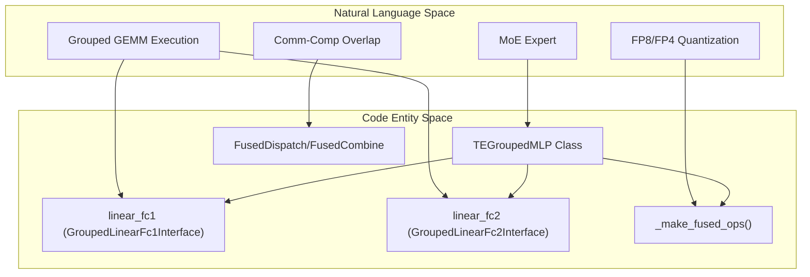
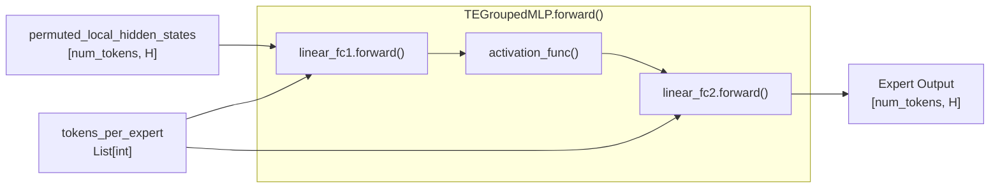
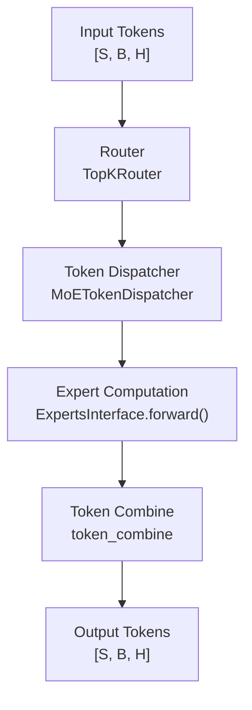

<!-- source: DeepWiki mcp.deepwiki.com · repo NVIDIA/Megatron-LM · extra page Expert Computation · fetched 2026-10-26 -->

# Expert Computation

<details>
<summary>Relevant source files</summary>

The following files were used as context for generating this wiki page:

- [megatron/core/inference/moe/activations.py](megatron/core/inference/moe/activations.py)
- [megatron/core/inference/moe/fused_moe.py](megatron/core/inference/moe/fused_moe.py)
- [megatron/core/inference/moe/permute.py](megatron/core/inference/moe/permute.py)
- [megatron/core/inference/quantization/mxfp8_quantize.py](megatron/core/inference/quantization/mxfp8_quantize.py)
- [megatron/core/inference/quantization/mxfp8_tensor.py](megatron/core/inference/quantization/mxfp8_tensor.py)
- [megatron/core/inference/quantization/utils.py](megatron/core/inference/quantization/utils.py)
- [megatron/core/resharding/transforms.py](megatron/core/resharding/transforms.py)
- [megatron/core/transformer/moe/README.md](megatron/core/transformer/moe/README.md)
- [megatron/core/transformer/moe/experts.py](megatron/core/transformer/moe/experts.py)
- [megatron/core/transformer/moe/fused_a2a.py](megatron/core/transformer/moe/fused_a2a.py)
- [megatron/core/transformer/moe/moe_layer.py](megatron/core/transformer/moe/moe_layer.py)
- [megatron/core/transformer/moe/moe_utils.py](megatron/core/transformer/moe/moe_utils.py)
- [megatron/core/transformer/moe/paged_stash.py](megatron/core/transformer/moe/paged_stash.py)
- [megatron/core/transformer/moe/router.py](megatron/core/transformer/moe/router.py)
- [megatron/core/transformer/moe/token_dispatcher.py](megatron/core/transformer/moe/token_dispatcher.py)
- [tests/unit_tests/a2a_overlap/utils.py](tests/unit_tests/a2a_overlap/utils.py)
- [tests/unit_tests/inference/test_mxfp8_utils.py](tests/unit_tests/inference/test_mxfp8_utils.py)
- [tests/unit_tests/models/test_hybrid_moe_model.py](tests/unit_tests/models/test_hybrid_moe_model.py)
- [tests/unit_tests/resharding/test_mxfp8_refit.py](tests/unit_tests/resharding/test_mxfp8_refit.py)
- [tests/unit_tests/transformer/moe/test_aux_loss.py](tests/unit_tests/transformer/moe/test_aux_loss.py)
- [tests/unit_tests/transformer/moe/test_grouped_mlp.py](tests/unit_tests/transformer/moe/test_grouped_mlp.py)
- [tests/unit_tests/transformer/moe/test_paged_stash_runner.py](tests/unit_tests/transformer/moe/test_paged_stash_runner.py)
- [tests/unit_tests/transformer/moe/test_paged_stashing.py](tests/unit_tests/transformer/moe/test_paged_stashing.py)
- [tests/unit_tests/transformer/moe/test_routers.py](tests/unit_tests/transformer/moe/test_routers.py)
- [tests/unit_tests/transformer/moe/test_token_dispatcher.py](tests/unit_tests/transformer/moe/test_token_dispatcher.py)

</details>


## Purpose and Scope

This document describes the expert computation components in Megatron-LM's Mixture of Experts (MoE) implementation. It covers how expert networks are implemented, including the MLP architectures used, optimization strategies through grouped GEMM operations, and memory/compute optimizations like DeepEP and HybridEP integration.

For information about how tokens are routed to experts, see [MoE Router and Load Balancing (3.3.1)](). For token dispatching and communication patterns, see [Token Dispatcher and Communication (3.3.2)](). For shared experts and additional MoE optimizations, see [Shared Experts and MoE Optimizations (3.3.4)]().

---

## Expert Network Architecture

Each expert in MoE is a Multi-Layer Perceptron (MLP) network that follows the standard transformer FFN structure. The basic architecture consists of three main operations:

1.  **Input projection** (`linear_fc1`): Projects hidden states from `hidden_size` to `ffn_hidden_size` [megatron/core/transformer/moe/experts.py:202-211]().
2.  **Activation function**: Applies non-linearity (GELU, SwiGLU, etc.) [megatron/core/transformer/moe/experts.py:214-222]().
3.  **Output projection** (`linear_fc2`): Projects back from `ffn_hidden_size` to `hidden_size` [megatron/core/transformer/moe/experts.py:224-233]().

For gated linear units (GLU), the `ffn_hidden_size` is doubled to accommodate both the gate and up projection weights [megatron/core/transformer/moe/experts.py:203-205]().

### Expert Architecture Mapping

The following diagram maps high-level MoE concepts to the specific code entities responsible for expert execution.



**Sources:** [megatron/core/transformer/moe/experts.py:183-233](), [megatron/core/transformer/moe/moe_layer.py:68-83](), [megatron/core/transformer/moe/fused_a2a.py:71-206]()

---

## Expert Implementation Variants

Megatron-LM provides implementations for expert computation optimized for different scenarios:

| Implementation | Use Case | Key Features |
| :--- | :--- | :--- |
| **SequentialMLP** | Few experts per rank, debugging | Processes experts one-by-one, simple implementation [megatron/core/transformer/moe/experts.py:1264]() |
| **TEGroupedMLP** | Multiple experts per rank with TE | Transformer Engine optimized, FP8/FP4 support, GroupedGEMM [megatron/core/transformer/moe/experts.py:183]() |
| **DeepEP/HybridEP** | High-performance A2A | Fused dispatch/combine for NVLink and RDMA [megatron/core/transformer/moe/fused_a2a.py:71]() |
| **Inference variants** | Deployment / Generation | FlashInfer, vLLM, and MCore optimized backends [megatron/core/transformer/moe/experts.py:82-87]() |

### SequentialMLP

`SequentialMLP` processes each local expert sequentially. It maintains a list of separate MLP instances and iterates through them during the forward pass [megatron/core/transformer/moe/experts.py:1264-1284]().

**Key characteristics:**
*   Creates `num_local_experts` separate MLP modules [megatron/core/transformer/moe/experts.py:1286-1288]().
*   Processes expert computations in a loop [megatron/core/transformer/moe/experts.py:1326-1348]().
*   Useful when few experts per rank or for debugging.

**Sources:** [megatron/core/transformer/moe/experts.py:1264-1348]()

### TEGroupedMLP

`TEGroupedMLP` leverages NVIDIA Transformer Engine for optimized grouped linear operations, supporting FP8/FP4 quantization and fused operations [megatron/core/transformer/moe/experts.py:183-187]().

**Key features:**
*   Uses `linear_fc1` and `linear_fc2` builders for grouped execution [megatron/core/transformer/moe/experts.py:207-233]().
*   Supports fused bias + activation functions [megatron/core/transformer/moe/experts.py:214-222]().
*   Integrated with TE's low-precision training (FP8/FP4) [megatron/core/transformer/moe/moe_utils.py:11-13]().

**Sources:** [megatron/core/transformer/moe/experts.py:183-233](), [megatron/core/transformer/moe/moe_utils.py:35-47]()

---

## Grouped GEMM Optimization

Grouped GEMM is a critical optimization that enables efficient multi-expert computation. Instead of launching separate matrix multiplications for each expert, Grouped GEMM batches them into a single kernel.

### Grouped GEMM Data Flow

This diagram illustrates how tokens are processed through the grouped GEMM interface in `TEGroupedMLP`.



**Sources:** [megatron/core/transformer/moe/experts.py:92-99](), [megatron/core/transformer/moe/experts.py:246-270]()

---

## Activation Functions and Fusion

Expert networks support various activation functions with specialized fused kernels for performance, particularly when applying routing probabilities.

### Supported Activation Functions

| Activation | Description | Fused Implementation |
| :--- | :--- | :--- |
| **SwiGLU** | Swish-Gated Linear Unit | `weighted_bias_swiglu_impl` [megatron/core/fusions/fused_bias_swiglu.py]() |
| **GeGLU** | GELU-Gated Linear Unit | `weighted_bias_quick_geglu_impl` [megatron/core/fusions/fused_bias_geglu.py]() |
| **Squared ReLU** | Squared ReLU | `weighted_squared_relu_impl` [megatron/core/fusions/fused_weighted_squared_relu.py]() |

### Weighted Activation Fusion

For MoE models, specialized kernels multiply the routing probability into the activation computation to avoid a separate multiplication pass [megatron/core/transformer/moe/experts.py:23-25](). In `TEGroupedMLP`, this is handled by `_fused_forward` when `moe_router_fusion` is enabled [megatron/core/transformer/moe/experts.py:355-365]().

**Sources:** [megatron/core/transformer/moe/experts.py:23-25](), [megatron/core/transformer/moe/experts.py:214-222]()

---

## Quantization Support

Expert computation supports FP8 and FP4 quantization through Transformer Engine integration and custom inference backends.

### FP8/FP4 Alignment

When using low-precision formats, token counts must be aligned to specific boundaries for optimal kernel performance [megatron/core/transformer/moe/moe_utils.py:12-13]().

```python
# megatron/core/transformer/moe/moe_utils.py:41
def get_align_size_for_quantization(config):
    if config.fp8:
        return get_fp8_align_size(config.fp8_recipe)
    elif config.fp4:
        return get_fp4_align_size(config.fp4_recipe)
    return 1
```

**Sources:** [megatron/core/transformer/moe/moe_utils.py:12-13](), [megatron/core/transformer/moe/moe_utils.py:41-47]()

---

## Expert Integration in MoE Layer

Expert computation is integrated into the `MoELayer` via the `ExpertsInterface` protocol [megatron/core/transformer/moe/moe_layer.py:68-83]().

### Expert Execution Flow



**Sources:** [megatron/core/transformer/moe/moe_layer.py:235-250](), [megatron/core/transformer/moe/moe_layer.py:68-83]()

---

## Key Classes and Functions

### Core Classes

| Class | File | Purpose |
| :--- | :--- | :--- |
| `TEGroupedMLP` | [megatron/core/transformer/moe/experts.py:183]() | TE-based grouped expert implementation |
| `SequentialMLP` | [megatron/core/transformer/moe/experts.py:1264]() | List-based sequential expert implementation |
| `MoELayer` | [megatron/core/transformer/moe/moe_layer.py:214]() | Top-level MoE layer coordinating routing and experts |
| `FusedDispatch` | [megatron/core/transformer/moe/fused_a2a.py:71]() | DeepEP fused dispatch for MoE communication |

### Key Functions

| Function | File | Purpose |
| :--- | :--- | :--- |
| `switch_load_balancing_loss_func` | [megatron/core/transformer/moe/moe_utils.py:63]() | Calculates MoE auxiliary load balancing loss |
| `z_loss_func` | [megatron/core/transformer/moe/moe_utils.py:153]() | Encourages small router logits for stability |
| `mcore_fused_moe` | [megatron/core/inference/moe/fused_moe.py]() | Inference-optimized grouped GEMM kernel |
| `router_gating_linear` | [megatron/core/transformer/moe/moe_utils.py:189]() | Computes router logits from input hidden states |

**Sources:** [megatron/core/transformer/moe/experts.py:183](), [megatron/core/transformer/moe/experts.py:1264](), [megatron/core/transformer/moe/moe_utils.py:63](), [megatron/core/transformer/moe/moe_utils.py:153](), [megatron/core/transformer/moe/moe_utils.py:189]()

---

