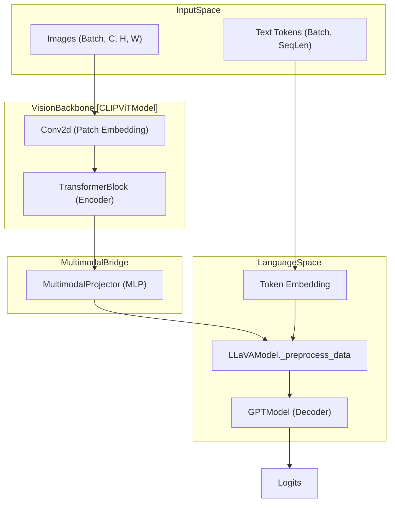
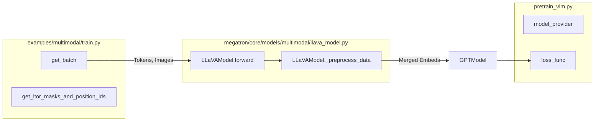

<!-- source: DeepWiki mcp.deepwiki.com · repo NVIDIA/Megatron-LM · extra page LLaVA and Vision-Language Models · fetched 2026-10-26 -->

# LLaVA and Vision-Language Models

Relevant source files

The following files were used as context for generating this wiki page:

- [docker/Dockerfile.ci.nemo](docker/Dockerfile.ci.nemo)
- [docs/llama_mistral.md](docs/llama_mistral.md)
- [examples/multimodal/Dockerfile](examples/multimodal/Dockerfile)
- [examples/multimodal/README.md](examples/multimodal/README.md)
- [examples/multimodal/combine_lm_vision_checkpoints.sh](examples/multimodal/combine_lm_vision_checkpoints.sh)
- [examples/multimodal/config.py](examples/multimodal/config.py)
- [examples/multimodal/dataloader_provider.py](examples/multimodal/dataloader_provider.py)
- [examples/multimodal/dataset_helpers.py](examples/multimodal/dataset_helpers.py)
- [examples/multimodal/image_processing.py](examples/multimodal/image_processing.py)
- [examples/multimodal/layer_scaling.py](examples/multimodal/layer_scaling.py)
- [examples/multimodal/model.py](examples/multimodal/model.py)
- [examples/multimodal/model_converter/clip_converter.py](examples/multimodal/model_converter/clip_converter.py)
- [examples/multimodal/model_converter/internvit_converter.py](examples/multimodal/model_converter/internvit_converter.py)
- [examples/multimodal/model_converter/radio_converter.py](examples/multimodal/model_converter/radio_converter.py)
- [examples/multimodal/model_converter/siglip_converter.py](examples/multimodal/model_converter/siglip_converter.py)
- [examples/multimodal/multimodal_args.py](examples/multimodal/multimodal_args.py)
- [examples/multimodal/nvlm/nvlm_prompts.json](examples/multimodal/nvlm/nvlm_prompts.json)
- [examples/multimodal/nvlm/pp_checkpoint_converter.py](examples/multimodal/nvlm/pp_checkpoint_converter.py)
- [examples/multimodal/nvlm/pretrain_blend.yaml](examples/multimodal/nvlm/pretrain_blend.yaml)
- [examples/multimodal/pretrain_mistral_clip.sh](examples/multimodal/pretrain_mistral_clip.sh)
- [examples/multimodal/run_text_generation.py](examples/multimodal/run_text_generation.py)
- [examples/multimodal/sft_mistral_clip.sh](examples/multimodal/sft_mistral_clip.sh)
- [examples/multimodal/text_generation_mistral_clip.sh](examples/multimodal/text_generation_mistral_clip.sh)
- [examples/multimodal/train.py](examples/multimodal/train.py)
- [megatron/core/models/multimodal/llava_model.py](megatron/core/models/multimodal/llava_model.py)
- [megatron/core/models/vision/clip_vit_model.py](megatron/core/models/vision/clip_vit_model.py)
- [megatron/core/models/vision/multimodal_projector.py](megatron/core/models/vision/multimodal_projector.py)
- [megatron/core/models/vision/radio.py](megatron/core/models/vision/radio.py)
- [pretrain_vlm.py](pretrain_vlm.py)
- [tests/unit_tests/models/test_llava_model.py](tests/unit_tests/models/test_llava_model.py)
- [tools/checkpoint/convert.py](tools/checkpoint/convert.py)

This page details the implementation of Vision-Language Models (VLM) in Megatron-LM, focusing on the LLaVA (Large Language-and-Vision Assistant) architecture. The implementation integrates a vision encoder (typically CLIP ViT), a multimodal projector, and a language model (GPT-style) into a unified pipeline capable of processing interleaved image, video, sound, and text data.

## Overview of LLaVA Architecture

The `LLaVAModel` class is the primary entry point for multimodal models in Megatron-LM [megatron/core/models/multimodal/llava_model.py:57](). It is designed to be flexible, supporting various vision backbones and language models through the use of `ModuleSpec` and `TransformerConfig`.

### Key Components
1.  **Vision Model**: Typically a `CLIPViTModel` [megatron/core/models/vision/clip_vit_model.py:26]() or similar encoder (e.g., SigLIP, InternViT, or RADIO [megatron/core/models/vision/clip_vit_model.py:59](), [megatron/core/models/vision/radio.py:32]()) that processes raw images into visual features.
2.  **Vision Projection**: A bridge module, usually an MLP, that projects vision features into the same hidden dimension as the language model [megatron/core/models/vision/multimodal_projector.py:16]().
3.  **Language Model**: A decoder-only transformer (e.g., Mistral, Llama, or Nemotron) that processes the combined sequence of visual and textual embeddings [megatron/core/models/multimodal/llava_model.py:13](), [examples/multimodal/config.py:9-163]().

### Data Flow and Embedding Integration
The model processes input by extracting image features, projecting them, and then "splicing" them into the text embedding sequence at positions marked by a special `<image>` token [megatron/core/models/multimodal/llava_model.py:51]().

**Vision-Language Embedding Fusion**

Sources: [megatron/core/models/multimodal/llava_model.py:466-546](), [megatron/core/models/vision/clip_vit_model.py:177-180]()

## Implementation Details

### LLaVAModel Class
The `LLaVAModel` inherits from `MegatronModule` [megatron/core/models/multimodal/llava_model.py:57](). It manages the sub-modules and handles the complex logic of interleaving vision and text features during the forward pass.

*   **Initialization**: The constructor takes separate configurations for the language model, vision model, and the projector [megatron/core/models/multimodal/llava_model.py:97-146]().
*   **Pipeline Parallelism**: It supports pipeline parallelism (PP) by optionally instantiating only the vision model/projector (on the first stage via `add_encoder`) or only the language model (on subsequent stages via `add_decoder`) [megatron/core/models/multimodal/llava_model.py:116-117]().
*   **Preprocessing**: The `_preprocess_data` method is critical; it calculates the offsets for image tokens and merges `image_embeddings` with `language_embeddings` into a single sequence [megatron/core/models/multimodal/llava_model.py:312-455]().
*   **Dynamic Resolution**: Supports high-resolution images via tiling, where images are split into multiple patches (tiles) and processed as separate embeddings [megatron/core/models/multimodal/llava_model.py:134]().
*   **Audio/Video Support**: Recent extensions include support for sound tokens (`<so_embedding>`) and video tokens (`<video>`), allowing the model to handle more diverse multimodal inputs [megatron/core/models/multimodal/llava_model.py:52-53](), [megatron/core/models/multimodal/llava_model.py:135-137]().

### Vision Encoder: CLIP ViT
The `CLIPViTModel` implements the Vision Transformer architecture [megatron/core/models/vision/clip_vit_model.py:26]().
*   **Patching**: Uses a `Conv2d` layer with `stride == kernel_size == patch_dim` to convert images into patches [megatron/core/models/vision/clip_vit_model.py:115-122]().
*   **Class Token**: Supports an optional class token (`[CLS]`) which can be expanded to a specific length (e.g., 1 or 8) [megatron/core/models/vision/clip_vit_model.py:131-139]().
*   **Flexibility**: Supports different subtypes like `clip`, `siglip`, `internvit`, and `internvit300M` [megatron/core/models/vision/clip_vit_model.py:59]().

### Multimodal Projector
The `MultimodalProjector` is a simple MLP that maps the vision encoder's output dimension to the language model's hidden size [megatron/core/models/vision/multimodal_projector.py:16](). It typically consists of a 2-layer MLP with a GELU activation [megatron/core/models/multimodal/llava_model.py:108]().

Sources: [megatron/core/models/multimodal/llava_model.py:57-146](), [megatron/core/models/vision/clip_vit_model.py:26-154]()

## Training Workflow

The training pipeline is orchestrated via `pretrain_vlm.py`. It differs from standard GPT training by requiring a specialized `model_provider` and `get_batch` function.

### Sequence Length Management
Because images are expanded into multiple tokens (e.g., a 336x336 image with patch size 14 results in 576 tokens), the `seq_length` must be adjusted.
*   The vision model sequence length is determined by `get_num_image_embeddings` [pretrain_vlm.py:81-90]().
*   The total decoder sequence length is the sum of text tokens and image embeddings [pretrain_vlm.py:98]().
*   **Context Parallelism (CP)**: Sequence length is padded to ensure divisibility by the CP size [pretrain_vlm.py:106-114]().

### Training Loop Entities

Sources: [pretrain_vlm.py:45-142](), [examples/multimodal/train.py:36-152]()

### Batch Construction and Packing
The `get_batch` function in `examples/multimodal/train.py` handles the retrieval of multimodal data:
1.  **Broadcast**: Data is broadcast across tensor parallel ranks using `tensor_parallel.broadcast_data` [examples/multimodal/train.py:65-72]().
2.  **Sequence Packing**: To optimize throughput, multiple samples can be packed into a single sequence. This is managed via `PackedSeqParams` [examples/multimodal/train.py:100-106]() and `greedy_knapsack` logic in the dataloader [examples/multimodal/dataset_helpers.py:103-142]().
3.  **Tiling Support**: If `use_tiling` is enabled, the dataloader provides `num_tiles` for each image, which is used during preprocessing to slice the vision embeddings correctly [examples/multimodal/train.py:69]().

## Inference

Inference for VLMs uses a specialized controller and wrapper to handle the transition between vision processing and autoregressive text generation.

### Key Inference Classes
*   **VLMInferenceWrapper**: Wraps the `LLaVAModel` to provide a consistent interface for the inference engine [examples/multimodal/run_text_generation.py:200]().
*   **VLMTextGenerationController**: Manages the generation loop, ensuring that image embeddings are only computed once and then cached [examples/multimodal/run_text_generation.py:202]().
*   **StaticInferenceEngine**: The core engine that orchestrates the forward steps and sampling [examples/multimodal/run_text_generation.py:205]().

Sources: [examples/multimodal/run_text_generation.py:192-210](), [megatron/core/inference/model_inference_wrappers/multimodal/vlm_inference_wrapper.py]()

## Configuration Parameters

| Parameter | Description | File Reference |
| :--- | :--- | :--- |
| `vision_model_type` | Specifies the backbone (e.g., `clip`, `siglip`, `radio`, `internvit`) | [pretrain_vlm.py:71](), [examples/multimodal/model.py:80]() |
| `img_h`, `img_w` | Input image dimensions | [megatron/core/models/multimodal/llava_model.py:118-119]() |
| `patch_dim` | Size of the image patches | [megatron/core/models/multimodal/llava_model.py:120]() |
| `vision_projection_type` | Architecture of the bridge (default `mlp`) | [megatron/core/models/multimodal/llava_model.py:108]() |
| `allow_missing_vision_projection_checkpoint` | Allows loading LM-only checkpoints for VLM fine-tuning | [megatron/core/models/multimodal/llava_model.py:109]() |
| `pixel_shuffle` | Enables pixel shuffle for vision feature resolution reduction | [megatron/core/models/multimodal/llava_model.py:127]() |
| `dynamic_resolution` | Enables dynamic resolution support (tiling) | [megatron/core/models/multimodal/llava_model.py:134]() |

Sources: [megatron/core/models/multimodal/llava_model.py:97-146](), [pretrain_vlm.py:45-169](), [examples/multimodal/model.py:18-150](), [examples/multimodal/multimodal_args.py:5-142]()

---

