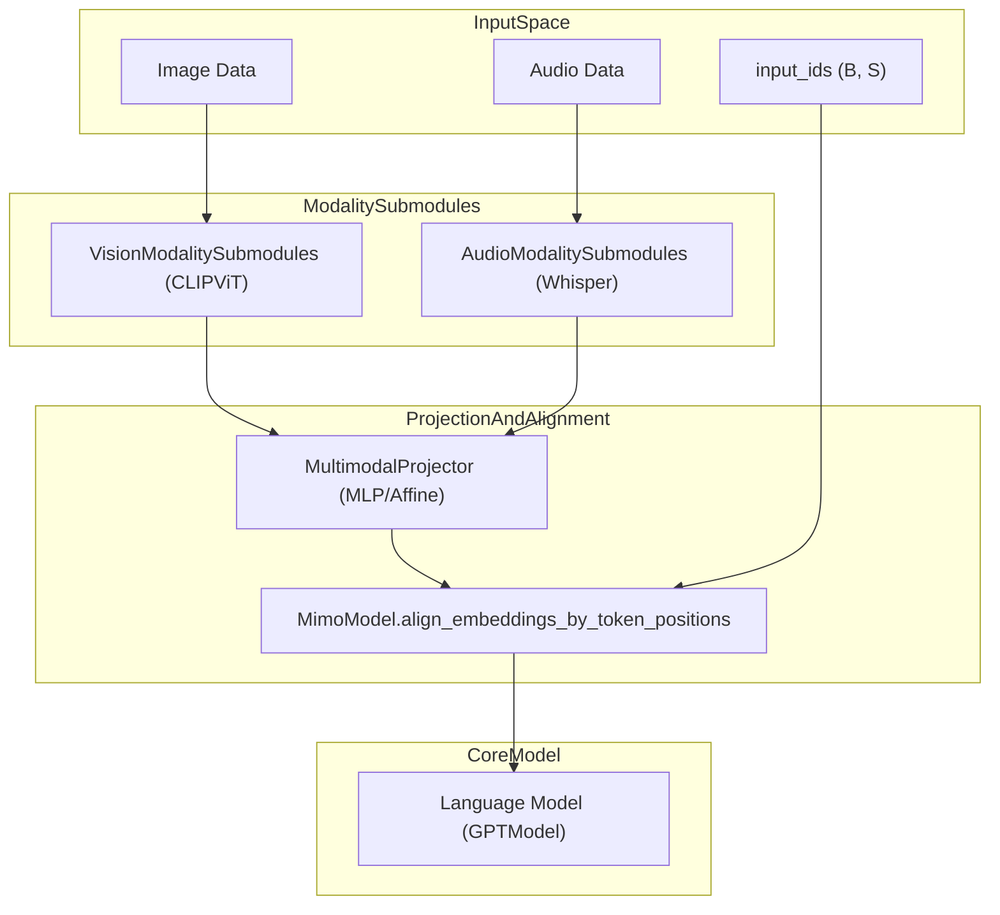
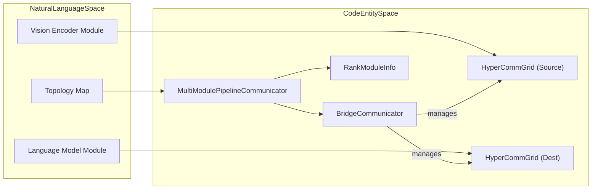
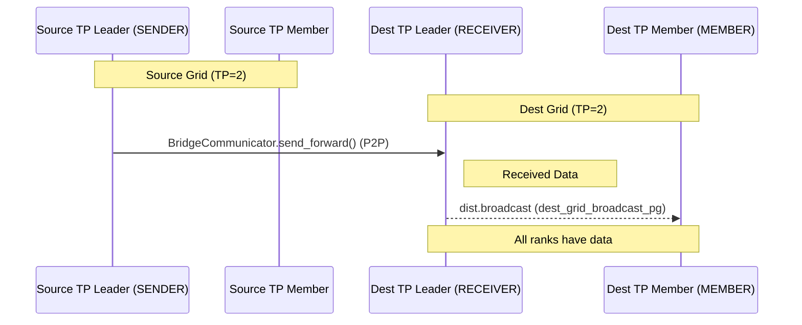

<!-- source: DeepWiki mcp.deepwiki.com · repo NVIDIA/Megatron-LM · extra page MIMO: Multimodal In/Out Architecture · fetched 2026-10-26 -->

# MIMO: Multimodal In/Out Architecture

Relevant source files

The following files were used as context for generating this wiki page:

- [.github/CODEOWNERS](.github/CODEOWNERS)
- [examples/mimo/model_providers/nemotron_moe_vlm.py](examples/mimo/model_providers/nemotron_moe_vlm.py)
- [examples/mimo/model_providers/radio_encoder.py](examples/mimo/model_providers/radio_encoder.py)
- [examples/mimo/pretrain_mimo.py](examples/mimo/pretrain_mimo.py)
- [examples/mimo/scripts/run_hetero_nemotron_20l_mock_train.sh](examples/mimo/scripts/run_hetero_nemotron_20l_mock_train.sh)
- [examples/mimo/training/args.py](examples/mimo/training/args.py)
- [examples/mimo/training/data.py](examples/mimo/training/data.py)
- [examples/mimo/training/grad_sync.py](examples/mimo/training/grad_sync.py)
- [examples/mimo/training/runtime.py](examples/mimo/training/runtime.py)
- [examples/mimo/training/topology.py](examples/mimo/training/topology.py)
- [megatron/core/hyper_comm_grid.py](megatron/core/hyper_comm_grid.py)
- [megatron/core/models/audio/__init__.py](megatron/core/models/audio/__init__.py)
- [megatron/core/models/audio/audio_feature_config.py](megatron/core/models/audio/audio_feature_config.py)
- [megatron/core/models/audio/audio_processor.py](megatron/core/models/audio/audio_processor.py)
- [megatron/core/models/audio/audio_projector.py](megatron/core/models/audio/audio_projector.py)
- [megatron/core/models/audio/nemo_audio_checkpoint.py](megatron/core/models/audio/nemo_audio_checkpoint.py)
- [megatron/core/models/audio/nemo_audio_preprocessing.py](megatron/core/models/audio/nemo_audio_preprocessing.py)
- [megatron/core/models/audio/nemo_transformer_audio_model.py](megatron/core/models/audio/nemo_transformer_audio_model.py)
- [megatron/core/models/audio/nemo_transformer_encoder.py](megatron/core/models/audio/nemo_transformer_encoder.py)
- [megatron/core/models/audio/packed_audio.py](megatron/core/models/audio/packed_audio.py)
- [megatron/core/models/mimo/model/base.py](megatron/core/models/mimo/model/base.py)
- [megatron/core/models/mimo/optimizer.py](megatron/core/models/mimo/optimizer.py)
- [megatron/core/pipeline_parallel/bridge_communicator.py](megatron/core/pipeline_parallel/bridge_communicator.py)
- [megatron/core/pipeline_parallel/multimodule_communicator.py](megatron/core/pipeline_parallel/multimodule_communicator.py)
- [tests/unit_tests/models/mimo/test_mimo_hetero_grid_args.py](tests/unit_tests/models/mimo/test_mimo_hetero_grid_args.py)
- [tests/unit_tests/models/mimo/test_mimo_mock_data.py](tests/unit_tests/models/mimo/test_mimo_mock_data.py)
- [tests/unit_tests/models/test_audio_modules.py](tests/unit_tests/models/test_audio_modules.py)
- [tests/unit_tests/models/test_nemo_audio_preprocessor.py](tests/unit_tests/models/test_nemo_audio_preprocessor.py)
- [tests/unit_tests/models/test_nemo_audio_processor.py](tests/unit_tests/models/test_nemo_audio_processor.py)
- [tests/unit_tests/pipeline_parallel/test_bridge_communicator.py](tests/unit_tests/pipeline_parallel/test_bridge_communicator.py)
- [tests/unit_tests/pipeline_parallel/test_multimodule_communicator.py](tests/unit_tests/pipeline_parallel/test_multimodule_communicator.py)
- [tests/unit_tests/pipeline_parallel/test_multimodule_schedules.py](tests/unit_tests/pipeline_parallel/test_multimodule_schedules.py)
- [tests/unit_tests/pipeline_parallel/test_schedules.py](tests/unit_tests/pipeline_parallel/test_schedules.py)
- [tests/unit_tests/test_mimo_hetero_topology.py](tests/unit_tests/test_mimo_hetero_topology.py)

The Multimodal In/Out (MIMO) architecture is an experimental framework within Megatron-LM designed to support models with arbitrary combinations of input and output modalities (e.g., vision, audio, text). It provides a structured way to manage modality-specific submodules, their projections into a shared latent space, and complex communication patterns required when different modalities or model components are distributed across different parallel grids.

## 1. Architecture Overview

The MIMO architecture is centered around the `MimoModel` class, which orchestrates the interaction between various `ModalitySubmodules` and a core language model.

### 1.1. Core Components

*   **`MimoModel`**: The top-level `MegatronModule` that manages the lifecycle of modality submodules and the language model. It handles embedding alignment and partitioning for sequence/context parallelism [megatron/core/models/mimo/model/base.py:25-42]().
*   **`ModalitySubmodules`**: An abstract base class for implementing modality-specific logic. It contains encoders, decoders, and projections (input/output) [megatron/core/models/mimo/submodules/base.py:18-38]().
*   **`MimoModelConfig`**: A centralized configuration object that defines the specifications for the language model and all modality submodules, as well as the mapping of modules to communication grids [megatron/core/models/mimo/config/base_configs.py:12-47]().
*   **`PartitionAdapter`**: Manages the mapping of tokens and embeddings across GPUs when using Context Parallelism (CP) or Sequence Parallelism (SP) [megatron/core/models/mimo/model/base.py:81-94]().

### 1.2. Data Flow and Embedding Alignment

MIMO uses special tokens in the input stream to mark where modality-specific embeddings should be inserted. The `align_embeddings_by_token_positions` method replaces these special tokens with the projected embeddings from the respective modality encoders [megatron/core/models/mimo/model/base.py:144-156]().

**MIMO Data Flow Diagram**

Sources: [megatron/core/models/mimo/model/base.py:144-160](), [megatron/core/models/vision/multimodal_projector.py:15-37]()

---

## 2. Multimodule Communication

MIMO introduces a robust communication layer to handle cases where different modules (e.g., a Vision Encoder and a Language Model) reside on different `HyperCommGrid` instances with varying degrees of Pipeline Parallelism (PP), Tensor Parallelism (TP), or Data Parallelism (DP).

### 2.1. Bridge Communicator

The `BridgeCommunicator` is responsible for point-to-point communication between two different grids. It handles:
*   **Fan-in/Fan-out**: Managing data movement when the source and destination have different DP or TP sizes [megatron/core/pipeline_parallel/bridge_communicator.py:41-49]().
*   **Rank Mapping**: Building a communication map (`comm_map`) that identifies which ranks in the source grid send to which ranks in the destination grid [megatron/core/pipeline_parallel/bridge_communicator.py:121-122]().
*   **Broadcast Groups**: Creating internal process groups (`src_grid_broadcast_pg`, `dest_grid_broadcast_pg`) to broadcast received data within a TP/CP replica at the destination [megatron/core/pipeline_parallel/bridge_communicator.py:135-160]().

### 2.2. MultiModulePipelineCommunicator

This class orchestrates multiple `BridgeCommunicator` instances based on a defined `topology` [megatron/core/pipeline_parallel/multimodule_communicator.py:110-120](). It allows for complex directed acyclic graph (DAG) execution patterns where a single module might send outputs to multiple downstream modules or receive from multiple upstream ones.

**Communication Entity Mapping**

Sources: [megatron/core/pipeline_parallel/multimodule_communicator.py:20-47](), [megatron/core/pipeline_parallel/multimodule_communicator.py:113-153](), [megatron/core/pipeline_parallel/bridge_communicator.py:72-97]()

---

## 3. Modality Submodules

Modality submodules are implemented as subclasses of `ModalitySubmodules`. They are designed to be "PP-aware," meaning they only initialize certain components (like input projections) on specific pipeline stages.

| Component | Stage Requirement | Purpose |
| :--- | :--- | :--- |
| `encoders` | All Stages | Process modality-specific raw inputs [megatron/core/models/mimo/submodules/base.py:137-142]() |
| `input_projections` | Last Stage | Project encoder output to LLM hidden dimension [megatron/core/models/mimo/submodules/base.py:154-161]() |
| `output_projections`| First Stage | Project LLM output back to modality-specific dimension [megatron/core/models/mimo/submodules/base.py:166-170]() |
| `decoders` | All Stages | Generate modality-specific outputs [megatron/core/models/mimo/submodules/base.py:145-150]() |

### 3.1. Sharded State Dict
To support distributed checkpointing across complex grids, `MimoModel` manually implements `sharded_state_dict`. It iterates through `modality_submodules` and injects the `dp_cp_group` from each module's `pg_collection` into the metadata, ensuring that checkpointing logic uses the correct process groups for the module's specific grid rather than global defaults [megatron/core/models/mimo/model/base.py:101-142]().

Sources: [megatron/core/models/mimo/submodules/base.py:78-99](), [megatron/core/models/mimo/model/base.py:101-142]()

---

## 4. Heterogeneous Parallelism and Optimizers

MIMO supports "heterogeneous parallelism," where different modules (e.g., Vision Encoder vs. LLM) can have different TP, DP, or PP configurations.

### 4.1. MimoOptimizer
Because modules can reside on different process groups, a standard optimizer cannot be used. The `MimoOptimizer` manages multiple `MegatronOptimizer` instances (one per module) via `ModuleOptimizerInfo` [megatron/core/models/mimo/optimizer.py:25-40](). It synchronizes gradient clipping by calculating a global gradient norm across all modules using `all_reduce` with the `MAX` operator [megatron/core/models/mimo/optimizer.py:63-74](). It also handles synchronized `found_inf` detection to prevent deadlocks across ranks with different module responsibilities [megatron/core/models/mimo/optimizer.py:79-85]().

### 4.2. Rank Roles
Ranks within a MIMO execution are assigned roles based on their position in the `module_to_grid_map`. A rank can be a `SENDER`, `RECEIVER`, or `MEMBER` within the context of a bridge communication [megatron/core/pipeline_parallel/bridge_communicator.py:16-29](). The `RankRole` class tracks which modules a specific rank participates in and its stage position [megatron/core/models/mimo/config/role.py:54-68]().

**Rank Interaction Diagram**

Sources: [megatron/core/pipeline_parallel/bridge_communicator.py:16-29](), [megatron/core/pipeline_parallel/bridge_communicator.py:135-160](), [megatron/core/models/mimo/config/role.py:104-140]()

---

## 5. Audio Model Integration

MIMO supports audio as a first-class modality. The integration involves specialized processors and encoders that handle the temporal nature of audio data.

### 5.1. Audio Components
*   **`AudioProcessor`**: Handles raw audio signal processing, including feature extraction (e.g., Mel-spectrograms) [megatron/core/models/audio/audio_processor.py:15-30]().
*   **`NemoTransformerAudioModel`**: A specialized transformer-based encoder for audio features, often utilizing NeMo-compatible architectures [megatron/core/models/audio/nemo_transformer_audio_model.py:20-45]().
*   **`AudioProjector`**: Projects the audio encoder's hidden states to the language model's latent space, similar to the `MultimodalProjector` used for vision [megatron/core/models/audio/audio_projector.py:12-28]().

### 5.2. Audio Feature Handling
Audio sequences are often packed to optimize throughput. The `PackedAudio` utility manages variable-length audio samples within a single batch, ensuring correct padding and masking during the encoder forward pass [megatron/core/models/audio/packed_audio.py:10-35]().

Sources: [megatron/core/models/audio/audio_processor.py](), [megatron/core/models/audio/nemo_transformer_audio_model.py](), [megatron/core/models/audio/audio_projector.py](), [megatron/core/models/audio/packed_audio.py]()

---

## 6. Key Classes and Functions

| Class/Function | File Path | Role |
| :--- | :--- | :--- |
| `MimoModel` | [megatron/core/models/mimo/model/base.py:25]() | Primary model class orchestrating text and modality submodules. |
| `BridgeCommunicator` | [megatron/core/pipeline_parallel/bridge_communicator.py:41]() | Low-level P2P communicator between two disjoint grids. |
| `MultiModulePipelineCommunicator` | [megatron/core/pipeline_parallel/multimodule_communicator.py:110]() | High-level manager for multi-grid pipeline schedules. |
| `MimoOptimizer` | [megatron/core/models/mimo/optimizer.py:35]() | Specialized optimizer for modules with heterogeneous parallelism. |
| `ModalitySubmodules` | [megatron/core/models/mimo/submodules/base.py:18]() | Base class for modality-specific encoders and projections. |
| `RankRole` | [megatron/core/models/mimo/config/role.py:54]() | Manages rank participation in modules and pipeline stage info. |
| `HyperCommGrid` | [megatron/core/hyper_comm_grid.py:46]() | N-dimensional communication grid for managing arbitrary parallelisms. |

Sources: [megatron/core/models/mimo/model/base.py](), [megatron/core/pipeline_parallel/bridge_communicator.py](), [megatron/core/pipeline_parallel/multimodule_communicator.py](), [megatron/core/models/mimo/optimizer.py](), [megatron/core/models/mimo/config/role.py](), [megatron/core/hyper_comm_grid.py]()

---

