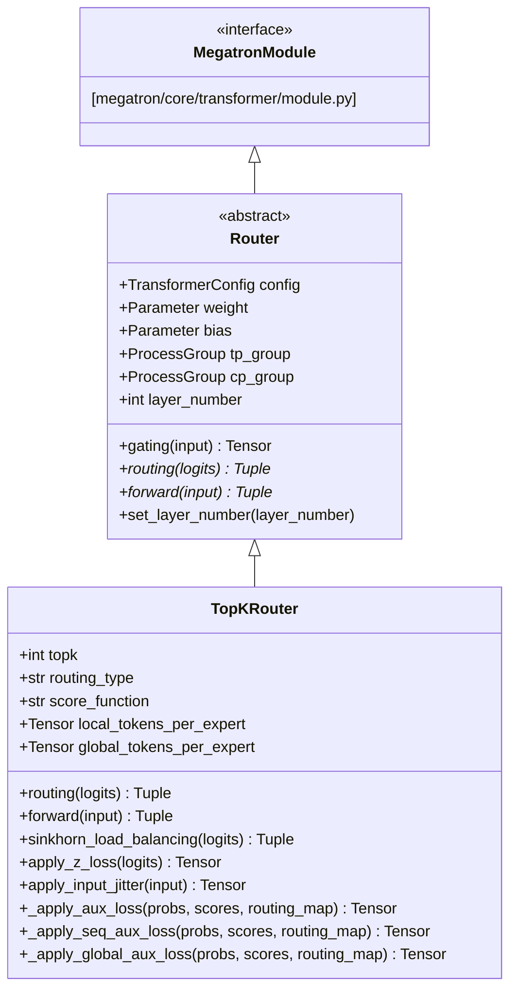

<!-- source: DeepWiki mcp.deepwiki.com · repo NVIDIA/Megatron-LM · extra page MoE Router and Load Balancing · fetched 2026-10-26 -->

# MoE Router and Load Balancing

Relevant source files

The following files were used as context for generating this wiki page:

- [megatron/core/transformer/moe/README.md](megatron/core/transformer/moe/README.md)
- [megatron/core/transformer/moe/experts.py](megatron/core/transformer/moe/experts.py)
- [megatron/core/transformer/moe/fused_a2a.py](megatron/core/transformer/moe/fused_a2a.py)
- [megatron/core/transformer/moe/moe_layer.py](megatron/core/transformer/moe/moe_layer.py)
- [megatron/core/transformer/moe/moe_utils.py](megatron/core/transformer/moe/moe_utils.py)
- [megatron/core/transformer/moe/paged_stash.py](megatron/core/transformer/moe/paged_stash.py)
- [megatron/core/transformer/moe/router.py](megatron/core/transformer/moe/router.py)
- [megatron/core/transformer/moe/token_dispatcher.py](megatron/core/transformer/moe/token_dispatcher.py)
- [megatron/core/transformer/moe/upcycling_utils.py](megatron/core/transformer/moe/upcycling_utils.py)
- [tests/unit_tests/a2a_overlap/utils.py](tests/unit_tests/a2a_overlap/utils.py)
- [tests/unit_tests/models/test_hybrid_moe_model.py](tests/unit_tests/models/test_hybrid_moe_model.py)
- [tests/unit_tests/transformer/moe/test_a2a_token_dispatcher.py](tests/unit_tests/transformer/moe/test_a2a_token_dispatcher.py)
- [tests/unit_tests/transformer/moe/test_aux_loss.py](tests/unit_tests/transformer/moe/test_aux_loss.py)
- [tests/unit_tests/transformer/moe/test_grouped_mlp.py](tests/unit_tests/transformer/moe/test_grouped_mlp.py)
- [tests/unit_tests/transformer/moe/test_paged_stash_runner.py](tests/unit_tests/transformer/moe/test_paged_stash_runner.py)
- [tests/unit_tests/transformer/moe/test_paged_stashing.py](tests/unit_tests/transformer/moe/test_paged_stashing.py)
- [tests/unit_tests/transformer/moe/test_routers.py](tests/unit_tests/transformer/moe/test_routers.py)
- [tests/unit_tests/transformer/moe/test_token_dispatcher.py](tests/unit_tests/transformer/moe/test_token_dispatcher.py)
- [tests/unit_tests/transformer/moe/test_upcycling.py](tests/unit_tests/transformer/moe/test_upcycling.py)

The MoE Router is responsible for determining which experts process which tokens in a Mixture of Experts (MoE) model. It computes routing probabilities for each token, selects the top-k experts, and applies load balancing mechanisms to ensure efficient expert utilization. This page covers the router architecture, routing algorithms, load balancing strategies, and auxiliary loss functions.

For information about token dispatching and communication patterns after routing, see [3.3.2 Token Dispatcher and Communication](). For expert computation details, see [3.3.3 Expert Computation](). For the overall MoE layer orchestration, see [3.3 Mixture of Experts (MoE)]().

## Router Architecture

The router system consists of a base `Router` class and a concrete `TopKRouter` implementation. The router transforms input token representations into routing decisions through a gating network.

**Class Hierarchy**

Sources: [megatron/core/transformer/moe/router.py:34-142](), [megatron/core/transformer/moe/router.py:144-996]()

## Router Workflow

The `TopKRouter` follows a multi-step workflow to route tokens. Each step is configurable based on the training strategy.

**TopKRouter Processing Pipeline**

```mermaid
graph TB
    Input["Input: hidden_states<br/>[num_tokens, hidden_size]"]
    
    subgraph "Step 1: Gating"
        Jitter["apply_input_jitter()<br/>[megatron/core/transformer/moe/moe_utils.py:1218]"]
        Gating["gating()<br/>[megatron/core/transformer/moe/router.py:90]"]
        Logits["logits<br/>[num_tokens, num_experts]"]
        ZLoss["apply_z_loss()<br/>[megatron/core/transformer/moe/router.py:777]"]
    end
    
    subgraph "Step 2: Routing"
        ScoreFunc["topk_routing_with_score_function()<br/>[megatron/core/transformer/moe/moe_utils.py:1003]"]
        GroupLimit["group_limited_topk()<br/>[megatron/core/transformer/moe/moe_utils.py:910]"]
        TopK["torch.topk()<br/>Select top-k experts"]
        Probs["probs, routing_map<br/>[num_tokens, num_experts]"]
    end
    
    subgraph "Step 3: Token Dropping (Optional)"
        CapCheck{"capacity_factor<br/>configured?"}
        TokenDrop["apply_router_token_dropping()<br/>[megatron/core/transformer/moe/moe_utils.py:1137]"]
        PadCheck{"pad_to_capacity?"}
        Padding["Pad to capacity"]
    end
    
    subgraph "Step 4: Auxiliary Loss (Optional)"
        AuxCheck{"aux_loss enabled<br/>and training?"}
        ComputeScores["compute_routing_scores_for_aux_loss()<br/>[megatron/core/transformer/moe/moe_utils.py:837]"]
        AuxLoss["_apply_aux_loss()<br/>[megatron/core/transformer/moe/router.py:302]"]
        SeqAuxLoss["_apply_seq_aux_loss()<br/>[megatron/core/transformer/moe/router.py:330]"]
        GlobalAuxLoss["_apply_global_aux_loss()<br/>[megatron/core/transformer/moe/router.py:374]"]
        AttachLoss["MoEAuxLossAutoScaler.apply()<br/>[megatron/core/transformer/moe/moe_utils.py:1164]"]
    end
    
    subgraph "Step 5: Expert Bias (Optional)"
        BiasCheck{"expert_bias<br/>enabled?"}
        UpdateBias["_apply_expert_bias()<br/>[megatron/core/transformer/moe/router.py:833]"]
    end
    
    Output["Output: probs, routing_map"]
    
    Input --> Jitter
    Jitter --> Gating
    Gating --> Logits
    Logits --> ZLoss
    ZLoss --> ScoreFunc
    ScoreFunc --> GroupLimit
    GroupLimit --> TopK
    TopK --> Probs
    
    Probs --> CapCheck
    CapCheck -->|Yes| TokenDrop
    CapCheck -->|No| AuxCheck
    TokenDrop --> PadCheck
    PadCheck -->|Yes| Padding
    PadCheck -->|No| AuxCheck
    Padding --> AuxCheck
    
    AuxCheck -->|Yes| ComputeScores
    AuxCheck -->|No| BiasCheck
    ComputeScores --> AuxLoss
    AuxLoss --> SeqAuxLoss
    SeqAuxLoss --> GlobalAuxLoss
    GlobalAuxLoss --> AttachLoss
    AttachLoss --> BiasCheck
    
    BiasCheck -->|Yes| UpdateBias
    BiasCheck -->|No| Output
    UpdateBias --> Output
```

Sources: [megatron/core/transformer/moe/router.py:843-996](), [megatron/core/transformer/moe/moe_utils.py:1003-1110](), [megatron/core/transformer/moe/moe_utils.py:1218-1234]()

## Gating Network

The gating network is a linear transformation mapping token representations to expert selection logits.

**Gating Implementation**

The `gating()` method performs a linear projection using router-specific weights and optional bias. The computation can be performed in higher precision (FP32/FP64) for numerical stability via `moe_router_dtype` [megatron/core/transformer/moe/router.py:105-111]().

| Component | Description | Configuration |
|-----------|-------------|---------------|
| `weight` | Shape `[num_experts, hidden_size]` | [megatron/core/transformer/moe/router.py:64-66]() |
| `bias` | Shape `[num_experts]` (optional) | [megatron/core/transformer/moe/router.py:67-72]() |
| `router_dtype` | Computation precision | [megatron/core/transformer/moe/router.py:105-111]() |
| Sequence Parallel | Weight attribute | [megatron/core/transformer/moe/router.py:85-88]() |

The gating linear operation is performed by the `router_gating_linear` helper [megatron/core/transformer/moe/moe_utils.py:1349-1382]().

Sources: [megatron/core/transformer/moe/router.py:90-112](), [megatron/core/transformer/moe/moe_utils.py:1349-1382]()

## Routing Algorithms

### Top-K Routing with Score Functions

The `topk_routing_with_score_function` utility computes routing probabilities using either softmax or sigmoid score functions [megatron/core/transformer/moe/moe_utils.py:1003-1110]().

**Score Function Logic**:
- **Softmax**:
  - Pre-softmax: Apply softmax to all logits, then select top-k [megatron/core/transformer/moe/moe_utils.py:1044-1045]().
  - Post-softmax: Select top-k logits, then apply softmax (default) [megatron/core/transformer/moe/moe_utils.py:1053-1057]().
- **Sigmoid**:
  - Apply sigmoid to logits [megatron/core/transformer/moe/moe_utils.py:1034]().
  - Optionally add `expert_bias` for biased routing [megatron/core/transformer/moe/moe_utils.py:1033]().
  - Normalize selected scores to sum to 1 [megatron/core/transformer/moe/moe_utils.py:1063]().

Sources: [megatron/core/transformer/moe/moe_utils.py:1003-1110](), [megatron/core/transformer/moe/router.py:853-938]()

### Sinkhorn Routing

Sinkhorn routing applies an iterative normalization algorithm to ensure balanced token distribution across experts. This is used when `moe_router_load_balancing_type="sinkhorn"` [megatron/core/transformer/moe/router.py:215-246]().

The `sinkhorn` algorithm iteratively normalizes rows and columns to converge to a doubly-stochastic matrix [megatron/core/transformer/moe/moe_utils.py:1268-1310]().

Sources: [megatron/core/transformer/moe/moe_utils.py:1268-1310](), [megatron/core/transformer/moe/router.py:215-246]()

### Group-Limited Routing

Group-limited routing restricts tokens to communicate with experts on a subset of devices or nodes, reducing communication overhead (e.g., DeepSeek-V3 node-limited routing) [megatron/core/transformer/moe/moe_utils.py:910-965]().

**Parameters**:
- `moe_router_num_groups`: Number of expert groups.
- `moe_router_group_topk`: Number of groups to select per token.

Sources: [megatron/core/transformer/moe/moe_utils.py:910-965](), [megatron/core/transformer/moe/router.py:882-892]()

## Load Balancing Strategies

### Auxiliary Loss (aux_loss)

The auxiliary loss penalizes uneven token distribution [megatron/core/transformer/moe/moe_utils.py:63-150]().

**Formula**:
`loss = E * Σ(f_i * P_i)`
where `f_i` is the fraction of tokens dispatched to expert `i`, and `P_i` is the averaged router probability [megatron/core/transformer/moe/moe_utils.py:79-87]().

**Implementation**:
The `switch_load_balancing_loss_func` computes this loss, supporting fused versions via Transformer Engine [megatron/core/transformer/moe/moe_utils.py:134-144]().

Sources: [megatron/core/transformer/moe/moe_utils.py:63-150](), [megatron/core/transformer/moe/router.py:302-328]()

### Sequence-Level and Global Auxiliary Loss

- **Sequence-Level (`seq_aux_loss`)**: Computes load balancing loss separately for each sequence in the batch [megatron/core/transformer/moe/router.py:330-372]().
- **Global Load Balancing Loss**: A specialized variant for distributed training with sequence or context parallelism [megatron/core/transformer/moe/moe_utils.py:89-103](), implemented in `_apply_global_aux_loss` [megatron/core/transformer/moe/router.py:374-411]().

Sources: [megatron/core/transformer/moe/router.py:330-411](), [megatron/core/transformer/moe/moe_utils.py:89-103]()

### Z-Loss

Z-loss encourages router logits to remain small, improving training stability [megatron/core/transformer/moe/moe_utils.py:153-178]().
It penalizes the logsumexp of logits to prevent them from growing too large [megatron/core/transformer/moe/moe_utils.py:156-157]().

Sources: [megatron/core/transformer/moe/moe_utils.py:153-178](), [megatron/core/transformer/moe/router.py:777-810]()

## Token Dropping and Capacity

Token dropping limits the number of tokens each expert processes to prevent memory overflow and ensure static execution shapes.

**Capacity Calculation**:
`capacity = ceil((num_tokens / num_experts) * capacity_factor)` [megatron/core/transformer/moe/moe_utils.py:1313-1329]().

**Token Dropping Logic**:
The `apply_router_token_dropping` function drops tokens exceeding capacity based on a policy (`probs` or `position`) [megatron/core/transformer/moe/moe_utils.py:1137-1199]().

Sources: [megatron/core/transformer/moe/moe_utils.py:1137-1199](), [megatron/core/transformer/moe/router.py:895-903]()

## Advanced Features

### Expert Bias

Expert bias adjusts routing scores based on historical token assignments to achieve load balancing without explicit auxiliary loss terms [megatron/core/transformer/moe/router.py:172-213](). It tracks `local_tokens_per_expert` and updates a bias buffer periodically [megatron/core/transformer/moe/router.py:833-841]().

Sources: [megatron/core/transformer/moe/router.py:172-213](), [megatron/core/transformer/moe/moe_utils.py:1385-1411]()

### Router Padding for Quantization

For FP8/FP4 training, the router can pad the number of tokens per expert to a multiple (e.g., alignment size) to satisfy hardware alignment requirements [megatron/core/transformer/moe/moe_utils.py:968-1000]().

Sources: [megatron/core/transformer/moe/moe_utils.py:968-1000]()

### Auxiliary Loss Auto-Scaling

The `MoEAuxLossAutoScaler` attaches auxiliary losses to the activation tensor, ensuring gradients are scaled correctly during the backward pass relative to the main loss [megatron/core/transformer/moe/moe_utils.py:1164-1215]().

Sources: [megatron/core/transformer/moe/moe_utils.py:1164-1215](), [megatron/core/transformer/moe/router.py:728-775]()

### DeepEP Integration

For high-performance routing on H100 and B200 architectures, Megatron-LM integrates DeepSeek's DeepEP via the `FusedDispatch` and `FusedCombine` operations, which combine computation (permutation/probs) with communication (All-to-All) [megatron/core/transformer/moe/fused_a2a.py:71-206]().

Sources: [megatron/core/transformer/moe/fused_a2a.py:71-206]()

---

