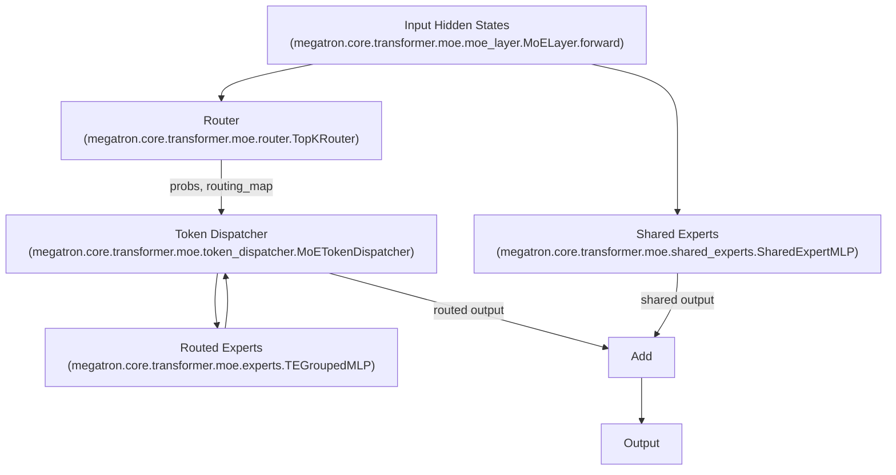
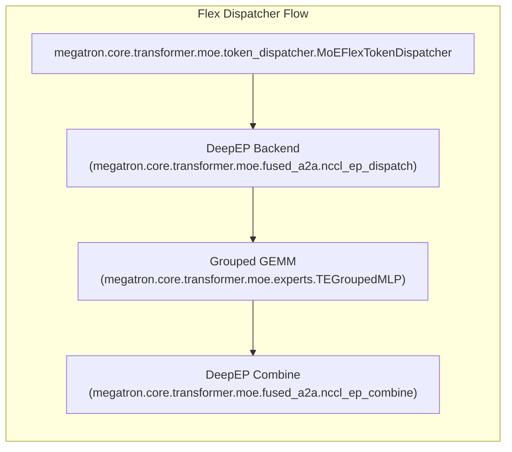

<!-- source: DeepWiki mcp.deepwiki.com · repo NVIDIA/Megatron-LM · extra page Shared Experts and MoE Optimizations · fetched 2026-10-26 -->

# Shared Experts and MoE Optimizations

Relevant source files

The following files were used as context for generating this wiki page:

- [docs/user-guide/features/fine_grained_activation_offloading.md](docs/user-guide/features/fine_grained_activation_offloading.md)
- [examples/multimodal/layer_specs.py](examples/multimodal/layer_specs.py)
- [examples/multimodal/nvlm/internvit.py](examples/multimodal/nvlm/internvit.py)
- [examples/multimodal/radio/radio_g.py](examples/multimodal/radio/radio_g.py)
- [megatron/core/extensions/transformer_engine_spec_provider.py](megatron/core/extensions/transformer_engine_spec_provider.py)
- [megatron/core/models/T5/t5_model.py](megatron/core/models/T5/t5_model.py)
- [megatron/core/models/T5/t5_spec.py](megatron/core/models/T5/t5_spec.py)
- [megatron/core/models/backends.py](megatron/core/models/backends.py)
- [megatron/core/models/bert/bert_layer_specs.py](megatron/core/models/bert/bert_layer_specs.py)
- [megatron/core/models/common/embeddings/language_model_embedding.py](megatron/core/models/common/embeddings/language_model_embedding.py)
- [megatron/core/models/gpt/heterogeneous/heterogeneous_layer_specs.py](megatron/core/models/gpt/heterogeneous/heterogeneous_layer_specs.py)
- [megatron/core/models/gpt/moe_module_specs.py](megatron/core/models/gpt/moe_module_specs.py)
- [megatron/core/pipeline_parallel/fine_grained_activation_offload.py](megatron/core/pipeline_parallel/fine_grained_activation_offload.py)
- [megatron/core/ssm/causal_conv1d.py](megatron/core/ssm/causal_conv1d.py)
- [megatron/core/transformer/moe/README.md](megatron/core/transformer/moe/README.md)
- [megatron/core/transformer/moe/experts.py](megatron/core/transformer/moe/experts.py)
- [megatron/core/transformer/moe/fused_a2a.py](megatron/core/transformer/moe/fused_a2a.py)
- [megatron/core/transformer/moe/moe_layer.py](megatron/core/transformer/moe/moe_layer.py)
- [megatron/core/transformer/moe/moe_utils.py](megatron/core/transformer/moe/moe_utils.py)
- [megatron/core/transformer/moe/paged_stash.py](megatron/core/transformer/moe/paged_stash.py)
- [megatron/core/transformer/moe/router.py](megatron/core/transformer/moe/router.py)
- [megatron/core/transformer/moe/shared_experts.py](megatron/core/transformer/moe/shared_experts.py)
- [megatron/core/transformer/moe/token_dispatcher.py](megatron/core/transformer/moe/token_dispatcher.py)
- [tests/unit_tests/a2a_overlap/utils.py](tests/unit_tests/a2a_overlap/utils.py)
- [tests/unit_tests/models/test_hybrid_moe_model.py](tests/unit_tests/models/test_hybrid_moe_model.py)
- [tests/unit_tests/models/test_t5_model.py](tests/unit_tests/models/test_t5_model.py)
- [tests/unit_tests/pipeline_parallel/test_fine_grained_activation_offloading.py](tests/unit_tests/pipeline_parallel/test_fine_grained_activation_offloading.py)
- [tests/unit_tests/ssm/test_causal_conv1d.py](tests/unit_tests/ssm/test_causal_conv1d.py)
- [tests/unit_tests/ssm/test_gated_delta_product.py](tests/unit_tests/ssm/test_gated_delta_product.py)
- [tests/unit_tests/transformer/moe/test_aux_loss.py](tests/unit_tests/transformer/moe/test_aux_loss.py)
- [tests/unit_tests/transformer/moe/test_grouped_mlp.py](tests/unit_tests/transformer/moe/test_grouped_mlp.py)
- [tests/unit_tests/transformer/moe/test_paged_stash_runner.py](tests/unit_tests/transformer/moe/test_paged_stash_runner.py)
- [tests/unit_tests/transformer/moe/test_paged_stashing.py](tests/unit_tests/transformer/moe/test_paged_stashing.py)
- [tests/unit_tests/transformer/moe/test_routers.py](tests/unit_tests/transformer/moe/test_routers.py)
- [tests/unit_tests/transformer/moe/test_shared_experts.py](tests/unit_tests/transformer/moe/test_shared_experts.py)
- [tests/unit_tests/transformer/moe/test_token_dispatcher.py](tests/unit_tests/transformer/moe/test_token_dispatcher.py)

## Purpose and Scope

This page documents **Shared Experts** and various **performance optimizations** for Megatron-LM's Mixture of Experts (MoE) system. Shared experts are a special type of expert that processes all tokens (unlike routed experts which process only assigned tokens), providing a dense component within the MoE architecture. This page also covers optimization techniques including:

- **Communication Overlap**: Hiding communication latency by overlapping shared expert computation with token dispatch operations.
- **Fine-Grained Activation Offloading**: Memory management for MoE activations in pipeline-parallel configurations.
- **Router and Permutation Fusion**: Fused kernels for routing (top-k, scores, aux loss) and token (un)permutation.
- **Memory-Efficient Permutation**: Moving probability multiplication to the activation function to reduce memory.
- **Expert Bias**: Dynamic load balancing without auxiliary loss.
- **DeepEP & Flex Dispatcher**: High-performance communication backends for MoE dispatching.
- **Multi-Token Prediction (MTP) Support**: Integration of MoE optimizations with MTP layers.

Sources: [megatron/core/transformer/moe/moe_layer.py:190-192](), [megatron/core/transformer/moe/shared_experts.py:102-136](), [megatron/core/transformer/moe/README.md:32-36]()

---

## Shared Expert Architecture

### Overview

Shared experts are MLP layers that process all input tokens, serving as a dense component within the MoE architecture. They provide a stable gradient signal and improve model quality by ensuring every token undergoes a common transformation.

| Property | Shared Experts | Routed Experts |
|----------|---------------|----------------|
| **Token Processing** | All tokens | Subset of tokens (Top-K) |
| **Parallelism** | Follows TP/DP/CP | Expert Parallelism (EP) |
| **Communication** | All-Gather/Reduce-Scatter (TP) | All-to-All/All-Gather (EP) |
| **Implementation** | `SharedExpertMLP` | `TEGroupedMLP` / `SequentialMLP` |

Sources: [megatron/core/transformer/moe/shared_experts.py:102-136](), [megatron/core/transformer/moe/moe_layer.py:182-192]()

### Integration in MoE Layer

The `MoELayer` orchestrates both shared and routed expert computation. The shared expert output is added element-wise to the combined output of the routed experts.

**Diagram: MoE Layer with Shared Experts and Code Entities**

Sources: [megatron/core/transformer/moe/moe_layer.py:255-296](), [megatron/core/transformer/moe/moe_layer.py:326-351]()

---

## Communication Overlap Mechanism

### Motivation and Implementation

MoE training involves significant communication overhead from token dispatching (`All-to-All` on EP group). Communication overlap hides this latency by executing independent shared expert computation (on the TP group) concurrently with the routed expert dispatch.

**Overlap Strategy:**
1. **Phase 1**: `pre_forward_comm` (All-Gather for Shared Expert) overlaps with `dispatch_preprocess`.
2. **Phase 2**: `linear_fc1_forward_and_act` (Shared Expert) overlaps with `token_dispatch` (All-to-All).
3. **Phase 3**: `linear_fc2_forward` (Shared Expert) overlaps with routed expert compute.
4. **Phase 4**: `post_forward_comm` (Reduce-Scatter for Shared Expert) overlaps with `token_combine`.

Sources: [megatron/core/transformer/moe/shared_experts.py:163-183](), [megatron/core/transformer/moe/token_dispatcher.py:99-158]()

### Stream Management

The `SharedExpertMLP` uses a dedicated CUDA stream to achieve true concurrency with the main compute stream. The `SharedExpertState` enum tracks the progress of the overlapped operations to ensure correct ordering.

| Component | Class/Function | Stream/State Usage |
|-----------|----------------|--------------|
| **Static Stream** | `SharedExpertMLP.stream` | Static class variable for overlap |
| **State Machine** | `SharedExpertState` | IDLE, FC1_FORWARD_DONE, etc. |
| **Sync Point** | `_BackwardStreamWait` | Custom autograd function for backward sync |
| **Dispatcher** | `MoETokenDispatcher` | Orchestrates overlap calls |

Sources: [megatron/core/transformer/moe/shared_experts.py:45-53](), [megatron/core/transformer/moe/shared_experts.py:88-100](), [megatron/core/transformer/moe/shared_experts.py:109-110]()

---

## MoE Specific Optimizations

### 1. Router and Permutation Fusion
Megatron Core utilizes **Transformer Engine (TE)** fused kernels to accelerate routing and permutation operations, reducing kernel launch overhead and memory bandwidth pressure.

| Optimization | Config Flag | TE Function |
|--------------|-------------|-------------|
| **Router Fusion** | `--moe-router-fusion` | `fused_topk_with_score_function` |
| **Permute Fusion** | `--moe-permute-fusion` | `fused_permute`, `fused_permute_with_probs` |
| **Aux Loss Fusion** | `--moe-router-fusion` | `fused_moe_aux_loss` |

Sources: [megatron/core/transformer/moe/moe_utils.py:35-60](), [megatron/core/transformer/moe/moe_utils.py:134-144]()

### 2. Fine-Grained Activation Offloading
To support extremely large MoE models in pipeline-parallel (PP) setups, Megatron Core provides fine-grained activation offloading. This mechanism specifically targets MoE modules to free memory during the forward pass.

- **Interface**: The `FineGrainedActivationOffloadingInterface` is implemented by experts to handle offloading logic.
- **GroupedMLP Integration**: `TEGroupedMLP` supports offloading for both sequential and grouped linear operations.
- **Paging Support**: `paged_stash_group_start` and `paged_stash_group_commit` manage the stashing of activations to non-pinned memory or CPU to reduce peak memory.

Sources: [megatron/core/transformer/moe/experts.py:29-31](), [megatron/core/transformer/moe/experts.py:44-48](), [megatron/core/transformer/moe/paged_stash.py:1-20]()

### 3. Memory-Efficient Token Permutation
To reduce activation memory, the system can move the routing probability multiplication from the unpermutation step (after expert compute) to the activation function within `TEGroupedMLP`. This avoids storing large intermediate tensors multiplied by probabilities.

Sources: [megatron/core/transformer/moe/experts.py:183-207](), [megatron/core/transformer/moe/README.md:29-30]()

### 4. Expert Bias (Dynamic Load Balancing)
Expert bias provides a mechanism for load balancing without the explicit penalty of an auxiliary loss. It dynamically adjusts the router's logits based on expert utilization tracked in a local buffer.

**Key Logic:**
- Utilization is tracked per expert.
- `apply_biased_logits` modifies routing scores before Top-K selection based on the `moe_router_enable_expert_bias` configuration.

Sources: [megatron/core/transformer/moe/router.py:180-185](), [megatron/core/transformer/moe/moe_utils.py:18-23]()

### 5. DeepEP and Flex Dispatcher
The `MoEFlexTokenDispatcher` supports high-performance backends like **DeepEP** (from DeepSeek) for efficient token dispatching on H100 and B200 architectures.

**Diagram: Flex Dispatcher with DeepEP Backend**

Sources: [megatron/core/transformer/moe/token_dispatcher.py:22-36](), [megatron/core/transformer/moe/fused_a2a.py:1-50]()

---

## Load Balancing and Loss Functions

Megatron-LM implements several auxiliary losses to ensure experts are utilized evenly across the distributed system.

### Switch Load Balancing Loss
Implements the auxiliary loss from the Switch Transformer paper.
- **Formula**: $loss = E \cdot \sum_{i=1}^{E} (f_i \cdot P_i)$
- **Implementation**: `switch_load_balancing_loss_func` in `moe_utils.py`.
- **Fusing**: Can be fused via TE for performance if `fused=True` is passed.

Sources: [megatron/core/transformer/moe/moe_utils.py:63-150]()

### Z-Loss
Encourages router logits to remain small to enhance training stability, particularly useful for large-scale MoE models.
- **Implementation**: `z_loss_func` in `moe_utils.py`.

Sources: [megatron/core/transformer/moe/moe_utils.py:153-168]()

---

## Precision and Alignment Optimizations

### FP8 and FP4 Support
For low-precision training (FP8/FP4), MoE layers require specific alignment to satisfy hardware constraints (e.g., NVIDIA Blackwell).

- **Quantization Alignment**: `get_align_size_for_quantization` ensures expert inputs are padded to the required size (e.g., multiples of 16 for FP8 or 32 for FP4).
- **Shared Expert Optimization**: In FP8/FP4 mode, `set_save_original_input` is used on `TELinear` within `SharedExpertMLP` to avoid redundant memory usage from saving both quantized and original tensors.

Sources: [megatron/core/transformer/moe/shared_experts.py:147-161](), [megatron/core/transformer/moe/moe_utils.py:12-13]()

---

## Multi-Token Prediction (MTP) Optimizations

MTP models integrate MoE optimizations by treating MTP blocks as specialized transformer layers. The `Router` and `MoELayer` classes accept an `is_mtp_layer` flag to adjust behavior for prediction heads.

- **Router Integration**: `Router.__init__` tracks the `is_mtp_layer` status to ensure correct routing for multi-token objectives.
- **Layer Integration**: `BaseMoELayer` passes the MTP flag down to the router and submodules.

Sources: [megatron/core/transformer/moe/router.py:41-56](), [megatron/core/transformer/moe/moe_layer.py:173-178]()

---

