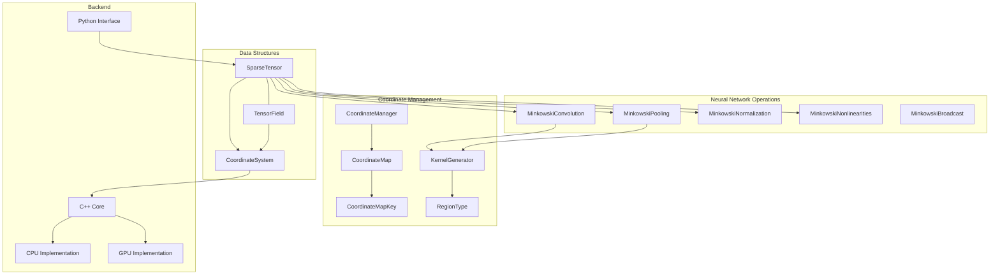
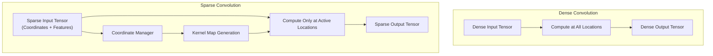
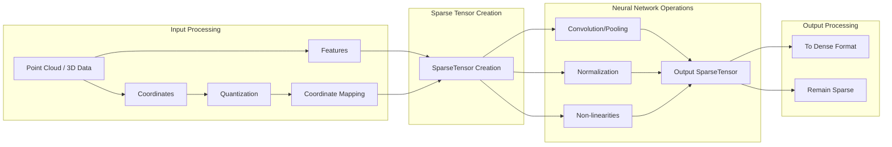
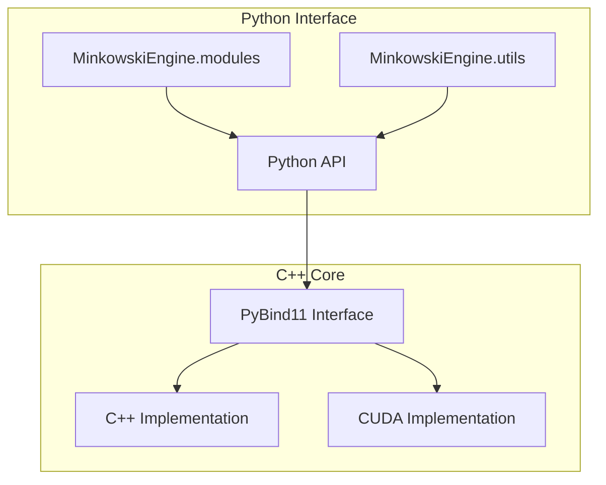

<!-- source: DeepWiki mcp.deepwiki.com · repo NVIDIA/MinkowskiEngine · page 1 Overview · fetched 2026-10-26 -->

# Overview

Relevant source files

The following files were used as context for generating this wiki page:

- [CHANGELOG.md](CHANGELOG.md)
- [Makefile](Makefile)
- [MinkowskiEngine/__init__.py](MinkowskiEngine/__init__.py)
- [README.md](README.md)
- [docs/convolution.rst](docs/convolution.rst)
- [docs/index.rst](docs/index.rst)
- [docs/quick_start.md](docs/quick_start.md)
- [docs/utils.rst](docs/utils.rst)
- [setup.py](setup.py)
- [tests/python/dense.py](tests/python/dense.py)

The MinkowskiEngine is an auto-differentiation library for sparse tensors. It provides efficient neural network operations for spatially sparse data, particularly in 3D contexts like point clouds, voxel grids, and other high-dimensional representations. This page introduces the fundamental concepts, architecture, and capabilities of the MinkowskiEngine.

For detailed installation instructions, see [Installation and Setup](#1.1). For basic usage examples, see [Quick Start Guide](#1.3).

## Purpose and Scope

MinkowskiEngine was designed to address the challenge of processing sparse 3D data efficiently. Unlike traditional deep learning methods operating on dense tensors, MinkowskiEngine focuses on *spatially* sparse data where most voxels or grid points contain no information. This is particularly important for 3D perception, where point clouds contain information only at specific spatial locations, with most of the 3D space being empty.

The library provides:
- A comprehensive implementation of sparse tensor operations
- Neural network layers for spatially sparse inputs
- Support for both CPU and GPU computations with CUDA accelerations
- Integration with PyTorch for seamless auto-differentiation

Sources: [README.md:11-11](), [README.md:34-37]()

## Core Architecture

The MinkowskiEngine is built around a layered architecture that efficiently handles sparse data through specialized data structures and operations.

The architecture consists of these main components:

1. **Data Structures**: `SparseTensor` and `TensorField` represent spatially sparse data with coordinates and features
2. **Coordinate Management**: Handles efficient coordinate mapping and indexing for sparse operations
3. **Neural Network Operations**: Implements standard neural network layers for sparse tensors
4. **Backend**: Provides both CPU and GPU implementations for the operations

Sources: [README.md:47-57](), [MinkowskiEngine/__init__.py:74-87](), [MinkowskiEngine/__init__.py:93-98]()

## Sparse Tensor Networks

Traditional neural networks operate on dense tensors where computations are performed at all spatial locations. MinkowskiEngine introduces **sparse tensor networks** that operate only on specified coordinates where data is present.

The key differences between sparse tensor networks and traditional networks:

1. **Computational Efficiency**: Operations only performed at non-zero locations
2. **Memory Efficiency**: Only non-zero values and their coordinates are stored
3. **Sparse Convolution**: Convolution kernels applied only at specified locations
4. **Dynamic Computation Graph**: Coordinates can change through the network

Sources: [README.md:33-43](), [setup.py:331-332]()

## Data Flow for Sparse Tensor Operations

The following diagram illustrates the typical data flow when processing point cloud data through MinkowskiEngine:

In this process:
1. Input 3D data is separated into coordinates and features
2. Coordinates are quantized to map continuous space to discrete voxel grid
3. A SparseTensor is created with the features and mapped coordinates
4. Neural network operations are applied to the SparseTensor
5. The resulting SparseTensor can be used for further processing or converted to other formats

Sources: [tests/python/dense.py:44-65](), [README.md:205-218]()

## Key Features

MinkowskiEngine provides a comprehensive set of features for working with sparse tensors:

| Feature | Description |
|---------|-------------|
| Unlimited Dimensions | Support for high-dimensional sparse tensors (beyond 3D) |
| Neural Network Layers | Convolution, pooling, normalization, broadcasting, etc. |
| Dynamic Computation | Coordinates can change throughout the network |
| Custom Kernel Shapes | Flexible definition of convolution kernel shapes |
| Multi-GPU Support | Efficient distributed training |
| Optimized Performance | Multi-threaded kernel mapping and GPU acceleration |

Sources: [README.md:47-57](), [README.md:83-89]()

## Implementation Details

MinkowskiEngine is implemented as a PyTorch extension with a Python front-end and a C++/CUDA back-end:

The implementation includes:
- Python interface for ease of use and PyTorch integration
- C++ core for CPU operations
- CUDA implementation for GPU acceleration
- PyBind11 for binding C++ to Python

The library is designed to be used with PyTorch's existing ecosystem, allowing for seamless integration with other PyTorch models and tools.

Sources: [setup.py:301-317](), [Makefile:222-270]()

## Common Use Cases

MinkowskiEngine is designed for applications involving spatially sparse data, including:

1. **3D Semantic Segmentation**: Assigning semantic labels to 3D points
2. **3D Object Classification**: Recognizing objects from 3D scans
3. **3D Object Detection**: Localizing and classifying 3D objects
4. **Point Cloud Registration**: Aligning multiple point cloud scans
5. **3D Reconstruction**: Generating complete 3D models from partial observations

These applications leverage the efficiency of sparse tensor operations for processing large-scale 3D data where traditional dense approaches would be computationally prohibitive.

Sources: [README.md:20-31](), [README.md:390-396]()

## System Requirements

To use MinkowskiEngine, you need:
- Ubuntu >= 14.04 (or other Linux distributions)
- Python >= 3.6
- PyTorch >= 1.7
- CUDA >= 10.1.243 (for GPU support, should match PyTorch's CUDA version)
- GCC >= 7.4.0
- OpenBLAS or other BLAS libraries

For installation instructions, please refer to [Installation and Setup](#1.1).

Sources: [README.md:59-67](), [README.md:69-78]()

## Conclusion

MinkowskiEngine provides an efficient framework for deep learning on sparse spatial data. By focusing only on non-empty voxels or points, it enables processing of large-scale 3D data that would be impossible with dense approaches. The library's integration with PyTorch makes it accessible to researchers and practitioners already familiar with deep learning tools, while its optimized backend ensures high performance for real-world applications.

For more detailed information on specific components, please refer to the other sections in this documentation.

---

