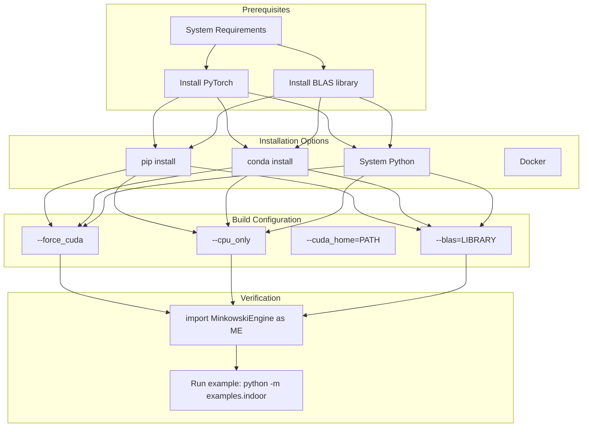
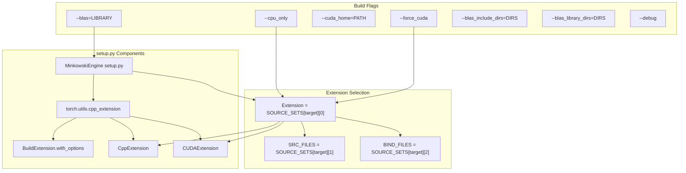

<!-- source: DeepWiki mcp.deepwiki.com · repo NVIDIA/MinkowskiEngine · page 1.1 Installation and Setup · fetched 2026-10-26 -->

# Installation and Setup

<details>
<summary>Relevant source files</summary>

The following files were used as context for generating this wiki page:

- [Makefile](Makefile)
- [README.md](README.md)
- [docs/_templates/layout.html](docs/_templates/layout.html)
- [docs/quick_start.md](docs/quick_start.md)
- [setup.py](setup.py)

</details>


This document provides detailed instructions for installing and configuring the MinkowskiEngine library on various platforms with different dependency requirements. MinkowskiEngine is a PyTorch-based library for sparse tensor operations that supports both CPU and GPU (CUDA) computation.

For information about the fundamental concepts and usage patterns, please refer to [Basic Concepts](#1.2). If you're looking for a quick introduction to get started, see [Quick Start Guide](#1.3).

## System Requirements

Before installing MinkowskiEngine, ensure that your system meets the following requirements:

| Requirement | Minimum Version | Notes |
|-------------|----------------|-------|
| Operating System | Ubuntu 14.04+ | Windows is not supported. macOS has limited support |
| CUDA | 10.1.243+ | Required for GPU acceleration only |
| PyTorch | 1.7+ | Must match the CUDA version used for MinkowskiEngine |
| Python | 3.6+ | |
| GCC | 7.4.0+ | For CUDA 10.2, must use GCC < 8 |
| ninja | Latest | Required for installation |
| BLAS library | openblas, mkl, atlas, or blas | |

Sources: [README.md:58-66](), [setup.py:44-54]()

## Installation Methods

MinkowskiEngine provides four main installation methods to accommodate different environments and requirements.

### Installation Workflow



Sources: [README.md:68-72](), [setup.py:121-138]()

### 1. Pip Installation

The simplest method is to install via pip:

```bash
# Install system dependencies
sudo apt install build-essential python3-dev libopenblas-dev
pip install torch ninja

# Install MinkowskiEngine
pip install -U MinkowskiEngine --install-option="--blas=openblas" -v --no-deps

# For the latest development version
pip install -U git+https://github.com/NVIDIA/MinkowskiEngine --no-deps
```

You can customize the installation with additional options:

```bash
# Force CUDA installation even if torch.cuda.is_available() is False
pip install -U MinkowskiEngine --install-option="--force_cuda" --no-deps

# Force CPU-only build (no CUDA support)
pip install -U MinkowskiEngine --install-option="--cpu_only" --no-deps

# Specify a different BLAS library
pip install -U MinkowskiEngine --install-option="--blas=mkl" --no-deps
```

Sources: [README.md:80-107]()

### 2. Anaconda Installation

Anaconda installation is recommended for better dependency management, especially for different CUDA versions.

#### For CUDA 10.2:

```bash
sudo apt install g++-7  # For CUDA 10.2, must use GCC < 8
conda create -n py3-mink python=3.8
conda activate py3-mink

conda install openblas-devel -c anaconda
conda install pytorch=1.9.0 torchvision cudatoolkit=10.2 -c pytorch -c nvidia

# Install MinkowskiEngine
export CXX=g++-7
# Optionally specify CUDA home
# export CUDA_HOME=/usr/local/cuda-10.2
pip install -U git+https://github.com/NVIDIA/MinkowskiEngine -v --no-deps \
    --install-option="--blas_include_dirs=${CONDA_PREFIX}/include" \
    --install-option="--blas=openblas"
```

#### For CUDA 11.x:

```bash
conda create -n py3-mink python=3.8
conda activate py3-mink

conda install openblas-devel -c anaconda
conda install pytorch=1.9.0 torchvision cudatoolkit=11.1 -c pytorch -c nvidia

# Install MinkowskiEngine
# Optionally specify CUDA home
# export CUDA_HOME=/usr/local/cuda-11.1
pip install -U git+https://github.com/NVIDIA/MinkowskiEngine -v --no-deps \
    --install-option="--blas_include_dirs=${CONDA_PREFIX}/include" \
    --install-option="--blas=openblas"
```

Sources: [README.md:109-161]()

### 3. System Python Installation

```bash
# Install system requirements
sudo apt install build-essential python3-dev libopenblas-dev

# Install pip if not already installed
curl https://bootstrap.pypa.io/get-pip.py | python3

# Install Python requirements
python3 -m pip install torch numpy ninja

# Clone and install MinkowskiEngine
git clone https://github.com/NVIDIA/MinkowskiEngine.git
cd MinkowskiEngine
python setup.py install

# With custom options (example)
# export CXX=c++; export CUDA_HOME=/usr/local/cuda-11.1; python setup.py install --blas=openblas --force_cuda
```

Sources: [README.md:163-184]()

### 4. Docker Installation

```bash
git clone https://github.com/NVIDIA/MinkowskiEngine
cd MinkowskiEngine
docker build -t minkowski_engine docker

# Verify installation
docker run minkowski_engine python3 -c "import MinkowskiEngine; print(MinkowskiEngine.__version__)"
```

Sources: [README.md:186-198]()

## Build Configuration Options

MinkowskiEngine's build system provides various configuration options to adapt to different hardware and requirements.

### Build Configuration Components



Sources: [setup.py:147-307]()

### 1. CPU-Only vs CUDA Build

MinkowskiEngine can be built with or without CUDA support:

```bash
# CPU-only build
python setup.py install --cpu_only

# Force CUDA build (even if torch.cuda.is_available() is False)
python setup.py install --force_cuda

# Specify CUDA home directory
python setup.py install --cuda_home=/usr/local/cuda-11.1
```

When `--cpu_only` is specified, the build uses the `CppExtension` from PyTorch and omits CUDA-specific source files. When CUDA is enabled, it uses `CUDAExtension` and includes additional GPU implementations.

Sources: [setup.py:124-138](), [setup.py:301-307]()

### 2. BLAS Configuration

MinkowskiEngine supports different BLAS libraries for CPU matrix operations:

```bash
# OpenBLAS (default)
python setup.py install --blas=openblas

# Intel Math Kernel Library (MKL)
conda install -c intel mkl mkl-include
python setup.py install --blas=mkl

# ATLAS
python setup.py install --blas=atlas

# System BLAS
python setup.py install --blas=blas
```

You can also specify include and library directories for BLAS:

```bash
python setup.py install --blas=openblas \
    --blas_include_dirs=/path/to/include \
    --blas_library_dirs=/path/to/lib
```

Sources: [setup.py:186-218](), [Makefile:90-111]()

### 3. Compiler and Optimization Options

```bash
# Specify C++ compiler
export CXX=g++-7
python setup.py install

# Enable debug build
python setup.py install --debug

# Specify CUDA architecture list
export TORCH_CUDA_ARCH_LIST="5.2 6.0 6.1 7.0 7.5 8.0 8.6+PTX"
python setup.py install --force_cuda
```

Sources: [setup.py:277-295](), [README.md:285-291]()

## Troubleshooting Common Installation Issues

### 1. CUDA Version Mismatch

**Problem**: The CUDA version used for PyTorch must match the CUDA version used for MinkowskiEngine.

**Solution**: Ensure you use the same CUDA version for both. For example, if using conda:

```bash
conda install pytorch=1.9.0 torchvision cudatoolkit=11.1 -c pytorch -c nvidia
export CUDA_HOME=/usr/local/cuda-11.1
```

Sources: [README.md:62-63]()

### 2. GCC Version Compatibility

**Problem**: CUDA versions have specific GCC compatibility requirements.

**Solution**:
- For CUDA 10.2: Use GCC < 8 (recommended: GCC 7.4.0)
- For CUDA 11.x: Newer GCC versions are supported

```bash
# For CUDA 10.2
sudo apt install g++-7
export CXX=g++-7
```

Sources: [README.md:118]()

### 3. Unhandled CUDA Out-Of-Memory Exception

**Problem**: Thrust exceptions in CUDA 10.

**Solution**: This is a known issue in thrust with CUDA 10. Consider upgrading to CUDA 11.x or periodically clearing the PyTorch CUDA cache:

```python
import torch
torch.cuda.empty_cache()
```

Sources: [README.md:293-296](), [README.md:300-309]()

### 4. Memory Issues on Multi-CPU Systems

**Problem**: Performance degradation on systems with many CPU cores.

**Solution**: Limit the number of OpenMP threads:

```bash
export OMP_NUM_THREADS=<number of threads to use>
python <your_program.py>
```

Recommended value is typically less than 24, regardless of how many actual CPU cores you have.

Sources: [README.md:320-327]()

## Verification

To verify your installation, run the following Python code:

```python
import torch
import MinkowskiEngine as ME
print(f"MinkowskiEngine version: {ME.__version__}")
print(f"CUDA available: {torch.cuda.is_available()}")
```

For a more comprehensive test, run one of the example networks:

```bash
git clone https://github.com/NVIDIA/MinkowskiEngine.git
cd MinkowskiEngine
python -m examples.indoor
```

This will download a pretrained model and run semantic segmentation on a 3D scene.

Sources: [README.md:205-211](), [README.md:20-31]()

---

