<!-- source: DeepWiki mcp.deepwiki.com · repo NVIDIA/MinkowskiEngine · page 1.2 Basic Concepts · fetched 2026-10-26 -->

# Basic Concepts

Relevant source files

The following files were used as context for generating this wiki page:

- [CHANGELOG.md](CHANGELOG.md)
- [Makefile](Makefile)
- [MinkowskiEngine/MinkowskiSparseTensor.py](MinkowskiEngine/MinkowskiSparseTensor.py)
- [MinkowskiEngine/MinkowskiTensor.py](MinkowskiEngine/MinkowskiTensor.py)
- [MinkowskiEngine/MinkowskiTensorField.py](MinkowskiEngine/MinkowskiTensorField.py)
- [MinkowskiEngine/__init__.py](MinkowskiEngine/__init__.py)
- [README.md](README.md)
- [docs/quick_start.md](docs/quick_start.md)
- [setup.py](setup.py)
- [tests/python/tensor_field.py](tests/python/tensor_field.py)

This page introduces the fundamental concepts of the MinkowskiEngine, focusing on sparse tensors, coordinate systems, and the architecture that powers this library. For detailed installation instructions, see [Installation and Setup](#1.1), and for specific examples of how to use the engine, refer to the [Quick Start Guide](#1.3).

## What is MinkowskiEngine?

MinkowskiEngine is an auto-differentiation library specifically designed for sparse tensors. Unlike traditional deep learning frameworks that work primarily with dense tensors, MinkowskiEngine provides specialized operations for spatially sparse data, such as 3D point clouds, high-dimensional statistical data, and other sparse inputs.

The library supports all standard neural network operations (convolution, pooling, broadcasting, etc.) but reimplements them to efficiently operate on sparse data structures.

Sources: [README.md:7-11](), [README.md:33-38]()

## Sparse Tensors vs. Dense Tensors

To understand MinkowskiEngine, it's important to first grasp the difference between dense and sparse tensors.

**Dense Tensors**: In traditional neural networks, data is represented in dense tensors where all positions in the tensor grid contain values, even if those values are zeros. This is memory-inefficient for spatially sparse data.

**Sparse Tensors**: Sparse tensors only store non-zero values and their corresponding coordinates. This significantly reduces memory usage and computation time when most of the tensor consists of zeros.

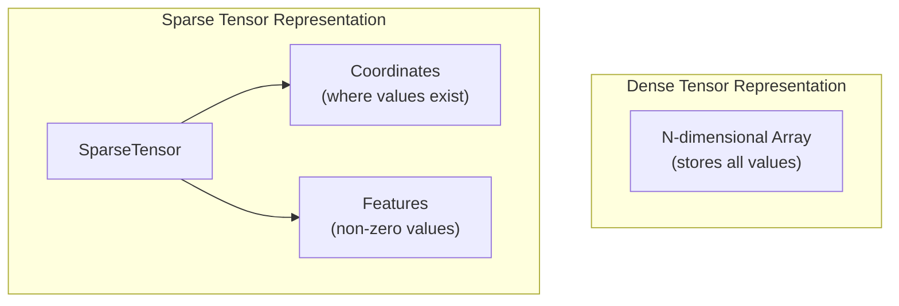

Sources: [README.md:41-43](), [MinkowskiSparseTensor.py:48-78]()

## COO Format and Sparse Tensor Representation

MinkowskiEngine uses the COOrdinate (COO) format to represent sparse tensors. This representation consists of two key components:

1. **Coordinates (C)**: A matrix containing the spatial positions of non-zero elements
2. **Features (F)**: The feature values associated with each coordinate

Mathematically, this is represented as:

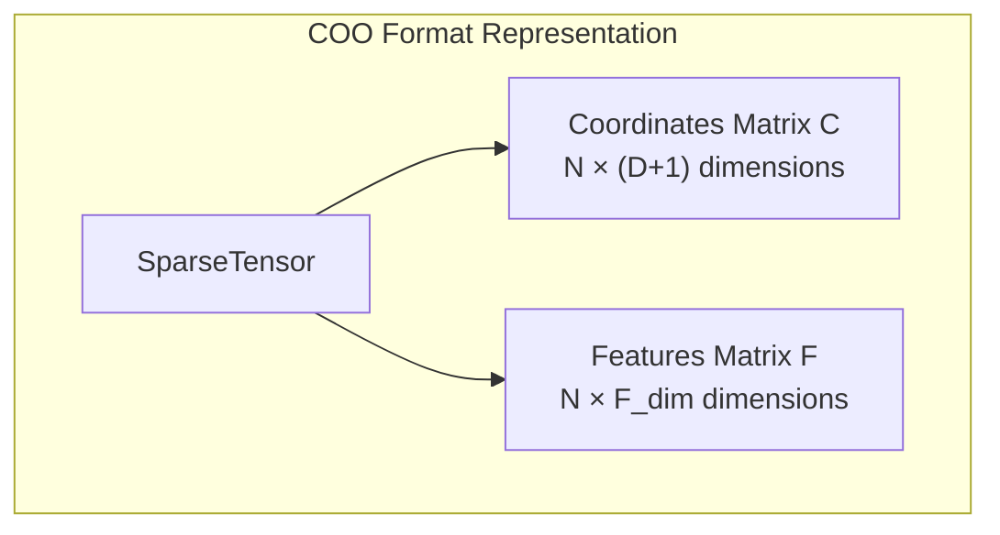

Where:
- N is the number of non-zero elements
- D is the spatial dimension (e.g., 3 for 3D space)
- The +1 in coordinates is for the batch index
- F_dim is the feature dimension

Example: For 3D point clouds, coordinates might be (x,y,z) positions, while features could be RGB colors, normals, or learned embeddings at those positions.

Sources: [MinkowskiSparseTensor.py:50-78](), [MinkowskiTensor.py:140-161]()

## Coordinate System

### Batch Representation

MinkowskiEngine handles batched data by treating the batch index as an additional spatial dimension. This allows for efficient processing of multiple samples simultaneously.

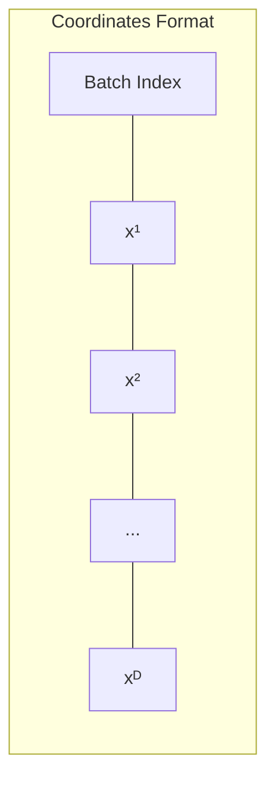

The first column of the coordinates matrix represents the batch index, followed by D spatial dimensions.

### Tensor Stride

Tensor stride defines the spacing between adjacent elements in a sparse tensor. It's similar to the concept of stride in convolution but applied to sparse tensors.

- A tensor stride of 1 means coordinates are at the base resolution
- Higher tensor strides indicate coarser resolutions (similar to downsampling in dense tensors)

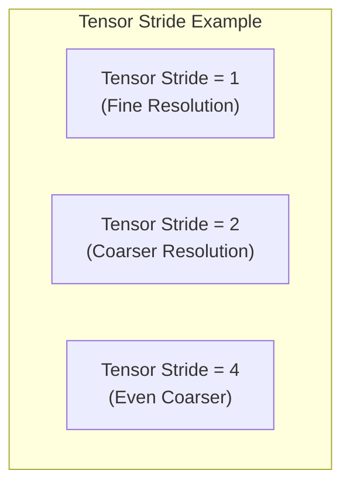

Tensor stride is an important property stored in the `CoordinateMapKey` which uniquely identifies a particular set of coordinates.

Sources: [MinkowskiSparseTensor.py:73-77](), [MinkowskiTensor.py:215-222](), [MinkowskiSparseTensor.py:196-218]()

## Core Data Structures

### SparseTensor

The `SparseTensor` class is the fundamental data structure in MinkowskiEngine. It represents spatially sparse data with discrete coordinates.

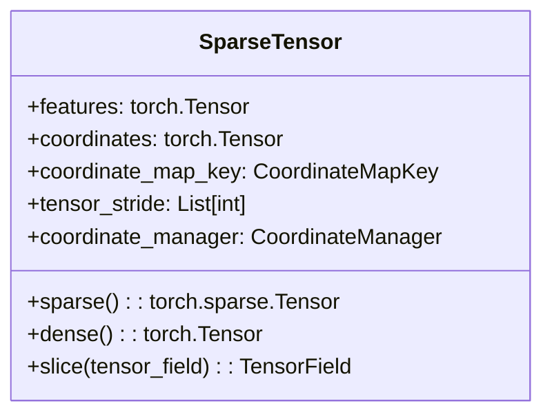

A `SparseTensor` is created by specifying:
- Features: The values at each non-zero position
- Coordinates: The positions of non-zero elements
- Tensor stride: The spacing between elements

Sources: [MinkowskiSparseTensor.py:122-189](), [MinkowskiSparseTensor.py:231-287]()

### TensorField

The `TensorField` class represents continuous (non-quantized) sparse data. It's useful for operations that require interpolation or when working with raw point cloud data.

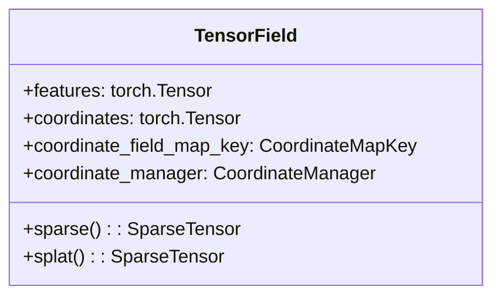

The key difference between `SparseTensor` and `TensorField` is that:
- `SparseTensor` uses discrete, quantized coordinates
- `TensorField` uses continuous, floating-point coordinates

`TensorField` can be converted to a `SparseTensor` using the `sparse()` method, which applies quantization.

Sources: [MinkowskiTensorField.py:76-146](), [MinkowskiTensorField.py:286-379]()

## Coordinate Management System

The coordinate management system is a critical component that enables efficient operations on sparse tensors.

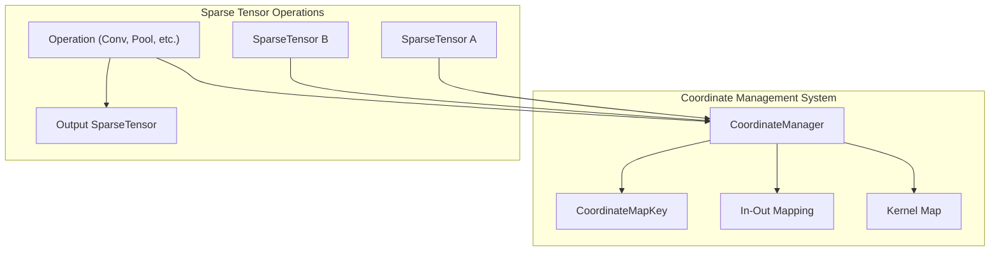

### CoordinateManager

The `CoordinateManager` handles:
- Storage of coordinate mapping
- Generation of kernel maps for convolution/pooling
- Efficient lookup of coordinates
- Coordinate union, intersection, and other set operations

### CoordinateMapKey

A `CoordinateMapKey` uniquely identifies a set of coordinates with specific tensor stride. It's used to retrieve coordinate information from the `CoordinateManager`.

Sources: [MinkowskiSparseTensor.py:213-258](), [MinkowskiTensor.py:211-214]()

## Quantization

Quantization is the process of converting continuous coordinates to discrete coordinates. This is especially important when working with point clouds or other continuous data.

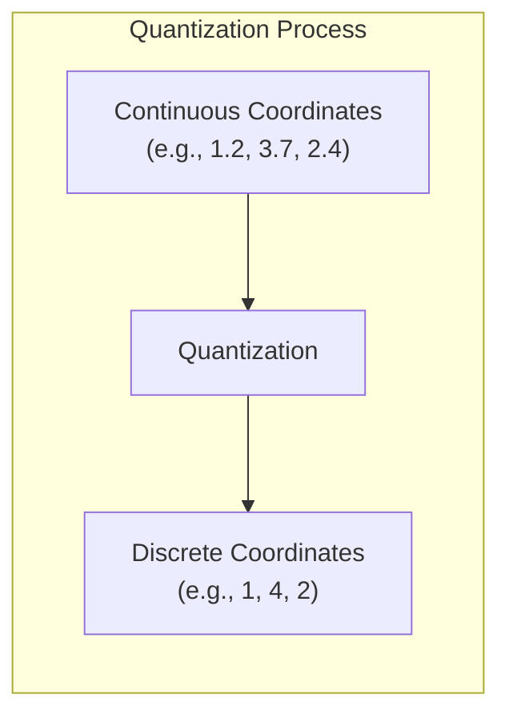

MinkowskiEngine provides several quantization modes through the `SparseTensorQuantizationMode` enum:

- `RANDOM_SUBSAMPLE`: Randomly selects one point per voxel
- `UNWEIGHTED_AVERAGE`: Averages all features within a voxel
- `UNWEIGHTED_SUM`: Sums all features within a voxel
- `MAX_POOL`: Takes the maximum feature value within a voxel
- `SPLAT_LINEAR_INTERPOLATION`: Distributes features to neighboring voxels with linear weights

Quantization is applied when:
1. Creating a `SparseTensor` directly from continuous coordinates
2. Converting a `TensorField` to a `SparseTensor` using the `sparse()` method

Sources: [MinkowskiTensor.py:47-61](), [MinkowskiSparseTensor.py:293-345](), [MinkowskiTensorField.py:292-378]()

## Operations on Sparse Tensors

MinkowskiEngine implements standard neural network operations for sparse tensors:

### Convolution

Sparse convolution applies convolutional filters only at locations where input features exist, significantly reducing computation compared to dense convolution.

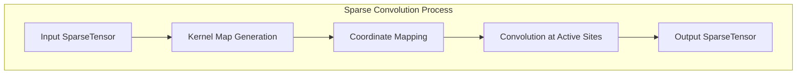

### Pooling

Similar to convolution, pooling operations (max, average, sum) are implemented to work only on non-zero elements.

### Other Operations

- Normalization (BatchNorm, InstanceNorm)
- Non-linearities (ReLU, Sigmoid, etc.)
- Broadcasting operations
- Global pooling

These operations are designed to maintain sparsity throughout the network, avoiding conversion to dense representations.

Sources: [README.md:48-56](), [MinkowskiEngine/__init__.py:100-107](), [MinkowskiEngine/__init__.py:111-125]()

## Processing Pipeline

The typical processing pipeline in MinkowskiEngine involves:

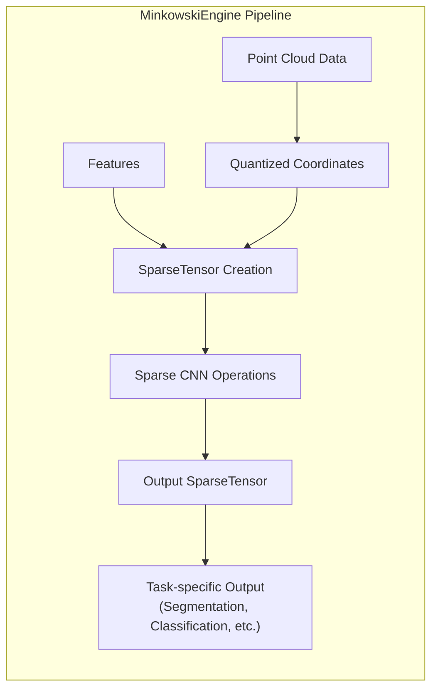

1. Input preparation: Converting raw data to coordinates and features
2. Quantization: Converting continuous coordinates to discrete grid points
3. SparseTensor creation: Combining quantized coordinates with features
4. Neural network operations: Applying convolutions, pooling, etc.
5. Task-specific outputs: Converting back to the desired output format

Sources: [README.md:20-31](), [README.md:205-211]()

## Memory Management

MinkowskiEngine offers options for memory management:

- GPU-accelerated coordinate management
- Multi-threaded kernel map generation
- Cache control for efficient memory usage

When using GPU operations, it's important to properly manage the cache to avoid memory leaks, especially during long-running training sessions.

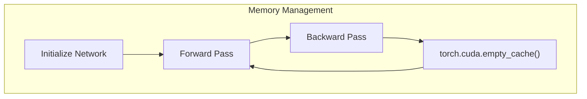

Sources: [README.md:298-308](), [README.md:320-323]()

## Conclusion

The MinkowskiEngine provides a comprehensive framework for working with sparse tensors, particularly for 3D point cloud processing tasks. By understanding the core concepts of sparse tensors, coordinate systems, and the operations available, you can effectively leverage this library for a wide range of applications.

For specific examples and use cases, refer to the [Quick Start Guide](#1.3) and [Examples and Use Cases](#6).

---

