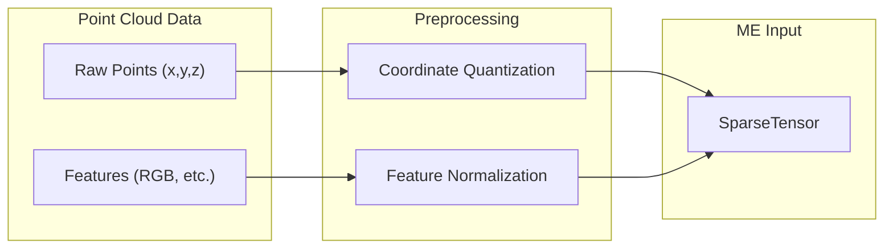
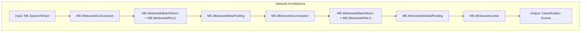
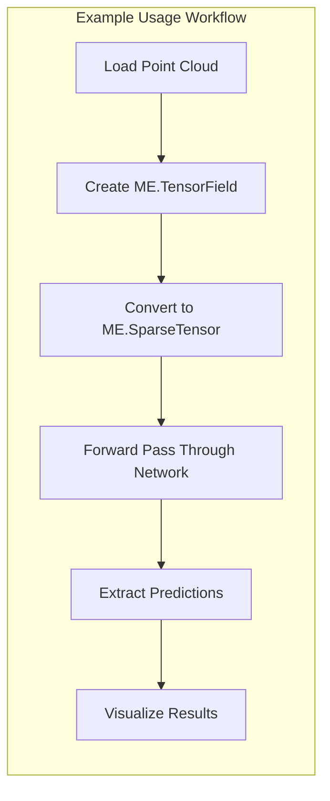

<!-- source: DeepWiki mcp.deepwiki.com · repo NVIDIA/MinkowskiEngine · page 1.3 Quick Start Guide · fetched 2026-10-26 -->

# Quick Start Guide

<details>
<summary>Relevant source files</summary>

The following files were used as context for generating this wiki page:

- [Makefile](Makefile)
- [README.md](README.md)
- [docs/quick_start.md](docs/quick_start.md)
- [examples/README.md](examples/README.md)
- [examples/classification_modelnet40.py](examples/classification_modelnet40.py)
- [examples/common.py](examples/common.py)
- [examples/download_modelnet40.sh](examples/download_modelnet40.sh)
- [examples/indoor.py](examples/indoor.py)
- [examples/pointnet.py](examples/pointnet.py)
- [examples/resnet.py](examples/resnet.py)
- [setup.py](setup.py)

</details>


This guide provides a concise introduction to MinkowskiEngine, a powerful library for sparse tensor operations designed primarily for 3D point cloud processing. You'll learn the basics of setting up MinkowskiEngine, creating sparse tensors, building neural networks, and running simple examples. For in-depth concepts about sparse tensors and the coordinate management system, see [Basic Concepts](#1.2).

## Installation

MinkowskiEngine can be installed via pip, conda, or from source. The library requires:

- Ubuntu 14.04 or higher
- CUDA 10.1+ (for GPU acceleration)
- PyTorch 1.7+
- Python 3.6+
- GCC 7.4.0+

### Quick Installation

```bash
# Basic installation with pip
pip install -U MinkowskiEngine

# Or the latest version from GitHub
pip install -U git+https://github.com/NVIDIA/MinkowskiEngine --no-deps
```

For CPU-only installation:
```bash
python setup.py install --cpu_only
```

For CUDA-specific installation:
```bash
export CUDA_HOME=/usr/local/cuda-11.1
pip install -U MinkowskiEngine --install-option="--force_cuda" --no-deps
```

Sources: [README.md:81-106](), [setup.py:17-42]()

## Basic Usage

### Creating a Sparse Tensor

The fundamental data structure in MinkowskiEngine is `SparseTensor`. To use it, you need:

1. Coordinates (spatial locations)
2. Features (values at those locations)

```python
import torch
import MinkowskiEngine as ME

# Create coordinates and features
coords = torch.tensor([
    [0, 0, 0],  # batch_idx, x, y
    [0, 0, 1],
    [0, 1, 0],
    [0, 1, 1],
    [1, 0, 0],  # new batch
    [1, 0, 1]
], dtype=torch.int32)

feats = torch.tensor([
    [1.0],  # Feature for coordinate [0, 0, 0]
    [2.0],  # Feature for coordinate [0, 0, 1]
    [3.0],  # Feature for coordinate [0, 1, 0]
    [4.0],  # Feature for coordinate [0, 1, 1]
    [5.0],  # Feature for coordinate [1, 0, 0]
    [6.0],  # Feature for coordinate [1, 0, 1]
], dtype=torch.float32)

# Create a sparse tensor
sparse_tensor = ME.SparseTensor(features=feats, coordinates=coords)
```

Sources: [README.md:205-270]()

### From Point Cloud to Sparse Tensor

For 3D point cloud data, you typically need to quantize continuous coordinates into discrete voxel positions:



Example of processing a point cloud:

```python
import numpy as np
import torch
import MinkowskiEngine as ME
import open3d as o3d

# Load a point cloud
pcd = o3d.io.read_point_cloud("example.ply")
coords = np.array(pcd.points)
colors = np.array(pcd.colors)

# Quantize coordinates to voxel coordinates
voxel_size = 0.05  # 5cm voxel size
discrete_coords = np.floor(coords / voxel_size)

# Create batched coordinates
batched_coords = ME.utils.batched_coordinates([discrete_coords])

# Create a sparse tensor
input_tensor = ME.SparseTensor(
    features=torch.tensor(colors, dtype=torch.float32),
    coordinates=batched_coords
)
```

Sources: [README.md:205-270](), [examples/indoor.py:103-146]()

## Building Networks

MinkowskiEngine provides sparse versions of standard neural network layers such as convolution, pooling, and batch normalization. Here's how to create a simple network:



Here's an example of a simple classification network:

```python
import torch.nn as nn
import MinkowskiEngine as ME

class SimpleNetwork(ME.MinkowskiNetwork):
    def __init__(self, in_feat, out_feat, D=3):
        super(SimpleNetwork, self).__init__(D)
        
        self.conv1 = nn.Sequential(
            ME.MinkowskiConvolution(
                in_channels=in_feat,
                out_channels=64,
                kernel_size=3,
                stride=2,
                dimension=D),
            ME.MinkowskiBatchNorm(64),
            ME.MinkowskiReLU())
            
        self.conv2 = nn.Sequential(
            ME.MinkowskiConvolution(
                in_channels=64,
                out_channels=128,
                kernel_size=3,
                stride=2,
                dimension=D),
            ME.MinkowskiBatchNorm(128),
            ME.MinkowskiReLU())
            
        self.pooling = ME.MinkowskiGlobalPooling()
        self.linear = ME.MinkowskiLinear(128, out_feat)
        
    def forward(self, x):
        x = self.conv1(x)
        x = self.conv2(x)
        x = self.pooling(x)
        return self.linear(x)
```

Sources: [README.md:216-252](), [examples/resnet.py:53-102]()

## Training Loop

A basic training loop with MinkowskiEngine follows standard PyTorch practices:

```python
import torch.nn as nn
import torch.optim as optim

# Create network, loss function, and optimizer
model = SimpleNetwork(in_feat=3, out_feat=10, D=3)
criterion = nn.CrossEntropyLoss()
optimizer = optim.SGD(model.parameters(), lr=0.01)

# Training loop
for epoch in range(num_epochs):
    for data_dict in data_loader:
        # Get inputs
        coordinates = data_dict['coordinates']
        features = data_dict['features']
        labels = data_dict['labels']
        
        # Create sparse tensor input
        input_tensor = ME.SparseTensor(
            features=features,
            coordinates=coordinates
        )
        
        # Zero the parameter gradients
        optimizer.zero_grad()
        
        # Forward pass
        outputs = model(input_tensor)
        
        # Compute loss
        loss = criterion(outputs.F, labels)
        
        # Backward pass and optimize
        loss.backward()
        optimizer.step()
```

Sources: [examples/resnet.py:240-278](), [examples/classification_modelnet40.py:367-401]()

## Data Structure Relationships

The following diagram shows the relationship between key MinkowskiEngine data structures:

```mermaid
classDiagram
    class "SparseTensor" {
        +features: torch.Tensor
        +coordinate_map_key: CoordinateMapKey
        +coordinate_manager: CoordinateManager
    }
    
    class "TensorField" {
        +features: torch.Tensor
        +coordinate_manager: CoordinateManager
    }
    
    class "CoordinateManager" {
        +coordinate_maps: dict
        +get_coordinate_map()
        +insert_and_map()
    }
    
    class "CoordinateMapKey" {
        +get_key()
    }
    
    "SparseTensor" --> "CoordinateManager" : uses
    "SparseTensor" --> "CoordinateMapKey" : references
    "TensorField" --> "CoordinateManager" : uses
    "CoordinateManager" --> "CoordinateMapKey" : creates
```

Sources: [README.md:39-44]()

## Running Examples

MinkowskiEngine includes various examples to demonstrate its capabilities.

### Classification Example

Run a 3D classification example using the ModelNet40 dataset:

```bash
python -m examples.classification_modelnet40
```

This example trains a network to classify 3D objects into 40 categories.

### Segmentation Example

Run a semantic segmentation example on indoor scenes:

```bash
python -m examples.indoor
```

This example loads a pre-trained model and performs semantic segmentation on a 3D scene.



Sources: [examples/indoor.py:124-171](), [examples/README.md:1-21]()

## Common Operations

### Quantization and Coordinate Management

The coordinate management system is a key component of MinkowskiEngine:

```python
# Quantize coordinates (e.g., for a point cloud)
voxel_size = 0.02
discrete_coords = torch.floor(coords / voxel_size)

# You can also use the provided utility function
discrete_coords = ME.utils.sparse_quantize(
    coordinates=coords,
    features=feats,
    quantization_size=voxel_size
)
```

### Batching Multiple Point Clouds

When working with multiple point clouds in a batch:

```python
# For multiple point clouds
coords_list = [coords1, coords2, coords3]
feats_list = [feats1, feats2, feats3]

# Create batched coordinates
batched_coords = ME.utils.batched_coordinates(coords_list)

# Combine features
batched_feats = torch.cat(feats_list, dim=0)

# Create sparse tensor
sparse_tensor = ME.SparseTensor(
    features=batched_feats,
    coordinates=batched_coords
)
```

Sources: [examples/resnet.py:255-262](), [examples/pointnet.py:44-55]()

## Memory Management

MinkowskiEngine with PyTorch can sometimes experience memory issues during training. Clear the PyTorch CUDA cache regularly to avoid out-of-memory errors:

```python
# Clear GPU memory cache
torch.cuda.empty_cache()
```

Sources: [README.md:297-309]()

## Next Steps

After getting familiar with the basics:

1. Explore the different neural network layers in MinkowskiEngine
2. Try the examples in the repository
3. Adapt the examples to your own data
4. Learn more about [Coordinate Management System](#2.3) for advanced usage

This quick start guide should help you begin your journey with MinkowskiEngine. For more detailed information on specific components, refer to the other sections of the documentation.

---

