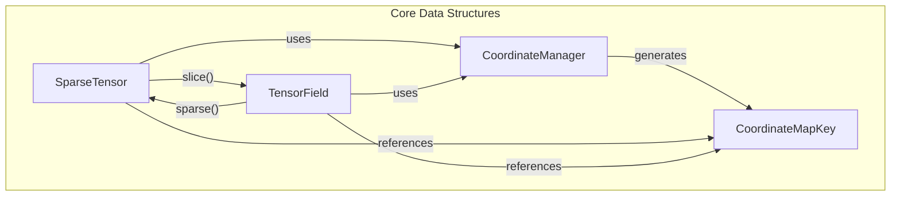
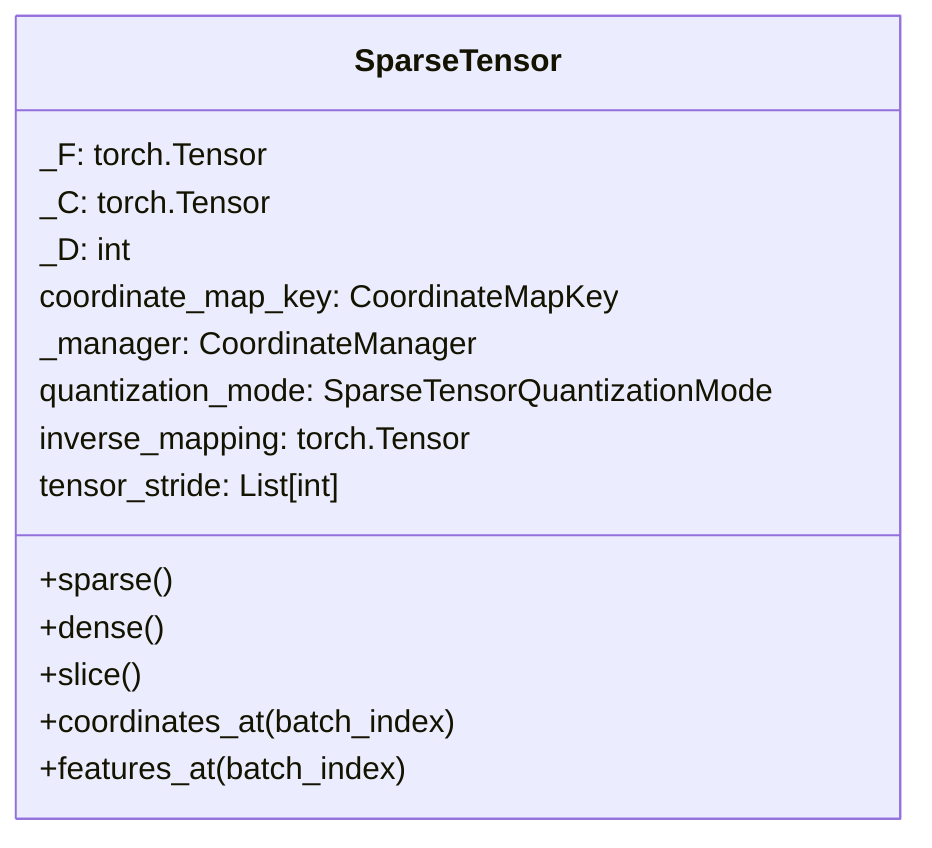
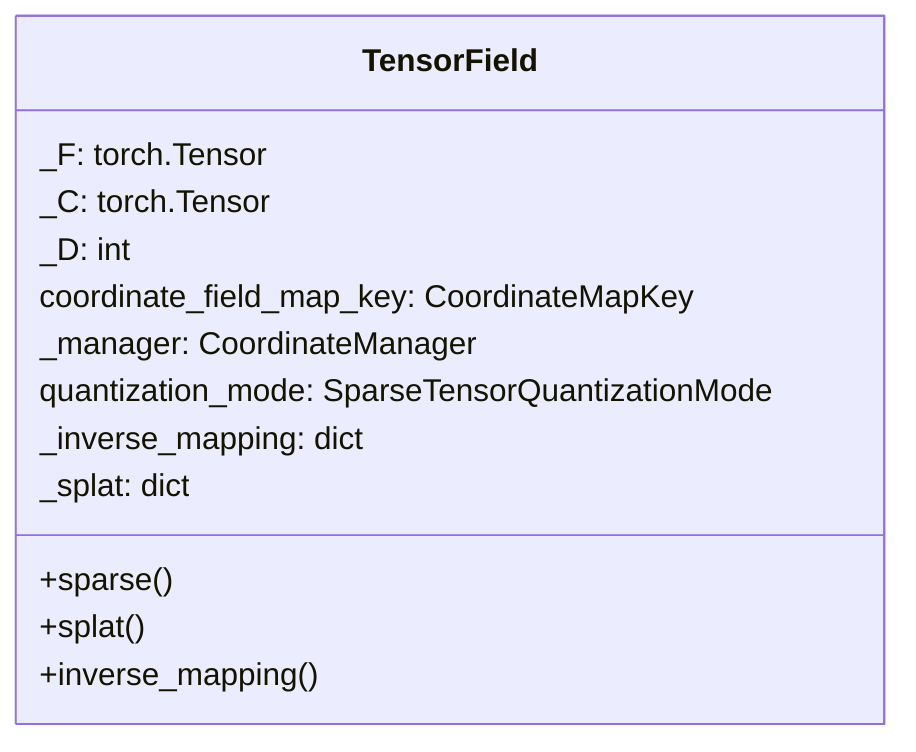
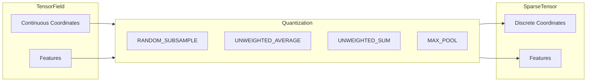
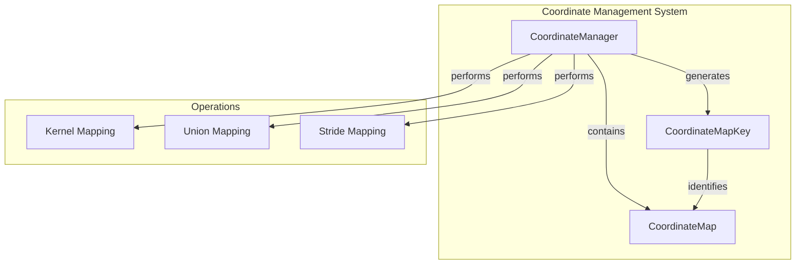
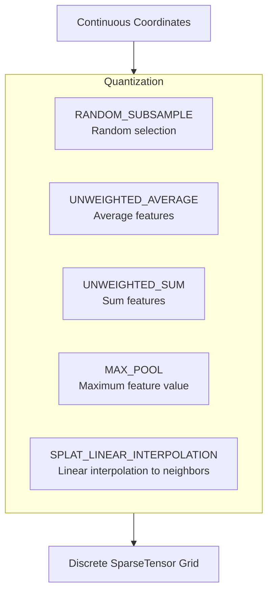
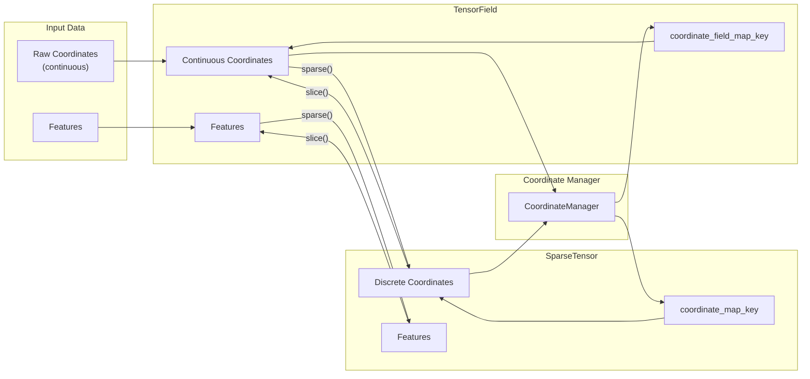
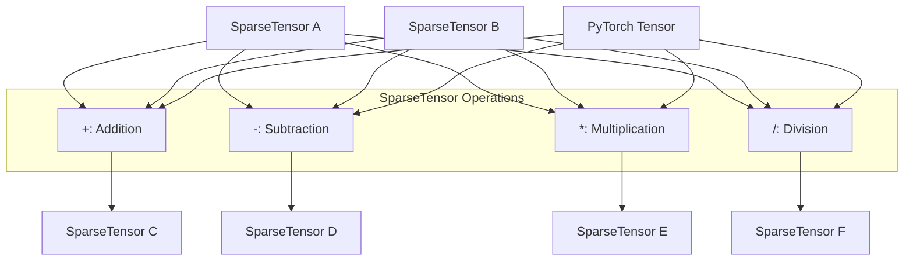

<!-- source: DeepWiki mcp.deepwiki.com · repo NVIDIA/MinkowskiEngine · page 2 Core Data Structures · fetched 2026-10-26 -->

# Core Data Structures

<details>
<summary>Relevant source files</summary>

The following files were used as context for generating this wiki page:

- [CHANGELOG.md](CHANGELOG.md)
- [MinkowskiEngine/MinkowskiSparseTensor.py](MinkowskiEngine/MinkowskiSparseTensor.py)
- [MinkowskiEngine/MinkowskiTensor.py](MinkowskiEngine/MinkowskiTensor.py)
- [MinkowskiEngine/MinkowskiTensorField.py](MinkowskiEngine/MinkowskiTensorField.py)
- [MinkowskiEngine/__init__.py](MinkowskiEngine/__init__.py)
- [tests/python/tensor_field.py](tests/python/tensor_field.py)

</details>


This page describes the primary data structures that form the foundation of MinkowskiEngine. These structures enable efficient processing of sparse 3D point cloud data through sparse tensor representations. For details on operations that can be performed on these data structures, see [Neural Network Operations](#3).

## Overview of Core Data Structures

MinkowskiEngine operates on sparse tensors to efficiently process 3D point cloud data. The core data structures work together to represent sparse data and manage coordinate systems.



Sources: [MinkowskiEngine/__init__.py:73-86](), [MinkowskiEngine/MinkowskiSparseTensor.py:48-121](), [MinkowskiEngine/MinkowskiTensorField.py:76-96]()

## SparseTensor

SparseTensor is the primary tensor class in MinkowskiEngine. It uses a COOrdinate (COO) format to represent sparse data by storing coordinates and their associated features.

### Structure and Components



A SparseTensor consists of:

1. **Features (`_F`)**: A dense tensor of shape `[N × C]` where:
   - `N`: Number of non-zero elements
   - `C`: Number of feature channels

2. **Coordinates (`_C`)**: A matrix of shape `[N × (D+1)]` where:
   - `N`: Number of non-zero elements
   - `D`: Spatial dimensions (e.g., 3 for 3D)
   - First column: Batch indices

3. **CoordinateMapKey**: Identifies the coordinate system and tensor stride

4. **CoordinateManager**: Manages coordinate mappings and operations

5. **Tensor Stride**: Defines the distance between adjacent elements

### Mathematical Representation

A SparseTensor can be represented mathematically as:

```
C = [b₁  x₁¹  x₁²  ... x₁ᴰ]
    [b₂  x₂¹  x₂²  ... x₂ᴰ]
    [...                  ]
    [bₙ  xₙ¹  xₙ²  ... xₙᴰ]

F = [f₁]
    [f₂]
    [..]
    [fₙ]
```

Where:
- `(b_i, x_i¹, x_i², ..., x_iᴰ)` is the coordinate of the i-th point
- `f_i` is the feature vector at that coordinate

### Creation and Initialization

A SparseTensor can be created in several ways:

```python
# From coordinates and features
sparse_tensor = ME.SparseTensor(features=feats, coordinates=coords)

# From an existing coordinate system
sparse_tensor = ME.SparseTensor(
    features=feats, 
    coordinate_map_key=existing_tensor.coordinate_map_key,
    coordinate_manager=existing_tensor.coordinate_manager
)

# With specific quantization mode
sparse_tensor = ME.SparseTensor(
    features=feats, 
    coordinates=coords,
    quantization_mode=ME.SparseTensorQuantizationMode.UNWEIGHTED_AVERAGE
)
```

### Key Methods

- **sparse()**: Convert to torch sparse tensor
- **dense()**: Convert to dense tensor
- **slice()**: Extract features at original continuous coordinates
- **coordinates_at(batch_index)**: Get coordinates for specific batch
- **features_at(batch_index)**: Get features for specific batch

Sources: [MinkowskiEngine/MinkowskiSparseTensor.py:48-751](), [MinkowskiEngine/MinkowskiTensor.py:139-604]()

## TensorField

TensorField represents features defined on continuous coordinates before quantization to a SparseTensor grid. It allows operations on continuous coordinate data and provides mechanisms to convert to and from SparseTensors.

### Structure and Components



A TensorField consists of:

1. **Features (`_F`)**: Feature vectors for each continuous coordinate
2. **Coordinates (`_C`)**: Continuous coordinates in a matrix of shape `[N × (D+1)]`
3. **CoordinateFieldMapKey**: Identifies the continuous coordinate field
4. **InverseMapping**: Maps between continuous and discrete coordinates

### Conversion to SparseTensor

TensorField provides the `sparse()` method to convert continuous coordinates to discrete SparseTensors with various quantization modes:

1. **RANDOM_SUBSAMPLE**: Randomly selects one feature when multiple fall in same voxel
2. **UNWEIGHTED_AVERAGE**: Averages all features within the same voxel
3. **UNWEIGHTED_SUM**: Sums all features within the same voxel
4. **MAX_POOL**: Takes maximum feature value in each voxel



### Splat and Interpolation

TensorField supports two unique operations:

1. **splat()**: Distributes features from continuous coordinates to neighboring discrete grid points using linear interpolation
2. **slice()**: Extracts features from a SparseTensor back to the original continuous coordinates 

Sources: [MinkowskiEngine/MinkowskiTensorField.py:76-506](), [tests/python/tensor_field.py:38-271]()

## Coordinate Management System

The coordinate management system is the backbone of MinkowskiEngine's sparse tensor operations. It efficiently maps between coordinates and manages operations like convolution and pooling.

### Key Components



### CoordinateManager

The CoordinateManager is responsible for:

1. Managing coordinate maps and their relationships
2. Generating mappings for neural network operations
3. Handling coordinate quantization and transformations
4. Providing an efficient way to look up coordinates

### CoordinateMapKey

A CoordinateMapKey uniquely identifies a coordinate system with:

1. Tensor stride: Spacing between coordinates
2. Optional string identifier

### Coordinate Mapping Operations

The coordinate manager enables these key operations:

1. **insert_and_map**: Add new coordinates and map them to existing ones
2. **kernel_map**: Generate mappings for convolution kernels
3. **stride_map**: Create mappings for strided operations
4. **union_map**: Combine multiple coordinate maps

Sources: [MinkowskiEngine/__init__.py:93-98](), [MinkowskiEngine/MinkowskiTensor.py:33-62]()

## Quantization Modes

MinkowskiEngine provides several quantization modes to convert continuous coordinates to discrete grid points:

### SparseTensorQuantizationMode



1. **RANDOM_SUBSAMPLE**: Randomly selects one point's features when multiple points map to the same voxel
2. **UNWEIGHTED_AVERAGE**: Averages all features within a voxel (default for TensorField to SparseTensor)
3. **UNWEIGHTED_SUM**: Sums all features within a voxel
4. **MAX_POOL**: Selects the maximum feature value in each voxel
5. **SPLAT_LINEAR_INTERPOLATION**: Distributes features to 2^D neighboring voxels using linear interpolation weights

The following example shows the different results of quantization modes on a small point cloud:

```python
# For coordinates: [[0, 1], [0, 1], [0, 2], [0, 2], [1, 0], [1, 0], [1, 1]]
# With features:   [[0], [1], [2], [3], [5], [6], [7]]

# UNWEIGHTED_AVERAGE results: {0.5, 2.5, 5.5, 7}
# MAX_POOL results:           {1, 3, 6, 7}
```

Sources: [MinkowskiEngine/MinkowskiTensor.py:47-61](), [tests/python/tensor_field.py:71-96]()

## Data Flow Between Core Structures

The following diagram illustrates how data flows between the core data structures in typical MinkowskiEngine operations:



This bidirectional relationship between TensorField and SparseTensor enables a flexible workflow:

1. Start with continuous coordinates in a TensorField
2. Convert to discrete SparseTensor for efficient computation
3. Apply neural network operations on SparseTensors
4. Convert back to continuous coordinates with slice() when needed

Sources: [MinkowskiEngine/MinkowskiSparseTensor.py:559-632](), [MinkowskiEngine/MinkowskiTensorField.py:286-450]()

## Binary Operations on Sparse Tensors

SparseTensor and TensorField support binary operations (addition, subtraction, multiplication, division) that work both between sparse tensors and between a sparse tensor and a regular PyTorch tensor.



When operating between two sparse tensors with different coordinate systems, a coordinate union is automatically performed. For sparse tensors with the same coordinate system, operations are performed element-wise directly.

Sources: [MinkowskiEngine/MinkowskiTensor.py:490-585]()

## Memory Management Considerations

SparseTensor and TensorField objects can share the same coordinate manager through the global coordinate manager mechanism. This can be controlled with `set_sparse_tensor_operation_mode`:

```python
# Share coordinate manager globally between tensors
ME.set_sparse_tensor_operation_mode(ME.SparseTensorOperationMode.SHARE_COORDINATE_MANAGER)

# Use separate coordinate manager for each tensor (default)
ME.set_sparse_tensor_operation_mode(ME.SparseTensorOperationMode.SEPARATE_COORDINATE_MANAGER)
```

Using the shared mode can significantly reduce memory usage and computation time when working with multiple related sparse tensors, but requires explicit clearing of the global coordinate manager after use:

```python
# After operations are complete
ME.clear_global_coordinate_manager()
```

Sources: [MinkowskiEngine/MinkowskiTensor.py:63-136]()

---

