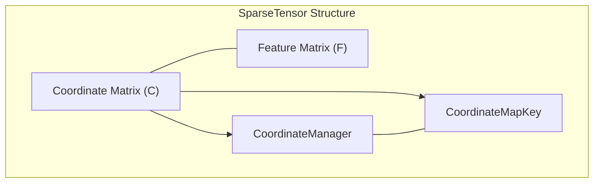
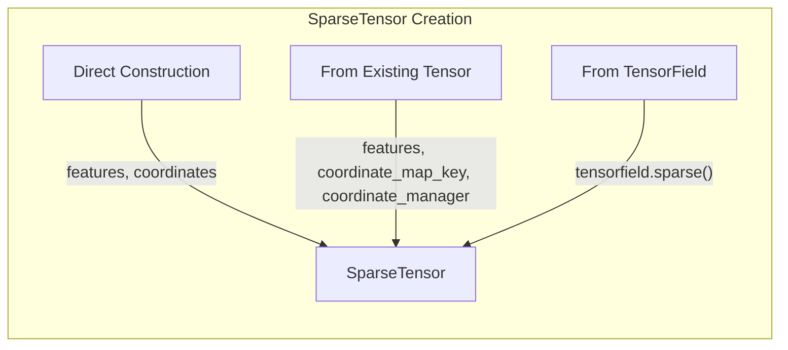
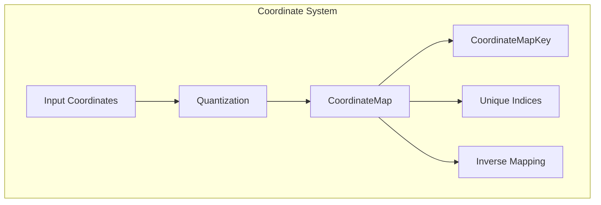
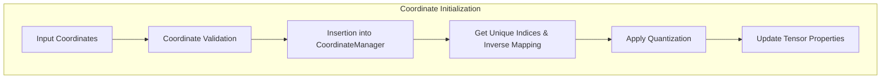
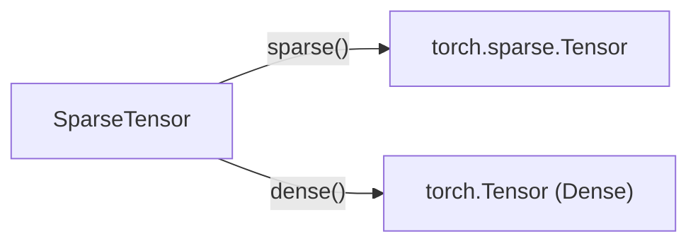
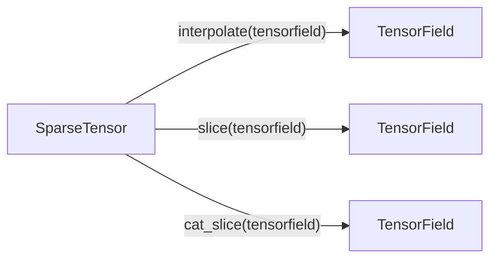
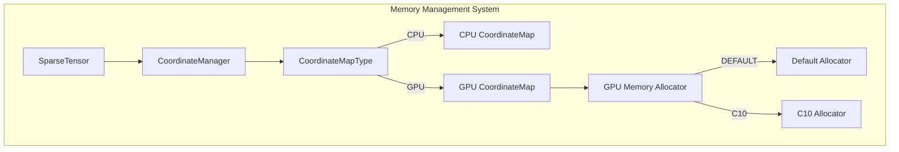
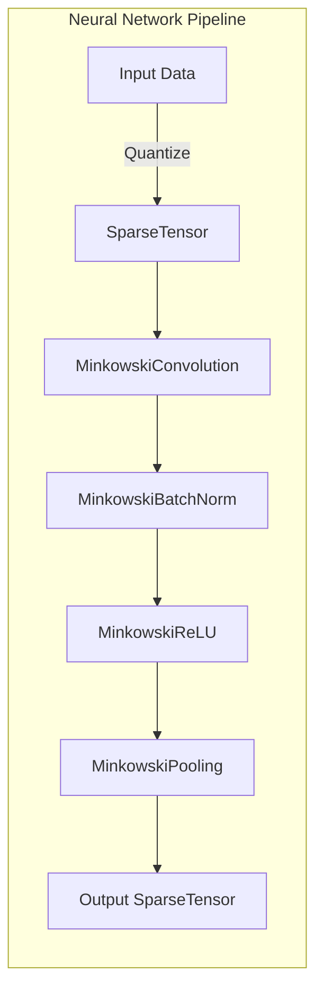

<!-- source: DeepWiki mcp.deepwiki.com · repo NVIDIA/MinkowskiEngine · page 2.1 SparseTensor · fetched 2026-10-26 -->

# SparseTensor

<details>
<summary>Relevant source files</summary>

The following files were used as context for generating this wiki page:

- [MinkowskiEngine/MinkowskiSparseTensor.py](MinkowskiEngine/MinkowskiSparseTensor.py)
- [MinkowskiEngine/MinkowskiTensor.py](MinkowskiEngine/MinkowskiTensor.py)
- [MinkowskiEngine/MinkowskiTensorField.py](MinkowskiEngine/MinkowskiTensorField.py)
- [src/coordinate_map_manager.cu](src/coordinate_map_manager.cu)
- [tests/python/sparse_tensor.py](tests/python/sparse_tensor.py)
- [tests/python/tensor_field.py](tests/python/tensor_field.py)

</details>


The `SparseTensor` class is the fundamental tensor data structure in MinkowskiEngine, designed for efficient representation and processing of sparse data like 3D point clouds. It represents data using only the non-zero elements and their corresponding spatial coordinates, making it memory-efficient for sparse data processing. This page explains how the `SparseTensor` works and how to use it effectively.

For information about the continuous coordinate version of SparseTensor, see [TensorField](#2.2).

## 1. Overview

`SparseTensor` is a sparse tensor representation using the COOrdinate (COO) format, which consists of:

1. A coordinate matrix `C` (size N×(D+1)) containing spatial positions and batch indices
2. A feature matrix `F` (size N×F) containing features for each coordinate
3. A coordinate management system to handle sparse operations efficiently



Sources: [MinkowskiEngine/MinkowskiSparseTensor.py:47-52](). [MinkowskiEngine/MinkowskiTensor.py:139-145]()

## 2. Mathematical Representation

A `SparseTensor` is mathematically represented as:

$$
\mathbf{C} = \begin{bmatrix}
b_1    & x_1^1  & x_1^2  & \cdots & x_1^D  \\
\vdots & \vdots & \vdots & \ddots & \vdots \\
b_N    & x_N^1  & x_N^2  & \cdots & x_N^D
\end{bmatrix}, \; \mathbf{F} = \begin{bmatrix}
\mathbf{f}_1^T\\
\vdots\\
\mathbf{f}_N^T
\end{bmatrix}
$$

Where:
- $\mathbf{x}_i \in \mathcal{Z}^D$ is a D-dimensional coordinate
- $b_i \in \mathcal{Z}_+$ is the batch index
- $\mathbf{f}_i$ is the feature vector associated with coordinate $\mathbf{x}_i$
- N is the number of non-zero elements in the sparse tensor

Sources: [MinkowskiEngine/MinkowskiSparseTensor.py:52-76]()

## 3. Initialization

### 3.1 Constructor Parameters

```python
SparseTensor(
    features: torch.Tensor,               # Required: Features for non-zero elements
    coordinates: torch.Tensor = None,     # Coordinates for non-zero elements
    tensor_stride: StrideType = 1,        # Stride between tensor elements
    coordinate_map_key: CoordinateMapKey = None,  # Optional: Reuse existing coordinates
    coordinate_manager: CoordinateManager = None, # Optional: Coordinate manager
    quantization_mode: SparseTensorQuantizationMode = SparseTensorQuantizationMode.RANDOM_SUBSAMPLE,
    allocator_type: GPUMemoryAllocatorType = None,
    minkowski_algorithm: MinkowskiAlgorithm = None,
    requires_grad = None,                 # Gradient requirements
    device = None                         # Device placement
)
```

Sources: [MinkowskiEngine/MinkowskiSparseTensor.py:122-189]()

### 3.2 Creation Methods

There are several ways to create a `SparseTensor`:



Sources: [MinkowskiEngine/MinkowskiSparseTensor.py:122-189](), [MinkowskiEngine/MinkowskiTensorField.py:286-378]()

### 3.3 Initialization Examples

```python
# 1. Basic initialization with coordinates and features
coords = torch.IntTensor([[0, 1, 2], [0, 3, 5], [0, 5, 6]]) # batch_idx, x, y
feats = torch.FloatTensor([[1.0], [2.0], [3.0]])
A = SparseTensor(features=feats, coordinates=coords)

# 2. Reusing coordinate system from another tensor
B = SparseTensor(features=new_feats, coordinate_map_key=A.coordinate_map_key, coordinate_manager=A.coordinate_manager)

# 3. With quantization mode for handling duplicate coordinates
C = SparseTensor(
    features=feats, 
    coordinates=coords, 
    quantization_mode=SparseTensorQuantizationMode.UNWEIGHTED_AVERAGE
)

# 4. With specific tensor stride
D = SparseTensor(features=feats, coordinates=coords, tensor_stride=2)
```

Sources: [MinkowskiEngine/MinkowskiSparseTensor.py:79-86](), [tests/python/sparse_tensor.py:43-66]()

## 4. Coordinate Management and Quantization

`SparseTensor` manages coordinates through the `CoordinateManager` which handles mappings between coordinate spaces. When creating a tensor, the coordinates are processed and a coordinate map is generated.

### 4.1 Coordinate System



Sources: [MinkowskiEngine/MinkowskiSparseTensor.py:293-345]()

### 4.2 Quantization Modes

`SparseTensor` provides several quantization modes to handle duplicate coordinates:

| Quantization Mode | Description |
|-------------------|-------------|
| `RANDOM_SUBSAMPLE` | Randomly select one coordinate per voxel (default) |
| `UNWEIGHTED_AVERAGE` | Average all features within a voxel |
| `UNWEIGHTED_SUM` | Sum all features within a voxel |
| `NO_QUANTIZATION` | No quantization applied (not for normal use) |
| `MAX_POOL` | Apply max pooling to features within a voxel |

Sources: [MinkowskiEngine/MinkowskiTensor.py:47-61]()

### 4.3 Coordinate Initialization Process



Sources: [MinkowskiEngine/MinkowskiSparseTensor.py:293-345]()

## 5. Properties and Attributes

`SparseTensor` provides several properties to access its internal state:

| Property | Description |
|----------|-------------|
| `coordinates`, `C` | The coordinate matrix |
| `features`, `F` | The feature matrix |
| `coordinate_map_key` | The key identifying the tensor in the coordinate manager |
| `coordinate_manager` | The manager handling coordinate operations |
| `tensor_stride` | The stride between tensor elements |
| `dimension`, `D` | The spatial dimension of the tensor |
| `device` | The device on which the tensor is stored |
| `dtype` | The data type of the feature tensor |
| `shape` | The shape of the feature matrix |

Sources: [MinkowskiEngine/MinkowskiSparseTensor.py:228-248](), [MinkowskiEngine/MinkowskiTensor.py:210-474]()

## 6. Basic Operations

### 6.1 Mathematical Operations

`SparseTensor` supports standard mathematical operations:

```python
# Addition
C = A + B  # Add features at corresponding coordinates

# Subtraction
C = A - B  # Subtract features at corresponding coordinates

# Multiplication
C = A * B  # Multiply features at corresponding coordinates

# Division
C = A / B  # Divide features at corresponding coordinates
```

When operating on two sparse tensors with different coordinate systems, the operation creates a union of coordinates.

Sources: [MinkowskiEngine/MinkowskiTensor.py:490-585]()

### 6.2 Format Conversions

`SparseTensor` provides methods to convert to other tensor formats:



Sources: [MinkowskiEngine/MinkowskiSparseTensor.py:348-557]()

#### 6.2.1 To Sparse Tensor

Converts to a PyTorch sparse tensor:

```python
sparse_tensor, min_coords, tensor_stride = tensor.sparse(
    min_coords=None,     # Optional minimum coordinates
    max_coords=None,     # Optional maximum coordinates
    contract_coords=True # Divide coords by tensor_stride for contiguity
)
```

Sources: [MinkowskiEngine/MinkowskiSparseTensor.py:348-458]()

#### 6.2.2 To Dense Tensor

Converts to a dense PyTorch tensor:

```python
dense_tensor, min_coordinate, tensor_stride = tensor.dense(
    shape=None,           # Optional output shape
    min_coordinate=None,  # Optional minimum coordinate
    contract_stride=True  # Divide coords by tensor_stride for contiguity
)
```

Sources: [MinkowskiEngine/MinkowskiSparseTensor.py:460-557]()

## 7. Advanced Features

### 7.1 Batch-wise Operations

`SparseTensor` provides methods to access features and coordinates by batch:

```python
# Get coordinates at batch index 0
coords_batch0 = tensor.coordinates_at(batch_index=0)

# Get features at batch index 1
feats_batch1 = tensor.features_at(batch_index=1)

# Get both coordinates and features at batch index
coords, feats = tensor.coordinates_and_features_at(batch_index)

# Get lists of coordinates and features for all batches
all_coords, all_feats = tensor.decomposed_coordinates_and_features
```

Sources: [MinkowskiEngine/MinkowskiTensor.py:309-423]()

### 7.2 Feature Extraction at Coordinates

Extract features at specific continuous coordinates:

```python
# Extract features at query coordinates
query_coords = torch.FloatTensor([[0, 0.1], [0, 1.1]])
features = tensor.features_at_coordinates(query_coords)
```

Sources: [MinkowskiEngine/MinkowskiSparseTensor.py:690-718]()

### 7.3 Slicing and Interpolation

`SparseTensor` provides methods to interpolate and slice with `TensorField`:



Sources: [MinkowskiEngine/MinkowskiSparseTensor.py:559-688]()

#### Interpolation

```python
# Interpolate sparse tensor features onto continuous coordinates in a TensorField
interpolated_field = sparse_tensor.interpolate(tensor_field)
```

#### Slicing

```python
# Retrieve features from the sparse tensor corresponding to original coordinates
# in a TensorField (reverses quantization)
sliced_field = sparse_tensor.slice(tensor_field)

# Similar to slice but concatenates sparse tensor features with tensor field features
cat_sliced_field = sparse_tensor.cat_slice(tensor_field)
```

Sources: [MinkowskiEngine/MinkowskiSparseTensor.py:578-688]()

## 8. Implementation Details

### 8.1 Memory Management

`SparseTensor` uses a sophisticated coordinate management system to efficiently handle sparse data operations. The library provides options for different GPU memory allocators through the `allocator_type` parameter.



Sources: [MinkowskiEngine/MinkowskiSparseTensor.py:230-258](), [src/coordinate_map_manager.cu:1-30]()

### 8.2 Operation Modes

`SparseTensor` can operate in different modes regarding coordinate manager sharing:

```python
# Set global operation mode to share coordinate managers
ME.set_sparse_tensor_operation_mode(ME.SparseTensorOperationMode.SHARE_COORDINATE_MANAGER)

# Create sparse tensors that share the same coordinate manager
a = ME.SparseTensor(...)
b = ME.SparseTensor(...)  # Uses the same coordinate manager as 'a'

# Clear the global coordinate manager when done
ME.clear_global_coordinate_manager()
```

Sources: [MinkowskiEngine/MinkowskiTensor.py:33-45](), [MinkowskiEngine/MinkowskiTensor.py:71-136]()

## 9. Best Practices and Considerations

1. **GPU Usage**: When using GPU, provide coordinates directly on the GPU to avoid unnecessary CPU-to-GPU transfers:
   ```python
   # Efficient: coordinates already on GPU
   SparseTensor(features.cuda(), coordinates.cuda())
   
   # Less efficient: coordinates will be processed on CPU first
   SparseTensor(features, coordinates).cuda()
   ```

2. **Batch Handling**: For batch processing, use `MinkowskiEngine.utils.batched_coordinates` or `MinkowskiEngine.utils.sparse_collate` to prepare batched coordinates.

3. **Memory Efficiency**: For large datasets, consider using `SparseTensorOperationMode.SHARE_COORDINATE_MANAGER` to reduce memory usage.

4. **Coordinate Manager Lifecycle**: When using shared coordinate managers, explicitly clear them with `clear_global_coordinate_manager()` after processing.

Sources: [MinkowskiEngine/MinkowskiSparseTensor.py:88-119](), [tests/python/sparse_tensor.py:288-334]()

## 10. Integration with Neural Networks

`SparseTensor` is designed to work seamlessly with neural network operations provided by MinkowskiEngine. Common operations include:

- MinkowskiConvolution
- MinkowskiPooling
- MinkowskiNormalization
- MinkowskiNonlinearities



See [Neural Network Operations](#3) for more details on available operations.

Sources: [tests/python/tensor_field.py:116-147]()

---

