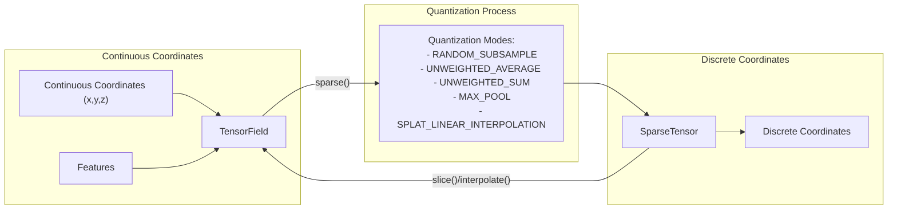
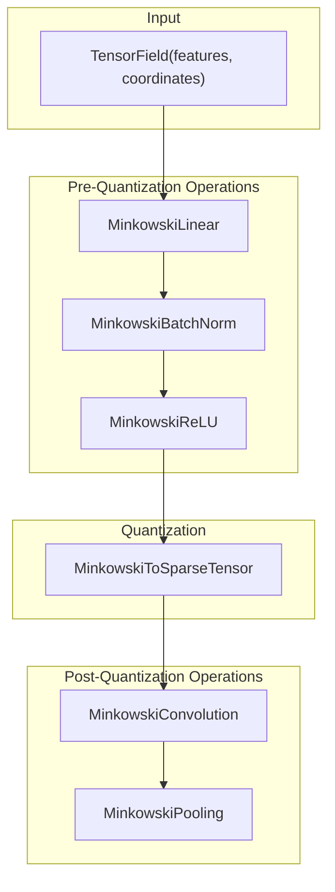

<!-- source: DeepWiki mcp.deepwiki.com · repo NVIDIA/MinkowskiEngine · page 2.2 TensorField · fetched 2026-10-26 -->

# TensorField

<details>
<summary>Relevant source files</summary>

The following files were used as context for generating this wiki page:

- [MinkowskiEngine/MinkowskiFunctional.py](MinkowskiEngine/MinkowskiFunctional.py)
- [MinkowskiEngine/MinkowskiNetwork.py](MinkowskiEngine/MinkowskiNetwork.py)
- [MinkowskiEngine/MinkowskiNonlinearity.py](MinkowskiEngine/MinkowskiNonlinearity.py)
- [MinkowskiEngine/MinkowskiNormalization.py](MinkowskiEngine/MinkowskiNormalization.py)
- [MinkowskiEngine/MinkowskiOps.py](MinkowskiEngine/MinkowskiOps.py)
- [MinkowskiEngine/MinkowskiSparseTensor.py](MinkowskiEngine/MinkowskiSparseTensor.py)
- [MinkowskiEngine/MinkowskiTensor.py](MinkowskiEngine/MinkowskiTensor.py)
- [MinkowskiEngine/MinkowskiTensorField.py](MinkowskiEngine/MinkowskiTensorField.py)
- [tests/python/tensor_field.py](tests/python/tensor_field.py)

</details>


This document provides a comprehensive explanation of the TensorField class in the MinkowskiEngine library, which is a key data structure for handling continuous coordinate data and features in sparse tensor networks. TensorField is particularly useful for representing and manipulating point cloud data before quantization. For discrete sparse representations, see [SparseTensor](#2.1).

## Purpose and Overview

TensorField represents a tensor with continuous coordinates in a sparse tensor network. Unlike SparseTensor which works with discrete, quantized coordinates, TensorField preserves the original continuous coordinate information while enabling various operations that can be applied directly to the continuous space before quantization.

The primary purposes of TensorField include:

1. Storing continuous coordinate data (e.g., raw point cloud coordinates) with associated features
2. Providing methods to convert continuous coordinates to discrete coordinates (quantization)
3. Maintaining mappings between continuous and quantized coordinates
4. Supporting neural network operations directly on continuous coordinate data
5. Enabling interpolation between continuous and discretized feature spaces

Sources: [MinkowskiEngine/MinkowskiTensorField.py:76-81](), [MinkowskiEngine/MinkowskiTensorField.py:76-506]()

## Relationship to SparseTensor

TensorField is closely related to SparseTensor but serves a distinct role in the processing pipeline:



Sources: [MinkowskiEngine/MinkowskiTensorField.py:286-373](), [MinkowskiEngine/MinkowskiSparseTensor.py:559-633]()

## Core Implementation

TensorField inherits from the base Tensor class, which provides common functionality for both TensorField and SparseTensor:

```mermaid
classDiagram
    class Tensor {
        +_F : Features
        +_C : Coordinates
        +_D : Dimension
        +_manager : CoordinateManager
        +F() : Features
        +C() : Coordinates
        +tensor_stride : Property
        +dimension : Property
    }
    
    class TensorField {
        +coordinate_field_map_key
        +_inverse_mapping{}
        +_splat{}
        +quantization_mode
        +sparse(tensor_stride, quantization_mode) : SparseTensor
        +splat() : SparseTensor
        +inverse_mapping(sparse_tensor_map_key)
    }
    
    class SparseTensor {
        +coordinate_map_key
        +unique_index
        +inverse_mapping
        +slice(X) : TensorField
        +interpolate(X) : TensorField
        +features_at_coordinates(query_coordinates)
    }
    
    Tensor <|-- TensorField
    Tensor <|-- SparseTensor
```

Sources: [MinkowskiEngine/MinkowskiTensorField.py:76-81](), [MinkowskiEngine/MinkowskiTensor.py:139-144]()

### Key Properties

TensorField contains several key properties:

| Property | Description |
|----------|-------------|
| `_F` | Features associated with the coordinates |
| `_C` | Continuous coordinates matrix (N × (D+1)) where N is the number of points and D is the dimension |
| `coordinate_field_map_key` | Key for the coordinate field mapping in the coordinate manager |
| `quantization_mode` | Defines how continuous coordinates will be quantized when converting to SparseTensor |
| `_inverse_mapping` | Dictionary storing mappings from sparse tensor keys to field indices |
| `_splat` | Dictionary storing splat operation results |

Sources: [MinkowskiEngine/MinkowskiTensorField.py:245-247](), [MinkowskiEngine/MinkowskiTensorField.py:496-506]()

## Initialization and Creation

### Constructor Parameters

TensorField can be initialized with the following parameters:

```python
TensorField(
    features: torch.Tensor,              # Features for each point (N × F)
    coordinates: torch.Tensor = None,    # Continuous coordinates (N × (D+1))
    tensor_stride: StrideType = 1,       # Tensor stride for the coordinate field
    coordinate_field_map_key = None,     # Optional existing coordinate field map key
    coordinate_manager = None,           # Optional coordinate manager
    quantization_mode = SparseTensorQuantizationMode.UNWEIGHTED_AVERAGE,  # Quantization mode
    allocator_type = None,               # GPU memory allocator type
    minkowski_algorithm = None,          # Algorithm mode (memory vs. speed)
    requires_grad = None,                # Whether features require gradients
    device = None                        # Device for the tensor
)
```

Sources: [MinkowskiEngine/MinkowskiTensorField.py:77-91](), [MinkowskiEngine/MinkowskiTensorField.py:92-143]()

### Quantization Modes

TensorField supports multiple quantization modes when converting to SparseTensor:

| Mode | Description |
|------|-------------|
| `RANDOM_SUBSAMPLE` | Randomly selects one point per discretized coordinate |
| `UNWEIGHTED_AVERAGE` | Averages all features within the same discretized coordinate |
| `UNWEIGHTED_SUM` | Sums all features within the same discretized coordinate |
| `MAX_POOL` | Takes the maximum feature value within each discretized coordinate |
| `SPLAT_LINEAR_INTERPOLATION` | Distributes features to neighboring grid points with linear weights |

Sources: [MinkowskiEngine/MinkowskiTensor.py:47-61](), [MinkowskiEngine/MinkowskiTensorField.py:286-373]()

## Key Methods and Operations

### Converting to SparseTensor

The `sparse()` method converts a TensorField to a SparseTensor by quantizing the continuous coordinates:

```python
def sparse(
    self,
    tensor_stride: Union[int, Sequence, np.array] = 1,
    coordinate_map_key: CoordinateMapKey = None,
    quantization_mode: SparseTensorQuantizationMode = None,
) -> SparseTensor
```

This method applies the specified quantization mode to convert continuous coordinates to discrete coordinates, creating a SparseTensor with the appropriate feature values.

Sources: [MinkowskiEngine/MinkowskiTensorField.py:286-373]()

### Creating Splat Coordinates

The `splat()` method creates a SparseTensor with coordinates generated through linear interpolation to neighboring grid points:

```python
def splat(self) -> SparseTensor
```

This implements a special quantization mode that uses N-dimensional linear interpolation to distribute feature values to 2^N neighboring grid points.

Sources: [MinkowskiEngine/MinkowskiTensorField.py:381-406](), [MinkowskiEngine/MinkowskiTensorField.py:53-73]()

### Inverse Mapping

The `inverse_mapping()` method retrieves the mapping from a sparse tensor coordinate key to the corresponding field coordinates:

```python
def inverse_mapping(self, sparse_tensor_map_key: CoordinateMapKey)
```

This is crucial for operations that need to map between continuous and discrete coordinates.

Sources: [MinkowskiEngine/MinkowskiTensorField.py:408-450]()

### Integration with Neural Networks

TensorField supports various neural network operations that can be applied directly to continuous coordinate data before quantization:



Sources: [tests/python/tensor_field.py:109-147](), [MinkowskiEngine/MinkowskiOps.py:40-67](), [MinkowskiEngine/MinkowskiNonlinearity.py:34-61]()

## Use Cases and Examples

### Point Cloud Processing Pipeline

A typical point cloud processing pipeline using TensorField would include:

1. Loading raw point cloud data (continuous coordinates)
2. Creating a TensorField with the continuous coordinates and associated features
3. Optionally applying pre-quantization operations (linear, normalization, activation)
4. Converting to a SparseTensor using an appropriate quantization mode
5. Processing with sparse convolution operations
6. If needed, slicing back to TensorField to recover features at the original continuous coordinates

```python
# Example pipeline (pseudocode)
coordinates = load_point_cloud()  # Continuous coordinates
features = get_features()  # Features for each point

# Create TensorField
tensor_field = TensorField(
    features=features,
    coordinates=coordinates,
    quantization_mode=SparseTensorQuantizationMode.UNWEIGHTED_AVERAGE
)

# Apply initial operations directly on continuous coordinates
tensor_field = linear_layer(tensor_field)
tensor_field = batch_norm(tensor_field)
tensor_field = relu(tensor_field)

# Convert to SparseTensor for sparse convolutions
sparse_tensor = tensor_field.sparse()
sparse_tensor = sparse_convolution(sparse_tensor)

# Get features back at original continuous coordinates
output_field = sparse_tensor.slice(tensor_field)
```

Sources: [tests/python/tensor_field.py:98-147](), [tests/python/tensor_field.py:149-176]()

### Special Interpolation Techniques

TensorField also supports more advanced interpolation techniques:

1. **Splat**: Distribute features from continuous points to surrounding grid points
2. **Slice**: Retrieve features from a SparseTensor back to the original continuous coordinates
3. **Interpolate**: Sample features at arbitrary continuous coordinates from a SparseTensor

Sources: [MinkowskiEngine/MinkowskiTensorField.py:381-406](), [MinkowskiEngine/MinkowskiSparseTensor.py:559-597]()

## Technical Considerations

### Device Support

TensorField works on both CPU and GPU, with coordinate management adapting to the device:

```python
# CPU TensorField
tensor_field_cpu = TensorField(features, coordinates)

# GPU TensorField
tensor_field_gpu = TensorField(features, coordinates, device="cuda")
```

Sources: [MinkowskiEngine/MinkowskiTensorField.py:177-183](), [tests/python/tensor_field.py:58-69]()

### Memory Management

When creating multiple TensorFields, the coordinate manager can be shared to reduce memory usage:

```python
# Shared coordinate manager mode
set_sparse_tensor_operation_mode(SparseTensorOperationMode.SHARE_COORDINATE_MANAGER)
tensor_field1 = TensorField(features1, coordinates1)
tensor_field2 = TensorField(features2, coordinates2)  # Uses the same coordinate manager
```

Sources: [MinkowskiEngine/MinkowskiTensorField.py:189-215](), [MinkowskiEngine/MinkowskiTensor.py:71-87]()

## Summary

TensorField is a powerful data structure for working with continuous coordinate data in sparse tensor networks. It provides the bridge between raw point cloud data and the discrete sparse tensors used for efficient computation. By supporting various quantization modes and maintaining mappings between continuous and discrete spaces, TensorField enables flexible processing of sparse spatial data with neural networks.

---

