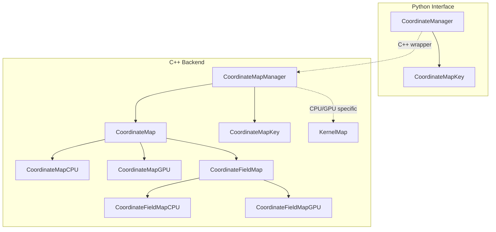
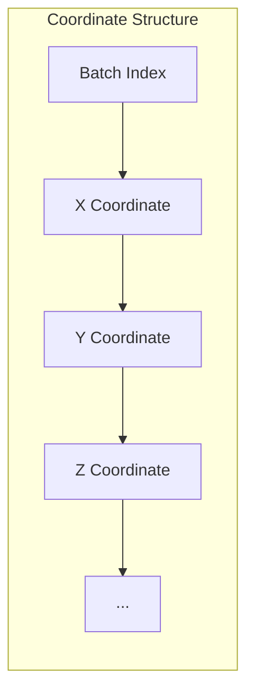
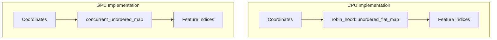
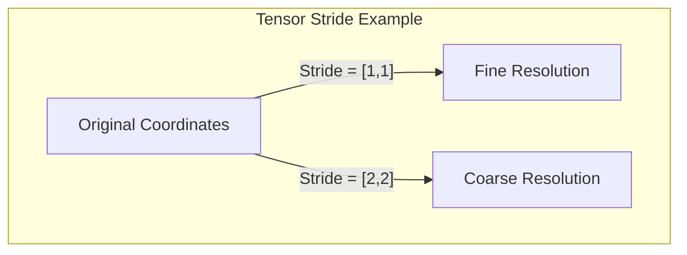
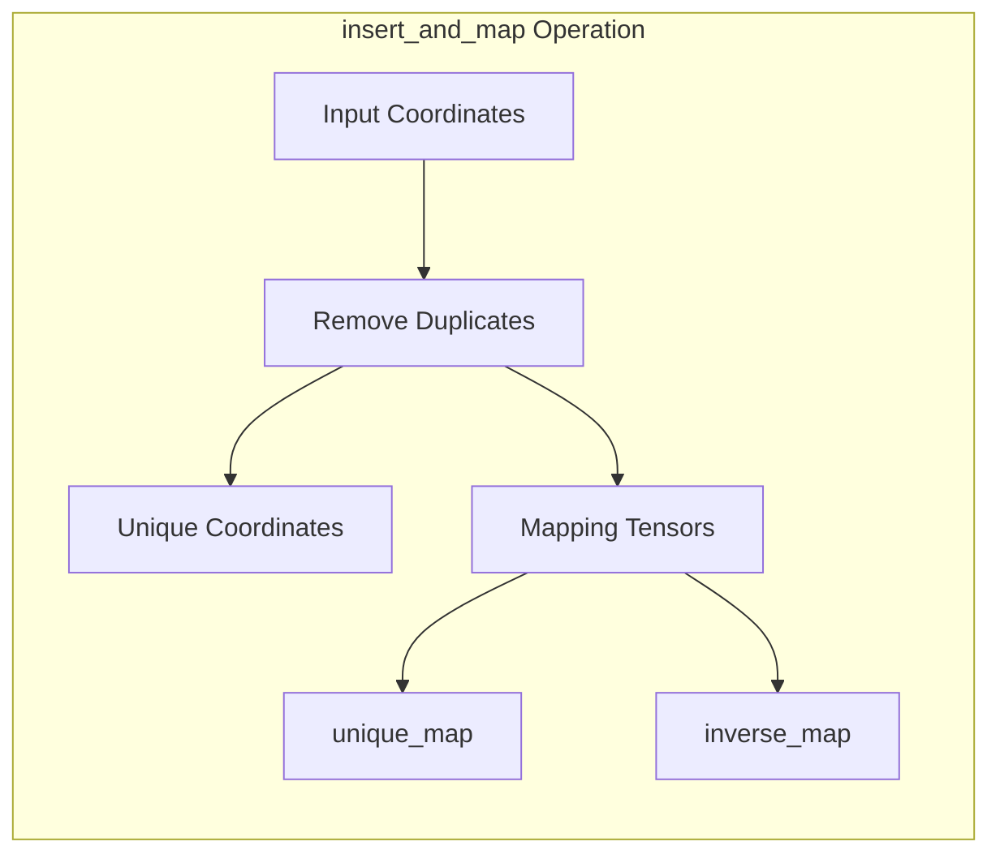
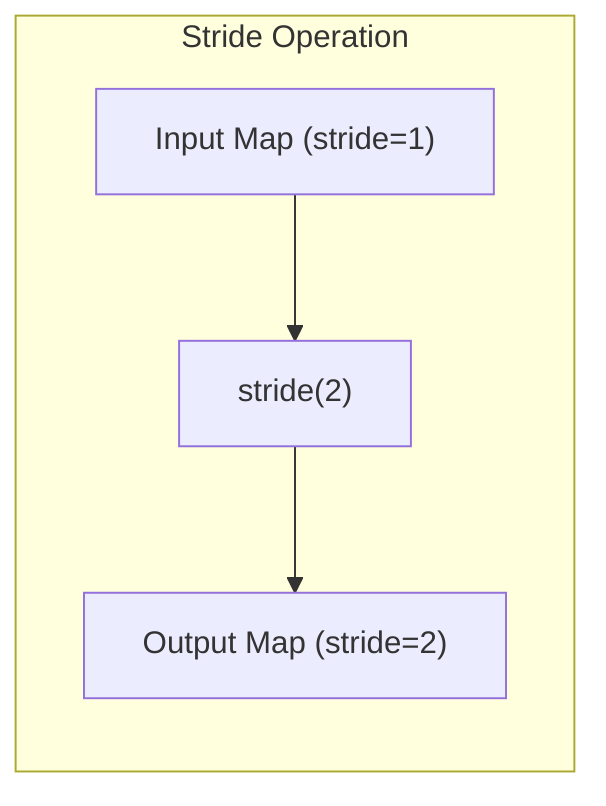
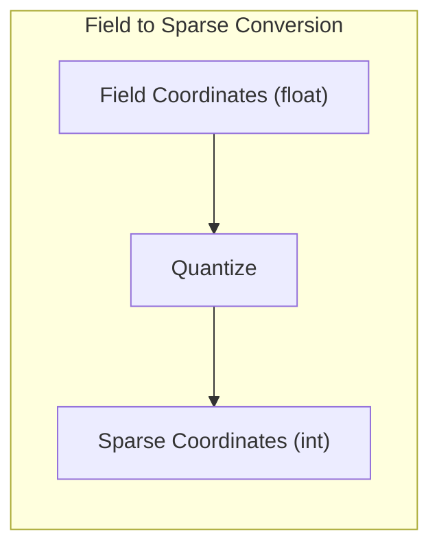
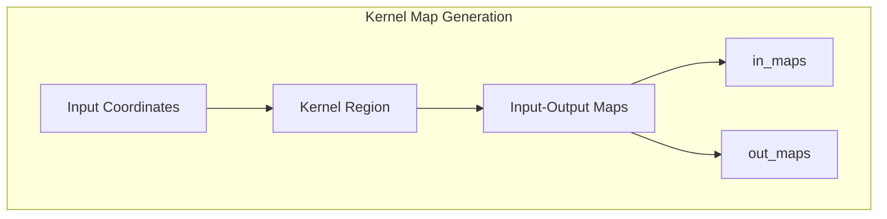
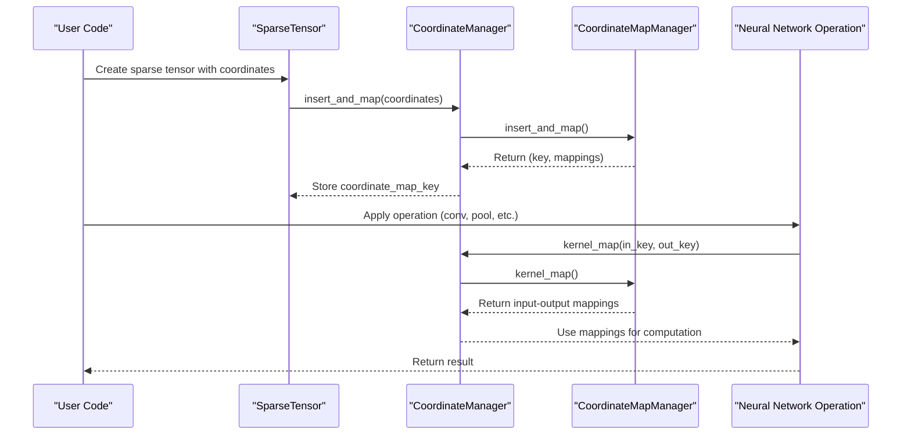
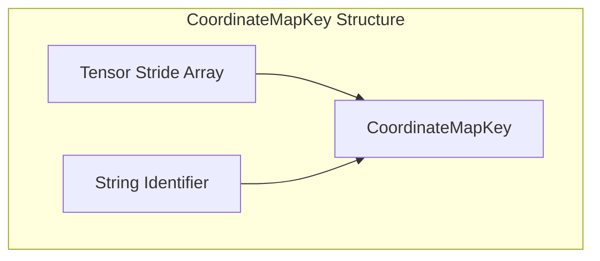

<!-- source: DeepWiki mcp.deepwiki.com · repo NVIDIA/MinkowskiEngine · page 2.3 Coordinate Management System · fetched 2026-10-26 -->

# Coordinate Management System

<details>
<summary>Relevant source files</summary>

The following files were used as context for generating this wiki page:

- [MinkowskiEngine/MinkowskiCoordinateManager.py](MinkowskiEngine/MinkowskiCoordinateManager.py)
- [pybind/extern.hpp](pybind/extern.hpp)
- [src/coordinate_map_cpu.hpp](src/coordinate_map_cpu.hpp)
- [src/coordinate_map_gpu.cu](src/coordinate_map_gpu.cu)
- [src/coordinate_map_gpu.cuh](src/coordinate_map_gpu.cuh)
- [src/coordinate_map_manager.cpp](src/coordinate_map_manager.cpp)
- [src/coordinate_map_manager.hpp](src/coordinate_map_manager.hpp)

</details>


The Coordinate Management System is a foundational component of MinkowskiEngine that efficiently manages sparse coordinates and their mappings. It handles creation, storage, and transformation of coordinate maps, which are essential for all sparse tensor operations such as convolution, pooling, and interpolation. This system provides the infrastructure needed to track the positions of non-zero elements in sparse tensors and compute their relationships across different operations.

For information about data quantization that uses this system, see [Quantization](#2.4).

## Core Components

The coordinate management system consists of several interrelated components that work together to track spatial information throughout the network:



Sources: [MinkowskiEngine/MinkowskiCoordinateManager.py](), [src/coordinate_map_manager.hpp](), [src/coordinate_map_cpu.hpp](), [src/coordinate_map_gpu.cuh]()

### Key Classes and Their Roles

| Class | Role |
|-------|------|
| `CoordinateManager` | Python interface that users interact with to manage coordinates |
| `CoordinateMapKey` | Uniquely identifies a coordinate map using tensor stride and string ID |
| `CoordinateMapManager` | C++ backend that manages multiple coordinate maps and their relationships |
| `CoordinateMap` | Base class for all coordinate map implementations |
| `CoordinateMapCPU/GPU` | CPU and GPU-specific implementations of coordinate maps |
| `CoordinateFieldMap` | Manages maps for floating-point coordinates (e.g., for continuous point clouds) |
| `KernelMap` | Defines input-output relationships for operations like convolution |

Sources: [src/coordinate_map_manager.hpp:87-564](), [MinkowskiEngine/MinkowskiCoordinateManager.py:107-498]()

## Coordinate Representation and Storage

### Coordinate Structure

Coordinates in MinkowskiEngine are represented as N-dimensional vectors, where:
- The first dimension is typically a batch index
- The remaining dimensions are spatial coordinates
- Integer coordinates (`coordinate_type`) are used for sparse tensors
- Floating-point coordinates (`coordinate_field_type`) can be used for continuous spaces



Sources: [src/coordinate_map_manager.hpp:83-109](), [src/coordinate_map_gpu.cuh:44-113]()

### Coordinate Maps

Coordinate maps provide the mapping between coordinate values and their corresponding indices in feature tensors. The system uses hash-based maps for efficient lookup:



Sources: [src/coordinate_map_cpu.hpp:280-309](), [src/coordinate_map_gpu.cuh:65-70]()

### Tensor Stride

Each coordinate map has an associated tensor stride, which defines the spacing between coordinates in each dimension. The tensor stride affects how coordinates are quantized, strided, and mapped:



Sources: [src/coordinate_map_manager.cpp:401-429]()

## Coordinate Management Operations

### Insertion and Mapping

The system provides two fundamental operations:
1. `insert` - Adds coordinates to a map without creating mappings
2. `insert_and_map` - Adds coordinates and creates mappings for duplicate removal

The mapping process returns:
- `unique_map` - Maps from input indices to unique coordinate indices
- `inverse_map` - Maps from unique coordinate indices back to input indices



Sources: [src/coordinate_map_manager.cpp:193-266](), [src/coordinate_map_cpu.hpp:352-380](), [src/coordinate_map_gpu.cu:197-291]()

### Stride Operations

The stride operation creates a new coordinate map with modified tensor stride:



Sources: [src/coordinate_map_manager.cpp:406-429](), [src/coordinate_map_cpu.hpp:418-437](), [src/coordinate_map_gpu.cu:410-483]()

### Field-to-Sparse Conversion

The system supports conversion between field (floating-point) coordinates and sparse (integer) coordinates:



Sources: [src/coordinate_map_manager.cpp:193-266](), [src/coordinate_map_gpu.cu:152-185]()

## Kernel Maps

Kernel maps define the relationships between input and output coordinates for operations like convolution and pooling. They're essential for implementing sparse neural network operations.



A kernel map consists of:
- `in_maps` - Maps from input features to kernel locations
- `out_maps` - Maps from output features to kernel locations

For each kernel position, the system computes which input coordinates affect which output coordinates.

Sources: [src/coordinate_map_cpu.hpp:569-670](), [src/coordinate_map_gpu.cu:600-692]()

## CPU vs. GPU Implementations

The system provides both CPU and GPU implementations with different characteristics:

| Feature | CPU Implementation | GPU Implementation |
|---------|-------------------|-------------------|
| Hash Map | robin_hood::unordered_flat_map | concurrent_unordered_map |
| Parallelization | OpenMP | CUDA |
| Memory Management | Standard allocators | Custom allocators (PyTorch/CUDA) |
| Suitable for | Small/medium data, CPU-only setups | Large datasets, GPU acceleration |

Sources: [src/coordinate_map_cpu.hpp:280-309](), [src/coordinate_map_gpu.cuh:65-70](), [MinkowskiEngine/MinkowskiCoordinateManager.py:126-147]()

## System Workflow and Interaction

The following diagram illustrates how the coordinate management system interacts with the rest of MinkowskiEngine:



Sources: [MinkowskiEngine/MinkowskiCoordinateManager.py:153-184](), [MinkowskiEngine/MinkowskiCoordinateManager.py:377-421]()

## Python Interface

The primary interface for users is the `CoordinateManager` class in Python, which wraps the C++ implementation:

```python
# Creating a coordinate manager
manager = CoordinateManager(D=3)  # For 3D spatial coordinates

# Inserting coordinates and getting mappings
key, (unique_map, inverse_map) = manager.insert_and_map(coordinates, tensor_stride=2)

# Getting kernel maps for convolution
kernel_maps = manager.kernel_map(
    in_key, out_key, 
    stride=2, kernel_size=3, dilation=1,
    region_type=RegionType.HYPER_CUBE
)
```

Sources: [MinkowskiEngine/MinkowskiCoordinateManager.py:107-147](), [MinkowskiEngine/MinkowskiCoordinateManager.py:153-184](), [MinkowskiEngine/MinkowskiCoordinateManager.py:377-421]()

## Implementation Details

### Memory Management

The system provides different memory allocation strategies for GPU operations:
- `GPUMemoryAllocatorType.PYTORCH` - Uses PyTorch's memory pool (default, better memory efficiency)
- `GPUMemoryAllocatorType.CUDA` - Uses raw CUDA calls (potentially faster but less memory efficient)

These can be configured using `set_gpu_allocator()` in the Python API.

Sources: [MinkowskiEngine/MinkowskiCoordinateManager.py:62-97]()

### Coordinate Map Key

The `CoordinateMapKey` uniquely identifies a coordinate map using:
- A tensor stride array specifying the resolution in each dimension
- An optional string ID to distinguish between maps with the same stride



Sources: [src/coordinate_map_key.hpp](), [pybind/extern.hpp:27-31]()

### Thread Management

The CPU implementation uses OpenMP for parallelization. The number of threads can be controlled:
- Default: Uses minimum of available CPU cores or 20
- Can be explicitly set through the constructor

Sources: [src/coordinate_map_manager.hpp:130-146](), [MinkowskiEngine/MinkowskiCoordinateManager.py:123-124]()

## Common Usage Patterns

### Creating a Sparse Tensor from Coordinates

```
1. Create a CoordinateManager
2. Call insert_and_map() with coordinates and tensor_stride
3. Use the returned key and mappings to create the SparseTensor
```

### Computing Convolution with Kernel Maps

```
1. Get input and output CoordinateMapKeys
2. Call kernel_map() with appropriate parameters
3. Use the returned maps to guide the convolution computation
```

### Striding a Sparse Tensor

```
1. Get the input CoordinateMapKey
2. Call stride() with the desired stride parameters
3. Use the returned key for the strided tensor
```

Sources: [MinkowskiEngine/MinkowskiCoordinateManager.py:153-184](), [MinkowskiEngine/MinkowskiCoordinateManager.py:254-268](), [MinkowskiEngine/MinkowskiCoordinateManager.py:377-421]()

---

