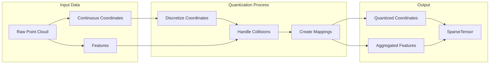
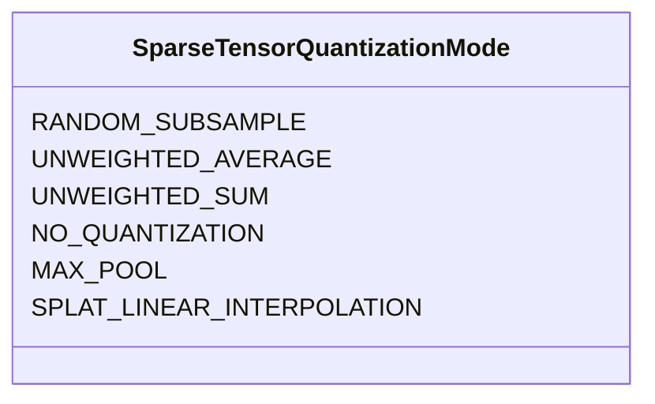
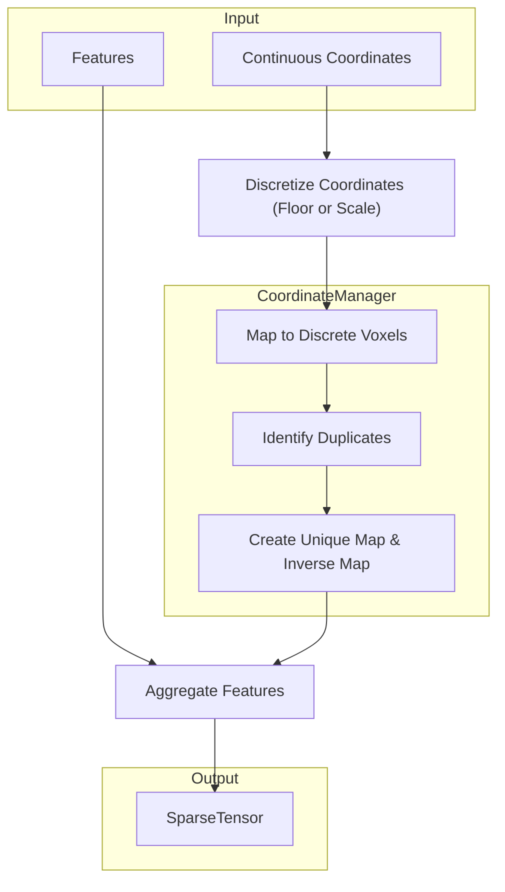
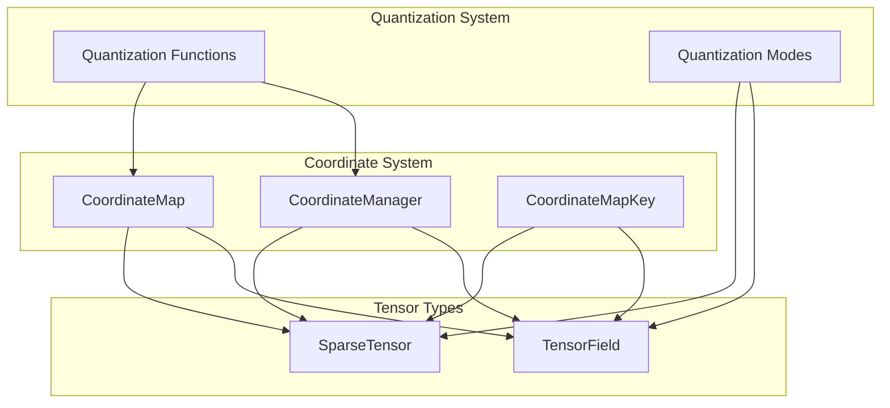
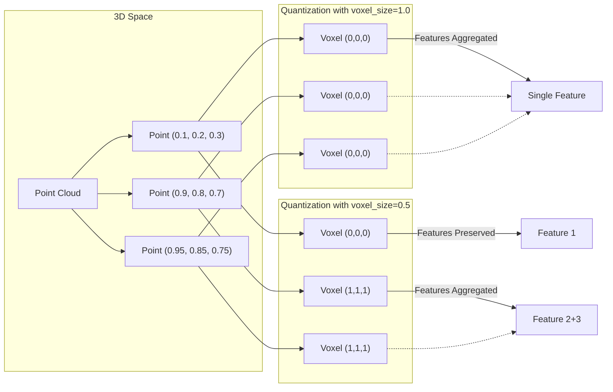

<!-- source: DeepWiki mcp.deepwiki.com · repo NVIDIA/MinkowskiEngine · page 2.4 Quantization · fetched 2026-10-26 -->

# Quantization

<details>
<summary>Relevant source files</summary>

The following files were used as context for generating this wiki page:

- [MinkowskiEngine/MinkowskiCommon.py](MinkowskiEngine/MinkowskiCommon.py)
- [MinkowskiEngine/MinkowskiKernelGenerator.py](MinkowskiEngine/MinkowskiKernelGenerator.py)
- [MinkowskiEngine/MinkowskiSparseTensor.py](MinkowskiEngine/MinkowskiSparseTensor.py)
- [MinkowskiEngine/MinkowskiTensor.py](MinkowskiEngine/MinkowskiTensor.py)
- [MinkowskiEngine/MinkowskiTensorField.py](MinkowskiEngine/MinkowskiTensorField.py)
- [MinkowskiEngine/utils/quantization.py](MinkowskiEngine/utils/quantization.py)
- [src/quantization.cpp](src/quantization.cpp)
- [tests/python/global.py](tests/python/global.py)
- [tests/python/quantization.py](tests/python/quantization.py)
- [tests/python/tensor_field.py](tests/python/tensor_field.py)

</details>


This page describes the quantization process in MinkowskiEngine, which is the mechanism for converting continuous coordinates (such as point cloud data) into discrete voxel positions. Quantization is a fundamental operation for creating sparse tensors from raw input data.

## Overview

Quantization is the process of discretizing continuous coordinates and managing collisions when multiple points map to the same discrete location. The process ensures that sparse tensors can efficiently represent sparse data by:

1. Converting continuous coordinates to discrete voxel positions
2. Handling feature aggregation when multiple points map to the same voxel
3. Creating mappings between original and quantized coordinates



Sources: [MinkowskiEngine/utils/quantization.py:136-332](), [MinkowskiEngine/MinkowskiSparseTensor.py:293-345]()

## Quantization Modes

MinkowskiEngine provides several quantization modes to handle how features are aggregated when multiple points map to the same voxel location:



| Mode | Description | Implementation |
|------|-------------|----------------|
| RANDOM_SUBSAMPLE | Randomly selects one feature per voxel | [MinkowskiSparseTensor.py:339-340]() |
| UNWEIGHTED_AVERAGE | Averages all features within a voxel | [MinkowskiSparseTensor.py:329-338]() |
| UNWEIGHTED_SUM | Sums all features within a voxel | [MinkowskiSparseTensor.py:318-328]() |
| MAX_POOL | Selects the maximum feature value for each channel | [MinkowskiTensorField.py:359-368]() |
| NO_QUANTIZATION | No feature aggregation (not typically used) | - |
| SPLAT_LINEAR_INTERPOLATION | Uses N-dimensional linear interpolation | [MinkowskiTensorField.py:381-406]() |

Sources: [MinkowskiEngine/MinkowskiTensor.py:47-61](), [MinkowskiEngine/MinkowskiSparseTensor.py:318-345](), [MinkowskiEngine/MinkowskiTensorField.py:359-406]()

## Quantization Process

The quantization process involves several key steps that transform continuous coordinates into an efficient sparse representation:



The process works as follows:

1. **Coordinate Discretization**: Continuous coordinates are discretized either by simple flooring or by dividing by a quantization size (voxel size)
2. **Duplicate Detection**: The system finds duplicate coordinates that map to the same voxel
3. **Mapping Creation**: Two maps are created:
   - **Unique Map**: Indices of unique coordinates in the original coordinates
   - **Inverse Mapping**: Mapping from original to unique coordinates
4. **Feature Aggregation**: Features associated with the same voxel are aggregated according to the specified quantization mode

Sources: [MinkowskiEngine/utils/quantization.py:136-332](), [MinkowskiEngine/MinkowskiSparseTensor.py:293-345](), [src/quantization.cpp:57-294]()

## Relationship with Coordinate System

Quantization is tightly integrated with MinkowskiEngine's coordinate management system:



The coordinate management system and quantization process work together to:

1. Store unique coordinates efficiently
2. Map between original and quantized coordinates
3. Provide a unified interface for operations on sparse tensors

Sources: [MinkowskiEngine/MinkowskiSparseTensor.py:227-287](), [MinkowskiEngine/MinkowskiTensorField.py:180-250]()

## API Reference

### SparseTensor Initialization with Quantization

```python
SparseTensor(
    features,                       # Feature tensor
    coordinates,                    # Coordinate tensor
    tensor_stride=1,                # Tensor stride
    coordinate_map_key=None,        # Optional coordinate map key
    coordinate_manager=None,        # Optional coordinate manager
    quantization_mode=SparseTensorQuantizationMode.RANDOM_SUBSAMPLE, # Quantization mode
    ... # Other parameters
)
```

The `SparseTensor` initialization processes coordinates through quantization if both `coordinates` and `features` are provided.

### TensorField to SparseTensor Conversion

```python
# Create a TensorField
tensor_field = TensorField(features, coordinates)

# Convert to SparseTensor with specific quantization mode
sparse_tensor = tensor_field.sparse(
    quantization_mode=SparseTensorQuantizationMode.UNWEIGHTED_AVERAGE
)
```

### Utility Functions

#### sparse_quantize

```python
sparse_quantize(
    coordinates,                    # Coordinates to quantize
    features=None,                  # Optional features
    labels=None,                    # Optional labels
    ignore_label=-100,              # Label to use for collisions
    return_index=False,             # Return unique indices
    return_inverse=False,           # Return inverse mapping
    quantization_size=None,         # Size of quantization grid
    device="cpu"                    # Device to use
)
```

This utility function handles the quantization process and returns quantized coordinates and optionally features/labels.

Sources: [MinkowskiEngine/utils/quantization.py:136-332](), [MinkowskiEngine/MinkowskiSparseTensor.py:122-189](), [MinkowskiEngine/MinkowskiTensorField.py:77-145]()

## Visualization of Quantization Process



This diagram illustrates how changing the voxel size affects quantization. With a larger voxel size, more points are aggregated into the same voxel, while smaller voxel sizes preserve more spatial details.

Sources: [MinkowskiEngine/utils/quantization.py:136-332]()

## Examples and Use Cases

### Basic Quantization

```python
# Raw point cloud data
coords = torch.tensor([[0, 0.1], [0, 0.2], [0, 0.3], [0, 1.1], [0, 1.2]])
feats = torch.tensor([[1.0], [2.0], [3.0], [4.0], [5.0]])

# Option 1: Use sparse_quantize directly
quantized_coords, quantized_feats = ME.utils.sparse_quantize(
    coords, feats, quantization_size=0.5
)

# Option 2: Create a SparseTensor directly (internal quantization)
sparse_tensor = ME.SparseTensor(
    features=feats,
    coordinates=coords,
    quantization_mode=ME.SparseTensorQuantizationMode.UNWEIGHTED_AVERAGE
)

# Option 3: Create a TensorField and convert to SparseTensor
tensor_field = ME.TensorField(features=feats, coordinates=coords)
sparse_tensor = tensor_field.sparse(
    quantization_mode=ME.SparseTensorQuantizationMode.MAX_POOL
)
```

### 3D Semantic Segmentation

For 3D semantic segmentation, quantization can handle both coordinates and labels:

```python
# Point cloud with labels
coords = load_point_cloud_coordinates()  # [N, 3]
feats = load_point_cloud_features()      # [N, C]
labels = load_point_cloud_labels()       # [N]

# Quantize with label handling
quantized_coords, quantized_feats, quantized_labels = ME.utils.sparse_quantize(
    coords, feats, labels=labels, ignore_label=-100, quantization_size=0.02
)

# Create sparse tensor
input_tensor = ME.SparseTensor(quantized_feats, quantized_coords)
```

In this example, when multiple points with different labels map to the same voxel, the label is set to an ignore value (-100) to handle ambiguity.

Sources: [MinkowskiEngine/utils/quantization.py:136-332](), [tests/python/quantization.py:33-121](), [tests/python/tensor_field.py:38-71]()

## Implementation Details

### Backend Implementation

MinkowskiEngine implements quantization using both Python and C++ code:

1. High-level API in Python for user interaction
2. Performance-critical operations in C++ for efficiency
3. CUDA implementation for GPU acceleration when available

The C++ backend uses efficient hash maps to detect duplicates and create mapping indices.

Sources: [src/quantization.cpp:57-294](), [MinkowskiEngine/utils/quantization.py:136-332]()

### Performance Considerations

- Quantization is a preprocessing step that significantly reduces the memory footprint and computational requirements
- The choice of quantization mode affects both accuracy and performance
- GPU implementation can offer significant speedups for large point clouds
- Quantization size (voxel size) is a critical parameter that balances detail preservation and computational efficiency

---

