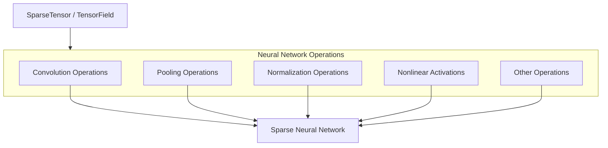
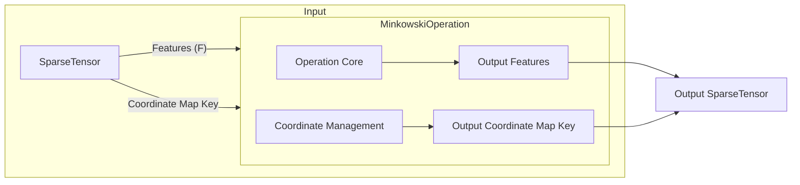
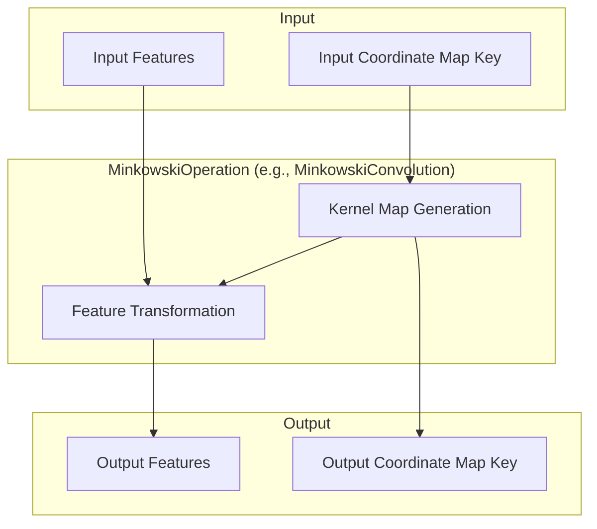

<!-- source: DeepWiki mcp.deepwiki.com · repo NVIDIA/MinkowskiEngine · page 3 Neural Network Operations · fetched 2026-10-26 -->

# Neural Network Operations

<details>
<summary>Relevant source files</summary>

The following files were used as context for generating this wiki page:

- [CHANGELOG.md](CHANGELOG.md)
- [MinkowskiEngine/MinkowskiFunctional.py](MinkowskiEngine/MinkowskiFunctional.py)
- [MinkowskiEngine/MinkowskiNetwork.py](MinkowskiEngine/MinkowskiNetwork.py)
- [MinkowskiEngine/MinkowskiNonlinearity.py](MinkowskiEngine/MinkowskiNonlinearity.py)
- [MinkowskiEngine/MinkowskiNormalization.py](MinkowskiEngine/MinkowskiNormalization.py)
- [MinkowskiEngine/MinkowskiOps.py](MinkowskiEngine/MinkowskiOps.py)
- [MinkowskiEngine/__init__.py](MinkowskiEngine/__init__.py)

</details>


This page documents the core operations available for building neural networks with sparse tensors in MinkowskiEngine. These operations enable the application of common neural network components (convolutions, pooling, normalization, activation functions) to sparse data like 3D point clouds.

For information about the underlying data structures these operations work on, see [Core Data Structures](#2). For details about the specific implementation in CPU and GPU, see [Implementation Details](#4).

## Overview of Neural Network Operations

MinkowskiEngine provides a comprehensive set of operations that mirror standard PyTorch neural network modules but are designed to work with sparse tensors. These operations can be composed to create complex neural network architectures for processing sparse data.



Sources: [MinkowskiEngine/__init__.py:100-124](), [MinkowskiEngine/__init__.py:134-164](), [MinkowskiEngine/__init__.py:166-172]()

## Operations Architecture

The operations in MinkowskiEngine maintain a consistent architecture pattern. Each operation takes a `SparseTensor` or `TensorField` as input and outputs a new `SparseTensor` or `TensorField`. Operations handle both the feature transformation and coordinate management internally.



Sources: [MinkowskiEngine/MinkowskiOps.py:40-67](), [MinkowskiEngine/MinkowskiNormalization.py:51-98](), [MinkowskiEngine/MinkowskiNonlinearity.py:34-58]()

## Convolution Operations

MinkowskiEngine provides sparse convolution operations that apply kernels to sparse data. These operations create output features based on the input features within each kernel's receptive field.

Key convolution operations include:

- `MinkowskiConvolution`: Standard sparse convolution
- `MinkowskiConvolutionTranspose`: Transposed sparse convolution
- `MinkowskiChannelwiseConvolution`: Channel-wise sparse convolution
- `MinkowskiGenerativeConvolutionTranspose`: Transpose convolution for generative models

The convolution operations handle the kernel mapping and sparse computation automatically.

Sources: [MinkowskiEngine/__init__.py:100-106]()

## Pooling Operations

Pooling operations reduce the spatial resolution of features by aggregating information within defined regions. MinkowskiEngine provides several pooling operations:

- Local pooling: `MinkowskiSumPooling`, `MinkowskiAvgPooling`, `MinkowskiMaxPooling`
- Global pooling: `MinkowskiGlobalSumPooling`, `MinkowskiGlobalAvgPooling`, `MinkowskiGlobalMaxPooling`
- Transpose pooling: `MinkowskiPoolingTranspose`
- Direct pooling: `MinkowskiDirectMaxPoolingFunction`

These operations manage both the feature transformation and the resulting change in coordinate structure.

Sources: [MinkowskiEngine/__init__.py:111-124]()

## Normalization Operations

Normalization operations standardize the distribution of features, improving model training stability. Key normalization operations include:

### Batch Normalization

`MinkowskiBatchNorm` normalizes features across the batch dimension, similar to PyTorch's `BatchNorm1d`.

```python
MinkowskiBatchNorm(num_features, eps=1e-5, momentum=0.1, affine=True, track_running_stats=True)
```

For distributed training, `MinkowskiSyncBatchNorm` provides synchronized batch normalization across multiple GPUs.

### Instance Normalization

`MinkowskiInstanceNorm` normalizes features within each instance independently:

```python
MinkowskiInstanceNorm(num_features)
```

A stable variant, `MinkowskiStableInstanceNorm`, is also available for improved training stability.

Sources: [MinkowskiEngine/MinkowskiNormalization.py:51-98](), [MinkowskiEngine/MinkowskiNormalization.py:101-191](), [MinkowskiEngine/MinkowskiNormalization.py:313-399]()

## Nonlinear Activations

Nonlinear activation functions introduce non-linearity into the network. MinkowskiEngine provides a comprehensive set of activation functions that mirror PyTorch's offerings:

| Category | Activation Functions |
|----------|----------------------|
| ReLU-based | `MinkowskiReLU`, `MinkowskiReLU6`, `MinkowskiLeakyReLU`, `MinkowskiPReLU`, `MinkowskiRReLU` |
| Sigmoid-based | `MinkowskiSigmoid`, `MinkowskiLogSigmoid`, `MinkowskiHardsigmoid` |
| Tanh-based | `MinkowskiTanh`, `MinkowskiTanhshrink` |
| Other | `MinkowskiELU`, `MinkowskiSELU`, `MinkowskiCELU`, `MinkowskiGELU`, `MinkowskiSiLU`, `MinkowskiSoftplus`, `MinkowskiSoftsign` |
| Advanced | `MinkowskiSoftmin`, `MinkowskiSoftmax`, `MinkowskiLogSoftmax` |
| Regularization | `MinkowskiDropout`, `MinkowskiAlphaDropout` |

All these operations maintain the sparse structure of the input tensor while applying the activation function only to the features.

Sources: [MinkowskiEngine/MinkowskiNonlinearity.py:34-200](), [MinkowskiEngine/__init__.py:134-164]()

## Functional Interface

MinkowskiEngine also provides a functional interface for operations, similar to PyTorch's `torch.nn.functional`. This allows for more flexibility in applying operations.

The functional interface includes:

- Activation functions (`relu`, `sigmoid`, `tanh`, etc.)
- Normalization (`batch_norm`, `normalize`)
- Linear operations (`linear`)
- Dropouts (`dropout`, `alpha_dropout`)
- Loss functions (`binary_cross_entropy`, `mse_loss`, etc.)

Example usage:

```python
import MinkowskiEngine.MinkowskiFunctional as MF

output = MF.relu(input_sparse_tensor)
```

Sources: [MinkowskiEngine/MinkowskiFunctional.py:30-232]()

## Other Operations

### Linear Operations

`MinkowskiLinear` applies a linear transformation to the features of a sparse tensor while preserving the coordinate structure:

```python
MinkowskiLinear(in_features, out_features, bias=True)
```

### Tensor Operations

MinkowskiEngine provides operations for manipulating sparse tensors:

- `cat`: Concatenates sparse tensors along the feature dimension
- `sum`: Sums feature values of sparse tensors
- `mean`: Computes the mean of feature values
- `var`: Computes the variance of feature values

### Conversion Operations

These operations convert between different tensor formats:

- `MinkowskiToSparseTensor`: Converts dense tensors or tensor fields to sparse tensors
- `MinkowskiToDenseTensor`: Converts sparse tensors to dense tensors
- `MinkowskiToFeature`: Extracts features from a sparse tensor

### Broadcasting Operations

Broadcasting operations apply operations between sparse tensors and globally pooled features:

- `MinkowskiBroadcastAddition`: Adds broadcast features to a sparse tensor
- `MinkowskiBroadcastMultiplication`: Multiplies sparse tensor features by broadcast features
- `MinkowskiBroadcastConcatenation`: Concatenates broadcast features with sparse tensor features

Sources: [MinkowskiEngine/MinkowskiOps.py:40-67](), [MinkowskiEngine/MinkowskiOps.py:141-243](), [MinkowskiEngine/MinkowskiOps.py:279-457](), [MinkowskiEngine/__init__.py:126-132]()

## Building Neural Networks

The operations can be composed to build complex neural networks for sparse data processing. MinkowskiEngine provides a base class, `MinkowskiNetwork`, for building sparse convolutional networks:

```python
class MyNetwork(MinkowskiNetwork):
    def __init__(self, in_channels, out_channels, D):
        super(MyNetwork, self).__init__(D)
        self.conv1 = MinkowskiConvolution(in_channels, 64, kernel_size=3, stride=2, dimension=D)
        self.bn1 = MinkowskiBatchNorm(64)
        self.conv2 = MinkowskiConvolution(64, 128, kernel_size=3, stride=2, dimension=D)
        self.bn2 = MinkowskiBatchNorm(128)
        self.relu = MinkowskiReLU()
        self.global_pool = MinkowskiGlobalAvgPooling()
        self.linear = MinkowskiLinear(128, out_channels)

    def forward(self, x):
        x = self.relu(self.bn1(self.conv1(x)))
        x = self.relu(self.bn2(self.conv2(x)))
        x = self.global_pool(x)
        return self.linear(x)
```

This architecture pattern allows for the creation of various network architectures like U-Nets, ResNets, etc., for tasks such as segmentation, classification, and generation on sparse data.

Sources: [MinkowskiEngine/MinkowskiNetwork.py:31-57]()

## Operation Data Flow

The following diagram illustrates the data flow through a typical neural network operation in MinkowskiEngine:



This pattern is consistent across different types of operations, with the specifics of the feature transformation and coordinate management varying based on the operation type.

Sources: [MinkowskiEngine/MinkowskiNormalization.py:51-98](), [MinkowskiEngine/MinkowskiNonlinearity.py:34-58](), [MinkowskiEngine/MinkowskiOps.py:40-67]()

---

