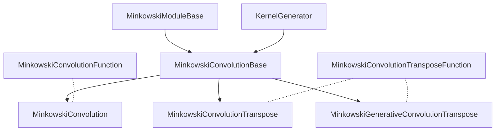
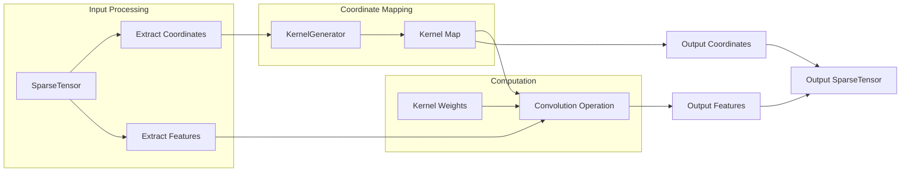
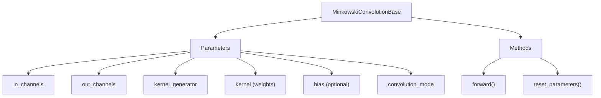
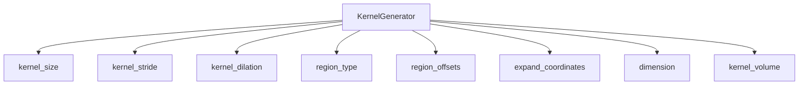
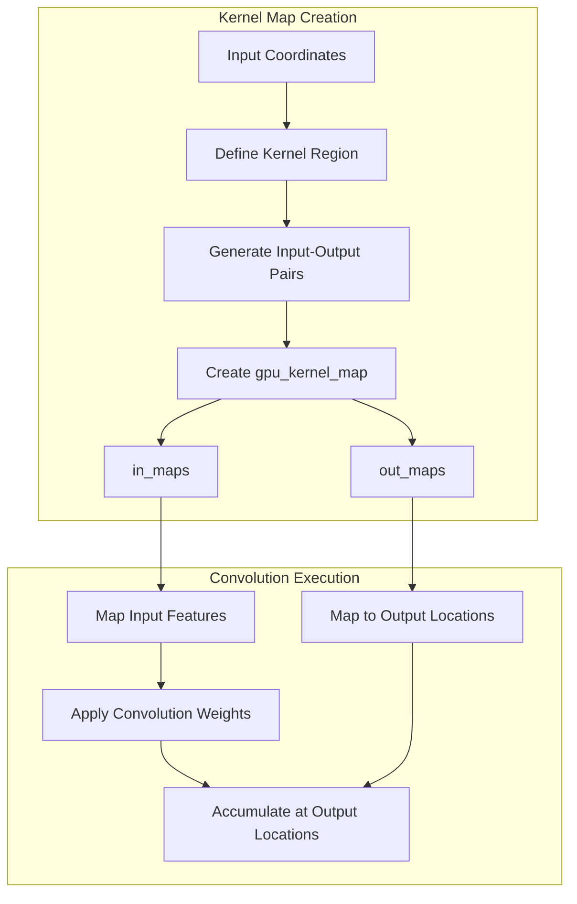
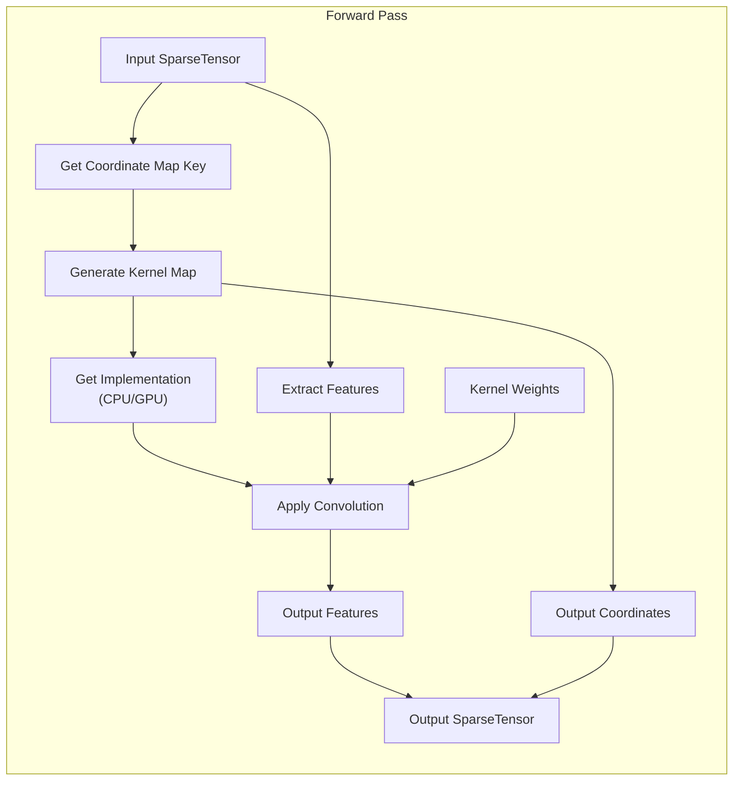
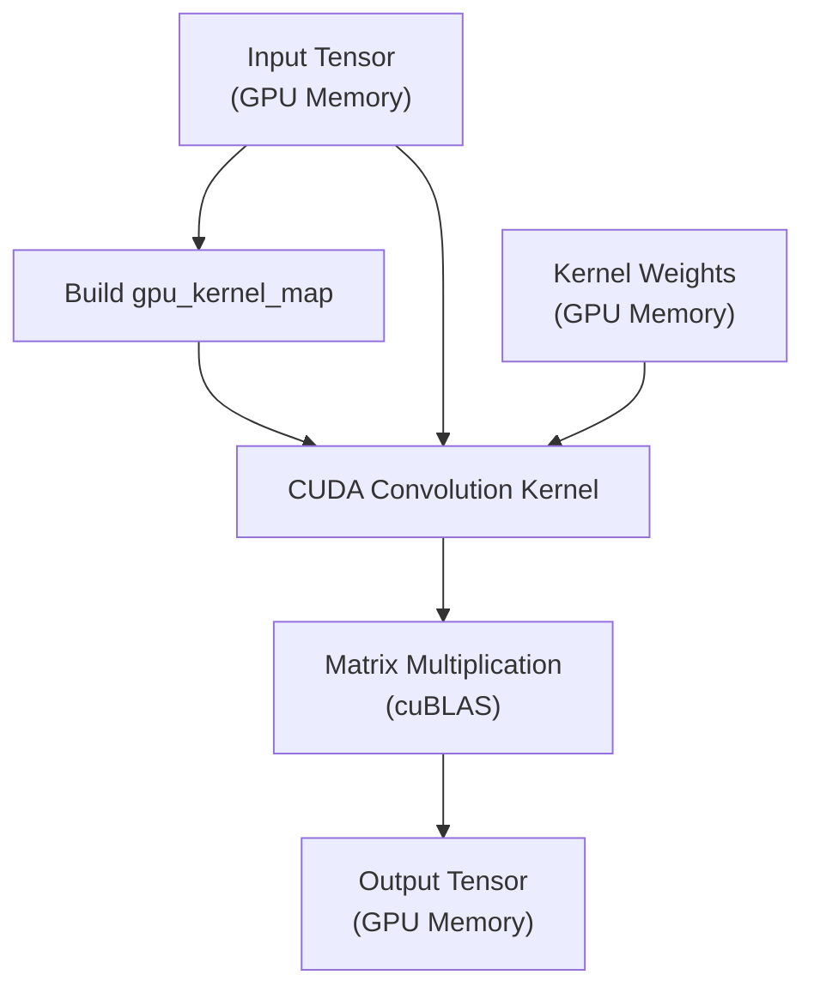

<!-- source: DeepWiki mcp.deepwiki.com · repo NVIDIA/MinkowskiEngine · page 3.1 Convolution Operations · fetched 2026-10-26 -->

# Convolution Operations

<details>
<summary>Relevant source files</summary>

The following files were used as context for generating this wiki page:

- [MinkowskiEngine/MinkowskiConvolution.py](MinkowskiEngine/MinkowskiConvolution.py)
- [src/convolution_transpose_cpu.cpp](src/convolution_transpose_cpu.cpp)
- [src/convolution_transpose_gpu.cu](src/convolution_transpose_gpu.cu)
- [src/kernel_map.cuh](src/kernel_map.cuh)
- [src/local_pooling_cpu.cpp](src/local_pooling_cpu.cpp)
- [src/local_pooling_gpu.cu](src/local_pooling_gpu.cu)
- [src/pooling_avg_kernel.hpp](src/pooling_avg_kernel.hpp)
- [src/pooling_max_kernel.cu](src/pooling_max_kernel.cu)
- [src/pooling_max_kernel.cuh](src/pooling_max_kernel.cuh)
- [src/pooling_max_kernel.hpp](src/pooling_max_kernel.hpp)
- [src/storage.cuh](src/storage.cuh)
- [tests/python/convolution.py](tests/python/convolution.py)

</details>


This page documents the sparse convolution operations in MinkowskiEngine, which form the core of its neural network capabilities. Unlike traditional dense convolutions in CNNs, these operations are specifically designed for sparse data representations, making them highly efficient for processing 3D point clouds and other sparse inputs.

For information about related operations that often accompany convolutions, see [Pooling Operations](#3.2) and [Normalization and Nonlinearities](#3.3).

## Convolution Types

MinkowskiEngine implements three primary convolution types:

| Type | Class | Description |
|------|-------|-------------|
| Standard Convolution | `MinkowskiConvolution` | Forward convolution on sparse tensors; downsamples or maintains resolution |
| Transposed Convolution | `MinkowskiConvolutionTranspose` | Transposed convolution for upsampling sparse data |
| Generative Transposed Convolution | `MinkowskiGenerativeConvolutionTranspose` | Specialized transposed convolution that generates new coordinates |

Sources: [MinkowskiEngine/MinkowskiConvolution.py:360-634]()

## Architecture and Implementation

### Class Hierarchy



Sources: [MinkowskiEngine/MinkowskiConvolution.py:42-201](), [MinkowskiEngine/MinkowskiConvolution.py:204-358]()

### Convolution Operation Flow

The sparse convolution process follows these key steps:



Sources: [MinkowskiEngine/MinkowskiConvolution.py:287-330](), [src/convolution_transpose_gpu.cu:47-156]()

## Key Components

### MinkowskiConvolutionBase

The abstract base class for all convolution operations:



Sources: [MinkowskiEngine/MinkowskiConvolution.py:204-358]()

The base class defines:
- Storage for kernel parameters and weights
- Forward pass logic for all convolution types
- Parameter initialization methods

### KernelGenerator

Defines the convolution kernel's properties and how it's applied:



The `KernelGenerator` determines:
- How input coordinates map to output coordinates
- Which input features contribute to each output feature
- The receptive field of the convolution

Sources: [MinkowskiEngine/MinkowskiConvolution.py:241-255]()

### Convolution Function Classes

The actual computation is performed by specialized function classes:

1. `MinkowskiConvolutionFunction`: Handles forward/backward for standard convolution
2. `MinkowskiConvolutionTransposeFunction`: Handles forward/backward for transposed convolution

These classes are responsible for:
- Building the kernel map
- Executing the convolution operation
- Computing gradients during backpropagation

Sources: [MinkowskiEngine/MinkowskiConvolution.py:42-121](), [MinkowskiEngine/MinkowskiConvolution.py:124-201]()

## Kernel Mapping Process

The kernel mapping is a crucial aspect of sparse convolution:



The kernel map contains:
- `in_maps`: Maps from kernel positions to input feature indices
- `out_maps`: Maps from kernel positions to output feature indices

Sources: [src/kernel_map.cuh:48-429]()

## Convolution Modes

MinkowskiEngine supports different convolution implementation modes:

| Mode | Description |
|------|-------------|
| `ConvolutionMode.DEFAULT` | Default mode selected based on input size |
| `ConvolutionMode.DIRECT_GEMM` | Direct generalized matrix multiplication |
| `ConvolutionMode.COPY_GEMM` | Copy data then perform matrix multiplication |

Sources: [tests/python/convolution.py:248-298]()

## Mathematical Definition

### Standard Convolution

For an input sparse tensor with features at coordinates C_in, the output at coordinate u ∈ C_out is:

```
x_out(u) = ∑_{i ∈ N(u, K, C_in)} W_i · x_in(i + u)
```

Where:
- N(u, K, C_in) is the set of offsets within kernel K
- W_i are the kernel weights
- x_in(i + u) are input features at corresponding coordinates

Sources: [MinkowskiEngine/MinkowskiConvolution.py:361-375]()

### Transposed Convolution

The transposed convolution reverses the spatial transformation of a standard convolution, effectively upsampling the input tensor based on the stride and kernel parameters.

Sources: [MinkowskiEngine/MinkowskiConvolution.py:455-457]()

## Forward and Backward Pass

### Forward Pass



Sources: [MinkowskiEngine/MinkowskiConvolution.py:44-85](), [src/convolution_transpose_gpu.cu:47-156]()

### Backward Pass

The backward pass computes:
1. Gradients for input features (for backpropagation)
2. Gradients for kernel weights (for optimization)

Sources: [MinkowskiEngine/MinkowskiConvolution.py:87-121](), [src/convolution_transpose_gpu.cu:158-239]()

## GPU Implementation

MinkowskiEngine's GPU implementation leverages CUDA for high-performance sparse convolution:



The GPU implementation uses:
- Custom CUDA kernels for coordinate mapping
- Optimized memory access patterns for sparse data
- cuBLAS for efficient matrix multiplication

Sources: [src/convolution_transpose_gpu.cu:133-154](), [src/kernel_map.cuh:48-429]()

## Usage Examples

Basic usage of `MinkowskiConvolution`:

```python
import torch
import MinkowskiEngine as ME

# Create a sparse tensor
coords = torch.IntTensor([[0, 0, 0], [0, 1, 1], [0, 2, 2]])
feats = torch.FloatTensor([[1.0, 2.0], [3.0, 4.0], [5.0, 6.0]])
input = ME.SparseTensor(feats, coordinates=coords)

# Create a convolution layer
conv = ME.MinkowskiConvolution(
    in_channels=2,
    out_channels=3,
    kernel_size=3,
    stride=2,
    dimension=2
)

# Apply convolution
output = conv(input)
```

Example using transposed convolution:

```python
# Create a transposed convolution layer
conv_tr = ME.MinkowskiConvolutionTranspose(
    in_channels=3,
    out_channels=2,
    kernel_size=3,
    stride=2,
    dimension=2
)

# Apply transposed convolution
output_tr = conv_tr(output)
```

Sources: [tests/python/convolution.py:226-246](), [tests/python/convolution.py:361-382]()

---

