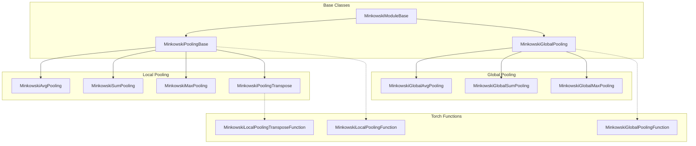
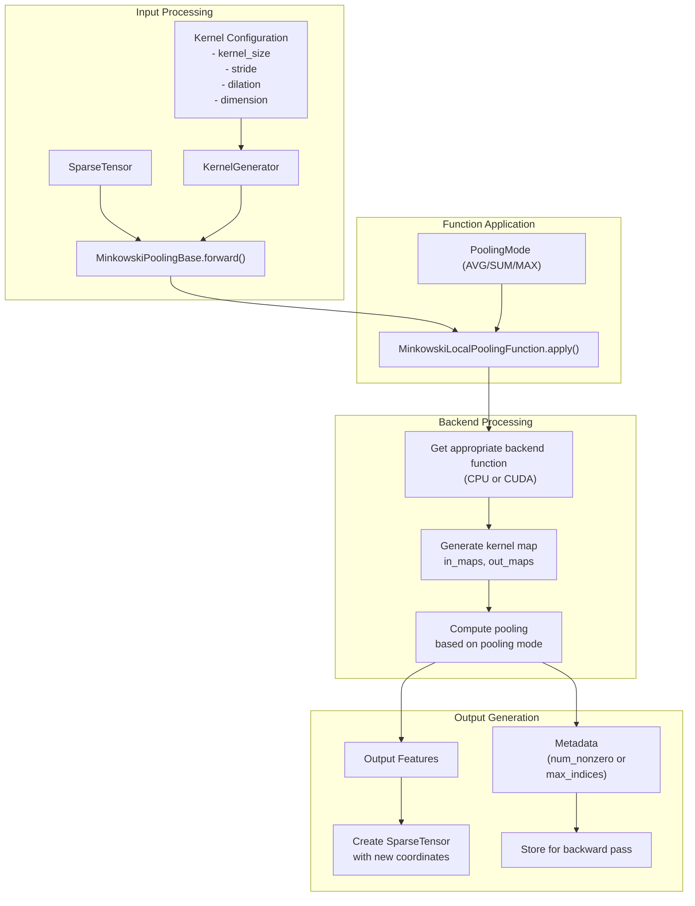
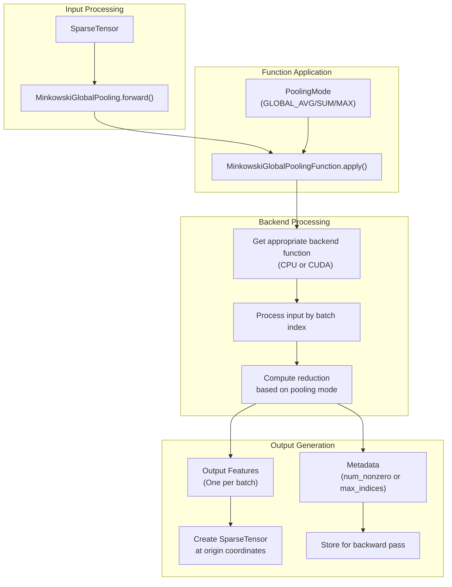

<!-- source: DeepWiki mcp.deepwiki.com · repo NVIDIA/MinkowskiEngine · page 3.2 Pooling Operations · fetched 2026-10-26 -->

# Pooling Operations

<details>
<summary>Relevant source files</summary>

The following files were used as context for generating this wiki page:

- [MinkowskiEngine/MinkowskiPooling.py](MinkowskiEngine/MinkowskiPooling.py)
- [src/global_pooling_cpu.cpp](src/global_pooling_cpu.cpp)
- [src/global_pooling_gpu.cu](src/global_pooling_gpu.cu)
- [src/kernel_map.cuh](src/kernel_map.cuh)
- [src/local_pooling_cpu.cpp](src/local_pooling_cpu.cpp)
- [src/local_pooling_gpu.cu](src/local_pooling_gpu.cu)
- [src/pooling_avg_kernel.hpp](src/pooling_avg_kernel.hpp)
- [src/pooling_max_kernel.cu](src/pooling_max_kernel.cu)
- [src/pooling_max_kernel.cuh](src/pooling_max_kernel.cuh)
- [src/pooling_max_kernel.hpp](src/pooling_max_kernel.hpp)
- [src/storage.cuh](src/storage.cuh)
- [tests/python/pool.py](tests/python/pool.py)

</details>


This document explains the pooling operations available in MinkowskiEngine for sparse tensors. Pooling operations are essential for dimensionality reduction and feature aggregation in sparse convolutional neural networks. They allow networks to achieve spatial invariance and reduce computational complexity by downsampling feature maps.

For information about convolution operations, see [Convolution Operations](3.1).
For information about the coordinate management system that underlies all operations, see [Coordinate Management System](2.3).

## Pooling Types Overview

MinkowskiEngine implements two main categories of pooling operations:

1. **Local Pooling Operations**: These operate on local regions defined by a kernel, similar to standard convolution pooling but adapted for sparse data.
2. **Global Pooling Operations**: These aggregate all features across the entire spatial domain, typically resulting in one feature vector per batch element.

### Pooling Class Hierarchy



Sources: [MinkowskiEngine/MinkowskiPooling.py:113-192](), [MinkowskiEngine/MinkowskiPooling.py:632-649]()

## Local Pooling Operations

Local pooling operations reduce feature dimensions by applying a specific operation (average, sum, max) over features within a kernel window.

### Local Pooling Execution Flow



Sources: [MinkowskiEngine/MinkowskiPooling.py:152-184](), [src/local_pooling_gpu.cu:48-137]()

### MinkowskiAvgPooling

Averages input features within a kernel window:

```
y_u = (1/|N|) * ∑ x_(u+i) for all i in the neighborhood of u
```

Where:
- `y_u` is the output feature at coordinate `u`
- `|N|` is the number of active inputs in the neighborhood
- `x_(u+i)` are the input features in the neighborhood

**Important Note**: Unlike dense tensors, sparse average pooling divides by the actual number of features present in each kernel window, which can vary between windows.

Sources: [MinkowskiEngine/MinkowskiPooling.py:195-281]()

### MinkowskiSumPooling

Sums all input features within a kernel window without dividing by the number of inputs:

```
y_u = ∑ x_(u+i) for all i in the neighborhood of u
```

This operation is equivalent to standard average pooling for dense tensors but without the division by kernel size.

Sources: [MinkowskiEngine/MinkowskiPooling.py:284-366]()

### MinkowskiMaxPooling

Selects the maximum value of input features within a kernel window:

```
y_u^c = max(x_(u+i)^c) for all i in the neighborhood of u
```

Where `c` denotes the channel dimension.

Sources: [MinkowskiEngine/MinkowskiPooling.py:369-438]()

### MinkowskiPoolingTranspose

Performs unpooling operation, which is the approximate inverse of pooling. It distributes features from a low-resolution tensor to a higher-resolution tensor:

```python
# Example usage
unpool = MinkowskiPoolingTranspose(kernel_size=2, stride=2, dimension=3)
output = unpool(input)
```

Sources: [MinkowskiEngine/MinkowskiPooling.py:513-581]()

## Global Pooling Operations

Global pooling operations reduce all spatial dimensions to a single point, aggregating features over the entire spatial domain for each batch element.

### Global Pooling Execution Flow



Sources: [MinkowskiEngine/MinkowskiPooling.py:583-629](), [src/global_pooling_gpu.cu:46-225]()

### MinkowskiGlobalAvgPooling

Computes the average of all features for each batch element:

```python
global_avg_pool = MinkowskiGlobalAvgPooling()
output = global_avg_pool(input)  # Results in one feature vector per batch
```

The output contains batch_size number of points at the origin, each representing the average of all features for that batch.

Sources: [MinkowskiEngine/MinkowskiPooling.py:693-702]()

### MinkowskiGlobalSumPooling

Computes the sum of all features for each batch element:

```python
global_sum_pool = MinkowskiGlobalSumPooling()
output = global_sum_pool(input)  # Results in one feature vector per batch
```

Sources: [MinkowskiEngine/MinkowskiPooling.py:682-691]()

### MinkowskiGlobalMaxPooling

Selects the maximum value of all features for each batch element:

```python
global_max_pool = MinkowskiGlobalMaxPooling()
output = global_max_pool(input)  # Results in one feature vector per batch
```

Sources: [MinkowskiEngine/MinkowskiPooling.py:704-749]()

## Implementation Details

### Pooling Modes

The pooling operations use different modes defined in the `PoolingMode` enum:

| Pooling Mode | Description |
| --- | --- |
| `LOCAL_AVG_POOLING` | Local average pooling |
| `LOCAL_SUM_POOLING` | Local sum pooling |
| `LOCAL_MAX_POOLING` | Local max pooling |
| `GLOBAL_AVG_POOLING_PYTORCH_INDEX` | PyTorch index-based global average pooling |
| `GLOBAL_SUM_POOLING_PYTORCH_INDEX` | PyTorch index-based global sum pooling |
| `GLOBAL_MAX_POOLING_PYTORCH_INDEX` | PyTorch index-based global max pooling |
| `GLOBAL_AVG_POOLING_KERNEL` | Kernel-based global average pooling |
| `GLOBAL_SUM_POOLING_KERNEL` | Kernel-based global sum pooling |
| `GLOBAL_MAX_POOLING_KERNEL` | Kernel-based global max pooling |

Sources: [MinkowskiEngine/MinkowskiPooling.py:31]()

### CPU vs GPU Implementation

MinkowskiEngine supports both CPU and GPU implementations for pooling operations:

#### CPU Implementation
- Implemented in `local_pooling_cpu.cpp` and `global_pooling_cpu.cpp`
- Uses direct loops and standard data structures
- Handles both local and global pooling operations

#### GPU Implementation
- Implemented in `local_pooling_gpu.cu`, `global_pooling_gpu.cu`, and specialized kernel files
- Uses CUDA for parallel processing
- Employs specialized data structures like `gpu_kernel_map` for efficiency
- Utilizes thrust library operations for parallel reductions

For max pooling specifically, the implementation:
1. Generates the kernel map (input and output mappings)
2. Finds the maximum values and stores their indices
3. Uses these indices in the backward pass to route gradients correctly

Sources: [src/local_pooling_gpu.cu:48-137](), [src/pooling_max_kernel.cu:129-234](), [src/global_pooling_gpu.cu:46-225]()

### Forward and Backward Operations

#### Forward Pass
1. The input `SparseTensor` is passed to the pooling operation
2. A kernel map is generated based on the specified kernel size, stride, and dilation
3. The appropriate pooling function is applied based on the mode
4. The result is wrapped in a new `SparseTensor` with the appropriate coordinates

#### Backward Pass
1. For max pooling: gradients are routed only to the input features that contributed the maximum values
2. For avg/sum pooling: gradients are distributed to all input features that contributed, possibly scaled by the number of contributions
3. The backward function computes gradients with respect to input features

Sources: [MinkowskiEngine/MinkowskiPooling.py:85-110](), [src/pooling_max_kernel.cu:312-327]()

## Usage Guidelines

### Kernel Size and Stride Relationship

For optimal performance, set the kernel size equal to the stride:

```python
# Efficient configuration
pool = MinkowskiMaxPooling(kernel_size=2, stride=2, dimension=3)
```

The engine generates in-out mappings faster in this case.

Sources: [MinkowskiEngine/MinkowskiPooling.py:223-228]()

### U-Net Architecture Considerations

For U-Net architectures, pair pooling operations with corresponding unpooling operations:

```python
# Downsampling
pool = MinkowskiSumPooling(kernel_size=2, stride=2, dimension=3)
# Upsampling
unpool = MinkowskiPoolingTranspose(kernel_size=2, stride=2, dimension=3)
```

Sources: [MinkowskiEngine/MinkowskiPooling.py:226-229]()

### Performance Considerations

1. **Memory Usage**: Global pooling operations require additional memory for reducing all spatial locations to one output
2. **Computation Efficiency**: Local pooling with equal kernel size and stride is most efficient
3. **Batch Processing**: Global pooling efficiency scales with batch size due to parallel batch processing

## Example Usage

### Basic Local Pooling

```python
import torch
import MinkowskiEngine as ME

# Create input sparse tensor
coords = torch.IntTensor([[0, 0, 0], [0, 0, 1], [0, 1, 0], [0, 1, 1], [1, 0, 0]])
feats = torch.FloatTensor([[1.0], [2.0], [3.0], [4.0], [5.0]])
input = ME.SparseTensor(feats, coordinates=coords)

# Create different pooling operators
avg_pool = ME.MinkowskiAvgPooling(kernel_size=2, stride=2, dimension=3)
sum_pool = ME.MinkowskiSumPooling(kernel_size=2, stride=2, dimension=3)
max_pool = ME.MinkowskiMaxPooling(kernel_size=2, stride=2, dimension=3)

# Apply pooling
output_avg = avg_pool(input)
output_sum = sum_pool(input)
output_max = max_pool(input)
```

### Global Pooling Example

```python
import torch
import MinkowskiEngine as ME

# Create multi-batch input
coords = torch.IntTensor([
    [0, 0, 0, 0], [0, 0, 1, 0], [0, 1, 0, 0],  # Batch 0
    [0, 0, 0, 1], [0, 1, 1, 1], [0, 2, 0, 1]   # Batch 1
])
feats = torch.FloatTensor([
    [1.0], [2.0], [3.0],  # Batch 0 features
    [4.0], [5.0], [6.0]   # Batch 1 features
])
input = ME.SparseTensor(feats, coordinates=coords)

# Create global pooling operations
global_avg_pool = ME.MinkowskiGlobalAvgPooling()
global_sum_pool = ME.MinkowskiGlobalSumPooling()
global_max_pool = ME.MinkowskiGlobalMaxPooling()

# Apply global pooling - each will return a sparse tensor with 2 points (one per batch)
output_avg = global_avg_pool(input)
output_sum = global_sum_pool(input)
output_max = global_max_pool(input)
```

### Network Integration Example

```python
import torch
import MinkowskiEngine as ME

class SimpleNet(ME.MinkowskiNetwork):
    def __init__(self, in_channels, out_channels, dimension):
        super(SimpleNet, self).__init__(dimension)
        self.conv1 = ME.MinkowskiConvolution(
            in_channels, 16, kernel_size=3, stride=1, dimension=dimension)
        self.pool1 = ME.MinkowskiMaxPooling(kernel_size=2, stride=2, dimension=dimension)
        self.conv2 = ME.MinkowskiConvolution(
            16, 32, kernel_size=3, stride=1, dimension=dimension)
        self.global_pool = ME.MinkowskiGlobalMaxPooling()
        self.linear = torch.nn.Linear(32, out_channels)
        
    def forward(self, x):
        x = self.conv1(x)
        x = ME.MinkowskiReLU()(x)
        x = self.pool1(x)
        x = self.conv2(x)
        x = ME.MinkowskiReLU()(x)
        x = self.global_pool(x)
        return self.linear(x.F)
```

Sources: [tests/python/pool.py:50-110](), [tests/python/pool.py:353-386]()

---

