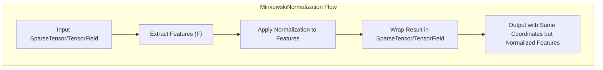
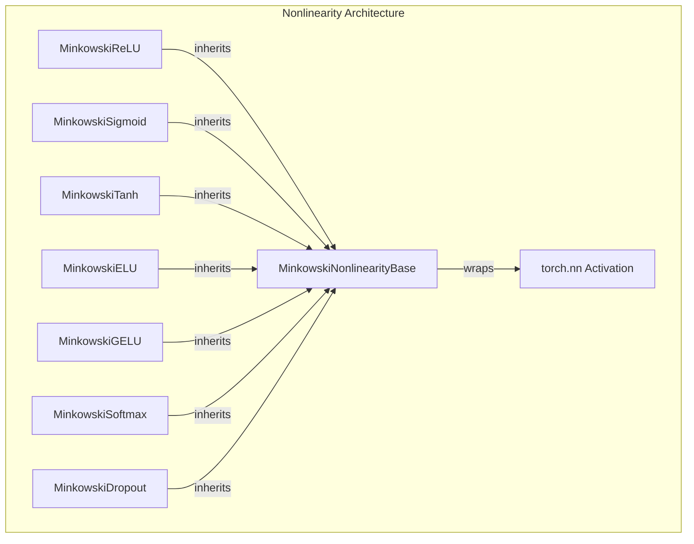
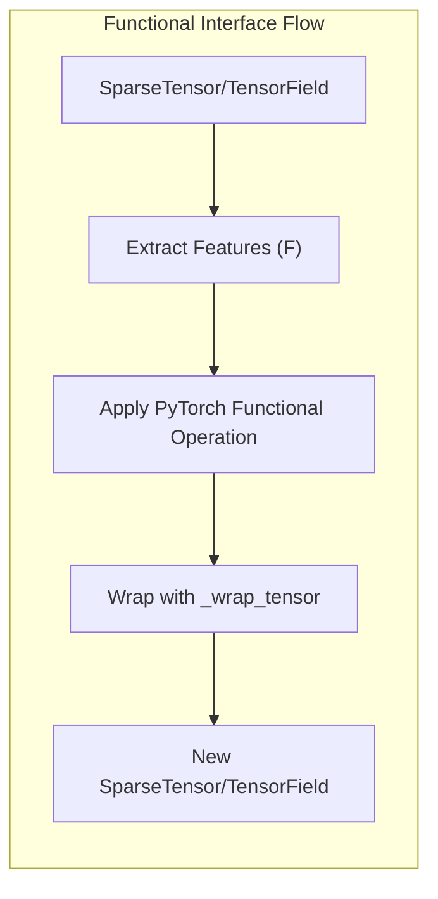
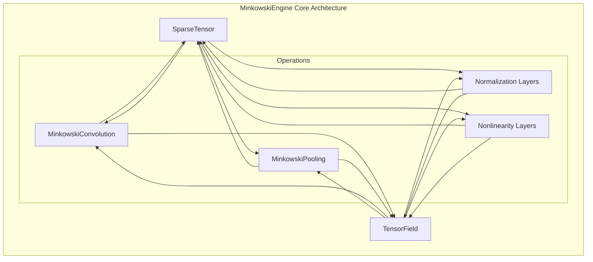

<!-- source: DeepWiki mcp.deepwiki.com · repo NVIDIA/MinkowskiEngine · page 3.3 Normalization and Nonlinearities · fetched 2026-10-26 -->

# Normalization and Nonlinearities

<details>
<summary>Relevant source files</summary>

The following files were used as context for generating this wiki page:

- [CHANGELOG.md](CHANGELOG.md)
- [MinkowskiEngine/MinkowskiFunctional.py](MinkowskiEngine/MinkowskiFunctional.py)
- [MinkowskiEngine/MinkowskiNetwork.py](MinkowskiEngine/MinkowskiNetwork.py)
- [MinkowskiEngine/MinkowskiNonlinearity.py](MinkowskiEngine/MinkowskiNonlinearity.py)
- [MinkowskiEngine/MinkowskiNormalization.py](MinkowskiEngine/MinkowskiNormalization.py)
- [MinkowskiEngine/MinkowskiOps.py](MinkowskiEngine/MinkowskiOps.py)
- [MinkowskiEngine/__init__.py](MinkowskiEngine/__init__.py)

</details>


## Purpose

This document explains the normalization layers and activation functions (nonlinearities) available in MinkowskiEngine for sparse tensors. These components are essential building blocks for constructing neural networks that operate on sparse data such as 3D point clouds.

## Normalization Layers

MinkowskiEngine provides several normalization layers that are specifically designed to work with sparse tensors. These layers normalize feature values while preserving the sparsity pattern of the input tensor.

### Batch Normalization

`MinkowskiBatchNorm` is a batch normalization layer for sparse tensors. It normalizes features across the batch dimension, similar to PyTorch's `BatchNorm1d`.

```python
# Example usage
import MinkowskiEngine as ME

# Create a batch normalization layer with 64 features
bn = ME.MinkowskiBatchNorm(64)

# Apply to a sparse tensor
out_tensor = bn(in_tensor)
```

Under the hood, `MinkowskiBatchNorm` wraps PyTorch's `BatchNorm1d` but handles the sparse tensor structure appropriately.

Sources: [MinkowskiEngine/MinkowskiNormalization.py:51-98]()

### Synchronized Batch Normalization

`MinkowskiSyncBatchNorm` is designed for multi-GPU training scenarios. It ensures that batch statistics are synchronized across GPUs, which is critical for consistent normalization when the batch is split across multiple devices.

```python
# Convert a network to use synchronized batch normalization
sync_net = ME.MinkowskiSyncBatchNorm.convert_sync_batchnorm(net)
```

Sources: [MinkowskiEngine/MinkowskiNormalization.py:101-191]()

### Instance Normalization

MinkowskiEngine provides two implementations of instance normalization:

1. `MinkowskiInstanceNorm`: Normalizes features independently for each instance in the batch.
2. `MinkowskiStableInstanceNorm`: A more numerically stable implementation of instance normalization.

Instance normalization is particularly useful for tasks where batch size might be small or when the distribution of features varies significantly between instances.

Sources: [MinkowskiEngine/MinkowskiNormalization.py:193-399]()

### Implementation Details

The normalization layers in MinkowskiEngine operate differently from their dense counterparts due to the sparse nature of the data. For instance, batch statistics are computed only on non-zero elements, and care is taken to preserve the coordinate mapping through the normalization process.



## Nonlinearity Layers

MinkowskiEngine provides a comprehensive set of nonlinearity (activation) functions that work seamlessly with sparse tensors.

### Base Class and Architecture

All nonlinearity layers in MinkowskiEngine inherit from `MinkowskiNonlinearityBase`, which provides the common functionality for handling sparse tensors. Each specific activation then wraps the corresponding PyTorch function.



Sources: [MinkowskiEngine/MinkowskiNonlinearity.py:34-59]()

### Available Activation Functions

MinkowskiEngine includes a wide range of activation functions:

| Category | Activation Functions |
|----------|---------------------|
| ReLU Family | `MinkowskiReLU`, `MinkowskiLeakyReLU`, `MinkowskiPReLU`, `MinkowskiRReLU`, `MinkowskiReLU6` |
| Sigmoid Family | `MinkowskiSigmoid`, `MinkowskiLogSigmoid`, `MinkowskiHardsigmoid` |
| Tanh Family | `MinkowskiTanh`, `MinkowskiTanhshrink` |
| ELU Family | `MinkowskiELU`, `MinkowskiCELU`, `MinkowskiSELU`, `MinkowskiGELU` |
| Softmax Family | `MinkowskiSoftmax`, `MinkowskiLogSoftmax`, `MinkowskiSoftmin` |
| Other | `MinkowskiHardtanh`, `MinkowskiHardswish`, `MinkowskiSoftplus`, `MinkowskiSoftshrink`, `MinkowskiSoftsign`, `MinkowskiThreshold`, `MinkowskiSiLU` |
| Dropout | `MinkowskiDropout`, `MinkowskiAlphaDropout` |

Sources: [MinkowskiEngine/MinkowskiNonlinearity.py:61-173](), [MinkowskiEngine/__init__.py:134-163]()

### Custom Sinusoidal Activation

MinkowskiEngine also provides a custom sinusoidal activation function (`MinkowskiSinusoidal`) which can be useful for specific types of tasks that require periodic activation behavior.

Sources: [MinkowskiEngine/MinkowskiNonlinearity.py:175-200]()

## Functional Interface

In addition to the class-based interface, MinkowskiEngine provides a functional interface for applying normalizations and nonlinearities through the `MinkowskiFunctional` module.

```python
# Example usage of functional interface
import MinkowskiEngine.MinkowskiFunctional as MF

# Apply ReLU activation
out_tensor = MF.relu(in_tensor)

# Apply normalization
out_tensor = MF.normalize(in_tensor)
```

The functional interface wraps PyTorch's functional operations to work with sparse tensors. This is particularly useful when you need more fine-grained control over the activation process or when integrating with other custom operations.



Sources: [MinkowskiEngine/MinkowskiFunctional.py:30-232]()

## Integration with Data Structures

Normalization and nonlinearity layers in MinkowskiEngine work with both `SparseTensor` and `TensorField` data structures. When an operation is applied to either data structure, it:

1. Extracts the feature tensor (`F` attribute)
2. Applies the operation to the features
3. Creates a new sparse tensor or tensor field with the processed features and the original coordinate information

This ensures that the spatial structure is preserved while only the feature values are modified.

```python
def forward(self, input):
    output = self.module(input.F)  # Apply operation only to features
    if isinstance(input, TensorField):
        return TensorField(
            output,
            coordinate_field_map_key=input.coordinate_field_map_key,
            coordinate_manager=input.coordinate_manager,
            quantization_mode=input.quantization_mode,
        )
    else:
        return SparseTensor(
            output,
            coordinate_map_key=input.coordinate_map_key,
            coordinate_manager=input.coordinate_manager,
        )
```

Sources: [MinkowskiEngine/MinkowskiNonlinearity.py:41-55](), [MinkowskiEngine/MinkowskiNormalization.py:74-88]()

## Usage in Neural Networks

Normalization and nonlinearity layers are typically used in combination with convolution and pooling operations to build sparse neural networks. The common pattern is:

```python
import MinkowskiEngine as ME

# Define a simple network with normalization and nonlinearity
network = nn.Sequential(
    ME.MinkowskiConvolution(in_channels, out_channels, kernel_size=3, stride=1, dimension=3),
    ME.MinkowskiBatchNorm(out_channels),
    ME.MinkowskiReLU(),
    ME.MinkowskiMaxPooling(kernel_size=2, stride=2, dimension=3)
)

# Process a sparse tensor
output = network(input_tensor)
```

This sequential pattern mirrors how layers are typically arranged in standard dense neural networks, but with sparse tensor operations under the hood.

## Best Practices

- **Layer Order**: The typical order is convolution → normalization → nonlinearity.
- **Multi-GPU Training**: Use `MinkowskiSyncBatchNorm` for synchronized batch normalization across multiple GPUs.
- **Performance**: These operations are memory-efficient as they operate directly on sparse tensors without materializing dense representations.
- **TensorField Support**: All normalization and nonlinearity layers support both `SparseTensor` and `TensorField` data structures.

## System Architecture Context



Sources: [MinkowskiEngine/__init__.py:166-172](), [MinkowskiEngine/__init__.py:134-163]()

This wiki page provides an overview of the normalization and nonlinearity components in MinkowskiEngine. For information about other operations like convolution and pooling, see [Convolution Operations](#3.1) and [Pooling Operations](#3.2) respectively.

---

