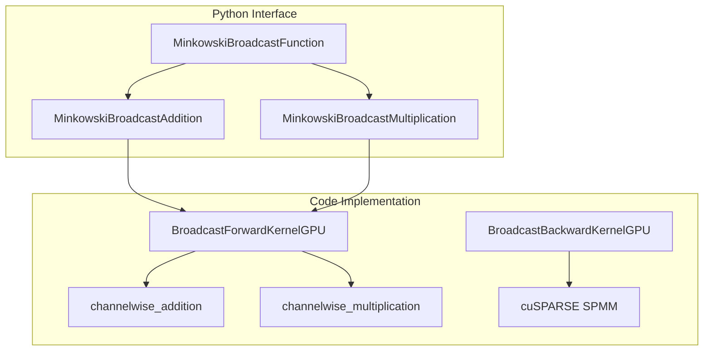
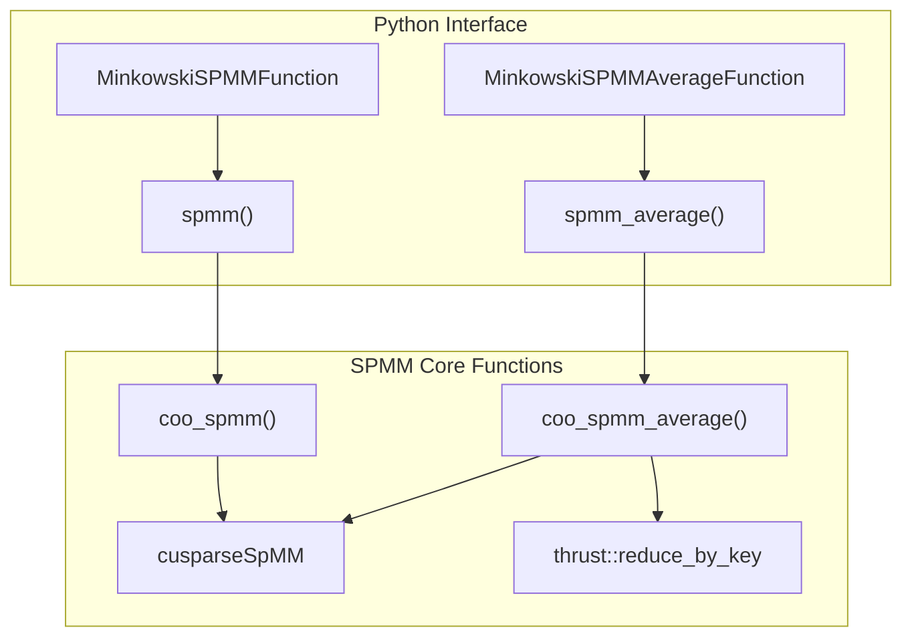
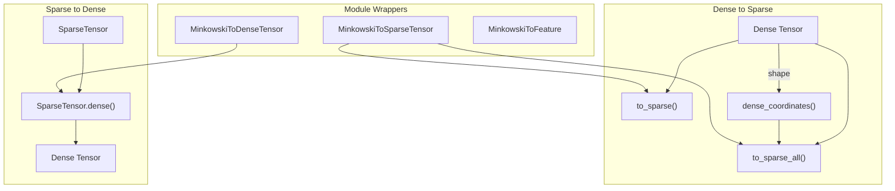
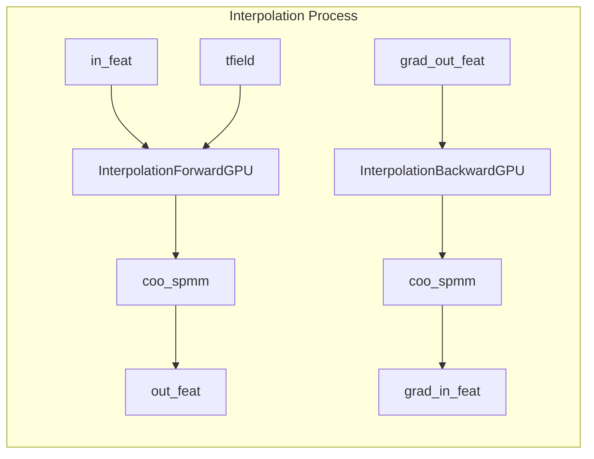
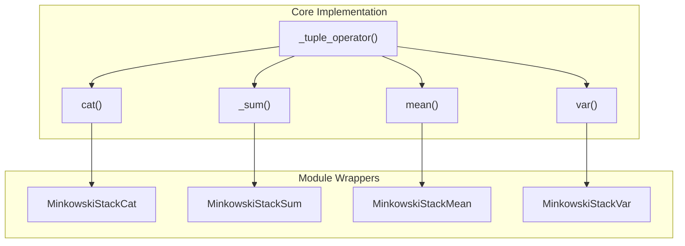
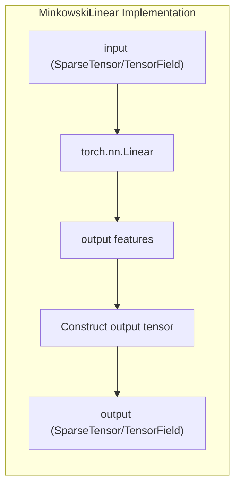
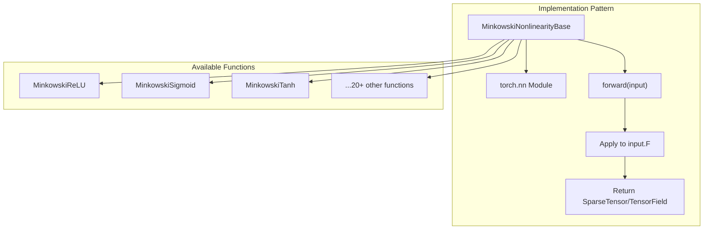
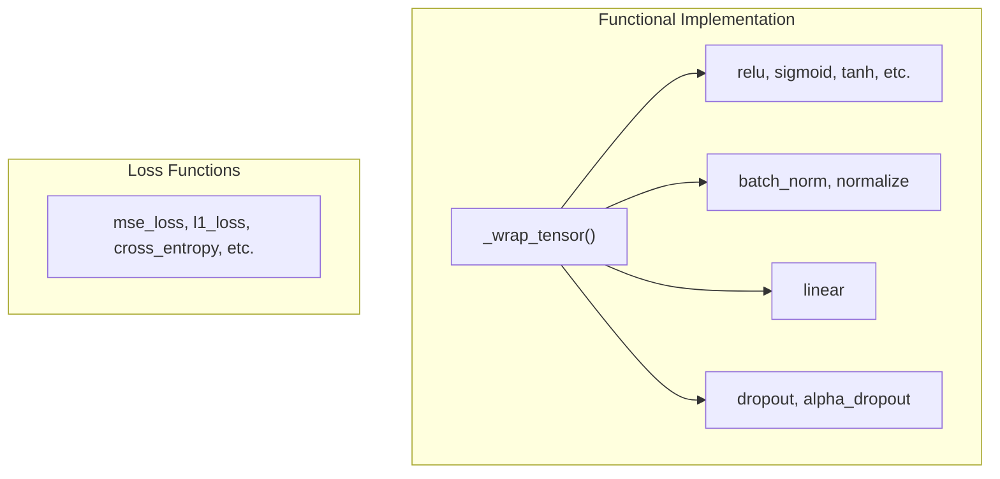
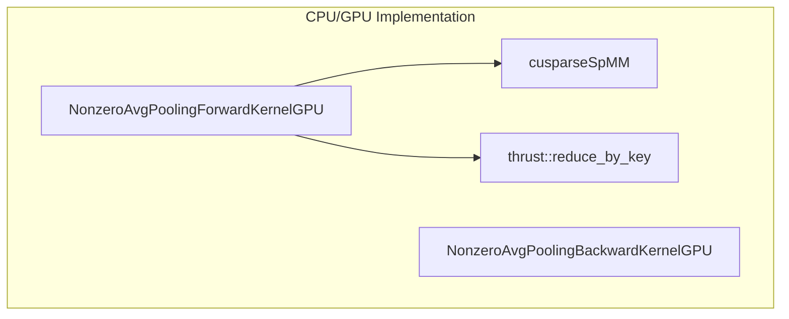

<!-- source: DeepWiki mcp.deepwiki.com · repo NVIDIA/MinkowskiEngine · page 3.4 Other Operations · fetched 2026-10-26 -->

# Other Operations

Relevant source files

The following files were used as context for generating this wiki page:

- [MinkowskiEngine/MinkowskiFunctional.py](MinkowskiEngine/MinkowskiFunctional.py)
- [MinkowskiEngine/MinkowskiNetwork.py](MinkowskiEngine/MinkowskiNetwork.py)
- [MinkowskiEngine/MinkowskiNonlinearity.py](MinkowskiEngine/MinkowskiNonlinearity.py)
- [MinkowskiEngine/MinkowskiNormalization.py](MinkowskiEngine/MinkowskiNormalization.py)
- [MinkowskiEngine/MinkowskiOps.py](MinkowskiEngine/MinkowskiOps.py)
- [MinkowskiEngine/sparse_matrix_functions.py](MinkowskiEngine/sparse_matrix_functions.py)
- [src/broadcast_kernel.cu](src/broadcast_kernel.cu)
- [src/interpolation_gpu.cu](src/interpolation_gpu.cu)
- [src/pooling_avg_kernel.cu](src/pooling_avg_kernel.cu)
- [src/spmm.cu](src/spmm.cu)
- [src/spmm.cuh](src/spmm.cuh)
- [tests/python/spmm.py](tests/python/spmm.py)

This page documents additional operations available in MinkowskiEngine beyond the core convolutional, pooling, and normalization operations covered in previous sections. These operations include broadcasting, sparse matrix multiplication (SPMM), tensor format conversions, interpolation, and utility functions for manipulating sparse tensors.

## Broadcasting Operations

Broadcasting operations apply element-wise operations between a sparse tensor and a globally pooled tensor. These operations are useful for implementing attention mechanisms, feature normalization, and other tasks requiring global context.

MinkowskiEngine supports two primary broadcasting modes:

1. **Element-wise Addition**: Adds the global feature to each feature of the sparse tensor
2. **Element-wise Multiplication**: Multiplies each feature of the sparse tensor by the global feature

### Broadcasting Architecture

The broadcasting operations use `BroadcastMode` enumeration to specify the operation type:
- `BroadcastMode.ELEMENTWISE_ADDITON`
- `BroadcastMode.ELEMENTWISE_MULTIPLICATION`

Sources: [src/broadcast_kernel.cu:90-133](), [src/broadcast_kernel.cu:167-451]()

## Sparse Matrix Multiplication (SPMM)

Sparse Matrix Multiplication (SPMM) is a fundamental operation for efficient processing of sparse data. MinkowskiEngine provides CUDA-accelerated SPMM operations through the cuSPARSE library.

### SPMM Operations

SPMM operations in MinkowskiEngine:

1. **Regular SPMM** (`coo_spmm`): Performs sparse-dense matrix multiplication
2. **Average SPMM** (`coo_spmm_average`): Performs sparse-dense matrix multiplication with averaging

The implementation supports different algorithms based on the CUDA version:
- CUDA 10.1-11.0: `CUSPARSE_COOMM_ALG1/2/3`
- CUDA 11.0+: `CUSPARSE_SPMM_COO_ALG1/2/3/4`

Sources: [src/spmm.cu:79-333](), [src/spmm.cu:341-590](), [MinkowskiEngine/sparse_matrix_functions.py:32-122](), [MinkowskiEngine/sparse_matrix_functions.py:123-213]()

## Tensor Conversion Operations

MinkowskiEngine provides operations for converting between dense and sparse tensor formats, enabling interoperability with standard PyTorch operations.

### Tensor Conversion Flow

Key conversion functions:

- `to_sparse()`: Converts a dense tensor to a sparse tensor, keeping only non-zero values
- `to_sparse_all()`: Converts a dense tensor to a sparse tensor with all coordinates
- `dense_coordinates()`: Generates coordinates for dense tensors (useful for caching coordinates)
- `SparseTensor.dense()`: Converts a sparse tensor back to a dense tensor
- `MinkowskiToFeature`: Extracts feature tensors from sparse tensors

Sources: [MinkowskiEngine/MinkowskiOps.py:246-276](), [MinkowskiEngine/MinkowskiOps.py:279-348](), [MinkowskiEngine/MinkowskiOps.py:351-412](), [MinkowskiEngine/MinkowskiOps.py:414-457](), [MinkowskiEngine/MinkowskiOps.py:460-477]()

## Interpolation

Interpolation operations map features from one coordinate space to another, useful for tasks like feature mapping between different resolutions or for operations like trilinear interpolation in 3D sparse tensors.

### Interpolation Implementation

The interpolation implementation:
1. Computes a mapping between input and output coordinates using the transformation field
2. Calculates interpolation weights
3. Uses SPMM to apply the weights and perform interpolation
4. Supports both forward and backward passes for end-to-end training

Sources: [src/interpolation_gpu.cu:43-84](), [src/interpolation_gpu.cu:87-149]()

## Utility Operations

MinkowskiEngine provides several utility operations for manipulating sparse tensors with the same coordinate structure:

### Utility Functions

Utility operations:

1. `cat`: Concatenates features of sparse tensors along the feature dimension
2. `_sum`: Computes element-wise sum of sparse tensor features
3. `mean`: Computes element-wise average of sparse tensor features
4. `var`: Computes element-wise variance of sparse tensor features

These operations require that all input sparse tensors have the same coordinate map key (same coordinates).

Sources: [MinkowskiEngine/MinkowskiOps.py:70-138](), [MinkowskiEngine/MinkowskiOps.py:141-158](), [MinkowskiEngine/MinkowskiOps.py:161-185](), [MinkowskiEngine/MinkowskiOps.py:188-212](), [MinkowskiEngine/MinkowskiOps.py:215-243]()

## Linear Operations

MinkowskiEngine provides standard linear operations adapted for sparse tensors.

### MinkowskiLinear

`MinkowskiLinear` is equivalent to PyTorch's `nn.Linear` but operates on the features of sparse tensors while preserving the sparse coordinate structure.

Sources: [MinkowskiEngine/MinkowskiOps.py:40-67]()

## Nonlinearity Operations

MinkowskiEngine provides a comprehensive set of nonlinear activation functions that can be applied to sparse tensors.

### Activation Function Structure

MinkowskiEngine provides wrapper classes for all standard PyTorch activation functions, enabling them to work seamlessly with sparse tensors.

Sources: [MinkowskiEngine/MinkowskiNonlinearity.py:34-56](), [MinkowskiEngine/MinkowskiNonlinearity.py:61-164](), [MinkowskiEngine/MinkowskiFunctional.py:30-152]()

## Functional API

In addition to the module-based API, MinkowskiEngine provides a functional API for operations on sparse tensors, similar to `torch.nn.functional`.

### MinkowskiFunctional

The functional API provides a more flexible way to apply operations to sparse tensors without creating module instances.

Sources: [MinkowskiEngine/MinkowskiFunctional.py:30-65](), [MinkowskiEngine/MinkowskiFunctional.py:155-233]()

## Pooling and Average Operations

MinkowskiEngine offers specialized pooling operations, including average pooling which can be used independently or as part of other operations.

### Average Pooling Implementation

Average pooling is implemented using sparse matrix multiplication and reduction operations, with optimizations for both CPU and GPU execution.

Sources: [src/pooling_avg_kernel.cu:127-349](), [src/pooling_avg_kernel.cu:410-488]()

## Summary

MinkowskiEngine provides a comprehensive set of operations beyond the core convolution and pooling operations, enabling efficient processing of sparse data for various tasks in 3D computer vision, robotics, and other domains. These operations maintain the sparse structure of the data throughout the computation graph, enabling end-to-end training and inference with sparse tensors.

---

