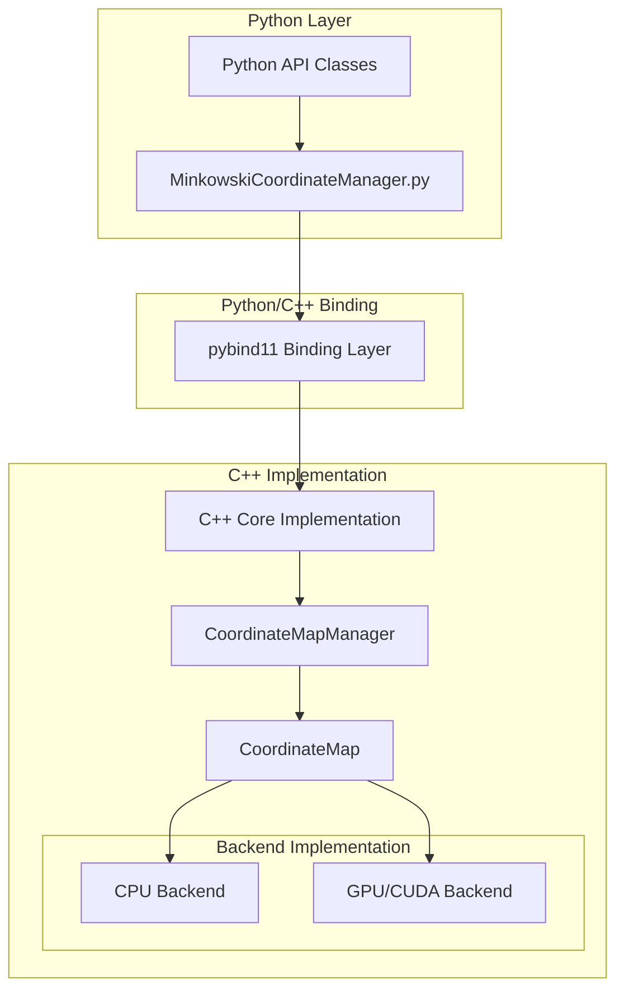
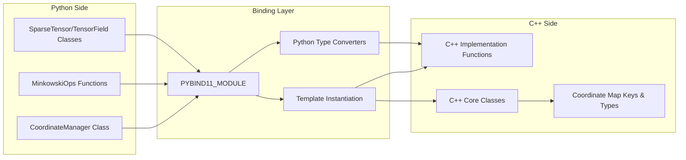
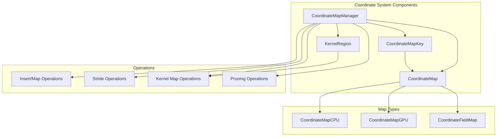
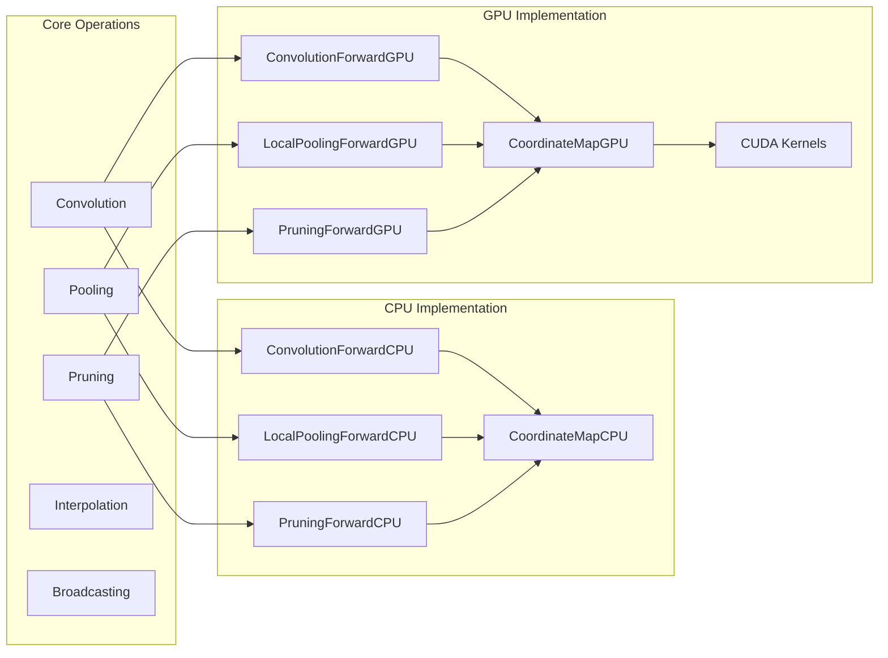
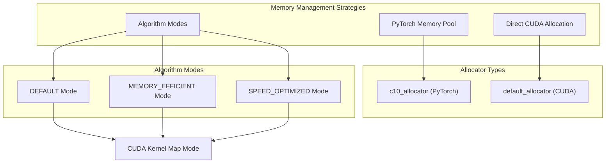
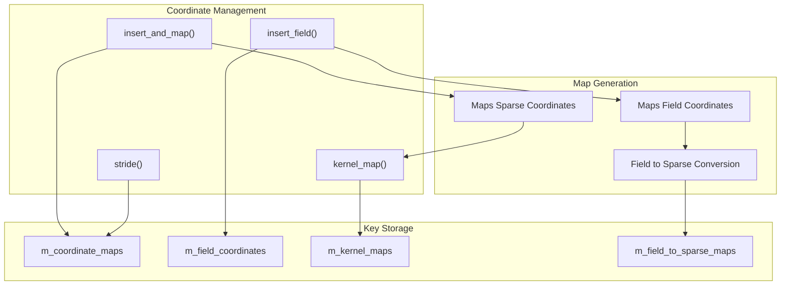
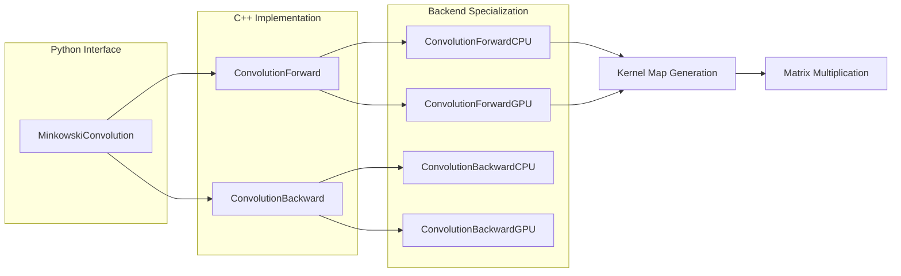
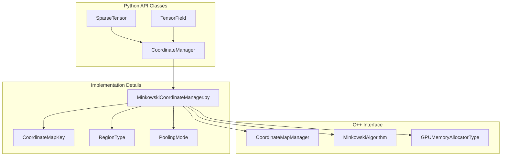

<!-- source: DeepWiki mcp.deepwiki.com · repo NVIDIA/MinkowskiEngine · page 4 Implementation Details · fetched 2026-10-26 -->

# Implementation Details

<details>
<summary>Relevant source files</summary>

The following files were used as context for generating this wiki page:

- [MinkowskiEngine/MinkowskiCoordinateManager.py](MinkowskiEngine/MinkowskiCoordinateManager.py)
- [pybind/extern.hpp](pybind/extern.hpp)
- [src/coordinate_map.hpp](src/coordinate_map.hpp)
- [src/coordinate_map_manager.cpp](src/coordinate_map_manager.cpp)
- [src/coordinate_map_manager.hpp](src/coordinate_map_manager.hpp)
- [src/kernel_region.hpp](src/kernel_region.hpp)
- [src/types.hpp](src/types.hpp)

</details>


This document provides a technical overview of the core architecture and implementation details of MinkowskiEngine. It focuses on the internal design decisions, memory management strategies, and how the Python and C++ layers interact. For information about specific operations like convolutions and pooling, see [Neural Network Operations](#3).

## Architecture Overview

MinkowskiEngine uses a hybrid architecture that combines Python and C++ code to achieve both flexibility and performance. The high-level Python interface provides user-friendly APIs, while the performance-critical operations are implemented in C++ with both CPU and GPU (CUDA) backends.



Sources: [pybind/extern.hpp:1-515](). [MinkowskiEngine/MinkowskiCoordinateManager.py:1-100]().

## Python-C++ Interface Architecture

The Python-C++ interface is implemented using pybind11, which allows for seamless integration between the two languages. The binding code is primarily located in `pybind/extern.hpp`, which defines the functions exposed to Python.



The interface follows a template-based approach to support different coordinate data types (e.g., `int32_t` for sparse tensors) and coordinate field types (e.g., `float` for continuous coordinates).

Key components in the binding layer:

1. **Type Definitions**: Various type definitions (in `types.hpp`) enable consistent data handling across the Python-C++ boundary.
2. **Template Instantiation**: Functions like `instantiate_cpu_func()` and `instantiate_gpu_func()` create the necessary template instances for different coordinate types.
3. **Exposed Classes**: Core classes like `CoordinateMapKey` and `CoordinateMapManager` are exposed directly to Python.

Sources: [pybind/extern.hpp:49-515](). [pybind/extern.hpp:513-668](). [src/types.hpp:37-106]().

## Coordinate System Implementation

The coordinate system is the foundation of MinkowskiEngine, managing sparse tensor coordinates efficiently.



### Core Coordinate Components

1. **CoordinateMapKey**: Uniquely identifies a coordinate system with tensor stride and string ID
   ```cpp
   using coordinate_map_key_type = std::pair<default_types::stride_type, std::string>;
   ```

2. **CoordinateMap**: Base template class for different coordinate map implementations
   - Maps coordinates to their indices in the feature tensor
   - Handles coordinate insertion, lookup, and transformation

3. **CoordinateMapManager**: Manages multiple coordinate maps 
   - Handles creation, transformation, and operations between coordinate maps
   - Stores mappings between different coordinate systems

4. **KernelRegion**: Defines regions of coordinates for convolution and pooling operations
   - Implements different region types (HYPER_CUBE, HYPER_CROSS, CUSTOM)
   - Provides efficient iteration through kernel offsets

Sources: [src/coordinate_map_manager.hpp:87-149](). [src/coordinate_map.hpp:106-132](). [src/types.hpp:77-101](). [src/kernel_region.hpp:47-172]().

## CPU and GPU Implementation

MinkowskiEngine provides both CPU and GPU (CUDA) implementations for all operations. The code is structured to allow seamless switching between the two backends.



### CPU Implementation

- Implemented in standard C++ with OpenMP parallelization for multi-threading
- CPU functions are defined with templates like `ConvolutionForwardCPU<coordinate_type>` in `extern.hpp`
- Exposed to Python through `instantiate_cpu_func` function

### GPU Implementation

- Built on CUDA for GPU acceleration
- Uses template metaprogramming for memory management
- Supports two memory allocation strategies:
  1. PyTorch memory allocator (default)
  2. Direct CUDA memory allocation (can be faster but less memory-efficient)
- GPU functions are defined with templates like `ConvolutionForwardGPU<coordinate_type, TemplatedAllocator>`
- Conditional compilation with `#ifndef CPU_ONLY` to enable CPU-only builds

Sources: [pybind/extern.hpp:53-115](). [pybind/extern.hpp:150-182](). [pybind/extern.hpp:213-245](). [pybind/extern.hpp:580-646]().

## Memory Management

MinkowskiEngine implements sophisticated memory management strategies, particularly for GPU operations.



### Memory Allocator Types

1. **PyTorch Allocator** (`GPUMemoryAllocatorType.PYTORCH`):
   - Uses PyTorch's memory pool for GPU allocations
   - Enables shared memory management with PyTorch tensors
   - Better memory efficiency for large batch sizes

2. **CUDA Allocator** (`GPUMemoryAllocatorType.CUDA`):
   - Uses direct CUDA calls for memory allocation
   - Can be faster but less memory-efficient
   - Useful for performance-critical applications

### Algorithm Modes

The `MinkowskiAlgorithm` enum defines different optimization strategies:

1. **DEFAULT**: Balanced between memory and speed (default)
2. **MEMORY_EFFICIENT**: Prioritizes memory efficiency
3. **SPEED_OPTIMIZED**: Prioritizes execution speed

These modes affect:
- CUDA kernel map generation strategy
- GPU memory usage patterns
- Default GPU occupancy levels

Sources: [src/types.hpp:115-130](). [src/coordinate_map_manager.hpp:128-156](). [MinkowskiEngine/MinkowskiCoordinateManager.py:46-97]().

## Coordinate Management System

The coordinate management system is responsible for tracking, transforming, and mapping coordinates between different tensor strides and operations.



### Core Functions

1. **`insert_and_map`**: Inserts coordinates and returns mappings
   - Takes integer coordinates and tensor stride
   - Returns a key and mapping tensors (unique_map, inverse_map)

2. **`insert_field`**: Inserts continuous coordinates
   - Takes floating-point coordinates
   - Used for TensorField operations

3. **`field_to_sparse_map`**: Converts field coordinates to sparse coordinates
   - Quantizes continuous coordinates to discrete grid
   - Creates mappings between field and sparse representations

4. **`kernel_map`**: Creates mappings for convolution/pooling kernels
   - Maps input and output coordinates for sparse convolution
   - Supports different region types and kernel configurations

5. **`stride`**: Creates strided coordinate maps
   - Generates new coordinates at different tensor strides
   - Used for hierarchical operations (e.g., pooling)

Sources: [src/coordinate_map_manager.cpp:139-186](). [src/coordinate_map_manager.cpp:193-266](). [src/coordinate_map_manager.cpp:353-399](). [src/coordinate_map_manager.cpp:632-662]().

## Operation Implementation

MinkowskiEngine implements various neural network operations for sparse tensors. Here's how the key operations are implemented:

### Convolution Operations



Convolution operations involve:
1. Generating a kernel map between input and output coordinates
2. Using the kernel map to perform sparse tensor operations
3. Executing optimized matrix multiplications for the actual convolution

### Pooling Operations

Pooling operations follow a similar pattern to convolutions, with specialized implementations for different pooling types:

- **Local Pooling**: Pooling within a kernel region
- **Global Pooling**: Pooling across the entire spatial dimension
- **Pooling Transpose**: Unpooling operations

### Other Operations

- **Broadcasting**: Operations that combine sparse and dense tensors
- **Pruning**: Removing coordinates based on specified criteria
- **Interpolation**: Sampling between sparse coordinate points

Sources: [pybind/extern.hpp:53-115](). [pybind/extern.hpp:187-245](). [pybind/extern.hpp:356-467]().

## Memory and Performance Optimization

MinkowskiEngine implements several strategies to optimize memory usage and computational performance:

1. **Custom Memory Allocators**:
   - Template-based allocators for different scenarios
   - Special handling for CUDA memory allocation

2. **Algorithm Mode Selection**:
   - Different modes prioritize memory efficiency vs. speed
   - Configurable at runtime through Python API

3. **Kernel Map Generation**:
   - Two modes for kernel map generation:
     - MEMORY_EFFICIENT: Uses less memory but might be slower
     - SPEED_OPTIMIZED: Faster but uses more memory

4. **Sparse Tensor Operations**:
   - Optimized sparse matrix multiplication algorithms
   - Efficient implementation of sparse convolution

Sources: [src/coordinate_map_manager.hpp:128-156](). [src/types.hpp:115-130](). [pybind/extern.hpp:671-691]().

## Python API Integration

The Python interface is designed to be intuitive while providing efficient access to the C++ implementation. The `CoordinateManager` class serves as the primary interface for coordinate management.



Key implementation details:

1. **Configuration Options**:
   - GPU memory allocator selection
   - Algorithm mode selection
   - Coordinate map type (CPU or CUDA)

2. **Core Python Methods**:
   - `insert_and_map`: Creates coordinate mappings
   - `kernel_map`: Generates kernel mappings for operations
   - `stride`: Creates strided coordinate maps

3. **C++ Integration**:
   - Uses dynamic dispatch to select appropriate C++ implementation
   - Handles tensor format conversion between PyTorch and C++

Sources: [MinkowskiEngine/MinkowskiCoordinateManager.py:107-144](). [MinkowskiEngine/MinkowskiCoordinateManager.py:153-186](). [MinkowskiEngine/MinkowskiCoordinateManager.py:377-421]().

## Conclusion

The implementation of MinkowskiEngine combines Python for ease of use with C++ for performance, leveraging both CPU and GPU computing capabilities. The core design centers around efficient coordinate management and sparse tensor operations, with specialized implementations for different backends and optimization strategies. This architecture enables high-performance processing of sparse 3D data while maintaining a user-friendly interface.

---

