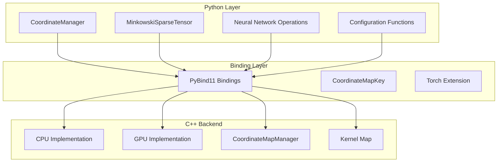
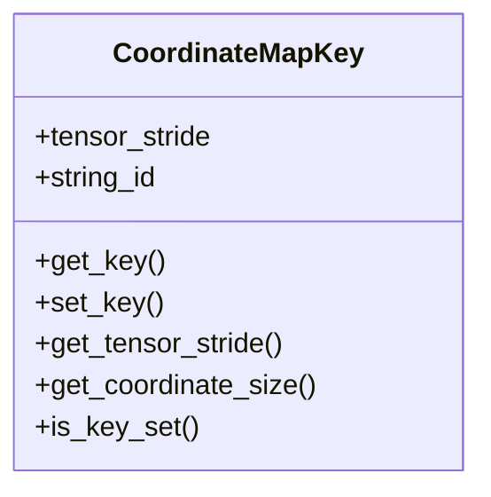
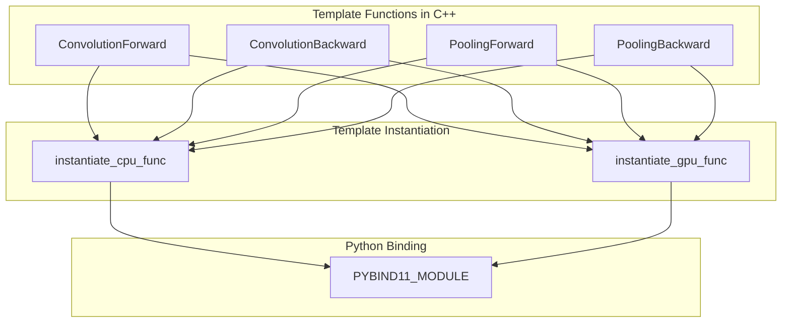
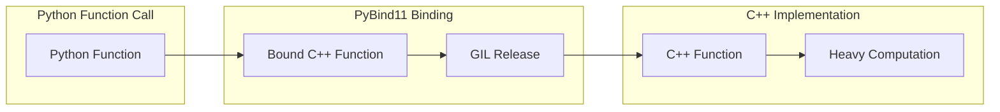
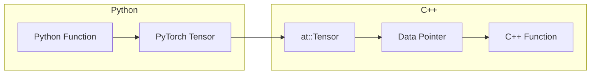
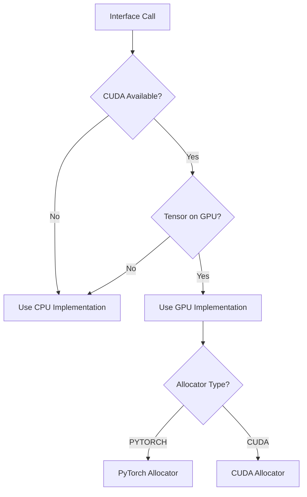
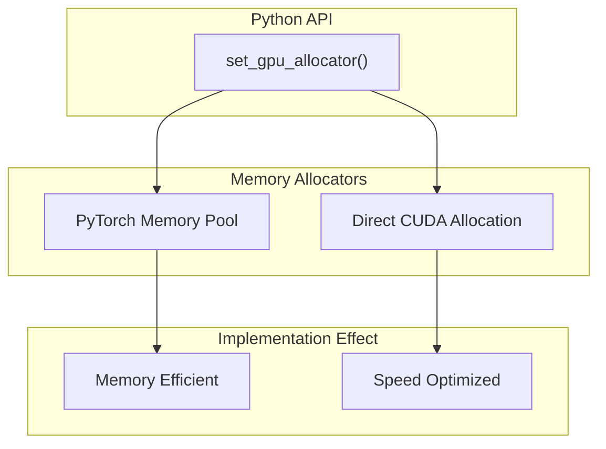

<!-- source: DeepWiki mcp.deepwiki.com · repo NVIDIA/MinkowskiEngine · page 4.1 Python/C++ Interface · fetched 2026-10-26 -->

# Python/C++ Interface

<details>
<summary>Relevant source files</summary>

The following files were used as context for generating this wiki page:

- [MinkowskiEngine/MinkowskiCoordinateManager.py](MinkowskiEngine/MinkowskiCoordinateManager.py)
- [pybind/extern.hpp](pybind/extern.hpp)
- [src/coordinate_map_manager.cpp](src/coordinate_map_manager.cpp)
- [src/coordinate_map_manager.hpp](src/coordinate_map_manager.hpp)

</details>


This document describes the interface between the Python API and the C++ backend in MinkowskiEngine. The Python/C++ interface is the critical bridge that allows Python users to access the high-performance C++ implementations of sparse tensor operations. For details about the specific CPU or GPU implementations, see [CPU Implementation](#4.2) and [GPU Implementation](#4.3).

## Interface Architecture Overview

MinkowskiEngine follows a layered architecture where Python code provides a user-friendly API that internally calls optimized C++ code through bindings. This design allows the library to offer both ease of use and high performance.



Sources: [pybind/extern.hpp:41-48](), [MinkowskiEngine/MinkowskiCoordinateManager.py:107-146]()

## Core Components

The Python/C++ interface consists of several key components that work together to enable seamless operation:

### CoordinateMapKey

`CoordinateMapKey` is a class used in both Python and C++ to uniquely identify coordinate maps. It's a crucial component that bridges the Python and C++ worlds by providing a consistent way to reference coordinate systems.



Sources: [pybind/extern.hpp:744-764](), [MinkowskiEngine/MinkowskiCoordinateManager.py:34-40]()

### CoordinateManager

The `CoordinateManager` class is the Python wrapper for the C++ `CoordinateMapManager`. It provides methods to manage sparse tensor coordinates, creating and manipulating coordinate systems, and generating mappings between them.

### Function Templates and Type Handling

MinkowskiEngine uses templated functions in C++ to handle different data types and implementations (CPU/GPU). These templates are instantiated and exposed to Python through PyBind11.



Sources: [pybind/extern.hpp:515-574](), [pybind/extern.hpp:576-646]()

## Interface Binding Mechanism

The interface between Python and C++ is created using PyBind11, which provides seamless integration between the two languages. The binding process exposes C++ classes and functions to Python by creating Python modules that map to C++ entities.

### PyBind11 Class Binding

C++ classes are exposed to Python using PyBind11's class_ template. Methods, constructors, and properties are bound to make them accessible from Python.

| C++ Entity | Python Equivalent | Description |
|------------|-------------------|-------------|
| `CoordinateMapKey` | `CoordinateMapKey` | Class for uniquely identifying coordinate maps |
| `CoordinateMapManager<type>` | `CoordinateMapManager{CPU/GPU}` | Template class instantiated for different backends |
| Enum types (RegionType, etc.) | Enum types | Exposed as Python enum objects |

Sources: [pybind/extern.hpp:669-765](), [pybind/extern.hpp:767-806]()

### Function Binding

C++ functions are exposed to Python by registering them with PyBind11's module object. Template functions are instantiated for specific types before binding.



Sources: [pybind/extern.hpp:515-574](), [pybind/extern.hpp:649-658]()

## Data Flow Between Python and C++

The interface handles data transfer between Python and C++ efficiently, using PyTorch tensors as the primary data structure for exchanging information.

### Tensor Passing

PyTorch tensors are passed directly between Python and C++ without copying the underlying data. This is possible because PyTorch's C++ API provides access to the tensor's memory.



Sources: [pybind/extern.hpp:54-66](), [pybind/extern.hpp:187-190]()

### Memory Management

MinkowskiEngine supports different memory allocation strategies for GPU operations, configurable through the Python API.

| Allocator Type | Description |
|----------------|-------------|
| `GPUMemoryAllocatorType.PYTORCH` | Uses PyTorch's memory pool (default) |
| `GPUMemoryAllocatorType.CUDA` | Uses direct CUDA calls for memory allocation |

Sources: [MinkowskiEngine/MinkowskiCoordinateManager.py:46-51](), [MinkowskiEngine/MinkowskiCoordinateManager.py:63-89]()

## CPU vs GPU Interface Specifics

The interface provides separate implementations for CPU and GPU operations, conditionally compiled based on the availability of CUDA.

### Implementation Selection

The interface dynamically selects the appropriate implementation based on the device type and available hardware:



Sources: [pybind/extern.hpp:83-115](), [MinkowskiEngine/MinkowskiCoordinateManager.py:132-147]()

### Conditional Compilation

The interface uses preprocessor directives to conditionally include GPU code based on the `CPU_ONLY` flag:

```cpp
#ifndef CPU_ONLY
// GPU-specific code
#endif
```

This ensures that the library can be built for systems without GPU support.

Sources: [pybind/extern.hpp:35-39](), [pybind/extern.hpp:150-182]()

## Key Operations

The interface exposes various operations from C++ to Python. Here are some of the most important ones:

### Coordinate Management Operations

| Operation | Description |
|-----------|-------------|
| `insert_and_map` | Creates a new coordinate map and returns mapping information |
| `kernel_map` | Generates mapping between input and output coordinates for convolution kernels |
| `stride` | Creates a strided coordinate map from an existing one |

Sources: [MinkowskiEngine/MinkowskiCoordinateManager.py:153-179](), [MinkowskiEngine/MinkowskiCoordinateManager.py:377-421]()

### Neural Network Operations

| Operation Type | CPU Variant | GPU Variant |
|----------------|-------------|-------------|
| Convolution | `ConvolutionForwardCPU` | `ConvolutionForwardGPU` |
| Pooling | `LocalPoolingForwardCPU` | `LocalPoolingForwardGPU` |
| Global Pooling | `GlobalPoolingForwardCPU` | `GlobalPoolingForwardGPU` |
| Broadcast | `BroadcastForwardCPU` | `BroadcastForwardGPU` |

Sources: [pybind/extern.hpp:53-115](), [pybind/extern.hpp:187-246]()

## Performance Considerations

The Python/C++ interface is designed with performance in mind, implementing several optimizations:

### GIL Release

To enable multi-threading, the interface releases the Python Global Interpreter Lock (GIL) during C++ function calls using PyBind11's `py::call_guard<py::gil_scoped_release>()`.

Sources: [pybind/extern.hpp:519](), [pybind/extern.hpp:582]()

### Custom Memory Allocators

For GPU operations, the interface offers different memory allocation strategies that can be selected based on the specific use case:



Sources: [MinkowskiEngine/MinkowskiCoordinateManager.py:63-98](), [pybind/extern.hpp:671-682]()

### Algorithm Selection

The interface supports different algorithm modes that trade-off between memory efficiency and speed:

| Algorithm Mode | Description |
|----------------|-------------|
| `DEFAULT` | Default balance between memory and speed |
| `MEMORY_EFFICIENT` | Prioritizes memory efficiency |
| `SPEED_OPTIMIZED` | Prioritizes execution speed |

Sources: [pybind/extern.hpp:684-690](), [MinkowskiEngine/MinkowskiCoordinateManager.py:138-155]()

## Common Usage Patterns

The Python/C++ interface is typically used in the following ways:

1. **Creating Coordinate Systems**:
   ```python
   manager = CoordinateManager(D=3)  # 3D coordinate system
   coords = torch.IntTensor(coordinates)
   key, (unique_map, inverse_map) = manager.insert_and_map(coords, tensor_stride=2)
   ```

2. **Generating Kernel Maps for Convolutions**:
   ```python
   kernel_map = manager.kernel_map(
       in_key, out_key, 
       kernel_size=3, stride=2, dilation=1,
       region_type=RegionType.HYPER_CUBE
   )
   ```

3. **Coordinate Manipulation**:
   ```python
   strided_key = manager.stride(key, stride=2)
   ```

Sources: [MinkowskiEngine/MinkowskiCoordinateManager.py:153-179](), [MinkowskiEngine/MinkowskiCoordinateManager.py:377-421]()

## Extension Points

The Python/C++ interface can be extended in several ways:

1. Adding new operations by implementing them in C++ and exposing them to Python
2. Supporting new data types by instantiating templates with those types
3. Implementing custom memory allocators for specialized hardware

Sources: [pybind/extern.hpp:649-667](), [pybind/extern.hpp:576-646]()

---

