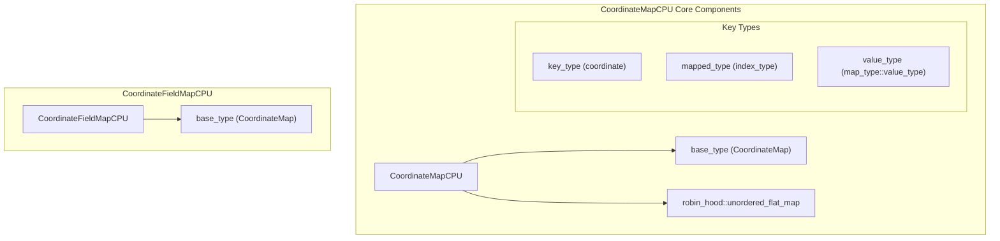
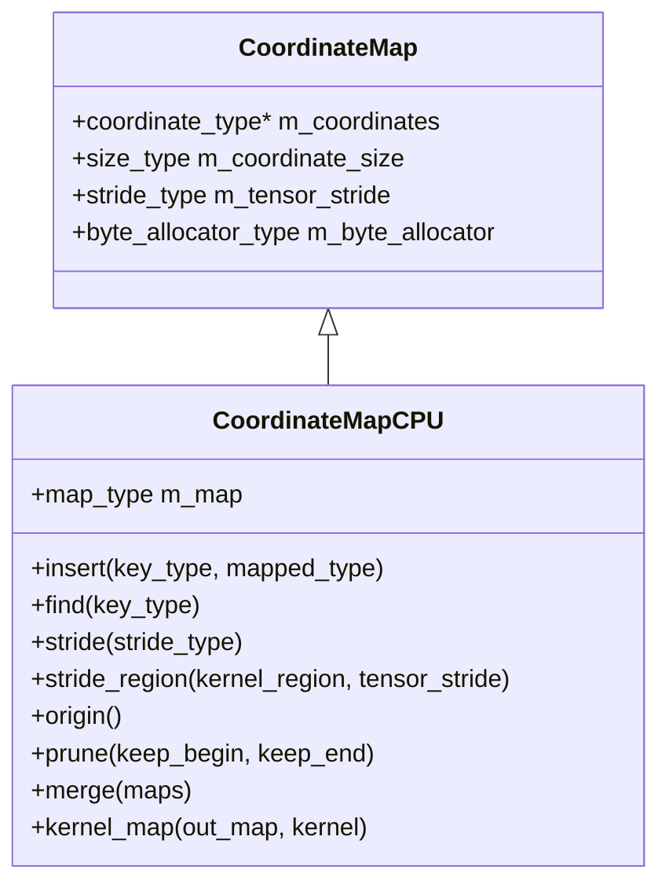
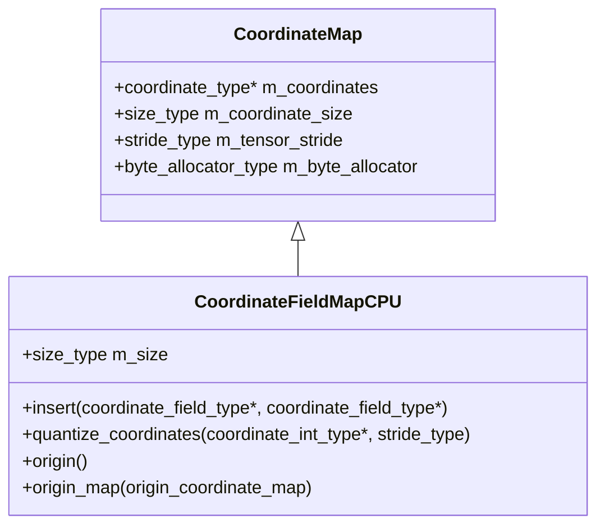
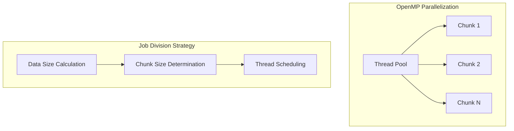
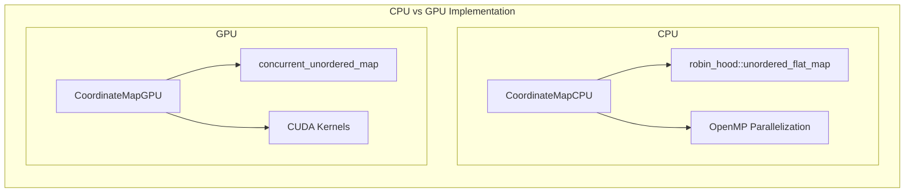

<!-- source: DeepWiki mcp.deepwiki.com · repo NVIDIA/MinkowskiEngine · page 4.2 CPU Implementation · fetched 2026-10-26 -->

# CPU Implementation

<details>
<summary>Relevant source files</summary>

The following files were used as context for generating this wiki page:

- [src/coordinate_map_cpu.hpp](src/coordinate_map_cpu.hpp)
- [src/coordinate_map_gpu.cu](src/coordinate_map_gpu.cu)
- [src/coordinate_map_gpu.cuh](src/coordinate_map_gpu.cuh)

</details>


This document describes the CPU implementation of operations in MinkowskiEngine. The CPU implementation provides an alternative to the [GPU Implementation](#4.3) for systems without compatible GPUs or for debugging purposes. This page covers the core data structures and algorithms used for CPU-based sparse tensor operations.

## Overview

The CPU implementation in MinkowskiEngine centers around two main classes that handle coordinate management and operations for sparse tensors:

1. `CoordinateMapCPU` - Manages discrete sparse coordinates
2. `CoordinateFieldMapCPU` - Manages continuous coordinate fields

Both classes provide efficient CPU-based implementations of operations such as coordinate insertion, finding, striding, pruning, and kernel map generation, with parallelization through OpenMP.



Sources: [src/coordinate_map_cpu.hpp:280-941](src/coordinate_map_cpu.hpp:280-941)

## Core Data Structures

### CoordinateMapCPU

`CoordinateMapCPU` is the main class responsible for managing discrete sparse coordinates on the CPU. It inherits from the base `CoordinateMap` class and implements CPU-specific operations.

#### Key Components

1. **Hash Map Implementation**: Uses `robin_hood::unordered_flat_map` for efficient hash-based storage and retrieval of coordinate-to-index mappings
2. **Coordinate Storage**: Maintains coordinates in a contiguous memory layout
3. **Tensor Stride**: Stores the stride information for each dimension



Sources: [src/coordinate_map_cpu.hpp:280-323](src/coordinate_map_cpu.hpp:280-323)

### CoordinateFieldMapCPU

`CoordinateFieldMapCPU` handles continuous coordinate fields (floating-point coordinates) with CPU-based implementations. It provides operations for quantizing continuous coordinates into discrete ones.



Sources: [src/coordinate_map_cpu.hpp:942-1066](src/coordinate_map_cpu.hpp:942-1066)

## Key Operations

### Coordinate Insertion and Mapping

The `CoordinateMapCPU` class provides methods for inserting coordinates and mapping them to indices. The main operations include:

1. **insert**: Inserts coordinates into the map
2. **insert_and_map**: Inserts coordinates and returns mapping vectors for unique coordinates and inverse mapping

```cpp
template <bool remap>
std::pair<std::vector<int64_t>, std::vector<int64_t>>
insert_and_map(coordinate_type const *coordinate_begin,
               coordinate_type const *coordinate_end);
```

This operation returns a pair of vectors:
- The first vector contains the indices of unique coordinates
- The second vector contains indices that can reconstruct the original coordinates

Sources: [src/coordinate_map_cpu.hpp:353-380](src/coordinate_map_cpu.hpp:353-380)

### Coordinate Finding

The `find` operation allows searching for coordinates in the map:

```cpp
template <typename key_iterator>
std::pair<index_vector_type, index_vector_type> 
find(key_iterator key_first, key_iterator key_last);
```

This returns a pair of vectors:
- Valid query indices
- Query results (corresponding indices in the map)

Sources: [src/coordinate_map_cpu.hpp:388-411](src/coordinate_map_cpu.hpp:388-411)

### Stride, Prune, and Origin Operations

#### Stride

The `stride` operation creates a new coordinate map with strided coordinates:

```cpp
self_type stride(stride_type const &stride) const;
```

#### Stride Region

The `stride_region` operation generates coordinates in a region around each existing coordinate, applying a stride:

```cpp
self_type stride_region(cpu_kernel_region<coordinate_type> const &kernel,
                        stride_type const &out_tensor_stride) const;
```

#### Origin

The `origin` operation creates a map containing only the batch indices (first coordinate value):

```cpp
self_type origin() const;
```

#### Prune

The `prune` operation creates a new map containing only coordinates that have been marked to keep:

```cpp
self_type prune(bool const *keep_begin, bool const *keep_end) const;
```

Sources: [src/coordinate_map_cpu.hpp:417-564](src/coordinate_map_cpu.hpp:417-564)

### Kernel Map Generation

The CPU implementation provides various methods for generating kernel maps, which define the relationships between input and output coordinates in neural network operations:

1. **kernel_map**: Creates a mapping between input and output coordinates for convolution operations
2. **stride_map**: Creates a mapping for strided operations
3. **origin_map**: Creates a mapping for operations involving only batch indices

```cpp
cpu_kernel_map kernel_map(self_type const &out_coordinate_map,
                         cpu_kernel_region<coordinate_type> const &kernel) const;
```

Sources: [src/coordinate_map_cpu.hpp:567-784](src/coordinate_map_cpu.hpp:567-784)

## Parallelization with OpenMP

A key feature of the CPU implementation is its use of OpenMP for parallel execution on multiple CPU cores. This is particularly important for operations that are computationally intensive.



The CPU implementation uses a job division strategy that:
1. Calculates total data size
2. Determines optimal chunk size based on thread count
3. Distributes chunks to threads

For example, in the `kernel_map` method:

```cpp
size_t N = 2 * omp_get_max_threads();
const size_t stride = (out_map_num_elements + N - 1) / N;
N = (out_map_num_elements + stride - 1) / stride;
```

This optimizes the workload distribution among threads, balancing thread initialization overhead with job sizes.

Sources: [src/coordinate_map_cpu.hpp:597-598](src/coordinate_map_cpu.hpp:597-598), [src/coordinate_map_cpu.hpp:618-660](src/coordinate_map_cpu.hpp:618-660)

## Field Operations

The `CoordinateFieldMapCPU` class provides methods for handling continuous coordinate fields:

### Quantization

The `quantize_coordinates` method converts continuous coordinates to discrete ones based on a tensor stride:

```cpp
void quantize_coordinates(coordinate_int_type *p_dst_coordinates,
                          stride_type const &tensor_stride) const;
```

For example, with a tensor stride of 2, coordinates (0.1, 1.3, 3.7) would be quantized to (0, 0, 2).

### Interpolation

For operations requiring interpolation between discrete points, the CPU implementation provides:

```cpp
std::vector<at::Tensor> interpolation_map_weight(at::Tensor const &tfield) const;
```

This calculates interpolation weights for a given continuous coordinate field.

Sources: [src/coordinate_map_cpu.hpp:994-1039](src/coordinate_map_cpu.hpp:994-1039), [src/coordinate_map_cpu.hpp:793-821](src/coordinate_map_cpu.hpp:793-821)

## Performance Considerations

When using the CPU implementation, consider the following performance factors:

1. **Number of CPU Cores**: Performance scales with the number of available CPU cores due to OpenMP parallelization.
2. **Memory Locality**: The CPU implementation is optimized for memory locality to improve cache efficiency.
3. **Thread Balancing**: The implementation carefully balances thread workloads to minimize idle threads.
4. **Hash Map Efficiency**: Uses `robin_hood::unordered_flat_map`, which provides good performance for coordinate lookup operations.

## Comparison with GPU Implementation

The CPU implementation differs from the GPU implementation in several ways:

| Aspect | CPU Implementation | GPU Implementation |
|--------|-------------------|-------------------|
| Container | `robin_hood::unordered_flat_map` | `concurrent_unordered_map` |
| Parallelization | OpenMP | CUDA Kernels |
| Memory | Host memory | Device (GPU) memory |
| Ideal Use Case | Smaller datasets, debugging | Large datasets requiring acceleration |
| Insert Implementation | Sequential or OpenMP parallel | GPU Parallel with `insert_and_map_kernel` |
| Find Implementation | Sequential or OpenMP parallel | GPU Parallel with atomics |



Sources: [src/coordinate_map_cpu.hpp:280-323](src/coordinate_map_cpu.hpp:280-323), [src/coordinate_map_gpu.cuh:37-223](src/coordinate_map_gpu.cuh:37-223)

## Implementation Details

### CoordinateMapCPU Methods

The `CoordinateMapCPU` class implements several key methods:

1. **Constructor**: Initializes the map with a specified capacity and coordinate size:
   ```cpp
   CoordinateMapCPU(size_type const number_of_coordinates,
                   size_type const coordinate_size,
                   stride_type const &stride = {1},
                   byte_allocator_type alloc = byte_allocator_type())
   ```

2. **Insert**: Adds coordinates to the map:
   ```cpp
   std::pair<iterator, bool> insert(key_type const &key, mapped_type const &val)
   ```

3. **Find**: Locates coordinates in the map:
   ```cpp
   const_iterator find(key_type const &key) const
   ```

Sources: [src/coordinate_map_cpu.hpp:310-323](src/coordinate_map_cpu.hpp:310-323), [src/coordinate_map_cpu.hpp:922-934](src/coordinate_map_cpu.hpp:922-934)

### CoordinateFieldMapCPU Methods

The `CoordinateFieldMapCPU` class implements methods for handling continuous coordinate fields:

1. **Constructor**: Initializes the field map:
   ```cpp
   CoordinateFieldMapCPU(size_type const number_of_coordinates,
                        size_type const coordinate_size,
                        stride_type const &stride = {1},
                        byte_allocator_type alloc = byte_allocator_type())
   ```

2. **Insert**: Adds continuous coordinates to the map:
   ```cpp
   void insert(coordinate_field_type const *coordinate_begin,
              coordinate_field_type const *coordinate_end)
   ```

Sources: [src/coordinate_map_cpu.hpp:961-970](src/coordinate_map_cpu.hpp:961-970), [src/coordinate_map_cpu.hpp:977-984](src/coordinate_map_cpu.hpp:977-984)

## Summary

The CPU implementation in MinkowskiEngine provides a complete set of operations for sparse tensor processing on CPU hardware. It uses efficient data structures and OpenMP parallelization to achieve good performance, making it suitable for systems without compatible GPUs or for debugging purposes. The implementation follows the same interface as the GPU implementation, allowing for seamless switching between the two backends.

Sources: [src/coordinate_map_cpu.hpp](src/coordinate_map_cpu.hpp)

---

