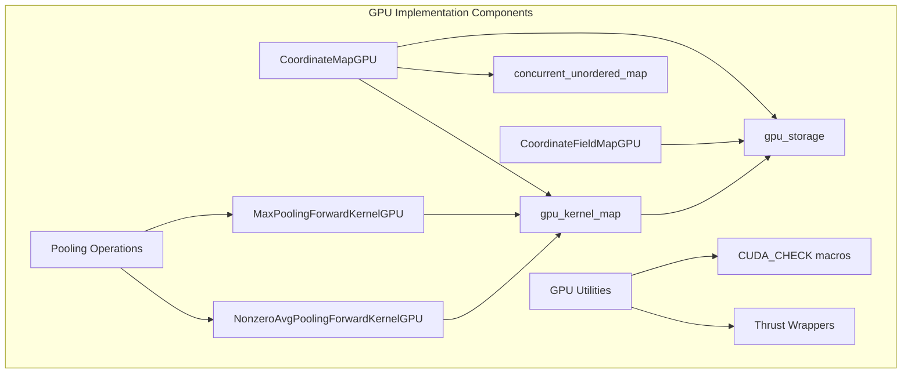
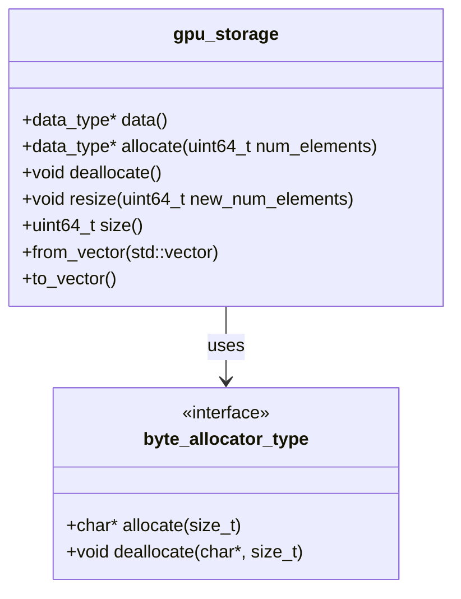
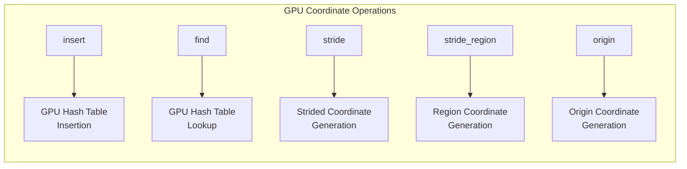
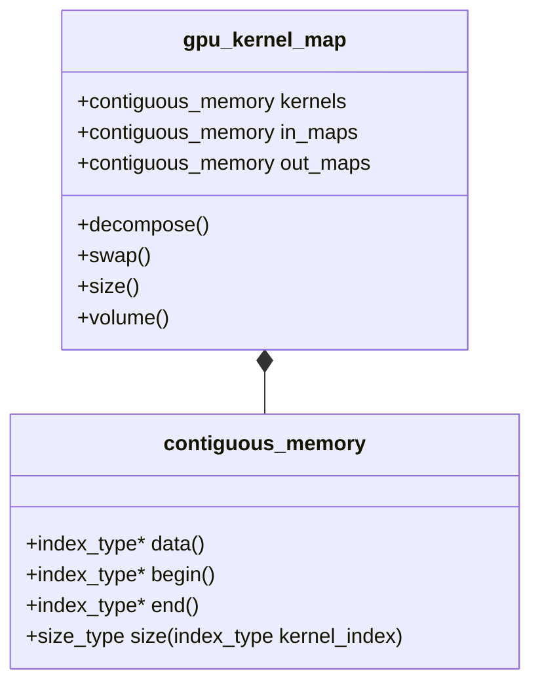
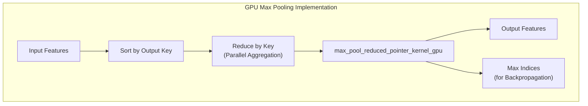
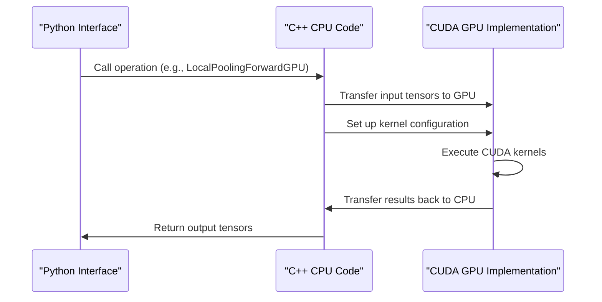

<!-- source: DeepWiki mcp.deepwiki.com · repo NVIDIA/MinkowskiEngine · page 4.3 GPU Implementation · fetched 2026-10-26 -->

# GPU Implementation

<details>
<summary>Relevant source files</summary>

The following files were used as context for generating this wiki page:

- [src/coordinate_map_cpu.hpp](src/coordinate_map_cpu.hpp)
- [src/coordinate_map_gpu.cu](src/coordinate_map_gpu.cu)
- [src/coordinate_map_gpu.cuh](src/coordinate_map_gpu.cuh)
- [src/gpu.cu](src/gpu.cu)
- [src/gpu.cuh](src/gpu.cuh)
- [src/kernel_map.cuh](src/kernel_map.cuh)
- [src/local_pooling_cpu.cpp](src/local_pooling_cpu.cpp)
- [src/local_pooling_gpu.cu](src/local_pooling_gpu.cu)
- [src/pooling_avg_kernel.hpp](src/pooling_avg_kernel.hpp)
- [src/pooling_max_kernel.cu](src/pooling_max_kernel.cu)
- [src/pooling_max_kernel.cuh](src/pooling_max_kernel.cuh)
- [src/pooling_max_kernel.hpp](src/pooling_max_kernel.hpp)
- [src/storage.cuh](src/storage.cuh)

</details>


This document details the GPU acceleration capabilities of MinkowskiEngine, explaining how sparse tensor operations are efficiently implemented using CUDA. It covers the key components, memory management strategies, and specialized kernels that enable high-performance processing of sparse data like 3D point clouds on NVIDIA GPUs.

For CPU-based implementation details, see [CPU Implementation](#4.2).

## Architecture Overview

MinkowskiEngine's GPU implementation combines multiple specialized components to accelerate sparse tensor operations. The following diagram illustrates the high-level architecture:



Sources: [src/coordinate_map_gpu.cuh:37-223](), [src/gpu.cuh:25-187](), [src/kernel_map.cuh:27-433](), [src/storage.cuh:26-200]()

## GPU Memory Management

MinkowskiEngine employs a specialized memory management approach for efficient GPU operations on sparse data. Two key classes handle memory:

1. `gpu_storage`: A wrapper class that manages GPU memory allocation, deallocation, and data transfers for storage of coordinates, features, and indices.

2. `ByteAllocator`: Template allocator for CUDA memory with two implementations:
   - `default_allocator`: Uses standard CUDA memory allocation
   - `c10_allocator`: Uses PyTorch's caching allocator for better memory reuse



This memory management system enables:
- Efficient allocation of large sparse tensors
- Fast data transfer between host and device
- Coordinate and feature storage with minimal memory overhead
- Proper cleanup to prevent memory leaks

Sources: [src/storage.cuh:35-175](), [src/coordinate_map_gpu.cuh:57-59]()

## Coordinate Mapping System

The coordinate mapping system is central to MinkowskiEngine's sparse tensor operations. On the GPU, this is implemented through the `CoordinateMapGPU` class, which provides a concurrent hash map for fast coordinate lookups.

### Key Components

1. **CoordinateMapGPU**: Main class for managing sparse coordinates on GPU
2. **concurrent_unordered_map**: GPU hash table for O(1) coordinate lookups
3. **CoordinateFieldMapGPU**: Manages continuous coordinates (e.g. for interpolation)

### Core Operations



The GPU coordinate mapping provides high-performance operations through:

1. **Concurrent Hash Operations**: Efficient parallel insertion and lookup using GPU-optimized hash tables
2. **Batch Processing**: Operations are implemented to process thousands of coordinates in parallel
3. **Memory Coalescing**: Coordinate data is organized to maximize GPU memory throughput
4. **Custom CUDA Kernels**: Specialized kernels for operations like coordinate quantization and mapping

Sources: [src/coordinate_map_gpu.cu:40-885](), [src/coordinate_map_gpu.cuh:44-223]()

## GPU Kernel Map Implementation

The `kernel_map` is a critical data structure that manages the many-to-many relationships between input and output coordinates during sparse convolution, pooling, and other operations. On the GPU, this is implemented by the `gpu_kernel_map` class.

### Structure and Memory Layout



The GPU kernel map maintains three parallel arrays:
- `kernels`: Identifies which kernel each map entry belongs to
- `in_maps`: Maps to input feature indices
- `out_maps`: Maps to output feature indices

This structure enables efficient parallel processing of sparse convolution and pooling operations by organizing the computation as a series of map lookups.

Sources: [src/kernel_map.cuh:48-429]()

## Sparse Operations on GPU

MinkowskiEngine implements various sparse tensor operations with GPU acceleration. The following sections outline the key implementations.

### Pooling Operations

Pooling operations are essential for feature aggregation in neural networks. MinkowskiEngine implements these operations efficiently on GPU:

1. **Max Pooling**: 
   - Implemented in `MaxPoolingForwardKernelGPU` and `MaxPoolingBackwardKernelGPU`
   - Uses CUDA kernels to find the maximum feature in each pooling region
   - Tracks indices for efficient backpropagation

2. **Average Pooling**:
   - Implemented in `NonzeroAvgPoolingForwardKernelGPU` and `NonzeroAvgPoolingBackwardKernelGPU`
   - Computes averages only over active (non-zero) sites in the sparse tensor
   - Uses atomic operations for accumulation

The pooling implementation employs an efficient reduction strategy:



This architecture allows for efficient parallel processing of sparse data without requiring the allocation of dense tensors.

Sources: [src/pooling_max_kernel.cu:44-419](), [src/local_pooling_gpu.cu:48-207]()

### CUDA Kernel Optimization

The MinkowskiEngine GPU implementation employs several optimization techniques for CUDA kernels:

1. **Shared Memory Usage**: Critical data for computations is loaded into shared memory to minimize global memory access
2. **Memory Coalescing**: Data structures are designed to ensure coalesced memory access patterns
3. **Dynamic Parallelism**: Work is distributed across threads and blocks based on the input size
4. **Thrust Library Integration**: Uses Thrust for efficient sorting, reduction, and other parallel primitives

Example configuration for kernel launches:

```
Block Size: CUDA_NUM_THREADS (128 threads per block)
Grid Size: Dynamically calculated with GET_BLOCKS macro
Shared Memory: Allocated based on operation requirements
```

Sources: [src/gpu.cuh:173-181](), [src/coordinate_map_gpu.cu:513-543]()

## CUDA Utilities

MinkowskiEngine provides several utilities to simplify CUDA programming and error handling.

### Error Handling

The `CUDA_CHECK` macro family is used throughout the codebase to verify CUDA operations:

```cpp
CUDA_CHECK(condition)             // Basic error checking
CUDA_CHECK_DEBUG(condition)       // Error checking only in debug builds
CUDA_CHECK_ARGS(condition, ...)   // Error checking with custom message
```

These macros help catch and report issues during CUDA operations with detailed error messages.

### Memory Management

The GPU implementation includes utilities for memory information and management:

```cpp
get_memory_info()    // Returns pair of (total_memory, free_memory)
```

This function is useful for monitoring GPU memory usage during operation.

### CUDA Library Wrappers

The implementation provides error string utilities for CUDA libraries:

```cpp
cublasGetErrorString()     // Get readable error message for cuBLAS errors
cusparseGetErrorString()   // Get readable error message for cuSPARSE errors
```

These functions convert numeric error codes into human-readable error messages.

Sources: [src/gpu.cuh:62-146](), [src/gpu.cu:35-130]()

## Communication with CPU Code

The GPU implementation communicates with the CPU code through a well-defined interface. Data transfer between CPU and GPU is handled by specific methods:



Key functions for this interface include:

1. `LocalPoolingForwardGPU`: Interfaces between CPU code and GPU pooling implementation
2. `from_vector` and `to_vector` methods: Handle data transfer between CPU and GPU
3. `CUDA_CHECK` macros: Ensure error-free data transfer

Sources: [src/local_pooling_gpu.cu:48-137](), [src/storage.cuh:89-131]()

## Performance Considerations

To achieve optimal performance with MinkowskiEngine's GPU implementation, consider the following:

1. **Memory Management**:
   - Use the PyTorch allocator (`detail::c10_allocator`) when working with PyTorch
   - Monitor GPU memory usage for large sparse tensors
   - Consider memory vs. computation tradeoffs for very large datasets

2. **Coordinate Structure**:
   - More structured coordinates generally lead to better performance
   - Highly sparse, randomly distributed coordinates can reduce efficiency

3. **Batch Size**:
   - GPU implementation benefits significantly from batching
   - Larger batch sizes often result in better GPU utilization

4. **Data Transfers**:
   - Minimize host-device transfers by keeping data on the GPU
   - Use asynchronous operations when possible for better overlap of computation and communication

5. **Kernel Size**:
   - Larger kernel sizes increase computational complexity
   - Consider using separable kernels for large kernel sizes to reduce computation

Sources: [src/coordinate_map_gpu.cu:154-184](), [src/pooling_max_kernel.cu:129-234]()

## Limitations and Future Work

While the GPU implementation significantly accelerates sparse tensor operations, there are some limitations and areas for future improvement:

1. **Memory Constraints**: Very large sparse tensors can exceed GPU memory
2. **Dynamic Parallelism**: Some operations could benefit from more advanced dynamic parallelism
3. **Warp-Level Operations**: Some operations could be further optimized using warp-level primitives
4. **Multi-GPU Support**: Current implementation focuses on single GPU acceleration

Future work may address these limitations by implementing more advanced memory management techniques, exploring additional CUDA optimization strategies, and extending to multi-GPU scenarios.

Sources: [src/coordinate_map_gpu.cu:240-278](), [src/gpu.cuh:173-181]()

---

