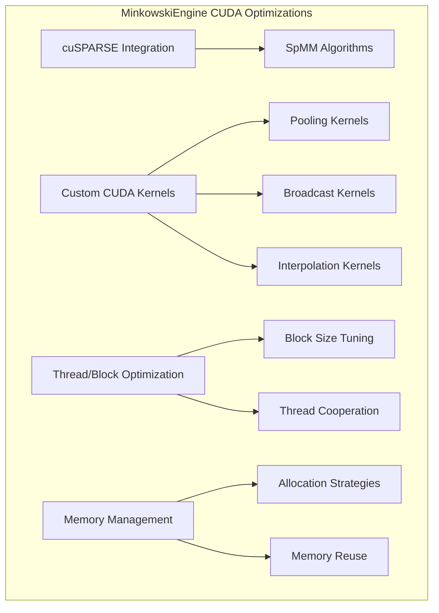
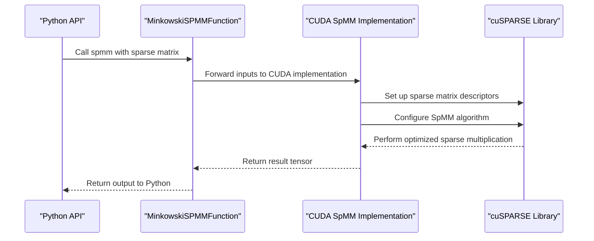
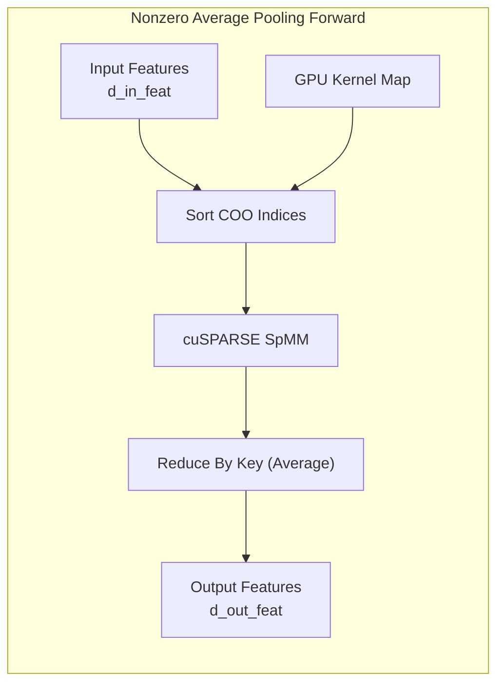
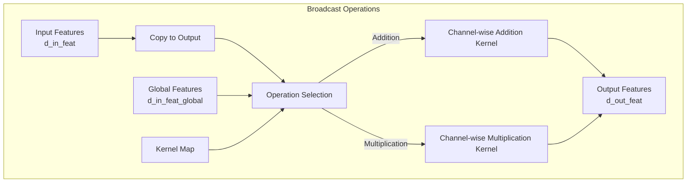
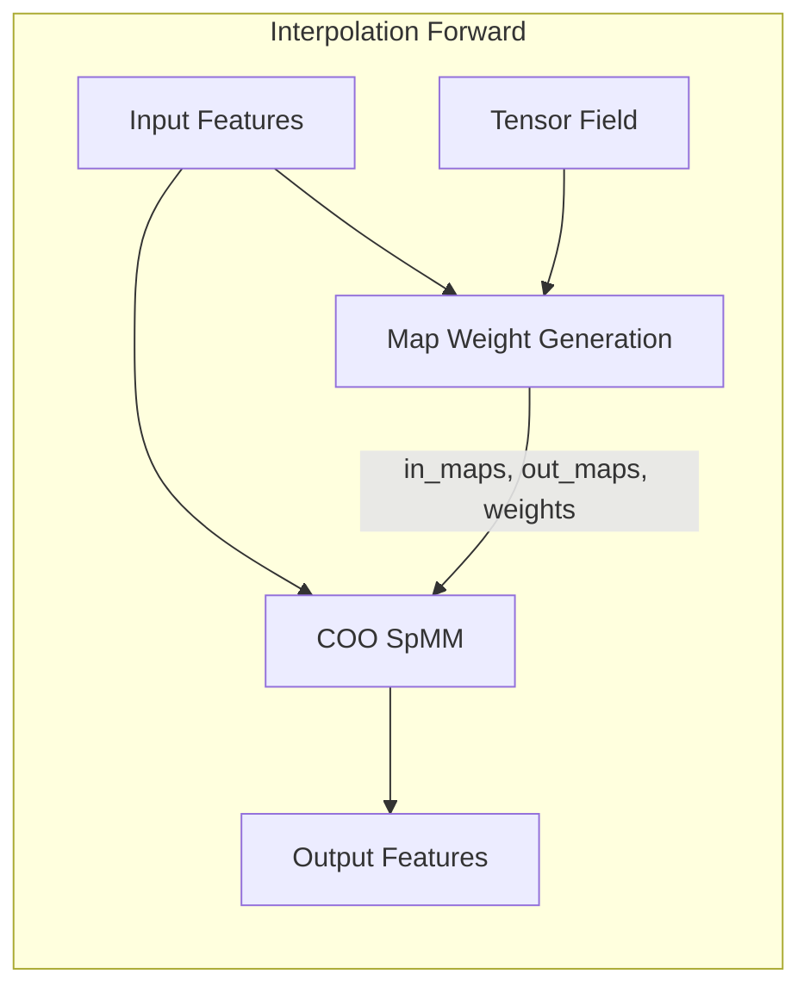
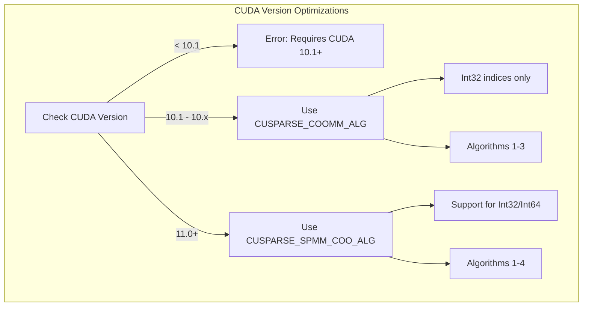

<!-- source: DeepWiki mcp.deepwiki.com · repo NVIDIA/MinkowskiEngine · page 4.4 CUDA Optimizations · fetched 2026-10-26 -->

# CUDA Optimizations

<details>
<summary>Relevant source files</summary>

The following files were used as context for generating this wiki page:

- [MinkowskiEngine/sparse_matrix_functions.py](MinkowskiEngine/sparse_matrix_functions.py)
- [src/broadcast_kernel.cu](src/broadcast_kernel.cu)
- [src/coordinate_map_manager.cu](src/coordinate_map_manager.cu)
- [src/gpu.cu](src/gpu.cu)
- [src/gpu.cuh](src/gpu.cuh)
- [src/interpolation_gpu.cu](src/interpolation_gpu.cu)
- [src/pooling_avg_kernel.cu](src/pooling_avg_kernel.cu)
- [src/spmm.cu](src/spmm.cu)
- [src/spmm.cuh](src/spmm.cuh)
- [tests/python/sparse_tensor.py](tests/python/sparse_tensor.py)
- [tests/python/spmm.py](tests/python/spmm.py)

</details>


This documentation page describes the CUDA optimizations implemented in MinkowskiEngine to accelerate sparse tensor operations on NVIDIA GPUs. It explains the key optimization techniques, memory management strategies, and custom CUDA kernels used for efficient sparse convolution operations. For general information about GPU implementation, see [GPU Implementation](#4.3).

## Overview of CUDA Optimizations

MinkowskiEngine employs several CUDA optimization strategies to efficiently handle sparse data in deep learning applications. These optimizations focus on sparse matrix operations, custom kernels for specific tasks, efficient memory management, and thread/block configurations.



Sources: [src/spmm.cu:1-604](), [src/gpu.cuh:1-187]()

## Sparse Matrix Multiplication (SpMM)

The most significant CUDA optimization in MinkowskiEngine is the efficient implementation of sparse matrix multiplication using NVIDIA's cuSPARSE library. SpMM operations are fundamental to sparse convolution networks and are critical for performance.

### cuSPARSE Integration

MinkowskiEngine leverages the cuSPARSE library to accelerate sparse matrix operations. The implementation supports both COO (Coordinate) format and conditional support for CSR (Compressed Sparse Row) format depending on the CUDA version.



The implementation selects different cuSPARSE algorithms based on the CUDA version and user-specified algorithm ID:

```
For CUDA 10.1 to 10.x:
- CUSPARSE_COOMM_ALG1, CUSPARSE_COOMM_ALG2, CUSPARSE_COOMM_ALG3

For CUDA 11.0+:
- CUSPARSE_SPMM_COO_ALG1, CUSPARSE_SPMM_COO_ALG2, CUSPARSE_SPMM_COO_ALG3, CUSPARSE_SPMM_COO_ALG4
```

Sources: [src/spmm.cu:95-132](), [MinkowskiEngine/sparse_matrix_functions.py:32-77]()

### Memory Management in SpMM

The SpMM implementation includes careful memory management strategies to optimize performance:

1. **Dynamic Workspace Allocation**: The implementation dynamically allocates workspace memory based on the requirements of the cuSPARSE algorithm.

2. **Sorting Optimization**: For algorithms that require sorted COO format, the implementation includes efficient CUDA-accelerated sorting.

3. **Temporary Buffer Management**: Temporary buffers are allocated and deallocated as needed to minimize memory usage.

Sources: [src/spmm.cu:280-323](), [src/spmm.cu:557-580]()

## Custom CUDA Kernels

MinkowskiEngine includes several custom CUDA kernels optimized for specific sparse tensor operations.

### Pooling Kernels

The average pooling operation is optimized with custom CUDA kernels that efficiently handle sparse data.



The pooling implementation uses cuSPARSE for efficient matrix operations and includes specialized CUDA kernels for:
- Column-to-row major conversion with division for averaging
- Unique row counting for nonzero elements
- Gradient computation for backward pass

Sources: [src/pooling_avg_kernel.cu:64-79](), [src/pooling_avg_kernel.cu:112-125](), [src/pooling_avg_kernel.cu:126-351]()

### Broadcast Kernels

The broadcast operations are optimized with specialized CUDA kernels for element-wise addition and multiplication of sparse tensors.



The broadcast operations leverage atomic operations for thread-safe updates in the CUDA kernels:
- `atomic_addition_n` for element-wise addition
- `multiplication_n` for element-wise multiplication

Sources: [src/broadcast_kernel.cu:42-57](), [src/broadcast_kernel.cu:59-80](), [src/broadcast_kernel.cu:111-129]()

### Interpolation Kernels

Interpolation operations use SpMM as the underlying mechanism for efficient computation on CUDA:



Sources: [src/interpolation_gpu.cu:44-84](), [src/interpolation_gpu.cu:88-109]()

## Thread and Block Optimization

MinkowskiEngine employs several thread and block optimization strategies for CUDA kernels:

### Block Size Configuration

The library uses predefined constants for block sizes to optimize the execution:

- `CUDA_NUM_THREADS`: Set to 128 threads per block as a default
- `SHARED_BLOCK_SIZE`: Set to 32, matching CUDA warp size
- `MAX_GRID`: Maximum grid size of 65535

Sources: [src/gpu.cuh:173-177]()

### Dynamic Grid Size Calculation

Grid sizes are calculated dynamically based on the number of elements and desired thread count:

```cpp
inline int GET_BLOCKS(const uint32_t N, const uint32_t THREADS) {
  return std::max((N + THREADS - 1) / THREADS, uint32_t(1));
}
```

This function ensures efficient use of GPU resources by calculating the minimum number of blocks needed to process N elements with THREADS threads per block.

Sources: [src/gpu.cuh:179-181]()

### Kernel Loop Pattern

The library uses a common CUDA pattern for handling large datasets with a limited number of threads:

```cpp
#define CUDA_KERNEL_LOOP(i, n)                                                 \
  for (int i = blockIdx.x * blockDim.x + threadIdx.x; i < (n);                 \
       i += blockDim.x * gridDim.x)
```

This pattern allows each thread to process multiple elements in a strided fashion, improving thread utilization.

Sources: [src/gpu.cuh:134-136]()

## Memory Management

### CUDA Allocators

MinkowskiEngine provides two types of allocators for GPU memory:

1. **Default Allocator**: Uses direct CUDA memory allocation functions
2. **C10 Allocator**: Leverages PyTorch's memory management system

The allocators are templated to handle different data types and ensure memory is properly managed throughout operations.

Sources: [src/coordinate_map_manager.cu:43-114]()

### Error Handling and Debugging

Comprehensive error handling and debugging macros are used throughout the CUDA code:

- `CUDA_CHECK`: Verifies CUDA function calls and throws detailed error messages
- `CUSPARSE_CHECK`: Validates cuSPARSE function calls
- `THRUST_CHECK`: Handles errors in thrust operations
- `CUDA_POST_KERNEL_CHECK`: Validates kernel execution

Debug-specific macros are also included for detailed debugging when needed.

Sources: [src/gpu.cuh:62-163]()

## CUDA Version-Specific Optimizations

MinkowskiEngine includes version-specific optimizations to leverage features available in different CUDA versions:



The code adapts the sparse matrix multiplication approach based on CUDA version:

- For CUDA 10.1 to 10.x: Uses older COO multiplication algorithms with int32 indices only
- For CUDA 11.0+: Uses newer SPMM algorithms with expanded functionality

Sources: [src/spmm.cu:94-136](), [src/spmm.cu:357-397]()

## Atomic Operations

For operations requiring thread-safe updates to memory, MinkowskiEngine implements specialized atomic operations:

1. **Double Precision Atomics**: Custom implementation for CUDA architectures below 6.0:

```cpp
#if !defined(__CUDA_ARCH__) || __CUDA_ARCH__ >= 600
#else
__device__ double atomicAdd(double *address, double val) {
  unsigned long long int *address_as_ull = (unsigned long long int *)address;
  unsigned long long int old = *address_as_ull, assumed;
  do {
    assumed = old;
    old = atomicCAS(address_as_ull, assumed,
                    __double_as_longlong(val + __longlong_as_double(assumed)));
  } while (assumed != old);
  return __longlong_as_double(old);
}
#endif
```

2. **Specialized Atomic Functions**: Custom atomic operations for specific kernel needs:

- `atomic_addition_n`: Adds multiple elements atomically
- `set_gradient_nonzero_avg`: Updates gradients with division for averaging

Sources: [src/gpu.cuh:42-54](), [src/pooling_avg_kernel.cu:112-125](), [src/broadcast_kernel.cu:42-48]()

## Performance Benchmarking and Memory Monitoring

The library includes utilities for performance monitoring:

- Memory usage tracking with `get_memory_info()`
- Formatted memory size reporting

This allows users to monitor GPU memory consumption during operations.

Sources: [src/gpu.cu:123-128]()

## Summary

MinkowskiEngine's CUDA optimizations provide substantial performance improvements for sparse tensor operations through:

1. Efficient sparse matrix multiplication using cuSPARSE
2. Custom CUDA kernels for specific operations
3. Optimized thread and block configurations
4. Careful memory management
5. Version-specific adaptations for different CUDA versions
6. Specialized atomic operations for thread-safe updates

These optimizations collectively enable high-performance sparse convolution neural networks, particularly for 3D point cloud processing applications.

---

