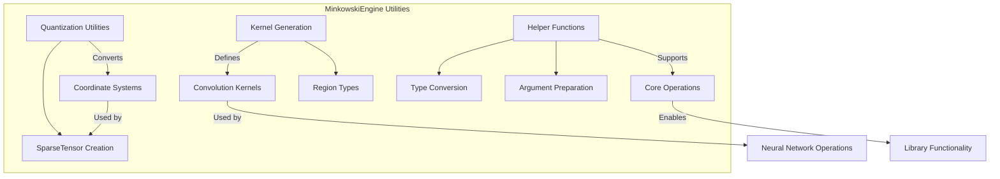
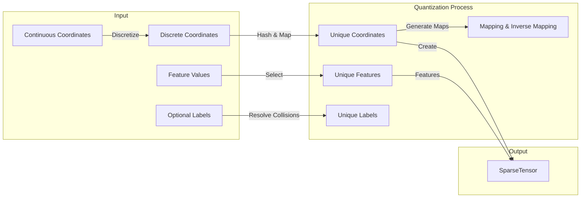
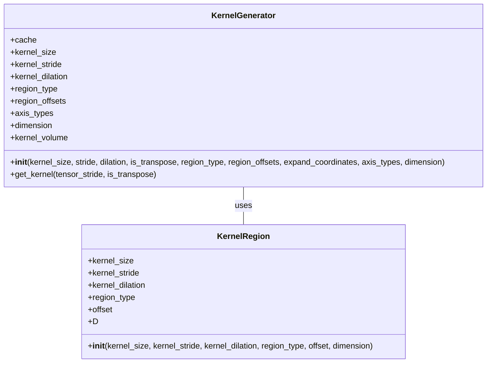
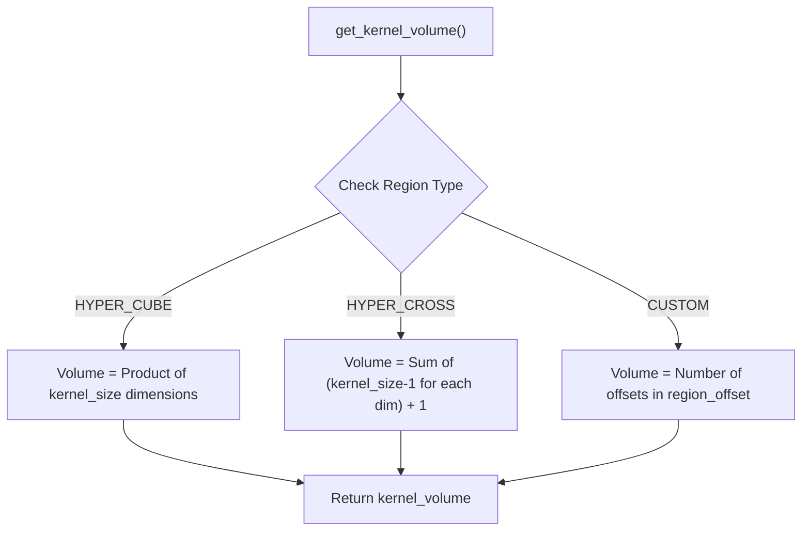
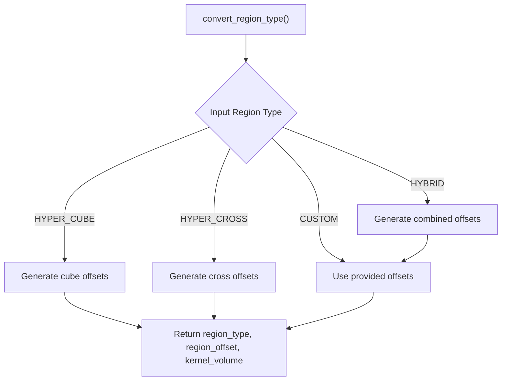
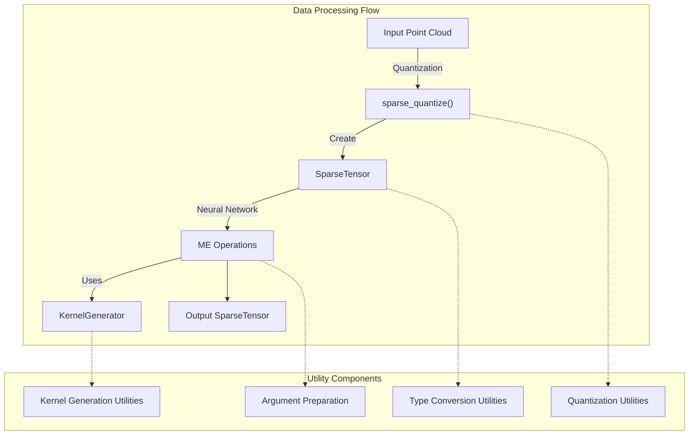

<!-- source: DeepWiki mcp.deepwiki.com · repo NVIDIA/MinkowskiEngine · page 5 Utilities · fetched 2026-10-26 -->

# Utilities

<details>
<summary>Relevant source files</summary>

The following files were used as context for generating this wiki page:

- [MinkowskiEngine/MinkowskiCommon.py](MinkowskiEngine/MinkowskiCommon.py)
- [MinkowskiEngine/MinkowskiKernelGenerator.py](MinkowskiEngine/MinkowskiKernelGenerator.py)
- [MinkowskiEngine/utils/quantization.py](MinkowskiEngine/utils/quantization.py)
- [src/quantization.cpp](src/quantization.cpp)
- [src/utils.hpp](src/utils.hpp)
- [tests/cpp/coordinate_map_cpu_test.cpp](tests/cpp/coordinate_map_cpu_test.cpp)
- [tests/cpp/coordinate_map_cpu_test.py](tests/cpp/coordinate_map_cpu_test.py)
- [tests/cpp/coordinate_map_gpu_test.cu](tests/cpp/coordinate_map_gpu_test.cu)
- [tests/cpp/coordinate_map_gpu_test.py](tests/cpp/coordinate_map_gpu_test.py)
- [tests/cpp/setup.py](tests/cpp/setup.py)
- [tests/python/global.py](tests/python/global.py)
- [tests/python/quantization.py](tests/python/quantization.py)

</details>


This page provides documentation for the utility functions and classes in MinkowskiEngine that support the core functionality of the library. These utilities primarily focus on coordinate quantization, kernel generation, and common helper functions that are essential for working with sparse tensors.

For information about the core data structures, see [Core Data Structures](#2). For details on neural network operations, see [Neural Network Operations](#3).

## Overview of Utility Components

MinkowskiEngine provides several utility components that serve as the backbone for efficient sparse tensor operations:



Sources: [MinkowskiEngine/utils/quantization.py:32-333](), [MinkowskiEngine/MinkowskiKernelGenerator.py:38-396](), [MinkowskiEngine/MinkowskiCommon.py:32-120]()

## Quantization Utilities

Quantization is a fundamental process in MinkowskiEngine that converts continuous coordinates (such as points in a 3D point cloud) into discrete voxel positions. This process is essential for creating sparse tensors and efficiently processing sparse data.

### Key Quantization Functions

| Function | Purpose | Python API | C++ Implementation |
|----------|---------|------------|-------------------|
| `quantize` | Creates unique indices and inverse mappings for coordinates | [quantization.py:68-104]() | [quantization.cpp:57-139]() |
| `quantize_label` | Similar to `quantize` but also handles labels | [quantization.py:106-122]() | [quantization.cpp:141-294]() |
| `sparse_quantize` | Generates quantized coordinates with optional features and labels | [quantization.py:136-332]() | - |
| `unique_coordinate_map` | Returns unique indices and inverse indices of coordinates | [quantization.py:335-363]() | - |

### Quantization Process Diagram



Sources: [MinkowskiEngine/utils/quantization.py:136-332]()

### Hash Functions

MinkowskiEngine uses two hash functions for efficient coordinate mapping:

1. **FNV Hash** (`fnv_hash_vec`): Implements the FNV64-1A non-cryptographic hash function
2. **Ravel Hash** (`ravel_hash_vec`): Performs a ravel operation to map multi-dimensional coordinates to a 1D space

These hash functions are used internally for coordinate mapping and collision detection during quantization.

Sources: [MinkowskiEngine/utils/quantization.py:32-65]()

### Quantization Example

The `sparse_quantize` function is the primary API for quantization tasks. It can be used in several ways:

1. **Basic quantization** - convert coordinates to voxels:
```python
quantized_coords = sparse_quantize(coordinates)
```

2. **Quantization with features** - for keeping feature values associated with coordinates:
```python
quantized_coords, quantized_feats = sparse_quantize(coordinates, features)
```

3. **Segmentation with labels** - for tasks where coordinates have labels:
```python
quantized_coords, quantized_feats, quantized_labels = sparse_quantize(
    coordinates, features, labels, ignore_label=-100)
```

4. **Custom quantization size** - for different voxel resolutions:
```python
quantized_coords, quantized_feats = sparse_quantize(
    coordinates, features, quantization_size=0.1)
```

The function supports both CPU and CUDA implementations, controlled by the `device` parameter.

Sources: [MinkowskiEngine/utils/quantization.py:136-332](), [tests/python/quantization.py:32-125]()

## Kernel Generation Utilities

Kernel generation utilities are responsible for creating different types of convolution kernels for sparse tensor operations. These utilities define the shape and behavior of convolution operations.

### KernelGenerator

The `KernelGenerator` class manages the creation and caching of kernels based on region type, kernel size, stride, and dilation:



Sources: [MinkowskiEngine/MinkowskiKernelGenerator.py:245-344](), [MinkowskiEngine/MinkowskiKernelGenerator.py:347-381]()

### Region Types

MinkowskiEngine supports different region types for convolution kernels, which define the shape of the kernel:

| Region Type | Description | Example Use Case |
|-------------|-------------|-----------------|
| `HYPER_CUBE` | Cube-shaped kernel region | Standard 3D convolution |
| `HYPER_CROSS` | Cross-shaped kernel region | Separable convolution |
| `CUSTOM` | User-defined kernel region | Specialized operations |
| `HYBRID` | Combination of different region types | Mixed operations |

The choice of region type affects the computational efficiency and the receptive field of the convolution operation.

### Kernel Volume Calculation

The `get_kernel_volume` function calculates the volume (number of elements) in a kernel based on its region type, size, and other parameters:



Sources: [MinkowskiEngine/MinkowskiKernelGenerator.py:38-102]()

### Region Type Conversion

The `convert_region_type` function handles the conversion between different region types and computes the corresponding region offsets:



Sources: [MinkowskiEngine/MinkowskiKernelGenerator.py:105-242]()

## Helper Utilities

MinkowskiEngine provides various helper utilities that support the core functionality of the library.

### Type Conversion Functions

These functions handle conversion between different data formats:

| Function | Purpose |
|----------|---------|
| `convert_to_int_list` | Converts various input types to an integer list |
| `convert_to_int_tensor` | Converts various input types to an integer tensor |
| `get_postfix` | Returns "GPU" or "CPU" based on tensor device |
| `get_minkowski_function` | Gets the appropriate function based on tensor device |

Sources: [MinkowskiEngine/MinkowskiCommon.py:39-120]()

### Argument Preparation

The `prep_args` function prepares arguments for network operations by converting them to the appropriate formats and validating their values:


Sources: [MinkowskiEngine/MinkowskiCommon.py:75-98]()

### C++ Utilities

MinkowskiEngine includes several C++ utility functions for timing, debugging, and error handling:

| Utility | Purpose | File |
|---------|---------|------|
| `timer` | Structure for timing operations | [src/utils.hpp:40-51]() |
| `ASSERT` | Macro for assertion checking | [src/utils.hpp:141-150]() |
| `WARNING` | Macro for warning messages | [src/utils.hpp:152-161]() |
| `Formatter` | Class for string formatting | [src/utils.hpp:98-128]() |
| `simple_range` | Iterator range utility | [src/utils.hpp:201-257]() |

Sources: [src/utils.hpp:38-257]()

## Integration with Core Components

The utilities in MinkowskiEngine are tightly integrated with the core components of the library. The following diagram illustrates how these utilities fit into the overall architecture:



Sources: [MinkowskiEngine/utils/quantization.py:136-332](), [MinkowskiEngine/MinkowskiKernelGenerator.py:245-344](), [MinkowskiEngine/MinkowskiCommon.py:39-120]()

## Usage Examples

### Quantizing a Point Cloud for Neural Network Input

```python
import torch
import numpy as np
import MinkowskiEngine as ME

# 1. Load point cloud data
points = np.random.rand(1000, 3)  # Random 3D points
features = np.random.rand(1000, 4)  # Random features for each point

# 2. Quantize the point cloud
voxel_size = 0.05  # 5cm voxel size
discrete_coords = np.floor(points / voxel_size)
quantized_coords, quantized_feats = ME.utils.sparse_quantize(
    discrete_coords, features)

# 3. Create a sparse tensor
coords = torch.from_numpy(quantized_coords)
feats = torch.from_numpy(quantized_feats)
sparse_tensor = ME.SparseTensor(feats, coordinates=coords)

# 4. Use in a neural network
# sparse_tensor is now ready for use in MinkowskiEngine neural networks
```

Sources: [MinkowskiEngine/utils/quantization.py:136-332](), [tests/python/quantization.py:32-125]()

### Creating Custom Convolution Kernels

```python
import MinkowskiEngine as ME
from MinkowskiEngine import MinkowskiConvolution
from MinkowskiEngineBackend._C import RegionType

# Create a standard 3x3x3 cubic kernel convolution
conv_standard = MinkowskiConvolution(
    in_channels=16,
    out_channels=32,
    kernel_size=3,
    stride=1,
    dimension=3
)  # Uses HYPER_CUBE region type by default

# Create a custom kernel with cross-shaped receptive field
conv_cross = MinkowskiConvolution(
    in_channels=16,
    out_channels=32,
    kernel_size=3,
    stride=1,
    dimension=3,
    region_type=RegionType.HYPER_CROSS
)

# Use with sparse tensors in a neural network
# out_tensor = conv_standard(input_tensor)
```

Sources: [MinkowskiEngine/MinkowskiKernelGenerator.py:245-344]()

## Performance Considerations

When using the utility functions, especially for large point clouds, consider the following performance tips:

1. **Quantization Size**: The `quantization_size` parameter in `sparse_quantize` directly affects the granularity of voxelization and memory usage.

2. **Device Selection**: Use the `device` parameter in `sparse_quantize` to control whether quantization happens on CPU or GPU. For very large point clouds, CPU may be more memory-efficient, while GPU is typically faster.

3. **Kernel Types**: Different region types (`HYPER_CUBE`, `HYPER_CROSS`, etc.) have different computational complexity. Cross-shaped kernels typically use fewer parameters than cube-shaped ones.

4. **Caching**: The `KernelGenerator` class caches kernels to avoid redundant computations. Reusing kernel generators when possible can improve performance.

Sources: [MinkowskiEngine/utils/quantization.py:268-273](), [MinkowskiEngine/MinkowskiKernelGenerator.py:296-313]()

---

