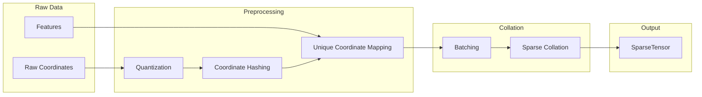
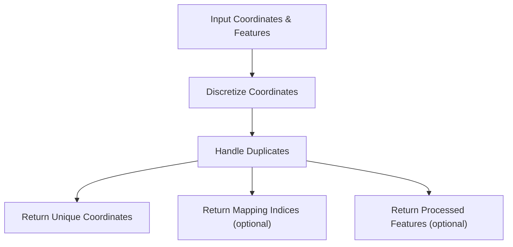
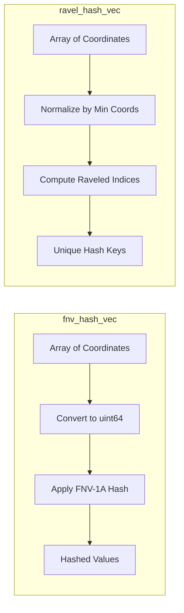
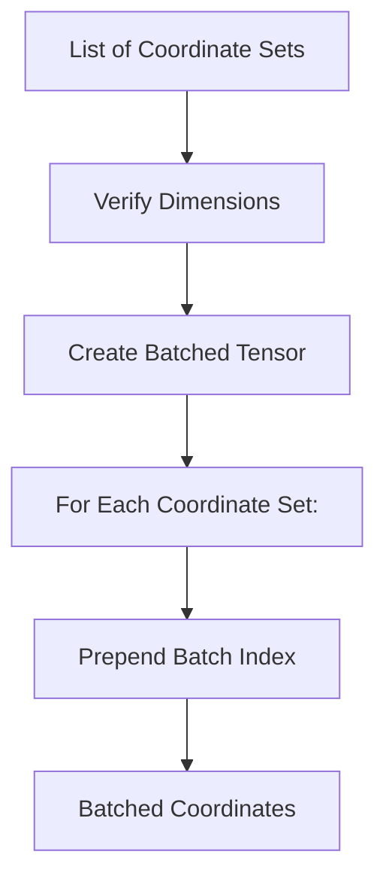
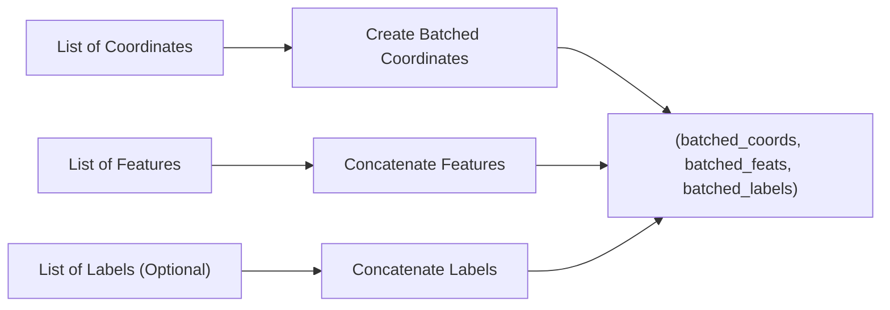
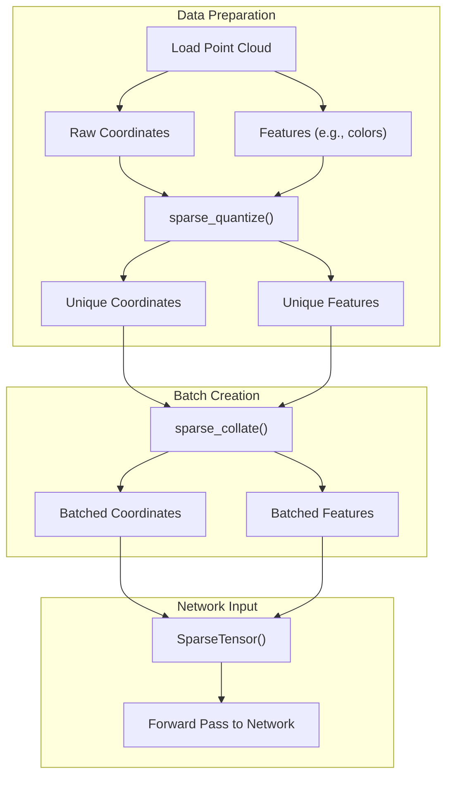

<!-- source: DeepWiki mcp.deepwiki.com · repo NVIDIA/MinkowskiEngine · page 5.1 Data Loading and Collation · fetched 2026-10-26 -->

# Data Loading and Collation

<details>
<summary>Relevant source files</summary>

The following files were used as context for generating this wiki page:

- [MinkowskiEngine/MinkowskiCommon.py](MinkowskiEngine/MinkowskiCommon.py)
- [MinkowskiEngine/MinkowskiKernelGenerator.py](MinkowskiEngine/MinkowskiKernelGenerator.py)
- [MinkowskiEngine/utils/__init__.py](MinkowskiEngine/utils/__init__.py)
- [MinkowskiEngine/utils/collation.py](MinkowskiEngine/utils/collation.py)
- [MinkowskiEngine/utils/quantization.py](MinkowskiEngine/utils/quantization.py)
- [MinkowskiEngine/utils/summary.py](MinkowskiEngine/utils/summary.py)
- [src/quantization.cpp](src/quantization.cpp)
- [tests/python/global.py](tests/python/global.py)
- [tests/python/quantization.py](tests/python/quantization.py)
- [tests/python/summary.py](tests/python/summary.py)

</details>


This page documents the utilities provided by MinkowskiEngine for loading, preprocessing, and collating sparse data for use in sparse convolutional neural networks. These utilities are essential for converting raw point cloud data or other sparse inputs into a format suitable for processing with the MinkowskiEngine.

For information about core data structures like SparseTensor, see [Core Data Structures](#2), and for coordinate systems, see [Coordinate Management System](#2.3).

## 1. Overview of Data Processing Pipeline

MinkowskiEngine provides a comprehensive workflow for preparing sparse data:



Sources: [MinkowskiEngine/utils/quantization.py:136-332](), [MinkowskiEngine/utils/collation.py:30-93]()

## 2. Coordinate Quantization

Quantization is the process of converting continuous coordinates (like points in a point cloud) into discrete voxel positions for sparse tensors.

### 2.1 Basic Quantization

The core quantization function, `sparse_quantize`, voxelizes continuous coordinates and handles duplicate points that fall into the same voxel.



Sources: [MinkowskiEngine/utils/quantization.py:136-332]()

#### Key Parameters:

| Parameter | Type | Description |
|-----------|------|-------------|
| coordinates | numpy.ndarray/torch.Tensor | Raw coordinates to be quantized |
| features | numpy.ndarray/torch.Tensor | Features associated with each coordinate |
| labels | numpy.ndarray/torch.Tensor | Optional labels for semantic tasks |
| quantization_size | float/list | Size of each voxel for discretization |
| return_index | bool | Whether to return indices of unique coords |
| return_inverse | bool | Whether to return inverse mapping |
| device | str | 'cpu' or 'cuda' for computation |

Sources: [MinkowskiEngine/utils/quantization.py:136-186]()

### 2.2 Hashing Methods

Two principal hashing functions for efficient coordinate handling:

1. **FNV Hash** - A non-reversible hash function for coordinate hashing
2. **Ravel Hash** - A reversible hash function that treats coordinates as array indices



Sources: [MinkowskiEngine/utils/quantization.py:32-65]()

### 2.3 Quantizing with Labels

For semantic segmentation tasks, `sparse_quantize` can merge features and resolve label conflicts when multiple points fall into the same voxel cell.

When points with different labels fall into the same voxel, the function can mark those positions with an ignore label, ensuring that ambiguous positions don't contribute to the loss function.

Sources: [MinkowskiEngine/utils/quantization.py:106-122](), [src/quantization.cpp:141-199]()

## 3. Collation for Sparse Tensors

Collation combines multiple sparse tensor inputs into a single batched input, adding a batch dimension to the coordinates.

### 3.1 Creating Batched Coordinates

The `batched_coordinates` function prepends a batch index to each coordinate set:



Sources: [MinkowskiEngine/utils/collation.py:30-93]()

### 3.2 Sparse Collation Function

The `sparse_collate` function combines coordinates, features, and optionally labels:



Sources: [MinkowskiEngine/utils/collation.py:96-188]()

### 3.3 Integration with PyTorch DataLoader

MinkowskiEngine provides two ways to integrate with PyTorch's DataLoader:

1. **batch_sparse_collate** - A collation function to use with DataLoader's `collate_fn` parameter
2. **SparseCollation class** - A more flexible collation class with additional features:

```python
data_loader = torch.utils.data.DataLoader(
    dataset,
    batch_size=4,
    collate_fn=SparseCollation(limit_numpoints=1000000)
)
```

The `SparseCollation` class can limit the number of points per batch to prevent memory overflow.

Sources: [MinkowskiEngine/utils/collation.py:191-263]()

## 4. Complete Data Processing Example

A typical workflow involves:

1. Loading raw point cloud data
2. Quantizing coordinates to create voxel grid
3. Collating multiple examples into a batch
4. Creating a SparseTensor



Sources: [tests/python/global.py:49-68](), [tests/python/summary.py:104-112]()

### 4.1 Example Code Structure

```python
# 1. Load point cloud
coords = np.array(point_cloud.points)
feats = np.array(point_cloud.colors)

# 2. Quantize
quantized_coords, quantized_feats = ME.utils.sparse_quantize(
    coords, feats, quantization_size=0.1
)

# 3. Create batch (for multiple point clouds)
batch_coords, batch_feats = ME.utils.sparse_collate(
    [quantized_coords], [quantized_feats]
)

# 4. Create SparseTensor and feed to network
sinput = ME.SparseTensor(batch_feats, coordinates=batch_coords)
output = network(sinput)
```

## 5. Best Practices and Considerations

### 5.1 Memory Management

- Use appropriate quantization size to control the sparsity of your tensor
- Consider using `SparseCollation` with `limit_numpoints` for large point clouds
- Quantizing on GPU may be faster but requires moving data to GPU first

### 5.2 Working with Different Data Types

MinkowskiEngine supports:
- Numpy arrays and PyTorch tensors for input data
- Int32 and Float32 data types for coordinates
- Automatic type conversion when needed

Sources: [MinkowskiEngine/utils/quantization.py:217-230](), [MinkowskiEngine/utils/collation.py:64-67]()

### 5.3 Common Pitfalls

- Ensure coordinates have the same dimension across a batch
- Be mindful of coordinate order - batch dimension is prepended
- For classification models, don't feed labels to `sparse_quantize` unless doing segmentation
- Ensure quantization size is appropriate for your data scale and task

Sources: [MinkowskiEngine/utils/quantization.py:199-215]()

---

