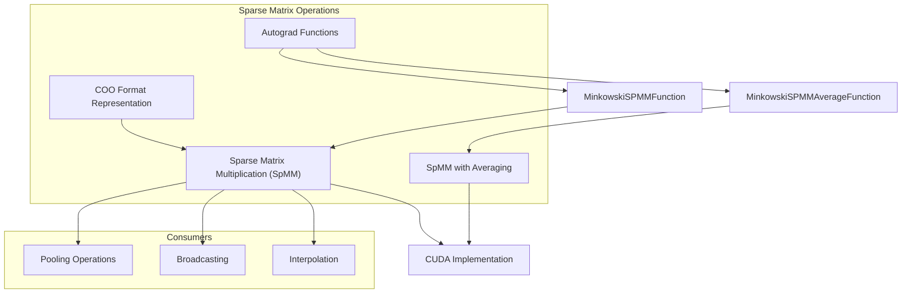
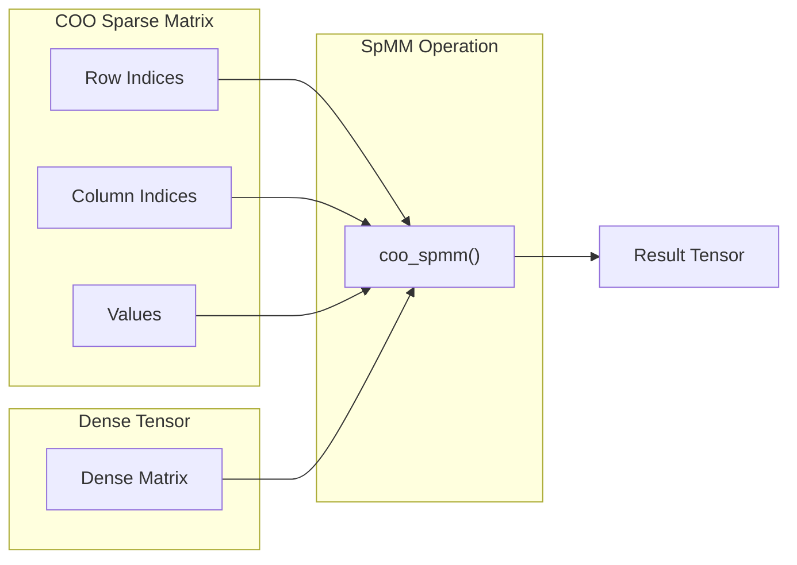
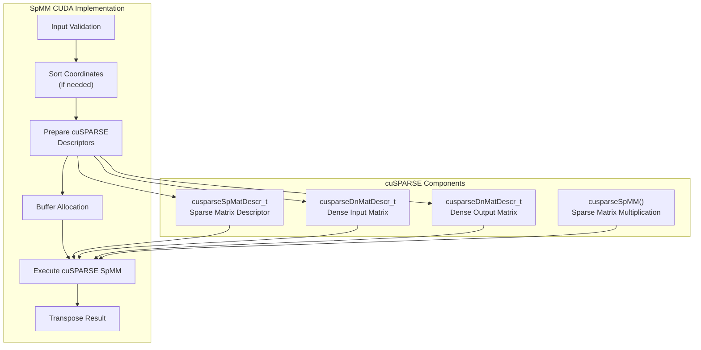
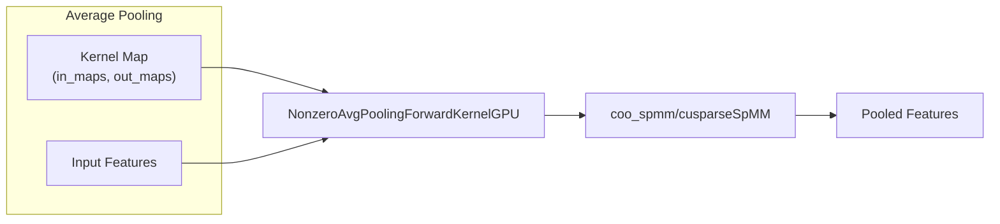

<!-- source: DeepWiki mcp.deepwiki.com · repo NVIDIA/MinkowskiEngine · page 5.2 Sparse Matrix Operations · fetched 2026-10-26 -->

# Sparse Matrix Operations

<details>
<summary>Relevant source files</summary>

The following files were used as context for generating this wiki page:

- [MinkowskiEngine/MinkowskiFunctional.py](MinkowskiEngine/MinkowskiFunctional.py)
- [MinkowskiEngine/MinkowskiNetwork.py](MinkowskiEngine/MinkowskiNetwork.py)
- [MinkowskiEngine/MinkowskiNonlinearity.py](MinkowskiEngine/MinkowskiNonlinearity.py)
- [MinkowskiEngine/MinkowskiNormalization.py](MinkowskiEngine/MinkowskiNormalization.py)
- [MinkowskiEngine/MinkowskiOps.py](MinkowskiEngine/MinkowskiOps.py)
- [MinkowskiEngine/sparse_matrix_functions.py](MinkowskiEngine/sparse_matrix_functions.py)
- [src/broadcast_kernel.cu](src/broadcast_kernel.cu)
- [src/interpolation_gpu.cu](src/interpolation_gpu.cu)
- [src/pooling_avg_kernel.cu](src/pooling_avg_kernel.cu)
- [src/spmm.cu](src/spmm.cu)
- [src/spmm.cuh](src/spmm.cuh)
- [tests/python/spmm.py](tests/python/spmm.py)

</details>


This page documents the sparse matrix operations in MinkowskiEngine, which are essential for efficient computation with sparse tensors. These operations enable efficient multiplication between sparse and dense matrices (SpMM), which serves as a foundation for many higher-level operations in the engine, including convolutions, pooling, and interpolation.

For general information about core data structures like SparseTensor, refer to [Core Data Structures](#2).

## Overview

Sparse matrix operations in MinkowskiEngine focus on efficiently handling computations between sparse and dense representations. The most critical operation is sparse-dense matrix multiplication (SpMM), implemented in both standard and averaging variants.



Sources: [MinkowskiEngine/sparse_matrix_functions.py:32-77](), [src/spmm.cu:79-333]()

## COO Sparse Format

MinkowskiEngine uses the COO (COOrdinate) format for sparse matrix representation, consisting of:

1. **Row indices** - Indices of non-zero element rows
2. **Column indices** - Indices of non-zero element columns
3. **Values** - The values at those coordinates



Sources: [src/spmm.cu:79-90](), [MinkowskiEngine/sparse_matrix_functions.py:32-41]()

## Core Operations

### Standard SpMM (Sparse-Dense Matrix Multiplication)

The standard SpMM operation multiplies a sparse matrix in COO format with a dense matrix.

```python
# Python API
result = spmm(rows, cols, vals, size, mat, is_sorted=False, cuda_spmm_alg=1)
```

Parameters:
- `rows`, `cols`: Tensors containing the row and column indices
- `vals`: Tensor containing the values at specified coordinates
- `size`: Tuple specifying the dimensions of the sparse matrix [dim_i, dim_j]
- `mat`: Dense matrix to multiply with
- `is_sorted`: Whether the input coordinates are already sorted (optimization)
- `cuda_spmm_alg`: CUDA algorithm selection for cuSPARSE

Returns:
- A dense tensor containing the result of the multiplication

Sources: [MinkowskiEngine/sparse_matrix_functions.py:32-77](), [src/spmm.cu:79-333]()

### SpMM with Averaging

This variant performs sparse-dense matrix multiplication where values associated with the same row are averaged.

```python
# Python API
result, sorted_rows_cols, sorted_vals = spmm_average(rows, cols, size, mat, cuda_spmm_alg=1)
```

Additional returns:
- `sorted_rows_cols`: Sorted row and column indices
- `sorted_vals`: Values that represent the reciprocal of counts per row

This operation is crucial for operations like average pooling where multiple values need to be combined with averaging.

Sources: [MinkowskiEngine/sparse_matrix_functions.py:80-121](), [src/spmm.cu:341-590]()

## Implementation Details

### CUDA Implementation

The sparse matrix operations are implemented using NVIDIA's cuSPARSE library for efficient GPU acceleration. The CUDA implementation involves several key steps:

1. **Input validation and preparation**
2. **Coordinate sorting** (if not already sorted)
3. **Creating cuSPARSE descriptors** for matrices
4. **Executing the multiplication** using cuSPARSE
5. **Transposing the result** (cuSPARSE returns column-major result)



Sources: [src/spmm.cu:156-332]()

### Algorithm Selection

The implementation supports different SpMM algorithms through the `spmm_algorithm_id` parameter:

| Algorithm ID | CUDA Version | cuSPARSE Algorithm |
|--------------|--------------|-------------------|
| 1 | CUDA 10.1-10.x | CUSPARSE_COOMM_ALG1 or CUSPARSE_SPMM_COO_ALG1 (CUDA 11+) |
| 2 | CUDA 10.1+ | CUSPARSE_COOMM_ALG2 or CUSPARSE_SPMM_COO_ALG2 (CUDA 11+) |
| 3 | CUDA 10.1+ | CUSPARSE_COOMM_ALG3 or CUSPARSE_SPMM_COO_ALG3 (CUDA 11+) |
| 4 | CUDA 11+ | CUSPARSE_SPMM_COO_ALG4 |

The choice of algorithm can affect performance depending on the sparsity pattern and hardware.

Sources: [src/spmm.cu:96-136]()

### Memory Management

The implementation carefully manages GPU memory using CUDA's memory allocation functions:

1. **Temporary storage** for sorted coordinates
2. **Workspace buffers** required by cuSPARSE
3. **Result matrix** allocation

For average operations, additional memory is allocated to store and process the counts for averaging.

Sources: [src/spmm.cu:215-322](), [src/spmm.cu:494-580]()

## Autograd Support

MinkowskiEngine provides automatic differentiation support through custom PyTorch autograd functions:

1. **MinkowskiSPMMFunction** - For standard SpMM operations
2. **MinkowskiSPMMAverageFunction** - For SpMM with averaging

These classes implement the forward and backward passes required for gradient computation in neural networks.

```python
# Using the autograd function
result = MinkowskiSPMMFunction.apply(rows, cols, vals, size, mat, cuda_spmm_alg)
```

The backward pass computes gradients for the dense input matrix by performing an appropriate transposed SpMM operation.

Sources: [MinkowskiEngine/sparse_matrix_functions.py:124-213]()

## Integration with Other Components

Sparse matrix operations serve as fundamental building blocks for higher-level operations in MinkowskiEngine:

### Average Pooling

Average pooling uses `spmm_average` to efficiently compute averages of features within pooling regions.



Sources: [src/pooling_avg_kernel.cu:127-348]()

### Interpolation

Interpolation operations use SpMM to efficiently compute weighted combinations of features.

```python
# Interpolation forward pass using spmm
out_feat = coo_spmm<int>(out_maps, in_maps, weights, tfield.size(0), in_feat.size(0), in_feat, 1, false);
```

Sources: [src/interpolation_gpu.cu:76-83](), [src/interpolation_gpu.cu:107-108]()

### Broadcasting

Broadcasting operations use sparse matrix operations to efficiently distribute values across sparse tensors.

Sources: [src/broadcast_kernel.cu:90-166](), [src/broadcast_kernel.cu:169-451]()

## Performance Considerations

To achieve optimal performance with sparse matrix operations:

1. **Provide sorted inputs** when possible by setting `is_sorted=True` to avoid sorting overhead
2. **Choose appropriate algorithm** based on your hardware and data patterns
3. **Batch operations** when processing multiple matrices with the same sparsity pattern
4. **Monitor memory usage** as sparse operations may require significant temporary storage

For very large sparse matrices, the CPU implementation may be more memory-efficient, while the GPU implementation offers significantly faster computation for matrices that fit in GPU memory.

Sources: [src/spmm.cu:96-136](), [src/spmm.cu:215-322]()

## Usage Examples

### Basic SpMM Operation

```python
import torch
from MinkowskiEngine import spmm

# Define sparse matrix in COO format
rows = torch.tensor([0, 0, 1, 1], dtype=torch.int32)
cols = torch.tensor([0, 1, 2, 3], dtype=torch.int32)
vals = torch.ones(4, dtype=torch.float32)
size = [2, 4]  # 2x4 sparse matrix

# Dense matrix to multiply with
mat = torch.randn(4, 3, dtype=torch.float32)

# Perform SpMM
result = spmm(rows, cols, vals, size, mat)
```

### SpMM with Gradients

```python
import torch
from MinkowskiEngine import MinkowskiSPMMFunction

# Define inputs
rows = torch.tensor([0, 0, 1, 1], dtype=torch.int32)
cols = torch.tensor([0, 1, 2, 3], dtype=torch.int32)
vals = torch.ones(4, dtype=torch.float32)
size = [2, 4]
mat = torch.randn(4, 3, dtype=torch.float32, requires_grad=True)

# Perform differentiable SpMM
result = MinkowskiSPMMFunction.apply(rows, cols, vals, size, mat)

# Compute gradients
loss = result.sum()
loss.backward()
```

Sources: [tests/python/spmm.py:33-144]()

---

