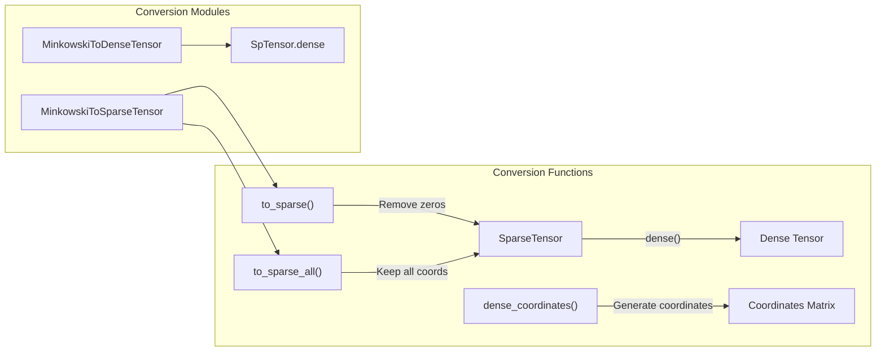
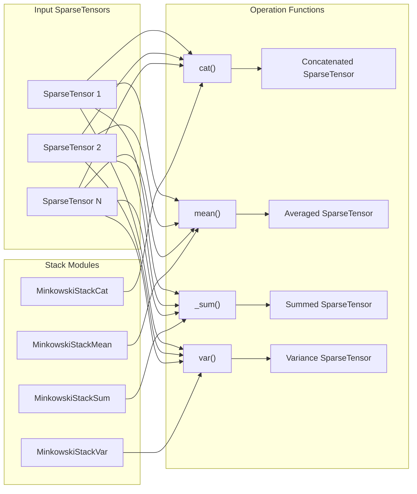
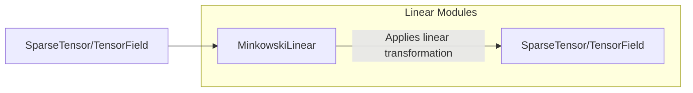
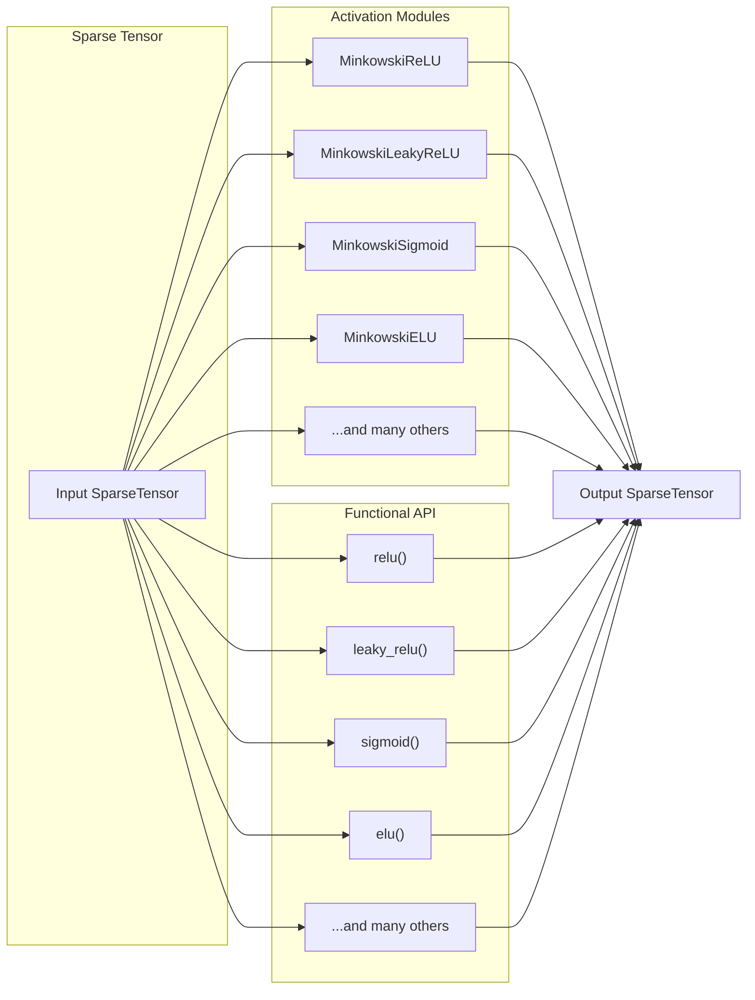
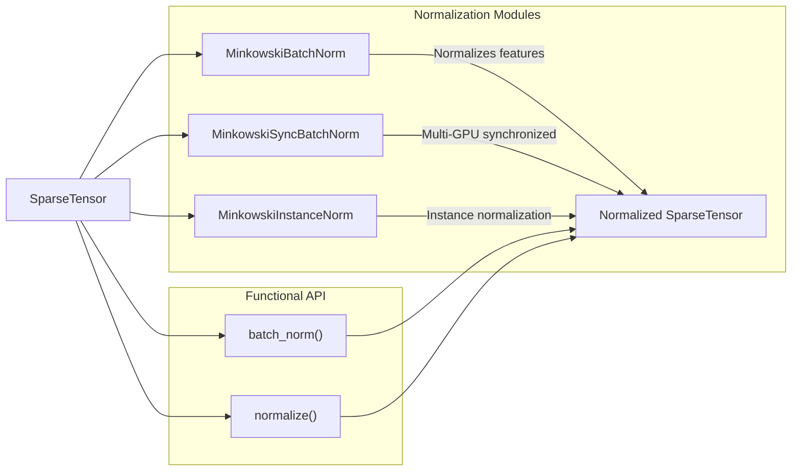
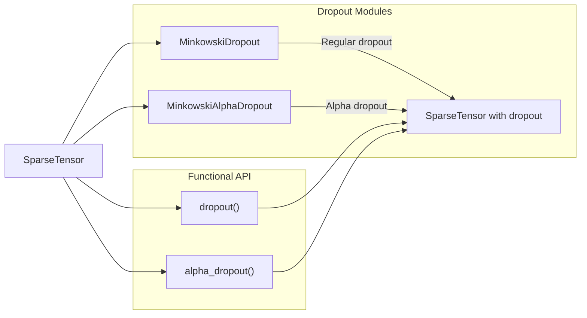
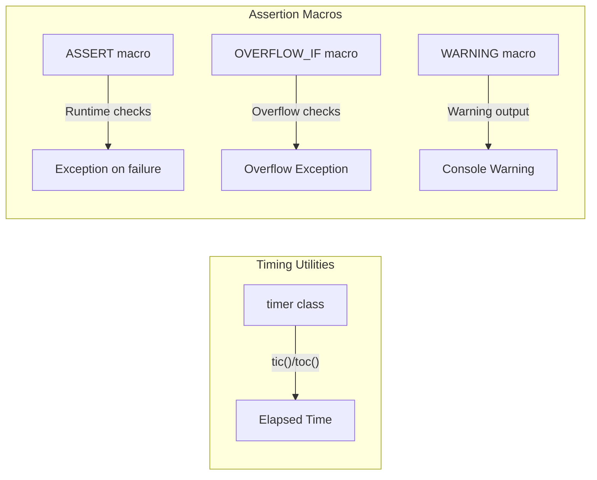
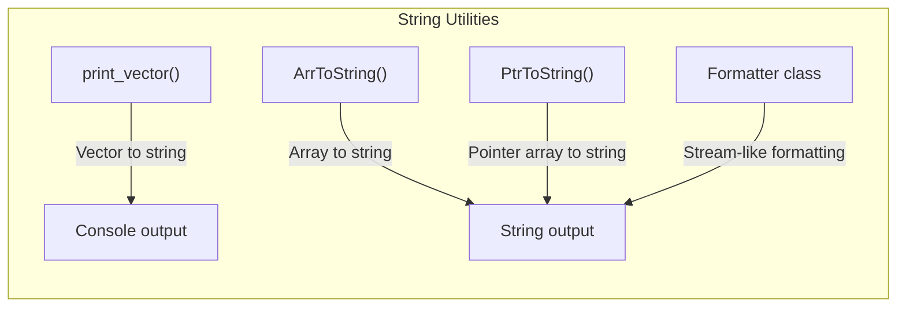
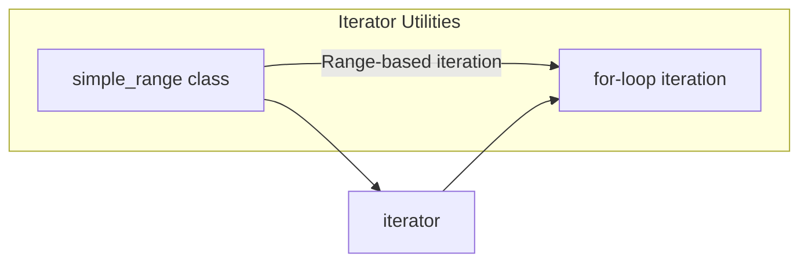

<!-- source: DeepWiki mcp.deepwiki.com · repo NVIDIA/MinkowskiEngine · page 5.3 Auxiliary Functions · fetched 2026-10-26 -->

# Auxiliary Functions

<details>
<summary>Relevant source files</summary>

The following files were used as context for generating this wiki page:

- [MinkowskiEngine/MinkowskiFunctional.py](MinkowskiEngine/MinkowskiFunctional.py)
- [MinkowskiEngine/MinkowskiNetwork.py](MinkowskiEngine/MinkowskiNetwork.py)
- [MinkowskiEngine/MinkowskiNonlinearity.py](MinkowskiEngine/MinkowskiNonlinearity.py)
- [MinkowskiEngine/MinkowskiNormalization.py](MinkowskiEngine/MinkowskiNormalization.py)
- [MinkowskiEngine/MinkowskiOps.py](MinkowskiEngine/MinkowskiOps.py)
- [src/utils.hpp](src/utils.hpp)
- [tests/cpp/coordinate_map_cpu_test.cpp](tests/cpp/coordinate_map_cpu_test.cpp)
- [tests/cpp/coordinate_map_cpu_test.py](tests/cpp/coordinate_map_cpu_test.py)
- [tests/cpp/coordinate_map_gpu_test.cu](tests/cpp/coordinate_map_gpu_test.cu)
- [tests/cpp/coordinate_map_gpu_test.py](tests/cpp/coordinate_map_gpu_test.py)
- [tests/cpp/setup.py](tests/cpp/setup.py)

</details>


This page documents the utility functions and helper modules provided by MinkowskiEngine that facilitate various common operations on sparse tensors. These functions complement the core sparse tensor operations by providing convenient methods for tensor manipulation, non-linear operations, and development utilities.

For sparse matrix operations, see [Sparse Matrix Operations](#5.2).

## 1. Tensor Manipulation Functions

MinkowskiEngine provides several utility functions for manipulating sparse tensors, including conversions between sparse and dense representations, and operations that combine multiple sparse tensors.

### 1.1 Sparse-Dense Conversions

These functions allow conversion between sparse tensors and regular PyTorch dense tensors.



#### `to_sparse`

Converts a dense batched tensor to a `SparseTensor`, keeping only the non-zero values:

```python
sparse_tensor = to_sparse(dense_tensor, format="BCX", device=None)
```

- `format`: String indicating tensor dimensions. Must include 'B' (batch) and 'C' (channel).
- `device`: Target device for the resulting sparse tensor.

#### `to_sparse_all`

Converts a dense tensor to a `SparseTensor`, keeping all coordinates regardless of value:

```python
sparse_tensor = to_sparse_all(dense_tensor, coordinates=None)
```

- `coordinates`: Optional pre-computed coordinates tensor.

#### `dense_coordinates`

Generates coordinates for a dense tensor in a format suitable for sparse tensor creation:

```python
coordinates = dense_coordinates(tensor.shape)
```

#### Conversion Modules

- `MinkowskiToSparseTensor`: Module wrapper for sparse tensor conversion
- `MinkowskiToDenseTensor`: Module that converts a sparse tensor to dense format
- `MinkowskiToFeature`: Module that extracts features from a sparse tensor

Sources: [MinkowskiEngine/MinkowskiOps.py:246-456]()

### 1.2 Sparse Tensor Operations

These functions perform operations on multiple sparse tensors with the same coordinates.



#### `cat`

Concatenates features from multiple sparse tensors:

```python
result = cat(tensor1, tensor2, tensor3)  # or cat([tensor1, tensor2, tensor3])
```

#### `mean`, `_sum`, `var`

Compute the mean, sum, or variance of features from multiple sparse tensors:

```python
mean_tensor = mean(tensor1, tensor2)
sum_tensor = _sum(tensor1, tensor2)
var_tensor = var(tensor1, tensor2) 
```

#### Stack Modules

- `MinkowskiStackCat`: Module that applies multiple operations and concatenates results
- `MinkowskiStackSum`: Module that applies multiple operations and sums results
- `MinkowskiStackMean`: Module that applies multiple operations and averages results
- `MinkowskiStackVar`: Module that applies multiple operations and computes variance

Sources: [MinkowskiEngine/MinkowskiOps.py:70-243](), [MinkowskiEngine/MinkowskiOps.py:480-497]()

### 1.3 Linear Operations



#### `MinkowskiLinear`

Applies a linear transformation to the features of a sparse tensor:

```python
layer = MinkowskiLinear(in_features, out_features, bias=True)
output = layer(input_tensor)
```

Similar to PyTorch's `nn.Linear` but designed to work with `SparseTensor` or `TensorField`.

Sources: [MinkowskiEngine/MinkowskiOps.py:40-67]()

## 2. Non-linear Operations

MinkowskiEngine provides a variety of non-linear operations adapted for sparse tensors, including activation functions, normalization, and dropout.

### 2.1 Activation Functions



MinkowskiEngine provides two ways to apply activation functions:

1. **Module-based approach**: Classes like `MinkowskiReLU`, `MinkowskiLeakyReLU`, etc.
2. **Functional approach**: Functions like `relu()`, `leaky_relu()`, etc.

#### Available Activation Functions

| Module Class | Functional API | Description |
|--------------|----------------|-------------|
| `MinkowskiReLU` | `relu()` | Rectified Linear Unit |
| `MinkowskiLeakyReLU` | `leaky_relu()` | Leaky ReLU |
| `MinkowskiELU` | `elu()` | Exponential Linear Unit |
| `MinkowskiSELU` | `selu()` | Scaled Exponential Linear Unit |
| `MinkowskiSigmoid` | `sigmoid()` | Sigmoid activation |
| `MinkowskiTanh` | `tanh()` | Hyperbolic tangent |
| `MinkowskiSoftmax` | `softmax()` | Softmax function |
| `MinkowskiLogSoftmax` | `log_softmax()` | Log softmax function |
| And many others | | |

Sources: [MinkowskiEngine/MinkowskiNonlinearity.py:34-200](), [MinkowskiEngine/MinkowskiFunctional.py:47-152]()

### 2.2 Normalization Layers



#### `MinkowskiBatchNorm`

Applies batch normalization to a sparse tensor:

```python
bn = MinkowskiBatchNorm(num_features, eps=1e-5, momentum=0.1)
output = bn(input_tensor)
```

#### `MinkowskiSyncBatchNorm`

Synchronized batch normalization for multi-GPU training:

```python
sync_bn = MinkowskiSyncBatchNorm(num_features, process_group=None)
output = sync_bn(input_tensor)
```

#### `MinkowskiInstanceNorm`

Applies instance normalization to a sparse tensor:

```python
in_norm = MinkowskiInstanceNorm(num_features)
output = in_norm(input_tensor)
```

Sources: [MinkowskiEngine/MinkowskiNormalization.py:51-399](), [MinkowskiEngine/MinkowskiFunctional.py:156-161]()

### 2.3 Dropout Layers



#### `MinkowskiDropout` and `dropout()`

Apply dropout to a sparse tensor:

```python
dropout_layer = MinkowskiDropout(p=0.5)
output = dropout_layer(input_tensor)

# Or using functional API
output = dropout(input_tensor, p=0.5)
```

#### `MinkowskiAlphaDropout` and `alpha_dropout()`

Apply alpha dropout to a sparse tensor (preserves mean and variance):

```python
alpha_dropout = MinkowskiAlphaDropout(p=0.5)
output = alpha_dropout(input_tensor)

# Or using functional API
output = alpha_dropout(input_tensor, p=0.5)
```

Sources: [MinkowskiEngine/MinkowskiNonlinearity.py:167-172](), [MinkowskiEngine/MinkowskiFunctional.py:170-175]()

### 2.4 Loss Functions

MinkowskiEngine's functional API provides loss functions that work directly with sparse tensors:

```python
# Cross-entropy loss
loss = cross_entropy(input_sparse_tensor, target_tensor)

# Mean squared error
loss = mse_loss(input_sparse_tensor, target_tensor)

# L1 loss
loss = l1_loss(input_sparse_tensor, target_tensor)
```

Other available loss functions include:
- `binary_cross_entropy`
- `binary_cross_entropy_with_logits`
- `nll_loss`
- `kl_div`
- `smooth_l1_loss`
- And others

Sources: [MinkowskiEngine/MinkowskiFunctional.py:179-232]()

## 3. Development Utilities

MinkowskiEngine includes several utilities that are helpful for development, testing, and debugging.

### 3.1 Timing and Assertion Utilities



#### `timer` Class

A simple timer class for benchmarking:

```cpp
timer t;
t.tic();  // Start timing
// ... operations to time
double elapsed = t.toc();  // Get elapsed time in seconds
```

#### Assertion Macros

- `ASSERT(condition, message, ...)`: Throws a `runtime_error` if the condition fails
- `OVERFLOW_IF(condition, message, ...)`: Throws an `overflow_error` if the condition is true
- `WARNING(condition, message, ...)`: Prints a warning to `std::cerr` if the condition is true

#### Debug Logging

- `LOG_DEBUG(...)`: Outputs debug information when compiled with DEBUG defined
- `LOG_WARN(...)`: Outputs warnings

Sources: [src/utils.hpp:40-199]()

### 3.2 String Formatting Utilities



#### `print_vector` Template Function

Outputs a vector to a stream in a readable format:

```cpp
std::vector<int> v = {1, 2, 3};
std::cout << v;  // Outputs [1, 2, 3]
```

#### `ArrToString` and `PtrToString`

Convert arrays and pointer arrays to string representation:

```cpp
std::vector<int> arr = {1, 2, 3};
std::string s = ArrToString(arr);  // "[1, 2, 3]"

int ptr_arr[3] = {1, 2, 3};
std::string s2 = PtrToString(ptr_arr, 3);  // "[1, 2, 3]"
```

#### `Formatter` Class

A stream-like string formatter with support for variadic arguments:

```cpp
Formatter fmt;
fmt << "Value: " << 42;
std::string s = fmt.str();  // "Value: 42"

// Or with variadic arguments
fmt.append("Values:", 1, 2, 3);  // "Values: 1 2 3"
```

Sources: [src/utils.hpp:53-128]()

### 3.3 C++ Iterator Utilities



#### `simple_range` Class

A simple range iterator to enable range-based for loops over integer ranges:

```cpp
// Iterate from 0 to 9
for (auto i : simple_range(10)) {
    // i takes values 0, 1, 2, ..., 9
}

// Iterate from 5 to 9
for (auto i : simple_range(5, 10)) {
    // i takes values 5, 6, 7, 8, 9
}
```

Sources: [src/utils.hpp:201-257]()

## Summary

MinkowskiEngine provides a rich set of auxiliary functions to support sparse tensor operations. These functions can be broadly categorized into:

1. **Tensor Manipulation**: Converting between sparse and dense formats, combining multiple sparse tensors
2. **Non-linear Operations**: Activation functions, normalization, dropout, and loss functions
3. **Development Utilities**: Timing, assertions, string formatting, and iteration helpers

These utilities make working with sparse tensors more convenient and follow similar patterns to PyTorch's standard functions, making the library more accessible to PyTorch users.

---

