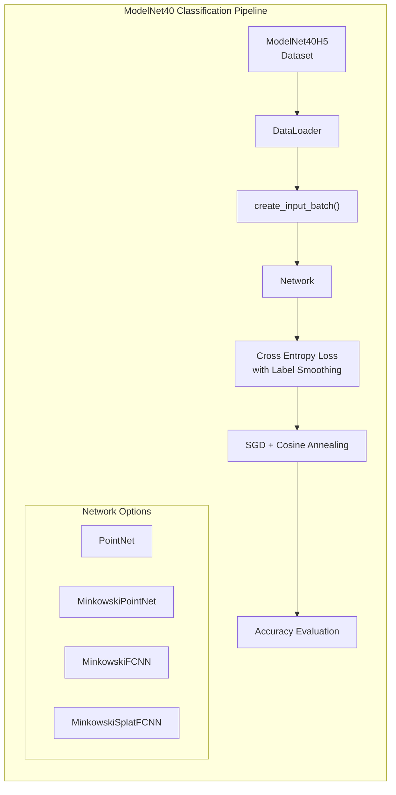
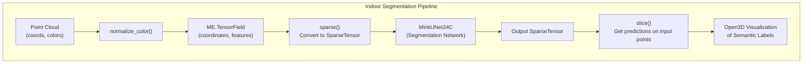
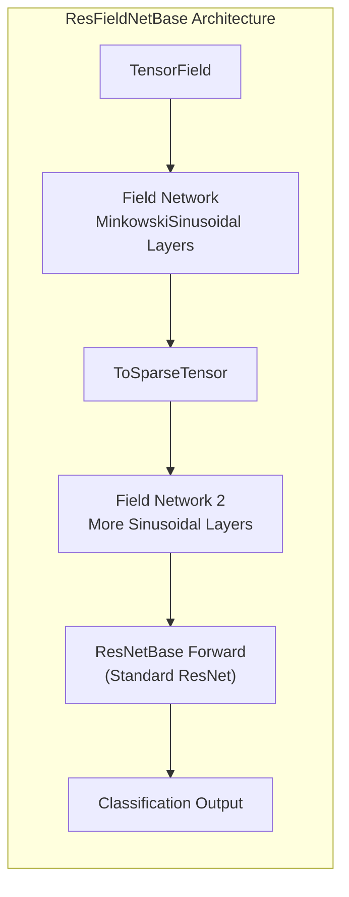
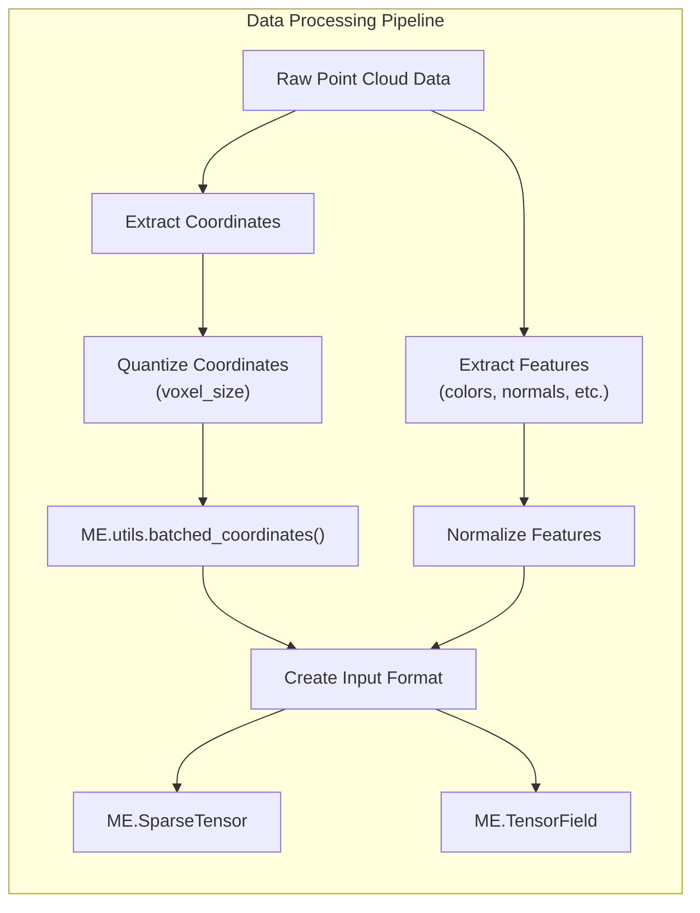

<!-- source: DeepWiki mcp.deepwiki.com · repo NVIDIA/MinkowskiEngine · page 6 Examples and Use Cases · fetched 2026-10-26 -->

# Examples and Use Cases

<details>
<summary>Relevant source files</summary>

The following files were used as context for generating this wiki page:

- [examples/README.md](examples/README.md)
- [examples/classification_modelnet40.py](examples/classification_modelnet40.py)
- [examples/common.py](examples/common.py)
- [examples/download_modelnet40.sh](examples/download_modelnet40.sh)
- [examples/indoor.py](examples/indoor.py)
- [examples/pointnet.py](examples/pointnet.py)
- [examples/resnet.py](examples/resnet.py)

</details>


This page provides an overview of example applications and network architectures implemented using MinkowskiEngine. It covers ready-to-use examples for common tasks such as 3D object classification and semantic segmentation, as well as guidelines for developing custom networks. For information about basic concepts and data structures, see [Basic Concepts](#1.2); for details about specific neural network operations, see [Neural Network Operations](#3).

## Classification Networks

MinkowskiEngine offers several implementations of standard classification networks adapted for sparse tensor operations. These examples demonstrate how to process 3D point clouds for object classification tasks.

### ResNet Architectures

The MinkowskiEngine implementation of ResNet adapts the standard 2D architecture for sparse 3D data. The examples include ResNet variants with different depths (ResNet14, ResNet18, ResNet34, ResNet50, ResNet101).

```mermaid
flowchart TD
    subgraph "ResNetBase Architecture"
        Input["SparseTensor<br>(coordinates, features)"] --> Conv1["Conv1 Layer<br>MinkowskiConvolution"]
        Conv1 --> Layer1["Layer 1<br>(BasicBlock/Bottleneck)"]
        Layer1 --> Layer2["Layer 2<br>(BasicBlock/Bottleneck)"]
        Layer2 --> Layer3["Layer 3<br>(BasicBlock/Bottleneck)"]
        Layer3 --> Layer4["Layer 4<br>(BasicBlock/Bottleneck)"]
        Layer4 --> Conv5["Conv5 Layer<br>MinkowskiDropout + Conv"]
        Conv5 --> GlobalPool["Global Max Pooling"]
        GlobalPool --> Final["MinkowskiLinear<br>Classification Output"]
    end
```



The implementation in `resnet.py` follows a modular structure with `ResNetBase` as the base class and specific variants inheriting from it:

- **ResNet14, ResNet18, ResNet34**: Use `BasicBlock` with different numbers of layers
- **ResNet50, ResNet101**: Use `Bottleneck` block with different numbers of layers

Each network can be initialized with a specified number of input channels, output channels (for classification), and dimensionality.

Usage example:

```python
# Create a ResNet14 model for 3D data with 3 input channels and 10 output classes
net = ResNet14(in_channels=3, out_channels=10, D=3)
```

Sources: [examples/resnet.py:52-182](), [examples/resnet.py:240-282]()

### PointNet Implementation

MinkowskiEngine includes both a standard PyTorch implementation of PointNet and a MinkowskiEngine-specific implementation that leverages sparse tensors.

```mermaid
flowchart TD
    subgraph "Standard PointNet"
        Input1["Input Tensor<br>(B×3×N)"] --> Conv1_1["Conv1D + BatchNorm + ReLU"]
        Conv1_1 --> Conv2_1["Conv1D + BatchNorm + ReLU"]
        Conv2_1 --> Conv3_1["Conv1D + BatchNorm + ReLU"]
        Conv3_1 --> Conv4_1["Conv1D + BatchNorm + ReLU"]
        Conv4_1 --> Conv5_1["Conv1D + BatchNorm + ReLU"]
        Conv5_1 --> MaxPool["Adaptive Max Pool"]
        MaxPool --> FC1_1["Linear + BatchNorm + ReLU"]
        FC1_1 --> Dropout1["Dropout"]
        Dropout1 --> FC2_1["Linear (Output)"]
    end

    subgraph "MinkowskiPointNet"
        Input2["TensorField"] --> MinkConv1["MinkowskiLinear + BatchNorm + ReLU"]
        MinkConv1 --> MinkConv2["MinkowskiLinear + BatchNorm + ReLU"]
        MinkConv2 --> MinkConv3["MinkowskiLinear + BatchNorm + ReLU"]
        MinkConv3 --> MinkConv4["MinkowskiLinear + BatchNorm + ReLU"]
        MinkConv4 --> MinkConv5["MinkowskiLinear + BatchNorm + ReLU"]
        MinkConv5 --> MinkPool["MinkowskiGlobalMaxPooling"]
        MinkPool --> MinkFC1["MinkowskiLinear + BatchNorm + ReLU"]
        MinkFC1 --> MinkDropout["MinkowskiDropout"]
        MinkDropout --> MinkFC2["MinkowskiLinear (Output)"]
    end
```



Key differences between the standard PointNet and MinkowskiPointNet implementation:

1. **Input format**: 
   - Standard PointNet: Fixed-size tensor (batch_size × channels × num_points)
   - MinkowskiPointNet: `TensorField` allowing variable number of points per example

2. **Operations**:
   - Standard PointNet: Uses PyTorch's Conv1D layers
   - MinkowskiPointNet: Uses MinkowskiEngine's sparse operations (`MinkowskiLinear`, etc.)

3. **Flexibility**:
   - MinkowskiPointNet allows arbitrary number of points per point cloud in a batch

Sources: [examples/pointnet.py:72-100](), [examples/pointnet.py:108-155](), [examples/pointnet.py:248-282]()

### ModelNet40 Classification Example

The repository includes a complete training and evaluation pipeline for 3D object classification on the ModelNet40 dataset, supporting multiple network architectures.



The `classification_modelnet40.py` example demonstrates:

1. **Data loading and preprocessing** with the ModelNet40 dataset
2. **Multiple network architectures**:
   - Standard PointNet
   - MinkowskiPointNet (sparse tensor version of PointNet)
   - MinkowskiFCNN (fully convolutional network with skip connections)
   - MinkowskiSplatFCNN (variant using splatting for sparse-to-dense conversion)
3. **Training pipeline** with cosine annealing learning rate scheduler
4. **Evaluation metrics** for model performance

Usage example:
```bash
# Train using MinkowskiFCNN architecture
python -m examples.classification_modelnet40 --network minkfcnn
```

Sources: [examples/classification_modelnet40.py:67-271](), [examples/classification_modelnet40.py:422-441](), [examples/README.md:4-15]()

## Segmentation Networks

MinkowskiEngine is particularly well-suited for semantic segmentation of 3D point clouds due to its efficient sparse tensor operations.

### MinkUNet for Indoor Scene Segmentation

The repository includes a complete example for semantic segmentation of indoor scenes using MinkUNet34C, a 3D U-Net architecture implemented with MinkowskiEngine.



The indoor segmentation example demonstrates:

1. **Loading and preprocessing** 3D point cloud data
2. **Creating a TensorField** from point coordinates and colors
3. **Converting to SparseTensor** for efficient network processing
4. **Applying MinkUNet34C** for semantic segmentation
5. **Extracting per-point predictions** using the `slice()` operation
6. **Visualization** of the segmentation results with Open3D

The segmentation network handles 20 semantic classes from the ScanNet dataset, including walls, floors, furniture, and other indoor objects.

Usage example:
```bash
# Run indoor segmentation on a demo point cloud
python -m examples.indoor
```

Sources: [examples/indoor.py:100-171](), [examples/README.md:16-20]()

## Custom Network Development

MinkowskiEngine provides flexible building blocks for creating custom network architectures for specialized tasks.

### ResFieldNet: Working with TensorFields

`ResFieldNet` is an extension of `ResNet` that works with `TensorField` inputs instead of `SparseTensor`. This demonstrates how to build networks that can directly process continuous coordinates.



The `ResFieldNet` example demonstrates:

1. Using `MinkowskiSinusoidal` layers to process continuous coordinates
2. Converting between `TensorField` and `SparseTensor` formats
3. Extending existing architectures to work with different input types

Sources: [examples/resnet.py:184-237]()

### MinkowskiFCNN: Advanced Feature Aggregation

`MinkowskiFCNN` implements a fully convolutional neural network with skip connections and pooling for hierarchical feature extraction.

```mermaid
flowchart TD
    subgraph "MinkowskiFCNN Architecture"
        Input["TensorField"] --> MLP["Initial MLP"]
        MLP --> SparseTensor["sparse()<br>Convert to SparseTensor"]
        
        SparseTensor --> Conv1["Conv Block 1"]
        Conv1 --> Pool1["MaxPooling 1"] 
        Pool1 --> Conv2["Conv Block 2"]
        Conv2 --> Pool2["MaxPooling 2"]
        Pool2 --> Conv3["Conv Block 3"]
        Conv3 --> Pool3["MaxPooling 3"]
        Pool3 --> Conv4["Conv Block 4"]
        Conv4 --> Pool4["MaxPooling 4"]
        
        Pool1 --> Slice1["slice() to TensorField"]
        Pool2 --> Slice2["slice() to TensorField"]
        Pool3 --> Slice3["slice() to TensorField"]
        Pool4 --> Slice4["slice() to TensorField"]
        
        Slice1 --> Concat["cat() Concatenate Features"]
        Slice2 --> Concat
        Slice3 --> Concat
        Slice4 --> Concat
        
        Concat --> FinalConv["Final Conv Blocks"]
        FinalConv --> GlobalPooling["Global Max+Avg Pooling"]
        GlobalPooling --> MLP_Final["Final MLP Layers"]
        MLP_Final --> Output["Classification Output"]
    end
```



The `MinkowskiFCNN` architecture showcases:

1. **Multi-scale feature extraction** with hierarchical convolutions
2. **Feature slicing and concatenation** to preserve spatial information
3. **Dual global pooling** (max and average) for better feature aggregation
4. **Skip connections** for gradient flow and feature reuse

Sources: [examples/classification_modelnet40.py:68-216]()

## Common Patterns and Best Practices

From the example implementations, we can identify several common patterns and best practices for using MinkowskiEngine:

### Data Loading and Preprocessing



Key patterns for data preparation:

1. **Coordinate quantization**: Divide coordinates by voxel size to create discrete voxel positions
2. **Batched coordinates**: Use `ME.utils.batched_coordinates()` to combine multiple point clouds
3. **Feature normalization**: Normalize features like colors to the range [-0.5, 0.5]
4. **Input format selection**: Choose between `SparseTensor` (discrete voxels) and `TensorField` (continuous coordinates)

Sources: [examples/resnet.py:46-50](), [examples/indoor.py:103-152](), [examples/classification_modelnet40.py:282-291]()

### Network Building Blocks

Common building blocks used across the example networks:

| Building Block | Description | Example Usage |
|----------------|-------------|---------------|
| `ME.MinkowskiConvolution` | Sparse convolution operation | Base convolution in all networks |
| `ME.MinkowskiLinear` | Linear layer for sparse tensors | Feature transformation, final classification |
| `ME.MinkowskiPooling` | Various pooling operations | Feature downsampling |
| `ME.MinkowskiGlobalPooling` | Global feature aggregation | Creating global descriptors |
| `ME.MinkowskiBatchNorm` | Batch normalization | Normalizing features after convolutions |
| `ME.MinkowskiReLU` | Activation function | Non-linearity after convolutions |
| `ME.MinkowskiDropout` | Regularization | Preventing overfitting |

Sources: [examples/resnet.py:69-103](), [examples/pointnet.py:111-144](), [examples/classification_modelnet40.py:89-107]()

### TensorField Operations

When working with continuous coordinates via `TensorField`:

1. **Creation**: Create a `TensorField` from coordinates and features
2. **Conversion**: Convert to `SparseTensor` using `sparse()` for discrete operations
3. **Interpolation**: Use `slice()` to get predictions back at original coordinates
4. **Quantization mode**: Specify how features are aggregated when multiple points map to same voxel

Sources: [examples/indoor.py:140-152](), [examples/classification_modelnet40.py:282-291]()

---

