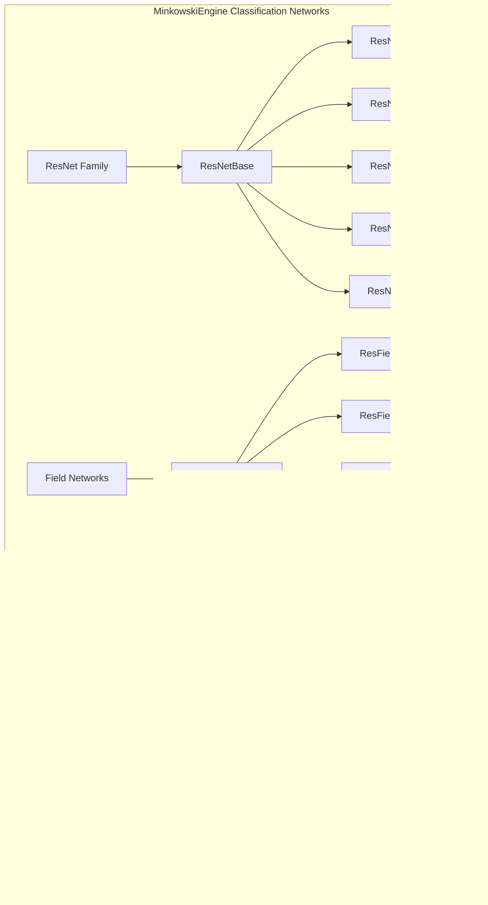
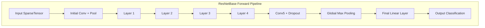
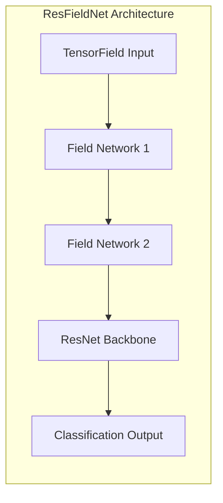
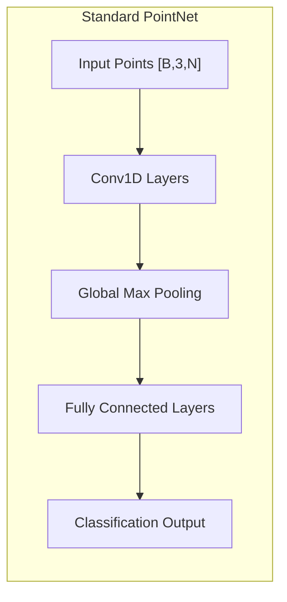
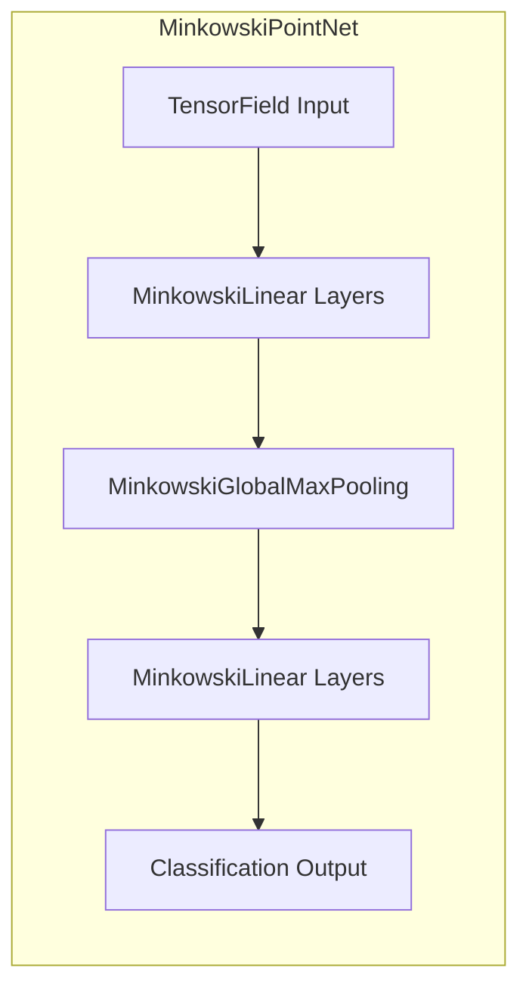
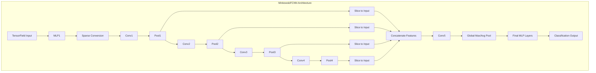
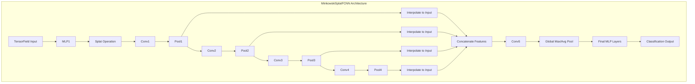
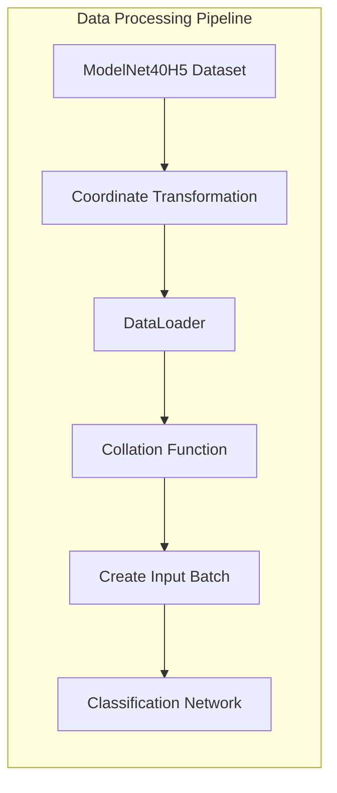
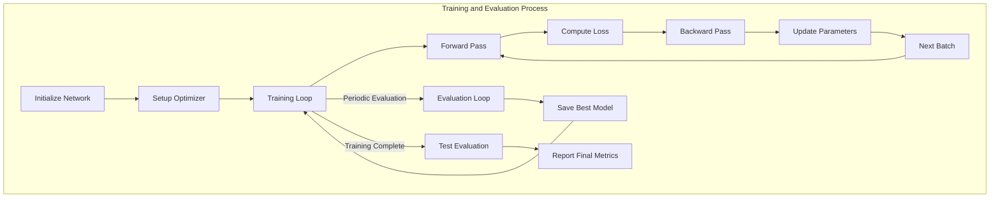

<!-- source: DeepWiki mcp.deepwiki.com · repo NVIDIA/MinkowskiEngine · page 6.1 Classification Networks · fetched 2026-10-26 -->

# Classification Networks

<details>
<summary>Relevant source files</summary>

The following files were used as context for generating this wiki page:

- [examples/README.md](examples/README.md)
- [examples/classification_modelnet40.py](examples/classification_modelnet40.py)
- [examples/common.py](examples/common.py)
- [examples/download_modelnet40.sh](examples/download_modelnet40.sh)
- [examples/indoor.py](examples/indoor.py)
- [examples/pointnet.py](examples/pointnet.py)
- [examples/resnet.py](examples/resnet.py)

</details>


## Purpose and Scope

This page documents the classification network architectures available in MinkowskiEngine for 3D point cloud classification tasks. MinkowskiEngine provides implementations of popular networks such as ResNet and PointNet adapted for sparse 3D data, as well as custom architectures designed specifically for sparse tensor operations. For segmentation network architectures, see [Segmentation Networks](#6.2).

## Overview of Classification Networks

MinkowskiEngine provides several classification network architectures, each designed to process sparse 3D data efficiently. These networks leverage the sparse tensor operations provided by MinkowskiEngine to handle the unique characteristics of point cloud data.



Sources: [examples/resnet.py](), [examples/pointnet.py](), [examples/classification_modelnet40.py]()

## ResNet Classification Networks

The ResNet classification networks in MinkowskiEngine are adaptations of the standard ResNet architecture for sparse 3D data. These networks use sparse convolutions and residual connections to process point cloud data efficiently.

### ResNetBase Architecture

`ResNetBase` is the foundation class for all ResNet variants in MinkowskiEngine. It implements the common structure shared by all ResNet models, with specific variants differing in the number and type of blocks.



Sources: [examples/resnet.py:53-156]()

The `ResNetBase` class implements:

1. Network initialization with configurable dimensions (2D, 3D, 4D)
2. Initial convolution and pooling layers
3. Four ResNet layers with configurable blocks and strides
4. A final convolution with dropout
5. Global pooling
6. Classification head

Key components of the implementation include:

- **Block Types**: `BasicBlock` or `Bottleneck` (imported from MinkowskiEngine.modules.resnet_block)
- **Layers Configuration**: Different ResNet variants use different layer configurations
- **Dimensions**: Supports any number of dimensions (typically 3D for point clouds)

### ResNet Variants

MinkowskiEngine provides several ResNet variants with different depths:

| Variant | Block Type | Layer Configuration | Parameters |
|---------|------------|---------------------|------------|
| ResNet14 | BasicBlock | [1, 1, 1, 1] | Lightest variant |
| ResNet18 | BasicBlock | [2, 2, 2, 2] | Standard lightweight model |
| ResNet34 | BasicBlock | [3, 4, 6, 3] | Medium depth model |
| ResNet50 | Bottleneck | [3, 4, 6, 3] | Deep model with bottleneck blocks |
| ResNet101 | Bottleneck | [3, 4, 23, 3] | Very deep model |

Sources: [examples/resnet.py:159-181]()

### ResFieldNet Variants

MinkowskiEngine also provides `ResFieldNet` variants which extend `ResNetBase` to work with `TensorField` inputs instead of `SparseTensor`. These networks add field processing networks before the standard ResNet backbone.



Sources: [examples/resnet.py:184-237]()

The `ResFieldNetBase` class:
- Adds two field processing networks using `MinkowskiSinusoidal` layers
- Converts the field features to a `SparseTensor`
- Passes the processed features to the standard ResNet backbone

## PointNet Classification Networks

MinkowskiEngine provides two implementations of PointNet:

1. A standard PointNet implementation using PyTorch operations
2. A MinkowskiEngine-specific implementation using sparse tensor operations

### Standard PointNet

The standard PointNet implementation follows the original architecture but uses PyTorch operations. It processes point clouds as dense tensors.



Sources: [examples/pointnet.py:72-100]()

The standard `PointNet` class:
- Uses 1D convolutions to process point features
- Applies batch normalization and ReLU activations
- Uses global max pooling to aggregate features
- Applies fully connected layers for classification

### MinkowskiPointNet

`MinkowskiPointNet` is an adaptation of PointNet using MinkowskiEngine operations. It processes point clouds as sparse tensors, allowing for more efficient computation and handling of varying point cloud densities.



Sources: [examples/pointnet.py:108-155]()

The `MinkowskiPointNet` class:
- Inherits from `ME.MinkowskiNetwork`
- Uses `MinkowskiLinear` layers instead of 1D convolutions
- Applies `MinkowskiBatchNorm` and `MinkowskiReLU`
- Uses `MinkowskiGlobalMaxPooling` for feature aggregation
- Can handle varying numbers of points per batch item

The key advantage of `MinkowskiPointNet` over the standard `PointNet` is the ability to handle varying point densities within a batch, as noted in the comment: "Unlike pointnet, number of points for each point cloud do not need to be the same."

## Additional Classification Networks

MinkowskiEngine provides additional classification network architectures designed specifically for sparse tensor operations.

### MinkowskiFCNN

`MinkowskiFCNN` is a fully convolutional neural network designed for efficient processing of sparse data. It combines convolutional layers with global pooling operations.



Sources: [examples/classification_modelnet40.py:68-216]()

Key features of `MinkowskiFCNN`:
- Uses a combination of MLP and convolutional blocks
- Extracts multi-scale features through pooling and slicing
- Combines features from different scales
- Uses both global max and average pooling
- Includes dropout for regularization

### MinkowskiSplatFCNN

`MinkowskiSplatFCNN` is a variant of `MinkowskiFCNN` that uses the splatting operation instead of slicing for propagating features across scales.



Sources: [examples/classification_modelnet40.py:231-271]()

The main difference between `MinkowskiSplatFCNN` and `MinkowskiFCNN` is:
- `MinkowskiFCNN` uses `.sparse()` and `.slice()` operations
- `MinkowskiSplatFCNN` uses `.splat()` and `.interpolate()` operations

## Working with Classification Networks

### Data Preparation

MinkowskiEngine provides utilities for preparing point cloud data for classification tasks:

1. **Data Loading**: The `ModelNet40H5` dataset class loads point clouds from HDF5 files.
2. **Coordinate Transformation**: The `CoordinateTransformation` class applies random transformations (scaling, translation, jittering) for data augmentation.
3. **Collation Functions**: `minkowski_collate_fn` and `stack_collate_fn` prepare batches for MinkowskiEngine and standard networks respectively.



Sources: [examples/pointnet.py:197-247](), [examples/classification_modelnet40.py:282-320]()

### Training and Evaluation

The training and evaluation process for classification networks follows these steps:

1. **Network Initialization**: Create and initialize the network with appropriate parameters.
2. **Optimizer Setup**: Configure an optimizer (typically SGD) and learning rate scheduler.
3. **Training Loop**: Iterate through batches, compute loss, and update network parameters.
4. **Evaluation**: Periodically evaluate the network on validation data.
5. **Testing**: Evaluate the final network on test data.



Sources: [examples/classification_modelnet40.py:323-441]()

### Example Usage

Here's an example of how to use a ResNet classification network:

1. **Initialize the Network**:
   ```python
   # Create a ResNet14 model for 3D data with 3 input channels and 10 output classes
   net = ResNet14(in_channels=3, out_channels=10, D=3)
   ```

2. **Create Input Data**:
   ```python
   # Create a sparse tensor from coordinates and features
   input = ME.SparseTensor(features, coordinates, device=device)
   ```

3. **Forward Pass**:
   ```python
   # Perform forward pass
   output = net(input)
   ```

4. **Compute Loss and Backpropagate**:
   ```python
   # Compute loss
   loss = criterion(output.F, labels)
   # Backpropagate
   loss.backward()
   optimizer.step()
   ```

Sources: [examples/resnet.py:240-282]()

## Benchmark Results

The classification networks in MinkowskiEngine are evaluated on the ModelNet40 dataset, a standard benchmark for 3D point cloud classification.

| Network | Accuracy | Training Time | Notes |
|---------|----------|---------------|-------|
| PointNet | ~89% | Baseline | Requires fixed point cloud size |
| MinkowskiPointNet | ~89% | Similar to PointNet | Supports variable point cloud size |
| MinkowskiFCNN | ~92% | Longer than PointNet | Better performance |
| MinkowskiSplatFCNN | ~92% | Similar to MinkowskiFCNN | Alternative feature propagation |

Sources: [examples/README.md:1-21]()

## Summary

MinkowskiEngine provides a variety of classification network architectures for processing 3D point cloud data. These networks leverage sparse tensor operations to efficiently handle the sparse nature of point cloud data. The key advantages of these networks include:

1. **Efficiency**: Sparse tensor operations reduce memory usage and computational requirements.
2. **Flexibility**: Support for varying point cloud densities and dimensions.
3. **Performance**: Competitive accuracy on standard benchmarks.

By using these classification networks, you can build applications that efficiently analyze and classify 3D point cloud data.

---

